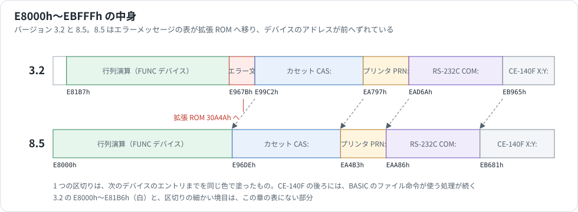
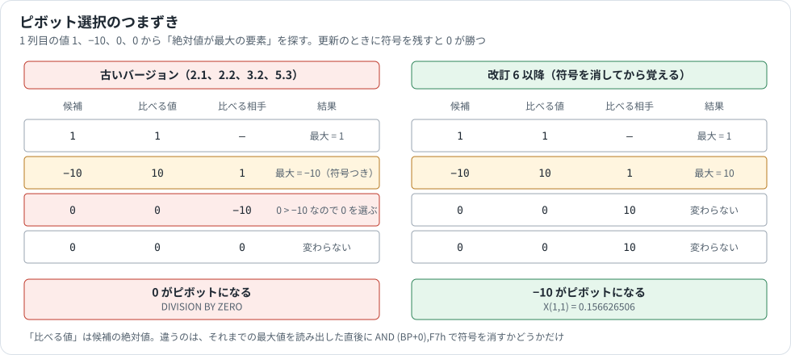
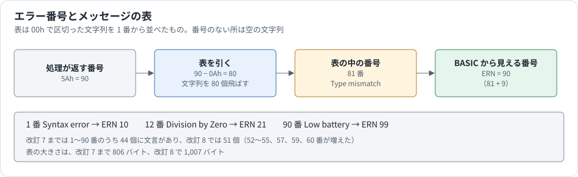
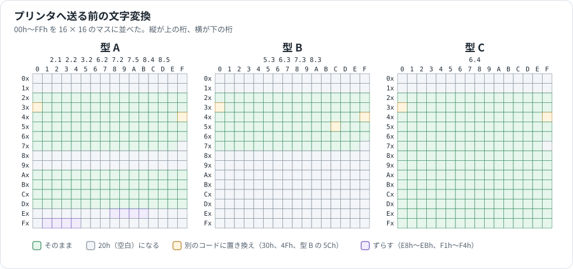
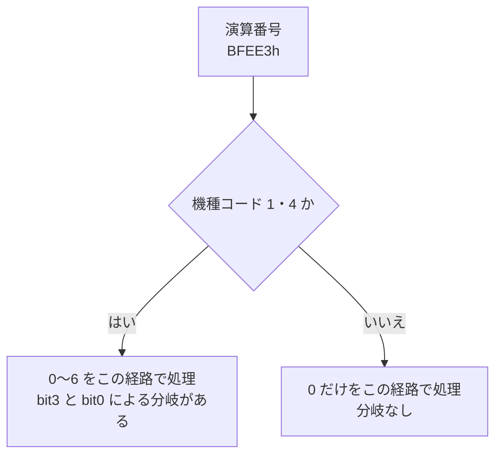

# 25. ROM バージョンの違い: 行列演算とドライバ

この章は、プリンタ、カセット、シリアル、フロッピーといった周辺機器を動かす処理と、行列計算、エラーメッセージの、バージョンによる違いをまとめたものです。「プリンタに出る文字が違う」「逆行列だけ計算できない」といった現象の理由がここにあります。

手元の ROM イメージ 13 本（`Emulator/app/rom/`）の E8000h〜EBFFFh 帯を比べました。この帯は BASIC 命令の処理からは直接たどれない処理（FUNC デバイスの行列演算）と、カセット・プリンタ・RS-232C・CE-140F のデバイスドライバ、BASIC のエラーメッセージ表からなります。

[目次へ戻る](README.md)

## この章で分かること

- E8000h〜EBFFFh に何が入っているか
- 古いバージョンの逆行列が `DIVISION BY ZERO` になる仕組みと、その確かめ方
- エラーメッセージの全一覧と、改訂 8 で増えたもの
- プリンタへ送る文字の変換の 3 つの型
- 機種コード 1・4 だけが持つ行列演算と、PC-1480U だけの違い

## 25.0 はじめに

デバイスドライバは、機器ごとの「話し方の違い」を引き受ける処理です。BASIC の `LPRINT` はプリンタの細かな手順を知らず、ドライバが文字コードを直したり、信号を送ったりします。

この帯の特徴は、**改訂による違いよりも、機種による違いのほうが多い**ことです。改訂 2〜7 では、行列演算の 1 か所のほかは機能が変わっていません。

| 見つかった違い | 原因 | 節 |
|---|---|---|
| 逆行列の計算の修正 | 改訂 5 → 6 | §25.2.1 |
| エラーメッセージの移動と追加 | 改訂 7 → 8 | §25.2.2 |
| プリンタの文字変換 | 機種（言語） | §25.3.1 |
| 行列演算の追加機能 | 機種コード 1・4 | §25.3.2 |
| RS-232C、カセット、ファイル入出力 | 機種コード 1 と他機種 | §25.3.3、§25.3.4 |

バージョン番号の読み方（上位桁＝改訂、下位桁＝機種コード）と ROM の一覧は [ROM バージョンの違い: BASIC](24_ROM_VERSIONS_BASIC.md) §24.1、バージョンの系統図は [ROM バージョンの違い: 配置](23_ROM_VERSIONS_MAP.md) §23.13 を参照してください。実験、コード、推定の意味は、章の終わりの「確度の表し方」にあります。

## 25.1 帯の中身

アドレスは 3.2 と 8.5 のものです。デバイスのエントリは IOCS ヘッダ（[IOCS と FCS](11_IOCS.md)）から引きました。



| 内容 | 3.2 | 8.5 | 備考 |
|---|---|---|---|
| FUNC デバイス（device 9）の行列演算 | `E81B7h`〜`E967Ah` | `E81F3h`〜`E96BCh` | `[BFEE3h]` の演算番号で処理を選ぶ。FUNC デバイスのエントリ自体は `EF2FDh`（3.2）。メインメニューの MATRIX モードの計算と見られる（推定） |
| BASIC のエラーメッセージ表 | `E967Bh`〜`E99A0h`（806 バイト） | 拡張 ROM `30A4Ah`〜`30E38h`（1,007 バイト） | §25.2.2 |
| カセット（CAS:、device 4） | `E99C2h`（処理は `E99A1h` から） | `E96DEh`（`E96BDh` から） | |
| プリンタ（STDL:PRN:、device 3） | `EA797h` | `EA4B3h` | 文字変換 `EA9C3h`（3.2） |
| RS-232C（COM:、device 2） | `EAD6Ah` | `EAA86h` | |
| CE-140F（X:Y:、device 7） | `EB965h` | `EB681h` | 後ろに BASIC のファイル命令が使う処理が続く |

行列演算、エラーメッセージの表、カセットの処理は、3.2 では隙間なく続いています。8.5 では、エラーメッセージの表が拡張 ROM へ移り、カセットより後ろのエントリが前にずれています。ずれの大きさは 3.2 と 8.5 のアドレスの差で、カセット、プリンタ、RS-232C、CE-140F のどれも 2E4h バイトです（`E99C2h` − `E96DEh` = `EB965h` − `EB681h` = 2E4h）。

## 25.2 改訂ごとの変更

改訂 2→3、3→5、6→7 では、この帯に機能の変更はありません（コードのずれに伴う表の再配置だけ）。

### 25.2.1 改訂 5 → 6：行列演算のピボット選択

連立方程式や逆行列を解く**ガウス消去**では、各列から 1 つの要素（**ピボット**）を選び、その行でほかの行を消していきます。ピボットが 0 だと割り算ができないので、その列で絶対値がいちばん大きい要素を選びます。これを部分ピボット選択といいます。

**何が起きていたか。** 古いバージョンは候補の要素を絶対値にして比べていましたが、最大値を更新するときは要素を符号付きのまま保存していました。いったん負の要素が最大値になると、次の比較では負の数と比べることになり、絶対値の小さい要素（0 も含む）が「大きい」と判定されてしまいます。0 が選ばれると、逆行列を持つ行列でも 0 で割ってしまいます。



**何が変わったか。** それまでの最大値を読み出した直後に符号を消す 1 命令が加わりました。

| アドレス | 変更 | 確度 |
|---|---|---|
| 6.2 `E88A5h`、6.3・7.3 `E88AFh`、8.3 `E88EBh` | 行列演算の最大要素の探索（行・列の添字 `($BA)`〜`($BF)` で回るループ。ガウス消去の部分ピボット選択と見られる）で、それまでの最大値を読み出した直後（6.2 では `E88A2h` の `CALL E952Bh` の後）に符号を消す `AND (BP+0),F7h` を追加した（同じ命令が 2 つ続いている）。古いバージョンは候補の要素は絶対値にして比べるが、最大値を更新するときは要素を符号付きのまま保存し（3.2 `E88BCh`〜`E88C5h`）、次の比較でもそのまま使っていた | 実験 |

改訂 6 以降の全機種（6.2・6.3・6.4・7.x・8.x）に入っています。

**確かめ方。** この処理は 4 行以上の行列だけが通ります（`E85B9h` で行数 `($BE)` が 1〜3 なら専用の処理へ分かれ、それ以外が `E8842h` の一般の消去法へ進みます）。MATRIX モードで次の 4×4 行列を X に入れ、CALC の `X⁻¹` を実行します。

```text
 1   2   3   4
-10  5   6   7
 0   8   9   1
 0   2   7   3
```

計算を手で追うと、つまずきの様子がよく分かります。1 列目だけを見て、最大の要素を探す手順です。

| 行 | 要素 | 古いバージョンが比べる相手 | 古いバージョンの判定 | 新しいバージョンが比べる相手 | 新しいバージョンの判定 |
|---|---|---|---|---|---|
| 1 | 1 | （最初） | 最大は 1 | （最初） | 最大は 1 |
| 2 | −10 | 1 | 10 > 1 なので最大は −10（符号つきで保存） | 1 | 最大は −10 |
| 3 | 0 | −10 | 0 > −10 なので最大は 0 | 10（符号を消した） | 0 < 10 で変わらない |
| 4 | 0 | 0 | 変わらない | 10 | 変わらない |
| 結果 | | | ピボットは 0 → `DIVISION BY ZERO` | | ピボットは −10 |

操作は次のとおりです。

1. メインメニューで MATRIX を選ぶ。
2. `X-DIM` で 4、4 を入れる。
3. 要素を行の順に入れる（負の数は数字の後に `+/-`）。
4. `CALC` → `X⁻¹` を選ぶ。

| バージョン | 結果 |
|---|---|
| 2.1・2.2・3.2・5.3 | `DIVISION BY ZERO` |
| 6.3・7.3・6.2・7.2・7.5・6.4・8.3・8.4・8.5 | 逆行列を返す（X(1,1)=0.156626506、正しい値 0.1566265060…） |

行列式は 1494 で、`detX` はどのバージョンも正しく 1494 を返します（行列式は別の処理）。1 列目が 1 → −10（最大値が負になる）→ 0（0 が「大きい」と判定される）の順に並ぶのが条件です。3×3 の行列（`1 2 3 / -10 5 6 / 0 8 9`）や、1 列目に 0 を含まない 4×4 では古いバージョンも正しく計算しました。

> [!TIP]
> 古いバージョンで 4 行以上の逆行列がこの形のエラーになったら、まず `detX` を計算してください。0 でなければ逆行列は存在します。

### 25.2.2 改訂 7 → 8：エラーメッセージ表の移動と追加

エラーメッセージ表は `\0` 区切りの文字列を 1 番から順に並べたもので、番号のない位置は空文字列になっています。番号だけで引けるように、使わない番号にも場所が空けてあるわけです。

```text
1 番               2 番                     3 番
Syntax error \0    Direct command error \0  Mode error \0   …
…  5 番                    6〜10 番（空）    11 番
…  Program not exist \0    \0 \0 \0 \0 \0    Overflow \0   …
```

改訂 7 まで（2.1〜7.5、1490UII の 6.4 を含む）の 10 本は、番号・文言とも完全に一致します（44 種、1〜90 番）。表の置き場所だけがバージョンで違います。

| バージョン | 表のアドレス | バージョン | 表のアドレス |
|---|---|---|---|
| 2.1 | `E9F67h` | 6.3、7.3 | `E968Bh` |
| 2.2 | `E9778h` | 6.4 | `E9DDEh` |
| 3.2 | `E967Bh` | 6.2、7.2、7.5 | `E9681h` |
| 5.3 | `E9685h` | 8.3、8.4、8.5 | 拡張 ROM `30A4Ah` |

BASIC の `ERN` の値は、この表の番号に 9 を足したものです（実験）。たとえば `Division by Zero` は 12 番で、`ERN` は 21 です。ROM の中で処理が返す番号も同じ値で、表を引く処理が 0Ah を引いて文字列を数えます（コード、3.2 の `EF03Fh` は `MV A,5Ah` で 81 番の `Type mismatch` を返す）。



改訂 8（8.3、8.4、8.5）では表が拡張 ROM の `30A4Ah` に移り、構造化構文（[ROM バージョンの違い: BASIC](24_ROM_VERSIONS_BASIC.md) §24.3.5）用に次の変更があります。3 本とも同じアドレスで、同じ内容です。

| 番号 | 改訂 7 まで | 改訂 8 |
|---|---|---|
| 41 | GOSUB or FOR nesting exceeded | GOSUB,FOR,REPEAT,WHILE or SWITCH nesting exceeded |
| 52 | （なし） | Block IF without ENDIF |
| 53 | （なし） | UNTIL without REPEAT |
| 54 | （なし） | WHILE without WEND |
| 55 | （なし） | WEND without WHILE |
| 57 | （なし） | Illegal CASE or DEFAULT |
| 59 | （なし） | SWITCH,CASE or DEFAULT without ENDSWITCH |
| 60 | （なし） | CASE,DEFAULT or ENDSWITCH without SWITCH |

確度: コード（文字列データの比較）。

番号には、まとまりがあります。表の文言から、おおよそ次のように分かれます。

| 番号 | 内容 |
|---|---|
| 1〜5 | 文法、モード、プログラムの有無 |
| 11〜13 | 計算 |
| 21〜24 | 配列、データの範囲 |
| 31〜35 | 行番号 |
| 41〜48 | 制御構文（GOSUB、FOR、RESUME）、データの終わり、文字列、バッファ |
| 51〜62 | メモリ、書式。改訂 8 では構造化構文（52〜60） |
| 63〜78 | 入出力、ファイル、プリンタ |
| 81〜90 | 型、パスワード、ファイル名、電池 |

改訂 7 までの 44 種（番号: 文言）:

| 番号 | 文言 | 番号 | 文言 |
|---|---|---|---|
| 1 | Syntax error | 45 | Buffer space exceeded |
| 2 | Direct command error | 46 | String too long |
| 3 | Mode error | 47 | Line buffer overflow |
| 4 | Can't continue | 48 | RESUME without error |
| 5 | Program not exist | 51 | Out of memory |
| 11 | Overflow | 61 | Can't print in specified format |
| 12 | Division by Zero | 62 | USING format error |
| 13 | Illegal function call | 63 | I/O error |
| 21 | Duplicate Definition | 64 | Too many files open |
| 22 | Array specified without DIM | 65 | NAME error |
| 23 | Subscript out of range | 66 | Bad drive name |
| 24 | Data out of range | 67 | File write protected |
| 31 | Undefined line | 68 | Disk full |
| 32 | Illegal line number | 71 | Tape read error |
| 35 | Bad line number | 73 | Verify error |
| 41 | GOSUB or FOR nesting exceeded | 75 | Printer error |
| 42 | RETURN without GOSUB | 76 | File not open |
| 43 | NEXT without FOR | 77 | File already open |
| 44 | Out of data | 78 | Input past end |
| 81 | Type mismatch | 85 | File not found |
| 83 | Password mismatch | 86 | Bad file name |
| 84 | Invisible program | 90 | Low battery |

## 25.3 機種による違い

### 25.3.1 プリンタの文字変換（PRN: の 1 文字出力）

本体の文字コードとプリンタ CE-126P の文字コードは、同じではありません。そこで、送る前に 1 文字ずつ変換します。CE-126P へ送る前に文字コードを変換する処理は 3 種類あります。変換処理のアドレスは 3.2 で `EA9C3h`（他のバージョンは下表）です。

| 型 | バージョン | 変換処理 |
|---|---|---|
| A | 2.1、2.2、3.2、6.2、7.2、7.5、8.4、8.5 | 2.1 `EB26Dh`、2.2 `EAAC0h`、3.2 `EA9C3h`、6.2・7.x `EA9C9h`、8.4 `EAE00h`、8.5 `EA6DFh` |
| B | 5.3、6.3、7.3、8.3 | 5.3 `EA9CDh`、6.3・7.3 `EA9D3h`、8.3 `EA6E9h` |
| C | 6.4 | `EB126h` |



| 入力 | 型 A | 型 B | 型 C |
|---|---|---|---|
| 00h〜1Fh、7Fh | 20h（空白） | 20h | 20h |
| `0`（30h） | F0h | F0h | F0h |
| `O`（4Fh） | 30h | 30h | 30h |
| `\`（5Ch） | そのまま | 0Bh | そのまま |
| その他の 20h〜7Eh | そのまま | そのまま | そのまま |
| 80h〜9Fh | 20h | 20h | そのまま |
| A0h〜DFh（カナ） | そのまま | 20h | そのまま |
| E0h〜E7h | 20h | 20h | そのまま |
| E8h〜EBh | +0Dh（F5h〜F8h） | 20h | そのまま |
| ECh〜F0h | 20h | 20h | そのまま |
| F1h | F4h | 20h | そのまま |
| F2h〜F4h | −1（F1h〜F3h） | 20h | そのまま |
| F5h〜FFh | 20h | 20h | そのまま |

**例: `LPRINT "A0\"` のとき**

| 文字 | コード | 型 A | 型 B | 型 C |
|---|---|---|---|---|
| `A` | 41h | 41h | 41h | 41h |
| `0` | 30h | F0h | F0h | F0h |
| `\`（国内版の画面では `¥`） | 5Ch | 5Ch | 0Bh | 5Ch |

`0` と `O` の入れ替えは、プリンタ側の字形の違い（スラッシュ付きゼロ）に合わせたものと見られます（推定）。型 B は欧文の文字セットを持つ機種コード 3 の ROM（8.3 を含む）で、プリンタで印字できない 80h 以上を空白にしています（[ROM バージョンの違い: システム](26_ROM_VERSIONS_SYSTEM.md) §26.3.1）。型 C（6.4）は `CMP A,80h` の直後の分岐がなく、80h 以上を素通しします。同じ機種コード 4 でも 8.4 は型 A に戻っています。

**確かめ方。** 確度: コード（変換処理の読み取り）。あわせて全 ROM で `CHR$(1)`〜`CHR$(255)` を LPRINT し、エミュレータの CE-126P が受け取った内容を比べました（実験）。型 A と型 C では表のとおりの違いが出て、型 B では 5Ch と 80h 以上が紙に出ません。

ただしエミュレータの CE-126P は、型 A の変換を元に戻し、20h 未満を捨て、行末の空白を削ってから記録します（`Emulator/src/native/ce126p.cpp` の `toE500`）。型 B の 0Bh が見えないのはこのためで、ROM が送るバイト列そのものは上の表のとおりです。

### 25.3.2 行列演算の追加機能（機種コード 1・4）

PC-1480U（2.1）、PC-1490UII（6.4）、PC-U6000（8.4）だけが、FUNC デバイスの行列演算に追加の処理を持ちます。



| 箇所 | 機種コード 1・4 | それ以外 | 確度 |
|---|---|---|---|
| 演算番号の振り分け（6.2 `E8F67h`、6.4 `E8E0Ch`） | 0〜6 をこの経路で処理する（`CMP A,07h` / `JRNC`） | 0 だけをこの経路で処理する（`CMP A,00h` / `JRNZ`） | コード |
| `[BFEE3h]` bit3 の分岐（6.4 `E8E84h`、`E91D3h`、`E9261h` など） | bit3 が立っていれば追加の演算列（6.4 `E92ADh`〜、要素を順に取り出して四則演算と関数を組み合わせる長い計算）へ進む | 分岐なし | コード |
| 要素数 | `[BFEE3h]` bit0 で 3 個と 4 個を切り替える処理がある（2.1 `E9A2Bh` など） | なし | コード |

FUNC デバイスのうち、数値と文字列を扱う側（`B` = 0）は、公式の資料では使えないデバイスとされていますが、実際には呼べます。2.5 と 4 を渡して 47h を呼ぶと 6.5 が返ります（実験、5 本の ROM。[IOCS と FCS](11_IOCS.md)）。行列の追加の処理は、要素を 3 個・4 個単位で扱うことから、ベクトルや 3×3・4×4 の行列に関する演算と見られます（推定）。表示側の対応は [ROM バージョンの違い: システム](26_ROM_VERSIONS_SYSTEM.md) §26.3.4 にあります。

### 25.3.3 RS-232C（COM:）

RS-232C の送受信を始めるときと終えるときの処理が、PC-1480U（2.1）と他機種で違います。アドレスは 2.2 のものです。

| アドレス | 2.2 以降 | 2.1 | 確度 |
|---|---|---|---|
| `EB05Eh`〜`EB066h` | 送受信を始める処理（`[BFC56h]` bit1 を立てる側）で、`[BFD34h]` bit6 が立っていれば `[BFD61h]` の 1 文字を扱う | なし | コード |
| `EB075h`〜`EB080h` | 送受信を終える処理（`[BFC56h]` bit1 を消す側）で、bit4 が立っていれば `[BFD62h]` の 1 文字を `EB428h` に渡す | なし | コード |
| `EB04Ah`、`EB098h` | `[BFD34h]` の設定を bit7 だけ立て、bit7 だけ消す（`80h`、`7Fh`） | bit7・bit6 をまとめて立て、まとめて消す（`C0h`、`3Fh`） | コード |
| `EAF04h` | 送信前に `EB41Ch` を呼び、使う設定値を `[BFD39h]` から `[BFD60h]` に変更 | — | コード |

`[BFD33h]` は UART の設定（UCR に書く値）で、初期値は 3Ch です。`OPEN` でパリティ `N` を指定すると 38h のような値に変わります（[15 ピン（シリアル）](07_PORT_15PIN.md)）。`[BFD61h]`・`[BFD62h]` は開始・終了時に送る制御文字の設定と見られます（推定）。

| ビット | 2.2 以降 | 2.1 |
|---|---|---|
| `[BFD34h]` の bit7 | 立てる、消す | 立てる、消す |
| `[BFD34h]` の bit6 | 変えない | bit7 と一緒に立てる、消す |

`80h` は bit7 だけの値、`C0h` は bit7 と bit6 を合わせた値、`7Fh` と `3Fh` はそれぞれを消すためのマスクです。

### 25.3.4 カセット（CAS:）と CE-140F（X:Y:）

PC-1480U（2.1）と他機種の違いです。

| デバイス | 内容 | 確度 |
|---|---|---|
| CAS: | 2.1 はファイル名の `?` を空白に置き換えてからコピーする（2.1 `EA4D4h`）。2.2 以降はこの置き換えがない | コード |
| CAS: | 2.2 以降は、ヘッダの 10 バイトを照合して 8 バイト読み飛ばす処理（2.2 `EA07Bh`〜）と、それを使う分岐（2.2 `E9F85h`）がある。2.1 にはない | コード |
| ファイル入出力の共通処理（SAVE・LOAD・OPEN などと COM: が使う） | 2.1 はヘッダの種別（10h）を確かめた後に `(BP+22h)` bit0 の判定がある（2.1 `EBE90h`）。2.2 以降はない | コード |

## 25.4 早見表

○はその処理・データを持ちます。

| 項目 | 2.1 | 2.2 | 3.2 | 5.3 | 6.3 | 7.3 | 6.2 | 7.2 | 7.5 | 6.4 | 8.3 | 8.4 | 8.5 |
|---|---|---|---|---|---|---|---|---|---|---|---|---|---|
| ピボット選択の絶対値化（§25.2.1） | | | | | ○ | ○ | ○ | ○ | ○ | ○ | ○ | ○ | ○ |
| 構造化構文のエラーメッセージ（§25.2.2） | | | | | | | | | | | ○ | ○ | ○ |
| プリンタ変換 型 A（§25.3.1） | ○ | ○ | ○ | | | | ○ | ○ | ○ | | | ○ | ○ |
| プリンタ変換 型 B | | | | ○ | ○ | ○ | | | | | ○ | | |
| プリンタ変換 型 C | | | | | | | | | | ○ | | | |
| 行列演算の追加機能（§25.3.2） | ○ | | | | | | | | | ○ | | ○ | |
| COM: の開始・終了文字（§25.3.3） | | ○ | ○ | ○ | ○ | ○ | ○ | ○ | ○ | ○ | ○ | ○ | ○ |

すべてバイト列の照合で全 ROM を調べました。ピボット選択（§25.2.1）は、加えて全 13 本で 4×4 の逆行列を計算して確かめました（実験）。

## 25.5 調べ方

[ROM バージョンの違い: BASIC](24_ROM_VERSIONS_BASIC.md) §24.7 と同じ方法（逆アセンブル、アドレスを伏せた命令列の差分、呼び出し元の逆引き、バイト列の照合）に、次の 2 つを加えました。

- 呼び出し元の逆引きの名札に、ROM 8.5 の IOCS・FCS のコマンドエントリ（[IOCS と FCS](11_IOCS.md)）を使いました。8.5 のエントリアドレスを、命令列の対応から各 ROM のアドレスへコピーして使っています。
- プリンタは、エミュレータの CE-126P を有効にして `FOR I=a TO b:LPRINT CHR$(I);:NEXT I:LPRINT` を 32 文字ずつ実行し、`e500_printer_read` で受け取った内容を比べました。

## まとめ

| 項目 | 覚えること |
|---|---|
| `ERN` | 表の番号 + 9 |
| 逆行列 | 2.1、2.2、3.2、5.3 は、4 行以上で 0 除算になることがある。改訂 6 で修正 |
| エラーメッセージ | 改訂 7 までの 44 種は全バージョンで同じ。改訂 8 は 7 つ増えて 51 種になり、41 番の文言が変わった |
| プリンタ | 型 A（国内）、型 B（英語）、型 C（6.4）の 3 通り |
| 行列の追加機能 | 機種コード 1・4 だけ |
| COM:、CAS: | 2.1 だけが違う |

## 確度の表し方

| 表記 | 意味 |
|---|---|
| **実験** | エミュレータ（`Emulator/bin/e500core.dll`）上で全 ROM に同じ操作をして違いを確かめた |
| **コード** | 逆アセンブル・データの比較で違いを確かめた。挙動は試していない |
| **推定** | コードの形から目的を推し量ったもの |

## 次に読むもの

- [ROM バージョンの違い: システム](26_ROM_VERSIONS_SYSTEM.md)（IOCS・表示・キー入力の違い）
- [ROM バージョンの違い: BASIC](24_ROM_VERSIONS_BASIC.md)（BASIC の違い）
- [CE-126P プリンタ](18_CE-126P_PRINTER.md)
- [11 ピン（テープ、周辺機器）](06_PORT_11PIN.md)
