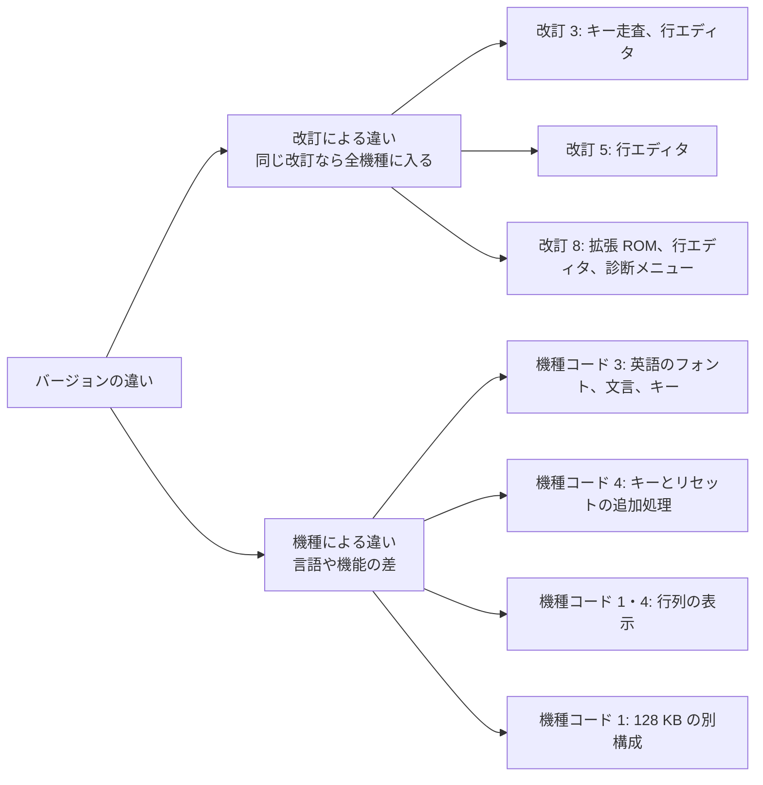
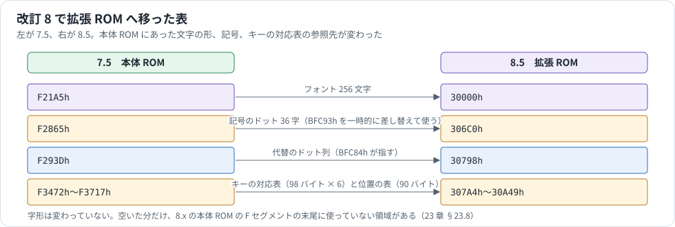
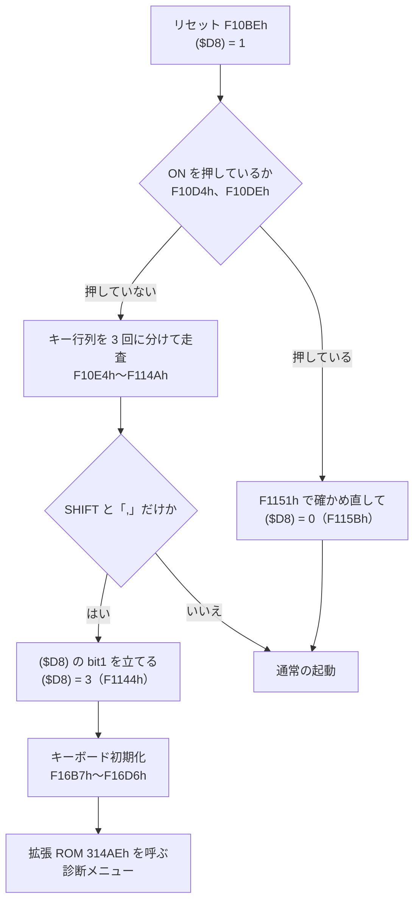
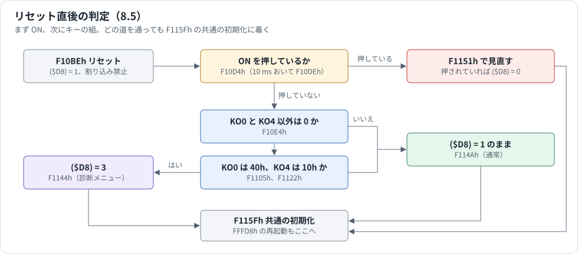
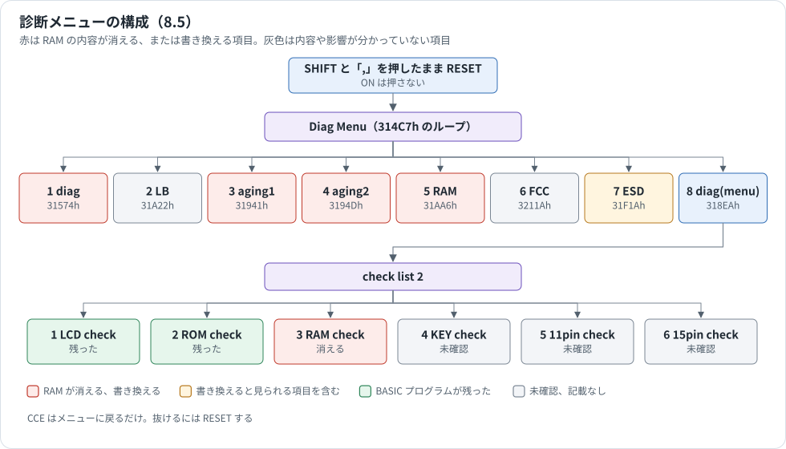

# 26. ROM バージョンの違い: システム

この章は、電源を入れてから文字が打てるようになるまでの「縁の下の処理」が、バージョンによってどう変わったかをまとめたものです。キーの反応、画面の文字、起動時の動きが機種で違う理由を知りたいときや、改訂 8 の機種に隠れている診断メニューを使いたいときに読んでください。

対象は、手元の ROM イメージ 13 本（`Emulator/app/rom/`）のうち、IOCS・FCS・RAM ディスクなどのデバイス処理（E0000h〜E4FFFh）と、リセット・割り込み・表示・キー入力・行エディタ（F0000h〜F4FFFh）を比べた違いです。F4xxxh 帯にある BASIC のトークン化の変更は [ROM バージョンの違い: BASIC](24_ROM_VERSIONS_BASIC.md) で扱い、ここでは番号だけ示します。

[目次へ戻る](README.md)

## この章で分かること

- システムの処理が ROM のどこにあるか
- キー走査や行エディタが、どの改訂でどう変わったか
- 改訂 8 で表が拡張 ROM へ移ったこと
- PC-E650、PC-U6000、PC-E500S の診断メニューの入り方と、項目ごとの危険
- 英語版（機種コード 3）のフォント、文言、キー入力の違い

## 26.0 はじめに

この章の「システム」は、BASIC より下にあって、いつも働いている部分です。リセットで機械を起こし、キーを読み、画面に文字を出し、1 行の入力を編集します。

変更は、大きく 2 種類に分かれます。



デバイスドライバ（E8000h〜EBFFFh）は [ROM バージョンの違い: 行列演算とドライバ](25_ROM_VERSIONS_DRIVERS.md) で扱います。バージョン番号の読み方（上位桁＝改訂、下位桁＝機種コード）と ROM の一覧は [ROM バージョンの違い: BASIC](24_ROM_VERSIONS_BASIC.md) §24.1、系統図は [ROM バージョンの違い: 配置](23_ROM_VERSIONS_MAP.md) §23.13 を参照してください。実験、コード、推定の意味は、章の終わりの「確度の表し方」にあります。

## 26.1 帯の中身

アドレスは 3.2 と 8.5 のものです。同じアドレスのままの処理と、動いた処理があります。

| 内容 | 3.2 | 8.5 |
|---|---|---|
| IOCS 主処理 | `E0000h` | `E0000h` |
| SYSTM:（device 8） | `E0183h` | `E0183h` |
| FCS | `E06BFh` | `E06BFh` |
| FUNC デバイスの表示処理（行列の表示など） | `E178Eh`〜`E1BB0h` 付近 | — |
| メニューなどの文言表示 | `E3381h` 付近 | — |
| RAM ディスク E:F:G:（device 5） | `E493Ah` | `E493Ah` |
| RAM カード S1:S2:S3:（device 6） | `F0000h` | `F0000h` |
| リセット | `F10BDh` | `F10BEh` |
| キーボード STDI:KYBD:（device 1） | `F165Fh` | `F16F5h` |
| 割り込み（キー走査・行エディタの呼び出し） | `F2005h` | `F209Bh` |
| 画面 STDO:SCRN:（device 0） | `F2949h` | `F223Fh` |
| フォントのポインタ初期化 | `F2C32h` | `F2528h` |
| 行エディタ | `F3456h`〜`F4xxxh` | `F2D4xh`〜 |
| BASIC のトークン化（ELSE の判定の位置） | `F4DDBh` | `F4633h` |

| 動き方 | 処理 |
|---|---|
| 3.2 と 8.5 で同じアドレス | IOCS 主処理、SYSTM:、FCS、RAM ディスク、RAM カード |
| 1 バイトだけ動いた | リセット |
| 大きく動いた | キーボード、割り込み、画面、フォントのポインタ初期化、行エディタ、トークン化 |

### 26.1.1 IOCS ヘッダ

全 13 本とも同じ 10 デバイス（SCRN・KYBD・COM・PRN・CAS・S1:S2:S3:・E:F:G:・device 9・X:Y:・SYSTM）を、同じ順で連結しています。違うのはヘッダ表の置き場所と各エントリのアドレスだけです。

| バージョン | ヘッダ先頭 |
|---|---|
| 2.1 | `E02A6h`（128 KB の ROM で、下位の RAMFILE 領域がない） |
| 2.2、3.2、5.3、6.3、7.3、6.2、7.2、7.5、8.3、8.5 | `DF820h` |
| 6.4、8.4 | `DF500h` |

確度: コード。デバイスごとのエントリのアドレスは [ROM バージョンの違い: 配置](23_ROM_VERSIONS_MAP.md) §23.4.2 にあります。

## 26.2 改訂ごとの変更

改訂 5→6、6→7 では、この帯に機能の変更はありません（コードのずれに伴う表の再配置だけ）。E0000h〜E4FFFh の IOCS・FCS・RAM ディスクは、改訂 2〜7 を通じて同じ機種の中では変わっていません。

| 改訂 | この帯の変更 |
|---|---|
| 2 → 3 | キー走査 2 件、行エディタ 3 件、トークン化 1 件 |
| 3 → 5 | 行エディタ 2 件 |
| 5 → 6、6 → 7 | なし |
| 7 → 8 | 表の移動 2 件、行エディタ 2 件、起動時のキー判定、キーボード初期化、割り込み |

### 26.2.1 改訂 2 → 3（2.2 → 3.2）

**キー走査のマスク（#1）。** キー走査は、キーの行列を 1 行ずつ調べる処理です。新しいバージョンは、読み取った値を、行番号で引く RAM の表と AND します。AND は、マスクの 0 のビットを必ず 0 にするので、表の値を変えれば、その行の特定のキーを無いことにできます。

```text
読み取ったキー     0 1 0 0 1 0 0 0     （2 つのキーが押されている）
表 [BFCA5h+行]     1 1 1 1 0 1 1 1     （1 つのキーを無効にした場合）
AND の結果         0 1 0 0 0 0 0 0     （1 つだけ残る）
```

アドレスは 3.2 のものです。

| # | 対象 | アドレス | 変更 | 確度 |
|---|---|---|---|---|
| 1 | キー走査 | `F1F3Fh`〜`F1F4Ch` | 読み取ったキー入力（`(BP+4)`）を、行番号 `(BP+0)` で引く RAM の表 `[BFCA5h+行]` と AND する処理を追加。行ごとに特定のキーを無効にできるようにしたものと見られる（推定） | コード |
| 2 | キー走査 | `F1E50h`、`F1F0Bh` | `($EA)` bit3 を見る位置を移動。古いバージョンは `(BP+PX)` が 03h で、かつ `($EA)` bit3 が立っているときだけ `[BFCBEh]` bit7 を立てていた。新しいバージョンは `($EA)` の条件を外し、`($FF)` bit3 を見る経路（`F1F0Bh`）の側で `($EA)` bit3 を判定する | コード |
| 3 | 行エディタ | `F39D6h`、`F39DEh` | AER 側の処理 `CALLF E5214h` を呼ぶ前に BP を切り替え（`PMDF ($EC),D6h`）、戻った後に元へ戻す（`PMDF ($EC),2Ah`）処理を追加 | コード |
| 4 | 行エディタ | `F3E9Ah` | `CALL F6114h` の戻り値を `(BP+0)` にも保存する命令を追加 | コード |
| 5 | 行エディタ | `F384Ch`、`F4712h` | カーソルを消す呼び出し（`A=0`、`IL=45h` で SCRN:45）を共通の小関数 `F4712h` にまとめ、`F384Ch` に呼び出しを追加 | コード |
| 6 | トークン化 | `F4DDBh` | ELSE の判定（[ROM バージョンの違い: BASIC](24_ROM_VERSIONS_BASIC.md) §24.3.1 #6） | 実験 |

### 26.2.2 改訂 3 → 5（3.2 → 5.3）

5.3 は機種コードも違うため、差の大半は機種差（§26.3.1）です。改訂 5 以降の全機種に入っている変更は次の 2 件です。

| # | 対象 | アドレス | 変更 | 確度 |
|---|---|---|---|---|
| 1 | 行エディタ | 3.2 の `F3D52h` | 空白詰めのループ回数 0 の対策（[ROM バージョンの違い: BASIC](24_ROM_VERSIONS_BASIC.md) §24.3.2 #1） | コード |
| 2 | 行エディタ | 3.2 の `F3726h` | U スタックを 0FFh 下げる処理の前に BP の切り替え（`PMDF ($EC),D4h`）を移動 | コード |

### 26.2.3 改訂 7 → 8（7.5 → 8.5、6.4 → 8.4、7.3 → 8.3）

**何が起きていたか。** 改訂 7 までは、フォントやキーの表が本体 ROM の `F` セグメントに入っていました。

**何が変わったか。** 改訂 8 では、これらの表が拡張 ROM へ移り、行エディタと診断メニューの処理が加わりました。機種コード 3・4・5 のすべてに同じ変更が入っています（8.3 はアドレスを伏せた命令列の照合で、#1〜#7 の各箇所を確かめました）。



図の代替のドット列のアドレスは、[ROM マップ](21_ROM_MAP.md) §21.4 の表の値です。4 つの帯はどれも、7.5 の元の場所と 1 バイトずつ同じです（データ）。アドレスは 8.5 のもの（括弧内は 7.5）です。

| # | 対象 | アドレス | 変更 | 確度 |
|---|---|---|---|---|
| 1 | フォント・表示の表 | `F2528h`、`F24B8h`、`F25EDh`〜`F25FFh`、`F2BFBh`、`E1F5Fh`、`F2D55h` ほか | フォント（6×8 ドット 256 文字）と、記号・カーソルのドットを拡張 ROM（`30000h`〜`307A3h`）へ移し、参照先を書き換えた（フォント本体は `F21A5h`〜 → `30000h`〜、記号は `F27A5h`〜`F2948h` → `30600h`〜`307A3h`。行エディタなどが `BFC93h` に入れて使う 36 字の記号は `F2865h` → `306C0h`）。字形は変わっていない（§26.3.1） | コード |
| 2 | キー対応表 | `F1987h`〜`F19B7h`、`F1D1Ah` | キーの対応表 6 つ（`F3472h`〜`F36BDh`）と位置の表（`F36BEh`〜`F3717h`）を拡張 ROM（`307A4h`〜`309EFh`、`309F0h`〜`30A49h`）へ移した。内容は 7.5 と同じ（並びは [配置](23_ROM_VERSIONS_MAP.md) §23.9.1） | コード |
| 3 | 行エディタ | `F2D55h`〜（`F3456h`〜） | BP 相対の作業域を 1 バイト広げ、以降の項目を 1 つずつずらした。キーコードの 2 バイト目 1Ch〜1Fh、3Eh・3Fh などへの分岐と、拡張 ROM・末尾パッチ域（`FFA63h`、`FFB84h`、`FFBF6h`）への呼び出しを追加。新しい編集キーへの対応と見られる（推定） | コード |
| 4 | 行エディタ | `F361Bh`〜`F3B60h` | #3 に合わせて BP の切り替え値と作業域の位置を 1 ずつずらした | コード |
| 5 | リセット | `F10E4h`〜`F114Ah` | ON キーが押されていないとき、3 回に分けてキー行列を走査し、特定の 2 つのキーだけが押されていれば `($D8)` の bit1 を立てる処理を追加 | コード |
| 6 | キーボード初期化 | `F16B7h`〜`F16D6h` | #5 の bit1 が立っていれば、IOCS を呼んだ後に拡張 ROM の `314AEh` を `($FB)=83h` で呼ぶ | コード |
| 7 | 割り込み | `F21AFh` | 待ち（`MV I,0481h` / `WAIT`）を追加 | コード |

#5・#6 は、リセット時のキー操作で入る診断メニューです。判定は「KO0 の KI6（SHIFT）と KO4 の KI4（`,`）だけが押され、他の行には何も押されていない」ことです。入り方と中身は §26.2.4 にあります。



#### リセット直後の処理を 1 命令ずつ読む

図の流れは、8.5 の `F10BEh` からを逆アセンブルすると、次のように読めます（コード）。ON キーを調べる所が先、キーの組を調べる所が後です。アドレスの順と実行の順が違うのは、ON が押されていたときだけ `F1151h` へ飛ぶからです。

| アドレス | すること |
|---|---|
| `F10BEh` | `IMR` を 0（割り込み禁止）、LCD に 3Eh を書く、`($D8)` を 1 に |
| `F10D0h` | 約 10 ms 待ち、SSR のビット 3（ON）を見る。押されていれば `F1151h` へ |
| `F10DAh` | もう一度約 10 ms 待って見る。押されていたら `F10D0h` からやり直し（チャタリング対策） |
| `F10E4h` | KO0 と KO4 のほかの行を High にし、KI が 0（何も押されていない）か |
| `F1105h` | KO0 だけを High にし、KI がちょうど 40h（SHIFT だけ）か |
| `F1122h` | KO4 だけを High にし、KI がちょうど 10h（`,` だけ）か |
| `F1144h` | 3 つとも合えば `OR ($D8),02h`。`($D8)` は 3 になり、`F115Fh` へ |
| `F114Ah` | 合わなければ `($D8)` は 1 のまま `F115Fh` へ |
| `F1151h` | （ON のとき）約 10 ms 待って ON を見直す。離されていれば `F10D0h` からやり直し |
| `F115Bh` | まだ押されていれば `($D8)` を 0 に |
| `F115Fh` | ここから先は共通の初期化 |

キーの判定も、合わなければ約 10 ms 後にもう一度調べます。1 回目か 2 回目のどちらかで合えば次へ進みます。待ち時間は `MV I,1E14h` と `WAIT` で、1E14h = 7700 サイクル、10.0 ms です（768 kHz）。

`($D8)` の 3 つの値の意味は次のとおりです。

| `($D8)` | 意味 |
|---|---|
| 0 | ON を押したままリセットした |
| 1 | ふつうのリセット。`FFFD8h` から来たときも 1 |
| 3 | SHIFT と `,` を押したままリセットした（改訂 8 だけ） |

改訂 7 までの処理には、`F10E4h`〜`F114Fh` に当たる部分がありません。3.2 では ON が押されていなければ、すぐに共通の初期化（`F10F3h`）へ進みます。`FFFD8h` の再起動（[ROM マップ](21_ROM_MAP.md) §21.3）は、8.5 でもキーの判定の後ろの `F115Fh` に入るので、診断メニューにはなりません。



### 26.2.4 診断メニュー（Diag Menu）

§26.2.3 の #5・#6 で入るサービス用のメニューです。アドレスは 8.5 のものです。エミュレータで確かめましたが、実機では試していません。

> [!WARNING]
> RAM を調べる項目を選ぶと、RAM の中身（プログラムや変数）が消えます。下の表の「RAM への影響」を見てから選んでください。

**入り方**: SHIFT と `,` の 2 つだけを押したまま RESET し、メニューが出たら離します（実験）。ON は押しません。ON を押していると、キーの判定（`F10E4h`〜）へは進まず `F1151h` へ分かれ、`($D8)` が 0 になります（`F115Bh`、コード）。

| 条件 | 結果 | 確度 |
|---|---|---|
| 8.5（PC-E650）、8.4（PC-U6000）、8.3（PC-E500S） | メニューが開く | 実験 |
| 7.5（PC-E550）、6.3・7.3（PC-E500） | 通常の `MAIN MENU` が出る | 実験 |
| SHIFT だけ、`,` だけ、ほかのキーも一緒に押す（`A`、`SPACE` で確認） | 入らない（8.5） | 実験 |
| 内蔵 RAM が未初期化 | 初期化の画面が出る。PF1 で初期化すると `MAIN MENU` になる。初期化の後でやり直す（8.5） | 実験 |

**抜け方**: RESET だけです。メニューのループ（`314C7h`）に出口はなく（コード）、CCE はメニューに戻るだけです（実験）。

エミュレータでは、`e500_reset` がキーの状態を消します（`Emulator/src/native/machine.cpp`）。キーは `e500_reset` の呼び出し後、`e500_run` の前に押します。呼び出し前に押しても入りません（実験）。



**メニューの項目**: キーとジャンプ先の表は `3156Ah`（キーコード。`0C 21 22 … 28 FF` で、CCE、1〜8 の順）と `314DEh`（アドレス）にあります。表のアドレスは 8.3 と 8.5 では同じで、8.4 だけ `FCC` が `320F7h`、`ESD` が `31EF7h` です。

| キー | 表示 | ジャンプ先 | 内容 | RAM への影響 | 確度 |
|---|---|---|---|---|---|
| 1 | `diag` | `31574h` | LCD、ROM、RAM、11pin、15pin、`31E80h` の検査、KEY の順に調べる | RAM チェックを含むので消える | コード |
| 2 | `LB` | `31A22h` | 電池の電圧の監視を確かめる。注意（caution）と限界（fatal）の 2 つの段階を調べる（PC-E500S サービスマニュアル p.6〜10） | — | 公式 |
| 3 | `aging1` | `31941h` | LCD、ROM、RAM のチェックを繰り返す | RAM チェックを含むので消える | コード |
| 4 | `aging2` | `3194Dh` | `aging1` と同じ処理を、`($D4)` の初期値を変えて呼ぶ | 同上 | コード |
| 5 | `RAM` | `31AA6h` | RAM に書き、読み直し、1 分待ってまた読み直す（`RAM WRITING`、`RAM VERIFYING`、`1 minute WAIT`） | 書き換える | コード |
| 6 | `FCC` | `3211Ah` | CE-126P と CE-515P に `H` の行を印字する（PC-E500S サービスマニュアル p.6〜10） | — | 公式 |
| 7 | `ESD` | `31F1Ah` | `ESD Menu`。内蔵 RAM・カード RAM の書き込み、読み出し、書き込みと読み出し（各 2 項目、計 6 項目） | 書き込みの項目は書き換えると見られる | 推定 |
| 8 | `diag(menu)` | `318EAh` | `check list 2` を開く | 下の表 | — |
| CCE | — | `314F9h` | メニューに戻る | なし | 実験 |

**`check list 2`**:

| キー | 表示 | RAM への影響 | 確度 |
|---|---|---|---|
| 1 | `LCD check` | BASIC プログラムは残った | 実験 |
| 2 | `ROM check` | BASIC プログラムは残った。8.5 の表示は `ROM OK!`、`PC-E650 Ver.08`。8.3 は `ROM OK!`、`PC-E500S  Ver.08` | 実験 |
| 3 | `RAM check` | **消える**。この後に RESET すると `S1(ﾅｲｿﾞｳ):ｱﾀﾗｼｲ ｶｰﾄﾞ ﾃﾞｽ` と出て、PF1 で初期化するとプログラムは残っていない | 実験 |
| 4 | `KEY check` | — | — |
| 5 | `11pin check` | — | — |
| 6 | `15pin check` | — | — |

メニューを開いて RESET で抜けるだけなら、BASIC プログラムは残りました（実験）。ただし RAM が全く変わらないわけではありません。メニューを開くと、`BF000h` より下で次のバイト数が変わりました（8.5、実験）。

| RAM の状態 | 変わったバイト数 | 場所 |
|---|---|---|
| プログラムなし | 4 | `B0029h`〜`B0032h` の中 |
| 1 行のプログラムあり | 120 | `B01ADh`〜`B026Ah` の中 |
| 2 行のプログラムあり | 129 | — |

11pin・15pin のチェックは、出力を入力へ戻すジグをコネクタに差して行います（PC-E500S サービスマニュアル p.6〜10）。出力の組み合わせと、正しいときに読める値の表は [回路とサービス](09_CIRCUIT.md) §9.5 にあります。番号 20 の検査は、11 ピンでは XOUT を XIN へ、15 ピンでは SD を RD へ戻します。[PC-E500 のサービスマニュアル](https://www.manualslib.com/manual/3347754/Sharp-Pc-E500.html?page=7)の第 10 章に、同じ名前のチェックと、ジグ UKOGC3020CSZZ の記載があります。ただし、このマニュアルのチェックは「check software を入力する」もので、PC-E500 の ROM にはこのメニューの文字列がありません。

## 26.3 機種による違い

### 26.3.1 フォント（機種コード 3）

6×8 ドットのフォント 256 文字は、機種コード 3 の 4 本（5.3・6.3・7.3・8.3）を除く 9 本で 1 ドットも違いません。機種コード 3 の 4 本も、互いに 1 ドットも違いません。PC-1480U（2.1）、PC-1490UII（6.4）、PC-U6000（8.4）も PC-E500 と同じで、円記号・カナ・グラフィック記号を持ちます（3 機種とも画面・カナ入力・添付ソフトが日本語で、国内向けと見られます。[ROM バージョンの違い: 機種](27_ROM_VERSIONS_MODELS.md) §27.1）。

つまり、13 本のフォントは 2 種類だけです。

| フォント | バージョン | 5Ch | 80h 以降 |
|---|---|---|---|
| 国内 | 2.1、2.2、3.2、6.2、7.2、7.5、6.4、8.4、8.5 | `¥` | カナ・グラフィック記号 |
| 欧文 | 5.3、6.3、7.3、8.3 | `\` | アクセント付きのラテン文字、罫線、ギリシャ文字など |

機種コード 3 の 4 本は 5Ch と 7Fh〜FEh の字形が違います。5Ch は `\`（他の機種は `¥`）、80h 以降はアクセント付きのラテン文字、通貨記号、罫線、ギリシャ文字などで、IBM PC のコードページ 437 と同じ配置の欧文の文字セットです（`CHR$(128)`=Ç、`CHR$(165)`=Ñ、`CHR$(177)`=▒、`CHR$(225)`=ß を表示で確認、実験）。カナはなく、KANA キーの位置のキーは ANS で、直前の計算の答えを入れます。カナ入力にはなりません（実験、[機種](27_ROM_VERSIONS_MODELS.md) §27.2.3）。

| バージョン | フォント本体 | 違う文字 |
|---|---|---|
| 2.1 | `F20F6h` | なし |
| 2.2 | `F2198h` | なし |
| 3.2、6.2、7.2、7.5 | `F21A5h` | なし |
| 5.3、6.3、7.3 | `F2155h` | 5Ch、7Fh〜FEh |
| 6.4 | `F21D5h` | なし |
| 8.3 | 拡張 ROM `30000h` | 5Ch、7Fh〜FEh |
| 8.4、8.5 | 拡張 ROM `30000h` | なし |

フォントのポインタ表（`BFC84h` へコピーする 6 個の 20 bit アドレス、[フォント](13_FONT.md)）は全バージョンで同じ構成で、アドレスのずれだけが違います。確度: コード（字形データの比較）。

### 26.3.2 画面の文言（機種コード 3）

機種コード 3 の 4 本（5.3・6.3・7.3・8.3）は画面の文言が英語で、他の 9 本はカナです。PC-1480U・PC-1490UII・PC-U6000 もカナで表示します。

| 場面 | 機種コード 3 | その他 |
|---|---|---|
| 電源投入時（RAM カードの初期化待ち） | `S1(MAIN):NEW CARD` / `PF1 --- INITIALIZE` | `S1(ﾅｲｿﾞｳ):ｱﾀﾗｼｲ ｶｰﾄﾞ ﾃﾞｽ` / `PF1 ｼｮｷｶ ｼﾏｽ` |
| 初期化の確認（3.2 `E33BBh` が表示） | `INITIALIZE OK? (Y/N)` | `ｼｮｷｶ OK? (Y/N)` |
| G: ドライブの表示（3.2 `E4EF2h`〜が表示） | ` ENGINEER SOFTWARE ` | ` ｴﾝｼﾞﾆｱ ｿﾌﾄｳｴｱ `（機種コード 1・4 にはこの文字列がない） |

文字列の長さが違うため、表示処理に渡す長さ（3.2 `E33BBh` の Y、`E4EF6h` の Y）と表示位置（`E33C1h`）も機種コード 3 だけ違います。確度: 電源投入時の画面は実験（2.1、3.2、5.3、6.3、7.3、6.4、8.3、8.4、8.5 で確認）、他はコード。

### 26.3.3 キー入力（機種コード 3・4）

英語版はカナ入力を使わないので、文字の読み出しが短い処理に差し替えられています。

| 機種 | 違い | 確度 |
|---|---|---|
| 機種コード 3 | キーボードの文字読み出し（KYBD:0Ah・0Ch・0Eh、3.2 の `F1B48h`〜）を、末尾のパッチ域（5.3 `FFF3Ah`、6.3・7.3 `FFF4Ah`、8.3 `FF910h`）の短い処理に置き換え、元の場所を `NOP` で埋めている。置き換え後は、特別なキーコード（0700h）の処理と `[BFC99h]` bit1 による分岐（`F6292h` / `F635Dh`、`F788Ah`）を通らない。カナ入力などの国内向けの処理を外したものと見られる（推定） | コード |
| 機種コード 3 | キーコードの定数（3.2 `F0C84h`〜`F0CEAh` の `A`・`IL` の値）が違う。`5Ch` を返す箇所がある（5.3 の `F0CBEh`）など、キー配列の違いと見られる（推定）。値は 5.3・6.3・7.3・8.3 で同じ | コード |
| 機種コード 4 | 文字読み出しの途中から末尾のパッチ域へ飛ぶ（6.4 `F1BCDh` → `FFEB7h`） | コード |
| 機種コード 4 | リセット時、`($D9)` が 3 のとき `[BFCC9h]` に `F2158h` を入れるなどの初期化を追加（6.4 `F1621h`〜） | コード |

### 26.3.4 FUNC デバイスの表示（機種コード 1・4）

[ROM バージョンの違い: 行列演算とドライバ](25_ROM_VERSIONS_DRIVERS.md) §25.3.2 の行列演算の追加機能に合わせて、表示処理（6.2 `E178Eh`〜`E1BB0h`、6.4 `E1886h`〜`E1C4Fh`）にも `[BFEE3h]` の値による分岐、表示桁数・行数の定数の違い（`A=02h`→`08h`、`06h`→`0Ch` など）、`BFF28h`・`BFF30h` の作業域を使う処理が加わっています。確度: コード。

### 26.3.5 PC-1480U（2.1）

2.1 は次の各所で 2.2 と違い、この帯だけで約 150 か所あります。

| 部分 | アドレス |
|---|---|
| IOCS 主処理 | `E002Ah` 付近 |
| SYSTM: | |
| FCS | `E090Ch`〜`E0DD9h` |
| RAM ディスク | `E4AE5h`〜`E4FC1h` |
| RAM カード S1: | `F0004h`〜`F0B27h` |
| キーボード | `F161Fh`〜`F1BABh` |
| 画面 | `F289Ah`〜`F2B33h` |
| 行エディタの各所 | |

同じ改訂 2 でも、128 KB の ROM に収めるための別構成になっています。

## 26.4 早見表

○はその処理・データを持ちます。

| 項目 | 2.1 | 2.2 | 3.2 | 5.3 | 6.3 | 7.3 | 6.2 | 7.2 | 7.5 | 6.4 | 8.3 | 8.4 | 8.5 |
|---|---|---|---|---|---|---|---|---|---|---|---|---|---|
| キー入力のマスク（§26.2.1 #1） | | | ○ | ○ | ○ | ○ | ○ | ○ | ○ | ○ | ○ | ○ | ○ |
| フォント・記号・キーの表が拡張 ROM（§26.2.3 #1・#2） | | | | | | | | | | | ○ | ○ | ○ |
| 起動時のキー判定（§26.2.3 #5） | | | | | | | | | | | ○ | ○ | ○ |
| 欧文フォント（§26.3.1） | | | | ○ | ○ | ○ | | | | | ○ | | |
| 英語の画面文言（§26.3.2） | | | | ○ | ○ | ○ | | | | | ○ | | |
| KYBD 読み出しの差し替え（§26.3.3） | | | | ○ | ○ | ○ | | | | | ○ | | |

§26.2.1 #1、§26.2.3 #5、§26.3.3 はバイト列の照合で全 ROM を調べました。§26.2.3 #1・#2 は参照先のアドレス、§26.3.1・§26.3.2 は全 ROM のデータの比較で判定しました。

## 26.5 調べ方

[ROM バージョンの違い: BASIC](24_ROM_VERSIONS_BASIC.md) §24.7 と同じ方法に、次を加えました。

- 呼び出し元の逆引きの名札に、ROM 8.5 の IOCS・FCS のコマンドエントリ（[IOCS と FCS](11_IOCS.md)）と、リセット・割り込みのベクタを使いました。8.5 のアドレスを、命令列の対応から各 ROM のアドレスへコピーしています。
- IOCS ヘッダは、文字列 `STDO:SCRN:` の 8 バイト前を先頭として連結をたどりました。
- フォントは、`BFC84h` へコピーするポインタ表（`MV Y,BFC84h` / `MV X,表` / `MV IL,12h` の並び）から本体のアドレスを求め、256 文字×6 バイトを比べました。
- 画面の文言は、エミュレータで電源を入れた直後の液晶を読み取って比べました。

## まとめ

- この帯で改訂による変更が多いのは 2 → 3 と 7 → 8 です。5 → 6、6 → 7 では機能が変わっていません。
- 改訂 8 では、フォントとキーの表が拡張 ROM に移り、診断メニューが加わりました。
- 診断メニューは SHIFT と `,` を押したまま RESET して開き、RESET で抜けます。RAM チェックは中身を消します。
- 機種コード 3 の 4 本は、欧文のフォント、英語の文言、差し替えたキー読み出しを持ちます。
- 2.1 は 128 KB に収めた別構成で、違いが多くあります。

## 確度の表し方

| 表記 | 意味 |
|---|---|
| **実験** | エミュレータ（`Emulator/bin/e500core.dll`）上で全 ROM に同じ操作をして違いを確かめた |
| **コード** | 逆アセンブル・データの比較で違いを確かめた。挙動は試していない |
| **推定** | コードの形から目的を推し量ったもの |

## 次に読むもの

- [起動、割り込み、タイマ、音](10_SYSTEM.md)（リセット、キー入力の流れ）
- [フォント](13_FONT.md)
- [ROM バージョンの違い: 機種](27_ROM_VERSIONS_MODELS.md)（使う人から見える違い）
- [回路とサービス](09_CIRCUIT.md) §9.5（サービス用の検査ソフト）
