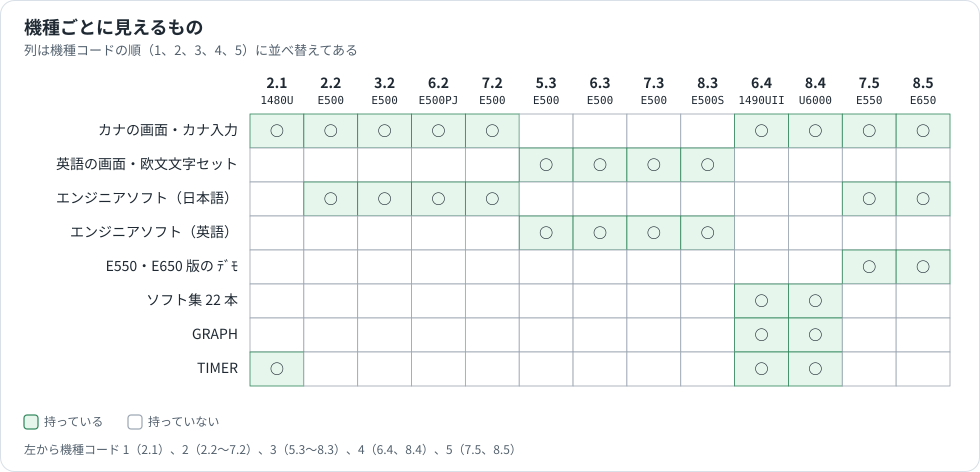
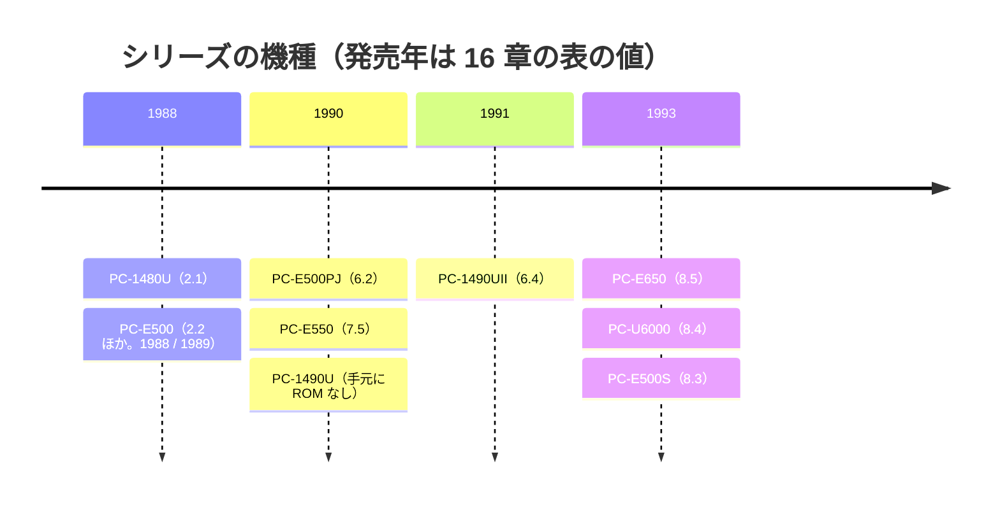
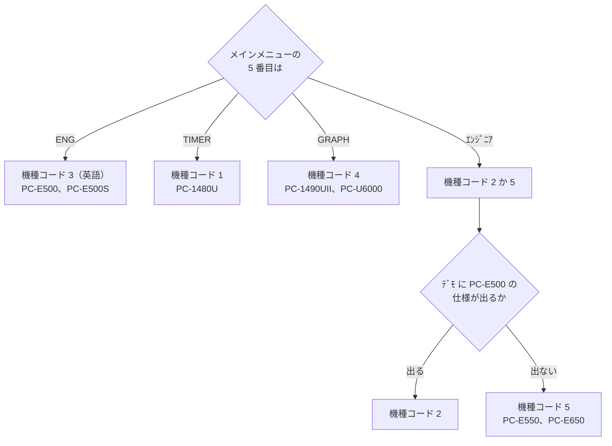
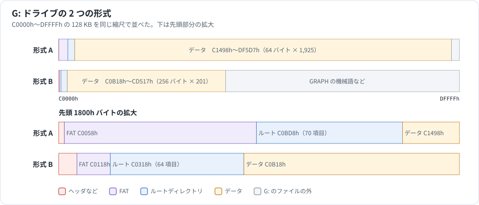
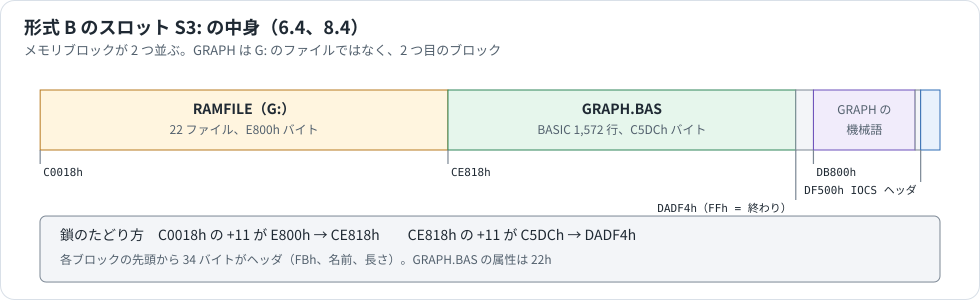

# 27. ROM バージョンの違い: 機種

この章は機械を並べて電源を入れたときに「あれ、違う」と気付く所を集めたものです。メニューの項目、カナ、文字の形、付属のソフトが機種でどう違うかを、画面と ROM の中身の両方から説明します。中古で手に入れた機械がどの機種の ROM を持っているかを知りたいときにも役立ちます。

手元の ROM イメージ 13 本（`Emulator/app/rom/`）について、機種ごとに違う「使う人から見える部分」をまとめました。対象は画面の言語、文字セット、カナ入力、メインメニュー、ROM に入っている添付ソフト（G: ドライブ、エンジニアソフト、GRAPH、TIMER）です。

[目次へ戻る](README.md)

## この章で分かること

- 画面を見ただけで機種コードを当てる方法
- 日本語版と英語版の違い（文言、カナ、文字セット）
- 付属のエンジニアソフトの一覧と、バージョンごとの違い
- PC-1490UII と PC-U6000 のソフト集、GRAPH、TIMER
- G: ドライブの 2 つの形式

## 27.0 はじめに

これまでの章は ROM の内側を見てきました。この章は電源を入れれば分かる違いを扱います。機種による違いは大きく 2 つの軸で整理できます。

| 軸 | 分かれ方 |
|---|---|
| 言語 | 日本語（カナ）と英語。英語は機種コード 3 の 4 本だけ |
| 付属ソフト | エンジニアソフト、ソフト集 22 本（機種コード 4）、なし（機種コード 1） |



機種を発売の順に並べると次のようになります。発売年は [周辺機器](16_PERIPHERALS.md) §16.1 の表の値（PC-E500S はサービスマニュアルの発行年月 1993 年 5 月、ほかは百科事典の値）で、バージョンは手元の ROM です。



バージョン番号の読み方（上位桁＝改訂、下位桁＝機種コード）は [ROM バージョンの違い: BASIC](24_ROM_VERSIONS_BASIC.md) §24.1、コードの違いは [ROM バージョンの違い: システム](26_ROM_VERSIONS_SYSTEM.md)・[ROM バージョンの違い: 行列演算とドライバ](25_ROM_VERSIONS_DRIVERS.md) を参照してください。実験、データ、推定の意味は章の終わりの「確度の表し方」にあります。

## 27.1 機種の一覧

| 機種コード | ファイル | 画面の言語 | カナ入力 | 文字セット | メインメニュー 5 番目 | G: ドライブ |
|---|---|---|---|---|---|---|
| 1 | PC-1480U（2.1） | 日本語（カナ） | あり | 国内（¥・カナ） | TIMER | なし |
| 2 | PC-E500（2.2、3.2、7.2）、PC-E500PJ（6.2） | 日本語（カナ） | あり | 国内 | ｴﾝｼﾞﾆｱ | エンジニアソフト（日本語見出し） |
| 3 | PC-E500（5.3、6.3、7.3）、PC-E500S（8.3） | 英語 | なし | 欧文（コードページ 437） | ENG | エンジニアソフト（英語見出し） |
| 4 | PC-1490UII（6.4）、PC-U6000（8.4） | 日本語（カナ） | あり | 国内 | GRAPH（7 番目に TIMER） | 別のソフト集 22 本 |
| 5 | PC-E550（7.5）、PC-E650（8.5） | 日本語（カナ） | あり | 国内 | ｴﾝｼﾞﾆｱ | エンジニアソフト（ﾃﾞﾓだけ違う） |

確度: メインメニューとカナ入力は実験（全 13 本）、ほかはデータ。

PC-E500S の本体は 220 × 104.5 × 19 mm（閉じたとき）、340 g、消費電力 0.09 W です（サービスマニュアル）。PC-E500S、PC-E650、PC-U6000 では、メモリ保護スイッチ S2 がカードの CE1 も切り離します。PC-E500 では切り離しません（[回路とサービス](09_CIRCUIT.md) §9.9）。

名前に U の付く 3 機種（PC-1480U、PC-1490UII、PC-U6000）も、画面・カナ入力・添付ソフトはすべて日本語です。国内向けの機種と判断できます（推定）。英語・欧文の ROM は機種コード 3 の 4 本だけです。

### 27.1.1 手元の機械のバージョンを確かめる

バージョン番号は BASIC から読めます。全 13 本で次の値になることを確かめました（実験）。

```basic
PRINT PEEK &HFFFF0;PEEK &HFFFF1
```

`7  2` ならバージョン 7.2 です。

| 表示の例 | バージョン | 機種 |
|---|---|---|
| `2  1` | 2.1 | PC-1480U |
| `3  2` | 3.2 | PC-E500 |
| `6  4` | 6.4 | PC-1490UII |
| `7  2` | 7.2 | PC-E500 |
| `8  3` | 8.3 | PC-E500S |
| `8  4` | 8.4 | PC-U6000 |
| `8  5` | 8.5 | PC-E650 |

BASIC を使わなくても、電源を入れた画面とメインメニューの 5 番目を見れば、機種コードの見当がつきます。



## 27.2 画面の言語とカナ

### 27.2.1 メインメニュー

メインメニューの項目は全機種とも `BASIC` `CAL` `MATRIX` `STAT` ［5 番目］ `AER` の並びで、5 番目だけが違います。機種コード 4 は 7 番目に `TIMER` を持ちます。ROM 内の項目名の表（2.1 `F9654h`、7.2 `F999Fh` 付近）で確かめました。

| 機種コード | 項目（表の並び） |
|---|---|
| 1 | BASIC CAL MATRIX STAT TIMER AER |
| 2・5 | BASIC CAL MATRIX STAT ｴﾝｼﾞﾆｱ AER |
| 3 | BASIC CAL MATRIX STAT ENG AER |
| 4 | BASIC CAL MATRIX STAT GRAPH AER TIMER |

確度: 実験（1 ページ目の表示、全 13 本）・データ。

### 27.2.2 画面の文言

機種コード 3 だけが英語で、ほかの 9 本はカナで表示します（[ROM バージョンの違い: システム](26_ROM_VERSIONS_SYSTEM.md) §26.3.2）。

| 場面 | 機種コード 3 | その他 |
|---|---|---|
| 電源投入時 | `S1(MAIN):NEW CARD` / `PF1 --- INITIALIZE` | `S1(ﾅｲｿﾞｳ):ｱﾀﾗｼｲ ｶｰﾄﾞ ﾃﾞｽ` / `PF1 ｼｮｷｶ ｼﾏｽ` |
| 初期化の確認 | `INITIALIZE OK? (Y/N)` | `ｼｮｷｶ OK? (Y/N)` |
| エンジニアソフトの見出し | ` ENGINEER SOFTWARE ` | ` ｴﾝｼﾞﾆｱ ｿﾌﾄｳｴｱ ` |

BASIC のエラーメッセージは全機種とも英語で、文言も同じです（[ROM バージョンの違い: 行列演算とドライバ](25_ROM_VERSIONS_DRIVERS.md) §25.2.2）。

### 27.2.3 カナ入力

カナ入力はローマ字のつづりをカナに変える方式です。KANA キーを押してから `K` `A` `N` `A` `S` `I` と打つと、機種コード 3 以外の 9 本は `ｶﾅｼ` と表示します（ローマ字かな入力）。

| 打った文字 | 機種コード 3 以外 | 機種コード 3 |
|---|---|---|
| KANA キーの位置のキー | カナに切り替わる | ANS。直前の計算の答えを入れる |
| `K` `A`、`N` `A`、`S` `I` | `ｶ`、`ﾅ`、`ｼ` | カナに切り替わらない |

機種コード 3 では、同じ位置のキーが ANS です。カナには切り替わらず、直前の計算の答えが入力行に入ります。電源を入れた直後の答えは 0 なので `0` が出ます。5.3 と 8.3 で `9/8` を計算したあとに押すと、入力行に `1.125` が入りました（実験）。

ROM の中では、キーの対応表の番号 07h（この位置のキー）の値だけが違います（[配置](23_ROM_VERSIONS_MAP.md) §23.9.3）。確度: 実験（2.1、7.2、5.3、7.3、6.4、8.3、8.5、ほかのバージョンもメインメニューの撮影時に同じ操作で確認）。

### 27.2.4 文字セット

同じ文字コードでも、機種コード 3 では別の文字が出ます。機種コード 3 の 80h 以降はコードページ 437 と同じ配置です。`PRINT CHR$(128);CHR$(165);CHR$(177);CHR$(225)` が、機種コード 3 では `Ç` `Ñ` `▒` `ß` になります（実験）。5Ch は機種コード 3 が `\`、ほかが `¥` です。

| 文字コード | 機種コード 3 |
|---|---|
| 128（80h） | `Ç` |
| 165（A5h） | `Ñ` |
| 177（B1h） | `▒` |
| 225（E1h） | `ß` |
| 92（5Ch） | `\`（ほかの機種は `¥`） |

フォントの違いの詳細は [ROM バージョンの違い: システム](26_ROM_VERSIONS_SYSTEM.md) §26.3.1、プリンタへ送るときの変換は [ROM バージョンの違い: 行列演算とドライバ](25_ROM_VERSIONS_DRIVERS.md) §25.3.1 にあります。

## 27.3 G: ドライブ（ROM 内の RAMFILE）

C0000h〜DFFFFh の 128 KB は、ROM に焼かれた読み出し専用のファイル領域（G:）です。12 bit FAT のファイルシステムで、形式は 2 種類あります。全 12 本でクラスタの連鎖とファイルの長さが矛盾なく読めました（データ）。PC-1480U は ROM が 128 KB で、この領域がありません。



| 形式 | バージョン | セクタ | FAT | ルート | データ域 | 有効ファイル | 合計 |
|---|---|---|---|---|---|---|---|
| A | 2.2、3.2、6.2、7.2 | 64 バイト | `C0058h` | `C0BD8h`（70 項目） | `C1498h` | 60 | 121,154 バイト |
| A | 5.3、6.3、7.3、8.3 | 同上 | 同上 | 同上 | 同上 | 60 | 121,262 バイト |
| A | 7.5、8.5 | 同上 | 同上 | 同上 | 同上 | 60 | 120,903 バイト |
| B | 6.4、8.4 | 256 バイト | `C0118h` | `C0318h`（64 項目） | `C0B18h` | 22 | 45,672 バイト |

形式 A のファイルごとの一覧は [G: ドライブ](22_ROM_GDRIVE.md)、ROM 全体の配置は [ROM バージョンの違い: 配置](23_ROM_VERSIONS_MAP.md) にあります。どのバージョンにも削除済みの項目が 1 つ残っています。形式 A の国内版は `?ﾞﾓ.50#`（0 バイト）、英語版は `?.414`（0 バイト）、形式 B は `?-ｼﾞｭｷﾞｮ.BAS`（1,687 バイト）です。`?` は削除の印 `E5h` で上書きされた名前の 1 文字目です。残っている部分から、元の名前は `ﾃﾞﾓ.50#`、`F.414`、`L-ｼﾞｭｷﾞｮ.BAS` と読めます（推定）。最後のものは今ある `Lｼﾞｭｷﾞｮｳ.BAS` と同じ長さです。`L-ｼﾞｭｷﾞｮ` で名前の 8 文字を使い切るので、`ｳ` を入れるために `-` を省いて付け直した名前と見られます（推定）。

媒体の情報とクラスタの使い方は次のとおりです（データ）。`C0042h` の 22 バイトは同じ形式の中で全バージョン同じで、違いはファイルの置き方にあります。

| 項目 | 形式 A 国内（2.2、3.2、6.2、7.2） | 形式 A 英語（5.3、6.3、7.3、8.3） | 形式 A（7.5、8.5） | 形式 B（6.4、8.4） |
|---|---|---|---|---|
| ブロックの名前（`C0019h`） | `RAMFILE !` | 同左 | 同左 | `RAMFILE` |
| メディアの値（`C0042h`） | `FFh` | 同左 | 同左 | `F9h` |
| クラスタ | 64 バイト | 同左 | 同左 | 256 バイト |
| FAT の大きさ | 2,944 バイト | 同左 | 同左 | 512 バイト |
| 使っているクラスタ | 1,925 | 1,925 | 1,921 | 190 |
| 最後に使うクラスタ | 1926 | 1926 | 1926 | 203 |
| 使っている最後のアドレス | `DF5D7h` | `DF5D7h` | `DF5D7h` | `CD517h` |
| 最後のクラスタ番号（媒体の情報） | 1935 | 1935 | 1935 | 222 |
| ブロックの終わり | `DF817h` | `DF817h` | `DF817h` | `CE817h` |
| 終わりの印 | `FF0h` | `FF0h` | `FF0h` | `FF0h` |
| ファイルの飛び（クラスタが連続しない回数） | 80 | 0 | 80 | 1 |
| 項目の数（有効、削除、未使用） | 60、1、9 | 60、1、9 | 60、1、9 | 22、1、41 |

使っている最後のアドレスは最後のクラスタの番号から計算できます。

| 形式 | 計算 | 最後のアドレス |
|---|---|---|
| A | `C1498h` +（1926 − 1）× 64 − 1 | `DF5D7h` |
| B | `C0B18h` +（203 − 1）× 256 − 1 | `CD517h` |

英語版だけは、全ファイルがクラスタの連続した並びに置かれています。国内版はファイルが細かく分かれていて、中身が同じファイルでも ROM の中の位置は英語版と違います。7.5、8.5 は 7.2 の配置のまま `ﾃﾞﾓ.50#` だけが短くなったので、使うクラスタが 4 減り、最後のクラスタは変わりません（`ﾃﾞﾓ.50#` の分の空きが残ります）。

```text
英語版  [ファイル1 ][ファイル2     ][ファイル3 ] …   飛び 0 回
国内版  [1 ][2 の一部][1 の続き][3 ][2 の続き] …     飛び 80 回（並びは模式図）
```

全バージョンとも、全ファイルの属性は `20h`、時刻と日付は 0 です。`C0018h`〜`DF7FFh` の帯で全バイトが同じ組は次のとおりです。

- 2.2、3.2、6.2、7.2 の組
- 5.3、6.3、7.3 の組
- 7.5、8.5 の組

8.3 は 5.3、6.3、7.3 と `DEMO.50#` の 7 バイト（`DECB0h`〜`DECB7h` の中）だけが違います（§27.3.1）。6.4 と 8.4 は、G: のファイルと `GRAPH.BAS`（§27.3.3）を含む範囲が全バイト同じです。C、D セグメントの違いは `DF505h`〜`DFF33h` の中の 196 バイト（このうち `DF7FFh` までは 49 バイト）だけで、IOCS ヘッダのエントリのアドレスなど、本体のコードのアドレスに関わる部分です。

### 27.3.1 エンジニアソフト（機種コード 2・3・5）

数学、科学、工学、統計などの計算をする、メニュー式の BASIC プログラム集です。メニュー用の短い文書ファイル 18 個（`MF` で始まる）と、トークン化された BASIC プログラム 42 本からなります。BASIC は全バージョンで同じキーワード表を使うので、どの機種でも同じ中間コードとして読めます。

| 分類 | 国内版の見出し | 英語版の見出し | プログラム（国内版 / 英語版） |
|---|---|---|---|
| 1##・11# | ｽｳｶﾞｸ・ｾｲｽｳ | MATHEMATICS・INTEGER | ｿｲﾝｽｳ / PRIME、GCMLCM |
| 12# | ﾎｳﾃｲｼｷ | EQUATIONS | 3ｼﾞ / CUBIC、ｽｳﾁｶｲ1 / NEWTON、ｽｳﾁｶｲ2 / BISECT |
| 13# | ﾋﾞﾌﾞﾝ･ｾｷﾌﾞﾝ | DIFFERENTIAL & INTEGRAL | ｾｷﾌﾞﾝ / INTGRL、ﾋﾞﾌﾞﾝ / DIFF、ﾎｶﾝ / INTPLT |
| 14# | ｽｳｶﾞｸ ｺｳｼｷ | FORMULAS | ｲﾝｽｳF / FACT、ｻﾝｶｸF / TRIG、ｾｷﾌﾞﾝF / INTFRM、ｷﾞﾘｼｬ / GREEK |
| 15# | ｸﾞﾗﾌ & ｽﾞｹｲ | GRAPHICS | ｸﾞﾗﾌF / FUNC、ｸﾞﾗﾌD / DATA、ﾒﾝｾｷ / FIGURE |
| 16# | ﾄｸｼｭ ｶﾝｽｳ | SPECIAL FUNCTIONS | ｶﾞﾝﾏ / GAMMA |
| 2##・21# | ｶｶﾞｸ・ﾌﾞﾂﾘ | SCIENCE・PHYSICS | ｼﾞｮｳｽｳ / CONST、ﾀﾝｲ / M-CONV、ｳﾝﾄﾞｳF / MOTION |
| 22# | ｶｶﾞｸ | CHEMISTRY | ｼｭｳｷ / PERIOD、ﾃﾞﾝｼ / ELECTR、ﾄﾞｳｲﾀｲ / ISOTOP |
| 23# | ﾁｶﾞｸ & ﾃﾝﾓﾝｶﾞｸ | EARTH SCIENCE | ｷｼｮｳ / METEO、ﾜｸｾｲ / PLANET |
| 24# | ｾｲﾌﾞﾂｶﾞｸ | BIOLOGY | ｱﾐﾉｻﾝ / AMINO |
| 3##・31# | ｺｳｶﾞｸ・ﾃﾞﾝｷ & ﾃﾞﾝｼ ｺｳｶﾞｸ | ENGINEERING・ELECTRICAL ENGINEERING | ﾌｸｿｽｳ / COMPLX、ﾃﾞﾝｷF / EE-FRM、ﾃﾞﾝｼﾞF / ELEMAG、ﾗﾌﾟﾗｽ / LAPLAC |
| 32# | ｷｶｲ ｺｳｶﾞｸ | MECHANICAL ENGINEERING | ｷｶｲF / ME-FRM |
| 4##・41# | ﾄｳｹｲ ｹｲｻﾝ・ﾌﾞﾝﾌﾟ ｶﾝｽｳ / ｶｸﾘﾂ | STATISTICS・DISTRIBUTION & PROBABILITY | ｾｲｷﾌﾞ / NORMAL、Tﾌﾞ / t、ｶｲﾌﾞ / CHI、Fﾌﾞ / F |
| 5## | ﾍﾝｼｭｳ | EDIT | ｴﾃﾞｨﾀ / EDITOR、ﾃﾞﾓ / DEMO |
| （共通部品） | — | — | COMN.00$、DISP500.00$〜DISP502.00$、SCUBIC.12$、SBDF.42$ |

確度: データ（全ファイルを取り出して BASIC の文字列に戻した）。エミュレータで 7.2・5.3・8.5 のメニューを 3 階層目まで開き、項目名がファイル名のとおり、見出しが MF ファイルの内容のとおりに出ることを確かめました（実験）。

#### バージョンによる違い

| 比較 | 違い | 確度 |
|---|---|---|
| 2.2・3.2・6.2・7.2 | 60 ファイルすべてがバイト単位で同一 | データ |
| 7.5・8.5（E550・E650）と 7.2 | `ﾃﾞﾓ.50#` だけが違う（2,371 → 2,120 バイト）。E550・E650 版は、PC-E500 の仕様を表示する部分（`PC-E500`、`40 * 4 lines`、`240 * 32 dots`、`32KB (max 96KB)` と効果音）を削り、繰り返し回数を 50 から 10 に減らしている。他の 59 ファイルは同一 | データ |
| 5.3・6.3 と 7.2 | ファイル名をすべて英語にし（ｽｳｶﾞｸ → MATH など）、メニュー見出しを英訳した。プログラム本体は計算部分も含めてほぼ同一で、違うのはカナの画面文言と一部の見出し（例: `TRIGONOMETRY` → `TRIGONOMETRIC FUNCTION`、`METEOROLOGICAL CONVERSION` → `METEOROLOGY`、`PF KEY TITLE EDITOR` → `PF KEY LABEL EDITOR`）。共通部品 6 本はバイト単位で同一。ほかに 16 本（`PRIME`、`GCMLCM`、`CUBIC`、`DIFF`、`FACT`、`GREEK`、`FIGURE`、`GAMMA`、`M-CONV`、`PERIOD`、`ELECTR`、`ISOTOP`、`COMPLX`、`ELEMAG`、`LAPLAC`、`NORMAL`）も中身は同一（合わせて 22 本。16 本のうち名前まで同じなのは `GCMLCM` だけ） | データ |
| 5.3、6.3、7.3 | 60 ファイルすべてが同一 | データ |
| 8.3（E500S）と 5.3・6.3・7.3 | `DEMO.50#` の表題の文字列だけが違う（`**** SHARP POCKET COMPUTER  PC-E500 ****` → `**** SHARP POCKET COMPUTER PC-E500S ****`。長さは同じで、ファイルは 2,370 バイトのまま）。PC-E500 の仕様を表示する部分（`40 *  4 lines`、`240 * 32 dots`、`32KB (max 96KB)`）は残っている。他の 59 ファイルは同一 | データ |

三角関数の公式集（`TRIG`）の 49 番は、操作説明書 p.67 と同じく符号が誤っています（ROM の文字列と数値の比較。[ENG](../handbook/07_ENG.md)）。

プログラムの計算部分と大半の画面文言は、国内版でも英語で書かれています（例: COMN.00$ の `Computing ...`、`Answer not found`）。英語版で書き換えたのは、主にカナで書かれていた案内文と見出しです。

### 27.3.2 機種コード 4 のソフト集（PC-1490UII・PC-U6000）

エンジニアソフトの代わりに、名前の先頭で分類した 22 本の BASIC プログラムが入っています。6.4 と 8.4 で全ファイルが同一です（データ）。

| 分類 | ファイル（大きさ） | 内容（画面の文字列から） |
|---|---|---|
| S-（理数） | S-ﾌﾞﾝｽｳ（3,340）、S-3ｼﾞ4ｼﾞ（2,675）、S-COMPLX（2,706）、S-ｼﾝﾌﾟｿﾝ（1,009）、S-Nｼﾝｽｳ（940）、S-ｻｲｼｮｳ2（1,256）、S-ﾃﾞﾝﾘｭｳ（850）、Sﾄﾗﾝｼﾞｽﾀ（1,169）、Sﾌﾞﾝｼﾘｮｳ（1,430） | 分数計算（"Fractional Calculator"）、3 次・4 次方程式、複素数、シンプソン積分、M 進数→N 進数、最小二乗（次数を指定）、電流による発熱（水と容器の重さ・比熱、電圧・電流を入れる）、トランジスタの測定、分子量 |
| L-（生活） | L-ﾚｺ-ﾄﾞ（333）、L-ﾃﾝﾁｭｳ（4,049）、L-ｴﾝｿｳ（1,331）、Lｼﾞｭｷﾞｮｳ（1,687）、L-ﾆｯｽｳ（642）、L-ﾏﾝﾈﾝ（2,312）、Lｺ-ﾄﾞﾏｽﾀ（6,671） | 時間の記録、天中殺、演奏、授業（月日と時限）、日数計算、万年暦（カレンダー）、ギターコード表（"CHORD MASTER"） |
| T-（ツール） | T-ﾄﾞｯﾄ（2,698）、T-ﾂｳｼﾝ（1,323） | ドット絵エディタ（Write・Erase・Move）、通信のサンプル（アップロード・ダウンロード） |
| G-（ゲーム） | Gｲﾝﾍﾞ-ﾀﾞ（1,650）、G-ﾋﾞﾝﾄﾘ（1,257）、G-ｼﾞｪｯﾄ（2,663）、G-ｹｲﾊﾞ（3,681） | インベーダー、ビン取り（「ｱﾅﾀ ﾉ ﾊﾞﾝﾃﾞｽ」「ｱﾅﾀ ﾉ ｶﾁ ﾃﾞｽ」と出る対戦ゲーム）、ジェット、競馬（1〜3 人） |

分類ごとの数は、S- が 9 本、L- が 7 本、T- が 2 本、G- が 4 本で、合わせて 22 本、45,672 バイトです。

名前の長音はカナの長音記号ではなく `-`（2Dh）です。拡張子はすべて `BAS` で、メニュー用のファイルはありません。確度: データ。内容の説明は画面に出す文字列から推したもので（推定）、実行はしていません。

### 27.3.3 GRAPH（機種コード 4）

メインメニューの GRAPH は関数のグラフ（`FGRAPH`）と回帰（`REGRES`）を持ちます。FGRAPH は `* SET FORMULA *` で式を入れ、`A_DRAW`・`DRAW`・`ZOOM`・`SOLVE`・`QUIT` を選びます（実験、6.4 で表示を確認）。

GRAPH の正体は G: の中のファイルではなく、G: の隣に置かれた BASIC のプログラムです。C0000h からの ROM はスロット `S3:` なので、その中にはメモリブロックがいくつも並べられます（[メモリ](03_MEMORY.md) §3.3）。形式 B の ROM には 2 つのブロックがあります（データ、6.4・8.4 で同じアドレス）。

| ブロック | 範囲 | 長さ | 中身 |
|---|---|---|---|
| `RAMFILE` | `C0018h`〜`CE817h` | E800h | G: ドライブ |
| `GRAPH.BAS` | `CE818h`〜`DADF3h` | C5DCh（50,652 バイト） | トークン化した BASIC のプログラム 1,572 行（10〜45950 行） |
| （終わり） | `DADF4h` | 1 | `FFh` |

`GRAPH.BAS` の属性は 22h で、パスワードのある `TEXT` と同じ値です。プログラムは行番号の順に並び、`10` 行の `AUTOGOTO *START` から始まります。文字列は `FGRAPH` が `CEE8Ch`、`SET FORMULA` が `CF42Eh`（2700 行の `PRINT`）、`A_DRAW` が `CF45Ah` にあります。

プログラムの文の中には `&DB800` などのアドレスが書かれていて、`DB800h`〜`DF1D9h` には機械語と表があります。`DB800h` の先頭は、BP、U、S を `BE801h` からの RAM に退避し、`BE800h` の番号で処理を選ぶコードです（コード）。グラフを描くような速さの要る部分を機械語で持ち、全体の流れを BASIC で書いた作りと見られます（推定）。



> [!NOTE]
> BASIC のプログラムだと分かったのは、ブロックのヘッダと行の鎖をたどれたからです。`GRAPH.BAS` の中身の先頭は `FF 00 00 00 34` で、`SAVE` した BASIC プログラムと同じ形です。行番号、長さ、本文、`0Dh` の並びが最後の行まで矛盾なく続きます。

### 27.3.4 TIMER（機種コード 1・4）

TIMER は `TIME`・`INTERVAL A`・`INTERVAL B` を表示する計時機能で、`Push BREAK to Stop` で止めます（実験、2.1 で表示を確認）。文字列 `INTERVAL` は 2.1 の `E26B1h`、6.4・8.4 の `E24E3h` にあり、機種コード 2・3・5 にはありません（データ）。

## 27.4 早見表

| 項目 | 2.1 | 2.2 | 3.2 | 5.3 | 6.3 | 7.3 | 6.2 | 7.2 | 7.5 | 6.4 | 8.3 | 8.4 | 8.5 |
|---|---|---|---|---|---|---|---|---|---|---|---|---|---|
| カナの画面・カナ入力 | ○ | ○ | ○ | | | | ○ | ○ | ○ | ○ | | ○ | ○ |
| 英語の画面・欧文文字セット | | | | ○ | ○ | ○ | | | | | ○ | | |
| エンジニアソフト（日本語） | | ○ | ○ | | | | ○ | ○ | ○ | | | | ○ |
| エンジニアソフト（英語） | | | | ○ | ○ | ○ | | | | | ○ | | |
| E550・E650 版の ﾃﾞﾓ | | | | | | | | | ○ | | | | ○ |
| ソフト集 22 本 | | | | | | | | | | ○ | | ○ | |
| GRAPH | | | | | | | | | | ○ | | ○ | |
| TIMER | ○ | | | | | | | | | ○ | | ○ | |

## 27.5 調べ方

- G: は、C0042h の媒体記述の先頭（`FFh` が形式 A、`F9h` が形式 B）で形式を見分け、FAT とルートディレクトリをたどって全ファイルを取り出しました。
- BASIC プログラムは行の形（行番号 2 バイト、長さ 1 バイト、本文、`0Dh`）と中間コードを、ROM 8.5 のキーワード表で文字に戻して比べました。中間コードの印は下の表のとおりです。
- 画面とカナ入力はエミュレータで電源投入 → PF1 で初期化 → メインメニューの撮影、BASIC モードで KANA キーと英字キーを押して液晶を読み取りました。

| 印 | 意味 |
|---|---|
| `FEh` ＋ token | キーワード |
| `1Dh` ＋ 7 バイト | 数値（符号・指数・仮数 5 バイト） |
| `1Fh` ＋ 2 バイト | 行番号 |
| `1Eh` ＋ 1 バイト | IF の条件の長さ |
| `1Ch` ＋ 2 バイト | ラベル参照 |

## まとめ

- 英語の画面と欧文の文字セットは、機種コード 3 の 5.3、6.3、7.3、8.3 だけです。
- メインメニューの 5 番目（TIMER、ｴﾝｼﾞﾆｱ、ENG、GRAPH）で機種コードの見当がつきます。
- G: は形式 A（60 ファイル）と形式 B（22 ファイル）の 2 通りで、2.1 にはありません。
- PC-1490UII と PC-U6000 はエンジニアソフトの代わりにソフト集、GRAPH、TIMER を持ちます。
- 機種コード 3 の KANA キーの位置は ANS キーです。
- 形式 B の ROM の GRAPH は、`S3:` の中の `GRAPH.BAS` という BASIC プログラムです。
- 正確なバージョンは `PRINT PEEK &HFFFF0;PEEK &HFFFF1` で確かめられます。

## 確度の表し方

| 表記 | 意味 |
|---|---|
| 実験 | エミュレータ（`Emulator/bin/e500core.dll`）上で全 ROM、または表に挙げた ROM に同じ操作をして確かめた |
| データ | ROM のデータ（文字列、フォント、ファイル）を取り出して比べた |
| 推定 | データの形から推し量ったもの |

## 次に読むもの

- [機種ガイド](29_MODELS.md): 機種ごとのまとめ（PC-E500S、PC-E650 など）
- [G: ドライブ](22_ROM_GDRIVE.md)（形式 A の全ファイル）
- [ROM バージョンの違い: 配置](23_ROM_VERSIONS_MAP.md)（バージョンの系統図、アドレスの比較）
- [ROM バージョンの違い: システム](26_ROM_VERSIONS_SYSTEM.md)（フォント、文言、キー入力のコード）
- [周辺機器](16_PERIPHERALS.md)（機種と接続できる機器）
