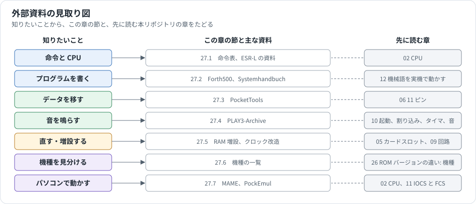
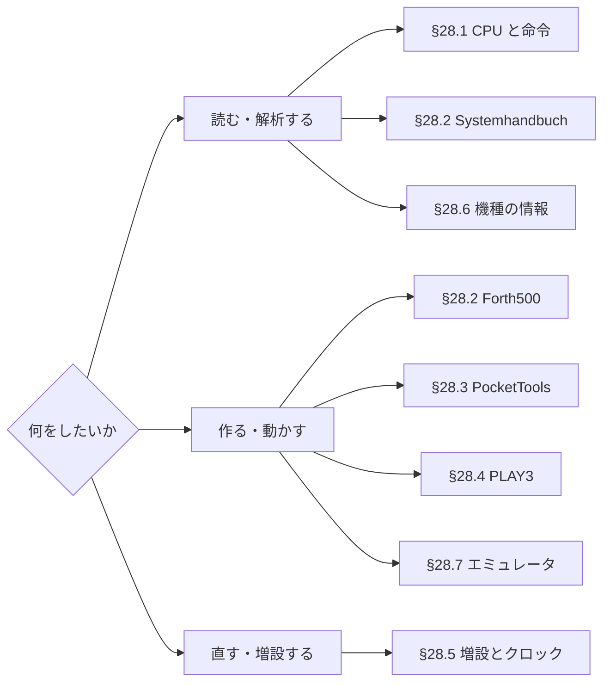
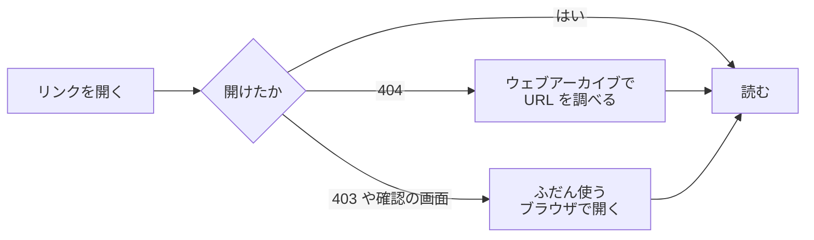

# 28. 外部資料

この章はネットの上にある PC-E500 シリーズの解析資料とツールの案内です。「もっと詳しく知りたい」「別の人の調べた結果と突き合わせたい」ときに、どのページを開けばよいかを目的別に並べました。この 30 年あまりの間に多くの人が調べた結果が、あちこちに残っています。

内容は 2026-11-06 に読み、リンクは 2026-11-25 に開けるかどうかを確かめ直しました（§28.9）。周辺機器の出典は [周辺機器](16_PERIPHERALS.md) §16.10 にあります。

[目次へ戻る](README.md)

## この章で分かること

- 知りたいことから、どの資料を開けばよいか
- それぞれの資料の中身と、本リポジトリの資料との関係
- ほかの資料と本リポジトリで食い違う所
- 読めなかった資料と、その理由
- リンクが今も開けるか

## 28.0 読み方

書かれている内容はそれぞれのページの記述です。特に断らなければ、本リポジトリで確かめたものではありません。「アーカイブ」と書いたページは、元のサイトが読めず、ウェブアーカイブのコピーで読みました。

先に本リポジトリの章で全体をつかみ、足りないところを外部資料で補うと迷いません。目的別の道順は次のとおりです。

| 目的 | 最初に開くもの | 次に開くもの |
|---|---|---|
| 命令の意味や番号を確かめる | [CPU（SC62015）](02_CPU.md) §2.15 | §28.1 の 2 つの命令表 |
| 機械語のプログラムを書く | [機械語を実機で動かす](12_MACHINE_CODE.md) | §28.2 の Forth500 のソース |
| BASIC やメモリの内部を知る | [メモリ](03_MEMORY.md)、[BASIC の内部形式](15_BASIC_INTERNALS.md) | §28.2 の Systemhandbuch |
| カセットの音とファイルを変換する | [11 ピン（テープ、周辺機器）](06_PORT_11PIN.md) | §28.3 の PocketTools |
| ブザーで音楽を鳴らす | [起動、割り込み、タイマ、音](10_SYSTEM.md) | §28.4 の PLAY3-Archive |
| 増設、改造をする | [カードスロット](05_CARD_SLOT.md)、[回路とサービス](09_CIRCUIT.md) | §28.5 |
| 機種の違いを調べる | [ROM バージョンの違い: 機種](27_ROM_VERSIONS_MODELS.md) | §28.6 |
| 別のエミュレータの作りを見る | [IOCS と FCS](11_IOCS.md) | §28.7 |

> [!NOTE]
> 資料によっては、別の機種や別のバージョンの ROM を対象にしています。アドレスを使う前に、自分のバージョンを [ROM マップ](21_ROM_MAP.md) §21.0 の方法で確かめてください。

## 28.1 CPU と命令

SC62015 は ESR-L とも呼ばれ、シャープのほかの機械にも使われています。そのため、PC-E500 以外の機械の解析資料も役に立ちます。

| 資料 | 内容 |
|---|---|
| [gikonekos/sc62015-opcode-reference](https://github.com/gikonekos/sc62015-opcode-reference) | SC62015 の命令表を印刷物から再構成したもの。実機での確認は途中。ライセンスは CC BY-SA 4.0 |
| [Hackaday の紹介記事](https://hackaday.com/2026/03/26/reconstructed-sc62015-opcode-reference-for-sharp-pocket-computers/) | 上の資料の紹介 |
| [Ben Ryves の journal](https://benryves.com/journal/3763200) | ESR-L の Ghidra モジュール。シャープの IQ-7000 系の解析で、IOCS（`FFFE8h`）の呼び方は PC-E500 と同じとある |
| [sarnau/SharpIQDocuments](https://github.com/sarnau/SharpIQDocuments) | シャープの電子手帳（IQ シリーズ）の資料集。`ESR-LInstructionManual.pdf`、`SharpElectronicOrganizer.pdf`、周辺機器 CE-131T と CE-133T の PDF などが並ぶ（上の journal で紹介。中身は読んでいない） |
| [Andrew Woods の命令表](http://www.andrewwoods3d.com/pce500/insttabl.html) | ESR-L の命令表（アーカイブ）。OZ-7000、IQ-7000 にも同じ CPU が使われているとある。下に比較の結果 |
| [tmizuno 氏のライブラリ](http://www.kt.rim.or.jp/~tmizuno/pocket/library/sharp01.html) | ESR-L の逆アセンブラ DISASM12.LZH、SC62015 のクロスアセンブラ XASM など、Lisp インタプリタ（アーカイブ）。DB-Z、PV-F1、ZAURUS の ESR-P は ESR-L の拡張とある |

Andrew Woods の表の 256 命令を [CPU（SC62015）](02_CPU.md) §2.15 の表と比べると、254 個のニーモニックが同じで、違いは次の 2 つでした。

| 命令 | Andrew Woods | 本リポジトリ | 判断 |
|---|---|---|---|
| `B7h` | `MV (m),(n)` | `CMP (m),(n)` | Systemhandbuch の命令表（p.93）も `CMP`。エミュレータの実装も引き算してフラグだけ変えます。`C8h` が `MV (m),(n)` なので、Andrew Woods の表の誤記と見られます |
| `BCh` | `MVP ((n)),X` | `MV [(n)],X` | どちらも 3 バイトの転送。書き方の違い |

sc62015-opcode-reference の実装メモには次の記述があります。

| 項目 | 記述 |
|---|---|
| `IL` への書き込み | `IH` も 0 になる |
| ループ命令で `I` が 0 | 10000h 回として扱う |
| プレバイト | 20h〜27h、30h〜37h |
| `CEh` | 未確定 |
| `DEh` | `HALT` |

## 28.2 開発環境と言語

プログラムを書く人に向いた資料です。Forth500 は動くものとソースの両方が手に入り、Systemhandbuch は内部の構造を広く扱っています。

| 資料 | 内容 |
|---|---|
| [Robert-van-Engelen/Forth500](https://github.com/Robert-van-Engelen/Forth500) | PC-E500(S) 用の Forth 2012。ソースに詳しい注釈がある。SC62015 のアセンブラ XASM を同梱 |
| [Forth500 の resources](https://github.com/Robert-van-Engelen/Forth500/tree/main/resources) | 4 つの PDF。`ESR L CPU technical manual.pdf`（CPU の資料、5.4 MB）、`PC-E500 manual.pdf`（操作説明書、7.0 MB）、`PC-E500 systemhandbuch.pdf`（7.1 MB）、`PC-E500 technical manual.pdf`（技術資料、5.7 MB） |
| Systemhandbuch（上の resources） | ドイツ語の解析書（Fischel GmbH）。シャープの資料ではない。周辺機器、メモリ、変数、中間コード、RAM ディスク、FUNCKEY、AER、ENG、システムアドレス、文字セット、CPU の命令表。内容は [メモリ](03_MEMORY.md)、[BASIC の内部形式](15_BASIC_INTERNALS.md) に取り込み、実験で確かめた項目はその旨を書きました。読んでいないページは下の「読めなかった資料」にあります |

Forth500 のソースから分かることです。

| 項目 | 内容 |
|---|---|
| 機械語エリアの確保 | `POKE &BFE03,&1A,&FD,&0B,0,&FC-&xx,0: CALL &FFFD8` で `&Bxx00`〜`&BFC00` を確保。確認は `HEX PEEK &BFD1B` |
| エントリ | `fcs` は `FFFE4h`、`iocs` は `FFFE8h` |
| BREAK | `test ($ff),$08` |
| 割り込みの禁止 | `and ($fb),$7f` |
| 配置 | 32 KB の機種は `&B9000`、拡張機は `&B0000` |
| 速度 | n-queens が 3.47 秒 |

## 28.3 転送とテープ

カセットの音声とファイルをパソコンで変換するツールです。

| 資料 | 内容 |
|---|---|
| [PocketTools](https://www.peil-partner.de/ifhe.de/sharp/) | シャープのポケコンのテープ用ツール（アーカイブ。v2.1.1、2022 年）。Wav2bin、Bin2wav、Bas2img。`CSAVE`、ASCII、`OPEN CAS`、`CSAVE M` を読む。`TstE5Inv` は PC-E500 で `-dINV` が必要かを調べるプログラム。Forth500 の説明に `bin2wav --pc=E500 --type=bin` の例がある |

テープの形式は [11 ピン（テープ、周辺機器）](06_PORT_11PIN.md) にあります。

## 28.4 音

本体のブザーは 1 ビットの出力で、鳴っているか止まっているかしかありません。それで和音を鳴らす工夫を解説した資料です。

| 資料 | 内容 |
|---|---|
| [gikonekos/PLAY3-Archive](https://github.com/gikonekos/PLAY3-Archive) | 1 ビットのブザーで 3 音を鳴らす PLAY3 の解析。原作は Ryu（Tatsuya Kobayashi）氏、1993 年 11 月のポケットコンピュータジャーナル |
| [Hackaday のタグページ](https://hackaday.com/tag/sharp-pc-e500) | PLAY3 の紹介記事 |

## 28.5 ハードウェアと改造

内蔵 RAM の増設、RAM カードの自作、クロックの変更の記録です。機種によって部品や基板が違うので、自分の機種と合うかを確かめてから読んでください。

| 資料 | 内容 |
|---|---|
| [cazacov/PocketComputers](https://github.com/cazacov/PocketComputers/tree/main/sharp-e500) | 内蔵 RAM の 128 KB 化と 256 KB RAM カードの自作。回路図と KiCad のデータ。カードの端子は [カードスロット](05_CARD_SLOT.md) §5.2 で使いました |
| [内蔵 RAM の増設（OIT）](https://www.oit.ac.jp/rd/labs/kobayashi-lab/~yagshi/old_web/misc/pocketcom/memup/index.html) | 62256 を 628128 に交換。PC-U6000 での作業 |
| [PC-E500 のメモリが 1 MB に迫る勢い](https://g-shoes.net/blog/index.php/view/229) | 空きアドレスに SRAM を追加して 704 KB にした記録と、CE0〜CE7 のアドレス |
| [Arno Welzel 氏の PC-E500S](https://arnowelzel.de/en/projects/technology-museum/pocket-computers/sharp-pc-e500s) | PC-E500S の紹介と 256 KB 化 |
| [Thimet 氏の PC-E500](https://www.thimet.de/CalcCollection/Calculators/Sharp-PC-E500/Contents.htm) | PC-E500 と PC-E500S の増設の例 |
| [HP Museum の Turbo mode の話題](https://www.hpmuseum.org/forum/post-174973.html) | クロック改造（4.8 MHz セラロック、68 kΩ）。検索結果の抜粋のみ確認し、本文は取得できなかった |

| 知りたいこと | 資料 |
|---|---|
| 内蔵 RAM を増やす | cazacov/PocketComputers、OIT の増設、g-shoes の 704 KB の記録、Arno Welzel 氏、Thimet 氏 |
| RAM カードを作る | cazacov/PocketComputers |
| クロックを上げる | HP Museum の Turbo mode の話題 |

## 28.6 機種の情報

| 資料 | 内容 |
|---|---|
| [sharppocketcomputers.com](https://sharppocketcomputers.com/) | 機種の一覧。15 ピンの表、技術資料の一覧 |
| [Wikipedia: Sharp PC-E500S](https://en.wikipedia.org/wiki/Sharp_PC-E500S) | 機種の違いと周辺機器 |
| pocket.free.fr の PC-E500 | 機種の紹介（アーカイブ）。RAM は 32〜544 KB、カードは 2〜512 KB とある |

## 28.7 エミュレータ

| 資料 | 内容 |
|---|---|
| [MAME](https://github.com/mamedev/mame) | SC61860（PC-1350 などの CPU）はあるが、`src/devices/cpu` の一覧に SC62015 や ESR-L の名前のフォルダはない（2026-11-25 に確認） |
| [matsumo/PockEmul](https://github.com/matsumo/PockEmul) | PC-E500 に対応するエミュレータのソース。`src/cpu/sc62015.cpp`、`src/machine/ce515p.cpp`、`src/machine/sharp/Ce126.cpp`、`ce140f.cpp` など。CE-515P の部分は [CE-515P プロッタ](19_CE-515P_PLOTTER.md) §19.10.1 で比べた。ほかの部分は読んでいない。リポジトリには ROM のファイルも含まれているようなので、取り扱いには注意してください |

## 28.8 読めなかった資料

今回は読めなかった資料です。どこまで読んだかを残しておくことで、次に調べる人が同じ所から始められます。

| 資料 | 理由 |
|---|---|
| HP Museum のフォーラム | 取得を拒否された。ウェブアーカイブでも読めなかった |
| Systemhandbuch の一部 | スキャンは読めるが未読のページ。p.68〜69（文字の表）、p.76〜91 と p.94 以降（命令表とその前後）。命令表は p.92〜93 だけ読み、`B7h` の行を確かめました |
| kyoro205 の計算機データベース | 404 |
| シャープの 1987 年カタログ（sharp-pc-1600.de） | 大きすぎて取得できなかった |

## 28.9 リンクの確認（2026-11-25）

この章のリンクを 1 つずつ開き、応答を見ました。個人のページはある日なくなることがあります。開けなくなったときは、[ウェブアーカイブ](https://web.archive.org/)に URL を入れると、昔のコピーが見つかることがあります。

| 資料 | 結果 |
|---|---|
| GitHub の 7 つ（sc62015-opcode-reference、SharpIQDocuments、Forth500、PLAY3-Archive、PocketComputers、MAME、PockEmul） | 開ける |
| Hackaday の記事とタグのページ、Ben Ryves の journal、Wikipedia | 開ける |
| Andrew Woods の命令表、tmizuno 氏のライブラリ | 開ける（元のサイトが応答する。命令表はウェブアーカイブにもコピーがある） |
| Arno Welzel 氏、Thimet 氏、g-shoes.net、sharppocketcomputers.com | 開ける |
| 大阪工業大学（OIT）の増設の記事 | 開ける。`/labs/rd/rssrv/` で始まる新しい場所へ転送される |
| PocketTools | 元の場所は 404。ウェブアーカイブに 2025 年 12 月のコピーがある |
| HP Museum のフォーラム、manualslib | 自動の取得を拒む（403）。ブラウザで開く |

> [!TIP]
> 資料どうしが食い違ったら、まず自分のバージョンを確かめ、次に ROM のバイトを見ます。命令の動きならエミュレータの実験、回路なら実機の測定が決め手です。本リポジトリの章では、その区別を「公式」「コード」「実験」「推定」の印で示しています。

## まとめ

- 命令表は 2 種類あり、Andrew Woods の表は本リポジトリの表と 254 個が一致し、違いは `B7h` と `BCh` の 2 つです。
- プログラムを書くなら Forth500 のソース、内部の構造なら Systemhandbuch が中心になります。
- テープは PocketTools、音は PLAY3-Archive、増設は §28.5 の各ページです。
- 2026-11-25 の時点で、PocketTools だけが元の場所になく、ほかは開けます（HP Museum と manualslib はブラウザで）。
- 書かれている内容は各ページの記述で、特に断らなければ本リポジトリでは確かめていません。

## 次に読むもの

- [CPU（SC62015）](02_CPU.md)
- [機械語を実機で動かす](12_MACHINE_CODE.md)
- [周辺機器](16_PERIPHERALS.md) §16.10（周辺機器の出典）
- [ROM マップ](21_ROM_MAP.md)
