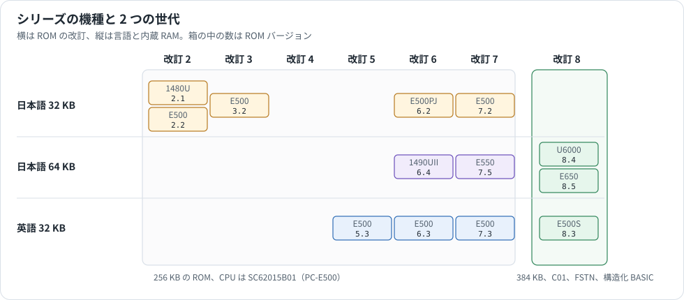
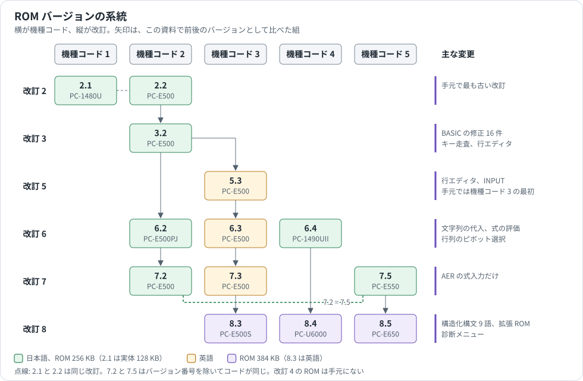
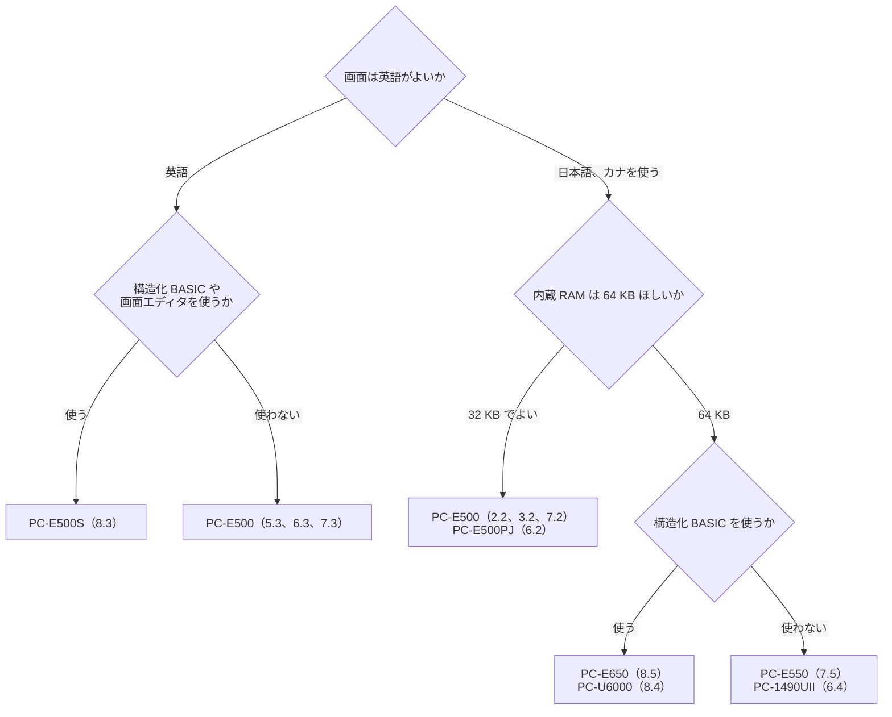
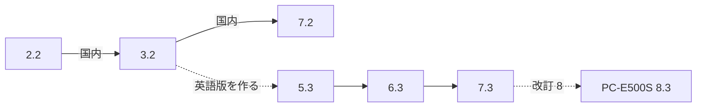
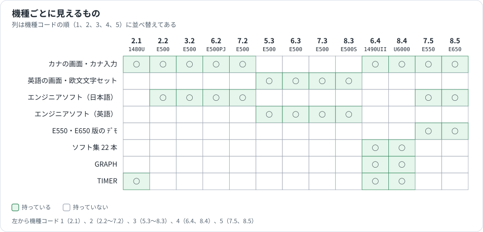
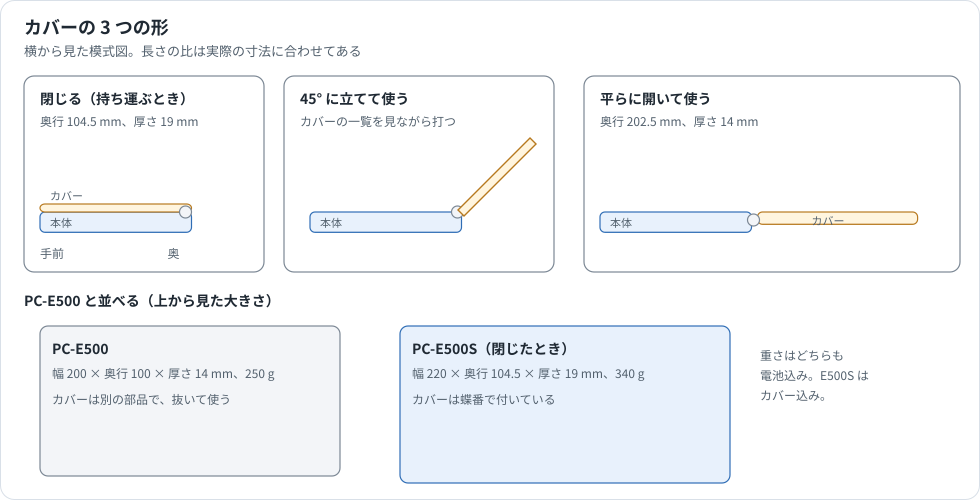
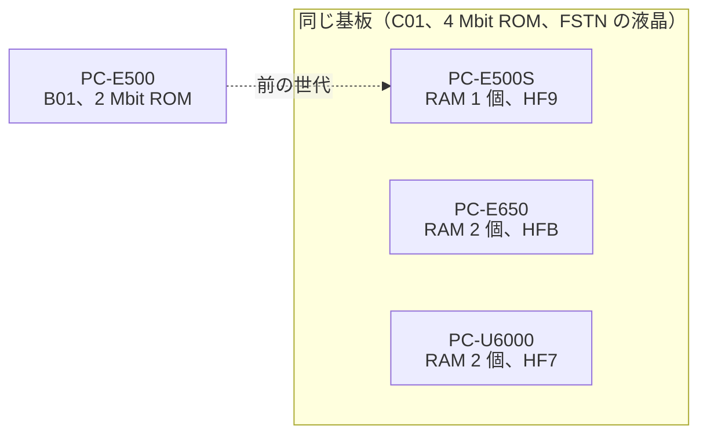
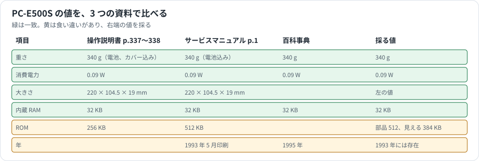

# 29. 機種ガイド

この章は PC-E500 シリーズの機種ごとに、ハードウェア、ROM、BASIC、ソフトの違いを 1 か所にまとめた章です。自分の機種に何ができるか、ほかの人のプログラムが自分の機種で動くか、説明書や百科事典の値が食い違うときにどれを信じるか、を調べるときに読みます。くわしい根拠はそれぞれの章にあります。

[目次へ戻る](README.md)

## この章で分かること

- シリーズの機種と、見分け方
- 機種ごとの部品、ROM バージョン、言語、付属ソフト
- PC-E500S が PC-E500 や PC-E650 とどう違うか
- 機種ごとの性格と、選ぶときの目安
- 資料によって食い違う値（重さ、消費電力、ROM、年）と、どれを採るか
- どの機種でも動くプログラムを作るときに気をつけること

## 29.0 はじめに

シリーズの機種は同じ CPU、同じ画面、同じ端子、同じ BASIC を持つ兄弟です。違いは大きく 3 つの軸で整理できます。

1. 世代。ROM の改訂が 7 までの機種と、改訂 8 の機種（PC-E500S、PC-E650、PC-U6000）です。改訂 8 は ROM が大きく、構造化 BASIC があります。
2. 言語。日本語の機種と、英語の機種（PC-E500 の一部と PC-E500S）です。画面の言葉、文字、カナ入力の有無が変わります。
3. 内蔵 RAM。32 KB と 64 KB です。



図の横が世代、縦が言語と RAM です。PC-E500S は「英語、32 KB」の段で、改訂 8 に進んだただ 1 つの機種だと分かります。ROM を持っていない PC-1490U は図にありません。

たとえば、構造化 BASIC を使ったプログラムを友人に渡すとします。相手が右の列の 3 機種なら動き、ほかでは動きません。カナを使ったプログラムなら、一番下の段では別の文字になります。64 KB いっぱいに作ったプログラムは、32 KB の段には入りません。

## 29.1 シリーズの全体

次の図は ROM バージョンの系統、表は機種の一覧です。



| 機種 | ROM バージョン | ROM サイズ | 内蔵 RAM | 発売年 | 画面の言語 | 構造化 BASIC | 章 |
|---|---|---|---|---|---|---|---|
| PC-1480U | 2.1 | 256 KB（実体 128 KB） | 32 KB | 1988 | 日本語 | − | [29.7](#297-pc-1480upc-1490upc-1490uii) |
| PC-E500（国内） | 2.2、3.2、7.2 | 256 KB | 32 KB | 1988 / 1989 | 日本語 | − | [29.3](#293-pc-e500) |
| PC-E500（英語） | 5.3、6.3、7.3 | 256 KB | 32 KB | 1988 / 1989 | 英語 | − | [29.3](#293-pc-e500) |
| PC-E500PJ | 6.2 | 256 KB | 32 KB | 1990 | 日本語 | − | [29.5](#295-pc-e500pj) |
| PC-E550 | 7.5 | 256 KB | 64 KB | 1990 | 日本語 | − | [29.6](#296-pc-e550pc-e650) |
| PC-1490U | （ROM なし） | | 32 KB | 1990 | | | [29.7](#297-pc-1480upc-1490upc-1490uii) |
| PC-1490UII | 6.4 | 256 KB | 64 KB | 1991 | 日本語 | − | [29.7](#297-pc-1480upc-1490upc-1490uii) |
| PC-E650 | 8.5 | 384 KB | 64 KB | 1993 | 日本語 | あり | [29.6](#296-pc-e550pc-e650) |
| PC-U6000 | 8.4 | 384 KB | 64 KB | 1993 | 日本語 | あり | [29.8](#298-pc-u6000) |
| **PC-E500S** | **8.3** | **384 KB** | **32 KB** | **1993**（百科事典は 1995） | **英語** | **あり** | [29.4](#294-pc-e500s) |

内蔵 RAM と発売年は百科事典の値です（[周辺機器](16_PERIPHERALS.md) §16.1）。PC-E500S の内蔵 RAM は操作説明書（p.18）とサービスマニュアルでも 32 KB です。年は、サービスマニュアルが 1993 年 5 月に印刷されているので、1993 年としました（[29.10](#2910-資料の食い違い)）。ROM バージョンは調べた 13 本の ROM イメージで確かめたものです（[ROM バージョンの違い: BASIC](24_ROM_VERSIONS_BASIC.md) §24.1）。

ROM サイズの欄は ROM イメージのサイズで、CPU から見えるサイズです。改訂 8 の部品そのものは 4 Mbit、つまり 512 KB です（[IC チップ](08_IC_CHIPS.md) §8.3.3）。

### 機種を選ぶ



中古で手に入れるときは、外見の名前だけでなく ROM バージョンも見てください。同じ PC-E500 でも、2.2 と 7.2 では BASIC の修正の数がずいぶん違います（[29.3](#293-pc-e500)）。

### 共通するもの

次のものはどの機種でも同じです。プログラムを移すときは、ここだけに頼れば安全です。

| 項目 | 内容 |
|---|---|
| CPU | SC62015（ESR-L）、2.304 MHz |
| 表示 | 240 × 32 ドット、40 桁 × 4 行、HD61202 2 個と HD61203 1 個 |
| 公開エントリ | `FFFE8h`（IOCS）、`FFFE4h`（FCS）、`FFFD8h` など。呼び出しアドレスは同じ |
| 機械語エリア | 確保の手順と、終わりの `BFBFFh` |
| BASIC の中間コード | 159 語は全部同じ番号 |
| 接続口 | 11 ピン、15 ピン、カードスロット |

## 29.2 機種とバージョンの確認

ROM の末尾近くに、バージョンを表す 2 バイトがあります。1 つ目（`FFFF0h`）が改訂、2 つ目（`FFFF1h`）が機種コードです。BASIC で打てば、分解せずに調べられます。左が改訂、右が機種コードです。

```basic
PRINT PEEK &HFFFF0;PEEK &HFFFF1
```

| 表示 | 機種 | 表示 | 機種 |
|---|---|---|---|
| `2  1` | PC-1480U | `7  2` | PC-E500 |
| `2  2` | PC-E500 | `7  3` | PC-E500 |
| `3  2` | PC-E500 | `7  5` | PC-E550 |
| `5  3` | PC-E500 | `8  3` | **PC-E500S** |
| `6  2` | PC-E500PJ | `8  4` | PC-U6000 |
| `6  3` | PC-E500 | `8  5` | PC-E650 |
| `6  4` | PC-1490UII | | |

たとえば `8  3` と出たら、改訂 8、機種コード 3 なので、PC-E500S です。`7  3` なら同じ機種コードでも改訂 7 なので、英語の PC-E500 です。

機種コード（右の数）の意味は次のとおりです（[ROM バージョンの違い: 機種](27_ROM_VERSIONS_MODELS.md) §27.1）。

| 機種コード | 機種 | メインメニューの 5 番目 | カナ入力 | 文字セット |
|---|---|---|---|---|
| 1 | PC-1480U | TIMER | あり | 国内 |
| 2 | PC-E500（国内）、PC-E500PJ | ｴﾝｼﾞﾆｱ | あり | 国内 |
| 3 | PC-E500（英語）、**PC-E500S** | ENG | なし | 欧文（コードページ 437） |
| 4 | PC-1490UII、PC-U6000 | GRAPH | あり | 国内 |
| 5 | PC-E550、PC-E650 | ｴﾝｼﾞﾆｱ | あり | 国内 |

BASIC を使わずに見当を付けることもできます。メインメニューの 5 番目が `ENG` なら英語の機種、`TIMER` なら PC-1480U、`GRAPH` なら PC-1490UII か PC-U6000、`ｴﾝｼﾞﾆｱ` なら国内の PC-E500 の仲間です。`SHIFT` と `,` を押しながら RESET して診断メニューが開けば、改訂 8 の機種です（[29.4](#294-pc-e500s) の注意を読んでから）。

## 29.3 PC-E500

シリーズの中心になる機種です。国内版（日本語、機種コード 2）と英語版（機種コード 3）があります。この本の画面は国内版の 7.2 が標準です。ROM バージョンは改訂 2 から 7 まで 6 種類を調べました。シリーズで一番バージョンが多い機種です。

カバーは別の部品で、使わないときにキーボードの面へ滑らせて付け、使うときは抜きます（操作説明書 p.6）。

| 項目 | 内容 | くわしく |
|---|---|---|
| CPU | SC62015B01 | [IC チップ](08_IC_CHIPS.md) §8.2 |
| ROM | `LH5320X□`（2 Mbit = 256 KB、44 ピン）。末尾の文字でバージョンが分かる | §8.3 |
| RAM | HM62256LFP-12SLT（32 KB） | §8.4.1 |
| 液晶 | LF7448G | §8.1 |
| 電池検出 | MN1280Q | [回路とサービス](09_CIRCUIT.md) §9.2 |
| 内蔵 RAM のアドレス | `B8000h`〜`BFFFFh` | [メモリ](03_MEMORY.md) |
| プログラムとデータ | 28600 バイト | §9.1 |
| 大きさ、重さ | 200 × 100 × 14 mm、250 g（電池込み） | §9.1、操作説明書 p.352 |
| 電源 | 単 4 形 4 本、0.07 W、約 70 時間 | 同上 |
| スタック | 145 バイト（`GOSUB` 1 段 4、`FOR` 1 段 21） | 操作説明書 p.351 |
| 付属品 | ハードカバー、乾電池 4 本、リチウム電池、説明書 | 操作説明書 p.352 |

バージョンによる BASIC の違いは [ROM バージョンの違い: BASIC](24_ROM_VERSIONS_BASIC.md) にあります。改訂 3 で一番多くの修正が入り、改訂 6 で文字列の代入と行列演算が直りました。改訂ごとの要点は次のとおりです。

| 改訂 | PC-E500 のバージョン | 前の改訂からの変更 |
|---|---|---|
| 2 | 2.2（国内） | 調べた中で一番古いバージョン |
| 3 | 3.2（国内） | `VAL`、`LEN`、`LINE`、`NPR` など、一番多くの修正 |
| 5 | 5.3（英語） | 行エディタの空白の詰め方など |
| 6 | 6.3（英語） | 文字列代入のアドレス再計算、行列演算 |
| 7 | 7.2（国内）、7.3（英語） | BASIC の変更なし。AER モードの式の入力だけ（打てる長さが 78 文字になった） |



改訂 6 の国内版は、調べた範囲では PC-E500PJ（6.2）だけです。

## 29.4 PC-E500S

1993 年にサービスマニュアルが印刷された、改訂 8 の英語の機種です（百科事典では 1995 年で、シリーズで一番新しい）。英語版の PC-E500 の後継で、PC-E650 と同じ世代の基板と ROM を使い、内蔵 RAM は 32 KB という組み合わせです。

サービスマニュアル（p.1）は、PC-E500 の改良版で、見やすい FSTN の液晶を持ち、おもな変更は樹脂のキートップとハードカバーの付け方だと説明しています。部品表の説明書はドイツ、アメリカ、そのほかの国の 3 種類で、部品の欄にはカナダ、オーストラリアの名前もあります（p.19〜20）。海外向けの機種です。



### ひとことで

| 比べる相手 | 同じところ | 違うところ |
|---|---|---|
| PC-E500（英語、7.3） | 機種コード 3、英語の画面、欧文の文字、カナなし（`ANS` キー）、ENG のソフト、RAM 32 KB | ROM 384 KB、構造化 BASIC、画面エディタ、診断メニュー、CPU の型番、液晶、筐体 |
| PC-E650（8.5） | 基板の系統、CPU（C01）、4 Mbit の ROM、液晶、構造化 BASIC、画面エディタ、診断メニュー | 英語の画面、カナなし、RAM は 1 個（32 KB）、機種名の表示 |

### 外形

カバーは本体の奥の辺に蝶番で付き、平らにも 45° にも開けます。留め具をずらせば外せます（操作説明書 p.6）。

| 項目 | PC-E500 | PC-E500S |
|---|---|---|
| 大きさ | 200 × 100 × 14 mm | 閉じて 220 × 104.5 × 19 mm、開いて 220 × 202.5 × 14 mm |
| 重さ | 250 g（電池込み） | 340 g（電池とカバー込み） |
| 消費電力 | 0.07 W | 0.09 W |
| 電池の持ち | 約 70 時間 | 約 70 時間 |
| 付属品 | ハードカバー、乾電池、リチウム電池、説明書 | 乾電池、リチウム電池、ドライバ、説明書 |



### ハードウェア

| 項目 | PC-E500 | **PC-E500S** | PC-E650 | くわしく |
|---|---|---|---|---|
| CPU | SC62015B01 | **SC62015C01** | SC62015C01 | [IC チップ](08_IC_CHIPS.md) §8.2 |
| ROM | LH5320X□（2 Mbit） | **LH534HF9（4 Mbit、32 ピン）** | LH534HFB（4 Mbit） | §8.3.3 |
| RAM | HM62256（32 KB） | **AT256BF12L 1 個（32 KB）** | AT256BF12L 2 個（64 KB） | §8.4.2 |
| RAM の選択 | − | **R25 あり、R26 なし、IC11 なし** | R25 なし、R26 あり、IC11 あり | §8.4.2 |
| 液晶 | LF7448G | **LF7766Q（FSTN）** | LF7766Q（FSTN） | §8.1 |
| 電池検出 | MN1280Q | **RH5VA39A** | | [回路とサービス](09_CIRCUIT.md) §9.2 |
| カードの回路の IC9 | TC7S04F | **TC7S02F（NOR）** | | [カードスロット](05_CARD_SLOT.md) §5.4 |
| ロジック IC | TC4S81F、TC7S04F、TC4S66F | **TC7S02F、TC4S66F、TC3W01F、TC7S08F、TC4S11F、TC4S81F** | | §9.2 |
| 動作の電流 | 3.24 mA 以下 | **3.29 mA 以下**（+5 V。6.3 V での検査の手順では 3.77 mA 以下） | | §9.4 |
| 電源オフの電流 | 64 µA 以下 | **22.8 µA 以下** | | §9.4 |
| メモリ保護スイッチ S2 | CE0 の線を切る。カードは変わらない | **RAM のデコーダを止め、カードの CE1 も切る** | PC-E500S と同じ | §9.9 |
| ブザー | Q2 で片側だけ駆動 | **NAND ゲートで両側を駆動**（振れ幅が大きい） | | §9.10 |
| システム構成図 | CE-515P がある | **CE-130T と CE-135T（MAC）があり、CE-515P はない**（テストの手順には CE-515P が出てくる） | | [周辺機器](16_PERIPHERALS.md) |
| 重さ、消費電力 | 250 g、0.07 W（公式） | **340 g、0.09 W（公式。百科事典も同じ）**。別の筐体 | | [回路とサービス](09_CIRCUIT.md) §9.1 |

PC-E500S、PC-E650、PC-U6000 は同じ基板で、ROM、R25 と R26、IC11 だけが違います。



### メモリ

| アドレス | 内容 |
|---|---|
| `20000h`〜`3FFFFh` | 拡張 ROM（128 KB）。CE3 |
| `B8000h`〜`BFFFFh` | 内蔵 RAM 32 KB |
| `C0000h`〜`FFFFFh` | 本体 ROM（256 KB）。CE2 |

- 拡張 ROM と本体 ROM は 1 個の 4 Mbit の ROM で、CE2 と CE3 の 2 つのウィンドウから見えます（§8.3.3）。
- サービスマニュアル（p.3）のメモリ図は、`B0000h`〜`BFFFFh` の枠に 32 KB の RAM、`10000h` に 64 KB の「RAM card」と書いています。実際の RAM は `B8000h` からで、`10000h` は ROM カードのウィンドウです（同じマニュアルの p.4 は CE6 を ROM カードの選択としています）。
- 診断メニューの処理の RAM の先頭は、8.3 が `B8000h`、8.4 と 8.5 が `B0000h` です（[ROM バージョンの違い: 配置](23_ROM_VERSIONS_MAP.md) §23.9.3）。内蔵 RAM の大きさの違いに合います。
- エミュレータでは、ROM に 8.3、内蔵 RAM に 32 KB を指定します（VS Code 拡張なら `"pcE500.ramKB": 32`）。

### ROM 8.3 の中身

| 項目 | 内容 | くわしく |
|---|---|---|
| サイズ | 384 KB（拡張 ROM 128 KB + 本体 ROM 256 KB） | [ROM マップ](21_ROM_MAP.md) §21.1 |
| BASIC のキーワード | 168 語（構造化の 9 語を含む）。辞書は 8.5 と全バイト同じ | §24.2 |
| キーワード表 | `F4FD1h`、処理表 `F52DCh` | [ROM バージョンの違い: BASIC](24_ROM_VERSIONS_BASIC.md) §24.1 |
| 改訂 8 の修正 | #1〜#7 がすべて入っている | §24.3.5 |
| フォント | 拡張 ROM の `30000h`〜`305FFh`。5.3、6.3、7.3 のフォントと全バイト同じ | §23.9.3 |
| 拡張 ROM | 8.5 と同じ長さ（`30000h`〜`33A18h`）。違いはフォント、キー対応表の 3 バイト、機種名、診断メニュー、ジャンプ先 | §23.9.3 |
| G: ドライブ | 形式 A（英語の ENG のソフト）。7.3 とは `DEMO.50#` の表題だけが違う | [ROM バージョンの違い: 機種](27_ROM_VERSIONS_MODELS.md) §27.3 |
| プリンタの文字変換 | 型 B（機種コード 3 の ROM） | [ROM バージョンの違い: 行列演算とドライバ](25_ROM_VERSIONS_DRIVERS.md) |
| 逆行列の誤り | ない（改訂 6 以降で直っている） | §25.2.1 |
| 調べた ROM | PockEmul に同梱の ROM から取り出したもの | §24.1 |

### BASIC

PC-E500S の BASIC は改訂 7 までの 159 語に、構造化の 9 語を足したものです。

- `WHILE`〜`WEND`、`REPEAT`〜`UNTIL`、`SWITCH`〜`ENDSWITCH`、複数行の `IF`〜`ENDIF` が使えます（[BASIC の命令と関数](14_BASIC_REFERENCE.md)）。
- 構造化の 9 語を使ったプログラムは、PC-E500 など改訂 7 までの機種では動きません。ほかの 159 語は同じ番号です。
- 改訂 7 までの機種で動かしたときの結果は、命令によって違います（実験、7.2 と 7.3）。`WHILE`、`REPEAT`、`SWITCH` は `Syntax error` で止まりますが、**複数行の `IF` は止まらず、条件に関係なく次の行へ進みます**。
- 逆に、PC-E500 のプログラムで `CASEX` のように 9 語で始まる変数を使っていると、8.3 ではエラーになります（実験。7.2 と 7.3 では動く）。
- 国内の機種でカナキーのある位置のキーは `ANS` で、直前の答えを入力します。電源を入れた直後は 0 なので `0` が出ます（実験、[機種](27_ROM_VERSIONS_MODELS.md) §27.2.3）。カナには切り替わりません。カナのプログラムは欧文の文字に見えます。
- `5Ch` は `\` です（国内版は ¥）。`80h` から上はアクセント付きの文字、罫線、ギリシャ文字などです。

```basic
10 I=1
20 WHILE I<=5
30 PRINT I;
40 I=I+1
50 WEND
60 END
```

スタックは PC-E500 と同じ 145 バイトです。1 段に `GOSUB` 4、`REPEAT` 7、`WHILE` 8、`SWITCH` 9、`FOR` 21 バイトを使うので、単独なら 36、20、18、1、6 段までネストできます（公式、実験）。

画面エディタも改訂 8 の違いです。PC-E500（7.2）では、直した行から ENTER を押さずに別の行へ移ると修正が捨てられますが、8.3 では移るだけで修正がプログラムに入ります（操作説明書 p.189〜191、実験）。

| キー | PC-E500S の画面エディタでの働き | 確度 |
|---|---|---|
| `▶` `◀` | カーソルを出す、動かす。行の端を越えると前後の行へ移る | 公式、実験 |
| `▼` `▲` | 1 行下、上へ。移る前の行の修正がプログラムに入る | 公式、実験 |
| ENTER | 編集を終えて、`>` に戻る | 公式、実験 |
| `C-CE` | 今いる行の修正だけを捨てて終わる | 公式、実験 |
| モードのキー | 今いる行も入れてから、モードが変わる | 公式、実験 |

行番号を書き換えて移ると、元の行を残したまま、新しい番号の行ができます。行番号ごと全部消して移っても、行は消えません（実験、8.3）。

### 診断メニュー

PC-E500S、PC-E650、PC-U6000 には、`SHIFT` と `,` を押しながらリセットすると開く診断メニューがあります。PC-E500S の `ROM check` の表示は `ROM OK!` と `PC-E500S  Ver.08` です（実験）。**RAM を消す項目があります**。入り方と危険は [ROM バージョンの違い: システム](26_ROM_VERSIONS_SYSTEM.md) §26.2.4 を読んでから使ってください。

### 周辺機器とカード

- 11 ピン、15 ピン、カードスロットの端子の並びは PC-E500 と同じです（回路図、§5.1）。
- RAM カードは `40000h`〜`7FFFFh`、ROM カードは `10000h`〜`1FFFFh` です。
- RAM カードは PC-E500 と同じ 4 種類で、使える大きさも同じです（操作説明書 p.21）。
- CE-515P は PC-E500S でも使えます。操作説明書（p.24〜25、p.28）が載せていて、命令も ROM にあります。サービスマニュアルの構成図にないだけです。CE-516L は 15 ピンの側につなぎます。
- 内蔵 RAM を 256 KB にした改造の例があり、カードスロットはそのまま使えます（個人、[メモリ](03_MEMORY.md) §3.9）。

### 機械語

- 公開エントリ、機械語エリアの確保、`CALL` の規約は、ほかの機種と同じです。
- ROM 内のアドレスは 8.5 とも違います。公開エントリだけを使います。
- [サンプル](../../Samples/README.md)のアセンブラのプログラムは、ROM 8.3、内蔵 RAM 32 KB のエミュレータで動きます。

## 29.5 PC-E500PJ

機種コード 2 の、国内の機種です。ROM バージョンは 6.2 で、画面、カナ入力、エンジニアソフトは国内の PC-E500 と同じです。改訂 6 なので、文字列の代入、式の評価、行列演算の修正が入っています。

| 項目 | 内容 |
|---|---|
| ROM | 6.2（256 KB）。未使用領域は `9Fh` で埋まっている |
| 内蔵 RAM | 32 KB |
| G: ドライブ | 2.2、3.2、7.2 と、60 ファイル全部が同じ |
| 改訂 7（7.2）との違い | AER モードの式の入力だけ。BASIC は同じ |
| 見分け方 | `PRINT PEEK &HFFFF0;PEEK &HFFFF1` が `6  2` |

プログラムから見ると、7.2 の PC-E500 と同じものと考えてかまいません。PC-E500 と同じ機種コードなので、ソフトがこの 2 つを区別することもできません。改訂の数だけが手がかりです。

## 29.6 PC-E550、PC-E650

機種コード 5 の、国内の機種です。どちらも内蔵 RAM が 64 KB で、PC-E500 の 2 倍あります。PC-E550 は PC-E500 の世代、PC-E650 は PC-E500S と同じ改訂 8 の世代です。

| 項目 | PC-E550 | PC-E650 |
|---|---|---|
| ROM | 7.5（256 KB） | 8.5（384 KB、LH534HFB） |
| 内蔵 RAM | 64 KB | 64 KB（AT256BF12L 2 個） |
| 構造化 BASIC | なし | あり |
| 診断メニュー | なし | あり |
| エンジニアソフト | あり（ﾃﾞﾓに PC-E500 の仕様が出ない） | 同じ |
| 画面エディタ | なし | あり（改訂 8） |
| 基板 | | PC-E500S、PC-U6000 と同じ |
| 見分け方 | `7  5` | `8  5` |

内蔵 RAM は 64 KB なので、`B0000h`〜`BFFFFh` に見えます。この本の図の多くは PC-E650 の例です。

PC-E550 の ROM 7.5 は、7.2（PC-E500）とコードが 1 バイトも違いません。違うのはバージョン番号と、G: の `ﾃﾞﾓ` だけです。つまり PC-E550 は「RAM を 64 KB にした PC-E500」です。PC-E650 は同じ関係で「RAM を 64 KB にし、日本語にした PC-E500S」に当たります。

```text
            32 KB                 64 KB
改訂 7   PC-E500（7.2）   →   PC-E550（7.5）     日本語どうし
改訂 8   PC-E500S（8.3）  →   PC-E650（8.5）     英語と日本語
```

## 29.7 PC-1480U、PC-1490U、PC-1490UII

名前に U の付く、国内の機種です。PC-E500 と同じ CPU と BASIC を持ちますが、エンジニアソフトがなく、代わりに別のものが入っています。

| 項目 | PC-1480U | PC-1490UII |
|---|---|---|
| ROM | 2.1（機種コード 1） | 6.4（機種コード 4） |
| 内蔵 RAM | 32 KB | 64 KB |
| メニューの 5 番目 | TIMER | GRAPH（7 番目に TIMER） |
| G: ドライブ | なし | 別のソフト集（22 本、形式 B） |

PC-1490U の ROM は調べていません。2.1 の本体 ROM は前半（`C0000h`〜）が後半のコピーです。

PC-1480U は改訂 2 の機種で、ROM の実体は 128 KB です。G: のソフトを置く領域（`C0000h`〜`DFFFFh`）に中身がなく、後半のコピーが見えます。シリーズで一番小さい ROM です。改訂 3 より後の修正は入っていないので、`VAL("&HFFFFFFFFFF")` が `1` になるなどの古い動きがあります（[ROM バージョンの違い: BASIC](24_ROM_VERSIONS_BASIC.md) §24.3.1）。

PC-1490UII のソフト集は、理数、生活、道具、ゲームに分かれています。

| 分類 | 本数 | 例 |
|---|---|---|
| S-（理数） | 9 | 分数計算、3 次と 4 次の方程式、最小二乗 |
| L-（生活） | 7 | 日数計算、万年暦、コード表 |
| T-（道具） | 2 | ドット絵エディタ、通信 |
| G-（ゲーム） | 4 | インベーダー、競馬 |

メインメニューの `GRAPH` は、G: の隣に置かれた BASIC のプログラムです。関数のグラフと回帰を描きます（[機種](27_ROM_VERSIONS_MODELS.md) §27.3.2〜§27.3.3）。

## 29.8 PC-U6000

機種コード 4 の ROM 8.4（384 KB、LH534HF7）を積んだ機種です。基板は PC-E500S、PC-E650 と同じで、内蔵 RAM は 64 KB です。構造化 BASIC と診断メニューがあり、ソフトは PC-1490UII と同じソフト集です。

| 項目 | PC-E650 | PC-U6000 |
|---|---|---|
| ROM | 8.5（LH534HFB） | 8.4（LH534HF7） |
| 内蔵 RAM | 64 KB | 64 KB |
| メニューの 5 番目 | ｴﾝｼﾞﾆｱ | GRAPH（7 番目に TIMER） |
| G: のソフト | エンジニアソフト（形式 A） | ソフト集 22 本（形式 B）と `GRAPH.BAS` |
| 診断メニューの名前 | `PC-E650` | `PC-U6000` |

PC-E500S のサービスマニュアル（p.17）には、3 機種の部品の違いの表があります。ROM、R25、R26、IC11 の 4 つだけです。つまり PC-U6000 は、PC-E650 の ROM を替えて「PC-1490UII の後継」にした機種だと言えます。

## 29.9 どの機種でも動くプログラム

シリーズの中で一番条件のきびしい機種に合わせれば、どこでも動きます。RAM なら 32 KB、BASIC なら 159 語、文字なら ASCII、ROM なら公開エントリだけです。

| 気をつけること | 理由 |
|---|---|
| 公開エントリだけを呼ぶ | ROM 内のアドレスはバージョンごとに違う |
| 内蔵 RAM 32 KB に収める | PC-E500、PC-E500S、PC-E500PJ、PC-1480U は 32 KB |
| 構造化の命令を使わない | 8.3、8.4、8.5 だけ。複数行の `IF` は、ほかの機種では止まらずに間違った答えを出す |
| 9 語で始まる変数の名前を避ける | `CASEX`、`WHILE1` などは改訂 8 でエラー |
| ネストは改訂 7 の範囲で | `FOR` 6 段、`GOSUB` 36 段 |
| カナや ¥ を避ける | 機種コード 3（PC-E500S など）は欧文の文字 |
| G: のソフトに頼らない | 機種で違い、PC-1480U にはない |
| バージョンを調べて処理を分ける | `PEEK &HFFFF0`（改訂）、`PEEK &HFFFF1`（機種コード） |

```basic
10 R=PEEK &HFFFF0:M=PEEK &HFFFF1
20 IF R>=8 THEN PRINT "STRUCTURED BASIC OK"
30 IF M=3 THEN PRINT "ENGLISH MODEL"
```

改訂を調べて、古い機種では終了する例です。

```basic
5 IF PEEK &HFFFF0<8 THEN PRINT "NEED REV.8":END
```

## 29.10 資料の食い違い

機種の値は資料によって違うことがあります。PC-E500S について、操作説明書（ドイツ語版）、サービスマニュアル、百科事典を比べると次のようになります。



| 項目 | 食い違い | 採る値 | 理由 |
|---|---|---|---|
| 重さ | なし。説明書 p.338、サービスマニュアル p.1、百科事典がどれも 340 g | 340 g | 説明書は「電池とカバー込み」と断っている。PC-E500 の 250 g は電池込みで、カバーは別の付属品 |
| 消費電力 | なし。どれも 0.09 W | 0.09 W | PC-E500 は 0.07 W。電池の持ちは両方とも約 70 時間 |
| 大きさ | 説明書とサービスマニュアルが同じ | 閉じて 220 × 104.5 × 19 mm | 開いたときは 220 × 202.5 × 14 mm |
| 内蔵 RAM | なし | 32 KB | `FRE0` が 28600 で、説明書 p.3 と一致（実験） |
| ROM | 説明書 p.337 は 256 KB、サービスマニュアル p.1 は 512 KB | 部品は 512 KB、見えるのは 384 KB | LH534HF9 は 4 Mbit。説明書の値は PC-E500 のまま |
| 年 | サービスマニュアルは 1993 年 5 月印刷、百科事典は 1995 年 | 1993 年 | 印刷された資料を採る。説明書には発売日の記載がない |
| PC-E500 の ROM | サービスマニュアル p.1 は 128 KB、操作説明書 p.351 は 256 KB | 256 KB | ROM イメージは 256 KB（[回路とサービス](09_CIRCUIT.md) §9.1） |
| PC-E500S と CE-515P | 操作説明書にはあり、サービスマニュアルの構成図にない | 使える | 操作説明書 p.24〜25、p.28 と、検査の手順（サービスマニュアル p.9） |

PC-E500S の操作説明書（ドイツ語）を読むときに迷いやすい箇所です。

| ページ | 記載 | 実際 |
|---|---|---|
| 15 | `NO MEMORY` の約 3 分後に電源が切れる | PC-E500 の説明書（p.15）では約 3 秒 |
| 188 | 1 行は 80 文字まで | p.150、p.158 は 254 文字。実際も ENTER を含めて 254 文字 |
| 213 | AER で倍精度は使えない | 使える（実験） |
| 246 | `FOR` は 5 段まで | 6 段（実験） |
| 258 | 関連の項に `XNOR` | 命令にない。`XOR` |
| 307 | 例の `UNTIL B>0` は負の値で終わる | 正の値で終わる。負なら `UNTIL B<0` |
| 324 | `WHILE` の例は、A が 100 より大きい間 | 例は `A<=100`。100 以下の間 |
| 337 | ROM は 256 KB | 部品は 512 KB（見えるのは 384 KB） |
| 339 | 旧機種の一覧に PC-E500 と PC-E220 がある | PC-E500 の説明書にはない。PC-E500 のテープは `CLOAD`、PC-E220 のテキストは `LOAD "CAS:名前"` で読む（公式） |

## まとめ

| 覚えること | 内容 |
|---|---|
| 見分け方 | `PRINT PEEK &HFFFF0;PEEK &HFFFF1` |
| 2 つの世代 | 256 KB の ROM（改訂 2〜7）、384 KB の ROM（改訂 8: PC-E500S、PC-E650、PC-U6000） |
| PC-E500S | 英語、RAM 32 KB、構造化 BASIC、画面エディタ、C01 の CPU、FSTN の液晶、340 g、0.09 W |
| 64 KB の機種 | PC-E550、PC-1490UII、PC-E650、PC-U6000 |
| 英語の機種 | 機種コード 3 だけ（5.3、6.3、7.3、8.3） |

## 出典

- 操作説明書: PC-E500（英語版）p.6、p.351〜352、PC-E500S（ドイツ語版）p.3、p.6、p.18〜28、p.189〜191、p.337〜338。
- サービスマニュアル: PC-E500 p.1〜2、PC-E500S（1993 年 5 月）p.1〜6、p.17〜20。
- 百科事典: 内蔵 RAM と発売年（[周辺機器](16_PERIPHERALS.md) §16.1）。
- 実験: エミュレータの ROM 5.3、6.3、7.2、7.3、8.3。

## 次に読むもの

- [BASIC の命令と関数](14_BASIC_REFERENCE.md#147-改訂-8-の拡張構造化-basic): 構造化 BASIC の書き方
- [ROM バージョンの違い: 機種](27_ROM_VERSIONS_MODELS.md): 言語、文字、添付ソフトのくわしい比較
- [IC チップ](08_IC_CHIPS.md): 部品の型番
- [ROM バージョンの違い: BASIC](24_ROM_VERSIONS_BASIC.md): 修正の有無の早見表
- [導入と設定](../manual/02_INSTALL.md#23-機種に合わせる): VS Code で機種を選ぶ
