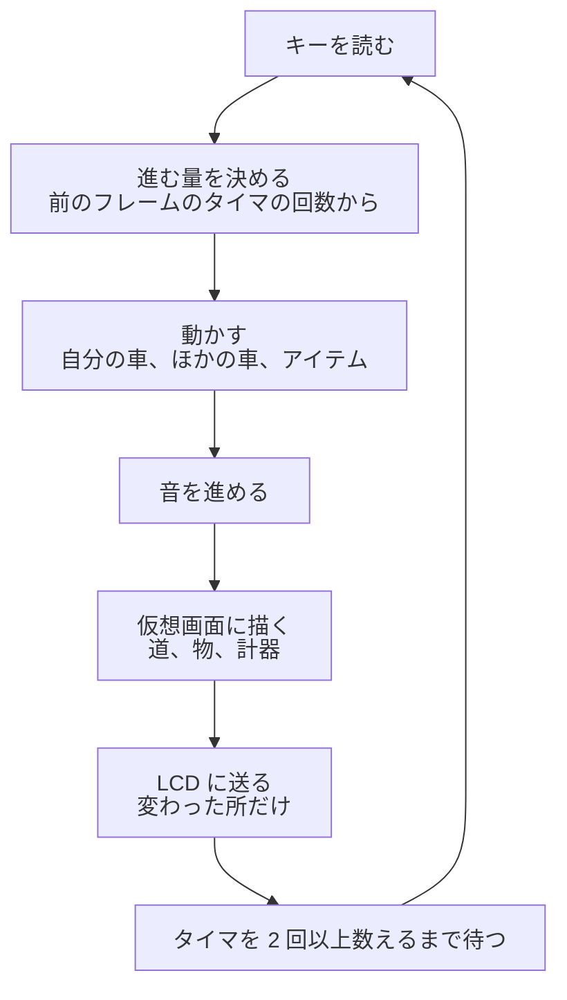
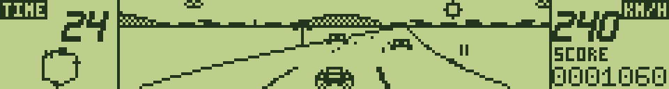

# 30. 機械語を速くする

この章は、PC-E500 シリーズの機械語を速く動かす方法を、測った数字とともにまとめたものです。題材は、後ろから見た道を 1 秒に約 20 枚描き直すレースゲーム（[PC-E500 ゲーム集](https://github.com/litchi-gh/pc-e500_games)の[ポケレーサー](https://github.com/litchi-gh/pc-e500_games/blob/main/Assembler/PokeRacer/README.md)。以下「例のゲーム」）です。画面を LCD に送る方法、送る量の減らし方、内部 RAM の使い方、1 枚の絵にかける時間の決め方、ゲームを止めずに音を出す方法を説明します。

[目次へ戻る](README.md)

## この章で分かること

- LCD へ 1 画面を送るのに、IOCS と直接書く方法でどれだけ差があるか
- 実機の LCD が取りこぼさない、データを書く間隔と、それに合わせたループの形
- 変わった所だけを送って、転送を減らす方法
- `BP = 0` にして内部 RAM を `(BP+n)` の形で使う理由
- 割り込みを止めた中で 16 ms のタイマを数え、絵の速さとゲームの速さを分ける方法
- 処理を止めずにブザーを鳴らす方法

## 30.0 はじめに

PC-E500 の CPU は 1 秒に 768000 サイクル動きます。1 サイクルは 1.30 µs です（[起動、割り込み、タイマ、音](10_SYSTEM.md) §10.1）。速いタイマの 16 ms は 12288 サイクルです。

動く画面は、1 枚の絵（フレーム）を作っては LCD に送る繰り返しです。1 秒に 20 フレーム出すなら、1 フレームに使えるのは 48 ms、36864 サイクルです。この中に、キーを読む、動かす、描く、LCD に送る、を全部入れます。

| 1 秒のフレーム数 | 1 フレームの時間 | サイクル | 16 ms のタイマの回数 |
|---|---|---|---|
| 31 | 32 ms | 24576 | 2 |
| 21 | 48 ms | 36864 | 3 |
| 16 | 64 ms | 49152 | 4 |

速くするときは、まず時間のかかっている所を測り、大きい所から削ります。この章の数字は、エミュレータ（ROM 7.2、RAM 32 KB）でルーチンを 1 回呼び、戻るまでに数えたサイクル数です（実験）。LCD が受け取れる書く間隔は、PC-E650 の実機で試しました（30.1.1）。命令ごとのサイクル数は[命令表](../manual/05_INSTRUCTIONS.md)と [CPU（SC62015）](02_CPU.md) §2.15 にあります。



## 30.1 LCD に送る方法を比べる

LCD の 1 画面は 240 × 32 ドット、960 バイトです。メモリの上に同じ形の仮想画面を作って描き、できたら LCD に送ります。送り方による違いは次のとおりです（実験）。

| 方法 | 1 バイトの間隔 | 1 画面のサイクル | 時間 |
|---|---|---|---|
| IOCS `SCRN_DOTS_WRITE`（8 ドットずつ）を 960 回 | — | 約 1060000 | 約 1.38 秒 |
| IOCS `SCRN_ROW_WRITE` を 4 行 | — | 24057 | 31.3 ms |
| 直接、1 バイトずつのループ（[`screen.inc`](../manual/06_INCLUDE_FILES.md) の `screen_show`） | 15 | 16442 | 21.4 ms |
| 直接、1 バイトずつのループ、書き先を Y に入れる（`screen_part.inc` の `screen_part`。例のゲームは `POPU A` の形） | 14〜15 | 15995 | 20.8 ms |
| 直接、7 バイトずつ展開し、`POPU A` で読む | 約 6.9 | 9692 | 12.6 ms |

最後の形はいちばん速いものの、実機では LCD がデータを取りこぼし、画面が崩れます（30.1.1）。実機で使えるのは、1 バイトに 14 サイクル以上かける形です。

IOCS は場所の計算や確認をするぶん遅くなります。速さがいるときは、LCD のコントローラに直接書きます。コントローラの命令とアドレスは [液晶（LCD）](04_LCD.md) にあります。

### 30.1.1 LCD が受け取れる間隔

LCD のコントローラ（HD61202）は、1 バイト受け取ると、しばらく BUSY になります。BUSY の間に来たデータは捨てられます（[液晶（LCD）](04_LCD.md) §4.4）。エミュレータは BUSY を真似しないので、どんなに速く書いてもエミュレータでは崩れません。

PC-E650 の実機で、データを書く間隔を変えて、2 つのコントローラに同じ模様を書きました（実験）。間隔は、次のデータを書くまでの CPU のサイクルです。

| 書き方 | 間隔 | 結果 |
|---|---|---|
| `0A00xh` に書く | 6、8、10 | 取りこぼす。後ろが詰まり、行の終わりに前の絵が残る |
| `0A00xh` に書く | 14、20 | 取りこぼさない |
| `0200xh` に書く（30.1.3 の遅い窓） | 6 ＋ 窓の待ち | ほとんど書けるが、1 か所崩れた |
| `0200xh` に書く | 10 ＋ 窓の待ち | 取りこぼさない |
| `0A00xh` に、1 バイトごとに BUSY が 0 になるのを待って書く | 待つだけ | 取りこぼさない |

ROM 自身は、1 バイトに 23〜28 サイクルかけています（実験、ROM 7.2 の表示の処理）。画面を消すループ（ROM 7.2 の `F2E80h`）は、書くたびに `EX BA,BA` を 3 つはさんで、わざと間をあけています（コード）。

そこで、データは 1 バイトに 14 サイクル以上かけて書きます。BUSY を毎回待つ形も確かですが、状態を読む `MV A,[Y-1]` が重く、例のゲームの道の所を送るのが 10826 から 17592 サイクルに増えました。

### 30.1.2 1 バイトにかかるサイクル

1 バイトを送るループの形ごとのサイクルです（サイクルは公式の命令表）。

| 形 | 1 バイトの命令 | サイクル |
|---|---|---|
| ループ（`screen_show`） | `MV A,[X++]` 4 + `MV [lmn],A` 5 + `DEC IL` 3 + `JRNZ` 3 | 15 |
| ループ、書き先を Y に入れる（`screen_part`） | `MV A,[X++]` 4 + `MV [Y],A` 4 + `DEC IL` 3 + `JRNZ` 3 | 14 |
| ループ、`POPU A` で読む（例のゲーム） | `POPU A` 2 + `NOP` 1 × 2 + `MV [Y],A` 4 + `DEC IL` 3 + `JRNZ` 3 | 14 |
| ループ、右から左 | `MV A,[--X]` 5 + `MV [Y],A` 4 + `DEC IL` 3 + `JRNZ` 3 | 15 |

- **書き先を Y に入れる。** `MV [lmn],A`（5 サイクル、4 バイト）より `MV [Y],A`（4 サイクル、2 バイト）が速くて短くなります。コントローラは書くたびに桁を 1 つ進めるので、書き先のアドレスは変えずに済みます。
- **`POPU A` で読まなくてよい。** 例のゲームは U を仮想画面のポインタにして、`POPU A`（2 サイクル、`MV A,[X++]` の半分）で読み、浮いたぶんを `NOP` 2 つで埋めて 14 にそろえています。`MV A,[X++]` でも同じ 14 サイクルで、U を預ける手間がいりません。`POPU A` が得になるのは展開するときだけで、展開は使えません（次の項目）。
- **展開しない。** ループを展開すると `DEC IL` と `JRNZ` の 6 サイクルは減りますが、間隔が 14 より短くなり、実機で取りこぼします。

画面の右半分（ページ 4〜7）は桁が右から左へ並ぶので、仮想画面を後ろから読みます（[液晶（LCD）](04_LCD.md) §4.5）。この所は `MV A,[--X]` を使います。

```asm
; [X++] から [Y] へ IL バイト送る（Y = コントローラのデータのアドレス）。間隔は 14 サイクル
put_fwd:
        MV    A,[X++]
        MV    [Y],A
        DEC   IL
        JRNZ  put_fwd
        RET

; [--X] から [Y] へ IL バイト送る。間隔は 15 サイクル
put_rev:
        MV    A,[--X]
        MV    [Y],A
        DEC   IL
        JRNZ  put_rev
        RET
```

ページと桁を決める命令の後は、BUSY が 0 になるのを待ってからデータを書き始めます。

この形で、仮想画面の四角い所と行を選んで送るルーチンが、[`screen_part.inc`](../manual/06_INCLUDE_FILES.md#変わった所だけを送る) の `screen_part` です。x の範囲が 4 つの区画のどこにかかっても、区画ごとに分けて送ります。

`POPU A` で読む形にするときは、U をポインタに使っている間に `PUSHU` すると、呼んだ先のルーチンの中でも仮想画面に書き込んでしまいます。元の U は外部メモリに預けて送り終えたら戻し、その間に呼ぶルーチンは S スタック（`PUSHS`、`POPS`）を使います。

### 30.1.3 LCD のアドレス

LCD のコントローラは、`2000h` 台のほかに `0A000h` 台でも同じものが見えます（[液晶（LCD）](04_LCD.md) §4.2）。

| アドレス | 1 回のアクセス | 使っているもの |
|---|---|---|
| `02000h`〜`0200Bh` | 7 ステート（CPU が LCD ドライバのウィンドウとして遅くする範囲。公式 p.22） | `hardware.inc` の `LCD_*` |
| `0A000h`〜`0A00Bh` | 1 ステート | ROM の表示の処理（コード、ROM 7.2 の `F2E3Ch`〜`F2E90h`） |

例のゲームは中央のコントローラを `0A008h`（命令）、`0A009h`（状態）、`0A00Ah`（データ）、両端のコントローラを `0A004h`、`0A005h`、`0A006h` で使っています。この章のサイクルはエミュレータで数えたもので、エミュレータはこのウィンドウの待ちを数えません。窓の待ちだけでは間隔が足りないことがあるので（30.1.1）、どちらのアドレスでも、1 バイトに 14 サイクル以上かけます。

## 30.2 送る量を減らす

960 バイト全部を毎フレーム送る必要はありません。例のゲームの画面は、中央の道（x = 43〜196）が毎フレーム変わり、左右の計器はたまにしか変わりません。



| 送る所 | サイクル | 時間 |
|---|---|---|
| 1 画面すべて | 17640 | 23.0 ms |
| 道の所、4 行 | 10826 | 14.1 ms |
| 道の所、1〜3 行（0 行目が前と同じとき） | 8445 | 11.0 ms |
| 計器の左の 2 行 | 1736 | 2.3 ms |

（どれも 30.1.2 の、1 バイトに 14〜15 サイクルかける形。途中で 30.4 のタイマも見ています。実験）

やっていることは次の 3 つです。

- **道の所だけ毎フレーム送る。** 道の所が LCD の両方のコントローラにまたがるので、1 行を 4 つに分け、両端は桁 43 から送ります。
- **計器は変わった行だけ送る。** 1 バイトの変数 `pdirty` の 8 ビットを、左右の計器の 4 行ずつに対応させます。描いたらその行のビットを立て、送ったら 0 にします。
- **計器を描くのは 1 フレームに 1 か所。** 時間、速さ、得点、コースの図を順番に回し、前と同じ値なら描きません。どれも 4 フレーム以内に新しくなります。

空と山を描く 0 行目は、カーブで背景が横に動いたときと、ゲートや文字が 0 行目にかかったときだけ送ります。

同じことは `screen_part.inc` の `screen_part` でもできます。左端の x、幅、行のビットを渡すだけです。たとえば道の所の 1〜3 行は `(screen_part_x)` = 43、`(screen_part_w)` = 154、`A` = `$0E`（ビット 1〜3）です。ただし汎用のぶん、区画の表を読む手間がかかります。例のゲームを `screen_part` で送るように変えて測ると、1 フレームの転送（道の 3 行と計器 1 行）が 9202 から 11296 サイクルに増え、タイトルのデモ走行のフレーム数は 1 秒に約 21 から約 20 に減りました（実験）。そのため例のゲームは、専用に書いた送り方のままにしています。1 画面すべてを送るときは、`screen_show` のほうが約 600 サイクル速くなります。

## 30.3 内部 RAM を速く使う

内部 RAM の指定には `(BP+n)` と、`(n)`、`(PX+n)` などの形があります。`(BP+n)` 以外の形は PRE バイトが付き、1 バイト長く、1 サイクル遅くなります（[CPU（SC62015）](02_CPU.md) §2.15）。

そこで、始めるときに BP（内部 RAM の `ECh`）を 0 にします。すると `(BP+n)` は内部 RAM の `n` 番地そのものになり、変数を全部速い形で使えます。

```asm
setup:  CALL  game_start        ; 内部 RAM 00h〜BFh の退避と、割り込みを止める
        MV    A,($EC)           ; BP を預ける（game_start の退避の外）
        MV    [save_bp],A
        MV    ($EC),0           ; BP = 0
        ...
quit:   MV    A,[save_bp]       ; BASIC に戻る前に BP を戻す
        MV    ($EC),A
        CALL  game_end
        RC
        RETF
```

| ルーチン | 変える前 | 変えた後 | 変えたこと |
|---|---|---|---|
| 道を描く | 17486 | 13749 | 変数を `(BP+n)` にし、中心の計算を短くした |
| 自分の車を描く | 2287 | 778 | 汎用の絵の表示（[`sprite.inc`](../manual/06_INCLUDE_FILES.md) の `sprite_draw`）をやめ、車の大きさ専用の描き方にした |

（サイクル、実験）

BP は BASIC も使うので、戻る前に必ず元に戻します（[機械語を実機で動かす](12_MACHINE_CODE.md) §12.3.4）。

## 30.4 フレームの時間を決める

処理の重さはフレームごとに違います。カーブで物が多いフレームは重く、まっすぐな道は軽くなります。そこで、1 フレームの時間を 16 ms のタイマの回数で数え、進む量をその回数に合わせます。

### 30.4.1 タイマを数える

`game_start`（[INCLUDE ファイル](../manual/06_INCLUDE_FILES.md)）の後は割り込みが止まっているので、ROM はタイマの印を消しません。速いタイマは 16 ms ごとに ISR（`FCh`）の MTI ビットを 1 にするので、自分で見て、数えて、0 に戻します（[起動、割り込み、タイマ、音](10_SYSTEM.md) §10.3、§10.4）。

印は 1 回分しか残りません。16 ms より長く見ないと、その間の回数が消えます。そこで、数えるルーチン `tick_poll` を、道を 1 ライン描くごと、物を 1 つ描くごと、LCD に 1 行送るごとに呼びます。例のゲームでは 1 フレームに 40 回ほどになります。

```asm
; 16 ms のタイマが来ていたら数える。A とフラグのほかは変えない。
tick_poll:
        PUSHS A                 ; LCD に送る間は U がポインタなので S に積む
        TEST  (ISR),MTI
        JRZ   tick_poll1
        AND   (ISR),$FF-MTI     ; 印を消す
        MV    A,[ticks]
        INC   A
        MV    [ticks],A
tick_poll1:
        POPS  A
        RET

; フレームの初めから 2 回たつまで待ち、たった回数を nt に入れる（6 回まで）
frame_wait:
        CALL  tick_poll
        MV    A,[ticks]
        CMP   A,2
        JRC   frame_wait
        CMP   A,7
        JRC   frame_wait1
        MV    A,6
frame_wait1:
        MV    [nt],A
        MV    A,0
        MV    [ticks],A
        RET
```

### 30.4.2 進む量を回数に合わせる

次のフレームでは、進む量を「1 回分の量 × `nt`」にします。重いフレームが 3 回から 4 回になっても、そのぶん遠くまで進むので、ゲームの速さ（1 秒に進む距離、残り時間の減り方）は変わりません。

| 決めたこと | 例のゲームの値 |
|---|---|
| いちばん短いフレーム | タイマ 2 回（32 ms）。軽すぎるフレームで速くなりすぎないように待つ |
| ふだんのフレーム | タイマ 3 回（48 ms、1 秒に約 20 フレーム） |
| 重いフレーム | タイマ 4 回（64 ms） |
| 1 回あたりの進む量 | 速さ（km/h）÷ 4 |
| 残り時間 | タイマを 62 回数えたら 1 秒減らす |

## 30.5 描く処理を軽くする

LCD に送る前の、仮想画面に描く処理にも同じ考え方を使います。

| 方法 | 内容 |
|---|---|
| 縦 8 ドットのバイトで描く | LCD の 1 バイトは縦 8 ドットです。道ばたの木や柱は縦線の集まりとして、1 バイトずつ OR で描きます。左右 2 列をまとめて 1 回の計算で描きます |
| 表を引く | 画面の 1 ラインごとの奥行きや道の幅は、計算せずに表から読みます |
| 足し算で進める | カーブで道の中心がずれる量は、ラインごとに足し算を重ねて求めます。かけ算を使いません |
| 命令の中の値を書き換える | 横線を引くループの `OR A,n` の `n` を、描く前にプログラムが書き換えます。ループの中でビットの形を読み直さずに済みます。RAM で動くプログラムなのでできる方法です |
| 描かなくてよいものは描かない | 計器は値が変わったときだけ描き（30.2）、画面の外に出た物は計算だけで飛ばします |

## 30.6 止めずに音を出す

ブザーは SCR（`FDh`）のビット 6〜4 で鳴らします（[起動、割り込み、タイマ、音](10_SYSTEM.md) §10.5）。鳴らし方で、処理を止めるかどうかが変わります。

| 鳴らし方 | 高さ | 処理 |
|---|---|---|
| ビット 6〜4 を 010 / 011 にする | 2 kHz / 4 kHz だけ | 止めない。CPU が何もしなくても鳴り続ける |
| ビット 4 を自分の周期で反転し、間を `WAIT` で待つ | 自由 | 鳴っている間は止まる |
| ビット 4 を、ほかの処理の合間に反転する | 呼ぶ間隔で決まる | 止めない |

例のゲームでは、3 つを場面で使い分けています。

- **効果音**: 「音の種類、フレーム数」の列を 1 フレームに 1 つ進めます。2 kHz と 4 kHz を組み合わせ、休みを入れて形を作ります。
- **曲**（タイトル、ステージの始まりなど）: `WAIT` で半周期を待って鳴らします。1 周期は「2 × 半周期 + 34 サイクル」です。画面が止まっていてよい所だけで使います。
- **エンジンの音**: 30.4 の `tick_poll` の中で、`(eng_acc) += (eng_step)` があふれるたびに `XOR (SCR),$10` でビット 4 を反転します。`eng_step` を速さに合わせて大きくすると、音が高くなります。

```asm
tick_poll:
        PUSHS A
        MV    A,(BP+eng_step)   ; 0 なら鳴らさない
        CMP   A,0
        JRZ   tick_poll0
        ADD   A,(BP+eng_acc)
        MV    (BP+eng_acc),A
        JRNC  tick_poll0        ; あふれたときだけ
        XOR   (SCR),$10         ; ブザーを反転
tick_poll0:
        TEST  (ISR),MTI
        ...
```

`tick_poll` を呼ぶ間隔はそろっていないので、エンジンの音は少しざらついた音になります。録った音を測ると、走っている間はずっと約 180〜280 Hz で鳴っていました（実験）。待つだけの `frame_wait` の中でも、`MV I,600` と `WAIT` を挟んで `tick_poll` を呼び続けると、待っている間も音が途切れません。

## 30.7 よくある落とし穴

| 症状 | 原因 | 対処 |
|---|---|---|
| エミュレータでは正しいのに、実機では画面の一部が描けず、前の絵が残る | LCD にデータを 14 サイクルより短い間隔で書いた | 1 バイトに 14 サイクル以上かける（30.1.1） |
| 送った画面の一部が壊れる | U を仮想画面のポインタにしている間に `PUSHU` した | その間に呼ぶものは `PUSHS` / `POPS` を使う |
| ゲームの速さがときどき遅くなる | タイマの印を 16 ms より長く見ていない | 重いループの中でも `tick_poll` を呼ぶ |
| 16 ビットの値の下位がおかしい | `MV BA,…` の後に `MV A,…` した。A は BA の下位バイト | 内部 RAM に預けるか、順番を変える |
| BASIC に戻ると BASIC が壊れる | BP を 0 にしたまま戻った | 戻る前に `ECh` を元に戻す |
| 命令を書き換える方法が動かない | ROM カードなど、書けない所で動かした | RAM に置いて動かす |

## まとめ

| 方法 | 効果 |
|---|---|
| LCD に直接書く | IOCS の 4 行転送 24057 → 15995 サイクル |
| データは 1 バイトに 14 サイクル以上かけて書く | 実機の LCD が取りこぼさない |
| 変わった所だけ送る | 1 画面 17640 → 道の所 8445 サイクル |
| `BP = 0` で `(BP+n)` を使う | 内部 RAM のアクセスごとに 1 サイクルと 1 バイト減る |
| タイマの回数で進む量を決める | 重いフレームがあってもゲームの速さは変わらない |
| ブザーは 2 kHz / 4 kHz か、合間の反転 | 処理を止めずに音が出る |

## 情報源と確度

| 表記 | 情報源 |
|---|---|
| **公式** | SHARP ESR-L Instruction Manual（p.22 の LCD ドライバのウィンドウ、p.74〜87 の命令のサイクル。[CPU（SC62015）](02_CPU.md) と同じ資料） |
| **コード** | ROM 7.2 の逆アセンブル（表示の処理が使う LCD のアドレス、画面を消すループの待ち） |
| **実験** | エミュレータ（ROM 7.2、RAM 32 KB）でルーチンを 1 回呼んで数えたサイクル数、録った音の周波数。PC-E650 の実機で、LCD にデータを書く間隔を変えて書いた模様 |

## 次に読むもの

- [液晶（LCD）](04_LCD.md): コントローラの命令とアドレス
- [CPU（SC62015）](02_CPU.md) §2.15: 命令ごとのサイクル数
- [起動、割り込み、タイマ、音](10_SYSTEM.md): タイマとブザー
- [ゲームを作る](../manual/07_GAME.md): `game.inc`、`screen.inc` を使ったゲームの作り方
- [ポケレーサー](https://github.com/litchi-gh/pc-e500_games/blob/main/Assembler/PokeRacer/README.md): この章の方法を使ったゲーム。動かして速さを見られます
