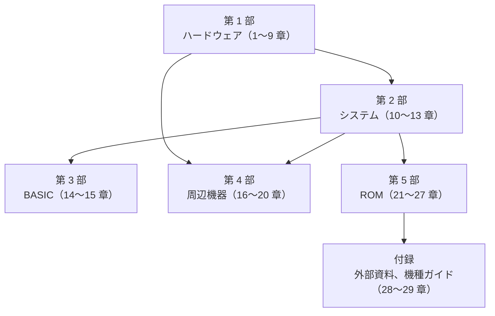

# PC-E500 シリーズ解析

SHARP PC-E500 シリーズ（PC-E500 / PC-E500S / PC-E550 / PC-E650 / PC-1480U / PC-U6000 など）の CPU、ハードウェア、ROM、BASIC、周辺機器を、ROM の解析と一次資料からまとめた本です。プログラムを作る人の資料としても、機械のしくみを知る読み物としても使えます。

ツールの使い方は[マニュアル](../manual/README.md)にあります。

## 目次

### 第 1 部 ハードウェア

| 章 | 題 | 内容 |
|---|---|---|
| 1 | [ハードウェアの全体](01_HARDWARE.md) | 全体の構成、各章の案内、キーボード |
| 2 | [CPU（SC62015）](02_CPU.md) | レジスタ、フラグ、メモリ空間、内部 RAM、ポート、UART、割り込み、アドレッシング、全命令、オペコード表 |
| 3 | [メモリ](03_MEMORY.md) | アドレスの割り当て、スロット、メモリブロック、作業域、RAM ディスク、システムアドレス |
| 4 | [液晶（LCD）](04_LCD.md) | 配線、コントローラのアドレスと命令、表示 RAM、インジケータ |
| 5 | [カードスロット](05_CARD_SLOT.md) | 端子、カードの認識、`MEM$`、書き込み保護、ROM カード |
| 6 | [11 ピン（テープ、周辺機器）](06_PORT_11PIN.md) | ピン配置、テープの信号とデータの形 |
| 7 | [15 ピン（シリアル）](07_PORT_15PIN.md) | ピン配置、`COM:` の設定、通信 |
| 8 | [IC チップ](08_IC_CHIPS.md) | CPU、ROM、RAM、LCD コントローラの型番 |
| 9 | [回路とサービス](09_CIRCUIT.md) | 部品、CPU のピン、消費電流、検査ソフト |

### 第 2 部 システム

| 章 | 題 | 内容 |
|---|---|---|
| 10 | [起動、割り込み、タイマ、音](10_SYSTEM.md) | リセット、割り込みの振り分け、タイマ、BEEP、自動電源オフ、電池 |
| 11 | [IOCS と FCS](11_IOCS.md) | 呼び出し方、デバイスと番号、ファイル制御、計算ドライバ |
| 12 | [機械語を実機で動かす](12_MACHINE_CODE.md) | 機械語エリア、`CALL` の規約、内部 RAM と割り込みの扱い、`LOAD M` |
| 13 | [フォント](13_FONT.md) | 6 × 8 ドットの字形の格納形式 |

### 第 3 部 BASIC

| 章 | 題 | 内容 |
|---|---|---|
| 14 | [BASIC の命令と関数](14_BASIC_REFERENCE.md) | 全命令の書式と引数、中間コード |
| 15 | [BASIC の内部形式](15_BASIC_INTERNALS.md) | 数値、変数、文字列、配列、プログラムの内部形式 |

### 第 4 部 周辺機器

| 章 | 題 | 内容 |
|---|---|---|
| 16 | [周辺機器](16_PERIPHERALS.md) | プリンタ、ディスク、カセットなどの仕様 |
| 17 | [CE-140F の通信](17_CE-140F_DISK.md) | ポケットディスクの通信手順とコマンド |
| 18 | [CE-126P プリンタ](18_CE-126P_PRINTER.md) | 11 ピンのプリンタの通信手順 |
| 19 | [CE-515P プロッタ](19_CE-515P_PLOTTER.md) | カラープロッタへ送るコマンドと図形の計算 |
| 20 | [カセットインターフェース](20_CASSETTE.md) | CE-124、CE-126P。つなぎ方、録音と再生、テープの命令、信号、うまくいかないとき |

### 第 5 部 ROM

| 章 | 題 | 内容 |
|---|---|---|
| 21 | [ROM マップ](21_ROM_MAP.md) | 領域、ファイルとアドレスの対応、固定エントリ |
| 22 | [G: ドライブ](22_ROM_GDRIVE.md) | ROM 内蔵のソフトの格納形式 |
| 23 | [ROM バージョンの違い: 配置](23_ROM_VERSIONS_MAP.md) | 公開エントリ、IOCS、フォント、拡張 ROM の比較 |
| 24 | [ROM バージョンの違い: BASIC](24_ROM_VERSIONS_BASIC.md) | 改訂ごとの修正、バージョン番号の読み方 |
| 25 | [ROM バージョンの違い: 行列演算とドライバ](25_ROM_VERSIONS_DRIVERS.md) | 行列演算、デバイスドライバ、エラーメッセージの表 |
| 26 | [ROM バージョンの違い: システム](26_ROM_VERSIONS_SYSTEM.md) | IOCS、FCS、表示、キー入力、行エディタ |
| 27 | [ROM バージョンの違い: 機種](27_ROM_VERSIONS_MODELS.md) | 言語、カナ入力、文字セット、添付ソフト |

### 付録

| 章 | 題 | 内容 |
|---|---|---|
| 28 | [外部資料](28_RESOURCES.md) | ほかの解析資料とツール |
| 29 | [機種ガイド](29_MODELS.md) | 機種ごとのまとめ。PC-E500S、PC-E650、PC-U6000 などの違いと見分け方 |

## 読み方の案内

| 知りたいこと | 読む順 |
|---|---|
| 機械語でプログラムを書く | [アセンブラ入門](../manual/03_ASSEMBLER_TUTORIAL.md) → 2 章 → 12 章 → 11 章 |
| 画面を速く描く | 4 章 → [INCLUDE ファイル](../manual/06_INCLUDE_FILES.md) |
| BASIC を深く知る | 14 章 → 15 章 → 24 章 |
| 周辺機器やエミュレータを作る | 1 章 → 6 章・7 章 → 16〜20 章 |
| 自分の機種と ROM の違いを知る | **29 章** → 24 章 → 27 章 |
| 修理や部品を調べる | 8 章 → 9 章 |

## この本の表記

| 書き方 | 意味 |
|---|---|
| `BFD1Ah` | 16 進のアドレス（CPU の 20 ビットのアドレス） |
| `(20h)` | 内部 RAM のアドレス |
| §12.3.2 | 12 章 3 節 2 項 |
| ROM 7.2 | ROM バージョン。読み方は [24 章](24_ROM_VERSIONS_BASIC.md) |
| 公式 / 書籍 / コード / 実験 / 推定 | 情報の確かさ。意味は各章の終わりにある |

参照元の操作説明書や技術資料の PDF は、このリポジトリに入っていません。
