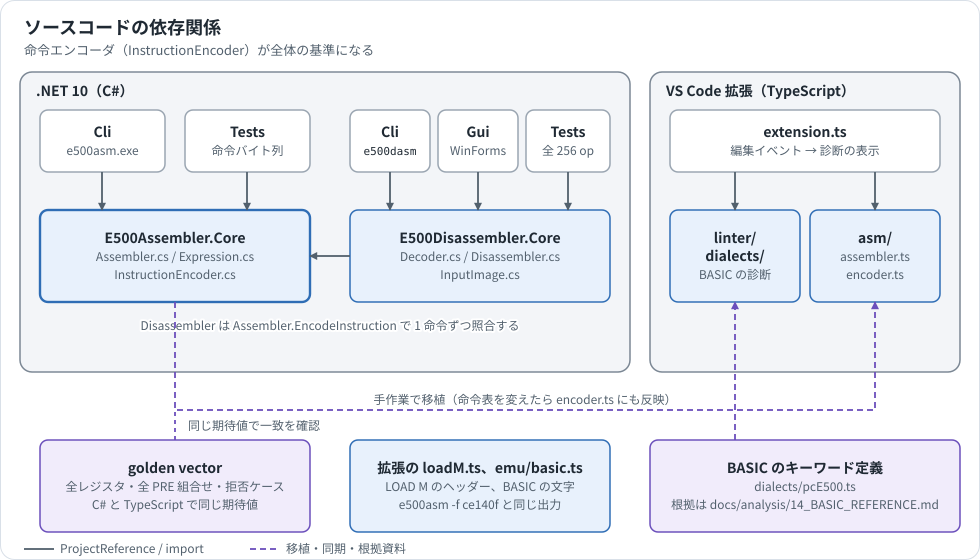
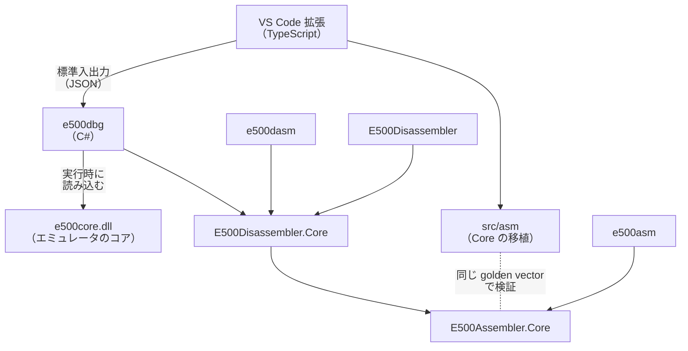
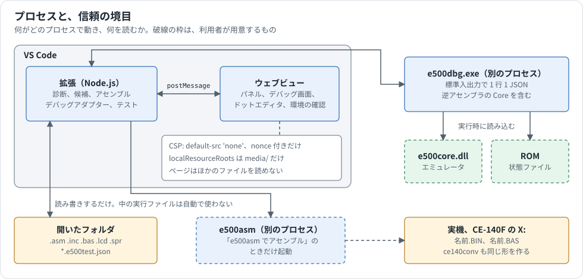
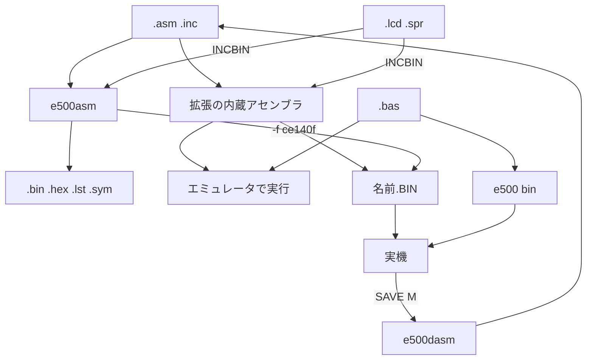

# 1. 全体の構造

この章はツール全体の概要です。どの部品でできていて、どうつながり、ソースが実機で動くまでにデータがどう流れるかを説明します。細かいことはあとの章に任せ、「この機能を直したいときは、どのフォルダを開けばよいか」がすぐに分かることを目指しています。初めてソースを触る人はここから読んでください。

[設計の目次へ戻る](README.md)

## この章で分かること

- フォルダと言語、部品の依存関係
- どのプロセスで動き、どこに信頼の境目があるか
- ソースから実機まで、データがどう流れるか
- 1 か所を変えたら、ほかにどこを直すか

## 1.1 構成

| 場所 | 言語 | 内容 |
|---|---|---|
| `Assembler/src/E500Assembler.Core/` | C# | アセンブラ本体（ライブラリ） |
| `Assembler/src/E500Assembler.Cli/` | C# | `e500asm` のコマンドライン |
| `DisAssembler/src/E500Disassembler.Core/` | C# | 逆アセンブラ本体（ライブラリ） |
| `DisAssembler/src/E500Disassembler.Cli/`、`.Gui/` | C# | `e500dasm` と GUI（Windows Forms） |
| `VSCodeExtensions/pc-e500-devtools/src/` | TypeScript | VS Code 拡張 |
| `VSCodeExtensions/pc-e500-devtools/media/` | JavaScript | パネル、デバッグ画面、ドットエディタ、環境の確認のページ |
| `VSCodeExtensions/pc-e500-devtools/server/` | C# | デバッグサーバー `e500dbg` |
| `VSCodeExtensions/pc-e500-devtools/inc/` | ASM | INCLUDE ファイル |
| `Samples/` | ASM、BASIC | 例題とゲーム |
| `docs/` | Markdown、SVG、PNG | マニュアル、設計、解析資料、図 |

ソースの大きさの目安です。全体を読む順番を決めるときに使ってください。

| 部分 | 行数の目安 | 中心のファイル |
|---|---|---|
| アセンブラ | Core 700、CLI 90 | `Assembler.cs`、`InstructionEncoder.cs` |
| 逆アセンブラ | Core 310、CLI 70、GUI 110 | `Decoder.cs` |
| 拡張 | TypeScript 8000（テストを除く） | `extension.ts`、`asm/assembler.ts`、`debug/adapter.ts` |
| 拡張のページ | JavaScript 2000 | `lcd.js`、`emulator.js` |
| `e500dbg` | 920 | `Program.cs`、`Machine.cs` |
| INCLUDE ファイル | 1000 | `sprite.inc`、`screen.inc` |

### なぜ 2 つの言語か

| 部分 | 言語 | 理由 |
|---|---|---|
| アセンブラ、逆アセンブラ | C# | 1 つの実行ファイルにでき、Windows、Linux、macOS で動く。逆アセンブラがアセンブラを部品として使える |
| 拡張 | TypeScript | VS Code の拡張の言語。編集のたびに診断するので、外のプロセスを呼ばずに自分で計算したい |
| `e500dbg` | C# | コアの DLL を呼べて、逆アセンブラの Core をそのまま使える |

アセンブラは C# と TypeScript の 2 つあります。「1 つの正解」を保つしくみは [1.5](#15-二重に持っているものと揃え方) で説明します。

## 1.2 依存関係

- 基準になるのは `InstructionEncoder.cs` です。逆アセンブラはこれを参照して出力を照合し、拡張の `src/asm/encoder.ts` はこれを移植したものです。
- `e500core.dll` と ROM は同梱しません。`e500dbg` が別のプロセスとして、実行時に利用者のものを読み込みます。拡張と `e500dbg` は MIT、コアは GPL-2.0-or-later のエミュレータの一部です。
- `LOAD M` のヘッダーは、アセンブラ、逆アセンブラ、拡張（`src/project/loadM.ts`）がそれぞれ持っています。
- 実行時に外のライブラリは使いません。C# は .NET の標準だけ、拡張は Node.js と VS Code の API だけです（`devDependencies` は型とビルドのツールです）。

### 依存の向きの決まり

| 部分 | 参照してよいもの | 参照しないもの |
|---|---|---|
| `E500Assembler.Core` | .NET の標準 | CLI、ほかのツール |
| `E500Disassembler.Core` | `E500Assembler.Core` | CLI、GUI |
| `e500dbg` | `E500Disassembler.Core`、`e500core.dll`（実行時） | 拡張 |
| `src/asm`、`src/linter`、`src/basic`（計算の部分）、`src/lcd/*File.ts` | Node.js の標準 | `vscode` |
| `src/extension.ts`、`*Provider.ts`、`*Panel.ts`、`*Editor.ts` | `vscode`、計算の部分 | − |

`vscode` を使わない部分を広く取ってあるのは、テストを VS Code なしの Node.js だけで動かすためです（[9 章](09_BUILD_TEST_RELEASE.md)）。

## 1.3 プロセスと、信頼の境目

| 境目 | 決まり |
|---|---|
| 拡張とページ | ページはファイルもネットワークも使えない。すべて `postMessage` で拡張に頼む |
| 拡張と `e500dbg` | 標準入出力だけ。ポートは開かない |
| 拡張と開いたフォルダ | ソースやデータは読み書きする。その中で見つけた実行ファイルや DLL は、候補に出すだけで自動では使わない |
| `e500asm` の起動 | 設定か、絶対パスの PATH にあるものだけ。`.cmd` / `.bat` は引数を引用符で囲む |
| コアと ROM | 利用者が用意したもの。リポジトリにも VSIX にも入れない |

VS Code の「制限モード」（信頼していないフォルダ）には、マニフェストの `capabilities.untrustedWorkspaces` で「限定」と宣言しています。診断や色分けなどの編集の機能はそのまま使えますが、実行するファイルを決める設定（アセンブラ、エミュレータ、ROM の場所など）は、そのフォルダの `.vscode/settings.json` からは読みません。フォルダを信頼すると、`pcE500.*` の設定をすべて使います。

## 1.4 データの流れ

| データ | 作るもの | 使うもの | 形 |
|---|---|---|---|
| `.asm` `.inc` | 人、逆アセンブラ | 2 つのアセンブラ | UTF-8（`e500asm` は `--encoding` で変えられる） |
| `.bin` | `e500asm` | ほかのツール | ヘッダーなしのバイト列 |
| `名前.BIN` | 拡張「BIN を作成」、`e500 bin`、`e500asm -f ce140f` | 実機の `LOAD M`、`e500dasm -f ce140f` | 16 バイトのヘッダー + 本体 |
| `.lst` `.sym` | `e500asm -l -s` | 人 | テキスト |
| `.lcd` `.pixels` `.spr` | ドットエディタ、テンプレート | `INCBIN`、テストの `picture` | [ファイル形式](../manual/19_FILE_FORMATS.md) |
| `.e500test.json` | 人、テンプレート | テスト エクスプローラー | [テスト](../manual/11_TESTS.md) |
| `.e500state` | エミュレータ | `launch.json` の `state` | JSON。`Data` にコアの状態（base64） |

### 例: 1 行の ASM が実機で動くまで

`MV A,5` が通る道を追います。

| 段 | 場所 | 姿 |
|---|---|---|
| 1 | エディタ | `start:  MV    A,5` |
| 2 | `parseStatement` | ラベル `start`、命令 `MV`、オペランド `["A", "5"]` |
| 3 | 符号化 | `08 05`（`MV A,n` は 08h、即値 1 バイト） |
| 4 | `binary` | アドレス BEC00h から `08 05 …` |
| 5 | `loadMFile` | `FF 00 06 01 10` `長さ` `00 EC 0B` `FF FF FF 00 0F` の後に `08 05 …` |
| 6 | 実機 | `LOAD M "X:GAME.BIN"` で BEC00h に置かれ、`CALL &HBEC00` で実行 |

## 1.5 二重に持っているものと、揃え方

同じ知識を 2 か所以上で持っているところは、食い違いが起きやすい場所です。次のしくみで揃えています。

| 知識 | 持っている場所 | 揃え方 |
|---|---|---|
| 命令の符号化 | `InstructionEncoder.cs`、`encoder.ts` | 双方のテストに同じ golden vector。`project.test.ts` は、テンプレートを `e500asm` と両方でアセンブルして比べる |
| 命令の書ける形（候補の表） | `instructions.ts` | テストが全部の形をエンコーダに通す |
| デコード | `Decoder.cs` | デコードした結果を `InstructionEncoder` でもう一度符号化して照合 |
| `LOAD M` のヘッダー | `Assembler.cs`、`InputImage.cs`、`loadM.ts`、`disassembler.ts` | 拡張のテストが `e500asm -f ce140f` の出力と比べる |
| IOCS の表 | `iocs.ts`、`inc/iocs.inc` | `iocsInclude()` で作り、テストが一致を調べる |
| 点と `.lcd` の対応 | `lcdFile.ts` の `dotPlace`、`lcd.js` の状態表示、`screen.inc` | エミュレータで実際に表示して比べる |
| BASIC のキーワード | `pcE500.ts`、`help.ts` | テストが過不足を調べる |
| 名前の規則 | `Assembler.cs` の `Name`、`assembler.ts` の `NAME_PATTERN`、`definition.ts`、文法（`syntaxes`） | 変えるときにまとめて直す |

## 1.6 変更するときに合わせて直す場所

| 変更 | 合わせて直す場所 |
|---|---|
| 命令表、符号化（`InstructionEncoder.cs`） | `src/asm/encoder.ts`、`src/asm/instructions.ts`（候補と説明）、`src/asm/hover.ts`（動作の式）、双方のテストの golden vector、`syntaxes/pc-e500-asm.tmLanguage.json`、[CPU（SC62015）](../analysis/02_CPU.md)、[命令一覧](../manual/05_INSTRUCTIONS.md) |
| 式、数の書式（`Expression.cs`） | `src/asm/expression.ts`、[アセンブラの文法](../manual/04_ASSEMBLER_REFERENCE.md#44-数と式) |
| `--org` の書式（`Assembler.ParseAddress`） | `e500asm` と `e500dasm` が共用。GUI の `RawOrigin`、`--help` の文面、[アドレスの書き方](../manual/14_TRANSFER.md#148-アドレスの書き方) |
| パス、疑似命令、診断（`Assembler.cs`） | `src/asm/assembler.ts`、[エラーメッセージ](../manual/04_ASSEMBLER_REFERENCE.md#49-エラーメッセージ) |
| `LOAD M` のヘッダー | `Assembler.cs` の `LoadMFile`、`InputImage.cs`、`src/project/loadM.ts`、`src/asm/disassembler.ts`、`src/emu/debugPanel.ts`（BIN の読み込み）、`server/Machine.cs`（ROM のダンプ）、[ファイル形式](../manual/19_FILE_FORMATS.md) |
| BASIC のキーワード | `src/dialects/pcE500.ts`、`src/basic/help.ts`、`syntaxes/pc-e500-basic.tmLanguage.json`、[BASIC の命令と関数](../analysis/14_BASIC_REFERENCE.md) |
| IOCS の番号と引数 | `src/asm/iocs.ts`（ここから `inc/iocs.inc`、候補、説明を作る）、[IOCS と FCS](../analysis/11_IOCS.md)、[INCLUDE ファイル](../manual/06_INCLUDE_FILES.md#番号) |
| `.lcd` / `.spr` の形 | `src/lcd/lcdFile.ts`、`sprFile.ts`、`media/lcd.js`、`inc/screen.inc`、`sprite.inc`、[ファイル形式](../manual/19_FILE_FORMATS.md) |
| `e500dbg` のコマンド | `server/Program.cs`、`src/emu/client.ts`、[デバッグサーバー](06_DEBUG_SERVER.md) |
| 設定、コマンド | `package.json`、`package.nls.json`、`package.nls.ja.json`、[設定とコマンド](../manual/17_SETTINGS.md) |
| 画面の文言 | `L("日本語", "English")` の両方 |
| コマンドラインのオプション | `--help`、マニュアルの該当する章 |
| バージョンの番号 | [9.5 版と配布](09_BUILD_TEST_RELEASE.md#95-版と配布) |

## 1.7 共通の方針

| 方針 | どう表れているか |
|---|---|
| 出力を壊さない | 一時ファイルに書いてから置き換える（`e500asm`、`e500dasm`、GUI）。入力と同じ出力先は断る |
| 推測しない | CE-140F の形式は、ヘッダーが 1 バイトでも違えば断る。表にない文字は私用領域に移して失わない |
| 実機と同じ経路を通る | BASIC は ROM の `LOAD` で読み、機械語エリアは ROM のルーチンで確保する |
| ROM バージョンに依存しない | ROM の中のアドレスの表を持たない。公開のエントリとハードウェアのアドレスだけを使い、必要なアドレスは動かして学ぶ |
| 個人の情報を出さない | リストにはファイル名だけ。`.gitignore` で個人の環境のファイルを除く |
| 日本語と英語 | 拡張と `e500dbg` の文言は 2 言語。コマンドラインのツールのメッセージは英語 |

## まとめ

| 覚えること | 内容 |
|---|---|
| 正解の中心 | `InstructionEncoder.cs`。TypeScript は移植、逆アセンブラは照合 |
| 実行の境目 | コアと ROM は `e500dbg` の中だけ。拡張は JSON で頼む |
| 変えたら | [1.6](#16-変更するときに合わせて直す場所) の表で合わせる場所を確かめる |
| 二重の知識 | [1.5](#15-二重に持っているものと揃え方) のテストで揃える |

## 次に読むもの

- [アセンブラ](02_ASSEMBLER.md): 正解の中心の作り
- [VS Code 拡張](05_VSCODE_EXTENSION.md): いちばん大きな部品
- [テスト、ビルド、配布](09_BUILD_TEST_RELEASE.md): 直したあとの確かめ方
