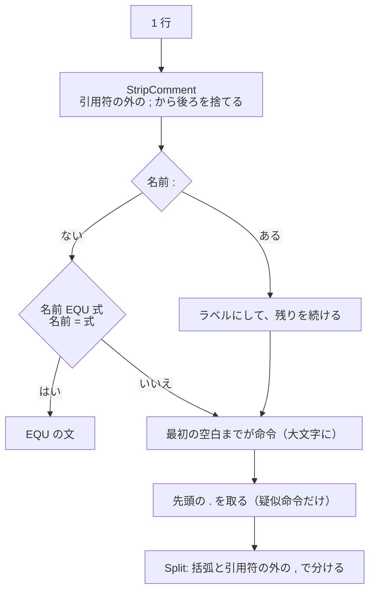
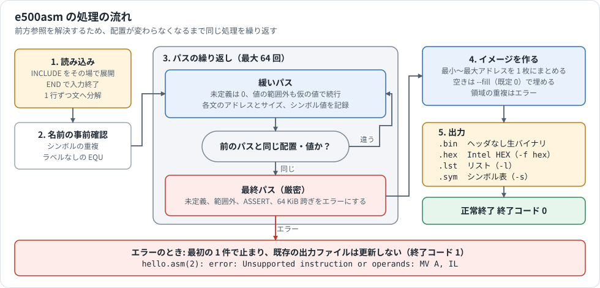
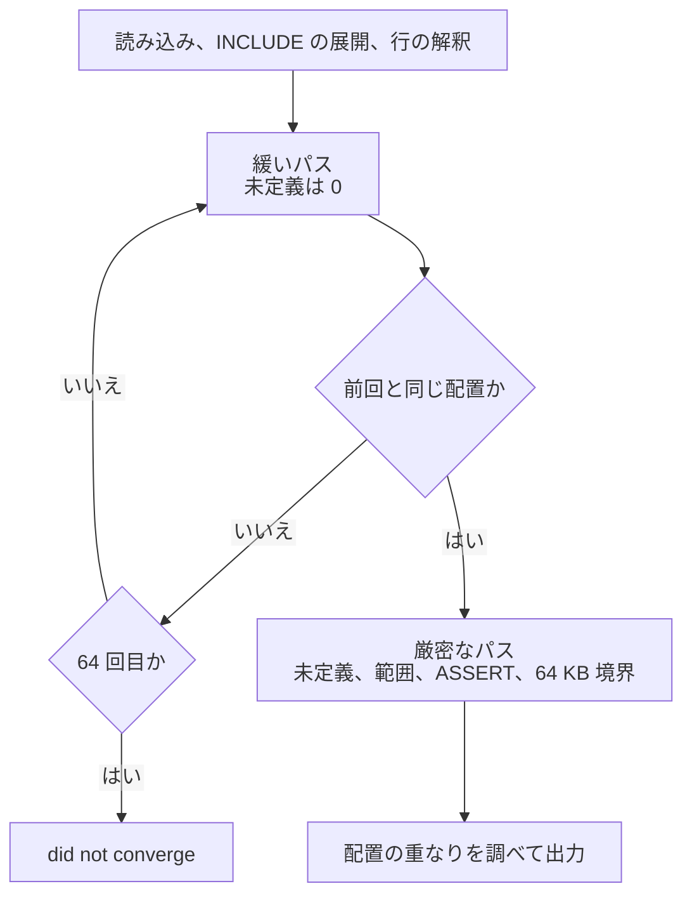
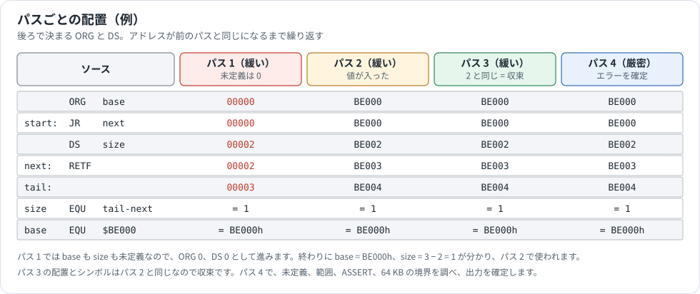
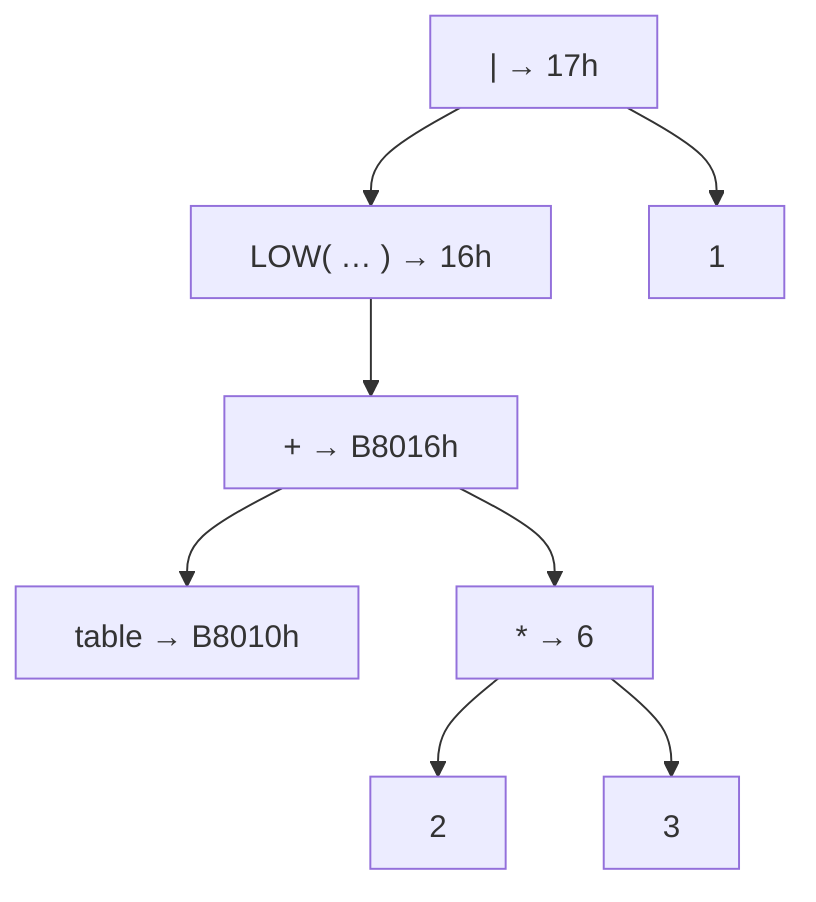
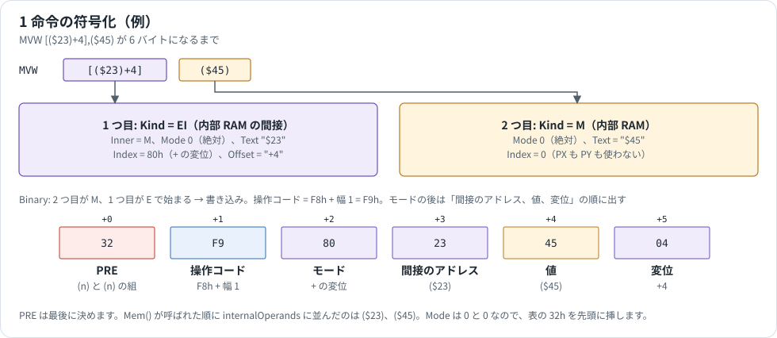
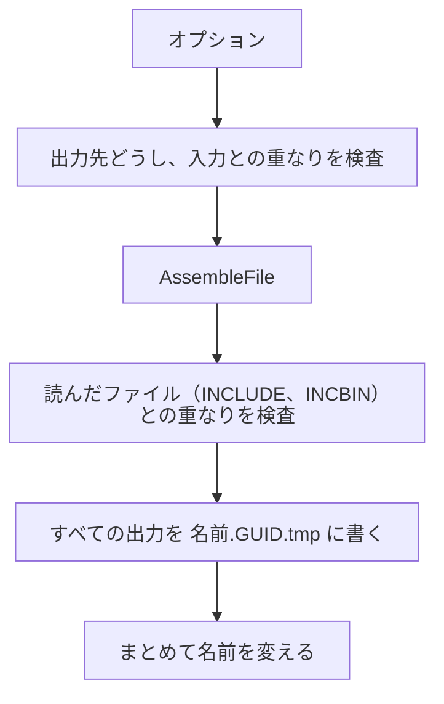

# 2. アセンブラ

この章はクロスアセンブラ `e500asm` の中身です。1 行の文字列が、分解され、アドレスが決まり、機械語になるまでを、実際のソースを追いながら説明します。アセンブラのいちばんの難しさは「まだアドレスの決まっていない名前を、どう扱うか」にあります。なぜ何度も読み直すのか、どこで止まるのかが分かれば、この章の半分は読み終わったことになります。使い方は[アセンブラの文法](../manual/04_ASSEMBLER_REFERENCE.md)にあります。

[設計の目次へ戻る](README.md)

## この章で分かること

- 1 行のソースがどう分解され、アドレスが決まり、バイト列になるか
- なぜ何回もパスを繰り返すのか、どこでエラーにするのか
- 式の計算、命令の符号化、PRE の選び方
- 命令、疑似命令、診断を足す手順

## 2.1 ファイル

| ファイル | 内容 |
|---|---|
| `Core/Assembler.cs` | 行の解釈、`INCLUDE`、パス、疑似命令、出力（bin、hex、lst、sym） |
| `Core/Expression.cs` | 式の計算（`Expression`）、コメント・オペランド・文字列の切り出し（`Syntax`）、例外 `AssemblyException` |
| `Core/InstructionEncoder.cs` | 命令の符号化、PRE の選択 |
| `Cli/Program.cs` | オプション、出力ファイルの保存 |
| `tests/E500Assembler.Tests/Program.cs` | Core のテスト |
| `tests/cli_smoke.py` | 実行ファイルのテスト |

Core は CLI に依存しません。`new Assembler().AssembleFile(path)` か `AssembleText(text)` の結果から、`Binary`、`Origin`、`Symbols`、`Listing`、`InputFiles` を取れます。1 命令だけなら `Assembler.EncodeInstruction(mnemonic, operands, address)` です。

### 目的と要件

| 要件 | 作りへの影響 |
|---|---|
| 後ろで定義した名前を、`ORG` や `DS` にも使える | 固定の 2 パスではなく、収束するまで繰り返す |
| 誤った機械語を黙って出さない | 最後に「厳密なパス」で、未定義、範囲外、境界をまとめて調べる |
| PRE を人が書かなくてよい | オペランドの形からエンコーダが決める |
| 拡張と逆アセンブラから使える | ライブラリにし、状態を持たない |
| マクロや条件アセンブルは持たない | 文の数はソースの行数と同じ。行とアドレスの対応が単純になる |

### データ構造

| 型 | 持つもの | 使う場所 |
|---|---|---|
| `SourceLine(File, Number, Text)` | ファイル、行番号（1 から）、元の文字 | エラーの位置、リスト |
| `Statement(Source, Label, Op, Args)` | ラベル（なければ null）、大文字にした命令、オペランドの配列 | パス |
| `AssemblerOptions` | `Origin` `Fill` `SourceEncoding` `IncludeDirectories` `Defines` | CLI が作る |
| `ListingLine(Source, Address, Bytes)` | 1 文のアドレスとバイト列 | 出力、リスト |
| `AssemblyResult` | `Origin` `Binary` `Symbols` `Listing` `InputFiles` | 呼び出し側 |

シンボルの表は大文字小文字を区別しません（`OrdinalIgnoreCase`）。`.sym` には、ソースに書いたとおりの大文字小文字で出ます。

## 2.2 行の解釈

`Parse` は 1 行を `Statement` にします。式の中身はまだ見ません。



| 段 | 関数 | 細かい決まり |
|---|---|---|
| コメント | `Syntax.StripComment` | `"…"` と `'…'` の中の `;` は残す。閉じない引用符は `Unterminated string` |
| ラベル | 正規表現 `^名前\s*:` | 名前は `[A-Za-z_.][A-Za-z_0-9.]*` |
| 定数 | `^名前\s+(?:\.?EQU\b\|=)\s*(.*)$` | 名前の後ろに空白が要る。式の全体が 1 つのオペランド |
| 命令 | 最初の空白まで | `.DB` のように `.` を付けた疑似命令も受ける |
| オペランド | `Syntax.Split` | `(` `[` のネストと引用符を数える。空の項目は `Empty operand` |

### 例

```text
loop:   MV    A,[X+4]   ; 次の値
```

| 部分 | 値 |
|---|---|
| コメントを取る | `loop:   MV    A,[X+4]` |
| ラベル | `loop` |
| 命令 | `MV` |
| オペランド | `["A", "[X+4]"]`（`[` の中の `,` は区切らない） |

`INCLUDE` はこの段で展開します。読み込み中のファイルの集合 `active` に同じファイルがあるか、深さが 64 を超えると `Recursive INCLUDE` です。`END` を見つけると、読み込んでいるすべてのファイルの残りを捨てます。`END` の後ろの行は解釈もしないので、誤りがあっても構いません。

### 名前を探す場所

`FindFile` は `INCLUDE` / `INCBIN` を書いたファイルのフォルダ、`-I` の順に探します。`/` を区切りに使う OS では、`inc\defs.inc` の `\` を `/` に読み替えます。

## 2.3 パス





- `ORG` や `DS` の式は後ろのラベルも参照できるので、アドレスは 1 度では決まりません。前のパスの結果を使って計算し、同じになるまで続けます。
- 緩いパスでは未定義のシンボルを 0 とします。この段階でエラーにはしません。
- 厳密なパスで配置が変わったらエラーです。
- `INCLUDE` はパスの前に展開し、再帰と深さ（64）を調べます。`INCBIN` はパスの中で 1 度だけ読みます。
- `EQU` は使われたときに計算し、計算中の名前をもう一度求めたら循環とします。途中でエラーになっても「計算中」の印は必ず外すので、未定義の名前を使った `EQU` は「未定義」とだけ報告されます。

### 1 回のパスで持ち越すもの

| 変数 | 中身 | 役割 |
|---|---|---|
| `previous` | 前のパスの終わりのシンボル | まだ来ていない名前の値 |
| `symbols` | このパスで決まったシンボル | 先に見る |
| `previousLayout` | 前のパスの（アドレス、長さ）の並び | 収束の判定、`EQU` の中の `$` |
| `layout` | このパスの（アドレス、長さ） | 次のパスへ |
| `binaryFiles` | `INCBIN` の中身 | 2 回目から読まない |

「同じ」とは、`layout` がすべて一致し、シンボルの数と値もすべて一致することです。

### 緩いパスと厳密なパスの違い

| 場面 | 緩いパス | 厳密なパス |
|---|---|---|
| 未定義の名前 | 0 | `Undefined symbol` |
| 名前の値 | このパスの値、なければ前のパスの値 | `ResolveFinal`（`EQU` は定義から計算し直し、ラベルは収束した値） |
| 範囲外の値（`ORG`、`DB` など） | 下限の値で続ける | `Value … outside …` |
| 命令の即値、分岐の距離 | 調べない | `does not fit`、`out of range` |
| 0 で割る | 未定義の名前があれば 0 | エラー |
| `ASSERT` | 計算だけ | 0 ならエラー |
| 使えない命令の形、オペランドの数 | エラー | エラー |

使えない形はどのパスでもエラーです。長さが決まらないと先へ進めないからです。

### 例: 1 行ずつ、パスごとに



できる機械語は 4 バイトです。

```text
BE000    12 01                     p.asm(2): start:  JR    next
BE002    00                        p.asm(3):         DS    size
BE003    07                        p.asm(4): next:   RETF
```

`JR next` は次の命令（BE002h）から BE003h までの +1 なので `12 01` です。

### 収束しない例

```text
a1 EQU a1+1
```

緩いパスでは、`a1` は前のパスの値に 1 を足したものになり、パスごとに 1、2、3、… と増えます。64 回目にも同じにならないので `Assembly layout did not converge` です。式を使う側から見つかる循環（`a1 EQU a2`、`a2 EQU a1`）は、値が 0 のまま収束するので、厳密なパスの `Cyclic EQU definition` になります。

## 2.4 式

`Expression` は優先順位を持つ再帰下降で、64 ビットの符号付き整数で計算します。桁あふれはエラーです。

- `$` と `*` は 16 進の数字や項が続くかどうかで、数と現在のアドレスを見分けます。
- 数は末尾の `h` を先に見るので、`0B8h` は 16 進です。`h` のない `0b…` は 2 進です。
- `'A'` は 1 バイトの文字だけです。

### 文法

```text
式     = 項 { 演算子 項 }          優先順位は下の表。同じ順位は左から
項     = ("+" | "-" | "~") 項
       | "(" 式 ")"
       | 文字定数 | 数 | "$" | "*" | 名前
       | 関数 "(" 式 ")"            LOW HIGH BANK
```

| 優先順位 | 演算子 | 備考 |
|---|---|---|
| 6（高い） | `*` `/` `%` | `*` と `+` `-` は `checked`（64 ビットを超えたらエラー） |
| 5 | `+` `-` | |
| 4 | `<<` `>>` | 右は 0〜63。`>>` は符号を保つ |
| 3 | `&` | |
| 2 | `^` | |
| 1（低い） | `\|` | |

`Binary(minimum)` は項を 1 つ読み、優先順位が `minimum` 以上の演算子が続く間だけ取り込みます。右側は `Binary(優先順位 + 1)` なので、同じ順位は左結合になります。

### 例: `LOW(table+2*3) | 1`

`table` = B8010h とします。



| 段 | `pos` の先 | 呼び出し | 値 |
|---|---|---|---|
| 1 | `LOW(` | `Binary(0)` → `Atom`: 名前の後ろが `(` なので関数 | |
| 2 | `table+2*3)` | `Binary(0)` | `table` = B8010h |
| 3 | `+2*3)` | `+` は 5 ≥ 0 → `Binary(6)` | 2、`*` は 6 ≥ 6 → 3 を取り込んで 6 |
| 4 | `)` | 優先順位 −1 → 戻る | B8010h + 6 = B8016h |
| 5 | ` \| 1` | `LOW` → 16h、`\|` は 1 ≥ 0 | 16h \| 1 = 17h |

### 見分けにくい書き方

| 書き方 | 読み方 | 理由 |
|---|---|---|
| `$-1` | 現在のアドレス − 1 | `$` の次が 16 進の数字でない |
| `$A-1` | 0Ah − 1 | `$` の次が 16 進の数字 |
| `2**3` | エラー | `2 * (現在のアドレス)` の後に `3` が残る |
| `0B8000h` | B8000h | `h` を `0b` より先に見る |
| `0b1010` | 10 | `h` がないので 2 進 |
| `B8000h` | 名前 `B8000h` | 数字で始まらない。`0B8000h` と書く |
| `&12` | 12h | `&` は 16 進の接頭辞。式の途中では AND |
| `1-2-3` | −4 | 左から |

## 2.5 符号化

`InstructionEncoder` はオペランドを種類（即値、レジスタ、内部 RAM、外部メモリ、間接）に分け、命令ごとの形と照合します。

### オペランドの種類

`Parse` が作る `Operand` の中身です。

| `Kind` | 書き方 | `Reg` | `Mode` / `Index` | `Offset` / `Inner` |
|---|---|---|---|---|
| `R` | `A` `IL` `BA` `I` `X` `Y` `U` `S` | 0〜7 | − | − |
| `B` `F` `IMR` | そのまま | − | − | − |
| `M` | `(n)` | − | `Mode` 0 | `Text` = アドレスの式 |
| `M` | `(BP+n)` | − | `Mode` 1 | `Text` = `+n` |
| `M` | `(PX+n)` `(PY+n)` | − | `Mode` 2、`Index` 1 か 2 | `Text` = `+n` |
| `M` | `(BP+PX)` `(BP+PY)` | − | `Mode` 3、`Index` 1 か 2 | `Text` = `0` |
| `EA` | `[lmn]` | − | − | `Text` = アドレスの式 |
| `ER` | `[X]` `[X++]` `[--X]` `[X±n]` | 4〜7 | `Index` 00h 20h 30h 80h/C0h | `Offset` = `+n` |
| `EI` | `[(n)]` `[(n)±n]` | − | `Index` 00h 80h/C0h | `Inner` = 内部 RAM |
| `V` | そのほか（`#` を付けてもよい） | − | − | `Text` = 式 |

全体が `(` で始まり `)` で終わるものは内部 RAM です。即値の式を括弧で囲むときは `#(1+2)` と書くか、`0+(1+2)` のように始めます。

### 外部メモリのモードバイト

`ER` と `EI` は操作コードの次に 1 バイトの「モード」を出します。

| 値 | 意味 | 変位のバイト |
|---|---|---|
| 00h + r | `[r]`、`[(n)]` | なし |
| 20h + r | `[r++]` | なし |
| 30h + r | `[--r]` | なし |
| 80h + r | `[r+n]`、`[(n)+n]` | 1 バイト |
| C0h + r | `[r-n]`、`[(n)-n]` | 1 バイト |

r は X=4、Y=5、U=6、S=7。`EI` では 0 です。変位は「符号から始まる 1 つの式」として計算します。`[X-1+2]` は `-1+2` = +1 なので、モードは 84h、変位は 01h です。計算の結果が 0 のときは、書いた符号を残します（`[X-0]` は C4h）。`[X+0]` と `[X-0]` は別の符号なので、逆アセンブルの往復に要ります。

### PRE の選び方

内部 RAM のオペランドを順に見て、1 つ目と 2 つ目の形の組から PRE を決めます。

| | 2 つ目 `(BP+n)` | `(n)` | `(PY+n)` | `(BP+PY)` |
|---|---|---|---|---|
| **1 つ目 `(BP+n)`** | なし | 22h | 23h | 21h |
| **`(n)`** | 30h | 32h | 33h | 31h |
| **`(PX+n)`** | 34h | 36h | 37h | 35h |
| **`(BP+PX)`** | 24h | 26h | 27h | 25h |

- 内部 RAM が 1 つだけの命令では、2 つ目を `(BP+n)` とみなした列を使います。
- 20h は予約なので出しません。

表の「1 つ目」「2 つ目」はソースの順ではなく、機械語に出る順です。`Mem()` が呼ばれるたびに `internalOperands` に積み、最後にまとめて決めます。1 つ目に `PY`、2 つ目に `PX` を使う組はないので `Internal operand 1 must use PX` などのエラーです。

### 例: PRE が付く 1 命令



ほかの例です（どれも実際の出力）。

| ソース | バイト列 | 説明 |
|---|---|---|
| `MV A,[X+off]`（`off` = 2） | `90 84 02` | `ER`、モード 84h、変位 2 |
| `MV (BP+2),($10)` | `22 C8 02 10` | 1 つ目 BP、2 つ目 (n) → 22h |
| `MV X,[($40)-2]` | `30 9C C0 40 02` | 内部 RAM は `($40)` の 1 つ → 30h。間接はモードの後にアドレス、変位 |
| `MV (BP+PX),(PY+4)` | `27 C8 00 04` | 1 つ目 BP+PX、2 つ目 PY+n。`(BP+PX)` のアドレスのバイトは 0 |
| `ADD X,I` | `45 43` | レジスタの組。上位 4 ビットが転送先 |
| `CMP [$BFC96],1` | `62 96 FC 0B 01` | 20 ビットのアドレスは 3 バイト、下位が先 |
| `JRZ $B8020`（B8000h から） | `18 1E` | B8020h − B8002h = 1Eh |

### 分岐の計算

| 命令 | 値 | 検査 |
|---|---|---|
| `JP` `CALL` とその条件付き | 下位 16 ビット | 10000h 以上のアドレスは、今と同じ 64 KB か |
| `JPF` `CALLF` | 20 ビット（3 バイト） | 20 ビットに入るか |
| `JR` の仲間 | 行き先 − (命令のアドレス + 2)、16 ビットの中で折り返す | −255〜+255 |
| `JR +n` `JR -n` | 式をそのまま距離に | −255〜+255 |

`JR` は向きを操作コードの最下位ビットに、大きさを 1 バイトに入れます。10000h 未満の行き先は今の 64 KB の中のアドレスとみなします。

### 書き換える形

`MVL (n),[X]` は CPU に同じ形がないので、`[X+0]` として出します。`MVL [Y],(n)` も同じです（操作コードは 56h と 5Eh）。

## 2.6 疑似命令

| 疑似命令 | 処理 | 検査（厳密なパス） |
|---|---|---|
| `ORG n` | アドレスを変える。リストのアドレスも新しいアドレス | 00000h〜FFFFFh |
| `EQU` / `=` | 名前に値。アドレスは進まない | ラベルが要る、1 つの式 |
| `DB` `DW` `DP` | 1、2、3 バイトを下位から | 幅に入る（負も可）。文字列は `DB` だけ、1 文字 1 バイト |
| `DS n[,fill]` | n バイトを埋める | 0〜100000h、fill は 0〜255 |
| `ALIGN n[,fill]` | アドレスが n の倍数になるまで埋める | 1〜100000h |
| `INCBIN "f"[,offset[,length]]` | ファイルの一部 | offset と長さがファイルの中 |
| `ASSERT 式` | 0 ならエラー | − |
| `END` | ここまで | オペランドなし |

`DEFB` `BYTE` は `DB`、`DEFW` `WORD` は `DW`、`DEFS` `SPACE` は `DS` と同じです。`ORG` と同じ行のラベルは `ORG` で変わる前のアドレスになります。ラベルは前の行か次の行に書きます。

## 2.7 出力

### 1 枚のイメージにする

すべての文のバイト列を、いちばん小さいアドレスから大きいアドレスまでの 1 枚に置きます。途中の空きは `--fill` の値です。同じアドレスに 2 回書くと `Overlapping output` です（値が同じでもエラー）。バイトを出す文がなければ、空のイメージになります。

### Intel HEX

16 バイトごとにデータの記録（種類 00）を出し、64 KB をまたぐたびに種類 04 の記録を入れます。1 つの記録は 64 KB の境界をまたぎません。

```text
:02000004000BEF        種類 04: 上位 16 ビット = 000Bh
:04E000001201000702    4 バイト、E000h、種類 00、データ 12 01 00 07、検査和 02h
:00000001FF            終わり
```

### 出力の安全

- 出力先がソースや `INCLUDE` したファイルと同じならエラーにします。
- エラーのときは、前の出力を変えません。
- リストのソース欄はファイル名だけです。公開しても、PC のフォルダ名が出ないようにするためです。
- 出力の重なりは同じ値でもエラーです。

CLI は次の順に動きます。書き出す前に、すべての検査が済みます。



パスの比較は、Windows と macOS では大文字小文字を区別せず、Linux では区別します。

## 2.8 エラーの扱い

| 例外 | 意味 | 終了コード |
|---|---|---|
| `AssemblyException` | ソースやオプションの誤り。`ファイル(行): error: メッセージ` | 1 |
| `IOException` `UnauthorizedAccessException` | 読み書きできない | 1 |
| `DecoderFallbackException` | 文字コードが違う（`--encoding` を間違えた） | 1 |
| `OverflowException` `DivideByZeroException` | 式の計算 | 1（文の位置を付ける） |

`At` が行の位置（ファイルのフルパスと行番号）を付けます。`INCLUDE` 先の行の解釈のエラーには、`INCLUDE` を書いた行の位置も外側に付き、`main.asm(1): error: inc.inc(2): error: Empty operand` のように経路が分かります。パスの中のエラー（範囲外など）は、起きた行だけを `inc.inc(2): error: …` と示します。`e500asm` は最初のエラーで止まります。

文字コードは厳しく読みます（`DecoderFallback.ExceptionFallback`）。Shift-JIS のソースを UTF-8 として読むと、化けた文字を通さずにエラーになります。

## 2.9 速さと限界

| 項目 | 内容 |
|---|---|
| パスの数 | ふつうは 3〜4 回（緩いパス 2〜3 回 + 厳密 1 回）。上限は緩い 64 回 + 厳密 1 回 |
| 1 パス | 文を前から 1 度見るだけ。`EQU` は厳密なパスで 1 度だけ計算して覚える |
| イメージ | 最大 1 MB（20 ビット空間） |
| `INCLUDE` の深さ | 64 |
| 長さが値で変わる命令 | ない。だから収束が速く、`JP` と `JR` の選び直しもしない |
| 名前 | 予約語はない。`X:` のようなラベルも書けるが、オペランドではレジスタになる |

### 仕様の出典

命令の仕様は SHARP の *ESR-L Instruction Manual* を基準にしています（公開場所は [外部資料](../analysis/28_RESOURCES.md)）。ページは本文に印刷された番号です。

| ページ | 内容 |
|---|---|
| 42〜46 | 内部 RAM と外部メモリのアドレッシング |
| 47 | `A` と `IL` の間の `MV` はない |
| 48〜51 | 16 / 20 ビットのレジスタ、`S` の制限 |
| 52〜55、80 | `MVL`、`MVLD`、`EX`。`MVL` の単純なレジスタ間接は変位 +0 の形にする |
| 56〜57、82 | `ADD`、`SUB` の幅と符号化 |
| 68 | `JR` は命令の位置 + 2 が基準。セグメントの中の 16 ビットで計算する |
| 74〜86 | 命令のビットパターン |
| 87 | PRE の対応表。内部 RAM のオペランドが 1 つのときは、第 2 オペランドが BP 相対の列を使う |
| 88 | オペコードの一覧 |

照合には、[PockEmul](https://github.com/pockemul/PockEmul) 由来の SC62015 エミュレータ（GPL-2.0-or-later）と [gikonekos/sc62015-opcode-reference](https://github.com/gikonekos/sc62015-opcode-reference) も使いました。**GPL のソースは取り込んでいません**。パーサとエンコーダは独立に書いたもので、テストが既にある DLL を呼ぶことがあるだけです。資料に差があるときは SHARP の資料に合わせ、20h は PRE として出しません（BP 相対どうしの組は PRE を省く）。

### 拡張の移植との対応

| C# | TypeScript |
|---|---|
| `Expression.cs` | `src/asm/expression.ts` |
| `InstructionEncoder.cs` | `src/asm/encoder.ts` |
| `Assembler.cs` | `src/asm/assembler.ts` |

移植はエラーのある行の大きさを前のパスの値で補って続け、問題をまとめて報告します。生成するバイト列は同じで、双方のテストが同じ golden vector を使います。

| 違い | `e500asm` | 移植 |
|---|---|---|
| 数 | `long` と `checked` | `bigint` と範囲の検査 |
| 緩いパスのエラー | その場で止まる | 長さ 0 として続け、厳密なパスで報告 |
| 厳密なパスのエラー | その場で止まる | 収束したときの長さで埋めて続ける（1 文 1 件） |
| 命令の綴り | エンコーダが断る | パスの前に `MNEMONICS` と `DIRECTIVES` で調べる |
| 結果 | `.bin` など | 加えて `lines`（アドレスと行）と `labels`。デバッガーが使う |
| シンボルの名前 | 書いたとおり | 大文字 |

## 2.10 変更の手順

### 新しい命令の形を足す

例として、ある命令に `(m),n` の形を足すとします。

1. `InstructionEncoder.cs` の `Unary` か `Binary` に条件を足し、`Emit` → `Mem` → `Immediate` の順に出す。内部 RAM は必ず `Mem` で出す（PRE の決定に使う）。
2. `tests/E500Assembler.Tests/Program.cs` に golden vector を足す。バイト列は命令表（`docs/analysis/02_CPU.md`）から起こし、プログラムの出力をコピーしない。
3. 受け付けてはいけない形を `Reject` に足す。
4. `Decoder.cs` の `switch` にデコードを足し、逆アセンブラのテストを動かす。
5. `encoder.ts` に同じ条件、`asm.test.ts` に同じ golden vector。
6. `instructions.ts` の `forms` に形を足す。`completion.test.ts` がエンコーダに通す。新しい命令なら `MNEMONICS`、`hover.ts` の `OPERATIONS`、`syntaxes` にも足す。
7. 文書（[命令一覧](../manual/05_INSTRUCTIONS.md)、CPU の章）を合わせる。

### 疑似命令を足す

1. `Assembler.cs` の `Directives` と、パスの `switch` に足す。長さは未定義の名前を 0 としても決まるように作る。
2. `assembler.ts` の `DIRECTIVES` と `switch`、`instructions.ts` の `DIRECTIVE_INFO`、`syntaxes` の `directives`。
3. 候補の出し方が特別なら `completion.ts`（`END`、`INCLUDE`、`INCBIN` の扱いが例）。
4. 双方のテストと[疑似命令](../manual/04_ASSEMBLER_REFERENCE.md#47-疑似命令)の表。

### 診断を足す

1. `e500asm` では `throw new AssemblyException("…")`。値が決まらないと判断できないものは `if (strict)` の中に置く。
2. `assembler.ts` では `AssemblyError(L("…", "…"), "ASM0xx")`。番号は似た仲間の番号を使う（下の表）。
3. 位置を細かく示すには、`Statement` の `labelAt` `opAt` `argsAt` を使う。
4. [エラーメッセージ](../manual/04_ASSEMBLER_REFERENCE.md#49-エラーメッセージ)の表と、テストの `Reject` に足す。

| 番号 | 仲間 | 番号 | 仲間 |
|---|---|---|---|
| `ASM001` | 収束しない | `ASM040` | 値の範囲 |
| `ASM010` | 書き方（括弧、引用符、数） | `ASM041` | 分岐、64 KB の境界 |
| `ASM020` | 命令、形 | `ASM050` | 出力の重なり、20 ビット空間 |
| `ASM021` | オペランドの数 | `ASM060` | ファイル |
| `ASM030`〜`032` | 名前（重複、未定義、`EQU`） | `ASM070` | `ASSERT` |

### 演算子を足す

1. `Expression.Binary` の `op` の切り出し（2 文字の演算子は先に見る）、優先順位の表、計算の `switch`。
2. `expression.ts` も同じ順に。`bigint` では `left << right` が 64 ビットを超えるので、`BigInt.asIntN(64, …)` で切る。
3. 拡張の文法の `operators`。

## 2.11 気をつけること

- **`Regex` と名前の規則**は 4 か所にあります（`Assembler.cs`、`assembler.ts`、`definition.ts`、`syntaxes`）。
- **式を評価する順番**に意味があります。`InstructionEncoder` は `Parse`（式を見ない）→ `Immediate`（式を評価）の順で、オペランドの順に評価します。
- **緩いパスで例外を投げない。** 値だけが原因の検査は、必ず `strict` の中に置きます。そうしないと、後ろで定義した名前を使うソースがアセンブルできなくなります。
- **`previousLayout` は文の番号で引きます。** 文を足したり消したりする処理をパスの途中に入れると、対応がずれます。
- **リストに出す文字**は `SourceLine.Text`（元の行）です。展開した行は足しません。

## まとめ

| 覚えること | 内容 |
|---|---|
| 流れ | 行の解釈 → 緩いパスを収束まで → 厳密なパス → 1 枚のイメージ |
| エラー | 値の検査は厳密なパスだけ。形の検査はどのパスでも |
| PRE | 内部 RAM のオペランドが機械語に出る順の組で決まる |
| 変位 | 符号から始まる 1 つの式。0 のときは書いた符号 |
| 変えたら | TypeScript の移植、双方の golden vector、候補の表、文法 |

## 次に読むもの

- [逆アセンブラ](03_DISASSEMBLER.md): 同じエンコーダで照合するしくみ
- [VS Code 拡張](05_VSCODE_EXTENSION.md): 移植を使う側
- [命令一覧](../manual/05_INSTRUCTIONS.md): 命令の動作
