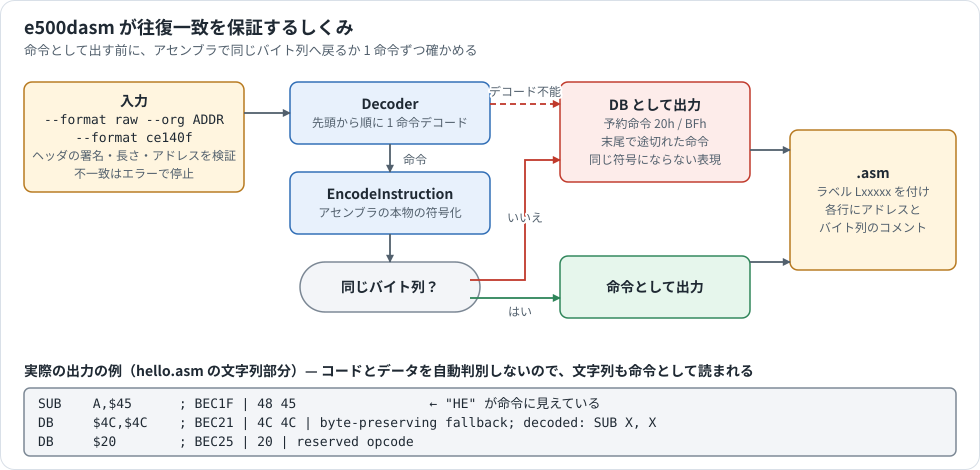
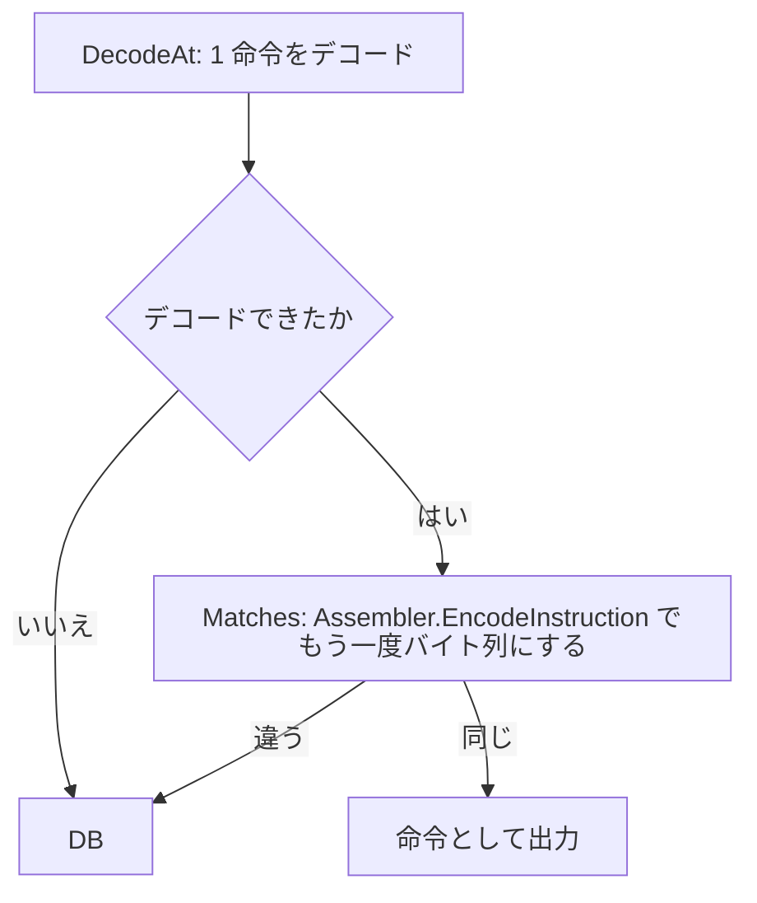
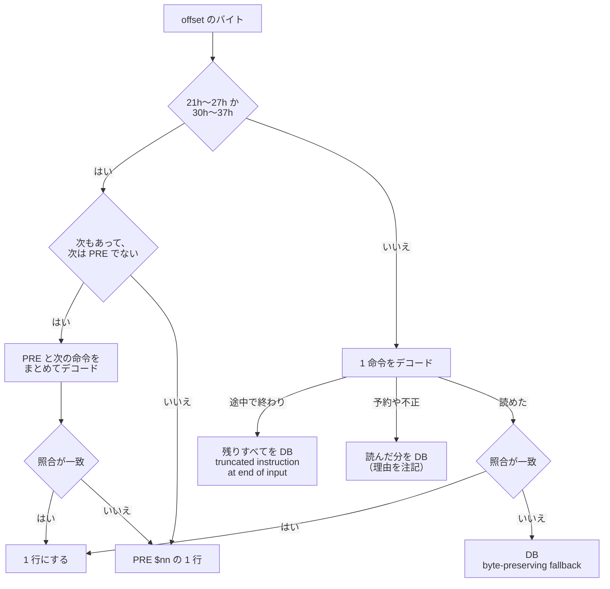
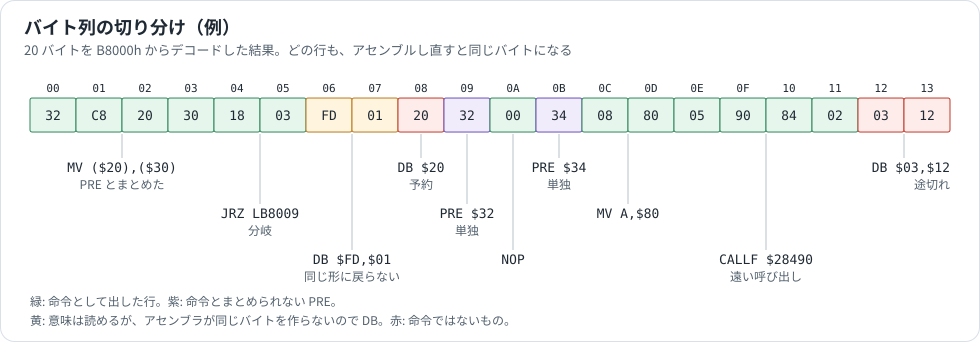

# 3. 逆アセンブラ

この章は逆アセンブラ `e500dasm` と `E500Disassembler` の中身です。逆アセンブラは、アセンブラの逆を行うだけに見えますが、同じ命令に 2 通りの機械語があったり、データが混ざっていたりするので、単純に戻すと元と違うものになります。「どんな入力でも、アセンブルし直せば必ず元に戻る」を、どうやって保証しているかを中心に説明します。使い方は[逆アセンブラ](../manual/15_DISASSEMBLER.md)にあります。

[設計の目次へ戻る](README.md)

## この章で分かること

- バイト列がどう命令とデータに分けられるか
- 「アセンブルし直すと必ず元に戻る」をどう保証しているか
- 入力の検査、ラベル、出力の形
- デコードを直すときの手順

## 3.1 ファイル

| ファイル | 内容 |
|---|---|
| `Core/InputImage.cs` | 入力形式（RAW、CE-140F）、ヘッダーの検査 |
| `Core/Decoder.cs` | 1 命令のデコード、アセンブラとの照合 |
| `Core/Disassembler.cs` | ラベル、ASM の文字列の組み立て |
| `Cli/Program.cs` | コマンドライン |
| `Gui/MainForm.cs` | 画面（Windows Forms） |
| `tests/E500Disassembler.Tests/Program.cs` | テスト |

Core は `E500Assembler.Core` を参照します。`e500dbg` も逆アセンブリの表示に Core を使います。

### 目的と要件

| 要件 | 作りへの影響 |
|---|---|
| 出力をアセンブルし直すと、元のバイト列と 1 バイトも違わない | 1 命令ごとにアセンブラで符号化して照合し、違えば `DB` にする |
| どんなバイト列でも止まらない | デコードできないものは例外を受けて `DB` にする |
| 誤ったアドレスからデコードしない | CE-140F の形式はヘッダーを厳しく調べ、RAW はアドレスを必ず指定してもらう |
| 外部の情報（ROM の表など）に頼らない | 先頭から順にデコードするだけ。コードとデータを推測で分けない |

### データ構造

| 型 | 持つもの |
|---|---|
| `InputImage(Payload, Origin, Format, Header)` | 本体、先頭のアドレス、形式、元のヘッダー（CE-140F だけ 16 バイト） |
| `DecodedLine(Address, Bytes, Mnemonic, Operands, Note, BranchTarget)` | 出力 1 行。`Mnemonic` は `DB` と `PRE` も含む |
| `DisassemblerOptions` | `GenerateLabels` `ShowAddresses` `ShowBytes` `LabelPrefix`（既定 `L`） |
| `DisassemblyResult(Image, Lines, Source)` | 行の一覧と ASM の文字列。`InstructionCount`、`DataByteCount` |

## 3.2 往復の保証





- 命令として出した行はアセンブルし直すと必ず同じバイト列になります。
- 予約命令（20h、BFh）、ないレジスタの組み合わせ、末尾で途切れた命令は `DB` です。
- 先頭から順にデコードします。コードとデータは区別しません。
- PRE は後ろの命令とまとめて、内部 RAM の指定として出します。命令とまとめられない PRE は `PRE $nn` です。

### なぜ照合するか

SC62015 には、同じ意味になる別の符号がいくつもあります。たとえば `FD 01` は `MV BA,I` と同じ動きですが、`e500asm` が `MV BA,I` から作るのは `FD 23` です。意味どおりに書き出すと、アセンブルし直したときにバイトが変わります。照合すると、こうした行だけを `DB` にして、意味は注記に残せます。

| 元のバイト | 意味 | `e500asm` が作るもの | 出力 |
|---|---|---|---|
| `FD 01` | `MV BA,I` | `FD 23` | `DB $FD,$01`（注記に `MV BA, I`） |
| `0D FF FF FF` | `MV Y,$FFFFF`（上位 4 ビットは無視） | `0D FF FF 0F` | `DB` 4 バイト |
| `32 C8 20 30` | `MV ($20),($30)` | 同じ | 命令 |
| `30 90 04` | `MV A,[X]` の前に余分な PRE | `90 04` | `PRE $30` と `MV A,[X]` |

## 3.3 デコードの手順

`Decode` は先頭から順に、次の判断を繰り返します。



### DecodeAt の中

`DecodeAt(offset, prefix)` は操作コードの `switch` で 1 命令を読みます。

| 部品 | 内容 |
|---|---|
| `Byte()` `Value(n)` | 1 バイト、n バイト（下位から）。足りないと `EndOfInput` |
| `Immediate(n)` `Address20()` | 16 進の文字列。20 ビットのアドレスは上位 4 ビットを捨てる |
| `Memory()` | 内部 RAM のオペランド。1 つ目か 2 つ目かで PRE のモードを使い分ける |
| `Indexed(...)` | モードバイト、変位。書き込みと読み出しで、間接のアドレスを読む順が違う |
| `PairRegisters(m, wide)` | レジスタの組。`wide`（`ED` `FD`）は 0 と 1 を BA と I と読む |

PRE のモードはアセンブラの表の逆引きです。

| PRE | 1 つ目、2 つ目 | PRE | 1 つ目、2 つ目 |
|---|---|---|---|
| なし | BP+n、BP+n | 30h | n、BP+n |
| 21h | BP+n、BP+PY | 31h | n、BP+PY |
| 22h | BP+n、n | 32h | n、n |
| 23h | BP+n、PY+n | 33h | n、PY+n |
| 24h | BP+PX、BP+n | 34h | PX+n、BP+n |
| 25h | BP+PX、BP+PY | 35h | PX+n、BP+PY |
| 26h | BP+PX、n | 36h | PX+n、n |
| 27h | BP+PX、PY+n | 37h | PX+n、PY+n |

### 分岐の行き先

| 命令 | 行き先 |
|---|---|
| `JP` `CALL` 条件付き `JP` | 命令（PRE の後ろ）のアドレスの上位 4 ビット + 16 ビット |
| `JPF` `CALLF` | 20 ビット |
| `JR` の仲間 | 上位 4 ビットはそのまま、(アドレス + 2 ± n) の下位 16 ビット |

## 3.4 例: 20 バイトを切り分ける



実際の出力です（先頭のコメントは省略）。

```text
        ORG $B8000

        MV     ($20),($30)                ; B8000 | 32 C8 20 30
        JRZ    LB8009                     ; B8004 | 18 03
        DB     $FD,$01                    ; B8006 | FD 01 | byte-preserving fallback; decoded: MV BA, I
        DB     $20                        ; B8008 | 20 | reserved opcode
LB8009:
        PRE    $32                        ; B8009 | 32 | explicit PRE: internal operand 1=absolute, 2=absolute
        NOP                               ; B800A | 00
        PRE    $34                        ; B800B | 34 | explicit PRE: internal operand 1=PX/PY+offset, 2=BP+offset
        MV     A,$80                      ; B800C | 08 80
        CALLF  $28490                     ; B800E | 05 90 84 02
        DB     $03,$12                    ; B8012 | 03 12 | truncated instruction at end of input
        END
```

| アドレス | 判断 |
|---|---|
| B8000 | PRE 32h + `C8`。まとめて符号化すると同じ → 1 行 |
| B8004 | `JRZ` の行き先 B8009h は行の先頭 → ラベル |
| B8006 | `MV BA,I` と読めるが、符号化すると `FD 23` → `DB` |
| B8008 | 20h は予約 → `DB` |
| B8009 | PRE の後が `NOP`。まとめると `00` だけになって合わない → `PRE` 単独 |
| B800B | PRE 34h の後が `MV A,$80`。内部 RAM を使わないので合わない → `PRE` 単独 |
| B8012 | `JPF` のアドレスが足りない → 残りをすべて `DB` |

ここでは、データや誤った位置からデコードを始めると、その後もずれることが分かります。`DB` や `PRE` が続くところは、データの可能性が高いところです。

## 3.5 ラベル

分岐（`JP` `JPF` `CALL` `CALLF` `JR` の仲間）の行き先が、命令の行の先頭と一致するときだけ `Lxxxxx` を付けます。命令の途中に飛ぶものはアドレスのまま出します。

1. すべての行の先頭のアドレスを集合にする。
2. `BranchTarget` が集合にあるものだけを、アドレスの順にラベルにする。
3. 出力のとき、行き先にラベルがある分岐は、オペランドをラベルに置き換える。

置き換えても符号は変わりません。`JP` は 64 KB の中のアドレス、`JR` は距離に直されるからです。`LabelPrefix` は英字か `_` で始まるものだけです。

## 3.6 入力の検査

CE-140F の形式では、先頭の 5 バイト、終わりの 5 バイト、長さ、20 ビットの空間に収まるかを調べ、1 つでも違えばエラーにします。誤った位置からデコードしないためです。元のヘッダーは ASM のコメントに残します。

| 検査 | エラー |
|---|---|
| 形式の指定がない | `Select input format with --format raw or --format ce140f` |
| RAW でアドレスがない | `RAW input requires a start address (--org)` |
| CE-140F に `--org` | `CE-140F input uses the header address; --org is for RAW only` |
| 16 バイト未満 | `… shorter than its 16-byte header` |
| 先頭が `FF 00 06 01 10` でない | `Not a CE-140F SAVE M machine-code header …` |
| 終わりが `FF FF FF 00 0F` でない | `Unsupported CE-140F header tail …` |
| ヘッダーの長さとファイルの長さが違う | `Header length … does not match payload length …; no data was discarded` |
| 20 ビットの空間に入らない | `Image must fit in addresses 00000h..FFFFFh` |
| 1 MB + 16 バイトより大きい | `Input exceeds the SC62015 1 MiB address space plus header` |

形式を自動で決めないのは、RAW の先頭が偶然 `FF 00 06 …` でも間違えないためです。GUI だけはファイルを選んだときに先頭の 5 バイトで形式の初期値を切り替えます。

### CLI と GUI の違い

| | CLI（`e500dasm`） | GUI（`E500Disassembler`） |
|---|---|---|
| 形式 | 必ず指定 | 選んだファイルで初期値を切り替え |
| アドレスの書式 | `Assembler.ParseAddress`（共用） | `RawOrigin`（接頭辞と `h` を順に取る。`_` は使えない） |
| 処理 | 同期 | 別スレッド（`Task.Run`）。終わるまでボタンを押せない |
| 出力 | 一時ファイルに書いてから置き換え | 同じ。画面にも表示 |
| 動く OS | Windows、Linux、macOS | Windows |

どちらも、出力先が入力と同じなら断ります。

## 3.7 速さと限界

| 項目 | 内容 |
|---|---|
| 照合 | 1 命令ごとにエンコーダを作って動かす。1 MB のファイルでも 100 万回ほど |
| 中断 | `CancellationToken` を 1 行ごとに見る |
| `e500dbg` での使い方 | 必要な範囲だけを読み、ラベルを作らずにデコードする（[6.8](06_DEBUG_SERVER.md#68-逆アセンブルの前後)） |
| コードとデータの区別 | しない。表や文字列も命令として読む |
| シンボル | 元の名前は復元できない。`Lxxxxx` だけ |

`PRE` を命令とまとめるときに、次が PRE でないことを確かめるのは、PRE が並んだデータで行が壊れないようにするためです。

## 3.8 変更の手順

### 新しい命令をデコードする

1. 先にアセンブラ（[2.10](02_ASSEMBLER.md#210-変更の手順)）が符号化できるようにする。
2. `Decoder.DecodeAt` の `switch` に足す。オペランドの読み順は機械語に出る順と同じにする。
3. テスト（`DisAssembler\build.cmd -TestOnly`）を動かす。全 256 の操作コードと 32768 バイトの乱数で往復を確かめるので、照合の漏れはここで見つかる。
4. 意味の表示（`byte-preserving fallback` の注記）が変わるものは、テストの注記の確認も足す。

### 出力の形を変える

`Disassembler.Disassemble` だけを直します。`Source` は ASM として読めるものでなければなりません（テストの `RoundTrip` がアセンブルし直します）。`e500dbg` は `Lines` だけを使うので、影響しません。

### 気をつけること

- `Decoder` は命令の途中の状態（`cursor` `memoryIndex` など）をフィールドに持ちます。`DecodeAt` の先頭で必ず初期化します。
- 照合は `AssemblyException` を「合わない」と扱います。アドレスが 64 KB をまたぐ命令は、アセンブラが断るので `DB` になります。
- 操作コードを足したのに照合が通らないと、エラーにならずに `DB` が増えます。テストの注記と命令の数で確かめます。

## まとめ

| 覚えること | 内容 |
|---|---|
| 保証 | デコード → 符号化 → 比べる。合わなければ `DB` |
| PRE | 次の命令とまとめて照合。合わなければ `PRE $nn` |
| 入力 | CE-140F は厳しく検査。RAW はアドレスが要る |
| 使う側 | CLI、GUI、`e500dbg` |

## 次に読むもの

- [アセンブラ](02_ASSEMBLER.md): 照合に使う符号化
- [デバッグサーバー](06_DEBUG_SERVER.md): 逆アセンブリの表示での使い方
