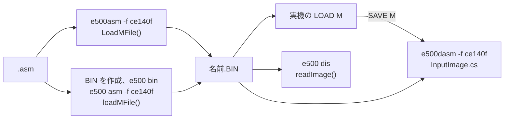

# 4. 実機のファイル

この章は、実機と受け渡しするファイルを作る部分と、読む部分の作りです。機械語の `LOAD M` のファイルと、BASIC のテキストの 2 つがあります。使い方は[実機へ送る](../manual/14_TRANSFER.md)と [BASIC のファイルと文字](../manual/16_BASIC_FILES.md)にあります。

[設計の目次へ戻る](README.md)

## この章で分かること

- `LOAD M` のヘッダーを、どこで作り、どこで読むか
- BASIC のソースを、本体の文字にするところ
- 直すときに、合わせて見るところ

## 4.1 LOAD M のファイル

| 場所 | 働き |
|---|---|
| `Assembler.cs` の `LoadMFile()` | アセンブルした結果にヘッダーを付ける |
| `src/project/loadM.ts` の `loadMFile()`、`loadMOrigin()` | 作る、アドレスを読む |
| `InputImage.cs`、`src/asm/disassembler.ts` の `readImage()` | 逆アセンブラが読む |
| `src/emu/debugPanel.ts` | デバッグ画面の BIN の読み込みと書き出し |

### ヘッダー

固定の部分は `FF 00 06 01 10` と `FF FF FF 00 0F` です。変わるのは長さとアドレスだけで、PC-E650 実機の `SAVE M` のファイルとバイト単位で一致します。

| オフセット | 長さ | 内容 | 例（3 バイト、BEC00h） |
|---|---|---|---|
| 0 | 5 | 固定 | `FF 00 06 01 10` |
| 5 | 3 | 長さ（下位から） | `03 00 00` |
| 8 | 3 | 先頭のアドレス（下位から） | `00 EC 0B` |
| 11 | 5 | 固定 | `FF FF FF 00 0F` |
| 16 | − | 本体 | `01 02 03` |

- アドレスと長さは、このヘッダーにしかありません。ヘッダーのないファイルは `LOAD M` で読めません。
- アドレス + 長さが 1 MB を超えるものは作りません。
- `e500asm -f ce140f`、`e500 asm -f ce140f`、`e500 bin` の出力が同じことを、`project.test.ts` と `cli.test.ts` が調べます。

## 4.2 BASIC のテキスト

`src/emu/basic.ts` の `encodeSource` が、UTF-8 のソースを本体のバイトにします。`F5`、`e500 run`、`e500 bin` が同じものを使います。

| 入力 | 出力 |
|---|---|
| ASCII | そのまま |
| 半角カナ（U+FF61〜FF9F） | `A1h`〜`DFh` |
| `¥`（U+00A5） | `5Ch` |
| タブ | 空白 |
| 改行（CR+LF、CR、LF） | `0D 0A` |
| 空の行、行番号のない行 | 除く（行番号のない行は数を返す） |
| ほかの文字 | 除いて、どの文字かを返す |

空の行を除くのは、ROM の `LOAD` がそこで読み込みを終えるためです。末尾に `1Ah` は付けません。終わりは CE-140F が知らせます。

`e500 bin` の BASIC の部分は `cli/main.ts` の `basicFile` です。ソースを上書きしないように、出力の名前を `samePath` で比べてから書きます。

## 4.3 変更の手順

| すること | 直すところ |
|---|---|
| 文字を足す | `encodeSource` と、表示の側の `server/Machine.cs`、[16 章の表](../manual/16_BASIC_FILES.md#163-文字) |
| ヘッダーを変える | 4.1 の表の場所の全部と、[ファイル形式](../manual/19_FILE_FORMATS.md) |

## まとめ

| 覚えること | 内容 |
|---|---|
| ヘッダー | 固定 10 バイト + 長さ 3 + アドレス 3 |
| BASIC | CR+LF、1 文字 1 バイト、`1Ah` なし |
| 作る部分 | C# と TypeScript に 1 つずつ。テストが比べる |

## 次に読むもの

- [ファイル形式](../manual/19_FILE_FORMATS.md): 作るファイルの形
- [逆アセンブラ](03_DISASSEMBLER.md): 同じヘッダーを読む側
