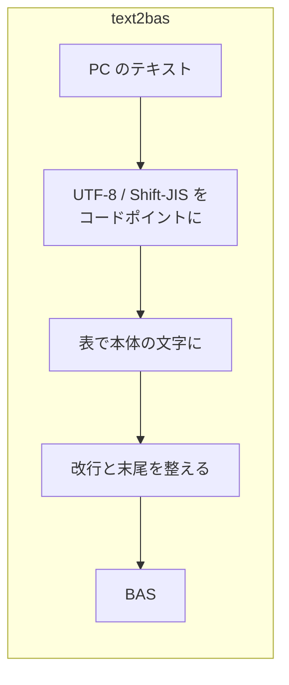
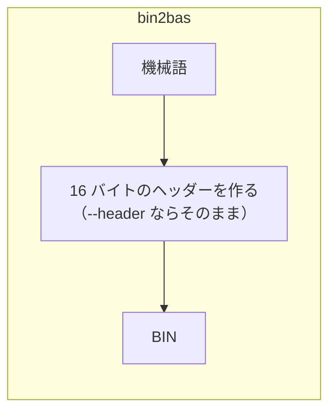
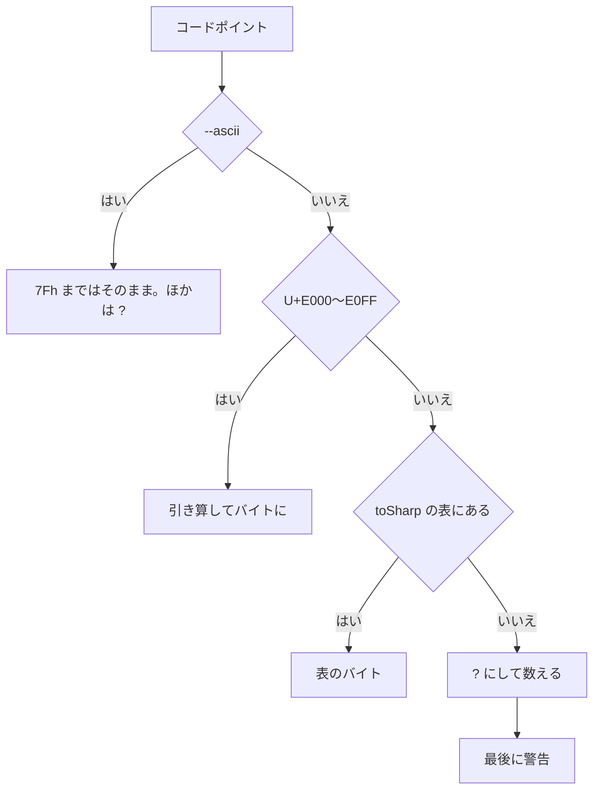
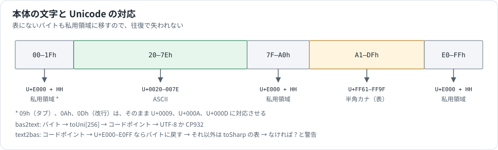

# 4. ファイル変換

この章は、ファイル変換 `ce140conv` の中身です。1 つの C++ ファイルだけの小さなツールですが、文字コード、改行、ヘッダー、上書きの事故の防止など、ファイルを扱うツールに要ることが一通り入っています。全体を読んで理解するのに、ちょうどよい大きさです。使い方は[ファイル変換](../manual/16_FILE_CONVERTER.md)にあります。

[設計の目次へ戻る](README.md)

## この章で分かること

- 5 つのモードが、どの関数でどう動くか
- 文字コード表と、往復で失わないしくみ
- `LOAD M` のヘッダーの組み立て
- オプションやモードを足す手順

## 4.1 方針

- C++17 の単一ソース `ce140conv.cpp` です。ライブラリに依存しません。
- Shift-JIS の変換だけ、Windows では Win32 API、ほかでは iconv を使います。
- 文字コード表はコンパイルせず、実行時に読みます。

| 要件 | 作りへの影響 |
|---|---|
| どこでもすぐ動く | 1 ファイル、標準ライブラリだけ。`ce140conv.exe` はリポジトリに入れる |
| 本体のファイルを壊さない | 知らない文字も失わない（私用領域）。ヘッダーは保存して戻せる |
| 文字の対応が増えても作り直さない | 表を実行時に読む |
| 実機と同じものを作る | ヘッダーは実機の `SAVE M` とバイト単位で同じ |

### ソースの並び

| 部分 | 中身 |
|---|---|
| 小さなツール | `die` `readFile` `writeFile` `rejectSameFile` `dirOf` `exeDirOf` |
| 文字コード | `utf8ToCodepoints` `appendUtf8` `sjisToCodepoints` `codepointsToSjis` |
| 文字の表 | `struct Charset` |
| ヘッダー | `HDR_SIG` `HDR_TAIL` `buildHeader` `put24le` `get24le` |
| 変換 | `text2bas` `bas2text` `bin2bas` `bas2bin` `info` |
| コマンドライン | `usage` `parseAddress` `main` |

## 4.2 処理





| モード | 検査 |
|---|---|
| `text2bas` | 入力の末尾の `1Ah` を捨て、最後の改行を補う。空の入力は警告 |
| `bas2text` | 先頭が `FFh` なら警告（機械語のファイルの可能性）。末尾の `1Ah` を 1 つ捨てる |
| `bin2bas` | アドレス + 長さが 1 MB 以内、`--header` は 16 バイトちょうど。アドレスがなければ警告して 0 |
| `bas2bin` | 16 バイト以上あるか。先頭が `FFh` でなければ警告 |
| `info` | 種類、長さ、アドレス、固定のバイト、長さの食い違いを表示 |
| `info` 以外 | 出力が入力、`--header` のファイルと、`--save-header` の出力が入力、出力と、同じファイルでないか（書き方が違っても、あるファイルなら `std::filesystem::equivalent` で見分ける） |

### 改行と末尾（text2bas）

BASIC の行は、本体では CR（0Dh）で終わります。`text2bas` は CR LF、CR、LF のどれも 1 つの行末とみなし、`0D 0A`（`--cr` なら `0D`）にします。最後の行に改行がなければ補います。

| 入力の末尾 | 出力の末尾 |
|---|---|
| `…END`（改行なし） | `…END 0D 0A` |
| `…END 0A` | `…END 0D 0A` |
| `…END 0D 0A 1A` | `…END 0D 0A` |
| `--eof` を付ける | 上の後に `1A` |

`1Ah` を付けないのが既定なのは、CE-140F の互換機（Sharp_ce140f_emul）がファイルの終わりに自分で送るためです。2 つになると入出力エラーになります。`--no-eof` は、昔の使い方のために残してあるだけで、既定と同じです。

### 文字の変換の流れ



### 例: 1 行の変換

`10 PRINT "ｱ¥"`（UTF-8）を `text2bas` に通すと、表に `5C U+00A5` を足していない場合、`¥`（U+00A5）は表にないので `?` になります。`ｱ`（U+FF71）は `B1h` です。

| 文字 | コードポイント | 本体のバイト |
|---|---|---|
| `1` | U+0031 | 31h |
| `ｱ` | U+FF71 | B1h |
| `¥` | U+00A5 | 3Fh（`?`。警告） |
| 改行 | U+000A | 0Dh 0Ah |

## 4.3 ヘッダー

固定の部分は `HDR_SIG`（`FF 00 06 01 10`）と `HDR_TAIL`（`FF FF FF 00 0F`）です。変わるのは長さとアドレスだけで、PC-E650 実機の `SAVE M` のファイルとバイト単位で一致します。

| オフセット | 長さ | 内容 | 例（3 バイト、BEC00h） |
|---|---|---|---|
| 0 | 5 | `HDR_SIG` | `FF 00 06 01 10` |
| 5 | 3 | 長さ（下位から） | `03 00 00` |
| 8 | 3 | 先頭のアドレス（下位から） | `00 EC 0B` |
| 11 | 5 | `HDR_TAIL` | `FF FF FF 00 0F` |
| 16 | − | 本体 | `01 02 03` |

互換機は、先頭の 1 バイトが `FFh` かどうかだけで、機械語のファイルを見分けます。`bas2bin --save-header` で取ったヘッダーを `bin2bas --header` に渡すと、元のヘッダーのまま戻せます。

## 4.4 文字

表にないバイト `HH` は、Unicode の私用領域 `U+E000 + HH` に移します。`bas2text` → `text2bas` の往復でバイトが変わらないようにするためです。



`charset_e500.tab` は、実行ファイルと同じ場所（Linux / macOS では PATH から起動したときも調べる）、次にカレントのフォルダから読みます。

### 表の読み込み

`Charset::buildDefault` が、すべてのバイトを私用領域に割り当ててから、20h〜7Eh、09h、0Ah、0Dh をそのままの文字にします。`loadFile` が表の行で上書きし、`rebuildReverse` が逆向きの表 `toSharp` を作ります。

| 行の形 | 意味 |
|---|---|
| `C2 U+FF82` | バイト C2h を U+FF82 に。`0xFF82` でもよい |
| `80 =` | 私用領域に戻す |
| `#` `;` から後ろ | コメント |

読んだ表のファイルの場所は覚えておき、`rejectSameFile` が、入力と同じく、出力で上書きできないファイルとして扱います。パスは `weakly_canonical` で比べるので、`.\` や大文字小文字の違いがあっても同じファイルと分かります。

同じコードポイントに 2 つのバイトがあるときは、小さいほうのバイトが逆引きに使われます。表が読めない行（16 進でない）はエラーで、行番号を示します。表がないときは、組み込みの ASCII と私用領域だけで動き、その旨を表示します。

### Shift-JIS

`--sjis` は、PC のテキストを CP932 として扱います。

| | Windows | Linux / macOS |
|---|---|---|
| 変換 | `MultiByteToWideChar` / `WideCharToMultiByte` | `iconv`（`CP932` と `UTF-32LE`） |
| 読めないバイト | U+FFFD | U+FFFD。割り当てのない 2 バイトは 1 文字とみなす |
| 書けない文字 | システムの既定の文字 | `?` |

iconv では、誤ったバイトで変換が止まるので、先頭バイトと 2 バイト目の範囲から「1 文字」か「1 バイト」かを決めて先へ進めます。

## 4.5 アドレスの書式

`parseAddress` は、いつも 16 進として読みます。`e500asm --org`、`e500dasm --org` と同じ考え方で、`&H` も使えます。

| 書き方 | 値 |
|---|---|
| `BEC00` `$BEC00` `&BEC00` `&HBEC00` `0xBEC00` `0BEC00h` | BEC00h |
| `BE_C00` | BEC00h（`_` は取る） |
| `FFFFFF` | エラー（FFFFFh を超える） |
| `XYZ` | エラー |

## 4.6 エラーと終了コード

| 場面 | 終了コード |
|---|---|
| 成功、`--help` | 0 |
| 引数なし（使い方を表示） | 1 |
| エラー（`die`） | 2 |

エラーと進み具合は標準エラー出力、`info` の結果は標準出力です。`info` の結果だけをファイルに取れます。

## 4.7 速さと限界

- ファイル全体をメモリに読みます。実機で扱うファイルは 1 MB までなので、分けて読む必要はありません。
- BASIC の中間コードは扱いません。`SAVE ,A` の ASCII のファイルだけです。
- 行の長さや行番号は調べません。本体の `LOAD` が調べます。

## 4.8 変更の手順

### 文字を足す

`charset_e500.tab` に 1 行足します。コンパイルは要りません。往復は次で確かめます。

Windows（PowerShell）

```powershell
ce140conv bas2text A.BAS a.txt
ce140conv text2bas a.txt B.BAS
fc.exe /b A.BAS B.BAS
```

Linux、macOS

```sh
ce140conv bas2text A.BAS a.txt
ce140conv text2bas a.txt B.BAS
cmp A.BAS B.BAS
```

`A.BAS` をテキストにし、もう一度 BASIC に戻して、元と 1 バイトずつ比べます。違いが出なければ、その文字は往復で失われません。

### オプションを足す

1. `Options` にメンバーを足す。既定値は、これまでの動作と同じにする。
2. `main` の引数の解析に足す。値を取るものは `need("--名前")` を使う。
3. `usage` と[ファイル変換](../manual/16_FILE_CONVERTER.md)に書く。
4. 読み書きするファイルの名前を取るものは、`rejectSameFile` を足す。

### モードを足す

1. 変換の関数を作り、`main` の終わりの分岐に足す。ファイルが要るものは `needPos(2)`。
2. 文字を変換するものは、文字コード表を読む条件（`cmd == "text2bas" || …`）に足す。
3. Windows（`build.bat`）と、Linux か macOS（`build.sh`）の両方でビルドする。`#ifdef _WIN32` の中だけで使う型を、外で使わない。

## まとめ

| 覚えること | 内容 |
|---|---|
| 形 | C++17 の 1 ファイル。表は実行時に読む |
| 文字 | 表にないバイトは U+E000 + HH。往復で失わない |
| ヘッダー | 固定 10 バイト + 長さ 3 + アドレス 3 |
| 終了コード | 0 成功、1 使い方、2 エラー |

## 次に読むもの

- [ファイル形式](../manual/19_FILE_FORMATS.md): 作るファイルの形
- [逆アセンブラ](03_DISASSEMBLER.md): 同じヘッダーを読む側
