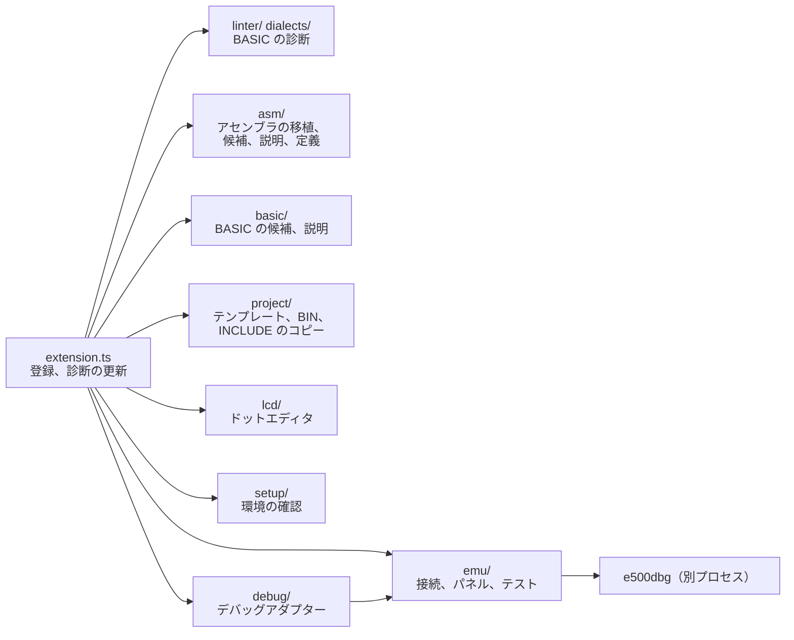
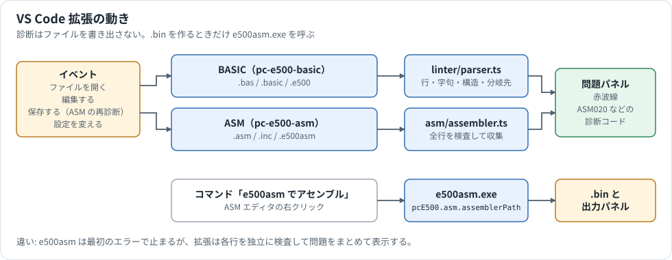
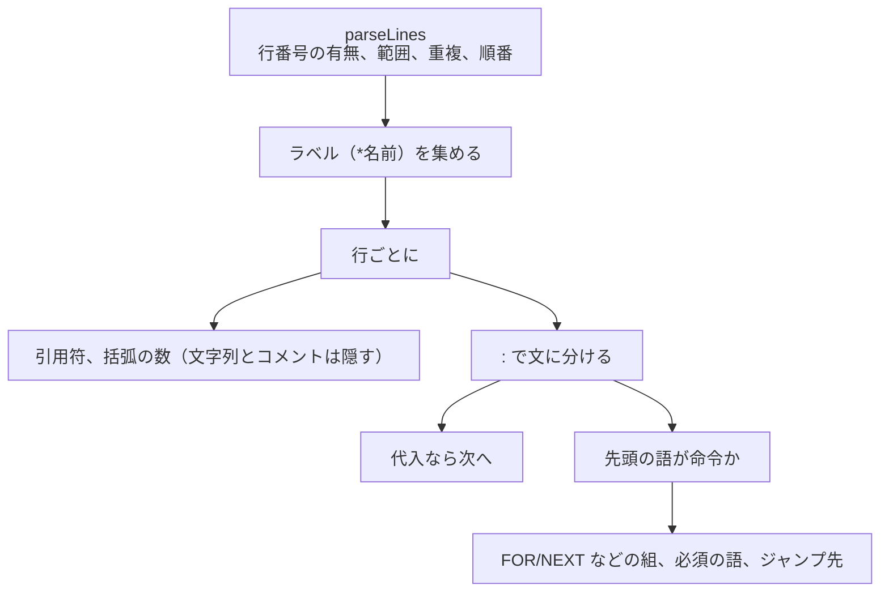
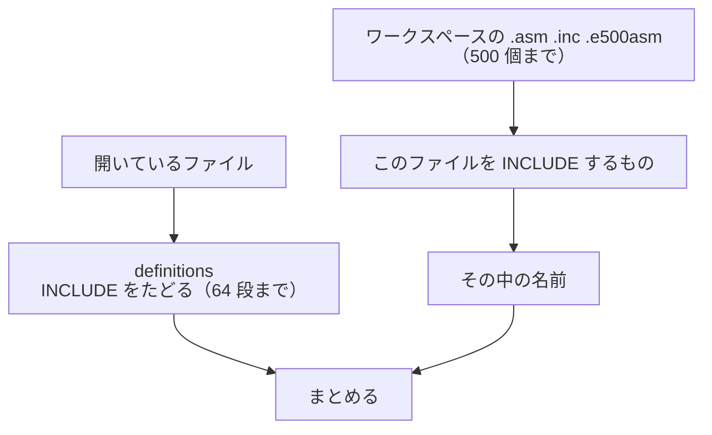
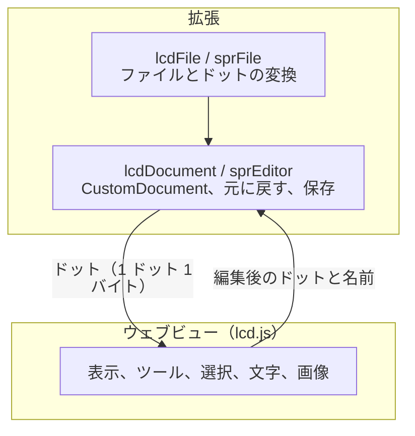
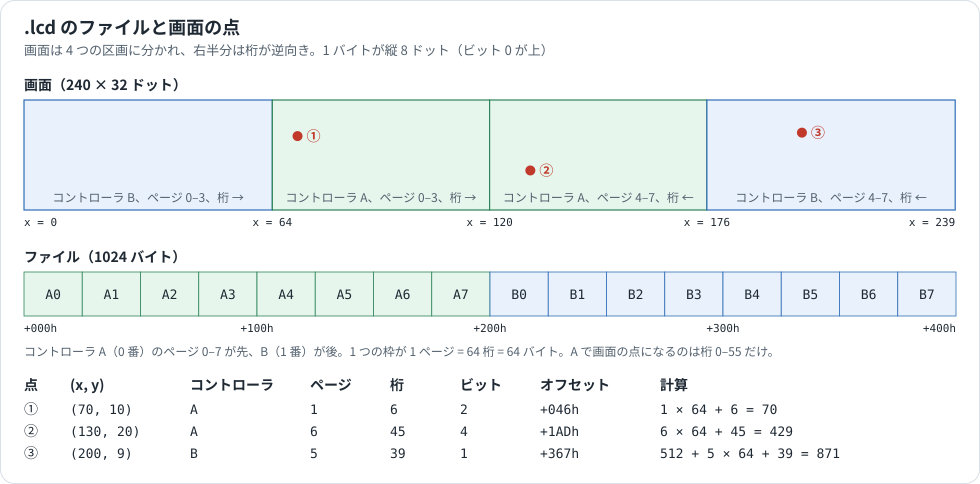
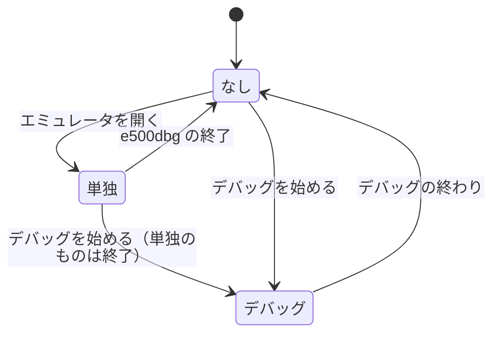

# 5. VS Code 拡張

この章は VS Code 拡張「PC-E500 開発ツール」（`litchi-gh.pc-e500-devtools`）の中身です。エディタの機能、ドットエディタ、パネル、環境の確認など、見た目の違う機能が 1 つの拡張に入っています。共通しているのは、「VS Code の API を使わない中身」と「VS Code につなぐ薄い層」に分ける、という作り方です。使い方は[マニュアル](../manual/README.md)の 8〜14 章にあります。

[設計の目次へ戻る](README.md)

## この章で分かること

- モジュールの分け方と、VS Code の API を使う境目
- 診断、候補、説明、定義がどこから来るか
- ドットエディタとパネルの、拡張とページの役割
- 設定の探し方、安全のための決まり
- 設定、コマンド、テンプレートなどを足す手順

## 5.1 全体



| 場所 | 内容 |
|---|---|
| `src/core.ts` | 診断の型 |
| `src/l10n.ts` | `L("日本語", "English")`。起動時に VS Code の表示言語で決まる |
| `src/extension.ts` | 起動、コマンド、診断の更新 |
| `src/completionProvider.ts` `asmHover.ts` `definitionProvider.ts` | ASM の候補、説明、定義を VS Code に渡す |
| `src/asm/` | `assembler.ts` `encoder.ts` `expression.ts`（移植）、`completion.ts` `hover.ts` `definition.ts`、`instructions.ts`（命令の表）、`iocs.ts`（IOCS の表）、`invocation.ts`（`e500asm` の起動） |
| `src/linter/`、`src/dialects/` | BASIC の診断、キーワード |
| `src/basic/` | BASIC の候補と説明（`help.ts` が命令の表） |
| `src/project/` | `templates.ts`（テンプレート）、`loadM.ts`（`LOAD M` のファイル）、`commands.ts` |
| `src/lcd/` | `.lcd` `.pixels` `.spr` の読み書き、カスタムエディタ |
| `src/setup/` | 場所を探す、確認の画面、古い設定の引き継ぎ |
| `src/debug/` | ASM と BASIC のデバッグアダプター |
| `src/emu/` | `e500dbg` との通信、起動と書き込み、パネル、デバッグ画面、テスト |
| `media/` | ウェブビューのページ（`emulator.js` `debug.js` `lcd.js` `setup.js`） |
| `syntaxes/`、`snippets/`、`schemas/` | 色分け、スニペット、テストのスキーマ |

VS Code の API を使うのは、画面や登録を受け持つファイルだけです。表、計算、ファイルの形は API なしで動くので、Node だけでテストできます。

### 起動のとき

言語のファイル（`.bas` `.asm` など）を開いたとき、コマンドを実行したとき、フォルダに `*.e500test.json` があるときに起動します。`activate` は次の順に進みます。

| 順 | 処理 |
|---|---|
| 1 | `setLanguage(vscode.env.language)`。`ja` で始まれば日本語、ほかは英語 |
| 2 | 拡張の `inc` フォルダを INCLUDE の場所として覚える |
| 3 | 診断のデータ型、出力の欄「PC-E500」を作る |
| 4 | コマンド、候補、説明、定義、カスタムエディタを登録 |
| 5 | 開いている文書を診断 |
| 6 | エミュレータ（パネル、デバッグ、テスト）を登録 |
| 7 | 古い名前の設定を引き継ぐ（`migrateSettings`） |

起動しただけでは、`e500dbg` もエミュレータも動きません。

## 5.2 診断



- 文書が開かれた、変わった、保存されたときに `refresh` します。何かを保存したときは、`INCLUDE` 先かもしれないので、開いている ASM をすべて調べ直します。
- ASM は `lintAsm` がファイル全体をアセンブルします。`INCLUDE` 先の問題は、`INCLUDE` の行に「ファイル名(行)」を付けて出します。
- 診断のコードは `ASM0xx`、BASIC は `E5000xx` です。`e500asm` のメッセージとの対応は[アセンブラの文法](../manual/04_ASSEMBLER_REFERENCE.md#49-エラーメッセージ)にあります。

| きっかけ | 調べるもの |
|---|---|
| `onDidOpenTextDocument`、`onDidChangeTextDocument` | その文書 |
| `onDidSaveTextDocument` | 開いている ASM すべて |
| `onDidChangeConfiguration`（`pcE500.basic`、`pcE500.asm`） | 開いている文書すべて |
| `onDidCloseTextDocument` | その文書の診断を消す |

### LintIssue から Diagnostic へ

| `LintIssue` | `vscode.Diagnostic` |
|---|---|
| `range.line` `start` `end`（0 から、1 行の中） | `Range` |
| `severity`: `error` `warning` `information` | `DiagnosticSeverity` |
| `code`: `ASM020` など | `code`（「問題」に表示） |
| − | `source`: `pc-e500-asm` か `pc-e500-basic` |

未保存の文書（`untitled:`）は `host` を渡さないので、`INCLUDE` は「保存してください」という警告（`ASM060`）になります。

### INCLUDE の検索

1. 書いてあるファイルのフォルダ
2. 設定 `pcE500.asm.includeDirectories`
3. 拡張機能の `inc`

「e500asm でアセンブル」にも、2 と 3 を `-I` として渡します。

### BASIC の診断

`lint` は 2 回に分けて調べます。



| コード | 内容 | 重さ |
|---|---|---|
| `E500001`〜`004` | 行番号がない、範囲外、重複、昇順でない | エラー（`003`、`004` は警告） |
| `E500005` | ラベルの重複 | エラー |
| `E500006`〜`008` | 行番号だけの行、254 文字を超える行、本体にない文字 | エラー（文字列の中の文字は警告） |
| `E500010`〜`012` | 引用符、括弧 | エラー（`010` は `INPUT` のほかは警告） |
| `E500020`〜`022` | 文の先頭、命令にない語、必須の語がない | エラー |
| `E500030`〜`031` | `FOR` / `NEXT` などの組 | エラー（`FOR` / `NEXT` は警告） |
| `E500040`〜`041` | ジャンプ先の行、ラベルがない | 警告 |

`DATA` の行では括弧を数えません（表示文字として閉じない括弧を書くことがあるため）。`FOR`/`NEXT`、`WHILE`/`WEND`、`REPEAT`/`UNTIL`、`SWITCH`/`ENDSWITCH` の組は、行をまたいだ積み重ねで調べます。

## 5.3 候補と説明

`instructions.ts` の表が元です。書ける形は短い記号で書き、テストがすべての形をエンコーダに通して、表とエンコーダが食い違わないようにしています。

| 処理 | もと |
|---|---|
| 命令、疑似命令 | `INSTRUCTIONS`、`DIRECTIVE_INFO` |
| オペランドのレジスタ | その命令の形の記号（`r` `q` `w` …）から |
| IOCS の番号 | `iocs.ts` の表。上の行をさかのぼって `(CL)` / `(CX)` の値を探す |
| ラベル、定数 | 開いている内容と `INCLUDE` 先、読み込み元（`definitions`） |
| 定義 | 開いているファイル、`INCLUDE` 先、読み込み元 |

### 形の記号

| 記号 | 意味 | 記号 | 意味 |
|---|---|---|---|
| `r` | `A IL BA I X Y U S` | `n` `mn` `lmn` | 1、2、3 バイトの即値 |
| `q` | `S` 以外 | `imm` | レジスタの幅の即値 |
| `w` | `BA I X Y U S` | `(m)` `(n)` | 内部 RAM |
| `v` | `A IL BA I` | `[lmn]` | アドレス |
| `r2` | `BA I` | `[p]` | `[r3]` `[r3++]` `[--r3]` `[r3±n]` `[(n)]` `[(n)±n]` |
| `r3` | `X Y U S` | `A/IL` | どちらか |

たとえば `ADD` は `A,n | (m),n | A,(n) | (n),A | A/IL,A/IL | r2,v | r3,r` です。

### カーソルの位置の判断（completionContext）

カーソルまでの 1 行を見て、何が書けるかを決めます。

| カーソルの前 | 種類 | 出すもの |
|---|---|---|
| `␣␣MV ` | オペランド 1 | `A IL BA I X Y U S B`、ラベル、定数 |
| `␣␣MV A,` | オペランド 2 | `B`（`MV` の形で、1 つ目が `A` のときの 2 つ目）、ラベル、定数 |
| `␣␣ADD BA,` | オペランド 2 | `A IL BA I`（`r2,v`） |
| `␣␣MV [` | `[` の中 | `X Y U S` |
| `␣␣MV (BP+` | `(` の中 | `PX PY` |
| `loop: JR` | 命令 | 命令と疑似命令 |
| `X EQU ` | 式 | ラベル、定数 |
| `␣MV A,$` | 数の途中 | 出さない |
| `;` の後、文字列の中 | − | 出さない |

`MV IL,` では、上へ 24 行までさかのぼって `MV (CL),…` `MVW (CX),…` を探し、そのデバイスの番号を先に並べます。分岐や `RET` を越えて探しません。下へ 8 行の間に `CALLF FCS` があれば、FCS の番号を出します。

### 名前の集め方（AsmNames）



- エディタで開いているファイルは未保存の内容を使います。
- 「自分を INCLUDE するファイル」の探索は 5 秒間覚えておきます。
- 名前は大文字にして比べます。同じ名前が複数あれば、すべてを定義の候補として出します。

### 説明（hover）

`asmWordAt` がカーソルの語を「命令」「疑似命令」「レジスタ」「名前」に分けます。行の先頭の語だけが命令になり、`name:` や `name EQU` の `name` は名前です。`MV IL,$42` の数の上では、上のデバイスと下の `CALLF` から、IOCS か FCS の番号として説明します。

### 定義へ移動

`definitionAt` は、`INCLUDE "…"` の上ならファイルへ、名前の上ならその定義へ飛びます。`INCBIN` は「リンク」として扱い、`.lcd` はドットエディタで開きます。

## 5.4 ドットエディタ



- 元に戻す、やり直す、保存は VS Code のカスタムエディタのしくみに乗せています。
- ページは「変わったドット全部」を送り、拡張が 1 回の編集として積みます。
- `.lcd` の余りのビットは元のファイルの値を残して書きます。
- 隣の `.pixels`（`.lcd`）は保存の前に同じ絵だったときだけ一緒に書き換えます。
- ページの CSP は `default-src 'none'` です。スクリプトは nonce 付きだけ、`style` 属性は使えないので、色や幅は要素の `data-` から JavaScript で設定します。

### .lcd の点の場所



`dotPlace(x, y)` の計算です。

```text
controller = (x < 64 または x >= 176) なら 1（B）、ほかは 0（A）
column     = x < 64  → x
             x < 120 → x - 64
             x < 176 → 175 - x
             ほか     → 239 - x
row        = y + (x >= 120 なら 32)      右半分は下の 32 行に配線されている
page       = row >> 3
bit        = row & 7
offset     = controller*512 + page*64 + column
```

### .spr のバイトの並び

4 バイトのヘッダー（幅、高さ/8、コマ数、マスクの有無）の後に、コマごとに、縦 8 ドットの行ごとに、左から並びます。マスクがあるときは 1 桁が「マスク、絵」の 2 バイトです。エディタの 3 つの値（透明 0、点灯 1、消灯 2）との対応です。

| エディタの値 | マスクのビット | 絵のビット |
|---|---|---|
| 透明（0） | 0 | 0 |
| 点灯（1） | 1 | 1 |
| 消灯（2） | 1 | 0 |

例: 2 × 8、マスクあり、(0,0) が点灯、(1,1) が消灯、(1,7) が点灯のファイルは `02 01 01 01`（ヘッダー）と `01 01`（桁 0）、`82 80`（桁 1）です。マスクなしのファイルでは、消灯は透明になります。編集中の絵も、マスクを外した時点で `withoutOff` が消灯を透明に変えるので、画面の絵と保存した結果が食い違いません。

### やり取り

| 向き | メッセージ | 内容 |
|---|---|---|
| ページ → 拡張 | `ready` | 表示の準備ができた |
| 〃 | `edit`（`data` `label`） | `.lcd` の絵の全部（base64）と、元に戻すの名前 |
| 〃 | `editSprite`（`sprite` `label`） | キャラクタの全コマ |
| 〃 | `clip` | コピーした範囲。ほかのエディタにも配る |
| 〃 | `text` | クリップボードに入れる文字（`DB` / `GPRINT` の行） |
| 〃 | `import` `png` | 画像を読む、PNG に書く |
| 〃 | `undo` `redo` `other` | VS Code のコマンドを呼ぶ |
| 拡張 → ページ | `picture` `sprite` | 絵と説明 |
| 〃 | `clip` `image` | ほかのエディタのコピー、選んだ画像 |

ページから来た値はそのまま信じません。`.lcd` は長さ 7680 と 0/1、`.spr` は `isSprite`（幅 1〜64、高さ 8/16/24/32、コマ 1〜255、大きさの一致）を確かめます。

### 保存と衝突

| 場面 | 動き |
|---|---|
| ファイルが開いた後にほかで変わった | 保存のときに「上書きしますか」 |
| 編集していないときに変わった | 読み直して表示（ビルドで作り直した場合など） |
| 隣の `.pixels` が同じ絵だった | 一緒に書き換え、状態バーに表示 |
| 隣の絵が違う | 書き換えず、知らせる |
| 大きさが違うファイル | 表示だけ。編集も保存もしない |
| VS Code の自動退避 | 絵（`.lcd` は 7680 バイト、`.spr` は JSON）を退避先に書く |

### ページの中の作り（lcd.js）

- 表示の拡大率は画面の実ピクセルで 1〜48 倍です。`saved.zoom` が 0 なら高さいっぱい、−1 なら全体です。
- 描いている途中の絵は `drawing`、選んで持ち上げた部分は `lift`、置く前の文字と画像は `placing` に分け、確定したときだけ `commit` で 1 回の編集を送ります。
- 塗りつぶしは再帰ではなく積んだ座標を取り出す方法です。
- 画像の取り込みは白地に描いてから明るさを計算し、しきい値か、Floyd–Steinberg の誤差拡散で 2 値にします。

## 5.5 エミュレータのパネル

| 部品 | 内容 |
|---|---|
| `hub.ts` | 今つながっている本体（1 台）。デバッグのものか、単独で起動したもの |
| `panel.ts` | ウェブビュー。画面の更新、キー、変数とウォッチ |
| `inspector.ts` | 変数、レジスタ、ラベル、ウォッチの値。実行中も、スライスの合間に読む |
| `asmValues.ts` | `[式]:2`、`(式)`、レジスタの読み書き（デバッガーと共用） |
| `debugPanel.ts`、`ramLayout.ts` | デバッグ画面、メモリマップ |
| `media/emulator.js` | 本体、液晶、キーを canvas に描く（エミュレータと同じ描き方） |

### 本体は 1 台（MachineHub）



`attach` は、前の本体が単独のものなら終わらせます。パネルとデバッグ画面は `onDidChange` を見て、つなぎ替えます。

### 画面の更新

1. `e500dbg` の `frame` は、液晶が変わったときだけ、1 秒に 60 回まで届きます。
2. パネルはそれを `postMessage` で渡し、ページは次の描画の機会にまとめて描きます。
3. 本体の絵は別の canvas に 1 度だけ描き、キーの押下などで変わったときに描き直します。液晶とシンボルだけを毎回重ねます。

変数とウォッチは、ページが 0.5 秒ごとに `inspect` を送って更新します。前の答えが来ていない間は送りません（3 秒で諦めて再開）。見えていないときも送りません。

### 書き換えの条件

| 種類 | 対象 | 条件 |
|---|---|---|
| `basic` | BASIC の変数 | BASIC のデバッグで行の直前に止まっている |
| `asm` | レジスタ、内部 RAM | 止まっていて、BASIC のデバッグではない |
| `memory` | メモリ、ラベルの中身 | 止まっている |

## 5.6 設定と起動

`config.ts` が、設定、PATH、インストール先から `e500core.dll`、ROM、`e500dbg` を決めます。足りないときは `SetupError` を投げ、ボタン付きのメッセージになります。「環境を確認」（`setup/check.ts`）は同じ探し方を使い、最後に実際に起動して ROM バージョンを読みます。

ワークスペースの中で見つけた実行ファイルや DLL は、候補として示すだけで自動では使いません。開いたフォルダの中身が利用者の意思なしに実行されないようにするためです。

### 探す順番

| 対象 | 1 | 2 | 3 | 4 |
|---|---|---|---|---|
| `e500asm` | 設定 | PATH | − | 候補だけ: ワークスペース |
| エミュレータのフォルダ | 設定 | PATH | インストール先（`%ProgramFiles%\PockeComE500`、`%LocalAppData%\Programs\PockeComE500`） | 候補だけ: ワークスペース |
| `e500core.dll` | 設定 `corePath` | フォルダの `bin`、直下、`app` のうち、デバッグ用の関数があるもの | 最初に見つかったもの | − |
| ROM | `launch.json` の `rom`、設定 `romPath` | フォルダの `rom`、`app/rom`（`PC-E500(7.2)` を優先） | インストールバージョンは `%LocalAppData%\PockeComE500\rom` | − |
| `e500dbg.exe` | 設定 `serverPath` | 拡張の `out/server` | − | − |
| X: フォルダ | 設定 `diskFolder` | フォルダの `drive-x`、`app/drive-x` | − | − |

- PATH の相対パスは無視します。カレントのフォルダ（開いたフォルダ）を指すことがあるからです。
- `${workspaceFolder}`、先頭の `~` は展開します。相対パスはワークスペースからです。
- `e500core.dll` にデバッグ用の関数があるかは、ファイルの中の文字列 `e500_debug_run` で見分けます。読み込んで調べると、その DLL の中身が動いてしまうからです。

### 環境を確認

`checkSetup` は項目ごとに `Check`（状態、見つけたもの、直すボタン）を作ります。外の世界に触る 3 つの処理（バージョンを聞く、ランタイムを調べる、起動する）は `Tools` として渡すので、テストでは偽物に差し替えます。

| 状態 | 意味 |
|---|---|
| `ok` | 使える |
| `info` | なくてもよい（`e500asm`、X: フォルダ） |
| `error` | 直す必要がある |

ボタンは 4 種類です: ファイルやフォルダを選択（`pick`）、見つけたものを設定に入れる（`use`）、設定を開く（`open`）、ダウンロードのページを開く（`link`）。設定は今その値がある場所（ワークスペースならワークスペース、なければユーザー）に書きます。

### e500asm の起動

「e500asm でアセンブル」は、`execFile` でシェルを通さずに起動します。`.cmd` / `.bat` だけは `cmd.exe` を通すので、`invocation.ts` が引数を 1 つずつ引用符で囲みます。

```text
cmd.exe /d /s /c ""C:/t/e500asm.cmd" "a&calc&.asm" "-I" "C:/x y""
```

`/s` は外側の引用符だけを取るので、中の引用符は残ります。ファイル名の `&` が命令の区切りになりません。引数に `"` や改行があるときは起動しません。

## 5.7 言語

- 画面の文言は `L("日本語", "English")`、設定とコマンドは `package.nls.ja.json` と `package.nls.json` です。
- 日本語以外の表示言語ではすべて英語になります。
- `L` は呼ぶたびに言語を見ます。テーブルに文字列を入れておくときは、`{ja, en}` の形で持ち、表示するときに `L(x.ja, x.en)` とします（`instructions.ts`、`iocs.ts`、`help.ts` が例）。
- `e500dbg` には `--lang ja` か `--lang en` を渡します。
- ページは `<html lang>` を見て、自分の文言を選びます。本体に印刷された文字は訳しません。

## 5.8 ウェブビューの安全

ページは 5 種類あり、CSP は次のとおりです。

| ページ | `default-src` | スクリプト | スタイル | 画像 |
|---|---|---|---|---|
| パネル | `'none'` | nonce | 拡張のファイル | 拡張のファイル、`data:` |
| デバッグ画面 | `'none'` | nonce | 拡張のファイル | なし |
| ドットエディタ（`.lcd`、`.spr`） | `'none'` | nonce | 拡張のファイル | `data:` |
| 環境の確認 | `'none'` | nonce | 拡張のファイル | 拡張のファイル |

- `localResourceRoots` は拡張の `media` だけです。
- ネットワークにはつながりません（`connect-src` がないので `'none'`）。
- 値を HTML に埋め込むときは `escape` します（パネルの変数など）。「環境を確認」は `textContent` だけを使います。
- nonce はページを作るたびに `newNonce`（暗号用の乱数 `randomBytes`）で作り直します。

## 5.9 速さ

| 処理 | 目安と工夫 |
|---|---|
| ASM の診断 | 打つたびにファイル全体を、`INCLUDE` 先も読んでアセンブルする。`INCLUDE` 先は打つたびに同期で読む |
| BASIC の診断 | 行ごとに 1 度見る |
| 候補の名前 | 「自分を読み込むファイル」の探索は 5 秒覚える。500 個まで |
| パネル | 液晶は変わったときだけ。本体の絵は覚えておく |
| デバッグ画面 | 0.25 秒ごと。メモリマップは 4 回に 1 回。前の答えを待つ |
| ドットエディタ | 描き直しは画面の更新 1 回に 1 度。見えている点だけ |

ASM の診断が重いと感じるときは、大きな `INCBIN` や深い `INCLUDE` を疑います。`findFile` は候補の存在を調べるのにファイルを読みます。

## 5.10 限界

| 項目 | 内容 |
|---|---|
| エミュレータとの連携 | VS Code の中からは Windows だけ。コマンド `e500` は Linux と macOS でも動く |
| 同時に見られる本体 | 1 台 |
| 編集できる絵 | `.lcd` 1024、`.pixels` 7680、`.spr`（幅 64、高さ 32、255 コマまで） |
| 未保存の ASM | 診断できるが、`INCLUDE` は解決しない |
| `INCLUDE` 先の診断の位置 | 読み込んだ行にまとめて出る（その先のファイルを開けば、そのファイルの中に出る） |

## 5.11 変更の手順

### 設定を足す

1. `package.json` の `configuration` に足す。説明は `%config.名前%` の形にする。
2. `package.nls.json` と `package.nls.ja.json` に同じキーで書く。
3. `config.ts` などで `getConfiguration("pcE500", scope).get("名前", 既定値)` で読む。既定値は `package.json` と同じにする。
4. 診断に効くものなら `onDidChangeConfiguration` の条件に入る接頭辞（`pcE500.basic`、`pcE500.asm`）にする。
5. 場所の設定なら「環境を確認」（`check.ts`）にも足す。
6. [設定とコマンド](../manual/17_SETTINGS.md)。

### コマンドを足す

1. `package.json` の `commands`（アイコンも）と、必要なら `menus`（`commandPalette` の `when`、`editor/title/run`、`explorer/context` など）。
2. 題名を 2 つの `package.nls` に。
3. `extension.ts` の `registerCommand`。右クリックからは `resource` が渡るので、なければアクティブな文書を使う。
4. [設定とコマンド](../manual/17_SETTINGS.md#172-コマンド)。

### テンプレートを足す

1. `templates.ts` に、名前を受け取って中身を返す関数を作る。ファイル名は「名前 + 拡張子」。名前は 8 文字までなので、2 つ目からは 1 文字を足す（`game` の `gamep.spr`）。
2. `TemplateId` と `templates()` に足す。説明は `L()`。
3. `project.test.ts` にエミュレータでの確認を足す。`assembles every template, in both languages` は自動で含まれる。
4. テスト付きのテンプレートは `.e500test.json` も返す。

### スニペットを足す

`snippets/asm.json` に足します。`iocs.test.ts` が、すべてのスニペットをアセンブルできるか調べます。IOCS を使うものは `iocs.inc` の名前で書きます。

### BASIC の診断を足す

1. `linter/parser.ts` の `lint` に足し、新しいコード（`E5000xx`）を付ける。文の先頭の位置は `start`。
2. 文字列とコメントを除いて見るときは `maskStringsAndComments` を通した文字で調べる。
3. 命令の一覧や組は `dialects/pcE500.ts`。命令を足したら `help.ts`（過不足をテストが調べる）と `syntaxes`。
4. `linter.test.ts`、[BASIC](../manual/13_BASIC.md)。

### ページの機能を足す

1. ページ → 拡張のメッセージの型（`FromView` や `PageMessage`）に足す。
2. 拡張側で必ず値を調べる（長さ、範囲、種類）。
3. `style=""` は CSP で効かないので、`element.style` を JavaScript で設定するか、`media/*.css` のクラスにする。
4. 文言は `L()`。ページの中でも 2 言語を書く。

## 5.12 気をつけること

- 式の値とシンボルは `bigint` です。アドレスとして使うときは `Number()` に直します。
- `INCLUDE` 先の診断は読み込んだ行の位置に出ます。ファイルの中の位置は、そのファイルを開いたときに出ます。
- 候補を出すきっかけの文字（空白など）では、字下げのときに出さないよう、`kind` が `operand` のときだけ出します。
- ウェブビューは隠しても生かす設定（`retainContextWhenHidden`）です。`setInterval` は `document.visibilityState` を見て止めます。
- `MachineHub` は同じ本体を何度も `attach` することがあります。前のものを終わらせる条件（単独で、別のもの）を変えないでください。

## 5.13 コマンド e500 とスキル

`src/cli/` は、拡張の中身（VS Code の API を使わない部分）をコマンドから使えるようにした薄い層です。`bin/e500.cmd` と `bin/e500` が `out/cli/main.js` を Node.js で動かします。

| ファイル | 内容 |
|---|---|
| `cli/main.ts` | コマンドの一覧（`COMMANDS`）と実行。終了コード 0 / 1 / 2 |
| `cli/options.ts` | 引数、エミュレータと ROM の場所 |
| `cli/lookup.ts` | `help`。命令、IOCS、BASIC の説明を文字にする |
| `cli/png.ts` | LCD を PNG にする |
| `cli/output.ts` | `asm`、`dis`。リスト、シンボル、Intel HEX を `e500asm` と同じ形で書く |
| `cli/skill.ts` | スキルを置く |
| `asm/disassembler.ts` | 逆アセンブラ。`DisAssembler` の Core を移植したもの |
| リポジトリの `skills/pc-e500/` | スキルの本文。リポジトリの `.claude/skills`、`.agents/skills` はここを指すだけ。VSIX には `npm run copy:skill`（`vscode:prepublish`）が作る写しを入れる |

- `asm` と `dis` の出力は `e500asm`、`e500dasm` と同じです（改行は LF）。C# の側を直したら TypeScript の側も直します。`disassembler.test.ts` は、`DisAssembler/app` に `e500dasm` があれば出力を比べます。
- Linux と macOS では、`run` と `test` は `dotnet e500dbg.dll` と `libe500core.so`（macOS は `libe500core.dylib`）で動きます（`coreName`、`EmulatorClient`）。Node.js がなければ `e500asm`、`e500dasm` を使います。VS Code の中からの実行とデバッグは Windows だけです。
- `bin/e500.cmd` は引数（`%*`）を `( )` のブロックの外で使い、`exit /b %errorlevel%` で終わります。ブロックの中に置くと、`(name):2` のような引数の `)` でブロックが閉じ、PowerShell に終了コードも渡りません。`cli.test.ts` で確かめています。
- 作業フォルダの設定（`.vscode/settings.json`）は読みません。そこに書かれた DLL や EXE を動かさないためです。ユーザー設定、環境変数、引数だけを使います。
- 探した場所の中では、デバッグ用の関数がある `e500core.dll` と ROM の両方があるものを選びます。
- `run` は、暴走してメインメニューなどに出たこと、BASIC のエラーを区別します。モードは LCD の表示ではなく ROM の作業域 `BFC98h`（`DBL`、`PRO`、`RUN`、`BUSY`）で調べます。LCD は、プログラムが上に描けるからです（`Machine.Mode`）。プロンプト `>` が画面にないときは、2 秒ぶん余分に動かしてから判断します。
- `cli.test.ts` は、別のプロセスとして `e500` を動かして確かめます。スキルの中のリンク、コマンド名、例のソース、絵の形式も調べるので、スキルを直したら必ず実行します。スキルが指す文書のパスと「」の見出しが実在するかも調べるので、**文書の番号や見出しを変えたときも実行し、失敗した所をスキルの側で直します**。スキルには節番号（§）を書かず、見出しの名前で指します。

## まとめ

| 覚えること | 内容 |
|---|---|
| 分け方 | 計算と表は VS Code なし。画面と登録だけが API を使う |
| 診断 | 変わるたびに全体を調べる。ASM は移植したアセンブラ、BASIC は行ごと |
| 表 | `instructions.ts`、`iocs.ts`、`help.ts` が、候補と説明の元 |
| ページ | `postMessage` だけ。CSP は `default-src 'none'` |
| 安全 | ワークスペースの実行ファイルは使わない。`.cmd` は引用符 |

## 次に読むもの

- [デバッグサーバー](06_DEBUG_SERVER.md): つながる相手
- [デバッガー](07_DEBUGGER.md): DAP の実装
- [テスト、ビルド、配布](09_BUILD_TEST_RELEASE.md): 拡張のテスト
