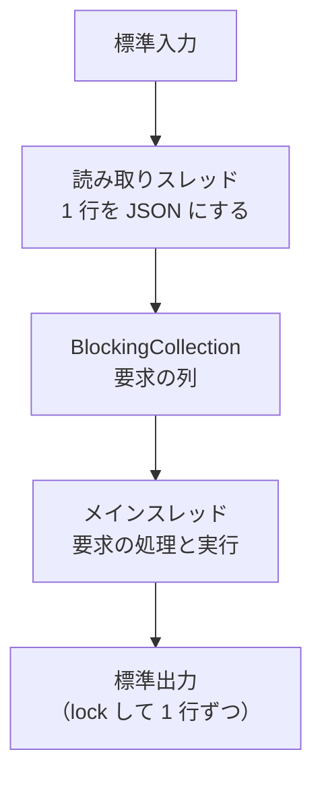
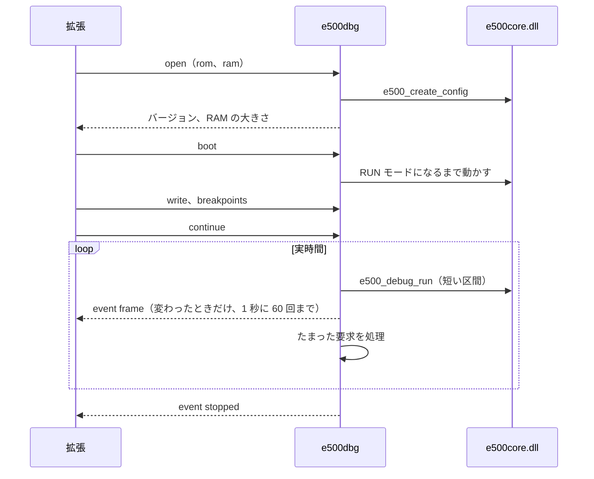
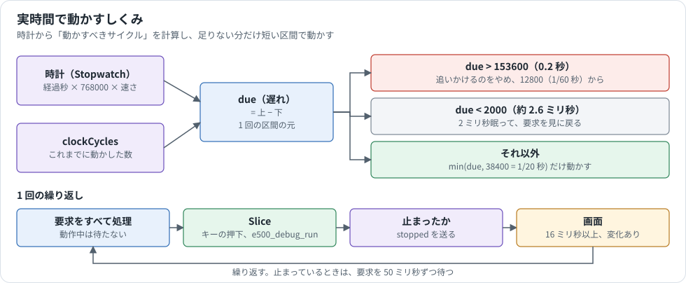
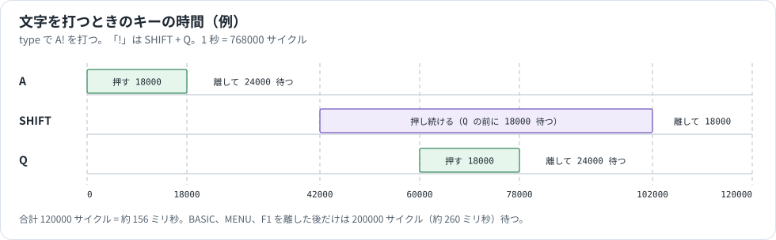
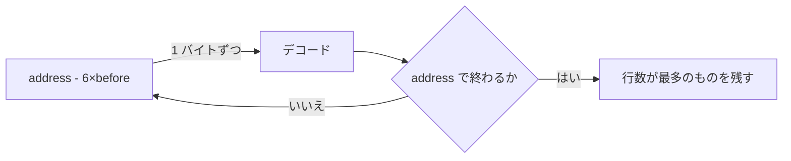

# 6. デバッグサーバー

この章はデバッグサーバー `e500dbg` の中身です。VS Code の拡張は JavaScript、エミュレータのコアは C++ の DLL なので、直接はつなげません。間に立って、1 行ずつの JSON の会話をコアの呼び出しに変えるのがこのプログラムです。実際の会話の記録を載せているので、手で同じ行を打ち込んで試すこともできます。

`e500dbg.exe` はエミュレータのコアを動かして VS Code 拡張とやり取りするプログラムです（C#、`server/`）。

[設計の目次へ戻る](README.md)

## この章で分かること

- なぜ別のプロセスにしたか、どんな形で会話するか
- 実時間で動かしながら要求に答えるループ
- すべてのコマンドと、実際のやり取りの例
- キー入力、起動、機械語エリアの確保、直接呼び出し
- コマンドを足す手順

## 6.1 なぜ別のプロセスか

- コア（`e500core.dll`）と ROM を同梱せずに、利用者のものを実行時に読み込むため。
- コアが落ちても VS Code に影響しないため。
- ネイティブの DLL を Node から直接呼ばずに済むため。

| 要件 | 作りへの影響 |
|---|---|
| 実機の速さで動かし、キーと画面が自然 | 時計に合わせて短い区間ずつ動かす |
| 動いている間もメモリや変数を読める | 区間の合間に要求を処理する。本体に触るのは 1 つのスレッドだけ |
| テストを速く | 時計を見ずに動かす `run` |
| 拡張が異常終了したら残らない | 標準入力が閉じたら終わる |
| 古いコアで気づかないうちに誤動作しない | 起動のときに関数があるか調べる |

## 6.2 構成

| ファイル | 内容 |
|---|---|
| `Program.cs` | 要求の受付、実時間の実行、画面の送信 |
| `Machine.cs` | 1 台の本体。キーの行列、文字の入力、機械語エリア、状態 |
| `Native.cs` | `e500core.dll` の関数。デバッグ用の関数があるかも調べる |
| `Lang.cs` | 日本語と英語 |

起動の引数は 2 つです。

| 引数 | 内容 | 省略時 |
|---|---|---|
| `--core パス` | `e500core.dll` | 実行ファイルと同じフォルダの `e500core.dll` |
| `--lang ja\|en` | メッセージの言語 | `ja` |

終了コードは、標準入力が閉じて終わったときが 0、コアを読めなかったときが 2 です。

### スレッド



JSON として読めない行には `output` の通知を返して、次の行に進みます。入力が終わると列に終わりの印（`null`）を入れ、メインスレッドがコアを片付けて終わります。

## 6.3 通信

標準入出力に、1 行 1 つの JSON を流します（UTF-8）。

| 向き | 形 |
|---|---|
| 要求 | `{"id": 1, "cmd": "read", "args": {…}}` |
| 応答 | `{"id": 1, "ok": true, "body": {…}}`、`{"id": 1, "ok": false, "error": "…"}` |
| 知らせ | `{"event": "stopped", "body": {…}}` |



本体はメインのスレッドで動き、要求は実行の区切りごとに処理します。そのため、実行中でもメモリや変数を読めます。

### 値の書き方

| 値 | 形 |
|---|---|
| アドレス、数 | 数。文字列なら `"&HBEC00"` `"0xBEC00"` `"$BEC00"` と 10 進も読む |
| バイト列 | base64 |
| 画面の点 | 240 × 32 ドットを 8 点ずつ 1 バイトに詰めた 960 バイト（base64）。行ごと、最上位ビットが左 |
| シンボル | 4 つの数（`e500_symbols` の 0、4、5、6 番） |

### 実際のやり取り

5 バイトのルーチン（`MV A,5`、`INC A`、`RETF`）を BEC00h に置き、BEC02h で止める例です。`>` が拡張から、`<` が `e500dbg` からです。

```text
< {"event":"ready","body":{"version":1}}
> {"id":1,"cmd":"open","args":{"rom":"…/PC-E500(7.2).ROM","ram":32,"card":0}}
< {"id":1,"ok":true,"body":{"romVersion":"7.2","romKB":256,"internalKB":32,"cardKB":0,"cpuHz":768000}}
> {"id":2,"cmd":"boot","args":{}}
< {"event":"frame","body":{"pixels":"QAAAAAAAAAAA…","symbols":[…]}}
< {"id":2,"ok":true,"body":{"run":true,"pro":false,"screen":">","log":"[0] …"}}
> {"id":3,"cmd":"area","args":{}}
< {"id":3,"ok":true,"body":{"start":785408,"size":0}}
> {"id":4,"cmd":"reserve","args":{"size":5120}}
< {"id":4,"ok":true,"body":{"start":780288,"size":5120,"screen":">"}}
> {"id":5,"cmd":"write","args":{"address":781312,"data":"CAVsAAc="}}
< {"id":5,"ok":true,"body":null}
> {"id":6,"cmd":"breakpoints","args":{"addresses":[781314]}}
< {"id":6,"ok":true,"body":null}
> {"id":7,"cmd":"call","args":{"entry":781312,"far":true,"registers":{"A":1}}}
< {"id":7,"ok":true,"body":{"returnAddress":1048562}}
> {"id":8,"cmd":"continue","args":{"speed":1}}
< {"event":"continued"}
< {"id":8,"ok":true,"body":null}
< {"event":"stopped","body":{"reason":"breakpoint","pc":781314}}
> {"id":9,"cmd":"registers","args":{}}
< {"id":9,"ok":true,"body":{"A":5,"IL":0,"BA":5,"I":0,…,"P":781314,"F":2,"off":false,"halt":false,"fault":false,"cycles":8294469}}
> {"id":11,"cmd":"disassemble","args":{"address":781314,"count":2,"before":1}}
< {"id":11,"ok":true,"body":[{"address":781312,"bytes":"0805","text":"MV A,$05","target":null},{"address":781314,"bytes":"6C00","text":"INC A","target":null},{"address":781316,"bytes":"07","text":"RETF","target":null}]}
```

アドレスは 10 進です（785408 = BFC00h、780288 = BE800h、781312 = BEC00h、1048562 = FFFF2h）。`reserve` の前は `size` が 0 で、機械語エリアがないことが分かります。JSON の中の日本語は実際には `\uXXXX` の形で出ます。

エラーの例です。

```text
> {"id":18,"cmd":"write","args":{"address":786432,"data":"AA=="}}
< {"id":18,"ok":false,"error":"C0000h から 1 バイトは RAM ではないため書き込めません。"}
> {"id":19,"cmd":"imem.write","args":{"address":240,"data":"AA=="}}
< {"id":19,"ok":false,"error":"内部 RAM は 00h〜EEh だけ書き換えられます（…）。"}
> {"id":20,"cmd":"nosuch","args":{}}
< {"id":20,"ok":false,"error":"不明なコマンド: nosuch"}
> {bad
< {"event":"output","body":{"text":"bad request: 'b' is an invalid start of a property name. …"}}
```

コマンドの中で起きた例外はすべて `ok: false` になり、`e500dbg` は動き続けます。

## 6.4 コマンド

| コマンド | 引数 | 内容 |
|---|---|---|
| `open` | `rom` `ram` `card` | 本体を作る |
| `info` | − | ROM バージョン、大きさ、CPU の速さ |
| `boot` | − | BASIC の RUN モードまで動かす |
| `reset` | `clear` | RESET |
| `continue` / `pause` | `speed` | 実時間で動かす、止める |
| `speed` | `speed` | 速さ（0 = 最高速） |
| `step` / `stepOver` / `stepOut` | − | 1 命令、呼び出しを飛ばす、戻るまで |
| `breakpoints` | `addresses` | ブレークポイント |
| `watchReads` | `addresses` `after` | そのアドレスを読んだら止まる（BASIC の行） |
| `registers` / `setRegister` | `name` `value` | レジスタ |
| `read` / `write` | `address` `length` / `data` | メモリ（base64）。書けるのは RAM だけ |
| `imem` / `imem.write` | `address` `data` | 内部 RAM。書けるのは 00h〜EEh |
| `callstack` | − | 呼び出し履歴 |
| `disassemble` | `address` `count` `before` | 逆アセンブル |
| `key` / `tap` / `type` / `releaseKeys` | `name` `down` / `text` | キー |
| `screen` | − | 液晶の点、シンボル、文字 |
| `frames.on` | `on` | 画面の通知を送るか |
| `mode` | − | BUSY、RUN、PRO |
| `area` / `reserve` | `size` | 機械語エリアの場所、確保 |
| `call` | `entry` `far` `registers` | ルーチンを呼ぶ準備 |
| `run` | `cycles` `settle` `untilTyped` | 最高速で動かす（テスト、準備） |
| `state.save` / `state.load` / `state.loadFile` | `data` / `path` | 状態 |
| `disk.mount` / `disk.status` | `folder` `readOnly` | CE-140F の X: |
| `status` | − | 実行中か、サイクル数 |

通知は `ready`（準備完了）、`frame`（画面）、`stopped`（理由とアドレス）、`continued`、`output`（記録）、`fatal`（続けられないエラー）です。

### 応答の中身

| コマンド | `body` |
|---|---|
| `open` `info` `state.loadFile` | `romVersion` `romKB` `internalKB` `cardKB` `cpuHz` |
| `boot` | `run` `pro` `screen` `log`（画面の移り変わり） |
| `registers` `setRegister` | `A IL BA I X Y U S P F`、`off` `halt` `fault` `cycles` |
| `callstack` | 古いほうから `site`（呼んだ所）`target`（行き先）`sp`（積んだ後の S）`interrupt` |
| `screen` | `pixels` `symbols` `text`（40 × 4 の文字） |
| `area` | `start` `size`、RAM の準備ができていなければ `null` |
| `reserve` | `start` `size` `screen` |
| `call` | `returnAddress` |
| `run` | `reason` `cycles` `pc`、`return` なら `registers`、`read` なら `address` |
| `type` | `skipped`（キーで打てない文字） |
| `disk.mount` `disk.status` | `status`（コアの値） |

### 止まった理由

| `reason` | 出どころ | 意味 |
|---|---|---|
| `breakpoint` | 実行中 | ブレークポイント |
| `return` | 実行中、`run`、`step` など | `call` で呼んだルーチンが、リターンアドレスに着いた。ステップで着いたときも `step` ではなくこれになる（`StepReason`）。レジスタを返し、CPU を呼ぶ前の状態に戻す |
| `step` | `step` など | ステップの終わり |
| `pause` | `pause` | 一時停止 |
| `exception` | どれも | コアの fault（今のコアでは起きない） |
| `read` | 実行中、`run` | `watchReads` のアドレスが読まれた（`address` 付き） |
| `timeout` | `run` だけ | サイクルを使い切った |
| `idle` | `run` だけ | キーを打ち終えて `settle` サイクルたった |

## 6.5 実行のループ



`Main` は、列にある要求をすべて処理し、動いていれば 1 区間（`Slice`）動かす、を繰り返します。止まっているときは、要求を 50 ミリ秒ずつ待ちます。

| 数 | 値 | 理由 |
|---|---|---|
| CPU の速さ | 768000 サイクル/秒 | 1 秒の仕事の量 |
| 1 区間の上限 | 38400（1/20 秒） | 要求への答えが遅れないように |
| 眠る境目 | 2000 サイクル未満 | 細かすぎる区間を避け、PC の CPU を使いすぎない |
| 追いかけるのをやめる境目 | 153600 より多い遅れ（0.2 秒） | デバッグで止めた後や遅い PC で、まとめて早送りしない |
| 最高速（速さ 0） | 1 区間 25600（1/30 秒） | 要求の合間をなるべく多く |
| 画面 | 16 ミリ秒より前には送らない | 1 秒に 60 回まで |

画面は点とシンボルのどちらかが変わったときだけ送ります。止まったとき、書き込みの後、`boot` の後などは、変わっていなくても送ります（`force`）。

### 1 区間の中（Machine.Run）

1. 待ちの時間が終わっていれば、キーの列から次の押下か離しを取り、コアに伝える。
2. 待ちがあればその分、なければ残り全部を `e500_debug_run` に渡す。
3. 動いた分だけ待ちを減らす。
4. コアが「止まった」を返したら、理由を返す。

`continue` で動き始めるときだけ、最初の命令のブレークポイントを見ません（`resume`）。止まったアドレスから先へ進むためです。

### ステップ

| コマンド | 動き |
|---|---|
| `step` | `e500_debug_step` で 1 命令（PRE と命令は 1 つ）。すぐ `stopped` |
| `stepOver` | 呼び出しの深さを覚えて 1 命令。深くなっていたら、その深さに戻るまで動かす |
| `stepOut` | 今の深さより浅くなるまで動かす。深さが 0 なら 1 命令 |

深さはコアの呼び出し履歴の数です。割り込みも 1 段と数えるので、`stepOver` の途中で割り込みが入っても戻ってから止まります。

## 6.6 コアの関数

ふつうのエミュレータの関数（`e500_create_config`、`e500_memory` など）のほか、デバッグ用に次を使います。

| 関数 | 内容 |
|---|---|
| `e500_debug_run` | ブレークポイントか、決めたサイクルまで動かす |
| `e500_debug_step` | 1 命令 |
| `e500_debug_breakpoints` | ブレークポイント |
| `e500_debug_watch_reads`、`e500_debug_read_hit` | 読み出しで止める |
| `e500_debug_frames`、`e500_debug_clear_frames` | 呼び出し履歴 |
| `e500_debug_call` | リターンアドレスを積んで飛ぶ |
| `e500_debug_halt` | CPU の停止状態 |
| `e500_debug_write_imem` | 内部 RAM の書き換え |

デバッグ用の関数がない古い DLL は、`Native.cs` が起動のときに断ります。調べるのは `e500_debug_run` `_step` `_frames` `_call` `_halt` `_watch_reads` と `e500_set_reg` です。`e500_debug_write_imem` だけは使ったときに「新しいコアが要る」というエラーにします。

### レジスタの番号

| 名前 | 番号 | 名前 | 番号 |
|---|---|---|---|
| A | 0 | Y | 5 |
| IL | 1 | U | 7 |
| BA | 2 | S | 8 |
| I | 3 | P | 9 |
| X | 4 | F | 10 |

### 状態のビット

| `e500_status` | 意味 |
|---|---|
| ビット 0 | 電源 OFF |
| ビット 1 | HALT |
| ビット 2 | fault（未定義命令） |

## 6.7 キーの入力

`type` は文字をキーの行列に変え、押す、離すを順に並べます。モードを変えるキー（BASIC、MENU、F1）の後は長めに待ちます。キーで打てない文字は応答の `skipped` で返します。



| 文字 | キー |
|---|---|
| 英字（大文字も小文字も） | その字のキー |
| 数字、`,` `;` `.` `+` `-` `*` `/` `(` `)` `=` `^` | そのキー |
| 空白 | SPACE |
| 改行 | ENTER |
| `!` `"` `#` `$` `%` `&` `'` `<` `>` `@` | SHIFT + Q W E R T Y U I O P |
| `[` `]` `{` `}` `\` `\|` `~` `_` | SHIFT + A S D F G H J K |
| `` ` `` `?` `:` | SHIFT + M `,` `;` |

`tap` はキーの名前（`C-CE`、`BASIC`、`ON/BRK` など）で 1 回押します。`key` は列に入れず、すぐに押す・離すです（パネルの本体のキー、テストの `keys`）。キーの行列は 12 行 × 8 ビットで、`Machine.cs` の `Matrix` にあります。

## 6.8 逆アセンブルの前後

`disassemble` は、アドレスの後ろは先頭からデコードするだけですが、前（`before`）は命令の切れ目が分かりません。

1. `before × 6` バイト前から 1 バイトずつ近づけてデコードする。
2. デコードした行がちょうど `address` で終わるものを候補にする。
3. 行数がいちばん多いものを使う（`before` 行に届いたら終わり）。



逆アセンブラの Core を使うので、表示の形は `e500dasm` と同じです（ラベルなし）。`count` は 1〜2000 に丸めます。

## 6.9 起動、機械語エリア、直接呼び出し

### 起動（boot）

1. RESET（RAM を消す）して 2 秒分動かす。
2. 最大 10 回、画面とモードを見て、次の操作を選ぶ。

| 画面 | 操作 |
|---|---|
| RUN で BUSY でない | 終わり |
| PRO | BASIC キー |
| `Y/N` か `(Y)` の文字 | `Y` を打つ（RAM の初期化の問い） |
| 1 回目 | F1（「初期化」や BASIC） |
| それ以外 | BASIC キー |

キーを打つたびに、打ち終わってから 2 秒分動かします。画面を出した直後のキーは、ROM が忙しくて受け取らないことがあるためです。10 回で RUN にならなければ、画面の文字を付けてエラーにします。`log` に移り変わりが残るので、新しい ROM で失敗したときはここを見ます。

### 機械語エリアの確保

`reserve` は BASIC から `POKE` と `CALL &HFFFD8` を打って、ROM 自身に確保させます。その後 BASIC に入り直し、`BFD1Ah` のポインタを読んで確かめます。どの ROM でも同じ手順で動きます。

打つ文字は、`size` = 1400h（5120）なら次のとおりです。数は 10 進です（`Type` で打てる文字だけにするため）。

```text
POKE 785923,26,253,11,0,20,0:CALL 1048536
```

| 部分 | 意味 |
|---|---|
| 785923（BFE03h） | ROM のルーチンへの引数の場所 |
| `26,253,11` | BFD1Ah（機械語エリアのポインタ） |
| `0,20,0` | 大きさ 001400h |
| 1048536（FFFD8h） | 公開のエントリ |

BASIC のプログラムの実行中や、RUN / PRO でないときは断ります。

### 直接呼び出し（call）

| 段 | 内容 |
|---|---|
| 1 | 全レジスタと HALT の状態を覚える（すでに呼び出し中なら、最初のものを残す） |
| 2 | `e500_debug_call` が、リターンアドレスを S スタックに積んでエントリに飛ぶ |
| 3 | 渡されたレジスタを入れる（P と S は変えない） |
| 4 | リターンアドレスをブレークポイントに足す |
| 5 | リターンアドレスで止まったら、結果のレジスタを答えに入れ、CPU を元に戻す |

リターンアドレスは、far なら FFFF2h、near ならエントリと同じ 64 KB の xFFF2h です。`reset`、`state.load` などは、呼び出し中の情報を捨てます（`ForgetCall`）。

### 状態

`state.save` はコアの状態をそのまま base64 で返します。周辺機器の通信中などはコアが断ります。`state.load` の後はキーの列と呼び出し履歴を空にします。`state.loadFile` はエミュレータの `.e500state`（JSON の `Data`）を読みます。

## 6.10 安全と限界

| 項目 | 内容 |
|---|---|
| 外との口 | 標準入出力だけ。ネットワークもファイルも、要求されたもの（ROM、状態、X: のフォルダ）だけ |
| 読み込む DLL | `--core` で渡されたものだけ。名前 `e500core` の解決を差し替える |
| 動く OS | Windows（x64）、Linux（x64）、macOS（Apple シリコン、Intel）。.NET 10 のランタイムが要る。`e500dbg.dll` は CPU を選ばない |
| 本体の数 | 1 プロセスに 1 台 |
| 内部 RAM の書き込み | 00h〜EEh だけ。EFh（AMC）と F0h からの I/O は、書くと動作が変わるため |
| ROM の大きさ | 256 KB か 384 KB。実機の `SAVEM` のダンプ（先頭 16 バイトのヘッダー付き 256 KB）も読む |
| 内蔵 RAM | 384 KB の ROM でバージョンの小数部が 3 以外（PC-E650、PC-U6000 など）は、64 KB 未満を 64 KB にする |

文字の読み取りは ROM の中の字形から行います。`0`〜`3` の字形の並びを ROM から探し、その 16 文字前を 20h の字形とします。画面の 1 文字が字形と 2 ドットまでの違いなら、その文字とみなします（反転表示も比べます）。合わなければ `□` です。

## 6.11 変更の手順

### コマンドを足す

例として、メモリを探す `find` を足すとします。

1. `Program.cs` の `Execute` に `case "find":` を足す。引数は `Int` `Str` `Bool` で取り、応答は `JsonObject` か `null`。失敗は例外を投げる（`Lang.L("…", "…")` の 2 言語）。
2. 本体に触る処理が長ければ `Machine.cs` に移す。
3. 走っている途中に受けても困らないか考える。止めてから行うものは `running = false` を先に書く（`state.load` などが例）。
4. `client.ts` に 1 行のメソッドを足す（引数と返り値の型）。
5. `emulator.test.ts` に足し、この章の表も直す。

### コアの関数を足す

1. `Native.cs` に `DllImport` を足す。必ず要るものは `Load` の一覧にも足す。
2. 新しいコアだけの関数は、`EntryPointNotFoundException` を受けて分かるメッセージにする（`WriteInternalMemory` が例）。
3. 拡張の `hasDebugger` は `e500_debug_run` の文字を見るだけです。ほかの関数の有無は `e500dbg` が起動のときに調べます。

### 通知を足す

`Send(new JsonObject { ["event"] = "名前", … })` で送り、`client.ts` は自動で同じ名前のイベントにします。`stopped` と `continued` だけは、`running` の値にも使われます。

### 気をつけること

- `Run` の `resume` は動き始めの最初の区間だけ `true` です。`stepOver` で呼び出しの中から動き出すときは `false` にします（呼び出し先の先頭のブレークポイントで止まるため）。
- `speed` や `continue` では時計と `clockCycles` を必ず 0 に戻します。
- `returnAddress` を変えたら `ApplyBreakpoints` を呼びます。
- 標準出力に JSON 以外を書かないでください。`Console.WriteLine` の 1 行は、拡張では `log`（標準エラーの記録と同じ扱い）になります。

## まとめ

| 覚えること | 内容 |
|---|---|
| 会話 | 1 行 1 JSON。`id` の付いた応答と、`event` の知らせ |
| 実行 | 時計との差を、1/20 秒までの区間で動かす。合間に要求 |
| 止まる理由 | `breakpoint` `return` `step` `pause` `exception` `read`（`run` は `timeout` `idle` も） |
| ROM に頼む | 起動、機械語エリアの確保は、キーを打って ROM に行わせる |

## 次に読むもの

- [デバッガー](07_DEBUGGER.md): このコマンドを使う側
- [VS Code 拡張](05_VSCODE_EXTENSION.md): パネルと `client.ts`
- [エミュレータのパネル](../manual/09_EMULATOR.md): 使い方
