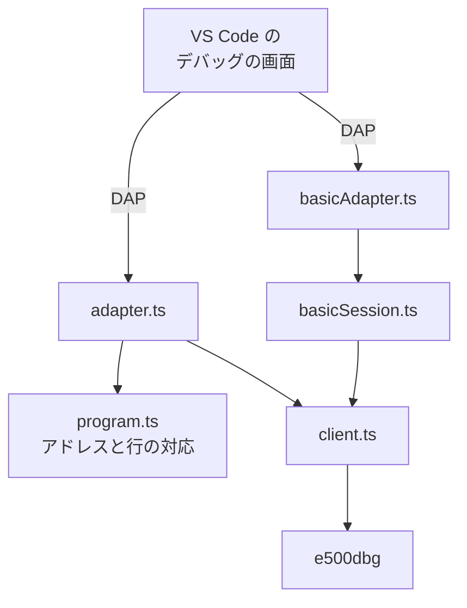
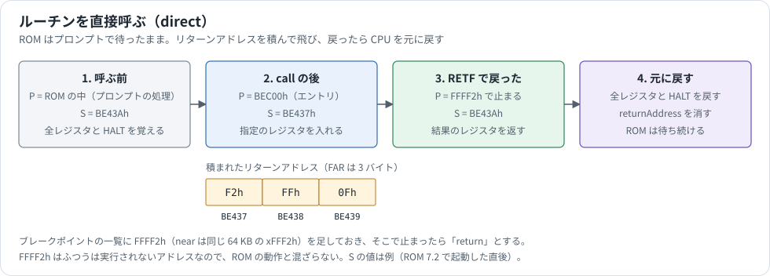
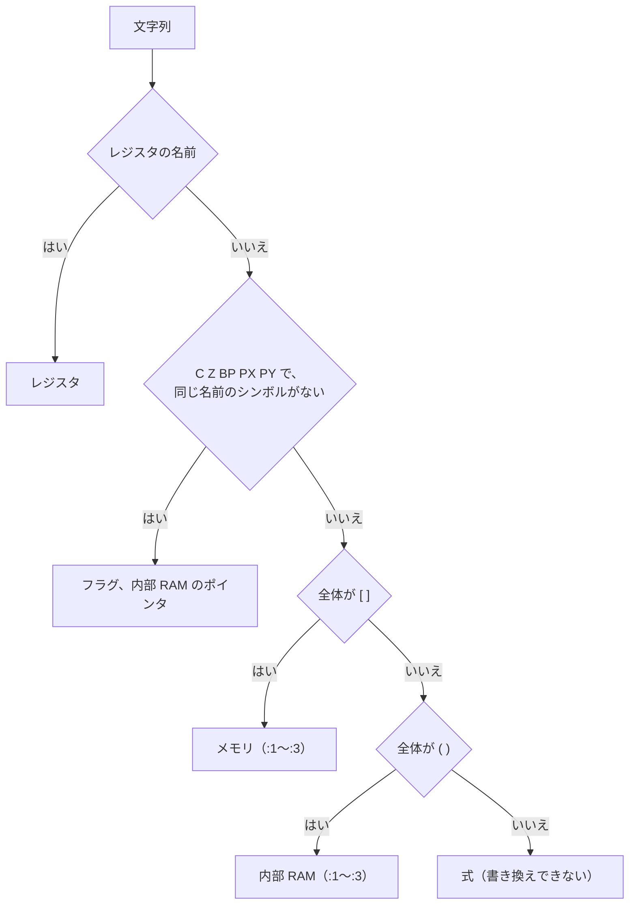
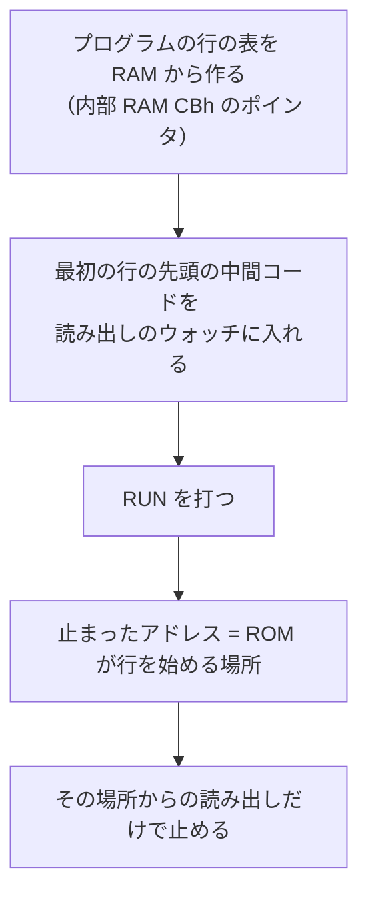
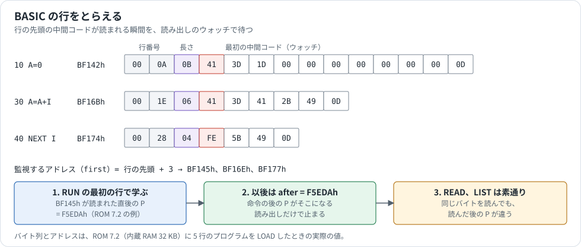
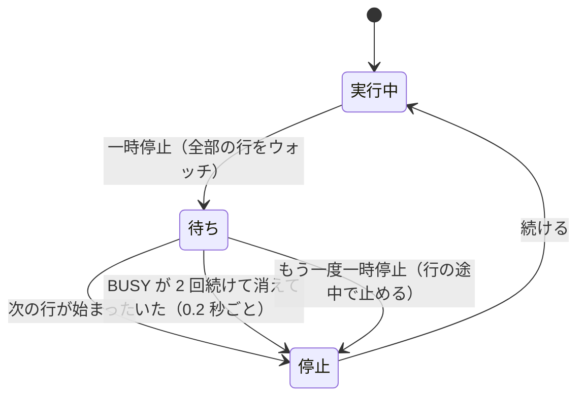
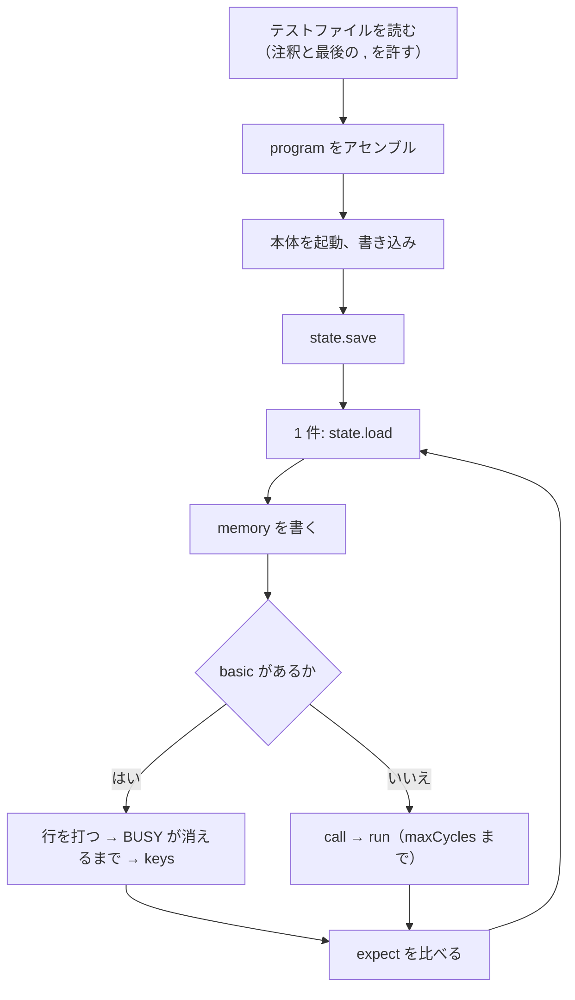

# 7. デバッガー

この章は、ASM と BASIC のデバッグ、テストの実行のしくみを説明します。VS Code の画面の「赤い丸」と「黄色の行」が、エミュレータの中のアドレスとどう結び付くのか。ソースの行を持たない BASIC を、どうやって行ごとに止めるのか。この 2 つが、章の中心になる問いです。

[設計の目次へ戻る](README.md)

## この章で分かること

- VS Code のデバッグ画面と `e500dbg` の間に何があるか
- F5 から終わりまでの、実際のメッセージ
- アドレスと行の対応、呼び出し履歴、値の書き方
- BASIC の行を、ROM のアドレスの表なしで止めるしくみ
- テストが 1 件ずつ独立して動く理由

## 7.1 デバッグアダプター

拡張の中で動く、Debug Adapter Protocol（DAP）の実装です。`launch.json` の `type` は `pc-e500` で、`.asm` は `adapter.ts`、`.bas` は `basicAdapter.ts` が受け持ちます。



対応している要求は、ブレークポイント（行、命令）、ステップ、一時停止、コール スタック、変数、書き換え、評価、メモリの読み書き、逆アセンブル、終了です。`terminate` には応答し、`terminated` の通知を送ります。

### 選び方

`createDebugAdapterDescriptor` が、`program` の拡張子（`.bas` `.basic` `.e500`）で BASIC のアダプターを選びます。どちらも `DebugAdapterInlineImplementation`（拡張の中で動く）です。別プロセスにしないのは、エディタの未保存の内容と設定をそのまま使えて、パネルと同じ `MachineHub` を共有できるためです。

| ファイル | 役割 |
|---|---|
| `debug/adapter.ts` | ASM の DAP、`E500ConfigurationProvider`（`launch.json` なしの F5） |
| `debug/basicAdapter.ts` | BASIC の DAP |
| `emu/program.ts` | アセンブルした結果。アドレスと行、ラベル、式 |
| `emu/prepare.ts` | 起動（`startMachine`）、書き込み（`loadProgram`） |
| `emu/basicSession.ts` | BASIC の読み込みと、行で止めるしくみ |
| `emu/basic.ts` | RAM の中の BASIC（行、変数、ブロック） |
| `emu/asmValues.ts` | 値の読み書き |
| `emu/client.ts` | `e500dbg` との会話 |

### 対応している DAP の要求

| 要求 | ASM | BASIC |
|---|---|---|
| `initialize` `launch` `configurationDone` `threads` `scopes` | ○ | ○ |
| `setBreakpoints` | 行 → アドレス | 行 → 行番号 |
| `setInstructionBreakpoints` | ○ | − |
| `stackTrace` | 呼び出し履歴 | 今の行 1 つ |
| `variables` `setVariable` `setExpression` `evaluate` | ○ | ○ |
| `readMemory` `writeMemory` `disassemble` | ○ | − |
| `continue` `next` `stepIn` `stepOut` `pause` | ○ | `stepOut` は次のブレークポイントまで |
| `terminate` `disconnect` | ○ | ○ |
| それ以外 | 「対応していません」 | 〃 |

## 7.2 ASM

### アドレスと行

`Program` が、アセンブルの結果から「アドレス → ファイルと行」と「行 → アドレス」の表を作ります。命令のない行のブレークポイントは、次の命令に移します。

| メソッド | しくみ |
|---|---|
| `lineAt(address)` | アドレス順に並べた行を 2 分探索。その行のバイトの中のアドレスなら、その行 |
| `codeAtOrAfter(file, line)` | 同じファイルで、その行以降の命令のうち、いちばん前の行 |
| `symbolFor(address)` | そのアドレスか手前のラベル。`START+1Bh` の形 |
| `entry(given)` | 指定、`START`、`MAIN`、先頭の順 |
| `resolve(text)` | ラベル、式、`&H…` などをアドレスに |
| `areaSize(internalKB)` | BFC00h より下の内蔵 RAM に収まるときの、確保する大きさ |

データ（`DB` など）の行は `code: false` で、ブレークポイントを置けません。

### 始め方

1. アセンブル（開いている内容。未保存でもよい）。
2. `e500dbg` を起動して `boot`（または `state.loadFile`）。
3. `BFC00h` より下の内蔵 RAM に置くなら、そこまで `reserve`。
4. `write` して、ブレークポイントを設定。
5. `mode: basic` は `CALL アドレス` を打つ。`mode: direct` は `call` で飛ぶ。

| 段の失敗 | 動き |
|---|---|
| アセンブルのエラー | 「デバッグ コンソール」に一覧を出し、`launch` を失敗にする。待っている `setBreakpoints` には答える |
| 確保できない | 記録に出して、そのまま書き込む（動くが、BASIC に上書きされることがある） |
| 書き込めない（ROM など） | `launch` を失敗にする |
| RUN モードでない | `CALL` を打たずに通知し、動かし続ける |

始めている最中（エミュレータの起動やアセンブルを待っている間）に `disconnect` が来ることもあります。アダプターは、コアの用意ができた時点で、もう終わったか（`ended`）を見て、終わっていれば、その場で `e500dbg` を片付けます。

### 呼び出し履歴

コアが `CALL`、`CALLF`、割り込みを記録します。リターンアドレスの S の値で、どこまで戻ったかを見分けます。ROM の中のアドレスは `ROM C1234` のように表示します。

`stackTrace` は「今の P」を先頭に、履歴の呼び出し元を新しい順に並べます。ソースのあるアドレスはそのファイルと行、ないアドレスは薄い表示です。割り込みで入った段には「（割り込み）」と付きます。

### direct

呼ぶ前のレジスタと停止状態を覚え、リターンアドレス（`FFFF2h` など、ふつうは実行されない所）で止めます。戻ったら結果を出し、CPU を元に戻すので、ROM は何もなかったようにプロンプトで待ち続けます。



5 バイトのルーチン（`MV A,5`、`INC A`、`RETF`）を `run` で呼ぶと、応答は次のとおりです。

```text
call  → {"returnAddress":1048562}
run   → {"reason":"return","cycles":10,"pc":1048562,"registers":{"A":6,…,"S":779322,…}}
```

`stopOnReturn` がなければ、結果を「デバッグ コンソール」に出して、そのまま続けます。

### 値の書き方

`asmValues.ts` が、`[式]`、`(式)`、`:2` `:3`、レジスタ、シンボルの式を扱います。変数の一覧、ウォッチ、ホバー、パネル、デバッグ画面で同じものを使います。内部 RAM の書き換えは 00h〜EEh だけです。



| 書き方 | 例 | 意味 |
|---|---|---|
| レジスタ | `X` `F` `C` | 20 ビット、8 ビット、フラグ |
| メモリ | `[msg]` `[X+1]:2` | 下位から 1〜3 バイト |
| 内部 RAM | `($D4)` `(BP):2` | 同じ |
| 式 | `msg_end-msg` `(1+2)*3` | アセンブラと同じ式。`&H7B` も読む |

書き換えの入力は、数、`FFh`、`40h（64）`（一覧の表示のまま）、式、負の数（2 の補数）を受けます。入らない値は断ります。ラベルの行には `03 04 FF` か `"ABC"` を打てます。

## 7.3 F5 から終わりまで

`examples/hello.asm` を、`CALLF IOCS`（21 行目）にブレークポイントを置いて動かしたときの、実際のメッセージです（左の数は、初めからのミリ秒。パスは短縮）。速さは 0（最高速）です。

```text
>    0 {"command":"initialize","arguments":{"adapterID":"pc-e500"}}
<    3 {"type":"response","command":"initialize","success":true,"body":{"supportsConfigurationDoneRequest":true,"supportsSetVariable":true,…}}
<    4 {"type":"event","event":"initialized"}
>    4 {"command":"launch","arguments":{"program":"…/hello.asm","mode":"basic","stopOnEntry":false}}
>    5 {"command":"setBreakpoints","arguments":{"source":{"path":"…/hello.asm"},"breakpoints":[{"line":21}]}}
<   29 output: hello.asm: BEC00〜BEC3F（64 バイト）、開始 BEC00 START
<  119 {"command":"setBreakpoints","success":true,"body":{"breakpoints":[{"verified":true,"line":21,"instructionReference":"0xBEC1B"}]}}
>  120 {"command":"configurationDone"}
<  527 output: ROM Ver.7.2（256KB）、内蔵 RAM 32KB
<  824 output: 初期化して BASIC の RUN モードにしました。
< 1015 output: 機械語エリアを 1000h バイト確保しました（BEC00〜BFBFF）。
< 1018 output: BEC00〜BEC3F に 64 バイト書き込みました。
< 1030 {"command":"launch","success":true}
< 1034 output: BASIC で CALL 781312 を実行します（RETF で BASIC に戻ります）。
< 1037 {"event":"continued","body":{"threadId":1,"allThreadsContinued":true}}
< 1068 {"event":"stopped","body":{"reason":"breakpoint","threadId":1,"allThreadsStopped":true}}
> 1069 {"command":"stackTrace","arguments":{"threadId":1}}
< 1084 {"body":{"stackFrames":[{"id":1,"name":"START+1Bh","source":{…},"line":21,"column":1,"instructionPointerReference":…},…]}}
> 1084 {"command":"scopes"}   → レジスタ、シンボル、内部 RAM（I/O）
> 1084 {"command":"variables","arguments":{"variablesReference":1}}
< 1086 {"body":{"variables":[{"name":"A","value":"02h（2）"},{"name":"IL","value":"42h（66）"},…]}}
> 1086 {"command":"evaluate","arguments":{"expression":"[msg]:2","context":"watch"}}
< 1093 {"body":{"result":"4548h（17736）","memoryReference":"0xBEC31"}}
> 1093 {"command":"next"}
< 1095 {"event":"continued"}
< 1096 {"event":"stopped","body":{"reason":"step"}}
> 1097 {"command":"terminate"}
< 1097 {"command":"terminate","success":true}
< 1098 {"event":"terminated"}
> 1098 {"command":"disconnect"}
< 1098 {"command":"disconnect","success":true}
```

読み取れることです。

| 見るところ | 説明 |
|---|---|
| 5 → 119 | `setBreakpoints` は `launch` より先に来ても、アセンブルが済むまで待って答える（`programReady`） |
| 120 → 1030 | `launch` の応答は、`configurationDone` と書き込みの後（`configured`） |
| 1015 | `ORG $BEC00` から BFBFFh までの 1000h バイトを、ROM に確保させた |
| 1034 | `CALL 781312` は 10 進（`&H` は打てるが、10 進なら記号が要らない） |
| 1086 | `[msg]:2` は `48 45`（"HE"）を下位から読むので 4548h |
| 1097 | `terminate` に応えて `terminated` を送る。送らないと、VS Code はもう一度止めるまで待つ |

### 通知の規約

| `e500dbg` の知らせ | DAP | 備考 |
|---|---|---|
| `stopped`（`breakpoint`） | `stopped`（`breakpoint`） | エントリで止めたときは `entry` |
| `stopped`（`step` `pause`） | 同じ | |
| `stopped`（`exception`） | `stopped`（`exception`） | 「未定義命令で停止しました（アドレス）」 |
| `stopped`（`return`） | `output` と、`stopOnReturn` なら `stopped` | なければ続ける |
| `stopped`（`read`） | BASIC だけ: `breakpoint` `step` `pause` | |
| `continued` | `continued` | |
| プロセスの終了 | `terminated` | |

## 7.4 BASIC

BASIC のプログラムには手を加えず、ROM バージョンごとのアドレスの表も使いません。

### 読み込み

一時フォルダを CE-140F の X: としてつなぎ、`LOAD "X:名前.BAS"` を打ちます。ROM 自身が中間コードにするので、実機と同じ結果になります。空の行と行番号のない行は送りません（`LOAD` が空の行で終わるため）。

| 変換（`encodeSource`） | 結果 |
|---|---|
| タブ | 空白 |
| ASCII、半角カナ、`¥` | そのバイト（`¥` は 5Ch、半角カナは A1h〜DFh） |
| 本体にない文字 | 省いて、知らせる |
| 行末 | `0D 0A` |

例: `10 PRINT "ｱ¥"`、空行、`note`、`20 END` は、`31 30 20 … 22 B1 5C 22 0D 0A 32 30 20 45 4E 44 0D 0A` になります（空行と `note` は送りません）。

名前は 8 文字までの `A-Z 0-9 _ -` に直します。`LOAD` の後、画面の終わりの 2 行に `error` があれば失敗とします。終わったら一時フォルダを消します。

### 行で止める



インタプリタは、行を始めるときにその行の最初の中間コードを、ROM の決まった 1 か所から読みます。その場所を最初の行で学び、以後はそこからの読み出しだけで止めます。`READ` や `LIST` がプログラムを読んでも止まりません。

- **ブレークポイント**は、その行の先頭だけをウォッチします。
- **ステップ**は、全部の行の先頭をウォッチし、次に始まった行で止めます。
- **一時停止**は、ステップと同じで次の行を待ちます。BUSY が消えているときは、その場で止めます。



#### 行の表

内部 RAM の CBh〜CDh が、プログラムのブロック（`TEXT    BAS`）を指します。ブロックの先頭は `FBh`、+16h の 3 バイトが使っている大きさ、+22h からが保存したファイルと同じ形、+35h から行です。

| 位置 | 内容 |
|---|---|
| 行の +0 | 行番号（上位が先） |
| +2 | 長さ（中間コードと終わりの `0Dh`） |
| +3 | 最初の中間コード（`first`） |
| ブロックの終わり | `FFh` |

#### 学び方

1. `watchReads([最初の行の first])`（`after` なし: どこからの読み出しでも止まる）。
2. `RUN` を打ち、最高速で動かす。
3. `read` で止まったときの P を `dispatch` とする。ROM 7.2 では F5EDAh、8.5 では F5778h。
4. 以後は `watchReads(行の first の一覧, dispatch)`。命令を実行した後の P が `dispatch` になる読み出しだけで止まる。

`after` が効くのは、「読み出しをした命令の次のアドレス」で区別しているからです。同じバイトを `READ` や `LIST` が読んでも、読んだ後の P が違います。

#### 止まった後

`e500dbg` は命令を実行し終えてから止まるので、止まった行はまだ始まったところです。変数はその行の前の値で、書き換えるとその行から使われます。

### 一時停止



`BEEP`、`WAIT`、`INPUT` のような長い行では、次の行が始まるまで待ちます。BUSY を 2 回見るのは、行と行の間の一瞬を「動いていない」と間違えないためです。

### 変数

`basic.ts` が、RAM の変数のブロック（`DATA`）を読みます。数値（10 進の仮数）、文字列、配列に対応します。`A`〜`Z` は ROM がいつも場所を取るので、プログラムで使っているものと 0 でないものだけを出します。書き換えは、行の直前で止まっているときに限ります。

#### DATA ブロック

+22h が `FF 00 01 00`、+26h から 3 バイトの位置が 10 個（ブロックの先頭から）並びます。

| 区画 | 中身 | 値の形 |
|---|---|---|
| 0 | 単精度の配列 | 要素 7 バイト |
| 1 | 倍精度の配列（`#`） | 12 バイト |
| 3 | 文字列の配列（`$`） | 3 バイト（位置 2、長さ 1） |
| 4 | `A`〜`Z` | 7 バイト |
| 5 | そのほかの単精度 | 7 バイト |
| 6 | 倍精度（`#`） | 12 バイト |
| 8 | 文字列（`$`） | 位置 3、長さ 1 |
| 9 | 文字列の中身 | − |

1 件は「名前の長さ 1 バイト、件の大きさ 3 バイト、名前、値」です。

#### 数値の形

| 部分 | 単精度（7 バイト） | 倍精度（12 バイト） |
|---|---|---|
| 1 バイト目 | 00h か 08h（負） | 01h か 09h（負） |
| 2 バイト目 | 10 進の指数（符号付き） | 同じ |
| 残り | 10 桁の BCD | 20 桁の BCD |

| 値 | 単精度 | 倍精度 |
|---|---|---|
| 123.45 | `00 02 12 34 50 00 00` | `01 02 12 34 50 00 00 00 00 00 00 00` |
| −0.005 | `08 FD 50 00 00 00 00` | `09 FD 50 …` |
| 3.14159265358979 | `00 00 31 41 59 26 54`（四捨五入） | `01 00 31 41 59 26 53 58 97 90 00 00` |

`encodeNumber` は桁を丸め、±1E-99〜9.99…E+99 を外れると断ります。文字列は、同じ長さのときだけ書き換えられます（長さが変わると、後ろの文字列をずらす必要があるため）。一覧では `\xNN` が 1 バイト、5Ch は `¥` です。

#### プログラムが使う A〜Z

`usedLetters` が中間コードを読み、数（`1D` と 7 か 12 バイト）、行番号（`1F` と 2 バイト）、ラベル（`1C` と 2 バイト）、文字列、命令（`FE xx`）、注釈を飛ばして、1 文字の名前だけを集めます。`A$` や `A(` は別の変数として除きます。

### BASIC の実行例

```text
10 A=0 / 20 FOR I=1 TO 3 / 30 A=A+I / 40 NEXT I / 50 PRINT "SUM=";A
```

```text
<  638 output: SUM.BAS を CE-140F から読み込みました（5 行）。
<  639 {"command":"setBreakpoints","body":{"breakpoints":[{"verified":true,"line":3}]}}
<  657 output: RUN しました（ROM の行の始まり F5EDAh）。
<  658 {"event":"stopped","body":{"reason":"entry"}}          10 行（stopOnEntry）
>  664 {"command":"next"}
<  669 {"event":"stopped","body":{"reason":"step"}}           20 行
>  670 {"command":"continue"}
<  671 {"event":"stopped","body":{"reason":"breakpoint"}}     30 行
<  674 {"variables":[{"name":"A","value":"0"},{"name":"I","value":"1"}]}
```

30 行の前なので、`A` はまだ 0、`I` は 1 です。

### 終わり方

BASIC のプログラムが終わっても、デバッグは終わりません。本体はプロンプトで動き続け、キーを打てます。止めるのは利用者です。

## 7.5 テスト

`testController.ts` がテスト エクスプローラーに並べ、`testfile.ts` が 1 件ずつ動かします。

1. 本体を 1 台起動し、プログラムを書いた直後の状態を `state.save` で覚える。
2. 1 件ごとに `state.load` で戻し、`memory` を書く。
3. `call` は `direct` と同じ。`basic` は行を打ち、BUSY が消えるまで待って、`keys` を押す。
4. `expect` を調べる。`screen` は液晶の点を字形と照合した文字、`picture` は全ドットの比較。

最高速で動かすので、1 件は数十ミリ秒から数百ミリ秒です。



| 場面 | 時間 |
|---|---|
| 既定の上限 | 3840000 サイクル（5 秒分） |
| `basic` の待ち | 打ち終わってから 0.5 秒分、その後 BUSY が消えるまで 0.25 秒分ずつ |
| `keys` の 1 つ | 押して 0.2 秒分、離して 1 秒分 |

失敗は、期待と実際を並べたメッセージ（`A: 期待 5（05h）、実際 6（06h）`）になり、テストの `name` の行に付きます。1 件の失敗は、ほかの件に影響しません（毎回 `state.load` で戻すため）。

「デバッグ」は、その件の `call` `registers` `memory` を `direct` の `launch` に渡し、エントリと戻りで止めます。`basic` の件はデバッグできません。

### テストのエクスプローラーの並び

- ファイルごとに 1 つ、件ごとに 1 つの項目です。項目の ID は「ファイルの URI + `#` + 名前」なので、名前は重ならないようにします。
- ファイルの追加、変更、削除を見て、並びを直します。
- スキーマ（`schemas/e500test.schema.json`）は、編集中の候補と検査に使われます。実行のときは `parseTestFile` が `program`、`tests`、`name` だけを確かめます。

## 7.6 限界

| 項目 | 内容 |
|---|---|
| BASIC の呼び出し履歴 | 今の行だけ。`GOSUB` の段は追わない |
| 条件付きブレークポイント、ログポイント | ない |
| 自動変数、スコープ | ASM は全体のシンボル。局所の区別はない |
| 実行中の書き換え | レジスタと内部 RAM は止めているときだけ。`write` は動いていてもできる |
| ROM の行 | ソースはない。逆アセンブリで見る |

## 7.7 変更の手順

### DAP の要求に対応する

1. `dispatch` に `case` を足す。`respond` を必ず 1 回呼ぶ（例外は自動で失敗の応答になる）。
2. `initialize` の応答に、対応を示す項目を足す。
3. 値が変わったら `invalidated`（`areas: ["variables"]`）を送る。
4. `dap.test.ts` か `basicDap.test.ts` に足す。`vscode` は、使うところだけの代わりを渡している。

### 変数の一覧に項目を足す

- `scopes` に `variablesReference` の番号を足し、`variables` と `setVariable` に分岐を足す。番号は ASM では 1〜3 を使っている。
- `memoryReference` を付けると、「メモリを見る」から開けます。

### BASIC の変数の形を足す

`parseVariables` の `sections` と `switch`。`Place`（場所、長さ、型）を付けると書き換えられます。`basic.test.ts` に、エミュレータから取ったバイト列を足します。

### 新しい ROM で確かめる

`E500_ROM` を替えて `basicEmulator.test` と `dap.test` を動かします。学んだ `dispatch` が出るので、行で止まらないときは、そのアドレスの命令と、行の先頭のバイトを見ます。

### 気をつけること

- `stopped` の通知は、要求の応答より先に届くことがあります（`step` は、止まった後に応答）。順番を頼りにしないでください。
- `MachineHub` には、起動が済んでから `attach` します。終わるとき（`end`）は `detach` と `dispose` の両方を行います。
- `noDebug`（「デバッグなしで実行」）では、ブレークポイントを渡しません。BASIC でも、`RUN` の最初の行を学ぶところまでは同じです。

## まとめ

| 覚えること | 内容 |
|---|---|
| エントリ | `.asm` は `adapter.ts`、`.bas` は `basicAdapter.ts`。どちらも拡張の中で動く |
| ASM | アセンブル → 起動 → 確保 → 書き込み → `CALL` か `call` |
| BASIC | ROM の `LOAD` と `RUN`。行の始まりを読み出しで学ぶ |
| 値 | `asmValues.ts` が、書き方も書き換えも 1 か所で扱う |
| テスト | 書き込んだ直後の状態に、毎回戻してから 1 件 |

## 次に読むもの

- [デバッグサーバー](06_DEBUG_SERVER.md): `watchReads` や `call` の中身
- [BASIC の内部形式](../analysis/15_BASIC_INTERNALS.md): 行と変数の形
- [テスト](../manual/11_TESTS.md): テストの書き方
