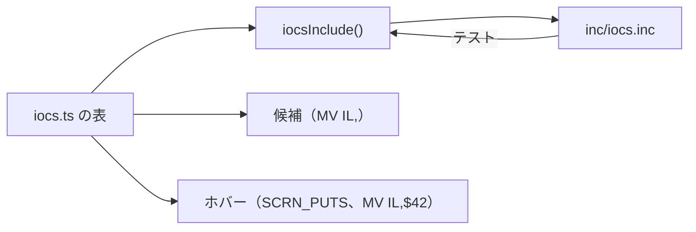
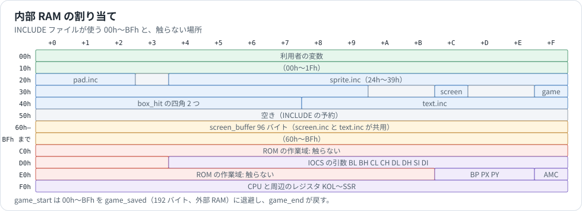
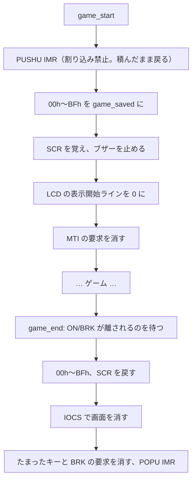
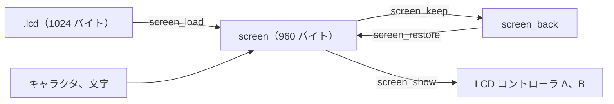
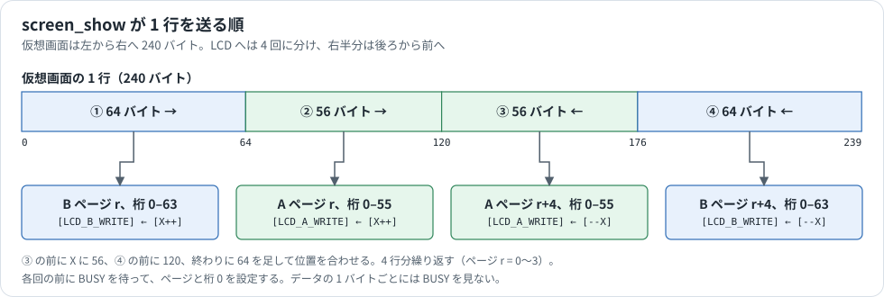
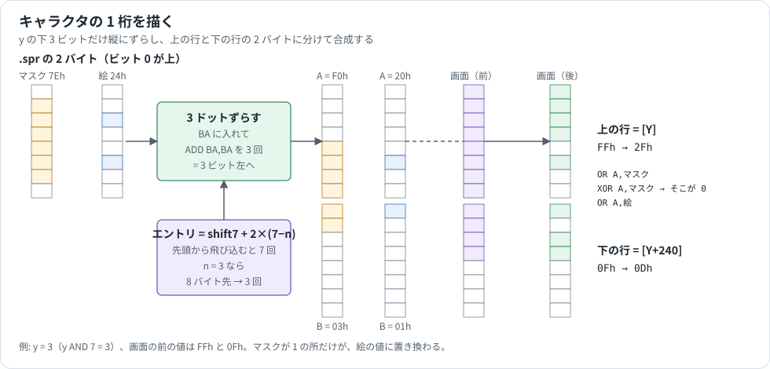

# 8. INCLUDE ファイル

この章は INCLUDE ファイル（`inc/`）の作りです。遅い CPU と、左右で向きの違う LCD を相手に、キャラクタをちらつかせずに動かすための工夫を、1 バイトの単位で説明します。速さは実際に測ったサイクル数で示すので、自分のプログラムの時間の見積もりにも使えます。使い方は[INCLUDE ファイル](../manual/06_INCLUDE_FILES.md)にあります。

[設計の目次へ戻る](README.md)

## この章で分かること

- なぜ仮想画面を使うか、どの内部 RAM を使うか
- キャラクタ、画面、キー、文字の処理が 1 バイトの単位で何をしているか
- 速さの数字と、1 コマの予算
- INCLUDE ファイルと IOCS の番号を足す手順

## 8.1 方針

- アセンブラの機能（マクロ、条件）がなくても使えるように、`EQU` とサブルーチンだけで書きます。
- 名前は「ファイルの接頭辞 + `_`」にして、利用者の名前と重ならないようにします（`sprite_x`、`screen_show`）。
- 公開エントリ（`FFFE8h`）と、全機種で同じハードウェアのアドレスだけを使います。ROM の中のアドレスは使いません。
- `e500asm` だけでもアセンブルできます。

処理のファイル（`game` `pad` `random` `screen` `sprite` `text`）の名前が、この接頭辞の決まりに従います。名前だけのファイル（`iocs` `hardware` `keycode`）は、資料の呼び名（`SCRN_PUTS`、`KOL`、`KEY_ENTER` など）に合わせます。`iocs.inc` の `BL` `BH` などは、IOCS の引数の名前としてそのまま使えるようにしてあります。

| ファイル | 種類 | 機械語の大きさ | 必要なもの |
|---|---|---|---|
| `iocs.inc` | 名前 | 0 | − |
| `hardware.inc` | 名前 | 0 | − |
| `keycode.inc` | 名前 | 0 | − |
| `game.inc` | 処理 | 336（うち退避用 192） | `hardware.inc` |
| `screen.inc` | 処理 | 2247（うち仮想画面 2 枚で 1920）＋ `screen_part.inc` | `hardware.inc` |
| `screen_part.inc` | 処理 | 379 | `hardware.inc`、仮想画面 `screen`（`screen.inc` が INCLUDE する） |
| `sprite.inc` | 処理 | 430 | `screen.inc` |
| `pad.inc` | 処理 | 137 | `hardware.inc` |
| `text.inc` | 処理 | 183 | `screen.inc`、`hardware.inc` |
| `random.inc` | 処理 | 40（種の 2 バイトを含む） | − |

名前のファイルは `EQU` だけなので、読み込んでもプログラムは大きくなりません。

## 8.2 iocs.inc

`src/asm/iocs.ts` の表から `iocsInclude()` で作ります。候補、ホバー、INCLUDE ファイルが同じ表から出るので、食い違いません。テストが、ファイルの内容が表と同じかを調べます。

| 表 | 1 件の中身 | 使い道 |
|---|---|---|
| `DEVICES` | 番号、`DEV_…`、番号の接頭辞、説明、ドライブ名 | `(CL)` の値の候補、`deviceBefore` |
| `COMMANDS` | デバイス（−1 はすべて共通）、番号、`SCRN_…`、説明、引数、戻り | `MV IL,` の候補、ホバー |
| `FILE_COMMANDS` | 番号、`FCS_…`、説明 | `CALLF FCS` の前の候補 |
| `ENTRIES` `ARGUMENTS` `ERRORS` | 定数、値、説明 | `iocs.inc` の先頭と終わり |



## 8.3 内部 RAM の割り当て



| アドレス | 使うもの |
|---|---|
| 00h〜1Fh | 利用者 |
| 20h〜22h | `pad.inc`（`pad_now` `pad_new` `pad_old`） |
| 24h〜39h | `sprite.inc` |
| 3Ah〜3Bh | `screen_part.inc`（左端と幅） |
| 3Ch | `screen.inc` の回数 |
| 3Fh | `game.inc` の時間 |
| 40h〜47h | `box_hit` の四角 |
| 48h〜4Fh | `text.inc` |
| 60h〜BFh | `screen.inc` と `text.inc` のバッファ（`screen_part.inc` の作業用も 60h〜69h） |
| D4h〜DFh | IOCS の引数（ROM） |

`game_start` は 00h〜BFh を外部メモリに退避し、`game_end` が戻します。C0h〜EBh の ROM の作業域には触りません（IOCS を呼ぶ `game_end` だけが、引数の D6h、D7h に書きます）。

この割り当ては、次の考えで決めています。

| 考え | 結果 |
|---|---|
| 利用者の変数は、いちばん覚えやすい所に | 00h〜1Fh |
| 1 回の処理の中だけで使うものは、同じ場所を使い回す | `screen_buffer` を `text.inc` と共用 |
| ROM が使う場所に触らない | C0h から上は使わない |
| PRE が増えない | すべて `(n)` の絶対アドレス。`game_start` の後は BP を気にしなくてよい |

### 始まりと終わり（game.inc）



`PUSHU IMR` は U スタックに積んだまま戻り、`game_end` の `POPU IMR` で取り出します。だから、`game_start` と `game_end` の間で U スタックの釣り合いを崩してはいけません。

## 8.4 仮想画面

LCD の表示 RAM は 4 つの区画に分かれ、右半分は左右が逆です。毎回この計算をすると遅いので、左から右へ並んだ 960 バイトの仮想画面に描き、最後にまとめて送ります。



- `screen_restore` と `screen_load` は内部 RAM のバッファを通して `MVL` で移します（外部メモリどうしの `MVL` がないため）。
- `screen_show` はコントローラごとに BUSY を待ってページと桁を設定し、続けて 1 バイトずつ書きます。右半分は逆順に送ります。
- `screen_part`（`screen_part.inc`）は、4 つの区画（x 0〜63、64〜119、120〜175、176〜239）と送る範囲の重なりを求めて、区画ごとの「バイト数、桁の命令、行の中の位置」の表（12 バイト）を作り、行ごとに重なった所だけを同じ形で送ります。右半分の区画は、桁を右端（175 − 右端の x、239 − 右端の x）から始めます。LCD には CPU が遅くしない `0A000h` 台のアドレスで書きます。x と幅が前の呼び出しと同じなら表を作り直さないので、1 行ずつ呼んでも遅くなりません。表は外部メモリにあり、間に `screen.inc` や `text.inc` を呼んでも壊れません。
- `screen_part.inc` を別のファイルにしたのは、仮想画面を自分で持つプログラム（`screen_back` の 960 バイトを取れないもの）でも使えるようにするためです。`screen.inc` は最後でこのファイルを INCLUDE します。データを書くループは `MV A,[X++]`、`MV [Y],A`、`DEC IL`、`JRNZ` の 14 サイクルと、逆順の 15 サイクルです。実機の LCD が取りこぼさない 14 サイクル以上にしてあり、展開しません（[解析 30 章](../analysis/30_SPEED.md)）。

仮想画面の 1 バイトは、`screen + 行×240 + x` の縦 8 ドット（ビット 0 が上）です。



### screen_load の移し方

`.lcd` の 1 行（ページ）分を 4 つに分けて仮想画面に並べます。X は A コントローラのそのページの先頭です。

| 順 | 仮想画面 | `.lcd` の場所 | 方法 |
|---|---|---|---|
| 1 | x = 0〜63 | X + 512（B のページ） | `MVL` でバッファを通して 64 バイト |
| 2 | x = 64〜119 | X | 同じく 56 バイト |
| 3 | x = 120〜175 | X + 256 + 56 から前へ | `[--X]` で 56 バイト |
| 4 | x = 176〜239 | X + 512 + 256 + 64 から前へ | `[--X]` で 64 バイト |

`+256` は 4 ページ先（右半分のページ 4〜7）です。終わりに X へ 64 を足して、次の行に進みます。

### なぜバッファを通すか

`MVL` は「内部 RAM どうし」か「内部 RAM と外部メモリ」の転送です。外部メモリから外部メモリへは 1 命令で移せないので、96 バイトのバッファ（60h〜BFh）に読み、外部へ書きます。`screen_copy` は 960 バイトを 96 バイト × 10 回で移します。1 バイトずつ `MV A,[X++]`、`MV [Y++],A` とするより速くなります。

### 速さ

| 処理 | サイクル（エミュレータ） | 時間 |
|---|---|---|
| `screen_show` | 16756 | 約 22 ミリ秒 |
| `screen_restore` | 4176 | 約 5 ミリ秒 |
| `screen_part`（1 画面すべて） | 17362 | 約 23 ミリ秒 |
| `sprite_draw`（9 × 16、マスクあり） | 4653 | 約 6 ミリ秒 |
| `sprite_draw`（9 × 16、マスクなし） | 3505 | 約 5 ミリ秒 |

テンプレートのゲームは `game_wait` に 3 を渡します。`screen_restore` + 9 × 16 のキャラクタ 2 つ + `screen_show` は約 30000 サイクルで、残りが動きの計算と文字です。

数字は `$env:E500_TIMES = '1'` を付けて `iocs.test` を動かすと出ます。テストの上限は、`screen_show` と `screen_part`（1 画面）が 1/35 秒、`screen_restore` が 1/100 秒、`sprite_draw` が 1/150 秒です。

## 8.5 キャラクタ

`sprite_draw` は次の順に処理します。

1. ヘッダーを読み、コマの先頭へ進む。
2. 左右にはみ出す分を切り、描く桁の数を決める。
3. 縦の位置を「行」と「行の中でずらすドット数」に分け、ずらす処理のエントリを決める。
4. 桁ごとに、マスクと絵をずらして、上の行と下の行に描く（`(画面 AND NOT マスク) OR 絵`）。

ずらす処理は `ADD BA,BA` を 7 つ並べた途中に入る方法です。ドット数だけ `ADD` を実行するので、繰り返しの判定が要りません。

### 位置の計算

| 値 | 計算 | 例（y = 3、高さ 16） |
|---|---|---|
| ずらすドット n | y AND 7 | 3 |
| エントリ | `sprite_shift7` + 2 × (7 − n)（`ADD BA,BA` は 2 バイト） | +8 |
| `sprite_page` | (y + 64) >> 3 | 8 |
| 描く行 | `sprite_page` − 8 | 0、その次の行も |

`sprite_page` を 8 多くしておくのは、負の行（画面の上）を符号なしで比べるためです。7 より小さければ画面の外、7 なら「下の行だけ」、8〜10 なら「上と下」、11 なら「上だけ」、12 以上は外です。

左のはみ出し（x が −1〜−255）は `sprite_skip` 桁だけ読み飛ばし、右のはみ出しは描く桁 `sprite_n` を減らします。x が −256 以下や 240 以上なら、何も描きません。

### 1 桁の処理



マスクの 8 ビットを BA に入れてずらすと、A が上の行、B が下の行の分になります。絵も同じです。合成は `OR A,マスク` → `XOR A,マスク`（マスクの所が 0 になる）→ `OR A,絵` です。`AND NOT` に当たる命令がないので、この 2 段で同じことをします。

マスクのないキャラクタではマスクを読まずに（0 のまま）重ねます。点灯だけが上書きされ、背景は残ります。

### 当たり判定（box_hit）

2 つの四角（x、y、幅、高さ）が重なるかを x と y の差で調べます。

```text
重なる ⇔ ax < bx+bw かつ bx < ax+aw かつ ay < by+bh かつ by < ay+ah
```

引き算で桁借りが出る（bx < ax）ときは、逆向きに引いて b の幅と比べます。どちらか一方だけが 0〜255 の差になるので、符号なしの 8 ビットで済みます。触れ合うだけ（端が隣り合う）は重ならないとします。

## 8.6 キー

`pad_read` は KO を 1 本ずつ立てて KI を読みます。割り込みのキースキャンと競合しないように、`game_start` の後（割り込み禁止）に使います。押した瞬間（`pad_new`）は「今 AND NOT 前」です。

| キー | KO | KI のビット | `pad_now` のビット |
|---|---|---|---|
| 右 | KO4（KOL = 10h） | 6 | `PAD_RIGHT` 02h |
| RETURN | KO4 | 7 | `PAD_B` 20h |
| 上 | KO3（08h） | 6 | `PAD_UP` 04h |
| 左 | KO3 | 7 | `PAD_LEFT` 01h |
| SPACE | KO2（04h） | 6 | `PAD_A` 10h |
| 下 | KO2 | 7 | `PAD_DOWN` 08h |
| Z | KO0（01h） | 5 | `PAD_C` 40h |
| ON/BRK | 行列の外（SSR のビット 3、`ONK`） | − | `PAD_BREAK` 80h |

ON/BRK はキーの行列ではなく CPU の ON ピンにつながっているので、`TEST (SSR),ONK` で読みます。エミュレータは ON/BRK を KO11 の KI1 にも出しますが、実機（PC-E650）では出ず、行列で読んでいたころの `pad_read` では ON/BRK で戻れませんでした（実験）。`game_end` が ON/BRK が離されるのを待つのも `SSR` で見ます。

KO を立てた後の `NOP` は、KI の値が落ち着くのを待つためです。読み終わったら KOL と、KOH の下位 4 ビットを 0 に戻します。KOH の上位 4 ビットは RS-232C の線なので変えません。

### 時間（game_wait）

`game_wait` は、割り込みの要求レジスタ ISR の MTI ビット（約 16 ミリ秒ごとに立つ）を待って、自分で消すことを、A 回繰り返します。割り込みは止まっていても、要求のビットは立ちます。前に待ってから過ぎた時間は、すでに立っているビットとして 1 回分だけ数えます（ビットは 1 つなので、2 回以上過ぎても 1 回）。処理が約 40 ミリ秒のテンプレートは、`A` = 3 で 1 ターン約 64 ミリ秒、1 秒に約 16 ターンです。

## 8.7 文字

字形のアドレスは `BFC90h` / `BFC93h` のポインタから読みます。ROM バージョンで字形の場所が変わっても使えます。

| 文字 | ポインタ | 場所 |
|---|---|---|
| 20h〜7Fh | `FONT_20`（BFC90h） | ポインタ + (文字 − 20h) × 6 |
| A0h〜DFh | `FONT_A0`（BFC93h） | ポインタ + (文字 − A0h) × 6 |

6 倍は `(n+n+n)×2`、つまり `ADD BA,BA` `ADD BA,I` `ADD BA,BA` の 3 回で求めます。1 文字 6 バイトを、バッファを通して仮想画面に移します。x が 235 以上なら描きません（234 + 6 = 240）。

`number_draw` は、10000、1000、100、10、1 を引けるだけ引いて桁を作り、先頭の 0 を空白にします。表の終わりの 0 が 1 の位の印です（1 の位は 0 でも書く）。

### 乱数（random.inc）

16 ビットの線形フィードバック シフト レジスタを、1 回の呼び出しで 8 ビット分進めます。

```text
8 回繰り返す: BA を右へ 1 ビット。出たビットが 1 なら BA = BA XOR B400h
返り値: A（下位 8 ビット）
```

`random_below` は 0〜255 の乱数から IL を引けるだけ引いた余りです。IL が 256 の約数でないと、小さい数がわずかに多く出ます。

## 8.8 テスト

`iocs.test.ts`、`project.test.ts` が、INCLUDE ファイルの全部をアセンブルし、エミュレータで動かして、描かれたドットを期待した絵と比べます。画面の端、負の座標、マスクの有無、コマの番号、当たり判定の境界を含みます。テンプレートと入門の例題は、ROM 13 本（2.1〜8.5）で同じ結果になります。

| テスト | 確かめること |
|---|---|
| すべてを一緒にアセンブル | 名前の重複、依存の順番 |
| `screen_load` `screen_show` `screen_restore` | 240 × 32 の全ドット |
| `screen_part` | 区画の境目にかかる範囲、行のビット、送らない所が変わらないこと、1 バイトの間隔が 14 サイクル以上 |
| `sprite_draw` | x: −300〜300 の端、y: −18〜34 の全部、コマ 0 と 1、マスクの有無 |
| `box_hit` | 隣り合う、重なる、離れるの境界 |
| `text_draw` `number_draw` | ROM の字形と同じ、桁ぞろえ |
| `random` `random_below` | 値の種類と偏り |
| `game_wait` | 0.13〜0.18 秒に収まるか |
| `pad_read` | 8 つのキーと組み合わせ、`pad_new` |
| `game_start` `game_end` | 前後で BASIC が同じように動くか |

## 8.9 速さと限界

| 項目 | 内容 |
|---|---|
| キャラクタの大きさ | `.spr` の形は幅 255 まで。エディタは 64 × 32 まで |
| 同時に描く数 | 決まりはない。1 つ約 6 ミリ秒を予算から引く |
| 仮想画面 | 2 枚（今の絵、背景）。増やすときは 960 バイトずつ |
| 重ね合わせの順番 | 後から描いたものが上 |
| グレー、スクロール | ない |

## 8.10 変更の手順

### IOCS の番号を足す

1. `iocs.ts` の `COMMANDS`（か `FILE_COMMANDS`）に `command(デバイス, 番号, 名前, 説明, 引数, 戻り)` を足す。説明は日本語と英語の両方。
2. `iocsInclude()` の結果で `inc/iocs.inc` を作り直す（テストの失敗の表示から取れる）。
3. [IOCS と FCS](../analysis/11_IOCS.md) と[INCLUDE ファイル](../manual/06_INCLUDE_FILES.md#番号)の表に足す。
4. エミュレータで動かせるものは、`iocs.test.ts` の `include files in the emulator` に呼び出しを足す。

### INCLUDE ファイルを足す

1. `inc/名前.inc` を作り、1 行目を `; 名前.inc: 説明` にする（候補と「INCLUDE ファイルをコピー」に出る）。
2. 名前は `名前_` で始める。内部 RAM は 8.3 の表から空きを選び、表に書く。
3. 割り込みを止めて使うのか、BASIC から呼べるのかを、先頭のコメントに書く。
4. `iocs.test.ts` に足し、[INCLUDE ファイル](../manual/06_INCLUDE_FILES.md)に節を作る。
5. VSIX には `inc/` がそのまま入る（`.vscodeignore` の変更は要らない）。

### 処理を速くする

- サイクルは `e500dbg` の `run` の `cycles` で測れます（`E500_TIMES`）。
- 内部 RAM の絶対アドレス `(n)` には PRE（1 バイト）が付きます。同じオペランドを何度も使うなら、レジスタに置くほうが速く小さくなります。
- 転送は `MVL`、続けて読み書きするなら `[X++]` `[--X]` を使います。

### 気をつけること

- `sprite_shift` は 3 バイト（24 ビットのアドレス）です。`JP (sprite_shift)` は内部 RAM の 3 バイトのアドレスへ飛びます。
- `sprite_draw` は `CALL sprite_do_shift` → `JP (sprite_shift)` → `RET` の順で戻ります。スタックは 1 回だけです。
- 仮想画面の `screen` と `screen_back` はプログラムの中に `DS` で取られます。`ORG` を決めるときに 1920 バイトを足してください。
- `game_start` と `game_end` の外で `screen_load` などを呼ぶと、60h〜BFh の元の中身が失われます。

## まとめ

| 覚えること | 内容 |
|---|---|
| 形 | `EQU` とサブルーチンだけ。名前は `ファイル名_` |
| 画面 | 仮想画面に描いて、まとめて送る。右半分は逆順 |
| キャラクタ | `ADD BA,BA` の列に飛び込んでずらし、OR/XOR/OR で合成 |
| 内部 RAM | 00h〜1Fh が利用者、20h〜BFh が INCLUDE、C0h から上は ROM |
| IOCS | `iocs.ts` が元。`iocs.inc` は作られる |

## 次に読むもの

- [INCLUDE ファイル（マニュアル）](../manual/06_INCLUDE_FILES.md): 使い方
- [液晶（LCD）](../analysis/04_LCD.md): コントローラの命令と表示 RAM
- [テスト、ビルド、配布](09_BUILD_TEST_RELEASE.md): テストの動かし方
