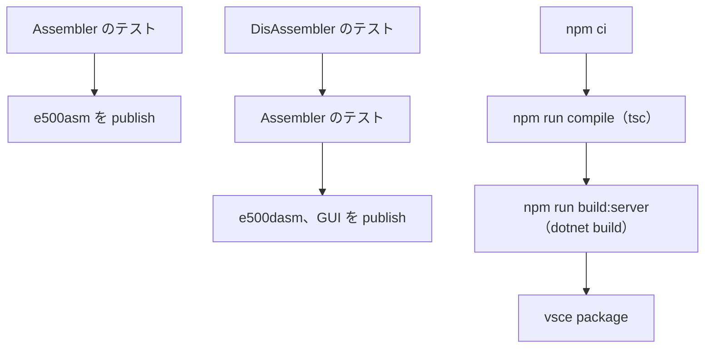
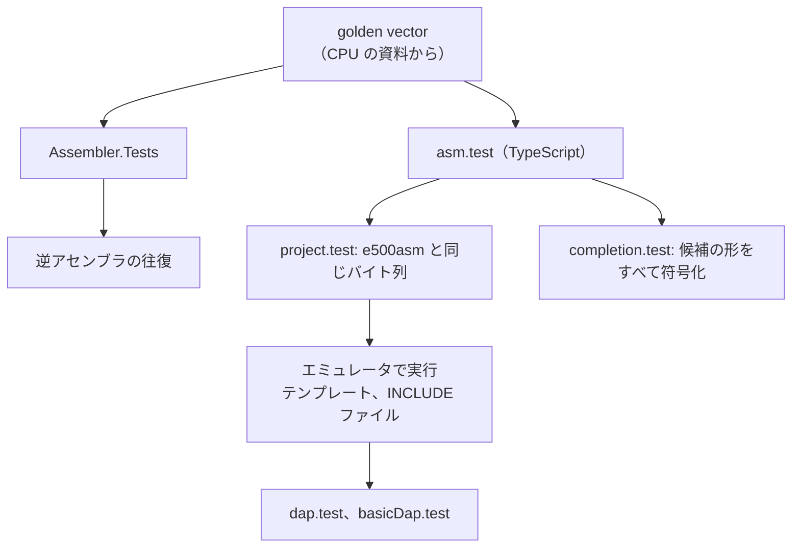

# 9. テスト、ビルド、配布

この章は、ツールを作り、確かめ、配るまでの手順です。どのテストが何を守っているかを知っておくと、直したあとに「どこまで動かせば安心か」を自分で決められます。文書と図の決まりもここにあります。

[設計の目次へ戻る](README.md)

## この章で分かること

- 何を入れれば、どこまで作れるか
- どのテストが何を守っているか、どこまで自分の PC で動かせるか
- バージョンの番号の場所と、配布するもの
- 文書と図の決まり

## 9.1 必要なもの

| 対象 | 必要なもの |
|---|---|
| アセンブラ、逆アセンブラ、`e500dbg` | .NET 10 SDK |
| `ce140conv` | C++17 のコンパイラ |
| VS Code 拡張 | Node.js と npm |
| エミュレータを使うテスト | `e500core.dll`（Linux は `libe500core.so`、macOS は `libe500core.dylib`）と ROM。`noRom.test` は ROM なしで動く |

| できること | Windows | Linux | macOS |
|---|---|---|---|
| アセンブラ、逆アセンブラ（CLI）のビルドとテスト | ○（`build.cmd`） | ○（`build.sh`） | ○（`build.sh`） |
| 逆アセンブラの GUI | ○ | −（Windows Forms） | − |
| `ce140conv` | ○（`build.bat`） | ○（`build.sh`） | ○（`build.sh`） |
| 拡張のコンパイルと、エミュレータを使わないテスト | ○ | ○ | ○ |
| `e500dbg`、エミュレータを使うテスト | ○ | ○（`dap.test`、`basicDap.test` は Windows だけ） | ○（Linux と同じ） |

## 9.2 ビルド

道具の入れ方は、[Windows](../manual/02_INSTALL_WINDOWS.md#29-ソースから作る必要な人だけ)、[Linux](../manual/02_INSTALL_LINUX.md#25-e500asme500dasmce140conv-を作る)、[macOS](../manual/02_INSTALL_MACOS.md#25-e500asme500dasmce140conv-を作る) にあります。以下はリポジトリのフォルダで打ちます。

### Windows でビルドする

```powershell
.\Assembler\build.cmd
.\DisAssembler\build.cmd
```

| コマンド | 何をするか | できるもの |
|---|---|---|
| 1 行目 | アセンブラのテストを動かし、通れば EXE を作る | `Assembler\app\e500asm.exe` |
| 2 行目 | 逆アセンブラとアセンブラのテストを動かし、通れば EXE を作る | `DisAssembler\app\e500dasm.exe`、`E500Disassembler.exe` |

`ce140conv` は、「Developer PowerShell for VS」などコンパイラの使えるターミナルで、フォルダを移ってから作ります（`build.bat` は、今いるフォルダの `ce140conv.cpp` を読むため）。

```powershell
cd FileConverter
.\build.bat
```

Linux 用の .NET の実行ファイルを Windows で作ることもできます。

```powershell
.\Assembler\build.cmd -Runtime linux-x64
.\DisAssembler\build.cmd -Runtime linux-x64
```

`-Runtime` は、どの OS と CPU 用に作るかを選びます（`linux-x64`、`linux-arm64`）。出力は `app\linux-x64\` などに分かれます。Linux へコピーした後は `chmod +x` で「実行してよい」という印を付けます。macOS の実行ファイルには署名が要るので、macOS の `build.sh` で作ります。

### Linux、macOS でビルドする

```sh
sh Assembler/build.sh
sh DisAssembler/build.sh
sh FileConverter/build.sh
```

| コマンド | 何をするか | できるもの |
|---|---|---|
| 1 行目 | アセンブラのテストを動かし、通れば実行ファイルを作る。OS と CPU は `uname` で調べる | `Assembler/app/e500asm` |
| 2 行目 | 逆アセンブラとアセンブラのテストを動かし、通れば CLI を作る | `DisAssembler/app/e500dasm` |
| 3 行目 | 見つかった C++ のコンパイラで作る | `FileConverter/ce140conv` |

### 拡張をビルドする（どの OS も同じ）

`VSCodeExtensions/pc-e500-devtools` フォルダで打ちます。

```text
npm ci
npm run compile
npm run build:server
npm run package
```

| コマンド | 何をするか | できるもの |
|---|---|---|
| `npm ci` | `package-lock.json` のとおりに部品を取ってくる。最初の 1 回と、部品が変わったとき | `node_modules/` |
| `npm run compile` | TypeScript を JavaScript に変える（`tsc`） | `out/` |
| `npm run build:server` | `e500dbg` を作る（`dotnet build`） | `out/server/` |
| `npm run package` | 上の 2 つを行い、VSIX にまとめる（`vsce package`） | `pc-e500-devtools-<バージョン>.vsix` |

拡張を VS Code で開いて `F5` を押すと、開発用の VS Code が起動します。

### ビルドの順番



`build.cmd` / `build.sh` は、テストが通らないと実行ファイルを作りません。逆アセンブラは、アセンブラのテストも動かします（照合に使うため）。

### スクリプトの引数

| スクリプト | 引数 | 内容 |
|---|---|---|
| `build.cmd`（中身は `build.ps1`） | `-TestOnly` | テストだけ |
| 〃 | `-Runtime <RID>` | ほかの OS 用（`app/<RID>/`） |
| `build.sh` | `--test-only` | テストだけ |
| `FileConverter/build.sh` | 環境変数 `CXX` | コンパイラの指定 |

`build.cmd` は PowerShell の実行ポリシーに関係なく動くように、`-ExecutionPolicy Bypass` を付けて `build.ps1` を呼びます。

### 実行ファイルの形

| 対象 | 形 | 設定 |
|---|---|---|
| `e500asm` `e500dasm` `E500Disassembler` | 自己完結型の 1 ファイル（`PublishSingleFile`、`self-contained`） | .NET を入れていない PC でも動く |
| `e500dbg` | フレームワーク依存（`dotnet build` の出力） | .NET 10 のランタイムが要る。VSIX を小さくするため |
| `ce140conv` | 1 ファイル | Windows の `.exe` だけリポジトリに入れる |

C# のプロジェクトは `TreatWarningsAsErrors`（`e500dbg` を除く）と `Nullable` を有効にしています。

## 9.3 テスト

| 対象 | Windows のコマンド | Linux、macOS のコマンド | 確かめる内容 |
|---|---|---|---|
| アセンブラ | `.\Assembler\build.cmd -TestOnly` | `sh Assembler/build.sh --test-only` | 命令のバイト列、PRE の全組み合わせ、前方参照、Intel HEX、エラー |
| アセンブラの実行ファイル | `python Assembler\tests\cli_smoke.py` | `python3 Assembler/tests/cli_smoke.py` | CLI、出力の保護、エミュレータがあれば CPU での実行 |
| 逆アセンブラ | `.\DisAssembler\build.cmd -TestOnly` | `sh DisAssembler/build.sh --test-only` | 全 256 オペコード、任意のバイト列、途切れた命令、往復の一致 |
| 拡張 | `npm test` | `npm test` | 下の表 |

`-TestOnly` と `--test-only` は「テストだけを動かし、実行ファイルは作らない」という意味です。`npm test` は、コンパイルしてから `out/test` のテストを全部動かします。

### 何が何を守っているか



golden vector はプログラムの出力からではなく、CPU の資料の命令表から起こします。出力をコピーすると、誤りもそのまま正解になるからです。

### 拡張のテスト

| ファイル | 内容 |
|---|---|
| `asm.test` | アセンブラと同じ golden vector |
| `linter.test`、`basicHelp.test` | BASIC の診断、候補と説明 |
| `completion.test`、`hover.test`、`definition.test`、`iocs.test` | 候補、説明、定義、IOCS の表と `iocs.inc`、INCLUDE ファイルの動作 |
| `lcd.test`、`lcdEdit.test`、`spr.test` | 絵のファイル |
| `project.test` | テンプレート（エミュレータで実行）、BIN |
| `setup.test`、`invocation.test` | 場所の探し方、`e500asm` の起動 |
| `emulator.test`、`dap.test` | `e500dbg`、ASM のデバッグ |
| `basic.test`、`basicEmulator.test`、`basicDap.test` | BASIC の変数、実行、デバッグ |

エミュレータを使うテストは、環境変数 `E500_CORE` と `E500_ROM`、なければリポジトリの隣の `Emulator` を探し、そろっていなければ飛ばします。`E500_ROM` に別の ROM を渡すと、その ROM で試せます。

Windows（PowerShell）

```powershell
$env:E500_ROM = 'C:\PockeCom\rom\PC-E650(8.5).ROM'
npm test
```

Linux

```sh
export E500_CORE="$HOME/pockecom/PC-E500-Emulator-<バージョン>-linux-x64/libe500core.so"
export E500_ROM="$HOME/pockecom/PC-E500-Emulator-<バージョン>-linux-x64/rom/PC-E500(7.2).ROM"
npm test
```

どちらも、今のターミナルの環境変数にファイルの場所を入れてから、テストを動かしています。ターミナルを閉じると元に戻ります。

| 環境変数 | 内容 | 省略時 |
|---|---|---|
| `E500_CORE` | `e500core.dll` | `..\Emulator\bin\e500core.dll`（リポジトリの隣） |
| `E500_ROM` | ROM | `..\Emulator\app\rom\PC-E500(7.2).ROM` |
| `E500_ROMS` | `basicEmulator.test` が ROM 2 本（7.2 と 8.5）を探すフォルダ | `..\Emulator\app\rom` |
| `E500_TIMES` | `1` で、画面とキャラクタの処理のサイクル数、テンプレートのゲームの速さを表示 | 表示しない |

### 一部だけ動かす

`npm test` は全部を動かします（コンパイルして `node --test out/test/**/*.test.js`）。直している間は、1 つのファイルだけにします。

```text
npm run compile
node --test out/test/asm.test.js
node --test --test-name-pattern "PRE" out/test/asm.test.js
```

| 行 | 何をするか |
|---|---|
| 1 | 直した TypeScript を JavaScript に変える。テストは変えた後のものを使うので、先に行う |
| 2 | `asm.test` だけを動かす |
| 3 | その中で、名前に `PRE` を含むテストだけを動かす |

`e500dbg` を直したら、`npm run build:server` を忘れないでください。テストは `out/server/e500dbg.exe` を使います。

### VS Code なしのテスト

拡張のテストは、VS Code を起動せずに Node.js の `node:test` だけで動きます。`dap.test` は、アダプターが使うところだけを持つ偽の `vscode` を、モジュールの読み込みを差し替えて渡します。

| 使う偽物 | 中身 |
|---|---|
| `EventEmitter` | 通知の配列 |
| `workspace.getConfiguration` | 表（`pcE500.corePath` など） |
| `workspace.openTextDocument` | ファイルを読む |
| `Uri.file` | `fsPath` だけ |

`setup.test` は、外の世界（`e500asm --version`、`dotnet --list-runtimes`、起動）を偽物に差し替え、PATH やフォルダを一時フォルダに作ります。画面の見た目（CSS、描画）はテストしません。

### 入門の例題

`Samples/Assembler/Tutorial/` の `*.e500test.json` は、拡張を入れた VS Code のテスト エクスプローラーで実行できます。ゲームのサンプル（`StarCatch`、`Meteor`、`NineBox`）と `Recipes` にもテストがあります。例題を直したら、マニュアルの本文も合わせます。

### アセンブラの実行ファイルのテスト

`cli_smoke.py` は、作った `e500asm` を実際に起動して、次を確かめます。

| 項目 | 例 |
|---|---|
| 終了コードとメッセージ | `--bad-option`、値のないオプション |
| 日本語のパス、空白のあるパス | `日本語 ソース.asm` |
| 出力の保護 | ソース、`INCLUDE`、`INCBIN` したファイルへの書き込みを断る |
| エラーのときに前の出力が残る | `MV A,256` の前後でファイルを比べる |
| `--encoding` | Shift-JIS のソースと、指定しないときのエラー |
| CPU での実行 | エミュレータの DLL があれば、自作の小さな ROM で `CALL`、PRE、`MVL` などを実行 |

## 9.4 直したときに動かすもの

| 直したもの | 動かすもの |
|---|---|
| `Assembler/src` | アセンブラのテスト、逆アセンブラのテスト、`npm test`（移植も直したとき） |
| `DisAssembler/src` | 逆アセンブラのテスト、`emulator.test`（逆アセンブルの表示） |
| `ce140conv.cpp` | Windows と Linux でビルド。`project.test`（`.exe` を作り直した後） |
| `src/asm` | `asm.test`、`completion.test`、`hover.test`、`definition.test` |
| `src/linter`、`src/basic`、`src/dialects` | `linter.test`、`basicHelp.test` |
| `src/lcd`、`media/lcd.js` | `lcd.test`、`lcdEdit.test`、`spr.test`。`lcd.js` は画面で確かめる |
| `server/` | `build:server`、`emulator.test`、`dap.test`、`basicEmulator.test` |
| `src/debug` | `dap.test`、`basicDap.test` |
| `inc/` | `iocs.test`、`project.test` |
| `package.json` | 開発用の VS Code（`F5`）で、設定とメニューを見る |

## 9.5 版と配布

| 配布するもの | バージョンの場所 |
|---|---|
| `e500asm-<バージョン>-win-x64.zip` | `Cli/Program.cs`（`--version` と `--help`） |
| `e500dasm-<バージョン>-win-x64.zip`、`E500Disassembler-<バージョン>-win-x64.zip` | 〃 |
| `ce140conv-<バージョン>-win-x64.zip`（`ce140conv.exe` と `charset_e500.tab`） | − |
| `pc-e500-devtools-<バージョン>.vsix` | `package.json` |

- .NET の実行ファイルは自己完結型で 1 つ 70〜120 MB あるため、リポジトリに入れず [Releases](https://github.com/litchi-gh/pc-e500_tools/releases) で配布します。
- VSIX には `e500dbg`（フレームワーク依存）を入れます。`e500core.dll` と ROM は入れません。
- 拡張の変更は `CHANGELOG.md` に書きます。

### リポジトリに入れないもの

| 入れないもの | `.gitignore` | 理由 |
|---|---|---|
| `bin/` `obj/` `node_modules/` `out/` `*.obj` | ○ | ビルドで作れる |
| `Assembler/app/*.exe`、`DisAssembler/app/*.exe` と Linux / macOS の実行ファイル | ○ | 大きい。Releases で配る |
| `Assembler/tmp/`、`DisAssembler/tmp/`、`tests/output/` | ○ | 作業用 |
| `.claude/`、`.vscode/`（根のフォルダ） | ○ | 個人の環境 |
| ROM、`e500core.dll` | − | 配布できない、別のプロジェクト |

### VSIX の中身

`.vscodeignore` で、TypeScript のソース、テスト、`server/` のソース、`.map`、`.pdb` を除きます。入るのは次のものです。

| フォルダ | 内容 |
|---|---|
| `out/` | コンパイルした JavaScript と `out/server/`（`e500dbg` と Core の DLL） |
| `media/` | ページ、スタイル、アイコン |
| `inc/` | INCLUDE ファイル |
| `syntaxes/`、`snippets/`、`schemas/` | 色分け、スニペット、スキーマ |
| `examples/` | サンプル |
| `package.json`、`package.nls*.json`、README、CHANGELOG、LICENSE | − |

### 配布の前に

1. バージョンの番号を、上の表の場所で上げる（`--help` の 1 行目にもある）。
2. `CHANGELOG.md` の「未リリース」をバージョンにする。
3. `Assembler\build.cmd`、`DisAssembler\build.cmd`、（`FileConverter` フォルダで）`build.bat`。
4. 拡張で `npm ci`、`npm test`、`npm run package`。
5. 別の環境（できれば VS Code を入れたばかりの PC）で、VSIX を入れて `F5` とテスト エクスプローラーを確かめる。
6. `ce140conv` の ZIP に `charset_e500.tab` が入っているか確かめる。

## 9.6 よくある失敗

| 症状 | 原因 |
|---|---|
| 拡張のテストがエミュレータの分だけ飛ぶ | `e500dbg` を作っていない、`E500_CORE` か ROM がない |
| `project.test` の `same bytes` が失敗 | `e500asm.exe` が古い。アセンブラを作り直す |
| `e500dbg` が起動しない | .NET 10 のランタイムがない。「環境を確認」に出る |
| `build.cmd` が `Tests failed` | テストの 1 件目の失敗で止まる。その行の入力と期待値を見る |
| Linux で `build.sh` が動かない | 改行が CR LF。`.gitattributes` で `*.sh` は LF に固定している |
| 日本語の Windows で日本語が化ける | ソースと文書は UTF-8（BOM なし）。Windows PowerShell 5.1 の `Set-Content` で書き直さない |

## 9.7 文書の決まり

| 項目 | 決まり |
|---|---|
| 置き場所 | 使い方は `docs/manual/`、作りは `docs/design/`、CPU・ROM・ハードウェアの資料は `docs/analysis/` |
| 番号 | ファイルと見出しの番号は連番。章を足したらそろえる |
| 図 | 処理の流れは Mermaid、配置やビットの図は `docs/images/` の SVG |
| 画面 | `docs/images/manual/` の PNG。日本語の画面で、個人の名前やパスをコピーしない |
| 命令一覧 | `src/asm/instructions.ts` と CPU（SC62015） §2.15 の表に合わせる |
| 例 | 実際に動かした結果を載せる。アドレスやバイト列は、動かして確かめてから書く |

### SVG

| 項目 | 決まり |
|---|---|
| 背景 | 白で塗りつぶす（GitHub のダークモードでも読めるように） |
| 幅 | `viewBox` の幅を 980 にする |
| アクセシビリティ | `<title>` と `<desc>` を書く |
| 字体 | 本文は `.b` / `.s`、コードは `.m` / `.ms`（等幅）。等幅の行には `xml:space="preserve"` |
| 置き場所 | 章ごとの図は `docs/images/design/`、`docs/images/analysis/`。ほかから使うものは `docs/images/` |

| 色 | 塗り / 線 | 意味 |
|---|---|---|
| 青 | `#E8F1FC` / `#2F6DB5` | ツール、処理 |
| 黄 | `#FFF5DF` / `#B7791F` | ファイル、データ |
| 緑 | `#E6F6EC` / `#2F855A` | 実機、外部の機器、成功 |
| 紫 | `#F1ECFB` / `#6B4FBB` | 資料、状態 |
| 赤 | `#FDECEA` / `#C0392B` | 注意、エラー |
| 灰 | `#F3F5F8` / `#7B8794` | 背景のグループ、予約領域 |

### 直すところの探し方

| 変えたもの | 探す文書 |
|---|---|
| 画面の文言 | `docs/manual/`、README |
| エラーメッセージ | [アセンブラの文法](../manual/04_ASSEMBLER_REFERENCE.md#49-エラーメッセージ)、[困ったとき](../manual/18_TROUBLESHOOTING.md) |
| ファイルの形 | [ファイル形式](../manual/19_FILE_FORMATS.md)、解析資料 |
| 作り | この設計 |

## まとめ

| 覚えること | 内容 |
|---|---|
| ビルド | `build.cmd` / `build.sh` はテストが先。拡張は `compile` と `build:server` |
| テスト | golden vector → 往復 → エミュレータ。`E500_ROM` で ROM を替える |
| 配布 | .NET の実行ファイルは Releases、`e500dbg` は VSIX、コアと ROM は入れない |
| 文書 | 使い方、作り、資料の 3 か所。番号は連番、図の色は意味で |

## 次に読むもの

- [全体の構造](01_ARCHITECTURE.md#16-変更するときに合わせて直す場所): 変更と、直す場所の表
- [インストールと設定](../manual/02_INSTALL.md): 利用者の側の準備
