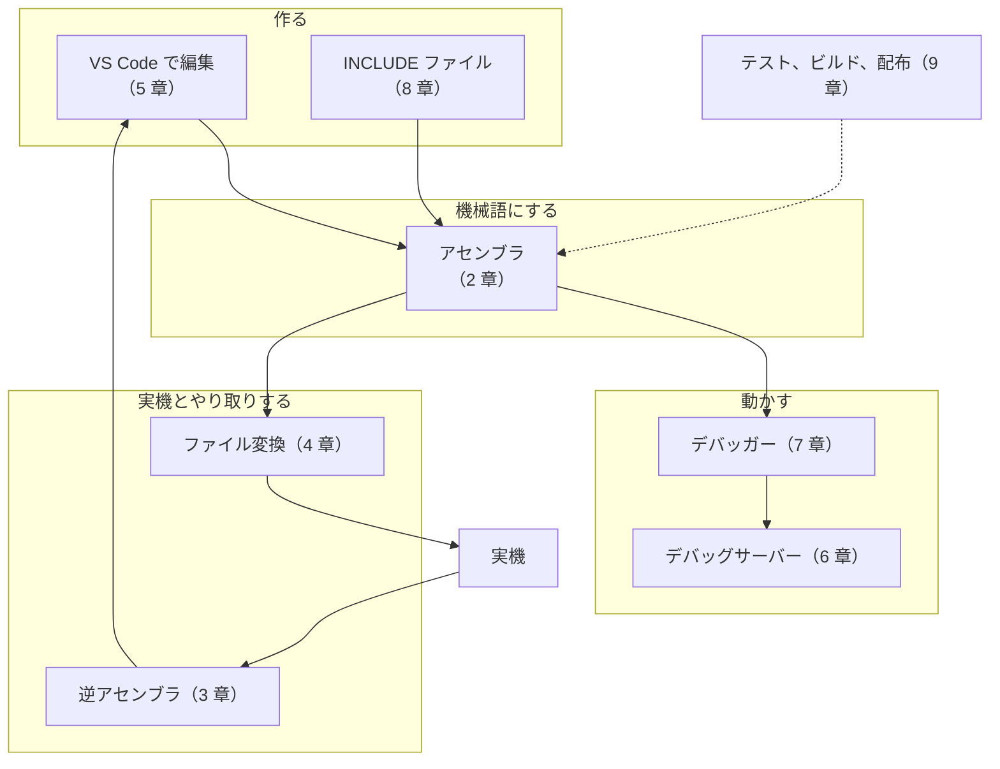

# PC-E500 Tools 設計

ツールを直す人に向けて、中身の作りを説明します。使い方は[マニュアル](../manual/README.md)にあります。

この設計書は、ソースを読む前の案内になるように書いています。何をするものか、なぜその作りにしたか、データがどう流れるか、どこを直せば何が変わるかを、実際の値を使った例で示します。

| # | 文書 | 内容 |
|---|---|---|
| 1 | [全体の構造](01_ARCHITECTURE.md) | フォルダ、依存関係、データの流れ、変更するときに直す場所 |
| 2 | [アセンブラ](02_ASSEMBLER.md) | `e500asm` のパス、式、符号化 |
| 3 | [逆アセンブラ](03_DISASSEMBLER.md) | `e500dasm` のデコードと、往復の保証 |
| 4 | [ファイル変換](04_FILE_CONVERTER.md) | `ce140conv` |
| 5 | [VS Code 拡張](05_VSCODE_EXTENSION.md) | 拡張機能のモジュール、診断、候補、ドットエディタ、パネル |
| 6 | [デバッグサーバー](06_DEBUG_SERVER.md) | `e500dbg` の通信とコマンド |
| 7 | [デバッガー](07_DEBUGGER.md) | ASM と BASIC のデバッグのしくみ、テストの実行 |
| 8 | [INCLUDE ファイル](08_INCLUDE_FILES.md) | 内部 RAM の割り当て、画面とキャラクタの処理、速さ |
| 9 | [テスト、ビルド、配布](09_BUILD_TEST_RELEASE.md) | テストの種類、ビルド、リリース、文書の決まり |

## 全体をひと目で

## 目的から読む

| やりたいこと | 読むところ |
|---|---|
| はじめてソースを触る | [1 章](01_ARCHITECTURE.md) → 触る部分の章 → [9 章](09_BUILD_TEST_RELEASE.md) |
| 命令、疑似命令、式を足す | [2.10 変更の手順](02_ASSEMBLER.md#210-変更の手順) |
| 診断のメッセージを足す | [2.10 変更の手順](02_ASSEMBLER.md#210-変更の手順)（ASM）、[5.11 変更の手順](05_VSCODE_EXTENSION.md#511-変更の手順)（BASIC） |
| デコードの誤りを直す | [3.8 変更の手順](03_DISASSEMBLER.md#38-変更の手順) |
| 設定、コマンド、テンプレート、スニペットを足す | [5.11 変更の手順](05_VSCODE_EXTENSION.md#511-変更の手順) |
| `e500dbg` のコマンドを足す | [6.11 変更の手順](06_DEBUG_SERVER.md#611-変更の手順) |
| デバッグの動きを追う | [7 章の DAP のやり取り](07_DEBUGGER.md#73-f5-から終わりまで) |
| IOCS の番号、INCLUDE ファイルを足す | [8.10 変更の手順](08_INCLUDE_FILES.md#810-変更の手順) |
| リリースする | [9.5 版と配布](09_BUILD_TEST_RELEASE.md#95-版と配布) |
| 文書や図を直す | [9.7 文書の決まり](09_BUILD_TEST_RELEASE.md#97-文書の決まり) |

## この設計書で使う言葉

| 言葉 | 意味 |
|---|---|
| 本体 | PC-E500 シリーズの実機。`e500dbg` の章では、エミュレータの中の 1 台 |
| コア | PC-E500 エミュレータの中心の DLL `e500core.dll`（別のプロジェクト） |
| 内部 RAM | CPU の中の 256 バイト。`(n)` と書く |
| 外部メモリ | 20 ビットの空間（00000h〜FFFFFh）。`[n]` と書く |
| PRE | 内部 RAM の指定方法を変える前置バイト（21h〜27h、30h〜37h） |
| 機械語エリア | 内蔵 RAM の上のほう（BFBFFh まで）に、ROM に頼んで確保する場所 |
| 中間コード | BASIC の行を ROM が変換したもの |
| golden vector | 「この入力にはこのバイト列」という、テストの正解の組 |

## 例の値について

章の中の実行例（アセンブル、`e500dbg` の JSON、DAP のやり取り、RAM の中身）は、実際に動かした結果です。アドレスの例は ROM 7.2、内蔵 RAM 32 KB のものです。長い行は `…` で省き、パスは短くしています。
