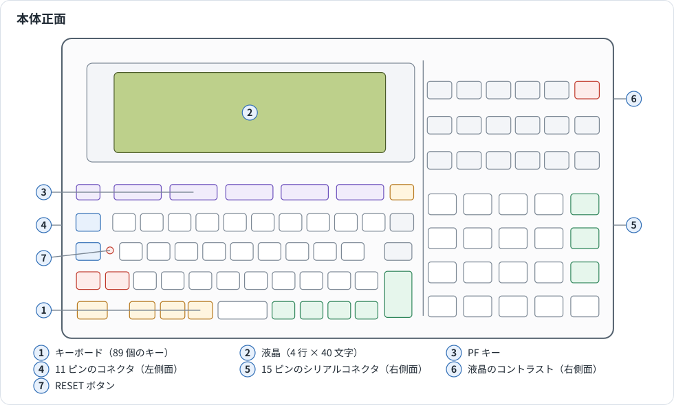
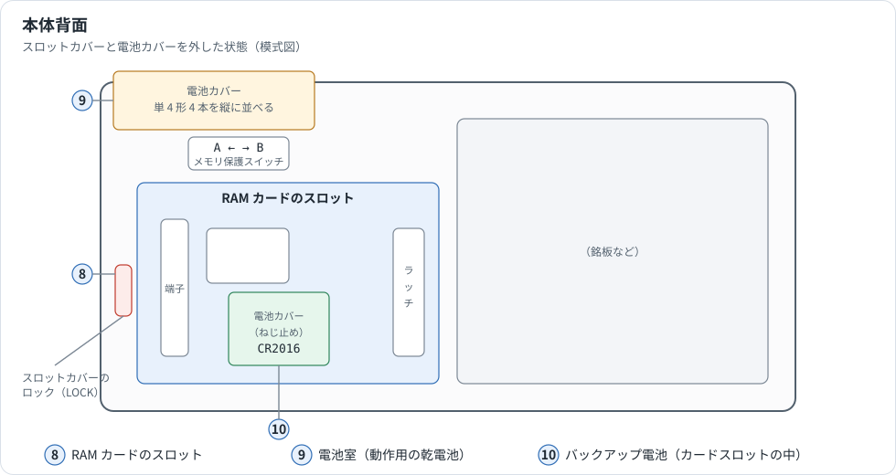
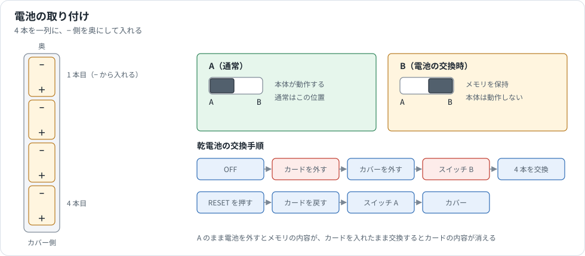
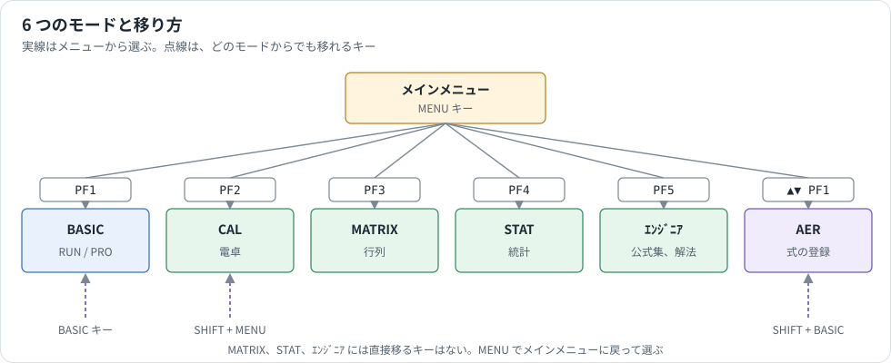
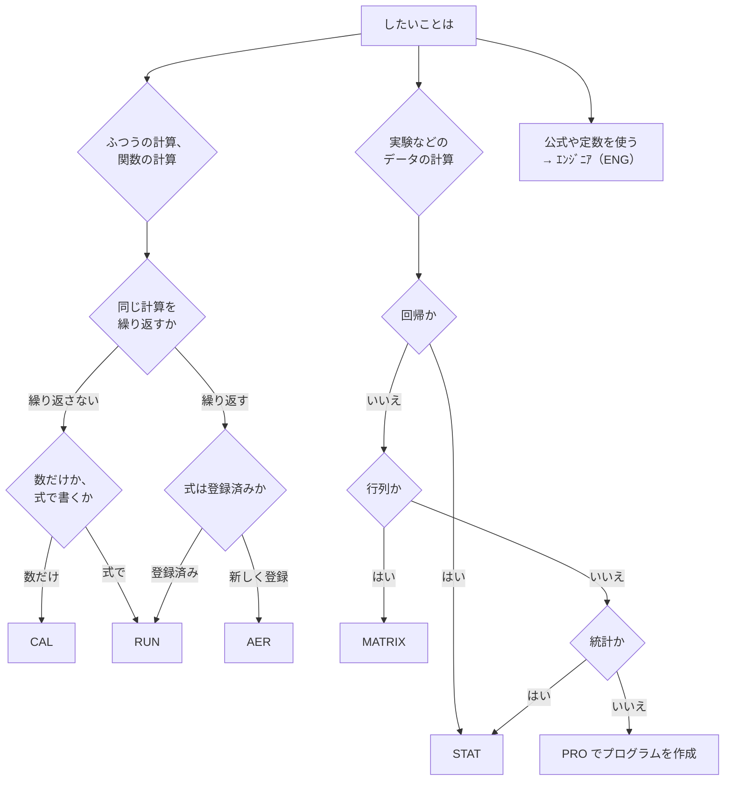

# 1. はじめて使う

この章は PC-E500 を手に入れてから最初の計算をするまでの案内です。電池を取り付け、本体を初期化し、動作を確認して、6 つのモードから目的に合うものを選びます。中古で手に入れた本体や、長期間使っていなかった本体を動かすときも、この順に進めてください。

この本では日本語版の PC-E500（ROM バージョン 7.2、内蔵 RAM 32 KB）を使います。英語版の PC-E500 は画面の表示とキーの一部が違います。違いは §1.8 にまとめました。

[目次へ戻る](README.md)

## この章で分かること

- PC-E500 でできること
- 本体の各部の名称
- 電池の取り付けと初期化の手順
- 動作確認の方法
- 6 つのモードと選び方

## 1.0 はじめに

PC-E500 は関数電卓と小型のコンピュータを 1 つにしたポケットコンピュータです。電卓として計算することも、式を登録して使うことも、BASIC のプログラムを書いて実行することもできます。

| できること | 章 |
|---|---|
| 10 桁の関数電卓 | [5 電卓（CAL）](05_CAL.md) |
| 式をそのまま入力する計算。20 桁の倍精度 | [6 RUN モードの計算](06_RUN.md) |
| 内蔵の公式集、定数表、解法プログラム | [7 エンジニアソフト（ENG）](07_ENG.md) |
| よく使う式の登録 | [8 AER（式の登録）](08_AER.md) |
| 1 変数の統計、直線回帰。データは保存され、あとから修正できる | [9 統計（STAT）](09_STAT.md) |
| 行列、連立方程式、逆行列、行列式、転置 | [10 行列（MATRIX）](10_MATRIX.md) |
| BASIC のプログラム | [11 BASIC の考え方](11_BASIC_CONCEPTS.md) から |
| メモリの一部をディスクとして使う RAM ディスク、RAM カード | [4 RAM カード](04_RAM_CARD.md)、[15 ファイルとドライブ](15_FILES.md) |
| プリンタ、ディスク、カセット、パソコンとつなぐ | [4 RAM カード](04_RAM_CARD.md) §4.8 |

使い始める前に、注意が 1 つあります。**大事なデータは本体の外にもバックアップを残してください。** 電池切れ、強い静電気、誤操作などで、メモリの内容が消えることがあります。紙、カセット、ディスク、パソコンなどに保存しておきましょう。

## 1.1 各部の名称



| 番号 | 名称 | 役割 |
|---|---|---|
| 1 | キーボード | QWERTY 配列の英字キー、テンキー、関数キー。全部で 89 個。`ON` と `OFF` は、誤って押さないように一段低い |
| 2 | 液晶 | 4 行 × 40 文字。上部に状態表示 |
| 3 | PF キー | メニューの選択、よく使う命令の登録 |
| 4 | 11 ピンのコネクタ | ディスク（CE-140F）、プリンタ（CE-126P）、カセット（CE-124） |
| 5 | 15 ピンのコネクタ | シリアルポート。プロッタ（CE-515P）、パソコン |
| 6 | コントラスト | 画面の濃淡を調整するダイヤル |
| 7 | RESET ボタン | 操作できなくなったときに押す |



| 番号 | 名称 | 役割 |
|---|---|---|
| 8 | RAM カードのスロット | RAM カードを入れる。カバーにロックがある |
| 9 | 電池室 | 単 4 形乾電池 4 本。カバーの内側にメモリ保護スイッチ |
| 10 | バックアップ電池 | CR2016 が 1 個。電池の交換中もメモリの内容を保持する |

スロットのカバーがロックされていないと、本体は動作しません。最初に確認してください。

本体には操作面を保護するハードカバーが付属しています。使うときは横にスライドさせて外し、使わないときは操作面にかぶせます。

## 1.2 電池の取り付け

PC-E500 は 2 種類の電池を使います。

| 電池 | 数 | 用途 |
|---|---|---|
| 単 4 形乾電池 | 4 | 本体の電源 |
| CR2016（リチウム） | 1 | 乾電池の交換中や電池切れのときのメモリ保持 |



### 1.2.1 乾電池

1. 裏面の電池カバーを外します。
2. 乾電池 4 本をマイナス側から順に入れます。
3. **メモリ保護スイッチが `A` になっていることを確認します。** `B` のままでは本体が動作しません。
4. 電池カバーを閉めます。

### 1.2.2 CR2016

バックアップ電池は RAM カードスロットの中にあります。

1. スロットカバーのロックを LOCK と反対側にスライドし、カバーを外します。
2. 電池カバーのねじをプラスドライバーで外します。本体を表に返すと、電池カバーが外れます。
3. 電池を乾いた布で拭き、**プラス面を上**にして、縁をつめの下に差し込みます。
4. 電池カバーを取り付け、ねじで固定します。
5. スロットカバーを取り付け、**ロックを LOCK に**します。

電池の交換方法と寿命は [表示と電源](03_DISPLAY_POWER.md) §3.6 で説明します。

## 1.3 初期化

電池を入れた直後は、メモリの内容が不定です。次の手順で初期化します。

1. `ON` キーを押したまま、`BASIC` キーの右の `RESET` ボタンをボールペンの先などで押します。
2. **RESET を先に離し**、それから `ON` を離します。

> [!WARNING]
> RESET はボールペンの先などで押してください。芯の出たシャープペンシルや、針のように鋭いものは使わないでください。

次のどちらかの画面が表示されます。それ以外の表示になったときは、操作をやり直します。


メモリが初期化されていないとき（電池を入れた直後など）の画面です。`PF1` を押します。


すでに初期化されているときの画面です。`Y` を押すと**メモリの内容がすべて消去**され、初期化されます。`N` を押すと、何も消さずに起動します。

「ｶｰﾄﾞ」とありますが、`S1(ﾅｲｿﾞｳ)` は本体の内蔵メモリのことです。どちらの画面も約 1 分間操作しないと電源が切れます。初期化が終わると、メインメニューが表示されます。


> [!NOTE]
> RAM カードが入っていると、先に `S2(ｶｰﾄﾞ)` の画面が表示されます。[RAM カード](04_RAM_CARD.md) §4.4 を見てください。

## 1.4 動作確認

メインメニューで `PF1` を押すと BASIC モードになり、`>` と `RUN` が表示されます。続けて次のように入力します。

```text
FRE0
                                   28600
```

`F` `R` `E` `0`（数字のゼロ）`⏎` です。`28600` はプログラムと変数に使えるメモリのバイト数で、内蔵 RAM が 32 KB の機種の値です（64 KB の機種では 61368。[カードスロット](../analysis/05_CARD_SLOT.md) §5.7.2）。この値が表示されれば、本体は正常です。表示されないときは、該当する手順からやり直してください。

> [!NOTE]
> 画面の数字のゼロには、英字の O と区別するために斜線が入っています。

計算も試してみましょう。`C·CE` で画面を消し、`125*8+3` と入力して ⏎ を押します。右端に `1003` と表示されます。

## 1.5 モードの選択

PC-E500 には 6 つの動作モードがあります。



| モード | 用途 |
|---|---|
| BASIC: RUN | プログラムや命令の実行、式の計算、登録した式（AER）の計算 |
| BASIC: PRO | プログラムの作成と編集 |
| CAL | 電卓 |
| MATRIX | 行列の計算 |
| STAT | 統計と回帰 |
| ｴﾝｼﾞﾆｱ（ENG） | エンジニアソフト |
| AER | 式の登録と編集 |

（BASIC の RUN と PRO をまとめて 1 つと数えます。）

`MENU` を押すとメインメニューが表示されます。モード名の下の `PF1`〜`PF5` を押して選びます。`▲▼`（PF1 の左のキー）を押すと次のページに切り替わり、`PF1` で `AER` を選べます。もう一度押すと元のページに戻ります。


次のキーを使うと、モードを直接切り替えられます。

| モード | キー |
|---|---|
| CAL | `SHIFT` を押しながら `MENU` |
| RUN | `BASIC`（RUN にいるときは PRO へ、PRO にいるときは RUN へ） |
| AER | `SHIFT` を押しながら `BASIC` |

エンジニアソフトの実行中は `BREAK`（`ON` キー）で中断してからモードを切り替えます。

メインメニューの 5 番目は機種によって違い、`GRAPH` や `TIMER` の機種もあります（[ROM バージョンの違い: 機種](../analysis/27_ROM_VERSIONS_MODELS.md)）。

### 1.5.1 目的別の選び方



## 1.6 電源のオンとオフ

電源は `ON` で入り、`OFF` で切れます。電源を入れたときのモードは切ったときのモードで決まります（操作説明書 p.10、実験）。

| 電源を切ったときのモード | 電源を入れたときのモード |
|---|---|
| メインメニュー、MATRIX、STAT、ｴﾝｼﾞﾆｱ | メインメニュー |
| RUN、PRO、AER | RUN |
| CAL | CAL |

プログラムと変数は電源を切っても保持されます。

## 1.7 取り扱いと保守

- **液晶はガラス製です。** 落としたり強く押したりしないよう、ていねいに扱ってください。
- 急激な温度変化、湿気、ほこりを避けます。夏の直射日光の当たる車内は高温になり、故障の原因になります。
- 汚れは柔らかい乾いた布で拭き取ります。溶剤、水、濡れた布は使わないでください。
- **長期間使わないときは電池を抜いて**おきます。液漏れによる故障を防ぐためです。
- 強い静電気やノイズを受けると、すべてのキーが効かなくなることがあります。そのときは RESET を押します（[表示と電源](03_DISPLAY_POWER.md) §3.9）。
- 周辺機器の着脱は電源を切ってから行います。

## 1.8 英語版の PC-E500 との違い

英語版の PC-E500（ROM 5.3、6.3、7.3）と PC-E500S（8.3）では、次の点が違います。計算の機能は同じです。

| 項目 | 日本語版（7.2） | 英語版 |
|---|---|---|
| 新しいメモリの画面 | `S1(ﾅｲｿﾞｳ):ｱﾀﾗｼｲ ｶｰﾄﾞ ﾃﾞｽ` / `PF1 ｼｮｷｶ ｼﾏｽ` | `S1(MAIN):NEW CARD` / `PF1 --- INITIALIZE` |
| 消去の確認 | `ｽﾍﾞﾃﾉ ﾃﾞｰﾀｦ ｼｮｳｷｮ ｼﾏｽｶ? (Y/N)` | `ALL CLEAR OK? (Y/N)` |
| メインメニューの 5 番目 | `ｴﾝｼﾞﾆｱ` | `ENG` |
| カナ入力 | あり（`カナ` キー） | なし（同じ位置は `ANS` キー） |
| 文字コード 5Ch | `¥` | `\` |

BASIC のエラーメッセージは、日本語版も英語です。キーの違いは [キーボード](02_KEYBOARD.md) §2.10 にあります。

## まとめ

| 順 | 操作 |
|---|---|
| 1 | 単 4 形 4 本と CR2016 を入れる。スイッチは `A`、ロックは LOCK |
| 2 | `ON` を押したまま RESET を押し、RESET から離す |
| 3 | `ｱﾀﾗｼｲ ｶｰﾄﾞ ﾃﾞｽ` なら `PF1`、`ｼｮｳｷｮ ｼﾏｽｶ?` なら `Y` |
| 4 | `PF1`、`FRE0` ⏎ で `28600`（32 KB の機種）を確認 |
| 5 | `MENU` でモードを選択 |

## 出典

- 操作説明書 p.i〜6（はじめに、電池、初期化、モードの選び方、カバー）、p.8〜10（各部、電源）、p.32（モード）、p.355（付録 H、取り扱い）。
- 実験: エミュレータの ROM 7.2 で、初期化の画面、`FRE0`、電源を入れ直したときのモードを確認しました。5.3 と、モードは 8.3 でも同じです。

## 次に読むもの

- [キーボード](02_KEYBOARD.md): キーの配置と第 2 の働き
- [表示と電源](03_DISPLAY_POWER.md): 状態表示、電池の交換、RESET
- [電卓（CAL）](05_CAL.md): 電卓としての使い方
- [困ったとき](19_TROUBLE.md): トラブルの対処
