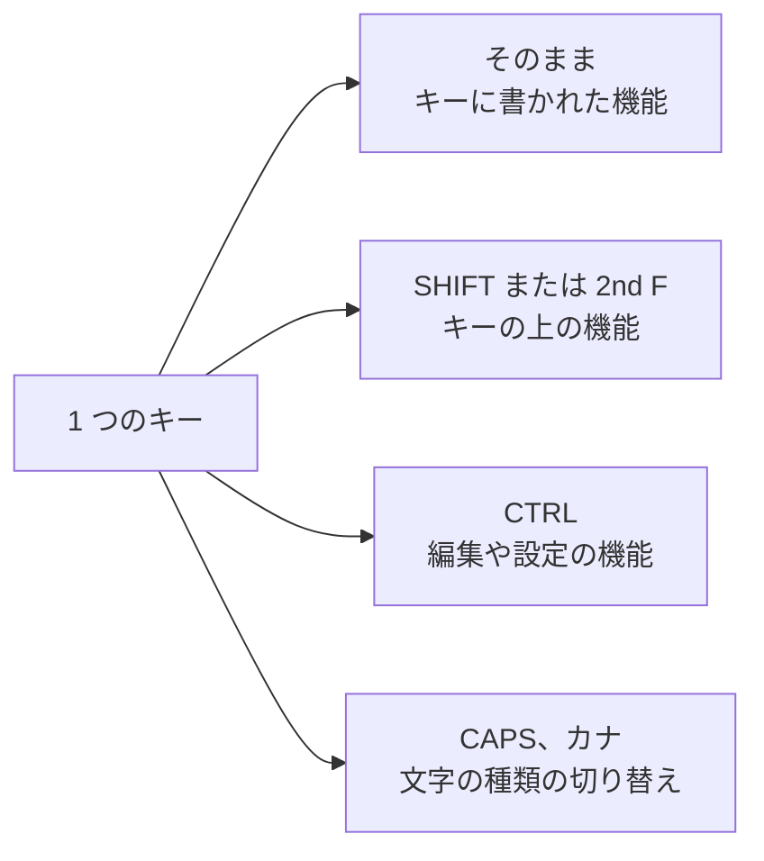
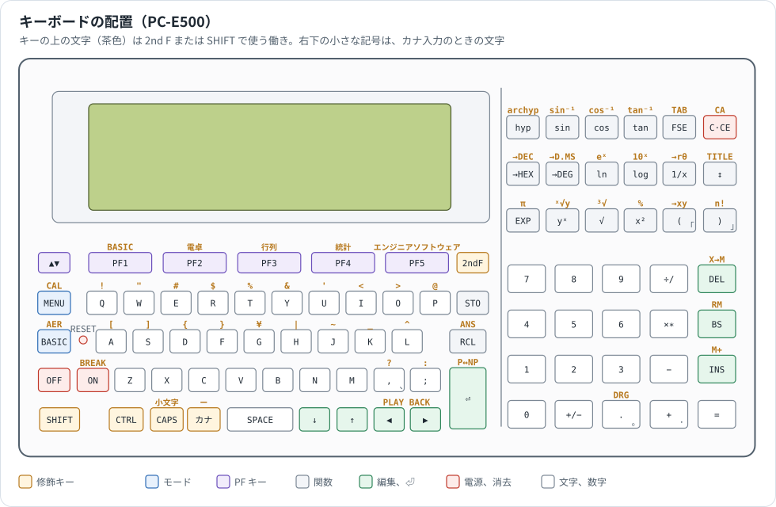
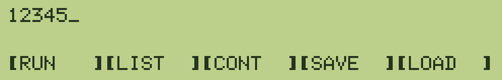

# 2. キーボード

この章は、89 個のキーの配置と、1 つのキーを複数の機能に使い分ける仕組みの説明です。キーの上の小さな文字の意味、`SHIFT` と `2nd F` の違い、小文字、記号、カナの入力、編集キーの使い方を順に説明します。ここを読んでおくと、あとの章の操作手順がすぐ分かります。

[目次へ戻る](README.md)

## この章で分かること

- キーの配置と 5 つの区画
- この本でのキーの表記
- `SHIFT`、`2nd F`、`CTRL`、`CAPS`、`カナ` の使い方
- 記号とカナの入力
- 編集キーと `CTRL` の組み合わせ
- 英語版の PC-E500 との違い

## 2.0 はじめに

89 個のキーで、英字、カナ、数字、記号、関数、編集までを入力するため、1 つのキーに 2 つ以上の機能があります。たとえば `sin` キーは、そのまま押せば sin、`2nd F` を押してからなら逆関数の sin⁻¹ です。`R` キーは、英字の R、`SHIFT` を押しながらなら `$`、カナ入力では `RA` で `ﾗ` になります。

## 2.1 キーの配置

| 区画 | 場所 | 主なキー |
|---|---|---|
| PF キー | 液晶の下 | `▲▼`、`PF1`〜`PF5`、`2nd F` |
| 文字キー | 左側 | 英字 26 個、`,` `;`、`SPACE`、`SHIFT` `CTRL` `CAPS` `カナ` |
| モードと電源 | 左端 | `MENU`、`BASIC`、`OFF`、`ON`、RESET |
| 関数キー | 右上 | `hyp`〜`)` の 18 個、`STO`、`RCL` |
| テンキー | 右下 | `0`〜`9`、`.`、`+/-`、四則、`=`、`DEL` `BS` `INS` |
| カーソルキー | 下の中央 | `↓` `↑` `◀` `▶`、`⏎` |

`⏎` はリターンキー（Enter キー）です。`↕` は `C·CE` の下のキー（上に TITLE）、`▲▼` は `PF1` の左のキーを表します。形は似ていますが、別のキーです。

## 2.2 キーの表記

| 表記 | 意味 |
|---|---|
| `A` | A キーを押して離す |
| `SHIFT` + `R` | SHIFT を**押したまま** R を押す |
| `2nd F` `sin⁻¹` | 2nd F を押して離し、次に sin キーを押す |
| `ON` と `BREAK` | 同じキー。電源を入れるときは ON、中断するときは BREAK |
| `MENU` と `CAL` | 同じキー。`SHIFT` + `CAL` は SHIFT + MENU |
| `FRE0` ⏎ | 1 文字ずつ入力し、最後に ⏎ を押す |

操作説明書でも、キーの上の機能を使うときは、そのキーを上の名称で表しています。`SHIFT` + `&` は、`&` が印字されている `Y` キーを、SHIFT と一緒に押すという意味です。空白は `SPACE` で入力します。

## 2.3 SHIFT と 2nd F

どちらも、次に押すキーを**キーの上に印字された機能**に切り替えます。機能は同じで、操作だけが違います。

| キー | 操作 |
|---|---|
| `SHIFT` | 押したまま、次のキーを押す |
| `2nd F` | 押して離してから、次のキーを押す。押すと `2ndF` が表示され、次のキーで消える |

`2nd F` を誤って押したときは、もう一度押すと解除されます（実験）。この本では、電卓と関数の説明には片手で操作できる `2nd F`、それ以外には `SHIFT` を使います。

**例**: `B$="OK"` は次のように入力します（`CAPS` が表示されているとき）。

| 文字 | キー |
|---|---|
| `B` | `B` |
| `$` | `SHIFT` + `R` |
| `=` | `=` |
| `"` | `SHIFT` + `W` |
| `O` `K` | `O` `K` |
| `"` | `SHIFT` + `W` |

### 2.3.1 記号の一覧

| 記号 | キー | 記号 | キー | 記号 | キー |
|---|---|---|---|---|---|
| `!` | Q | `[` | A | `` ` `` | M |
| `"` | W | `]` | S | `?` | `,` |
| `#` | E | `{` | D | `:` | `;` |
| `$` | R | `}` | F | `^` | L（`yˣ` でも入力できる） |
| `%` | T | `¥` | G | `_` | K |
| `&` | Y | `\|` | H | `~` | J |
| `'` | U | `<` | I | `>` | O |
| `@` | P | | | | |

`Z` `X` `C` `V` `B` `N` は、`SHIFT` を押しても同じ英字です。`+ - * / = ( )` と数字は、テンキーと関数キーで入力します。これらは `SHIFT` を押しても変わりません（実験）。`SHIFT` + `M` の `` ` `` はキーの上に印字がありませんが、入力できます（実験）。

### 2.3.2 モードと設定のキー

| キー | 機能 |
|---|---|
| `SHIFT` + `MENU`（CAL） | CAL モード |
| `SHIFT` + `BASIC`（AER） | AER モード |
| `SHIFT` + `RCL`（ANS） | 直前の答えの呼び出し（§2.8） |
| `SHIFT` + `C·CE`（CA） | 消去と、設定の初期化（§2.6） |
| `SHIFT` + `⏎`（P↔NP） | 計算の印刷の切り替え（`PRINT` の表示） |
| `SHIFT` + `.`（DRG） | 角度の単位を DEG → RAD → GRAD の順に切り替え |
| `SHIFT` + `PF1`〜`PF5` | `PF6`〜`PF10`（RUN では `INPUT` `PRINT` `GOTO` `GOSUB` `RETURN`。実験） |
| `SHIFT` + `◀`、`▶` | カーソルを行の先頭、末尾へ移動 |
| `SHIFT` + `カナ`（ー） | カナ入力で長音を入力（§2.9） |

## 2.4 大文字と小文字（CAPS）

`CAPS` を押すたびに、英字の大文字と小文字が切り替わります。大文字のときは `CAPS` が表示されます。初期状態は大文字です。

| 表示 | `A` `B` `C` を押すと |
|---|---|
| `CAPS` あり | `ABC` |
| なし | `abc` |

命令は小文字で入力しても実行できます（`print 3` でも `3` と表示されます。実験）。`SHIFT` で入力する記号は、`CAPS` の状態に影響されません（実験）。カナ入力中の `CAPS` は、小さいカナの入力に使います（§2.9）。

## 2.5 同時押し、先行入力、キー音

- 数字キーを押したまま別の数字キーを押すと、両方が入力されます。`1` を押したまま `2` を押すと `12` です。速く入力しても取りこぼしません。
- 実行中（`BUSY`）に押したキーは、8 個まで記憶されます（実験。[RUN モードの計算](06_RUN.md) §6.2.2）。
- `CTRL` + `0` で、キーを押したときのクリック音のオンとオフが切り替わります。BASIC モードで設定すると、ほかのモードでも有効です。内部では `BFCBFh` のビット 4 が反転します（実験）。

## 2.6 消去と中断のキー

| キー | 機能 |
|---|---|
| `C·CE` | 入力中の行と画面を消去し、エラーを解除する。プログラムと変数は消えない |
| `SHIFT` + `CA` | `C·CE` の機能に加え、設定を初期状態に戻す |
| `BREAK`（`ON`） | プログラムや、`BEEP`、`CLOAD` などの実行を中断する |

`SHIFT` + `CA` で初期化されるのは、`WAIT` の時間、`USING` の書式、`TRON`（トレース）の状態、`PRINT=LPRINT` の設定、エラーの状態です（操作説明書 p.344）。

## 2.7 編集キー

| キー | 機能 |
|---|---|
| `◀` `▶` | カーソルを左右に移動。⏎ のあとでは、入力した行を呼び出す（PLAY BACK） |
| `↑` `↓` | RUN ではカーソルを上下に移動。PRO では前後の行を表示（[プログラムを書く](12_PROGRAMMING.md)） |
| `SHIFT` + `◀`、`▶` | 行の先頭、末尾へ移動 |
| `INS` | 挿入モードの切り替え。カーソルが `◀` の形になる |
| `DEL` | カーソル位置の文字を削除し、後ろを詰める |
| `BS` | カーソルの左の文字を削除する |
| `SPACE` | 文字の上では、空白に置き換える |

PLAY BACK と編集の例は、[RUN モードの計算](06_RUN.md) §6.3 にあります。

### 2.7.1 CTRL の組み合わせ

`CTRL` は、押したまま次のキーを押します。

| キー | 機能 | 根拠 |
|---|---|---|
| `CTRL` + `0` | クリック音の切り替え | 公式 |
| `CTRL` + `▲▼` | 画面の最下行に PF キーのラベルを表示、消去 | 公式、実験 |
| `CTRL` + `E` | カーソルから行末まで削除 | 公式、実験 |
| `CTRL` + `U` | 行全体を削除 | 公式、実験 |
| `CTRL` + `A` | メインメニュー | 実験 |
| `CTRL` + `C` | 中断（`BREAK` と同じ） | 実験 |
| `CTRL` + `H` | 左の文字を削除（`BS` と同じ） | 実験 |
| `CTRL` + `J` | カーソルを 1 行下へ移動 | 実験 |
| `CTRL` + `K` | カーソルを入力中の文の先頭へ移動 | 実験 |
| `CTRL` + `L` | 画面を消去 | 実験 |
| `CTRL` + `M` | ⏎ と同じ | 実験 |
| `CTRL` + `R` | 挿入モードの切り替え（`INS` と同じ） | 実験 |
| `CTRL` + `X` | カーソルを行末へ移動 | 実験 |

公式にあるのは最初の 4 つです。`CTRL` と英字の組み合わせは、文字コード 01h〜1Ah のコントロールコードを入力する機能で、そのうち画面に変化があったものを載せました。

PF キーのラベルを表示すると、4 行目がラベルの表示になります。

`▲▼` を押すと、`INPUT`、`PRINT`、`GOTO`、`GOSUB`、`RETURN` に切り替わります。PF キーへの登録は [PF キーと便利な使い方](16_PF_KEYS.md) にあります。

## 2.8 RCL（ANS）と STO

`RCL` は、直前の答えを文字として入力するキーです。キーの上に `ANS` と印字されていますが、`SHIFT` を押しても押さなくても同じ動作をします（実験）。CAL モードでは、`STO` と `RCL` を英字キーと組み合わせて、変数への保存と呼び出しに使います。

| モード | `RCL` | `STO` |
|---|---|---|
| RUN、PRO | 直前の答えを入力 | 入力なし |
| CAL | 続けて押した英字の変数を呼び出し | 続けて押した英字の変数に保存 |

## 2.9 カナ入力

`カナ` を押すたびに、カナ入力のオンとオフが切り替わります。オンのときは `カナ` が表示され、**ローマ字で入力した文字が半角カナになります。**

入力途中のローマ字は、画面の右側に `[R ]` のように表示されます。上の画面は、`KANANYUURYOKU` と空白のあとに `R` まで入力したところです。

| 入力 | 結果 | 入力 | 結果 |
|---|---|---|---|
| `A` `I` `U` `E` `O` | `ｱｲｳｴｵ` | `N` + 母音、`Y` 以外 | `ﾝ` |
| `KA` `KI` `KU` `KE` `KO` | `ｶｷｸｹｺ` | `KITTE` | `ｷｯﾃ`（子音を重ねると `ｯ`） |
| `SI`、`SHI` | `ｼ` | `SYA` | `ｼｬ` |
| `TI`、`CHI` | `ﾁ` | `TYU` | `ﾁｭ` |
| `TU`、`TSU` | `ﾂ` | `NYU` | `ﾆｭ` |
| `HU`、`FU` | `ﾌ` | `FA` | `ﾌｧ` |
| `ZI`、`JI` | `ｼﾞ` | `VU` | `ｳﾞ` |
| `GA`、`PA` | `ｶﾞ`、`ﾊﾟ` | `WO` | `ｦ` |

（実験。ROM 7.2。）

- 濁点と半濁点は、それぞれ 1 文字です。`ｶﾞ` は 2 文字分になります。
- `ﾝ` は、`N` のあとに母音と `Y` 以外の文字、空白、⏎ などを入力すると確定します。`HANNI` は `ﾊﾝﾆ` です。
- **小さいカナ**（`ｧ`、`ｯ`、`ｬ` など）は、カナ入力中に `CAPS` を押してから入力します。`小文字` が表示され、次の 1 文字が小さいカナになると消えます。`CAPS` `TU` で `ｯ`、`CAPS` `A` で `ｧ` です。
- 記号は、キーの右下の印字のとおり `(` が `｢`、`)` が `｣`、`,` が `､`、`.` が `｡`、`+` が `･` になります。長音 `ｰ` は `SHIFT` + `カナ` です。`-` はマイナスのままです。
- 数字はそのまま入力できます。

カナを入力したあと命令を入力するときは、`カナ` を押してオフにします。オンのまま `RUN` と入力すると `ﾙﾝ` になり、`Syntax error` になります（実験）。

## 2.10 英語版の PC-E500 との違い

| 項目 | 日本語版（7.2） | 英語版（5.3、7.3）、PC-E500S（8.3） |
|---|---|---|
| `SPACE` の左のキー | `カナ` | `ANS` |
| 直前の答え | `RCL`（ANS） | `ANS` または `RCL` |
| `SHIFT` + `G` | `¥` | `\` |
| PF キーの上の印字 | BASIC、電卓、行列、統計、エンジニアソフトウェア | BASIC、CAL、MATRIX、STAT、ENG |
| カナ入力、小文字の表示 | あり | なし（画面にうっすら見えることがある） |
| `CTRL` + `J` | 1 行下へ移動 | 5.3 は同じ。8.3 は変化なし |

そのほかのキーの配置、`SHIFT` の記号、`CTRL` の組み合わせは同じです（実験）。

## まとめ

| したいこと | 操作 |
|---|---|
| キーの上の機能 | `2nd F` を押してから、または `SHIFT` を押したまま |
| 大文字と小文字 | `CAPS` |
| 入力ミスの修正 | `BS`（左の文字）、`DEL`（カーソル位置）、`C·CE`（全部） |
| 前の行の呼び出し | `◀` または `▶` |
| 直前の答え | `RCL` |
| クリック音 | `CTRL` + `0` |
| PF キーのラベル | `CTRL` + `▲▼` |
| 実行の中断 | `BREAK` |
| カナ | `カナ` キーを押してローマ字で入力 |

## 出典

- 操作説明書 p.8（配置）、p.11〜12（キーの表記、SHIFT と 2nd F）、p.150（同時押し、先行入力、クリック音）、p.344〜347（付録 C、BASIC でのキーの機能）。
- 実験: エミュレータの ROM 7.2 で、`SHIFT` と英字、`CTRL` と英字のすべての組み合わせと、カナ入力を確認しました。英語版との比較は 5.3 と 8.3 です。

## 次に読むもの

- [表示と電源](03_DISPLAY_POWER.md): 状態表示
- [RUN モードの計算](06_RUN.md): 編集キーの使用例
- [PF キーと便利な使い方](16_PF_KEYS.md)
- [文字コード表とキー一覧](18_CODES.md)、[ハードウェアの全体](../analysis/01_HARDWARE.md) §1.2（キースキャンの仕組み）
