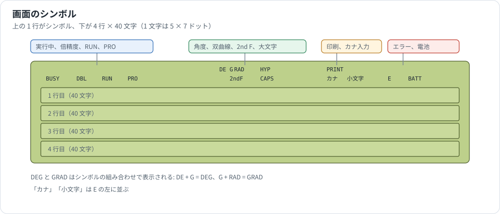
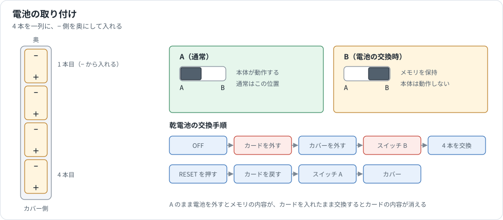
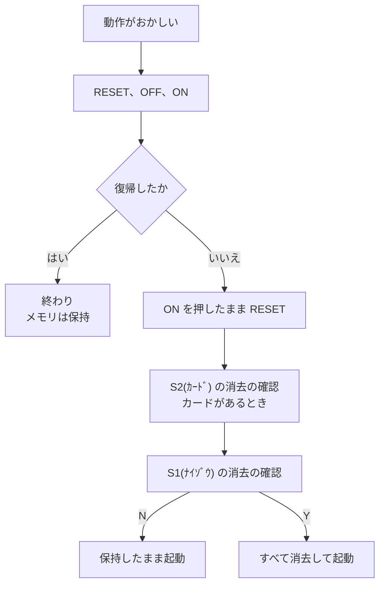

# 3. 表示と電源

この章は画面の状態表示（シンボル）の意味と、電源の扱いをまとめた章です。画面上部のシンボルは、本体が今どの状態にあるかを示します。後半では、自動電源オフ、電池の交換、操作できなくなったときの RESET を説明します。**電池の交換とメモリ保護スイッチの操作は、手順を誤るとプログラムが消える**ので、交換の前に必ず読んでください。

[目次へ戻る](README.md)

## この章で分かること

- 画面の構成とシンボルの意味
- コントラストの調整
- 自動電源オフの条件と、動作しない場合
- 乾電池とバックアップ電池の交換
- RESET の 2 通りの操作と、その違い

## 3.1 画面



液晶は 4 行 × 40 文字の表示部と、その上のシンボルで構成されています。1 文字は 5 × 7 ドットです。全体では 240 × 32 ドットで、BASIC から図形を描けます（[液晶](../analysis/04_LCD.md)）。

入力した文字や答えは上の行から表示され、4 行を超えると全体が 1 行スクロールします。

```text
2+3*4                              ← 1 行目
                                      14
5*-6+7
                                     -23 ← 4 行目。次の入力でスクロールする
```

BASIC モードではプロンプトとカーソルが表示されます。

| 記号 | 意味 |
|---|---|
| `>` | プロンプト。入力を始めると消える |
| `_` | カーソル。次に入力する位置（文字のない位置） |
| 点滅する四角 | 文字の上にあるカーソル |
| 点滅する `◀` | 挿入モードのカーソル（`INS`） |

数字のゼロは、英字の O と区別するために斜線付きで表示されます。

電源を入れたり切ったりする瞬間に、画面全体が黒くなったり、無関係なドットやシンボルが表示されたりすることがありますが、故障ではありません。

## 3.2 シンボル

| シンボル | 表示される条件 |
|---|---|
| `BUSY` | プログラムや命令の実行中 |
| `DBL` | 倍精度（20 桁）モード（[RUN モードの計算](06_RUN.md) §6.11） |
| `RUN` | RUN モード |
| `PRO` | PRO モード |
| `DEG`、`RAD`、`GRAD` | 角度の単位 |
| `2ndF` | 2nd F を押した状態。次のキーで消える |
| `HYP` | 双曲線関数を選択した状態。`2ndF HYP` は逆双曲線関数 |
| `CAPS` | 英大文字の入力 |
| `カナ` | カナ入力（[キーボード](02_KEYBOARD.md) §2.9） |
| `小文字` | 次のカナを小さいカナで入力 |
| `PRINT` | 計算を印刷する状態（`SHIFT` + `P↔NP`） |
| `E` | エラー。`C·CE` で消える |
| `BATT` | 乾電池の消耗。すぐに交換する |

`DEG` は `DE` と `G`、`GRAD` は `G` と `RAD` の組み合わせで表示されます（[液晶](../analysis/04_LCD.md) §4.7）。英語版では `カナ` と `小文字` は使いませんが、液晶には同じ部品があるため、うっすら見えることがあります（操作説明書 p.13）。

現在のモードが分からないときは、まず `RUN` と `PRO` を見ます。どちらもなく、電卓のアイコンがあれば CAL、メニューがあればメインメニューです。

## 3.3 コントラスト

本体の右側面上部のダイヤルで調整します。操作説明書（p.13）の図の矢印の向き（上向き）に回すと濃く、反対に回すと薄くなります。見る角度によって見え方が変わるので、使う姿勢で合わせてください。何も表示されないときは、電池のほかに、ダイヤルが薄い側に回りきっていないかも確認します。

## 3.4 電源のオンとオフ

| キー | 機能 |
|---|---|
| `ON` | 電源を入れる |
| `OFF` | 電源を切る |

`ON` は、動作中は `BREAK` キーになります。電源が切れないときは、`BEEP`、`CSAVE`、`CLOAD` など時間のかかる命令の実行中かもしれません。`BREAK` で中断してから `OFF` を押します。

電源を入れたときのモードは [はじめて使う](01_START.md) §1.6 にあります。電源を切ったときの内容は次のようになります。

| 保持されるもの | 初期化されるもの |
|---|---|
| プログラム、変数、RAM ディスク、AER の式 | 直前の答え（`RCL`）は 0 |
| CAL のメモリ、角度の単位 | 倍精度（`DBL`）は単精度 |
| | CAL の表示形式（FIX、SCI、ENG）と桁数 |

（操作説明書 p.42、p.155〜157、実験。）

## 3.5 自動電源オフ

電池を節約するため、約 11 分間キー操作がないと、自動的に電源が切れます。`ON` で復帰します。初期化や消去の確認画面（[はじめて使う](01_START.md) §1.3）では、約 1 分で切れます。

| 状態 | 自動電源オフ | 根拠 |
|---|---|---|
| キー入力待ち（RUN、CAL など） | 動作する | 公式、実験 |
| `INPUT` の入力待ち | 動作する。`ON` を押すと `?` から続けられる | 公式、実験 |
| `INKEY$` を繰り返すプログラム | 動作しない | 公式、実験 |
| `INPUT$` の入力待ち | 動作しない | 公式、実験 |
| ループなど、プログラムの実行中 | 動作しない | 実験 |
| RESET の確認画面 | 約 1 分で動作する | 公式、実験 |

エミュレータでは、キー入力待ちと `INPUT` では約 600 秒、RESET の確認画面では約 60 秒で電源が切れました。`INKEY$`、`INPUT$`、ループのプログラムでは 700 秒後も切れませんでした（ROM 7.2、5.3）。実機の「約 11 分」との差はタイマの周期の違いによるものと見られます（[起動、割り込み、タイマ、音](../analysis/10_SYSTEM.md) §10.7）。

> [!WARNING]
> 自動電源オフが動作しない状態で放置すると、電池が消耗し、プログラムとデータが消えます。`INKEY$` で入力を待つゲームなどは、終わったら中断して電源を切ってください。

## 3.6 電池

### 3.6.1 種類と寿命

| 電池 | 寿命 |
|---|---|
| 単 4 形（R03）4 本、6 V | 約 70 時間（1 時間あたり計算 10 分、表示 50 分、20 ℃。操作説明書 p.352） |
| CR2016、3 V | 約 2 年（20 ℃） |

CR2016 は乾電池の交換中や電池切れの間、メモリの内容を保持します。ただし、**乾電池を外したまま、または切れたままにすると、CR2016 は早く消耗します**。高温や低温の環境では寿命が短くなります。

CE-126P プリンタを接続しているときに乾電池が切れると、プリンタから電源が供給され、本体の電池の消費が減ります。

### 3.6.2 交換時期

画面の右上に `BATT` が表示されたら、**すぐに**プログラムとデータをカセット、ディスク、パソコンなどに保存し、乾電池を交換します。そのまま使い続けると電源が切れ、`ON` を押しても入らなくなります。警告と停止の電圧は [起動、割り込み、タイマ、音](../analysis/10_SYSTEM.md) §10.8 にあります。

> [!IMPORTANT]
> 周辺機器を接続していると、機器から電源が供給されるため、乾電池が消耗していても `BATT` は表示されません。ときどき機器を外して確認してください。

### 3.6.3 乾電池の交換



手順を誤ると、本体が動作しなくなったり、バックアップ電池の寿命が短くなったりします。周辺機器があれば、交換の前に内容を保存しておきます。

1. `ON`、`OFF` の順に押し、電源を切ります。
2. **RAM カードが入っていれば取り外します**（[RAM カード](04_RAM_CARD.md) §4.3）。入れたまま交換すると、カードの内容がすべて消えます。
3. 電池カバーを外します。
4. **メモリ保護スイッチを `B` に**します。`A` のまま交換すると、メモリの内容が消えます。
5. 古い電池を取り出し、新しい電池 4 本を乾いた布で拭いて、マイナス側から入れます。
6. `RESET` を押します。カードはまだ入れません。`NO MEMORY` と表示され、約 3 秒で電源が切れます。何も表示されないか、ほかの表示になったときは、もう一度押します。
7. カードを取り付け、スロットカバーをロックします。
8. メモリ保護スイッチを **`A` に戻し**ます。戻さないと本体は動作しません。
9. 電池カバーを取り付けます。

6 で何も表示されないときは、スロットカバーのロックも確認してください。ロックされていないと、メッセージは表示されません。

### 3.6.4 バックアップ電池（CR2016）の交換

先に、`BATT` が表示されていないことを確認します。**乾電池が消耗した状態で CR2016 を外すと、メモリの内容が消えることがあります。** 消耗していれば、先に乾電池を交換します。

1. `ON`、`OFF` の順に押し、電源を切ります。
2. スロットのロックを外し、カバーを外します。カードがあれば取り外します。
3. 電池カバーのねじを外し、カバーを外します。
4. 古い電池を縁から起こして取り出します。
5. 新しい電池を拭き、プラス面を上にして、縁をつめの下に差し込みます。
6. 電池カバーをねじで固定し、カードを戻し、スロットカバーを取り付けてロックします。

### 3.6.5 電池の取り扱い

- 4 本を同時に交換します。新しい電池と古い電池、種類の違う電池を混ぜないでください。
- 充電式ではなく**充電できない**電池を使います。
- 電池室の表示どおりの向きに入れます。
- 使い切った電池は取り出します。液漏れは故障の原因です。火に入れると破裂するおそれがあります。
- **子どもの手の届かない場所**に保管してください。

## 3.7 メモリ保護スイッチ

| スイッチ | 本体 | 乾電池を外すと |
|---|---|---|
| `A` | 動作する | メモリの内容が消える |
| `B` | 動作しない | メモリの内容は保持される |

`B` のときに RESET を押すと `NO MEMORY` と表示されます。乾電池の交換が終わったら、必ず `A` に戻します。

## 3.8 電源のトラブル

| 症状 | 確認すること |
|---|---|
| 表示が薄い、濃い | コントラスト |
| 電源が入らない | 乾電池。メモリ保護スイッチが `A` か。スロットカバーがロックされているか |
| 電源が切れない | `BREAK` のあと `OFF`。切れなければ §3.9 |
| キーが効かない | §3.9 |

スロットカバーをロックし忘れていたときは、ロックし、電源を切ってから入れ直します。詳しくは [困ったとき](19_TROUBLE.md) にあります。

## 3.9 RESET

`RESET` は、`BASIC` キーの右にある小さなボタンです。ボールペンの先などで押します。押し方によって動作が違います。

| 操作 | 動作 |
|---|---|
| `RESET` だけ | メモリを保持したまま再起動する。続けて `OFF`、`ON` を押す |
| `ON` を押したまま `RESET` を押し、RESET から離す | メモリを消去するかどうかを確認する |




変数 A に 123 を代入してから RESET を押した結果です（実験。ROM 7.2、5.3）。

| 操作 | 操作後の `A` |
|---|---|
| `RESET` だけ | 123 |
| `ON` + `RESET`、`N` | 123 |
| `ON` + `RESET`、`Y` | 0 |

RAM カードが入っていると、先に `S2(ｶｰﾄﾞ):`、次に `S1(ﾅｲｿﾞｳ):` の確認が表示されます。


カードだけを消去するときは、`Y`、`N` の順に押します。`MEM$="B"` のときは、カードと内蔵メモリが一体になっているので、`S1(ﾅｲｿﾞｳ):` だけが表示され、`Y` で両方が消去されます（[RAM カード](04_RAM_CARD.md) §4.5）。

> [!WARNING]
> プログラムやデータの異常で正常に動作しないときは、`Y` ですべて消去するしかないことがあります。`Y` を押すと元に戻せません。普段からバックアップを残しておいてください。

## まとめ

| 項目 | 要点 |
|---|---|
| `BATT` | 表示されたら、保存してすぐ交換 |
| 乾電池の交換 | カードを外す → スイッチ `B` → 4 本交換 → RESET → スイッチ `A` |
| 自動電源オフ | 約 11 分。`INKEY$`、`INPUT$`、実行中は動作しない |
| RESET | 単独ならメモリを保持。`ON` と一緒なら消去を確認 |
| スロットカバーのロック | 外れていると動作しない |

## 出典

- 操作説明書 p.10〜17（電源、シンボル、コントラスト、電池）、p.347〜349（付録 D、RESET）、p.352（電池の寿命）。
- 実験: エミュレータの ROM 7.2 で、RESET と、自動電源オフ、`INKEY$`、`INPUT$`、`INPUT` の時間を測定しました（5.3 でも同じ）。電池とスイッチの操作は操作説明書によります。

## 次に読むもの

- [RAM カード](04_RAM_CARD.md)
- [困ったとき](19_TROUBLE.md)
- [仕様と保守](20_SPECS.md)
- [起動、割り込み、タイマ、音](../analysis/10_SYSTEM.md): 電源と電池の仕組み
