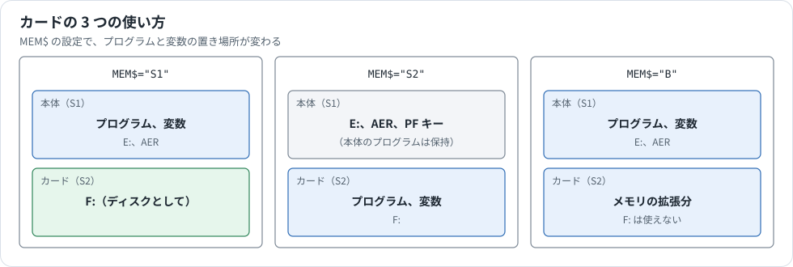
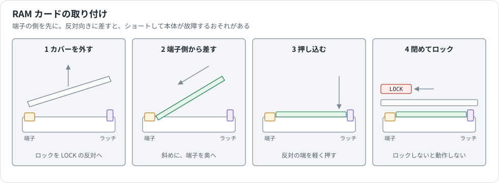
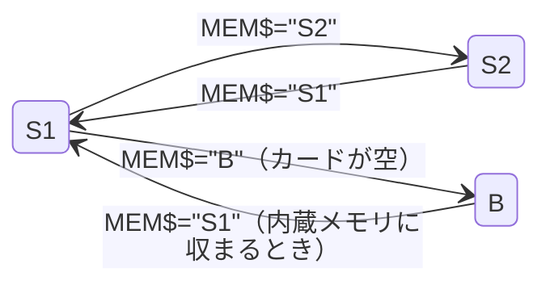
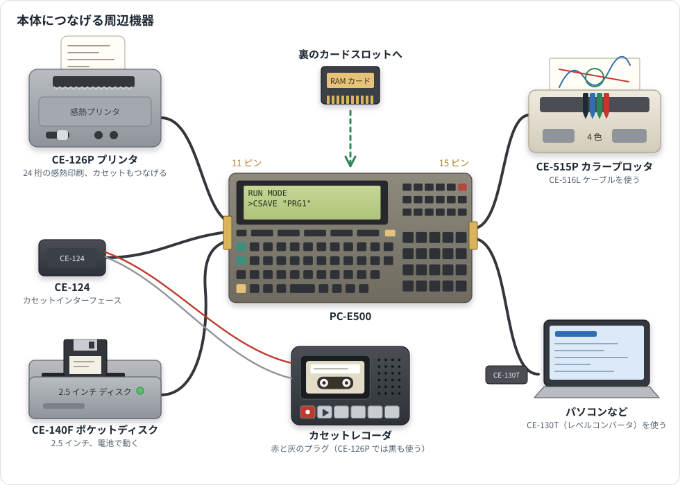

# 4. RAM カード

この章は本体の裏のスロットに入れる RAM カードの使い方の説明です。カードはメモリの増設にも、プログラムやデータを持ち運ぶディスクとしても使えます。使い方によっては切り替えるときに内容が消えるので、まず 3 つの使い方の違いを説明します。章の後半では、プリンタ、カセット、ディスクなどの周辺機器の接続もまとめます。

[目次へ戻る](README.md)

## この章で分かること

- カードの種類、使用できる容量、電池の寿命
- カードの取り付け、取り外し、初期化
- `MEM$` の 3 つの設定と切り替え
- RAM ディスク `F:` のファイル数
- プリンタ、カセット、ディスク、シリアルポートの使い方

## 4.0 はじめに

カードには専用の電池が入っているので、本体から外しても内容が保持されます。カセットテープやディスクの代わりに使え、読み書きも高速です。使い方は次の 3 つです（操作説明書 p.20）。

| 使い方 | 設定 | イメージ |
|---|---|---|
| プログラムやファイルを保存するディスク | `MEM$="S1"` で `F:` を使う | フロッピーディスク |
| プログラムと変数を丸ごと切り替えるメモリ | `MEM$="S2"` | 内蔵メモリの代わり |
| メモリの増設 | `MEM$="B"` | 内蔵メモリの拡張 |



特に理由がなければ、`S1` のまま `F:` をディスクとして使うのがよいでしょう。カードを何枚も交換して使え、ほかの PC-E500 でも読めます。操作説明書も、ディスクの容量を増やす目的なら、`B` で `E:` を広げるより `S1` で `F:` を使うことを勧めています。

## 4.1 カードの種類

PC-E500 の内蔵 RAM は 32 KB です（64 KB の機種もあります）。純正のカードは 8 KB から 64 KB まで 4 種類です。カードに付属の説明書も参照してください。

| カード | 容量 | `S2` で使える容量 | `B` で使える容量 | 電池の寿命（本体から外した状態） |
|---|---|---|---|---|
| CE-212M | 8 KB | 7725 バイト | 36792 バイト | 約 15 か月 |
| CE-2H16M | 16 KB | 15917 バイト | 44984 バイト | 約 14 か月 |
| CE-2H32M | 32 KB | 32301 バイト | 61368 バイト | 約 14 か月 |
| CE-2H64M | 64 KB | 65069 バイト | 94136 バイト | 約 12 か月 |

- 使える容量はプログラムと変数に使えるバイト数（`FRE0` の値）です。`B` の列は内蔵 32 KB の機種の値です。
- RAM ディスク `E:` や `F:` を作ると、その分だけ減ります。
- 32 KB のカードで確認した値は、`S1` が 28600、`S2` が 32301、`B` が 61368 で、表と一致しました（実験。ROM 7.2、5.3）。
- そのほかの容量、他社のカード、ROM カードについては [カードスロット](../analysis/05_CARD_SLOT.md) にあります。

> [!WARNING]
> カードの部品は静電気に弱いため、取り扱う前にドアノブなどの金属に触れて、体の静電気を逃がしてください。端子には絶対に触れないでください。

## 4.2 取り扱い上の注意

- カードは別のカードと交換するときと、カードの電池を交換するとき以外は取り外しません。
- 着脱は電源を切ってから行います。
- 外したカードはケースに入れて保管します。
- **本体の乾電池を交換するときは、必ずカードを外します。** 入れたままにすると、カードの内容が消えます（[表示と電源](03_DISPLAY_POWER.md) §3.6.3）。

## 4.3 取り付けと取り外し



1. `ON`、`OFF` の順に押し、電源を切ります。
2. 裏面のスロットのロックを LOCK と反対側にスライドし、カバーを外します。
3. カードが入っていれば、着脱ラッチを矢印の方向に動かします。カードがつめから外れるので、取り出します。
4. 新しいカードをケースから出し、外したカードはケースに入れます。
5. 端子側から、矢印の方向に差し込みます。
6. 反対側を軽く押し、カチッとはまるのを確認します。
7. カバーを取り付け、ロックします。

> [!WARNING]
> カードを逆向きに差し込まないでください。端子がショートし、本体が故障するおそれがあります。

カバーがロックされていないと、本体は動作しません。その場合はロックしてから電源を入れ直します。

## 4.4 初期化

新しいカードや、電池を交換したカードを入れて電源を入れると、次の画面が表示されます（操作説明書 p.19、実験）。


| キー | 動作 |
|---|---|
| `PF1` | カードを初期化する |
| `PF2` | 初期化しない。カードは使えない |

内蔵メモリも初期化されていないときは、続けて `S1(ﾅｲｿﾞｳ)` の画面が表示されるので、こちらも `PF1` を押します。ほかの機種で使ったカードなどでは、`ﾀﾉ ｷｼｭﾉ ｶｰﾄﾞ ﾃﾞｽ` や `ﾍﾟｱ ﾐｽﾏｯﾁ ﾃﾞｽ` と表示されることがあります（[カードスロット](../analysis/05_CARD_SLOT.md) §5.6.1）。

> [!NOTE]
> 英語版の PC-E500 では、`S2(CARD):NEW CARD`、`PF1 --- INITIALIZE`、`PF2 --- DO NOT INITIALIZE` と表示されます。

## 4.5 MEM$ による使い分け

`MEM$` はプログラムと変数を置く場所の設定です。RUN モードで `MEM$="S1"` ⏎ のように入力します。現在の設定は `MEM$` ⏎ で確認できます。

| 設定 | プログラムと変数 | `E:` | `F:` | AER、PF キーの登録 | カードをほかの PC-E500 で使う |
|---|---|---|---|---|---|
| `S1` | 内蔵メモリ | 使える | 使える | 内蔵メモリ | できる |
| `S2` | カード | 使える（内蔵メモリ） | 使える | 内蔵メモリ | `E:` と AER を使っていなければできる |
| `B` | 内蔵メモリ + カード | 使える | **使えない** | 内蔵メモリ | **できない** |

`S2` では、変数 A〜Z（固定変数）も含めてカードに置かれます。内蔵メモリのプログラムと変数は保持されていて、`S1` に戻すとまた使えます。

```text
MEM$
S1
A=5
                                       5
MEM$="S2"
>
A
                                       0   ← カード側の A
A=77
                                      77
MEM$="S1"
>
A
                                       5   ← 内蔵メモリの A
```

（実験。ROM 7.2、5.3。もう一度 `S2` にすると、`A` は 77 です。）

### 4.5.1 切り替えの規則



| 操作 | 結果 | 根拠 |
|---|---|---|
| `S2` から `B`、`B` から `S2` | `Illegal function call`。`S1` を経由する | 実験 |
| カードに内容が残った状態で `B` | `Out of memory` | 実験 |
| カードが空の状態で `S1` から `B` | 切り替わる。内蔵メモリの変数は保持される | 公式、実験 |
| `B` で `FILES "F:"` | `Bad drive name` | 実験 |

`S2` で使ったカードを `B` で使うには、`S1` に戻し、カードの内容を消去してから `B` にします。消去の方法は次の節にあります。

### 4.5.2 内蔵メモリの内容を残した増設

内蔵メモリのプログラムと変数を残したまま `B` にする手順です（操作説明書 p.22、実験）。

1. 電源を切り、カードを取り付けます。
2. `ON` を押したまま `RESET` を押し、RESET から離します。
3. `S2(ｶｰﾄﾞ):` の `ｽﾍﾞﾃﾉ ﾃﾞｰﾀｦ ｼｮｳｷｮ ｼﾏｽｶ? (Y/N)` に **`Y`** で答えます（新しいカードの画面なら `PF1`）。カードが空になります。
4. `S1(ﾅｲｿﾞｳ):` の同じ確認に **`N`** で答えます。内蔵メモリは保持されます。
5. `BASIC` で RUN モードにし、`MEM$="B"` ⏎ を実行します。

> [!WARNING]
> 4 で `Y` を押すと、内蔵メモリの内容がすべて消えます。先にバックアップを取ってください。

`B` で使うカードはその本体と組になります。ほかの本体では使えません。`B` の状態で `ON` + `RESET` を行うと、`S1(ﾅｲｿﾞｳ)` の確認だけが表示され、`Y` で内蔵メモリとカードの両方が初期化されます（操作説明書 p.349）。

### 4.5.3 大容量のカードへの交換（B の場合）

`B` のままカードを交換することはできません。いったん `S1` に戻します（操作説明書 p.23）。`S1` に戻せるのは、`B` で使用している量が内蔵メモリに収まるときです。収まっていれば、`MEM$="S1"` ⏎ のあと、次の 4 から始めます。収まらないときは 1 から行います。

1. プログラムとデータをカセットやディスクに保存します。
2. 保存したプログラムとデータをメモリから消去します。
3. `MEM$="S1"` ⏎ を実行します。
4. 電源を切り、大容量のカードに交換して、電源を入れます。
5. `ON` を押したまま `RESET` を押し、RESET から離します。
6. `S2(ｶｰﾄﾞ)` の確認に `Y`（新しいカードの画面なら `PF1`）で答えます。
7. `S1(ﾅｲｿﾞｳ)` の確認に `N` で答えます。
8. RUN モードで `MEM$="B"` ⏎ を実行します。
9. 保存しておいたプログラムとデータを読み込みます。

## 4.6 RAM ディスク F:

`S1` または `S2` のときは、カードの一部を `F:` というディスクとして使えます。ディスクの作成には `INIT` を使います。

```text
INIT "F:8K"
>
FRE0
                                   24109   ← S2 のとき。32301 − 8192
```

`10 PRINT 1` という 1 行のプログラムを保存した例です（実験）。

```text
SAVE "F:T"
>
FILES "F:"
     T       .BAS         34   F:
```

`S2` では、`F:` とプログラムが同じカードにあるため、`F:` の大きさだけ `FRE0` が減ります。`F:` の大きさはカードの容量より 1 KB 小さい値までです。

大きさを変えて `INIT` をやり直すと、内容は消えます。既存の `F:` に `INIT` を実行すると、`ｼｮｷｶ OK? (Y/N)`（英語版は `INITIALIZE OK? (Y/N)`）と確認されます（実験）。使い方は [ファイルとドライブ](15_FILES.md)、大きさの範囲は [カードスロット](../analysis/05_CARD_SLOT.md) §5.7.2 にあります。

### 4.6.1 ファイル数

保存できるファイルの数はファイルの大きさと、ディレクトリの大きさで決まります。初期化した `F:` の最大ファイル数は次のとおりです（操作説明書 p.18）。

| `F:` の大きさ | ファイル数 | `F:` の大きさ | ファイル数 |
|---|---|---|---|
| 2 KB | 5 | 17〜20 KB | 40 |
| 3〜4 KB | 8 | 21〜24 KB | 48 |
| 5〜8 KB | 16 | 25〜28 KB | 56 |
| 9〜12 KB | 24 | 29 KB 以上 | 64 |
| 13〜16 KB | 32 | | |

小さいファイルを多数保存するときは、`F:` を大きめに作ります。

## 4.7 トラブルと対処

| 症状 | 原因と対処 |
|---|---|
| 本体が動作しない | スロットカバーのロック、メモリ保護スイッチ |
| `Bad drive name` | `F:` を作成していない、`B` になっている、初期化を `PF2` で断った |
| `ｱﾀﾗｼｲ ｶｰﾄﾞ ﾃﾞｽ` が繰り返し表示される | カードの電池切れ、または電池の交換直後 |
| 外したら内容が消えた | カードの電池切れ |
| `Out of memory`（`MEM$="B"`） | カードが空でない。§4.5.2 |

## 4.8 周辺機器の接続

カードのほかに、次の周辺機器を接続できます。詳しい仕様は [周辺機器](../analysis/16_PERIPHERALS.md)、通信の内容は各章にあります。接続の前に電源を切り、機器の説明書も参照してください。

| 機器 | 接続先 | 特徴 | 解析 |
|---|---|---|---|
| CE-140F ポケットディスク | 11 ピン（左側面） | 2.5 インチのディスク。カセットより高速で、ランダムに読み書きできる。`COPY` でバックアップできる。電池で動作する | [17](../analysis/17_CE-140F_DISK.md) |
| CE-126P プリンタ | 11 ピン | 24 桁の感熱印刷。カセットインターフェースを内蔵 | [18](../analysis/18_CE-126P_PRINTER.md) |
| CE-124 カセットインターフェース | 11 ピン | カセットレコーダの接続 | [20](../analysis/20_CASSETTE.md) |
| CE-515P カラープロッタ | 15 ピン（CE-516L ケーブル） | 4 色のペンで文字と図形を描く | [19](../analysis/19_CE-515P_PLOTTER.md) |



### 4.8.1 カセット

レコーダは標準またはマイクロカセットのもので、`MIC` 入力と、`EXT`、`MONITOR`、`EAR` のいずれかの出力があるものを使います。`AUX` 入力は使えません。レコーダの条件は [周辺機器](../analysis/16_PERIPHERALS.md) §16.5 にあります。

| プラグ | 接続先 | 使うとき |
|---|---|---|
| 赤 | `MIC` | 録音（保存） |
| 灰 | `EAR` | 再生（読み込み、照合） |
| 黒 | `REM` | 録音と再生（レコーダの自動停止） |

**保存**（CE-126P を使う場合）

1. CE-126P の REMOTE スイッチを切ります。
2. 本体にプログラムを入力します。
3. テープを入れ、録音する位置まで送ります。先頭の透明なリーダー部分と、録音済みのプログラムは避けます。
4. 赤のプラグを `MIC`、黒を `REM` に接続します。
5. REMOTE スイッチを入れます。
6. 録音ボタンと再生ボタンを同時に押します。
7. RUN モードまたは PRO モードで `CSAVE "PRG1"` ⏎ を実行します。
8. 約 8 秒間の信号音に続いて、ファイル名と内容が録音されます。終わると `>` が表示され、テープが停止します。

プログラムは本体にも残ります。テープカウンタの値を記録しておくと、あとで探しやすくなります。データの保存は次のようにプログラムで行います。

```basic
100 OPEN "CAS:DATA1" FOR OUTPUT AS #1
110 FOR I=1 TO 10: PRINT #1,A(I): NEXT I
120 CLOSE #1
```

**照合**

1. REMOTE スイッチを切り、照合するファイルの手前までテープを戻します。
2. 灰のプラグを `EAR`、黒を `REM` に接続し、REMOTE スイッチを入れます。
3. 再生ボタンを押します。
4. `CLOAD? "PRG1"` ⏎ を実行します。
5. ファイルが見つかると、入力した行に `*` が付き、照合が始まります。一致すれば `>`、一致しなければエラーが表示されます。一致しないときは、もう一度照合します。

**読み込み**

1. REMOTE スイッチを切り、ファイルの手前までテープを送ります。
2. 灰のプラグを `EAR`、黒を `REM` に接続します。REM 端子のないレコーダでは一時停止ボタンで操作します。
3. REMOTE スイッチを入れ、再生ボタンを押します。音量は中間から最大の間、音質は高音を最大にします。
4. `CLOAD "PRG1"` ⏎ を実行します。見つかると `*` が付き、読み込みが終わると `>` が表示されます。

エラーになったときは、音量を少し調整して最初からやり直します。エラーが出ずにテープが止まらないときは、`BREAK` で中断してやり直します。

テープを使うときの注意は次のとおりです。

- 録音に使ったレコーダで再生します。別のレコーダでは読み込めないことがあります。
- 品質のよいテープを使います。
- CE-126P を AC アダプタで使うと、ノイズで録音に失敗することがあります。そのときは電池を使います。
- 録音済みのテープを再利用するときは、前の内容を消去してから使います。

### 4.8.2 プリンタ（CE-126P）

| 印刷するもの | 方法 |
|---|---|
| 計算の式と答え | RUN モードで `SHIFT` + `P↔NP`（[RUN モードの計算](06_RUN.md) §6.12） |
| プログラムの出力 | `LPRINT`。書式は `PRINT` と同じ |
| プログラムリスト | `LLIST`。行番号の範囲を指定できる。24 桁を超える行は、次の行に字下げして印刷される |

強いノイズで意味のない数字が印刷されたときは、`BREAK` で中断し、プリンタの電源を入れ直してから、本体の `C·CE` を押します。使わないときはプリンタの電源を切っておくと、電池が長持ちします。

### 4.8.3 プロッタ（CE-515P）

`LPRINT` や `LLIST` のほか、円や線を描く命令があります（[CE-515P プロッタ](../analysis/19_CE-515P_PLOTTER.md)）。

- 使う前に `OPEN` でシリアルポートを開いておきます。開いていないと使えません。
- 座標は X（横。負が左、正が右）と Y（縦。正が上、負が下）で表します。
- 図形の命令に渡す値は、`CIRCLE` の比率を除き、小数部分が切り捨てられます。
- 紙からはみ出した部分は描かれません（シザリング）。大きな図を用紙に合わせて分割して描くときに便利です。プログラムを誤ると、図が用紙の外に出てしまうので注意します。

### 4.8.4 シリアルポート

15 ピンのコネクタはプロッタのほか、パソコンなどとのデータ通信に使います。

> [!WARNING]
> 規定の範囲を超える電圧を加えると、本体が故障するおそれがあります。RS-232C のパソコンとは、レベルコンバータを通して接続します（[15 ピン](../analysis/07_PORT_15PIN.md)）。

シリアルポートは通常は閉じています。使うときの手順は次のとおりです。

1. `OPEN` で開きます。通信速度やデータ形式は相手の機器と合わせます。設定も `OPEN` で変更できます。すでに開いているときに `OPEN` を実行すると、エラーになります。
2. データを送受信します。`LPRINT`、`LLIST`、`SAVE`、`LOAD`、`CHAIN`、`MERGE`、`INPUT$`、`PRINT #`、`INPUT #` が使えます。
3. `CLOSE` で閉じます。プログラムの終了（`END` など）と、`RUN` の実行でも閉じます。

`SAVE`、`LOAD`、`CHAIN`、`MERGE` では、`OPEN` と `CLOSE` が自動的に実行されます。

シリアルポートの命令にはタイムアウトがありません。**相手の電源が入っていなかったり、通信が途中で止まったりすると、待ち続けます。** そのときは `BREAK` で中断します。

設定の書き方は [ファイルとドライブ](15_FILES.md)、信号は [仕様と保守](20_SPECS.md) にあります。

## まとめ

| 使い方 | 設定 | 条件と注意 |
|---|---|---|
| ディスク | `S1`、`INIT "F:..."` | カードを交換して使える |
| メモリの切り替え | `S2` | 変数 A〜Z も切り替わる |
| メモリの増設 | `B` | カードを空にしてから。`F:` は使えない。その本体専用 |
| 設定の切り替え | `S1` を経由 | `S2` と `B` は直接切り替えられない |
| 取り付け | 端子側から差し込み、ロック | 乾電池の交換のときは外す |

## 出典

- 操作説明書 p.18〜23（RAM カード）、p.24〜30（周辺機器）、p.349（RESET の表示）。
- 実験: エミュレータの ROM 7.2 に 32 KB のカードを取り付け、初期化、`MEM$` の切り替え、`FRE0`、`INIT`、`FILES`、`ON` + `RESET` を確認しました（5.3 でも、言語を除いて同じ）。周辺機器の節は操作説明書によります。

## 次に読むもの

- [ファイルとドライブ](15_FILES.md): `INIT`、`SAVE`、`FILES` の使い方
- [カードスロット](../analysis/05_CARD_SLOT.md): カードの内部、他社のカード、ROM カード
- [周辺機器](../analysis/16_PERIPHERALS.md): 仕様一覧
- [カセットインターフェース](../analysis/20_CASSETTE.md): テープの信号とデータ
