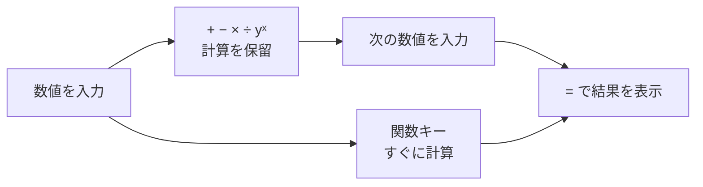
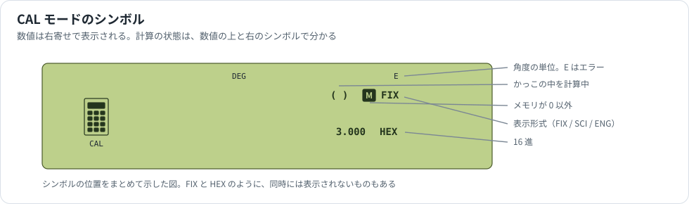
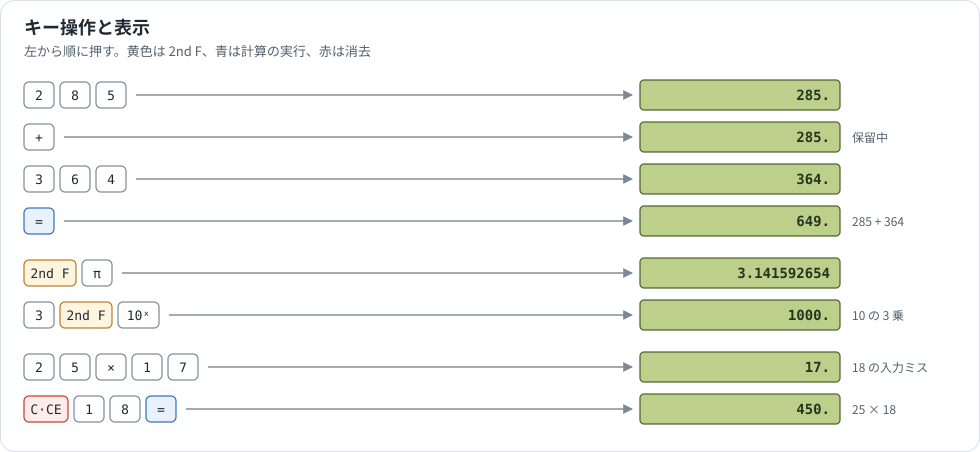
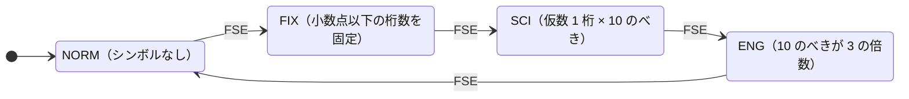
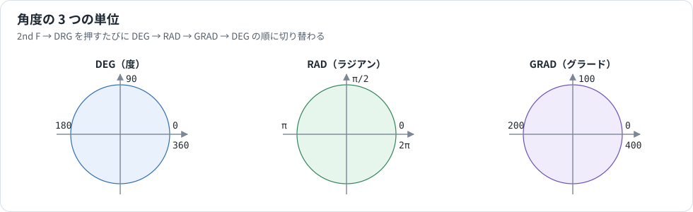
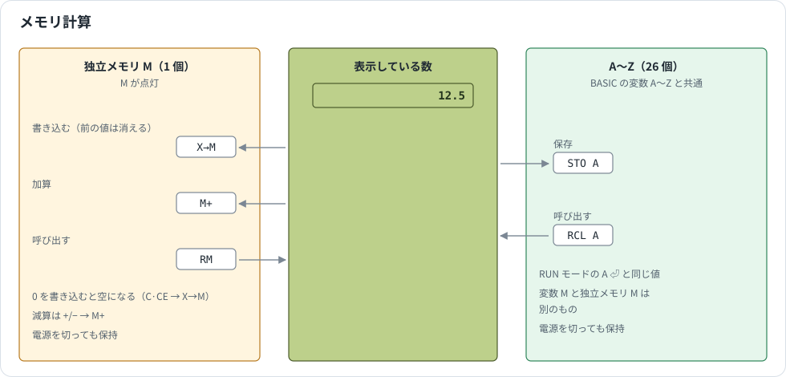
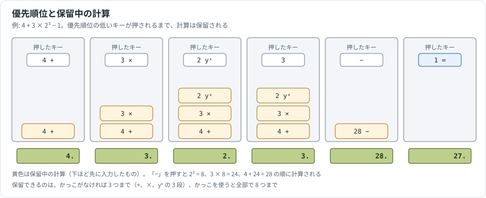
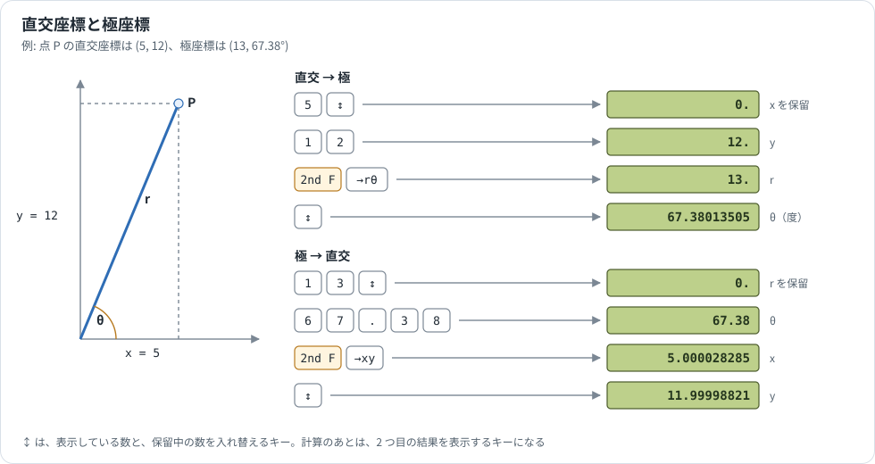
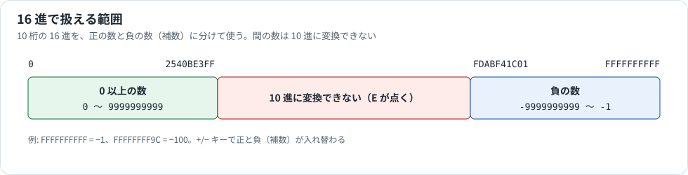

# 5. 電卓（CAL）

この章は PC-E500 を 10 桁の関数電卓として使う CAL モードの説明です。式を入力して ⏎ を押す [RUN モードの計算](06_RUN.md) と違い、CAL モードでは一般の関数電卓と同じように、キーを押すたびに結果が表示されます。四則計算から、三角関数、メモリ、度分秒、座標変換、16 進計算まで、キー操作と表示を並べて説明します。

[目次へ戻る](README.md)

## この章で分かること

- CAL モードの起動と、画面のシンボルの意味
- 入力ミスの訂正とエラーの解除
- 関数キーの一覧と操作の順序
- 表示形式（FIX、SCI、ENG）と小数点以下の桁数
- メモリ、かっこ、優先順位、度分秒、座標変換、16 進計算

## 5.0 はじめに

CAL モードは本体の右側のキーだけで使える関数電卓です。プログラムや変数の知識は必要ありません。一方、BASIC の変数 `A`〜`Z` を電卓のメモリとして使えるので、測定値を電卓で保存し、あとから BASIC の式で使うこともできます。



関数は数値を入力してから関数キーを押します。30 度のサインは `30` `sin` の順です。RUN モードの `SIN 30` とは順序が逆になります。

この章の例はすべて ROM 7.2 で実行した結果です。英語版の 5.3 と PC-E500S の 8.3 でも、同じキー操作で同じ表示になります（実験）。

## 5.1 起動と画面

CAL モードは次のどちらかの操作で起動します（操作説明書 p.33）。

| 方法 | キー |
|---|---|
| どのモードからでも | `SHIFT` を押したまま `MENU`（キーの上に CAL と印字）。`2nd F` `MENU` の順でも同じ |
| メインメニューから | `MENU` を押し、`PF2` を押す |


左に電卓のアイコンと `CAL`、右に数値が表示されます。整数でも最後に小数点が付きます（`0.`）。



| シンボル | 意味 |
|---|---|
| `DEG`、`RAD`、`GRAD` | 角度の単位（§5.6.2） |
| `2ndF` | 2nd F が押されている |
| `HYP` | 双曲線関数を選択中（§5.6.3） |
| `E` | 計算エラー。`C·CE` で解除 |
| `( )` | かっこの中を計算中（§5.8） |
| 反転表示の `M` | 独立メモリの値が 0 以外（§5.7） |
| `FIX`、`SCI`、`ENG` | 表示形式（§5.4） |
| `HEX` | 16 進モード（§5.11） |
| `STO`、`RCL` | 英字キーの入力待ち（§5.7.2） |

次の画面はメモリに 5 を保存し、FIX にして、`(` `3` `+` と入力したところです。


CAL モードの計算は印刷できません。印刷が必要なときは RUN モードを使います（操作説明書 p.33、[RUN モードの計算](06_RUN.md) §6.12）。

> [!NOTE]
> この章では、キー操作を `2` `+` `3` `=` のように表記します。`2nd F` `sin⁻¹` は、`2nd F` を押して離してから `sin` キーを押す操作です。`SHIFT` を押したまま押しても同じです（[キーボード](02_KEYBOARD.md) §2.3）。

## 5.2 基本操作



`+` を押した時点では、表示は変わりません。285 の加算が保留され、次の数値の入力待ちになります。`=` を押すと結果が表示されます。

### 5.2.1 入力ミスの訂正（C·CE）

`C·CE` キーの動作は押すタイミングで変わります（操作説明書 p.34）。

| タイミング | 消去されるもの |
|---|---|
| 数値の入力直後、メモリの呼び出し直後 | その数値だけ。保留中の計算は残る |
| それ以外（`+` などを押した直後、結果の表示後） | 保留中の計算も含めてすべて |
| `E`（エラー）の表示中 | エラーの状態 |

どの場合も、メモリの値は消えません。

**例**: 25 × 18 の 18 を 17 と入力したときは、`C·CE` `18` `=` で `450.` になります。最初からやり直すときは、`C·CE` を 2 回押せば確実です。

**例**: 保留中の計算もまとめて消去される場合です。

| キー | 表示 | 説明 |
|---|---|---|
| `6` `×` `2` `+` | `12.` | 6 × 2 が計算され、「12 + 」を保留 |
| `C·CE` | `0.` | 保留中の計算も消去 |
| `6` `÷` `2` `+` | `3.` | 新しい計算 |
| `5` `=` | `8.` | 3 + 5 |

### 5.2.2 エラー（E）

計算できないときは、表示が `0.` になり、`E` が点灯します。`C·CE` を押すまで、ほかのキーは使えません。

| 例 | キー | 原因 |
|---|---|---|
| 0 で除算 | `5` `÷` `0` `=` | ゼロ除算 |
| 負の数の平方根 | `1` `+/-` `√` | 実数の範囲外 |
| 0 の対数 | `0` `ln` | 定義域の外 |
| 90 度のタンジェント | `90` `tan` | 無限大 |
| 1 より大きい数の逆サイン | `2` `2nd F` `sin⁻¹` | 定義域の外 |
| 70 の階乗、2.5 の階乗 | `70` `2nd F` `n!` | オーバーフロー、整数でない |
| 0 の 0 乗 | `0` `yˣ` `0` `=` | 不定 |
| オーバーフロー | `9.99999999` `EXP` `99` `×` `10` `=` | 10 の 100 乗以上 |

いずれも `E` になることを確認しました（実験）。逆に、絶対値が小さすぎる結果はエラーにならず、0 になります。`1` `EXP` `99` `+/-` `÷` `10` `=` は `0.` です。関数ごとの計算範囲は [関数と計算の範囲](14_FUNCTIONS.md) にあります。

## 5.3 数値の入力

| キー | 機能 |
|---|---|
| `0`〜`9`、`.` | 数値。10 桁まで。11 桁目以降は無視される |
| `+/-` | 符号の反転。数値を入力した**あと**に押す |
| `EXP` | 指数。`4` `EXP` `3` は 4 × 10³ |
| `2nd F` `π` | 円周率 3.141592654 |

| 数値 | キー | 表示 |
|---|---|---|
| −7.5 | `7` `.` `5` `+/-` | `-7.5` |
| 4 × 10³ | `4` `EXP` `3` | `4.E 03` |
| （続けて） | `=` | `4000.` |
| −1.23 × 10⁻⁵ | `1.23` `+/-` `EXP` `5` `+/-` | `-1.23E-05` |
| （続けて） | `=` | `-0.0000123` |
| 11 桁以上 | `12345678901234` | `1234567890.` |
| 3 桁の指数 | `1` `EXP` `123` | `1.E 23`（最後の 2 桁が有効） |

`+/-` は、数値の入力中は仮数の符号、`EXP` のあとでは指数の符号を反転します。結果の表示後に押すと、結果の符号が反転します。

### 5.3.1 指数表示になる条件

通常の表示（NORM）では次のように表示されます（実験）。

| 結果 | 表示 |
|---|---|
| 10 桁に収まる整数 | `9999999999.` |
| 10¹⁰ 以上 | `1.E 10` |
| 10⁻⁹ 以上の小さい数 | `0.000000001`（1 ÷ 10⁹） |
| 10⁻⁹ より小さい数 | `1.E-10` |

小数は整数部の 0 を含めて 10 桁で表示されます。そのため、**絶対値の小さい数は有効桁数が減ります。** 1 ÷ 3000 は `0.000333333` で、有効数字は 6 桁です。四捨五入はされず、切り捨てになります（2 ÷ 3 は `0.666666666`）。内部では 12 桁で計算しているので（§5.9.2）、有効桁数が必要なときは次の節の FIX や SCI を使います。

## 5.4 表示形式（FSE、TAB）

### 5.4.1 FSE キー

`FSE` を押すたびに、次の順に切り替わります。



**例**: 1.23456789 × 1000 を桁数 3（初期値）で表示します。

| キー | シンボル | 表示 |
|---|---|---|
| `1.23456789` `×` `1000` `=` | | `1234.56789` |
| `FSE` | FIX | `1234.568` |
| `2nd F` `TAB` `2` | FIX | `1234.57` |
| `FSE` | SCI | `1.23E 03` |
| `FSE` | ENG | `1.23E 03` |
| `FSE` | | `1234.56789` |

ENG は指数が 3 の倍数になる形式です。ミリ、マイクロ、キロ、メガなどの接頭語に合わせるのに便利です。23000 は ENG では `23.000E 03`（23 キロ）、SCI では `2.300E 04` です。

### 5.4.2 TAB キー

`2nd F` `TAB`（`FSE` キーの上）のあとに `0`〜`9` を押すと、小数点以下（SCI と ENG では仮数の小数点以下）の桁数を指定します。表示は指定した桁の次の桁で四捨五入されます。

| キー | 5 ÷ 8 の表示 |
|---|---|
| `FSE`、`5` `÷` `8` `=`（桁数 2） | `0.63` |
| `2nd F` `TAB` `5` | `0.62500` |
| `FSE` | `6.25000E-01` |
| `FSE` | `625.00000E-03` |
| `FSE` | `0.625` |

次の点に注意してください。

- TAB は **FIX、SCI、ENG のときだけ**有効です。NORM で `2nd F` `TAB` `9` と押すと、桁数は変わらず、数値の `9` が入力されます（実験）。
- `FSE` は数値の入力中は無効です。`7` `FSE` では変化がなく、`7` `=` `FSE` で `7.000` になります（実験）。
- 10 桁に収まらない桁数を指定すると、表示できる桁まで表示されます。299792458 は FIX の桁数 3 でも `299792458.0` です（実験）。
- 電源を入れ直すと、NORM、桁数 3 に戻ります（操作説明書 p.42）。別のモードに切り替えたときも NORM に戻ります（実験）。

**例**: 丸めの違いです。1 ÷ 7 は内部では 0.142857142857 です。

| 形式 | 表示 | 説明 |
|---|---|---|
| NORM | `0.142857142` | 切り捨て |
| FIX、桁数 9 | `0.142857143` | 四捨五入 |
| SCI、桁数 9 | `1.428571429E-01` | 仮数 10 桁。有効桁数が最も多い |
| FIX、桁数 0 | `0.` | 整数に四捨五入 |

表示形式は統計や行列の計算でも使えます（操作説明書 p.43、[統計](09_STAT.md)、[行列](10_MATRIX.md)）。

## 5.5 四則計算

### 5.5.1 加減乗除

`×` と `÷` は `+` と `−` より先に計算されます。式のとおりにキーを押せば、正しい結果になります。

| 問題 | キー | 表示 |
|---|---|---|
| 12 + 45.6 − 32.1 + 789 − 741 + 213 | 左から順に、最後に `=` | `286.5` |
| 298 円を 12 個、1500 円を引く | `298` `×` `12` `-` `1500` `=` | `2076.` |
| 1.5 × 3.6 + 2 × 0.85 | `1.5` `×` `3.6` `+` `2` `×` `0.85` `=` | `7.1` |
| 10.5 − 3.25 × 2 | `10.5` `-` `3.25` `×` `2` `=` | `4.` |

演算キーを続けて押すと、最後のキーが有効です。`5` `+` `×` `3` `=` は 5 × 3 で `15.` です。`5` `+` `=` は 5 + 5 で `10.`、`5` `×` `=` は 5 × 5 で `25.` になります（実験）。

### 5.5.2 定数計算

`=` を押したあと、数値だけを入力して `=` を押すと、直前の計算の演算と数値が定数として繰り返し使われます。同じ数を掛けたり割ったりする計算に便利です。

| 直前の計算 | 定数 | 例 | 次に数値と `=` |
|---|---|---|---|
| 乗算 | 被乗数（先の数） | `8` `×` `25` `=` → `200.` | `12` `=` → `96.`（8 × 12）、`7` `=` → `56.` |
| 除算 | 除数（後の数） | `100` `÷` `8` `=` → `12.5` | `50` `=` → `6.25`（50 ÷ 8） |
| 加算 | 加える数（後の数） | `15` `+` `2` `×` `6` `=` → `27.` | `100` `=` → `112.`（100 + 12） |
| 減算 | 引く数（後の数） | `6` `×` `5` `-` `4` `=` → `26.` | `10` `=` → `6.`（10 − 4） |

優先順位によって保留された計算がある場合は、最後に実行された計算が定数になります。

| 入力した式 | 最後に実行される計算 | 定数 |
|---|---|---|
| a + b × c | + | bc を加算 |
| a + b ÷ c | + | b/c を加算（実験。`2` `+` `12` `÷` `4` `=` のあと `10` `=` は `13.`） |
| a ÷ b × c | × | a/b を乗算 |
| a × b − c | − | c を減算 |

> [!NOTE]
> 操作説明書（p.38）は a + b ÷ c のあとの定数を「÷ c」（定数の割り算）としています。実際の ROM（7.2、5.3、8.3）では、10 ÷ 4 = 2.5 ではなく、10 + 3 = 13 になります（実験）。

### 5.5.3 パーセント

`%` は `2nd F` を押してから `x²` キーを押します。

| 問題 | キー | 表示 |
|---|---|---|
| 1980 の 15 % | `1980` `×` `15` `2nd F` `%` `=` | `297.` |
| 1980 の 15 % 引き | `1980` `-` `15` `2nd F` `%` `=` | `1683.` |
| 1980 の 10 % 増し | `1980` `+` `10` `2nd F` `%` `=` | `2178.` |
| 18 は 240 の何 % か | `18` `÷` `240` `2nd F` `%` `=` | `7.5` |

`%` を押した時点の表示は直前の演算によって変わります（実験）。`×` と `÷` のあとでは 100 分の 1（`1500` `×` `8` `2nd F` `%` で `0.08`）、`+` と `−` のあとでは先の数に対する割合（`1500` `+` `8` `2nd F` `%` で `120.`）です。続けて `=` を押すと、その値で計算されます。

## 5.6 関数計算

### 5.6.1 キーの一覧

関数キーを押すと、表示中の数値に対してすぐに計算されます。`yˣ` と `ˣ√y` だけは、2 つ目の数値が必要です。

| 計算 | キー | 例 | 表示 |
|---|---|---|---|
| sin、cos、tan | `sin` `cos` `tan` | `60` `sin` | `0.866025403` |
| 逆三角関数 | `2nd F` `sin⁻¹` など | `0.6` `2nd F` `sin⁻¹` | `36.86989765` |
| 双曲線関数 | `hyp` `sin` など | `2` `hyp` `sin` | `3.626860408` |
| 逆双曲線関数 | `2nd F` `archyp` `sin` など | `3` `2nd F` `archyp` `sin` | `1.818446459` |
| 自然対数、e のべき | `ln`、`2nd F` `eˣ` | `2` `ln` | `0.69314718` |
| 常用対数、10 のべき | `log`、`2nd F` `10ˣ` | `1.5` `2nd F` `10ˣ` | `31.6227766` |
| 2 乗 | `x²` | `15` `x²` | `225.` |
| べき乗 | `yˣ` | `1.02` `yˣ` `12` `=` | `1.268241795` |
| 平方根 | `√` | `2` `√` | `1.414213562` |
| 立方根 | `2nd F` `³√` | `1000` `2nd F` `³√` | `10.` |
| x 乗根 | `2nd F` `ˣ√y` | `32` `2nd F` `ˣ√y` `5` `=` | `2.` |
| 逆数 | `1/x` | `8` `1/x` | `0.125` |
| 階乗 | `2nd F` `n!` | `5` `2nd F` `n!` | `120.` |
| パーセント | `2nd F` `%` | §5.5.3 | |
| 度分秒 | `→DEG`、`2nd F` `→D.MS` | §5.9 | |
| 座標 | `2nd F` `→rθ`、`2nd F` `→xy` | §5.10 | |

### 5.6.2 角度の単位と三角関数



`2nd F` `DRG`（`.` キー）を押すたびに、DEG → RAD → GRAD → DEG の順に切り替わり、シンボルも変わります。180° = π rad = 200 g です。**表示中の数値は変換されません。** 以後の計算での単位だけが変わります。

この設定は BASIC と共通です。RUN モードで `RADIAN` や `GRAD` を実行すると CAL モードの単位も変わり、電源を切っても保持されます（実験）。

| 問題 | 単位 | キー | 表示 |
|---|---|---|---|
| cos 60° | DEG | `60` `cos` | `0.5` |
| sin(π/6) | RAD | `2nd F` `π` `÷` `6` `=` `sin` | `0.5` |
| sin 50ᵍ | GRAD | `50` `sin` | `0.707106781` |
| sin²45° + cos²45° | DEG | `45` `sin` `x²` `+` `45` `cos` `x²` `=` | `1.` |
| cos⁻¹ 0.6 | DEG | `0.6` `2nd F` `cos⁻¹` | `53.13010235` |
| tan⁻¹(3/4) | DEG | `3` `÷` `4` `=` `2nd F` `tan⁻¹` | `36.86989765` |

逆関数の結果の範囲は次のとおりです。

| | DEG | RAD | GRAD |
|---|---|---|---|
| sin⁻¹、tan⁻¹ | −90〜90 | −π/2〜π/2 | −100〜100 |
| cos⁻¹ | 0〜180 | 0〜π | 0〜200 |

### 5.6.3 双曲線関数

`hyp` を押すと `HYP` が表示され、次の `sin`、`cos`、`tan` が sinh、cosh、tanh になります。逆関数は `2nd F` `archyp`（`hyp` キー）で、`2ndF HYP` と表示されます。誤って押したときは `C·CE` で解除できます。

| 問題 | キー | 表示 |
|---|---|---|
| cosh 2 | `2` `hyp` `cos` | `3.762195691` |
| tanh 2 | `2` `hyp` `tan` | `0.96402758` |
| cosh⁻¹ 3 | `3` `2nd F` `archyp` `cos` | `1.762747174` |
| tanh⁻¹ 0.4 | `0.4` `2nd F` `archyp` `tan` | `0.42364893` |
| cosh²2.5 − sinh²2.5 | `2.5` `hyp` `cos` `x²` `-` `2.5` `hyp` `sin` `x²` `=` | `1.` |

### 5.6.4 べき乗、根、対数

| 問題 | キー | 表示 |
|---|---|---|
| 2¹⁰ | `2` `yˣ` `10` `=` | `1024.` |
| 2⁻³ | `2` `yˣ` `3` `+/-` `=` | `0.125` |
| 年利 5 % の複利で 10 年後の 10 万円 | `1.05` `yˣ` `10` `×` `100000` `=` | `162889.4627` |
| −8 の立方根 | `8` `+/-` `2nd F` `³√` | `-2.` |
| (−8)³ | `8` `+/-` `yˣ` `3` `=` | `-512.` |
| 1024 の 10 乗根 | `1024` `2nd F` `ˣ√y` `10` `=` | `2.` |
| 100 の立方根 | `100` `2nd F` `³√` | `4.641588834` |
| 2 倍のデシベル値 | `2` `log` `×` `10` `=` | `3.010299957` |
| log₂ 500 | `500` `ln` `÷` `2` `ln` `=` | `8.965784285` |
| e | `1` `2nd F` `eˣ` | `2.718281828` |

### 5.6.5 逆数と階乗

| 問題 | キー | 表示 |
|---|---|---|
| 1/3 + 1/6 | `3` `1/x` `+` `6` `1/x` `=` | `0.5` |
| 1、2.2、4.7 kΩ の並列抵抗 | `1` `1/x` `+` `2.2` `1/x` `+` `4.7` `1/x` `=` `1/x` | `0.599767981` |
| 10 個から 4 個を選ぶ組合せの数 | `10` `2nd F` `n!` `÷` `(` `4` `2nd F` `n!` `×` `6` `2nd F` `n!` `)` `=` | `210.` |
| 69! | `69` `2nd F` `n!` | `1.711224524E 98` |

階乗は 0 から 69 までの整数について計算できます。0! は `1.` です。

## 5.7 メモリ



### 5.7.1 独立メモリ M

累計などに使う、1 つだけのメモリです。

| キー | 印字の位置 | 機能 |
|---|---|---|
| `X→M` | `DEL` の上 | 表示中の数値を書き込む。前の値は消える |
| `RM` | `BS` の上 | 呼び出す |
| `M+` | `INS` の上 | 保留中の計算を実行し、結果をメモリに加算する |

CAL モードでは、`DEL`、`BS`、`INS` を 2nd F なしで押しても `X→M`、`RM`、`M+` として動作します。`2nd F` を押しても同じです（実験）。

| キー | 表示 | M の値 |
|---|---|---|
| `C·CE` `X→M` | `0.` | 0（`M` が消える） |
| `12.5` `X→M` | `12.5` | 12.5 |
| `3.6` `+` `1.4` `M+` | `5.` | 17.5 |
| `2` `M+` | `2.` | 19.5 |
| `RM` | `19.5` | 19.5 |
| `4` `+/-` `M+` | `-4.` | 15.5（減算は、符号を反転して加算） |
| `RM` | `15.5` | 15.5 |

M は電源を切っても保持されます（実験）。累計を始める前に、`C·CE` `X→M` で 0 にします。

### 5.7.2 STO と RCL（A〜Z）

`STO` に続けて英字を押すと、表示中の数値を保存し、`RCL` に続けて英字を押すと呼び出します。26 個あり、BASIC の変数 A〜Z と共通です。CAL モードの `RCL` `A` と、RUN モードの `A` ⏎ は、同じ値を表示します。

| キー | 表示 |
|---|---|
| `365` `STO` `D` | `365.` |
| `24` `STO` `H` | `24.` |
| `RCL` `D` `×` `RCL` `H` `=` | `8760.` |
| `STO` `T` | `8760.` |

保存した値は RUN モードで `T` ⏎ と入力すると確認できます。

- `STO` や `RCL` を押すと、画面上部に `STO`、`RCL` と表示され、英字の入力待ちになります。取り消しは `C·CE` です。数字キーは無効です（実験）。
- `12` `+` `3` `STO` `D` で保存されるのは、表示中の 3 です。合計の 15 を保存するには、先に `=` を押します（実験）。
- `RCL` `M` は BASIC の変数 `M` で、独立メモリの M とは別です（実験）。
- BASIC のプログラムが変数を書き換えると、保存した値も変わります。`CLEAR` や `NEW` を実行すると 0 になります。`RUN` では、A〜Z の値は消えません（実験）。

## 5.8 かっこと優先順位

### 5.8.1 かっこ

先に計算する部分を `(` と `)` で囲みます。かっこの中を計算している間は、`( )` が表示されます。

| 問題 | キー | 表示 |
|---|---|---|
| 96 ÷ (7 − 3) | `96` `÷` `(` `7` `-` `3` `)` `=` | `24.` |
| 5 × {2 + (9 − 4) × 3} | `5` `×` `(` `2` `+` `(` `9` `-` `4` `)` `×` `3` `)` `=` | `85.` |

`=` や `M+` の直前の `)` は省略できます。2 つ目の例は `3` のあとすぐに `=` を押しても `85.` になります。

### 5.8.2 優先順位

| 順位 | 計算 |
|---|---|
| 1 | sin、x²、% などの 1 変数の関数 |
| 2 | yˣ、ˣ√y |
| 3 | ×、÷ |
| 4 | +、− |
| 5 | =、M+ |

同じ順位の計算は入力した順に行います。`2` `×` `3` `÷` `4` `=` は (2 × 3) ÷ 4 です。順位 1 の関数はキーを押すとすぐに計算され、保留されません。



優先順位の低い計算は、高い計算が終わるまで保留されます。保留される計算は数値と演算の組で数えます。

| 式 | 保留の数 |
|---|---|
| 1 + 2 = | 1 |
| 1 + 2 × 3 = | 2 |
| 1 + 2 × 3 yˣ 4 = | 3 |
| 1 + 2 × 3 yˣ ( 4 ÷ 5 … | 4 |

**例**: `1` `+` `2` `×` `3` `yˣ` `4` `÷` と押すと `162.` になります。`÷` は `yˣ` より優先順位が低く、`×` と同じなので、3⁴ = 81 と 2 × 81 = 162 が計算され、「1 +」と「162 ÷」の 2 つが保留されます。続けて `5` `=` で 1 + 162 ÷ 5 = `33.4` です。

制限は次のとおりです（操作説明書 p.43〜44、実験）。

| 制限 | 数 | 超えたとき |
|---|---|---|
| かっこなしで保留できる計算 | 3 | 優先順位は 3 段なので、超えることはない |
| かっこを使って保留できる計算 | 8 | 9 つ目で `E` |
| かっこのネスト | 15 | 16 個目で `E` |

## 5.9 度分秒と時間

### 5.9.1 度分秒の表記

度分秒は次の形式で入力します。

```text
 35 . 41 23 4
 度   分 秒 秒の小数      35 度 41 分 23.4 秒
```

| 変換 | キー | 例 | 表示 |
|---|---|---|---|
| 度分秒 → 10 進の度 | `→DEG` | 35° 41′ 23″ は `35.4123` `→DEG` | `35.68972222` |
| 10 進の度 → 度分秒 | `2nd F` `→D.MS` | `139.6917` `2nd F` `→D.MS` | `139.413012`（139° 41′ 30.12″） |

時・分・秒も 60 進なので、時間の計算にも使えます。10 進に変換して計算し、最後に 60 進に戻します。

**例**: 1 時間 35 分 45 秒と 48 分 30 秒の合計。

| キー | 表示 | 説明 |
|---|---|---|
| `1.3545` `→DEG` | `1.595833333` | 10 進の時間に変換 |
| `+` `0.4830` `→DEG` | `0.808333333` | 時が 0 のときは `0.` から入力 |
| `=` | `2.404166667` | 合計（時間） |
| `2nd F` `→D.MS` | `2.2415` | 2 時間 24 分 15 秒 |

**例**: 5 時 45 分から 2 時 30 分を引く計算は、`5.45` `→DEG` `-` `2.3` `→DEG` `=` `2nd F` `→D.MS` で `3.15`、3 時間 15 分です。1 桁の分や秒は、`.03` のように 2 桁で入力します。

### 5.9.2 丸め誤差

度分秒の表示では NORM の切り捨てに注意が必要です。たとえば `10` `÷` `3` `=`（3 時間 20 分）に `2nd F` `→D.MS` を押すと、`3.195999999` と表示されます（実験）。これは 3 時間 19 分 59.99999 秒で、四捨五入すると 3 時間 20 分です。`FSE` を押して FIX にし、`2nd F` `TAB` `4` とすると `3.1960` になります。19 分 60 秒、つまり 20 分と読みます。

CAL モードでは、内部の仮数は 12 桁、表示は 10 桁です（操作説明書 p.43）。0.5 ÷ 9 は内部では 5.55555555555 × 10⁻² です。NORM では `0.055555555`、FIX の桁数 9 では四捨五入されて `0.055555556` と表示されます。

## 5.10 座標変換



座標変換は入力も結果も 2 つなので、`↕` キー（`C·CE` の下、上に TITLE と印字）で 2 つの数値を切り替えます。

| 変換 | 操作 | 結果 |
|---|---|---|
| 直交 → 極 | x `↕` y `2nd F` `→rθ` | r、`↕` で θ |
| 極 → 直交 | r `↕` θ `2nd F` `→xy` | x、`↕` で y |

`↕` は表示中の数値と保留中の数値を入れ替えます。入力の順序を間違えたときは、`↕` を押せば入れ替えられます。角度を先に計算するときにも、この機能を使います。

**例**: 極座標 (2, π/4) を直交座標に変換します（RAD）。角度を先に計算し、`2` のあとに `↕` で順序を入れ替えます。

| キー | 表示 |
|---|---|
| `2nd F` `DRG`（RAD にする） | `0.` |
| `2nd F` `π` `÷` `4` `=` `↕` `2` `↕` | `0.785398163`（θ。r = 2 は保留） |
| `2nd F` `→xy` | `1.414213562`（x） |
| `↕` | `1.414213562`（y） |

θ の範囲は次のとおりです。符号は象限に応じて決まります。

| | DEG | RAD | GRAD |
|---|---|---|---|
| θ | −180〜180 | −π〜π | −200〜200 |

| x、y | キー | r | θ |
|---|---|---|---|
| 3、4 | `3` `↕` `4` `2nd F` `→rθ` | `5.` | `53.13010235` |
| −1、−1 | `1` `+/-` `↕` `1` `+/-` `2nd F` `→rθ` | `1.414213562` | `-135.` |
| 0、−1 | `0` `↕` `1` `+/-` `2nd F` `→rθ` | `1.` | `-90.` |

## 5.11 16 進計算

### 5.11.1 変換

`→HEX` を押すと、表示中の数値が 16 進に変換され、`HEX` が表示されて 16 進モードになります。`2nd F` `→DEC`（同じキーの上）で 10 進に戻ります。**`C·CE` では 16 進モードを解除できません。**


| 問題 | キー | 表示 |
|---|---|---|
| 1000 を 16 進に | `1000` `→HEX` | `3E8. HEX` |
| −100 を 16 進に | `100` `+/-` `→HEX` | `FFFFFFFF9C. HEX` |
| 0.9 を 16 進に | `0.9` `→HEX` | `0. HEX`（小数は切り捨て） |
| 1F4h を 10 進に | `→HEX` `1F4` `2nd F` `→DEC` | `500.` |
| FFFFFFFF9Ch を 10 進に | `→HEX` `FFFFFFFF9C` `2nd F` `→DEC` | `-100.` |

10〜15 は英字の `A`〜`F` キーで入力します。16 進モード以外では、英字キーを押しても入力されません。



負の数は **16 の補数**（16¹⁰ から引いた数）で表します。10 進の範囲は −9999999999〜9999999999 で、16 進では 0〜2540BE3FF と FDABF41C01〜FFFFFFFFFF です。この間の値は入力できますが、`→DEC` で `E` になります（実験: 2540BE400、FDABF41C00）。10¹⁰ を `→HEX` で変換しても `E` です。

### 5.11.2 計算

16 進モードでは、四則、かっこ、メモリ、`yˣ` が使えます。

| 問題 | キー | 表示 |
|---|---|---|
| FF + 1 | `FF` `+` `1` `=` | `100. HEX` |
| A × B | `A` `×` `B` `=` | `6E. HEX` |
| 10 − 20 | `10` `-` `20` `=` | `FFFFFFFFF0. HEX` |
| 7 の 2 乗 | `7` `yˣ` `2` `=` | `31. HEX` |
| 64 の補数 | `64` `+/-` | `FFFFFFFF9C. HEX`（もう一度で `64.`） |

**例**: 2 つの式の合計をメモリで求めます。1F0 + 2E と、300 − 1FF です。

| キー | 表示 |
|---|---|
| `C·CE` `X→M` | `0. HEX` |
| `1F0` `+` `2E` `M+` | `21E. HEX` |
| `300` `-` `1FF` `M+` | `101. HEX` |
| `RM` | `31F. HEX` |

### 5.11.3 注意点

- 小数は使えません。`.` と `EXP` は無効で、`1` `.` `5` は 15 になります（実験）。
- 最終結果の小数部分は切り捨てられます。`FFFF` `÷` `10` `=` は `FFF.` です。
- **計算の途中で小数が生じるとエラーになります。** `B` `÷` `3` `×` は `E` になります。`B` `÷` `3` `=` なら `3.` です。
- `sin` や `√`、`1/x`、`%` などの関数と `FSE` は無効です（実験）。
- `STO` で保存した値は 10 進の値になります（12h を保存すると、変数は 18）。小数部分のある変数を `RCL` で呼び出すと `E` になります（実験）。
- 11 桁目以降は無視されます。`FFFFFFFFFF` + `1` は `0.` です（−1 + 1）。
- 統計と行列のモードでは、16 進の変換と計算は使えません（操作説明書 p.48）。
- BASIC では `&H` を付けた数と `HEX$` を使います（[RUN モードの計算](06_RUN.md) §6.9.5）。

## 5.12 電源オフとモードの切り替え

| 項目 | 電源オフ | モードの切り替え |
|---|---|---|
| 表示中の数値、保留中の計算 | 消える | 消える |
| 独立メモリ M、A〜Z | 保持 | 保持 |
| 角度の単位 | 保持 | 保持 |
| FIX、SCI、ENG | NORM に戻る | NORM に戻る |
| モード | CAL のまま | |

計算の途中で別のモードに切り替えて戻ると、`0.` から始まります（実験）。切り替える前に、結果を `STO` で保存してください。

## まとめ

| したいこと | キー |
|---|---|
| 起動 | `SHIFT` + `MENU`、または `MENU` `PF2` |
| 訂正、エラーの解除 | `C·CE`（すべて消去するときは 2 回） |
| キーの上の機能 | `2nd F` を先に押す |
| 負の数 | 数値のあとに `+/-` |
| 角度の単位 | `2nd F` `DRG` |
| 表示形式、桁数 | `FSE`、`2nd F` `TAB` 数字 |
| 累計 | `X→M`、`M+`、`RM` |
| 値の保存 | `STO` 英字、`RCL` 英字（BASIC の変数と共通） |
| 60 進 | `→DEG`、`2nd F` `→D.MS` |
| 座標変換 | `↕`、`2nd F` `→rθ`、`2nd F` `→xy` |
| 16 進 | `→HEX`、`2nd F` `→DEC` |

## 出典

- 操作説明書 p.33〜48。キーの機能と制限。
- 実験: エミュレータの ROM 7.2 で、この章の表のキーを 1 つずつ押して表示を読み取りました。5.3、8.3 の表示も同じでした。

## 次に読むもの

- [RUN モードの計算](06_RUN.md): 式を入力する計算、倍精度（20 桁）の計算
- [関数と計算の範囲](14_FUNCTIONS.md): 関数ごとの範囲と精度
- [キーボード](02_KEYBOARD.md): `2nd F` と `SHIFT`、キーの配置
- [統計](09_STAT.md)、[行列](10_MATRIX.md): 同じキーを使う別のモード
