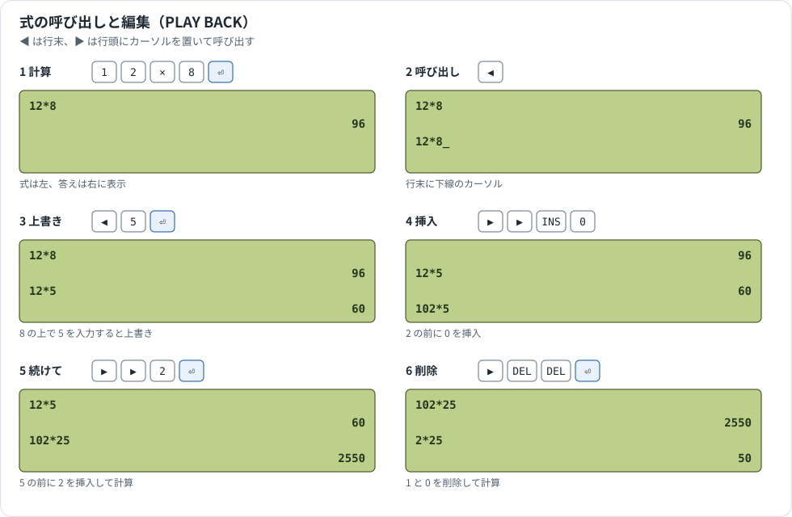
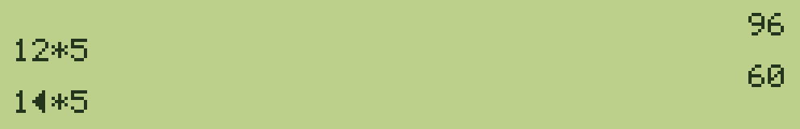
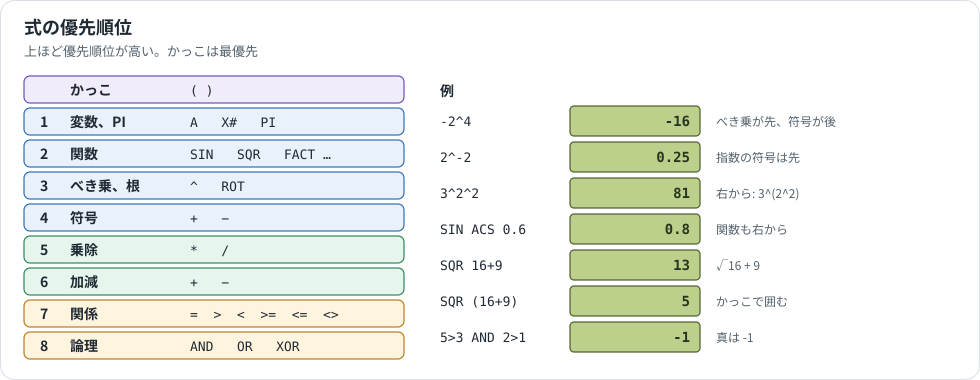
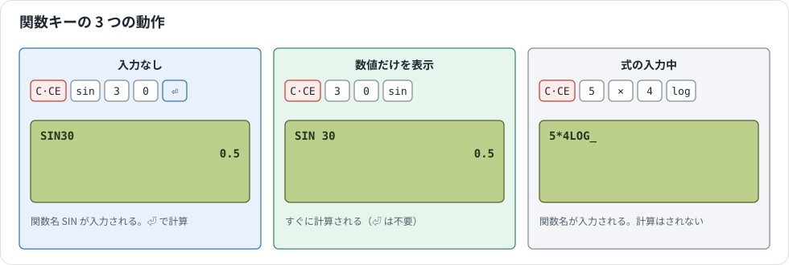
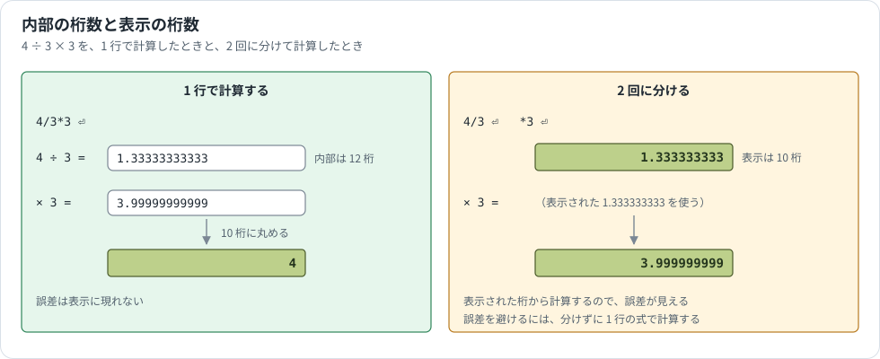

# 6. RUN モードの計算

この章は BASIC の RUN モードで、式をそのまま入力して計算する方法の説明です。プログラムを書かなくても、`2+3*4` と入力して ⏎ を押せば答えが表示されます。[電卓（CAL）](05_CAL.md) と違い、入力した式を確認、編集でき、変数と 20 桁の倍精度が使えます。

[目次へ戻る](README.md)

## この章で分かること

- 式の入力と答えの表示
- 式の呼び出しと編集（PLAY BACK）
- 直前の答え、続けて計算、変数
- 角度、度分秒、座標、16 進、比較、論理の計算
- 倍精度（20 桁）への切り替えと、計算の誤差

## 6.0 はじめに

CAL モードとの違いは次のとおりです。

| | CAL | RUN |
|---|---|---|
| 入力 | 電卓のキー操作 | 式のとおり |
| 計算の実行 | `=` | `⏎` |
| 式の確認と編集 | できない | できる |
| 関数 | 数値のあとに押す | 数値の前に書く（`SIN 30`） |
| 桁 | 10 桁 | 10 桁または 20 桁 |
| エラー | `E` | メッセージ（`Syntax error` など） |
| 印刷 | できない | CE-126P へ印刷できる |

この章の例は ROM 7.2 で実行した結果です。特に断りのないものは英語版の 5.3 と PC-E500S の 8.3 でも同じです（実験）。

## 6.1 起動と画面

`MENU` `PF1` で BASIC モードになります。`PRO` と表示されたときは、`BASIC` キーを押して `RUN` に切り替えます。`BASIC` キーを使えば、ほかのモードから直接 RUN モードに移れます。

```text
 RUN                    DEG   CAPS
>
```

`>` は入力待ちを示すプロンプトです。入力を始めると消え、カーソル `_` が次の入力位置を示します。式は左端から、答えは次の行の右端に表示されます。

```text
2+3*4
                                      14
5*-6+7
                                     -23
```

画面は 4 行 × 40 文字です。5 行目からは上にスクロールします。

> [!IMPORTANT]
> 計算を実行するキーは `=` ではなく **⏎** です。`1+2=` と入力して ⏎ を押すと `Syntax error` になります（実験）。

## 6.2 入力の規約

| 規約 | 例 |
|---|---|
| 乗算は `*`、除算は `/`（`×∗`、`÷/` キー） | `12*8/3` |
| べき乗は `^`（`yˣ` キー、または `SHIFT` + `L`） | `2^10` |
| 3 桁ごとのカンマは使えない | `1,000+1` は `Syntax error` |
| `$` は付けられない | `$5` は `Syntax error` |
| 乗算の `*` は省略できない | `2PI`、`2(3+4)` は `Syntax error` |
| かっこは閉じる必要がある | `(1+2)*(3+4` は `Syntax error` |
| 負の数はそのまま `-` を付ける | `5*-6+7`（`+/-` キーは RUN では使えない） |

カンマや `$` は BASIC では別の意味を持ちます（[BASIC の考え方](11_BASIC_CONCEPTS.md)）。2 つ目の小数点は無視され、`1.2.3` は `1.23` になります（実験）。数値の中の空白も無視され、`5 6` は `56` です（実験）。

新しい計算を始めるときは `C·CE` を押します。画面が消去され、エラーが解除されます。変数とプログラムは消えません。`C·CE` を押さずに演算子から入力すると、直前の答えに続けた計算になります（§6.6）。

### 6.2.1 1 行の長さ

1 行に入力できるのは 254 文字までです（操作説明書 p.158）。254 文字に達するとカーソルが点滅する四角になり、それ以上は入力できません。

ただし、数値 1 つは内部で 8 バイト（倍精度は 13 バイト）になるため、数値の多い式は 254 文字未満でも実行できないことがあります。`1+1+1+…` を 254 文字入力して ⏎ を押すと、`Line buffer overflow` になります（実験）。その場合は式を分けて計算します。

### 6.2.2 先行入力と同時押し

- 実行中（`BUSY`）に押したキーは 8 個まで記憶されます。実行中に 40 個のキーを押すと、終了後に最初の 8 個だけが入力されました（操作説明書 p.150、実験）。
- 数字キーを押したまま次の数字キーを押すと、両方が入力されます。`1` を押したまま `2` を押すと `12` です。
- `CTRL` + `0` で、キーのクリック音のオンとオフが切り替わります。設定はほかのモードでも有効です。

## 6.3 式の呼び出しと編集（PLAY BACK）

計算のあとで `◀` か `▶` を押すと、入力した式がもう一度表示されます。式の確認や、数値を変えた再計算に使えます。キーの上の `PLAY BACK` はこの機能を表しています。



| キー | 機能 |
|---|---|
| `◀`（⏎ のあと） | 式を呼び出し、カーソルを**末尾**に置く |
| `▶`（⏎ のあと） | 式を呼び出し、カーソルを**先頭**に置く |
| `◀` `▶` `↑` `↓` | カーソルの移動 |
| `SHIFT` + `◀`、`SHIFT` + `▶` | 行の先頭、末尾へ移動 |
| 文字キー | カーソル位置の文字を上書き |
| `INS` | 挿入モード。もう一度 `INS` か ⏎ で解除 |
| `DEL` | カーソル位置の文字を削除し、後ろを詰める |
| `BS` | カーソルの左の文字を削除 |
| `SPACE` | カーソル位置の文字を空白に置き換える（詰めない） |
| `CTRL` + `E` | カーソルから末尾まで削除 |
| `CTRL` + `U` | 行全体を削除 |

カーソルは、文字のない位置では下線 `_`、文字の上では点滅する四角、挿入モードでは `◀` の形になります。挿入した文字はカーソル位置の文字の**前**に入ります。



上書きした文字は元に戻せません。呼び出せるのは、最後に入力した 1 行だけです。

> [!NOTE]
> 呼び出した式の数値は、内部形式から変換して表示されます。そのため、`5E3+5E-3` は `5000+0.005`、`2.500*2` は `2.5*2` になります。10 桁で表せない数は指数表示です（`1E15+1` は `1E+15+1`）（操作説明書 p.150、実験）。

## 6.4 エラーの対処

計算できない式には `E` と英語のエラーメッセージが表示されます。

```text
48//6
Syntax error
```

ここで `◀` か `▶` を押すと、式が呼び出され、カーソルが**エラーの位置**に置かれます。この例では 2 つ目の `/` の上です。`DEL` ⏎ で `48/6` になり、`8` と表示されます。文字が足りないときは、`INS` で挿入します。訂正しないときは `C·CE` を押します。

| 式 | メッセージ |
|---|---|
| `48//6`、`5+`、`1,000+1` | `Syntax error` |
| `1/0` | `Division by Zero` |
| `SQR -1`、`LOG 0` | `Illegal function call` |
| `1E99*10`、`FACT 70` | `Overflow` |

絶対値が小さすぎる結果は 0 になります（`1E-99/10` は `0`）。式の計算で起こるエラーのほとんどは `Syntax error` です。エラーの全部は [エラー一覧](17_ERRORS.md) にあります。

本体がまったく反応しなくなったときは、`ON` を押しながら RESET を押します（[表示と電源](03_DISPLAY_POWER.md) §3.9）。

## 6.5 複合計算と優先順位

CAL モードと同じように、優先順位に従って計算されます。順序を変えるときは、かっこを使います。

| 式 | 答え | |
|---|---|---|
| `480+960/24` | `520` | 960 ÷ 24 が先 |
| `(480+960)/24` | `60` | かっこが先 |
| `480+(960/24)` | `520` | かっこがなくても同じ |



次の 4 つは特に注意が必要です。

- **符号とべき乗**では、`-2^4` は −(2⁴) で `-16` です。指数の符号は先に処理されるので、`2^-2` は `0.25` になります。`-8^(1/3)` は −(8 の立方根) = `-2`、`(-8)^(1/3)` も `-2` でした（実験）。
- **べき乗の連続**は右から計算されます。`3^2^2` は 3⁴ = `81` です。
- **関数の引数は直後の 1 つの数値だけ**です。`SQR 16+9` は 4 + 9 で `13`、`SQR (16+9)` が `5` です。
- **合成関数**は右から計算されます。`SIN ACS 0.6` は、ACS 0.6 が先です。

## 6.6 続けて計算

⏎ のあと、`C·CE` を押さずに演算子（`+ - * / ^`）から入力すると、直前の答えが自動的に式の先頭に入ります。

```text
25*16
                                     400
400*0.08_              ← *0.08 と入力したところ
```

⏎ で `32`、続けて `*-1` ⏎ で、符号を反転した `-32` になります。

RUN モードでは、パーセント計算はできません。`SHIFT` + `T` の `%` は単なる文字で、`200*15%` は `Syntax error` になります。`2nd F` `x²` の `%` は入力されません（実験）。15 % は `*.15` と書きます。

## 6.7 直前の答え（ANS）

### 6.7.1 RCL キー

続けて計算（§6.6）では、直前の答えは式の先頭にしか入りません。式の途中で使うときは、`RCL` キー（上に ANS と印字）を押します。直前の答えが文字として入力されます。`SHIFT` を押しても押さなくても、同じ動作です（実験）。

| キー | 画面 |
|---|---|
| `9/8` ⏎ | `1.125` |
| `7*` `RCL` | `7*1.125_` |
| `+` `RCL` ⏎ | `7*1.125+1.125` → `9` |
| `C·CE` `RCL` | `9_`（新しい答えに変わった） |

1 つの式の中で何度でも使えます。

> [!NOTE]
> 英語版の PC-E500 では、`カナ` の位置に `ANS` キーがあり、`RCL` と同じ動作をします。`RCL` は英語版でも使えます（実験。5.3、8.3）。

### 6.7.2 直前の答えの更新

| 操作 | 直前の答え |
|---|---|
| ⏎ による計算、変数への代入（`M=99`） | 新しい値になる |
| `C·CE`、`SHIFT` + `CA` | 変わらない |
| プログラムによる数値の `PRINT` | 表示した値になる |
| `PRINT` しないプログラムの実行 | 変わらない |
| 文字列の表示（`"ABC"`） | 変わらない |
| エラー | 変わらない |
| 電源オフ | 0 になる |

> [!NOTE]
> 操作説明書（p.157）には「RUN モード以外では呼び出せない」「プログラムを実行すると置き換わる」とあります。実際の ROM（7.2、5.3、8.3）では、PRO モードでも呼び出せ、プログラムの実行で変わるのは数値を表示したときだけです（実験）。

## 6.8 変数

A〜Z の 26 個の変数に数値を代入できます（詳しくは [BASIC の考え方](11_BASIC_CONCEPTS.md)）。CAL モードの `STO`、`RCL` と共通です。

```text
A=12
                                      12
B=-5
                                      -5
C=A*B+1
                                     -59
D=C
                                     -59
```

`=` の右辺を計算し、左辺の変数に代入します。⏎ を押すと、代入した値も表示されます。値を確認するには変数名だけを入力します（`D` ⏎ → `-59`）。代入していない変数の値は `0` です。

変数の値は、電源を切っても、自動電源オフになっても保持されます。変わるのは次のときです。

- 同じ変数に別の値を代入したとき
- `CLEAR` ⏎ を実行したとき（`C·CE` キーでは消えません）
- RESET で内蔵メモリを消去したとき

座標変換（§6.9.4）の結果は変数 `Y` と `Z` に代入されるので、この 2 つの値は変わります。

## 6.9 関数計算

### 6.9.1 関数の入力

関数は、関数名を 1 文字ずつ入力しても、関数キーを押してもかまいません。関数キーを押すと、次の文字が入力されます（実験）。

| キー | 入力される文字 | キー | 入力される文字 |
|---|---|---|---|
| `sin` `cos` `tan` | `SIN` `COS` `TAN` | `2nd F` + 同じキー | `ASN` `ACS` `ATN` |
| `hyp` `sin` など | `HSN` `HCS` `HTN` | `2nd F` `archyp` `sin` など | `AHS` `AHC` `AHT` |
| `ln`、`log` | `LN`、`LOG` | `2nd F` `eˣ`、`10ˣ` | `EXP`、`TEN` |
| `√` | `SQR` | `2nd F` `³√` | `CUR` |
| `x²` | `SQU` | `1/x` | `RCP` |
| `yˣ` | `^` | `2nd F` `ˣ√y` | `ROT` |
| `2nd F` `n!` | `FACT` | `2nd F` `π` | `PI` |
| `→DEG` | `DEG` | `2nd F` `→D.MS` | `DMS` |
| `2nd F` `→rθ` | `POL` | `2nd F` `→xy` | `REC` |
| `→HEX` | `HEX` | `2nd F` `→DEC` | `DECI` |
| `EXP` | `E`（指数） | `2nd F` `DRG` | 角度の単位の切り替え |



### 6.9.2 ダイレクト計算

数値だけが表示されているときに関数キーを押すと、⏎ を押さなくても計算されます（ダイレクト計算機能）。

| キー | 画面 |
|---|---|
| `C·CE` `3` `0` `sin` | `SIN 30` → `0.5` |
| `C·CE` `8` `2nd F` `n!` | `FACT 8` → `40320` |
| `C·CE` `9` `√` | `SQR 9` → `3` |
| `C·CE` `255` `→HEX` | `HEX 255` → `FF` |
| `5/12` ⏎ `2nd F` `tan⁻¹` | `ATN 4.166666667E-01` → `22.61986495` |

最後の例のように、計算の直後にも使えます。比の値を確認してから角度を求める、といった計算ができます。

次の場合は使えません。

- 2 つの数値が必要な関数（べき乗、根、座標変換）。`2` `yˣ` は `2^` と入力されるだけです。
- 式の入力中。`5*4` `log` は `5*4LOG` になります。
- `A`〜`F` を含む 16 進数。⏎ で計算します。

何も入力していないときに関数キーを押すと、関数名だけが入力されます。

### 6.9.3 計算の例

角度の単位は、`DEGREE`（直角が 90）、`RADIAN`（π/2）、`GRAD`（100）のいずれかを実行して選びます。`2nd F` `DRG` でも切り替えられます。

| 計算 | 入力 | 答え |
|---|---|---|
| sin 30° | `DEGREE` ⏎、`SIN 30` | `0.5` |
| tan(π/4) | `RADIAN` ⏎、`TAN (PI/4)` | `1` |
| sin 50ᵍ | `GRAD` ⏎、`SIN 50` | `7.071067812E-01` |
| 逆サイン（RAD） | `ASN 1` | `1.570796327` |
| sinh 1 | `HSN 1` | `1.175201194` |
| cosh⁻¹ 2 | `AHC 2` | `1.316957897` |
| 立方根 | `CUR 27` | `3` |
| 8 の立方根 | `8 ROT 3` | `2` |
| 3 の 8 乗根 | `3 ROT 8` | `1.14720269` |
| 2 乗、逆数 | `SQU 12`、`RCP 8` | `144`、`0.125` |
| 10³ | `TEN 3` | `1000` |
| 5!/3! | `FACT 5/FACT 3` | `20` |
| 整数部分、絶対値、符号 | `INT -3.5`、`ABS -4`、`SGN -3` | `-4`、`4`、`-1` |

関数の一覧と計算範囲は [関数と計算の範囲](14_FUNCTIONS.md) にあります。

### 6.9.4 度分秒と座標変換

| 計算 | 入力 | 答え |
|---|---|---|
| 12° 30′ 45″ を 10 進の度に変換 | `DEG 12.3045` | `12.5125` |
| 12.5125° を度分秒に変換 | `DMS 12.5125` | `12.3045` |
| (5, 12) を極座標に変換（DEG） | `POL(5,12)` | `13`（r） |
| （続けて）角度 | `Z` | `67.38013505`（θ） |
| r = 10、θ = 30° を直交座標に変換 | `REC(10,30)` | `8.660254038`（x） |
| （続けて）y | `Z` | `5` |

1 つ目の結果（r または x）は変数 `Y` にも代入され、2 つ目の結果（θ または y）は変数 `Z` に代入されます。`REC(10,30)` のあとの `Y` は `8.660254037` で、表示とは最後の桁が違います（実験。8.3 では `8.660254038`）。

### 6.9.5 16 進数

`&H` を付けた数は 16 進数です。`&` は `SHIFT` + `Y` で入力します。

| 計算 | 入力 | 答え |
|---|---|---|
| 16 進 → 10 進 | `&H2F` | `47` |
| 負の数（補数） | `&HFFFFFFFFFF` | `-1` |
| 10 進 → 16 進 | `HEX$ 500` | `1F4` |
| 文字列から変換 | `VAL ("&H"+"1F")` | `31` |

`HEX 500`（`→HEX` キー）でも `1F4` になります。プログラムの中では `A$=HEX$ N` や `N=VAL ("&H"+A$)` と書きます。範囲は 0〜&H2540BE3FF と、負の数の &HFDABF41C01〜&HFFFFFFFFFF です（操作説明書 p.48）。

### 6.9.6 関係演算と論理演算

`5>3` のような関係式の値は、成立すれば −1、成立しなければ 0 です。

| 演算子 | 意味 | 成立する例（−1） | 成立しない例（0） |
|---|---|---|---|
| `=` | 等しい | `7=7` | `5=3` |
| `<>` | 等しくない | `3<>4` | `3<>3` |
| `>`、`<` | より大きい、より小さい | `5>3` | `5<3` |
| `>=`、`<=` | 以上、以下 | `5>=5` | `5<=3` |

`=` には注意が必要です。`A=7` と入力すると、比較ではなく代入になります。比較するときは、`7=A` のように数値や式を左辺に書きます（`IF` 文の条件では、`A=7` でも比較になります）。A に 7 を代入したあとの `7=A` は `-1` です（実験）。

`AND`、`OR`、`XOR`、`NOT` は、ビットごとの論理演算です。`5 AND 3` は `1`、`5 OR 3` は `7`、`5 XOR 3` は `6`、`NOT 5` は `-6` です。真が −1（全部のビットが 1）なので、`5>3 AND 2>1` のように条件を組み合わせることもできます。

## 6.10 答えの表示

| 値 | 表示 | 例 |
|---|---|---|
| 10 桁以内 | そのまま | `123456.789*1000` → `123456789` |
| 10 桁を超える | 指数表示 | `1000000*1000000` → `1E+12` |
| 桁数の少ない小数 | そのまま | `0.00123` → `0.00123` |
| 桁数の多い 1 未満の数 | 指数表示 | `1/3` → `3.333333333E-01` |

CAL モードと違い、有効数字 10 桁がすべて表示されます。1/3 は、CAL では `0.333333333`（9 桁）、RUN では `3.333333333E-01`（10 桁）です。2/3 は四捨五入されて `6.666666667E-01` になります。

## 6.11 単精度と倍精度

### 6.11.1 切り替え

通常の計算（**単精度**）は 10 桁、**倍精度**は 20 桁です。指数はどちらも 2 桁（±99）です。

| 設定 | 操作 | 表示 |
|---|---|---|
| 倍精度 | `DEFDBL` ⏎ | `DBL` が表示される |
| 単精度 | `DEFSNG` ⏎ | `DBL` が消える |
| 単精度に自動復帰 | 電源オフ、`RUN`、`NEW`、`CLEAR` の実行 | `DBL` が消える |

CAL、MATRIX、STAT の各モードは常に単精度です（操作説明書 p.351）。

| 式 | 単精度 | 倍精度 |
|---|---|---|
| `4/3` | `1.333333333` | `1.3333333333333333333#` |
| `2/3` | `6.666666667E-01` | `6.6666666666666666667D-01` |
| `PI` | `3.141592654` | `3.1415926535897932385#` |
| `SQR 2` | `1.414213562` | `1.4142135623730950488#` |
| `1D15*1D10` | | `1D+25` |

- 倍精度の結果には末尾に `#` が付くか、指数が `E` の代わりに `D` で表示されます。
- 入力するときの指数は `E` でも `D` でもかまいません。`1E5+1D5` は `200000#` です。
- 単精度のモードでも、`#` や `D` を付けた数値や 10 桁を超える数値を使うと、その式は倍精度で計算されます。`2#/3` は `6.6666666666666666667D-01`、`1.23456789012345` は `1.23456789012345#` になります（実験）。
- 変数 A〜Z は単精度変数です。倍精度のモードで `A=1/3` を実行しても、保存されるのは 10 桁です。20 桁を保存するには、`A#=1/3` のように `#` を付けた倍精度変数を使います（実験、[BASIC の考え方](11_BASIC_CONCEPTS.md)）。

### 6.11.2 計算の誤差

計算に使う桁数には限りがあるため、割り切れない数では誤差が生じます。PC-E500 は、単精度では 12 桁、倍精度では 24 桁で計算し、結果を丸めて表示することで、誤差を目立たなくしています（操作説明書 p.163）。



| 入力 | 単精度 | 倍精度 |
|---|---|---|
| `4/3*3` | `4` | `4#` |
| `4/3` ⏎ `*3` ⏎ | `3.999999999` | `3.9999999999999999999#` |

続けて計算（§6.6）や `RCL` では、表示された桁数の値が使われます。12 桁のまま計算するには、1 行の式にします。

関数の値にも計算アルゴリズムによる誤差があります。関数を組み合わせるほど誤差は大きくなり、特異点や変曲点の付近（たとえば 90 度付近のタンジェント）で最大になります（操作説明書 p.164）。

## 6.12 計算の印刷

CE-126P プリンタを接続して電源を入れ、RUN モードで `SHIFT` + `P↔NP`（⏎ キー）を押すと、`PRINT` が表示され、計算するたびに式と答えが印刷されます（操作説明書 p.27、p.162）。

```text
300/50              ← 1 行目に式
             6.     ← 2 行目に答え（右寄せ）
```

解除するときは、もう一度 `SHIFT` + `P↔NP` を押すか、プリンタの電源を切ります。CAL モードの計算は印刷できません。プリンタの接続は [RAM カード](04_RAM_CARD.md) §4.8 と、[CE-126P プリンタ](../analysis/18_CE-126P_PRINTER.md) にあります。

## まとめ

| したいこと | 操作 |
|---|---|
| RUN モードの起動 | `MENU` `PF1`、PRO なら `BASIC` |
| 計算 | 式を入力して ⏎ |
| 新しい計算 | `C·CE` |
| 前の式の編集 | `◀`（末尾から）、`▶`（先頭から） |
| 直前の答えに続けて計算 | 演算子から入力 |
| 直前の答えを式の中で使う | `RCL` |
| ダイレクト計算 | 数値を入力して関数キー |
| 角度の単位 | `DEGREE`、`RADIAN`、`GRAD`、または `2nd F` `DRG` |
| 20 桁の計算 | `DEFDBL`（解除は `DEFSNG`） |
| 印刷 | `SHIFT` + `P↔NP` |

## 出典

- 操作説明書 p.149〜164（RUN モード）、p.27（印刷）、p.48（16 進）、p.344〜346（キーの機能）。
- 実験: エミュレータの ROM 7.2 で、この章の式とキー操作を実行して画面を読み取りました。5.3 と 8.3 でも比較しました。

## 次に読むもの

- [BASIC の考え方](11_BASIC_CONCEPTS.md): 変数、式、優先順位の詳細
- [AER（式の登録）](08_AER.md): よく使う式の登録と呼び出し
- [プログラムを書く](12_PROGRAMMING.md): プログラムの作成
- [PF キーと便利な使い方](16_PF_KEYS.md): よく使う命令のキーへの登録
