# 7. エンジニアソフト（ENG）

この章は PC-E500 の ROM に入っている計算ソフトと公式集、エンジニアソフトの使い方です。素因数分解から、方程式、積分、グラフ、物理定数、単位の換算、周期表、複素数、確率分布まで、36 本のソフトが PF キー 3 回ほどで呼び出せます。自分のプログラムを同じメニューに足す方法も説明します。

[目次へ戻る](README.md)

## この章で分かること

- メニューのたどり方、戻り方、数の入れ方
- 36 本のソフトの一覧と、それぞれの式、入力、出力
- 主なソフトの例題と、実際の画面
- 公式集、定数、換算表、原子量の表の中身
- 自分のプログラムをメニューに足す方法、付属のソフトを置き換える方法
- 本体と説明書の食い違い、公式集の誤り

## 7.0 はじめに

電卓とプログラムの中間にあたる機能です。たとえば x³ − 8 = 0 の解が知りたいとき、電卓では手順を自分で考え、BASIC ではプログラムを書きます。エンジニアソフトなら、メニューで `3ｼﾞ`（三次方程式）を選び、係数 1、0、0、−8 を打つだけです。


中身は BASIC のプログラムで、ROM の中の G: というドライブにファイルとして入っています。選ぶと、そのプログラムがメモリの空きへ読み込まれて動きます。

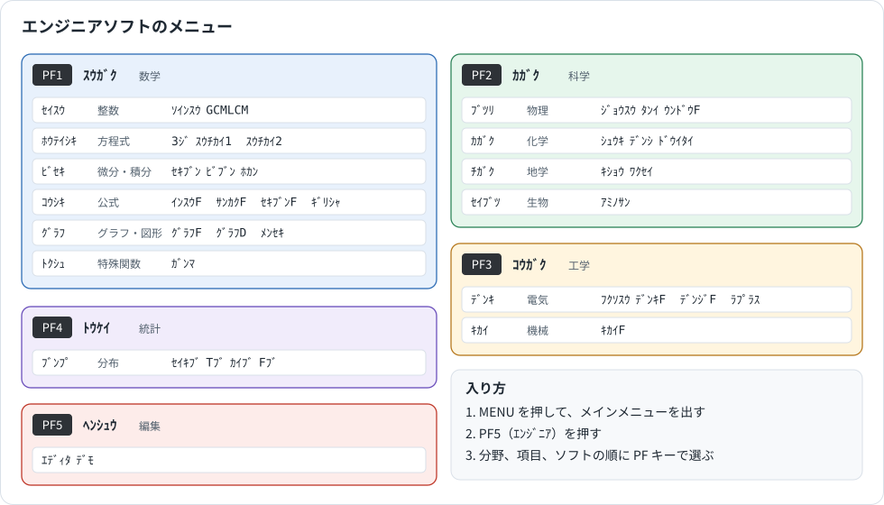

この章の画面と例は日本語の PC-E500（ROM 7.2）です。日本語の 2.2、3.2、6.2、7.2 では 60 個のファイルがすべて同じで、PC-E550 と PC-E650 でも `ﾃﾞﾓ` のほかは同じです。名前の F は公式（Formula）を見せるソフトに付いています（`ｸﾞﾗﾌF` の F は関数、`ｸﾞﾗﾌD` の D はデータです）。

> [!NOTE]
> 英語版の PC-E500 と PC-E500S では、メニューと名前が英語になり、見出し行の言葉が少し違います（§7.2 の英語名、§7.10.2）。計算の中身は同じです。PC-1480U、PC-1490UII、PC-U6000 にはエンジニアソフトはありません（[ROM バージョンの違い: 機種](../analysis/27_ROM_VERSIONS_MODELS.md) §27.3）。

## 7.1 使い方

### 7.1.1 メニューをたどる

メインメニューで `PF5`（`ｴﾝｼﾞﾆｱ`）を押します。PF5 キーのそばには「エンジニアソフトウェア」と印字されています。あとは、画面の下の名前に対応する `PF1`〜`PF5` を順に押していきます。

| キー | 動き |
|---|---|
| `PF1`〜`PF5` | 下の階層へ進む、ソフトを始める |
| `▲▼` | メニューの 2 ページ目（PF6〜PF10 にあたる）を出す。もう一度で戻る |
| `BREAK` | 1 つ上の階層へ戻る。動いているソフトをやめる |
| `MENU` `PF5` | メインメニューから入り直す |

2 ページ目を出すときに `SHIFT` は使いません。`*.17#` のような表示はまだ何もない場所です。ここに自分のソフトを足せます（§7.9）。

たとえば三次方程式は `MENU` `PF5` `PF1` `PF2` `PF1` です。この章では、`PF1`（ｽｳｶﾞｸ）`PF2`（ﾎｳﾃｲｼｷ）`PF1`（3ｼﾞ）のように、エンジニアソフトの最初のメニューからのキーを書きます。

ソフトを動かしているときに別のソフトへ移るには、`BREAK` で上の階層へ戻り、選び直します。`MENU` を押してもメインメニューが出ないときは、先に `BREAK` を 1 回押します。`BREAK` を 1 回押しても答えの画面が変わらないソフトもありました（`ﾀﾝｲ`）。そのときはもう一度押します。

### 7.1.2 数を入れる

`?` が出ている箇所で数を打ち、`⏎` を押します。打ち間違えたら `C·CE` で消します。

数を打たずに `⏎` だけを押したときの動きは 2 通りで、ソフトによって違います。

| 動き | 例 |
|---|---|
| 表示されている値（前の値や初めの値）をそのまま使う | 関数の式、ε、回数の上限 |
| 最初の入力に戻る、メニューに戻る | `x= ?`、`X= ?`、`n= ?` |

答えを見たあと `⏎` を押すと、多くのソフトは最初の入力に戻ります。

### 7.1.3 気を付けること

- ソフトを動かすと、BASIC の変数は消えます。統計のデータ（配列 MD）も普通は消えます。`ｿｲﾝｽｳ` を動かしたあとの統計は `D(000,0)`（データなし）でした（実験）。例外は統計のデータを使う `ｸﾞﾗﾌD` です。このソフトは MD も、`A` のような変数も消しません（実験）。`ｼﾞｮｳｽｳ` は定数を変数に保存するため、変数を消しません。
- 角度の単位が自動で変わるソフトがあります。`ｽｳﾁｶｲ1`、`ｽｳﾁｶｲ2`、`ｾｷﾌﾞﾝ`、`ﾋﾞﾌﾞﾝ` は RAD に、`ﾒﾝｾｷ` は DEG にします。`ｸﾞﾗﾌF` は変えないので、先に自分で決めます。
- 読み込む空きが足りないと `Out of memory in Program`、変数の場所が足りないと `Answer not found` と出ます。いらない行や変数を消します。`Answer not found` は、計算があふれたときや、できない計算をしたときにも出ます。
- エンジニアソフトの中では `OFF` が効かないことがあります。先に `BREAK` を押します。
- 定数の値は決め直されることがあります。精度が足りるかどうかは、使う人が確かめます（§7.5.1 に今の値との比較があります）。
- 数式の表示では、分数は `/`、平方根は `√( )` で書かれます。たとえば tan 2θ は `2tanθ/(1-tan²θ)`、半角のサインは `±√((1-cosθ)/2)` の形です。

### 7.1.4 公式を見るソフトのキー

`ｲﾝｽｳF`、`ｻﾝｶｸF`、`ｾｷﾌﾞﾝF`、`ｳﾝﾄﾞｳF`、`ﾃﾞﾝｷF`、`ﾃﾞﾝｼﾞF`、`ﾗﾌﾟﾗｽ` は、公式を 1 つずつ見せるソフトです。キーは共通です。

| キー | 動き |
|---|---|
| `PF1` | 最初の公式 |
| `PF2` | 5 つ前（`ｷｶｲF` は 3 つ前） |
| `PF3` [CENTER] | 真ん中の公式 |
| `PF4` | 5 つ先（`ｷｶｲF` は 3 つ先） |
| `PF5` | 最後の公式 |
| `↓` `↑` | 次、前の公式 |

`PF2`、`PF4`、`↓`、`↑` は押し続けると続けて動きます。

## 7.2 一覧

大きさは選んだときに要る空きのおよその値（操作説明書 p.51〜52、変数を除く）です。拡張子の数字は階層の番号です（§7.9.1）。

| 分野 | 拡張子 | 名前 | 英語名 | 内容 | 大きさ（バイト） |
|---|---|---|---|---|---|
| 数学: 整数 | 111 | `ｿｲﾝｽｳ` | PRIME | 素因数分解 | 2,300 |
| | 112 | `GCMLCM` | GCMLCM | 最大公約数、最小公倍数 | 2,100 |
| 数学: 方程式 | 121 | `3ｼﾞ` | CUBIC | 三次方程式 | 3,800 |
| | 122 | `ｽｳﾁｶｲ1` | NEWTON | 方程式の数値解（ニュートン法） | 2,400 |
| | 123 | `ｽｳﾁｶｲ2` | BISECT | 方程式の数値解（二分法） | 2,500 |
| 数学: 微積分 | 131 | `ｾｷﾌﾞﾝ` | INTGRL | 定積分（ロンバーグ法） | 2,800 |
| | 132 | `ﾋﾞﾌﾞﾝ` | DIFF | 微分方程式（ルンゲ・クッタ法） | 2,600 |
| | 133 | `ﾎｶﾝ` | INTPLT | 補間（ラグランジュ法） | 2,200 |
| 数学: 公式 | 141 | `ｲﾝｽｳF` | FACT | 因数分解の公式 26 個 | 4,200 |
| | 142 | `ｻﾝｶｸF` | TRIG | 三角関数の公式 49 個 | 5,400 |
| | 143 | `ｾｷﾌﾞﾝF` | INTFRM | 積分の公式 42 個 | 4,900 |
| | 144 | `ｷﾞﾘｼｬ` | GREEK | ギリシャ文字 | 2,700 |
| 数学: 図形 | 151 | `ｸﾞﾗﾌF` | FUNC | 関数のグラフ | 3,400 |
| | 152 | `ｸﾞﾗﾌD` | DATA | データのグラフ | 4,200 |
| | 153 | `ﾒﾝｾｷ` | FIGURE | 図形の面積 | 9,900 |
| 数学: 特殊関数 | 161 | `ｶﾞﾝﾏ` | GAMMA | ガンマ関数 | 2,300 |
| 科学: 物理 | 211 | `ｼﾞｮｳｽｳ` | CONST | 物理定数 47 個 | 5,200 |
| | 212 | `ﾀﾝｲ` | M-CONV | 単位の換算 | 11,400 |
| | 213 | `ｳﾝﾄﾞｳF` | MOTION | 運動の式 21 個 | 3,200 |
| 科学: 化学 | 221 | `ｼｭｳｷ` | PERIOD | 周期表、原子量 | 9,400 |
| | 222 | `ﾃﾞﾝｼ` | ELECTR | 電子配置、電離電圧 | 9,800 |
| | 223 | `ﾄﾞｳｲﾀｲ` | ISOTOP | 安定同位体 | 16,700 |
| 科学: 地学 | 231 | `ｷｼｮｳ` | METEO | 気圧、風速の換算 | 5,100 |
| | 232 | `ﾜｸｾｲ` | PLANET | 太陽、惑星、月の定数 | 4,000 |
| 科学: 生物 | 241 | `ｱﾐﾉｻﾝ` | AMINO | アミノ酸 | 6,700 |
| 工学: 電気 | 311 | `ﾌｸｿｽｳ` | COMPLX | 複素数の計算 | 3,700 |
| | 312 | `ﾃﾞﾝｷF` | EE-FRM | 電気の公式 14 個 | 3,200 |
| | 313 | `ﾃﾞﾝｼﾞF` | ELEMAG | 電磁気の公式 16 個 | 3,200 |
| | 314 | `ﾗﾌﾟﾗｽ` | LAPLAC | ラプラス変換 46 個 | 5,000 |
| 工学: 機械 | 321 | `ｷｶｲF` | ME-FRM | 機械の公式 12 個と計算 | 5,900 |
| 統計: 分布 | 411 | `ｾｲｷﾌﾞ` | NORMAL | 正規分布 | 6,000 |
| | 412 | `Tﾌﾞ` | t | t 分布 | 6,200 |
| | 413 | `ｶｲﾌﾞ` | CHI | カイ二乗分布 | 6,300 |
| | 414 | `Fﾌﾞ` | F | F 分布 | 6,400 |
| 編集 | 51# | `ｴﾃﾞｨﾀ` | EDITOR | メニューの名前を付ける | 2,200 |
| | 50# | `ﾃﾞﾓ` | DEMO | デモ | 2,371（ファイルの大きさ） |

`ﾃﾞﾓ` は操作説明書の一覧にありません。`ﾍﾝｼｭｳ` のメニューで `▲▼` を押した 2 ページ目の `PF5` にあります（§7.8）。`ﾄｸｼｭ`（特殊関数）も `ｽｳｶﾞｸ` のメニューの 2 ページ目です。

## 7.3 数学

### 7.3.1 素因数分解（ｿｲﾝｽｳ）

| 項目 | 内容 |
|---|---|
| キー | `PF1` `PF1` `PF1` |
| 計算 | 整数を素数のかけ算に分ける。2、3、5、7、… と割っていく |
| 入力 | 2 以上 10¹⁰ 未満の整数 |
| 出力 | `2^3*3^2*…` の形。`^` は何乗 |

例: 360360

```text
          *  PRIME FACTORS  *

 360360 = 2^3*3^2*5*7*11*13
```

範囲の外の数や整数でない数は、入れ直しになります。大きな素数に近い数は奇数で 1 つずつ割っていくので時間がかかります（計算中は `Computing ...` と出ます）。

### 7.3.2 最大公約数と最小公倍数（GCMLCM）

| 項目 | 内容 |
|---|---|
| キー | `PF1` `PF1` `PF2` |
| 計算 | ユークリッドの互除法。大きいほうを小さいほうで割った余りを求め、余りが 0 になるまで繰り返す |
| 入力 | a、b: 1 以上 10¹⁰ 未満の整数 |
| 出力 | G.C.M.（最大公約数）と L.C.M.（最小公倍数 = a ÷ G.C.M. × b） |

例: 84 と 120

```text
          *  G.C.M. & L.C.M.  *
 a= 84               b= 120
 G.C.M.= 12
 L.C.M.= 840
```

互除法の動きは 120 ÷ 84 → 余り 36、84 ÷ 36 → 12、36 ÷ 12 → 0 なので、答えは 12 です。`⏎` だけなら 1 とみなします。

### 7.3.3 三次方程式（3ｼﾞ）

| 項目 | 内容 |
|---|---|
| キー | `PF1` `PF2` `PF1` |
| 計算 | ax³ + bx² + cx + d = 0 の 3 つの解（実数、複素数、重解）。カルダノの方法 |
| 入力 | a（0 以外）、b、c、d。b、c、d は `⏎` だけで 0 |
| 出力 | a(x−α)(x−β)(x−γ)=0 の α、β、γ。有効数字 6 桁 |

カルダノの方法は x = y − b/(3a) と置き換えて 2 乗の項を消し、y³ + 3py + q = 0 にします。y = u + v と置くと u³ と v³ は二次方程式の解になり、Δ = q² + 4p³ の符号で場合が分かれます。この ROM では、3 つの違う実数解のときは cos を使う形で計算しています（ROM の `SCUBIC.12$`）。

| 解の形 | 画面 |
|---|---|
| 3 つの違う解 | `a(x-α)(x-β)(x-γ)=0` と α、β、γ |
| 1 つと重解 | `a(x-α)(x-β)²=0` と α、β |
| 三重解 | `a(x-α)³=0` と α |

例 1: x³ − 6x² + 11x − 6 = 0 → α = 1、β = 3、γ = 2

例 2: x³ − 8 = 0


x = 2 と、x = −1 ± 1.73205i（√3 = 1.73205…）です。指数の形になる解は倍精度で計算しているので `D` で書かれます（例: `-3.35D-25`）。

### 7.3.4 方程式の数値解（ｽｳﾁｶｲ1、ｽｳﾁｶｲ2）

f(x) = 0 になる x を繰り返しで求めます。

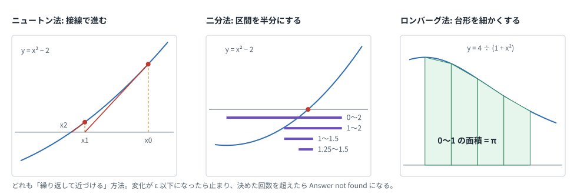

| 項目 | `ｽｳﾁｶｲ1` | `ｽｳﾁｶｲ2` |
|---|---|---|
| キー | `PF1` `PF2` `PF2` | `PF1` `PF2` `PF3` |
| 考え方 | 接線と x 軸の交わる点へ進む | 符号の違う 2 点の真ん中をとり、半分の区間を残す |
| 入力 | f(x)、x0（初めの値）、h、ε、回数の上限 | f(x)、x0、x1、ε、回数の上限 |
| 初めの値 | h = 0.00001、ε = 0.000001、30 回 | ε = 0.000001、40 回 |
| 式 | x₁ = x₀ − f(x₀) ÷ f′(x₀)、f′ は (f(x+h) − f(x)) ÷ h | f(x₀) と f(x₁) の符号が違うこと |
| 終わり | 前の値との差が ε 以下 | 区間の幅が ε 以下 |

変数は大文字の X を使います。どちらも角度の単位が RAD になります。

例 1（`ｽｳﾁｶｲ1`）: cos x = x となる x。f(x) に `COSX-X`、x0 に 1、あとは `⏎` だけ。

```text
* NUMERICAL SOLUTION (Newton's method) *
 f(x)= COSX-X

 X= 0.739085
```

例 2（`ｽｳﾁｶｲ2`）: x² − 2 = 0。x0 = 0、x1 = 2、あとは `⏎` だけ。

```text
*NUMERICAL SOLUTION(method of bisection)
 f(x)= X^2-2

 X= 1.414214
```

答えは ε の大きさに合わせて丸めて表示されます。

同じ式で初めの値を変えて、ほかの解を探すには、答えのあと `⏎` を押し、式のところで `⏎` だけを押します。

収束しない例: x³ − 2x + 2 を x0 = 0、回数 4 で解くと、0 と 1 を行き来して終わりません。

```text
            Answer not found
```

ここで `⏎` を押すと、実行した回数の上限と、そのときの値が出ます。

```text
 f(x)= X^3-2*X+2

 loop limit= 4      Xn= 0
```

| 困ったとき | 対処 |
|---|---|
| `ｽｳﾁｶｲ1` が収束しない | x0 を変える。接線が x 軸と平行になる点は避ける |
| h が小さすぎて割り算できない | h を大きくする（`Answer not found` のあと、値は出ずに式の入力へ戻る） |
| 答えの誤差が大きい | ε を小さくする |
| ε を小さくしたら終わらない | 内部の計算は 13 桁なので、小さすぎる ε には届かない。1E-90 より小さい値は入れ直しになる |

### 7.3.5 定積分（ｾｷﾌﾞﾝ、ロンバーグ法）

| 項目 | 内容 |
|---|---|
| キー | `PF1` `PF3` `PF1` |
| 計算 | f(x) を a から b まで積分する。区間を 2 等分していった台形の面積を組み合わせ、誤差を打ち消す |
| 入力 | f(x)、a、b、ε（初め 0.000001）、分割の上限（初め 10） |
| 終わり | 次の近似との差が ε 以下 |
| 出力 | ∫dx = 値 |

例: 4/(1+x²) を 0 から 1 まで。ε に 1E-10 を入れました。


答えは π です。角度の単位は RAD になります。

> [!NOTE]
> 操作説明書（p.60）は「ε は 10⁻⁹⁰ より大きい値」としていますが、`ｾｷﾌﾞﾝ` は 1E-10 より小さい ε を受け付けず、もう一度聞いてきます（実験: 1E-12 は入れ直し、1E-10 は入る。7.2 のほか 5.3、7.3、8.3 のプログラムの 130 行も同じ）。10⁻⁹⁰ は `ｽｳﾁｶｲ1` と `ｽｳﾁｶｲ2` の制限です。

うまく積分できない形もあります。

- 周期や対称がある関数（sin など）: 分割した点の値が偶然同じになると、早く終わって間違うことがあります。周期ごとに区間を分けて積分し、合計します。0〜4π なら、0〜π、π〜2π、2π〜3π、3π〜4π の 4 回です。
- 狭い山がある関数: 山のはじめと終わりで区間を分けて、合計します。

### 7.3.6 微分方程式（ﾋﾞﾌﾞﾝ、ルンゲ・クッタ法）

| 項目 | 内容 |
|---|---|
| キー | `PF1` `PF3` `PF2` |
| 計算 | dy/dx = f(x, y) を、初めの点 (x0, y0) から刻み h で進めていく |
| 入力 | dy/dx の式（X と Y を使う）、x0、y0、h（初め 1） |
| 出力 | `⏎` を押すたびに次の y。50 個まで。`◀` で 1 つ前、`▶` で式の入力へ |

1 歩の計算は次のとおりです。

```text
k1 = h f(x, y)
k2 = h f(x + h/2, y + k1/2)
k3 = h f(x + h/2, y + k2/2)
k4 = h f(x + h, y + k3)
y(x + h) = y + (k1 + 2 k2 + 2 k3 + k4) ÷ 6
```

例: dy/dx = y、x0 = 0、y0 = 1、h = 0.1（答えは eˣ）

| 回 | 画面 | 正しい値 |
|---|---|---|
| 最初 | `y(0) = 1` | 1 |
| `⏎` | `y(0.1) = 1.105170833` | 1.105170918 |
| `⏎` | `y(0.2) = 1.221402571` | 1.221402758 |

操作説明書は「P(x) y + Q(x) の形」と書いていますが、プログラムは打った式をそのまま計算するので、`-X/Y` のような形も使えます（説明書の例がその形です）。角度の単位は RAD になります。

### 7.3.7 補間（ﾎｶﾝ、ラグランジュ法）

| 項目 | 内容 |
|---|---|
| キー | `PF1` `PF3` `PF3` |
| 計算 | n 個の点を全部通る多項式を作り、ほかの x での y を求める |
| 入力 | 点の数（2〜200）、x と y の組、そのあと x |
| 出力 | y。x を打たずに `⏎` で最初に戻る |

式は y = Σ yᵢ Π (x − xⱼ) ÷ (xᵢ − xⱼ)（j は i 以外）です。

例: (0, 1)、(1, 3)、(3, 13) を通る曲線の x = 2 での値。3 点は y = x² + x + 1 の上にあるので、答えは 7 です。

```text
 x= 2
 y= 7.000000001
```

最後の桁の 1 は割り算の丸めの誤差です。

前に入れた値のまま次へ進むには `⏎` だけ、途中で入力を終えるには `*` `⏎` です（プログラムの 120、130 行）。

### 7.3.8 因数分解の公式（ｲﾝｽｳF）

`PF1` `PF4` `PF1`。26 個です。CENTER は 13 番です。

| 番号 | 公式 | 番号 | 公式 |
|---|---|---|---|
| 1 | a²−b² = (a+b)(a−b) | 14 | (ac+bd)²+(ad−bc)² = (a²+b²)(c²+d²) |
| 2 | a³±b³ = (a±b)(a²∓ab+b²) | 15 | (ac+bd)²−(ad+bc)² = (a²−b²)(c²−d²) |
| 3 | a⁴−b⁴ = (a+b)(a−b)(a²+b²) | 16 | (ac−bd)²−(ad−bc)² = (a²−b²)(c²−d²) |
| 4 | a⁴+b⁴ = (a²+√2ab+b²)(a²−√2ab+b²) | 17 | a²(b−c)+b²(c−a)+c²(a−b) = −(b−c)(c−a)(a−b) |
| 5 | aⁿ−bⁿ = (a−b)(aⁿ⁻¹+aⁿ⁻²b+…+bⁿ⁻¹) | 18 | (b−c)³+(c−a)³+(a−b)³ = 3(b−c)(c−a)(a−b) |
| 6 | aⁿ+bⁿ = (a+b)(aⁿ⁻¹−aⁿ⁻²b+…+bⁿ⁻¹)（n は奇数） | 19 | a⁴+b⁴+c⁴−2b²c²−2c²a²−2a²b² = (a+b+c)(b−c−a)(c−a−b)(a−b−c) |
| 7 | a²±2ab+b² = (a±b)² | 20 | x²+(a+b)x+ab = (x+a)(x+b) |
| 8 | a³±3a²b+3ab²±b³ = (a±b)³ | 21 | acx²+(ad+bc)x+bd = (ax+b)(cx+d) |
| 9 | (a±b)²∓4ab = (a∓b)² | 22 | x³+(a+b+c)x²+(bc+ca+ab)x+abc = (x+a)(x+b)(x+c) |
| 10 | a²+b²+c²+2bc+2ca+2ab = (a+b+c)² | 23 | a²−b²−c²−2bc = (a+b+c)(a−b−c) |
| 11 | a⁴+a²b²+b⁴ = (a²+ab+b²)(a²−ab+b²) | 24 | (a+b+c)(bc+ca+ab)−abc = (b+c)(c+a)(a+b) |
| 12 | a³+b³+c³−3abc = (a+b+c)(a²+b²+c²−bc−ca−ab) | 25 | (a+b+c)³−(a³+b³+c³) = 3(b+c)(c+a)(a+b) |
| 13 | (ac−bd)²+(ad+bc)² = (a²+b²)(c²+d²) | 26 | a³(b−c)+b³(c−a)+c³(a−b) = −(b−c)(c−a)(a−b)(a+b+c) |

### 7.3.9 三角関数の公式（ｻﾝｶｸF）

`PF1` `PF4` `PF2`。49 個です。CENTER は 25 番です。画面では sec は 1/cos、cosec は 1/sin、cot は 1/tan のことです。

| 番号 | 公式 | 番号 | 公式 |
|---|---|---|---|
| 1 | sin²θ+cos²θ = 1 | 26 | cot(θ/2) = ±√((1+cosθ)/(1−cosθ)) |
| 2 | 1+tan²θ = sec²θ | 27 | cot(θ/2) = sinθ/(1−cosθ) |
| 3 | 1+cot²θ = cosec²θ | 28 | cot(θ/2) = (1+cosθ)/sinθ |
| 4 | sin(α±β) = sinα cosβ±cosα sinβ | 29 | cot(θ/2) = cosecθ+cotθ |
| 5 | cos(α±β) = cosα cosβ∓sinα sinβ | 30 | sin3θ = −4sin³θ+3sinθ |
| 6 | tan(α±β) = (tanα±tanβ)/(1∓tanα tanβ) | 31 | cos3θ = 4cos³θ−3cosθ |
| 7 | cot(α±β) = (cotα cotβ∓1)/(cotβ±cotα) | 32 | tan3θ = (3tanθ−tan³θ)/(1−3tan²θ) |
| 8 | sin(α+β)sin(α−β) = sin²α−sin²β | 33 | sinα cosβ = (sin(α+β)+sin(α−β))/2 |
| 9 | sin(α+β)sin(α−β) = cos²β−cos²α | 34 | cosα sinβ = (sin(α+β)−sin(α−β))/2 |
| 10 | cos(α+β)cos(α−β) = cos²α−sin²β | 35 | cosα cosβ = (cos(α+β)+cos(α−β))/2 |
| 11 | cos(α+β)cos(α−β) = cos²β−sin²α | 36 | sinα sinβ = −(cos(α+β)−cos(α−β))/2 |
| 12 | sin(α±β)cos(α∓β) = sinα cosα±sinβ cosβ | 37 | sinα+sinβ = 2sin((α+β)/2)cos((α−β)/2) |
| 13 | sin(α+β)/sin(α−β) = (tanα+tanβ)/(tanα−tanβ) | 38 | sinα−sinβ = 2cos((α+β)/2)sin((α−β)/2) |
| 14 | cos(α+β)/cos(α−β) = (1−tanα tanβ)/(1+tanα tanβ) | 39 | cosα+cosβ = 2cos((α+β)/2)cos((α−β)/2) |
| 15 | sin2θ = 2sinθ cosθ | 40 | cosα−cosβ = −2sin((α+β)/2)sin((α−β)/2) |
| 16 | cos2θ = cos²θ−sin²θ | 41 | tanα±tanβ = sin(α±β)/(cosα cosβ) |
| 17 | cos2θ = 1−2sin²θ | 42 | cotα±cotβ = sin(β±α)/(sinα sinβ) |
| 18 | cos2θ = 2cos²θ−1 | 43 | cosα±sinα = √2 sin(45°±α) |
| 19 | tan2θ = 2tanθ/(1−tan²θ) | 44 | cosα±sinα = √2 cos(45°∓α) |
| 20 | sin(θ/2) = ±√((1−cosθ)/2) | 45 | tan(45°±θ/2) = secθ±tanθ |
| 21 | cos(θ/2) = ±√((1+cosθ)/2) | 46 | tan(45°±θ/2) = (1±sinθ)/cosθ |
| 22 | tan(θ/2) = ±√((1−cosθ)/(1+cosθ)) | 47 | tan(45°±θ/2) = cot(45°∓θ/2) |
| 23 | tan(θ/2) = (1−cosθ)/sinθ | 48 | tan(45°+θ) = (1+tanθ)/(1−tanθ) |
| 24 | tan(θ/2) = sinθ/(1+cosθ) | 49 | cot(45°−θ) = (1+cotθ)/(1−cotθ)（誤り。下を見る） |
| 25 | tan(θ/2) = cosecθ−cotθ | | |

> [!WARNING]
> **公式集の誤り**が 2 か所あります。
>
> - 49 番は、本体の画面も操作説明書（p.67）も符号が逆です。正しくは cot(45°−θ) = (1+cotθ)/(**cotθ−1**) です。θ = 0.6 ラジアンで計算すると、左辺は 5.33186、書かれている右辺は −5.33186 になります。
> - 36 番は、操作説明書（p.67）に先頭のマイナスがありません。本体の画面にはマイナスがあり、正しい式です（ROM 7.2 の `ｻﾝｶｸF.142` の 450 行）。

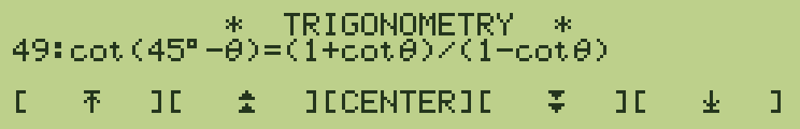

### 7.3.10 積分の公式（ｾｷﾌﾞﾝF）

`PF1` `PF4` `PF3`。42 個です。CENTER は 21 番です。`log` は自然対数、角度はラジアンです。積分定数 C は省いて書きます。

| 番号 | 関数 | 積分 | 番号 | 関数 | 積分 |
|---|---|---|---|---|---|
| 1 | 1 | x | 22 | cosec ax | (1/a) log tan(ax/2) |
| 2 | xⁿ | xⁿ⁺¹/(n+1)（n ≠ −1） | 23 | cosec ax | −(1/2a) log((1+cos ax)/(1−cos ax)) |
| 3 | 1/x | log∣x∣ | 24 | sin²x | x/2 − (1/4) sin 2x |
| 4 | 1/(x±a) | log∣x±a∣ | 25 | cos²x | x/2 + (1/4) sin 2x |
| 5 | eˣ | eˣ | 26 | sec²ax | (1/a) tan ax |
| 6 | eⁿˣ | (1/n) eⁿˣ | 27 | cosec²ax | −(1/a) cot ax |
| 7 | aˣ | aˣ/log a（a > 0、a ≠ 1） | 28 | 1/sin x | log tan(x/2) |
| 8 | aⁿˣ | aⁿˣ/(n log a) | 29 | 1/cos x | log tan(π/4+x/2) |
| 9 | log x | x(log x−1) | 30 | eⁿˣ sin bx | eⁿˣ(n sin bx−b cos bx)/(n²+b²) |
| 10 | xⁿ log x | (xⁿ⁺¹/(n+1))(log x−1/(n+1)) | 31 | eⁿˣ cos bx | eⁿˣ(n cos bx+b sin bx)/(n²+b²) |
| 11 | x eⁿˣ | (eⁿˣ/n²)(nx−1) | 32 | sin⁻¹x | x sin⁻¹x+√(1−x²) |
| 12 | sin x | −cos x | 33 | cos⁻¹x | x cos⁻¹x−√(1−x²) |
| 13 | sin ax | −(1/a) cos ax | 34 | sinh x | cosh x |
| 14 | cos x | sin x | 35 | cosh x | sinh x |
| 15 | cos ax | (1/a) sin ax | 36 | tanh x | log cosh x |
| 16 | tan x | −log∣cos x∣ | 37 | 1/√(a²−x²) | sin⁻¹(x/a)（∣x∣ < a） |
| 17 | tan ax | −(1/a) log cos ax | 38 | 1/(a²−x²) | (1/2a) log∣(a+x)/(a−x)∣ |
| 18 | cot x | log∣sin x∣ | 39 | 1/(a²+x²) | (1/a) tan⁻¹(x/a) |
| 19 | cot ax | (1/a) log sin ax | 40 | 1/√(x²±a²) | log(x+√(x²±a²)) |
| 20 | sec ax | (1/a) log tan(π/4+ax/2) | 41 | √(a²−x²) | (1/2)(x√(a²−x²)+a² sin⁻¹(x/a)) |
| 21 | sec ax | (1/2a) log((1+sin ax)/(1−sin ax)) | 42 | 1/(x²−a²) | (1/2a) log((x−a)/(x+a))（x > a） |

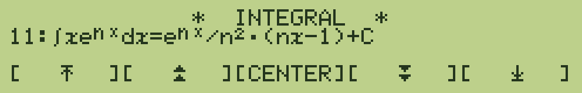

### 7.3.11 ギリシャ文字（ｷﾞﾘｼｬ）

`PF1` `PF4` `PF4`。24 個のギリシャ文字の大文字と小文字、読み、対応するローマ字を見せます。`↓` `↑` で 3 行ずつ動きます。


| 文字 | 読み | 文字 | 読み | 文字 | 読み | 文字 | 読み |
|---|---|---|---|---|---|---|---|
| Α α | Alpha (a) | Η η | Eta (ē) | Ν ν | Nu (n) | Τ τ | Tau (t) |
| Β β | Beta (b) | Θ θ | Theta (th) | Ξ ξ | Xi (x) | Υ υ | Upsilon (u) |
| Γ γ | Gamma (g) | Ι ι | Iota (i) | Ο ο | Omicron (o) | Φ φ | Phi (ph) |
| Δ δ | Delta (d) | Κ κ | Kappa (k) | Π π | Pi (p) | Χ χ | Chi (ch) |
| Ε ε | Epsilon (e) | Λ λ | Lambda (l) | Ρ ρ | Rho (r) | Ψ ψ | Psi (ps) |
| Ζ ζ | Zeta (z) | Μ μ | Mu (m) | Σ σ | Sigma (s) | Ω ω | Omega (ō) |

### 7.3.12 関数グラフ（ｸﾞﾗﾌF）

| 項目 | 内容 |
|---|---|
| キー | `PF1` `PF5` `PF1` |
| 入力 | f(x)（変数は X）、Xmin、Xmax、Ymin、Ymax |
| 動き | x の範囲を 165 に分けて計算し、Y の最小と最大を見せる。その値のまま `⏎` でも、自分の値でもよい |

例: 減っていく波。角度の単位が DEG のまま、f(x) = `EXP(-X/300)*COSX`、Xmin = 0、Xmax = 1080。計算が終わると `Ymin=-0.559`、`Ymax= 1` と出ます。ここで −1 と 1 を入れました。

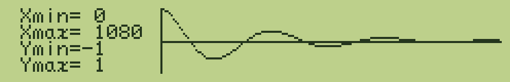

- 角度の単位は変わりません。必要なら先に CAL か BASIC で決めます。
- Xmin ≧ Xmax や Ymin ≧ Ymax は、入れ直しになります。
- 左の数字の場所は 5 桁分です。それより長い数はグラフに重なります。
- 描いている間は、左下に `*` が出ます。
- 点と点の間は線でつなぎません。変化が急な部分はとびとびの点になります。
- 計算した Ymin、Ymax のまま描くと、丸めのためにグラフの端が欠けることがあります。計算できない点があったときや、値が大きすぎる、小さすぎるときは、Ymin と Ymax が 0 になるので、自分で入れます。

### 7.3.13 データグラフ（ｸﾞﾗﾌD）

| 項目 | 内容 |
|---|---|
| キー | `PF1` `PF5` `PF2` |
| メニュー | 1: 全部消す（点の数を決める）、2: 入れる、直す、3: 描く |
| 点の数 | 1〜100（描くには 2 組以上） |

例: (1, 2)、(2, 5)、(3, 6)、(4, 9) の 4 点。

| キー | 内容 |
|---|---|
| `1` `Y` `4` `⏎` | データを消し、点の数を 4 にする |
| `2` | 入力。`X(1)`、`Y(1)`、`X(2)`、… の順 |
| `1` `⏎` `2` `⏎` … `9` `⏎` | 8 個の数 |
| `3` | `Xmin= 1` `Xmax= 4` `Ymin= 2` `Ymax= 9` と出る |
| `0` `⏎` `5` `⏎` `0` `⏎` `10` `⏎` | 余白を付けて描く |


- データは[統計](09_STAT.md)と共通の配列 MD です。統計で入れたデータの 1 列目が x、2 列目が y になります。統計のデータが残っているときに別のデータを描くには、先に `1` で消します（行列 MD も同じです）。
- 直すときは `2` を押し、`⏎` で送って、直したい値で新しい値を打ちます。終わりは `*` `⏎` です。
- 点の数はあとから変えられません。
- `Clear ok (y/n)` で消さないときは `N` です。

### 7.3.14 図形の面積（ﾒﾝｾｷ）

`PF1` `PF5` `PF3`。`↓` `↑` で 1 行、`▶` `◀` で 3 行ずつ印を動かし、`⏎` で選びます。角度の単位は DEG になります。

| 番号 | 図形（画面の名前） | 式 |
|---|---|---|
| 1 | Triangle | S = ah/2 |
| 2 | Triangle | S = (ab sinθ)/2 |
| 3 | Triangle | S = √(s(s−a)(s−b)(s−c))、s = (a+b+c)/2 |
| 4 | Parallelogram | S = ah |
| 5 | Parallelogram | S = ab sinθ |
| 6 | Trapezoid | S = (a+b)h/2 |
| 7 | Circle | S = πr² |
| 8 | Fan shape（おうぎ形） | S = lr/2 |
| 9 | Fan shape | S = πr²θ/360 |
| 10 | Bow shape（弓形） | S = (lr − r² sin(l/r))/2（この計算だけ RAD で行い、終わると DEG に戻る） |
| 11 | Ellipse | S = πab |
| 12 | Regular polygon f(n,r) | S = n r² tan(π/n)（r は内接円の半径） |
| 13 | Regular polygon f(n,R) | S = (n R² sin(2π/n))/2（R は外接円の半径） |
| 14 | Regular polygon f(n,l) | S = (n l²/4) cot(π/n)（l は辺） |

例: 半径 6、角 60° のおうぎ形。`▶` `▶` `↓` `↓` で 9 番を選び、`⏎` `6` `⏎` `60` `⏎`。


答えは 6π です。操作説明書（p.76）の名前は Sector、Circular segment ですが、本体の画面は `Fan shape`、`Bow shape` です。

### 7.3.15 ガンマ関数（ｶﾞﾝﾏ）

`PF1` `▲▼` `PF1` `PF1`。Γ(x) を 0 < x ≦ 70 で求めます。答えは有効数字 7 桁です。整数では Γ(n) = (n−1)! です。1 より小さい値や小数部分は 8 次の近似式で計算し、Γ(x+1) = x Γ(x) で大きな x に広げます。

| 入力 | 表示 | 正しい値 |
|---|---|---|
| 0.5 | `Γ(0.5)= 1.77245` | √π = 1.7724539 |
| 5 | `Γ(5)= 24` | 4! = 24 |
| 71 | 入れ直し | 範囲の外 |

Γ(0.5) の答えの 7 桁目は 0 なので、表示は 1.77245 です（正しい 7 桁は 1.772454 で、近似式の誤差が出ています）。

## 7.4 科学: 公式

### 7.4.1 運動の公式（ｳﾝﾄﾞｳF）

`PF2` `PF1` `PF3`。21 個です。CENTER は 11 番です。

| 番号 | 名前 | 式 |
|---|---|---|
| 1 | 等加速度の直線運動 | v = v₀+at、a = Δv/Δt、s = v₀t+at²/2 |
| 2 | 運動方程式 | F = ma |
| 3 | 円運動（1） | T = 2πr/v = 2π/ω = 1/f |
| 4 | 円運動（2） | ω = 2π/T = 2πf = v/r、F = mrω² = mv²/r |
| 5 | 単振動 | x = r sin ωt、v = rω cos ωt、a = −ω²x |
| 6 | フックの法則 | F = −kx |
| 7 | ばねの振動 | a = F/m = −(k/m)x、T = 2π√(m/k) |
| 8 | 単振り子 | a = F/m = −(g/l)x、T = 2π√(l/g) |
| 9 | 摩擦 | F = μN |
| 10 | 仕事 | W = Fs |
| 11 | ケプラーの法則（調和） | T²/r³ = 一定 |
| 12 | 万有引力 | F = GMm/r²、G = 6.67259×10⁻¹¹ |
| 13 | 慣性モーメント | I = mr²、E = Iω²/2 |
| 14 | 角運動量 | J = Iω |
| 15 | 運動量保存 | mv₁+MV₁ = mv₂+MV₂ |
| 16 | 位置エネルギー | Ep = mgh |
| 17 | 位置エネルギー（天体） | Up = −GMm/r |
| 18 | 運動エネルギー | Ek = mv²/2 |
| 19 | 運動エネルギー（天体） | Ek = mr²ω²/2 |
| 20 | 弾性エネルギー | Ee = kx²/2 |
| 21 | 質量とエネルギー | E = mc² |

## 7.5 科学: 定数と表

### 7.5.1 物理定数（ｼﾞｮｳｽｳ）

| 項目 | 内容 |
|---|---|
| キー | `PF2` `PF1` `PF1` |
| 動かし方 | `↓` `↑` で 1 つ、`▶` `◀` で 3 つ（間の 2 つを飛ばす） |
| 保存する | `STO` を押すと `STORE (A-Z) ?` と出る。英字を打って `⏎` |

47 個の値です。

| 番号 | 名前 | 記号 | 値 | 単位 |
|---|---|---|---|---|
| 1 | 真空中の光速 | c | 2.99792458E+8 | m s⁻¹ |
| 2 | 万有引力定数 | G | 6.67259E-11 | N m² kg⁻² |
| 3 | 重力加速度 | g | 9.80665 | m s⁻² |
| 4 | 電子の質量 | mₑ | 9.1093897E-31 | kg |
| 5 | 陽子の質量 | mₚ | 1.6726231E-27 | kg |
| 6 | 中性子の質量 | mₙ | 1.6749286E-27 | kg |
| 7 | ミュー粒子の質量 | m_μ | 1.8835327E-28 | kg |
| 8 | 原子質量単位 | u | 1.6605402E-27 | kg |
| 9 | 電気素量 | e | 1.60217733E-19 | C |
| 10 | プランク定数 | h | 6.6260755E-34 | J s |
| 11 | ボルツマン定数 | k | 1.380658E-23 | J K⁻¹ |
| 12 | 真空の透磁率 | μ₀ | 12.566370614E-7 | H m⁻¹ |
| 13 | 真空の誘電率 | ε₀ | 8.854187817E-12 | F m⁻¹ |
| 14 | 電子の比電荷 | e/mₑ | 1.75881962E+11 | C kg⁻¹ |
| 15 | 古典電子半径 | rₑ = e²/4πε₀mₑc² | 2.81794092E-15 | m |
| 16 | 微細構造定数 | α = e²/4πε₀ħc | 7.29735308E-3 | |
| 17 | 循環量子 | h/2mₑ | 3.63694807E-4 | J s kg⁻¹ |
| 18 | ボーア半径 | a₀ = 4πε₀ħ²/mₑe² | 5.29177249E-11 | m |
| 19 | リュードベリ定数 | R∞ = e²/16π²ε₀a₀ħc | 1.0973731534E+7 | m⁻¹ |
| 20 | 磁束量子 | h/2e | 2.06783461E-15 | Wb |
| 21 | ボーア磁子 | μ_B = eħ/2mₑ | 9.2740154E-24 | J T⁻¹ |
| 22 | 電子の磁気モーメント | μₑ | 9.2847701E-24 | J T⁻¹ |
| 23 | 自由電子の g 因子 | 2μₑ/μ_B | 2.002319304386 | |
| 24 | 核磁子 | μ_N = eħ/2mₚ | 5.0507866E-27 | J T⁻¹ |
| 25 | 陽子の磁気モーメント | μₚ | 1.41060761E-26 | J T⁻¹ |
| 26 | 陽子の g 因子 | 2μₚ/μ_N | 5.585694772 | |
| 27 | 陽子の磁気回転比 | γₚ | 2.67522128E+8 | s⁻¹ T⁻¹ |
| 28 | 中性子の磁気モーメント | μₙ | 9.6623707E-27 | J T⁻¹ |
| 29 | ミュー粒子の磁気モーメント | μ_μ | 4.4904514E-26 | J T⁻¹ |
| 30 | 電子のコンプトン波長 | λc = h/mₑc | 2.42631058E-12 | m |
| 31 | 陽子のコンプトン波長 | λcp = h/mₚc | 1.32141002E-15 | m |
| 32 | シュテファン・ボルツマン定数 | σ = π²k⁴/60ħ³c² | 5.67051E-8 | W m⁻² K⁻⁴ |
| 33 | アボガドロ定数 | N_A | 6.0221367E+23 | mol⁻¹ |
| 34 | 理想気体の体積（標準状態） | V₀ | 2.241410E-2 | m³ mol⁻¹ |
| 35 | 気体定数 | R = N_A k | 8.314510 | J mol⁻¹ K⁻¹ |
| 36 | ファラデー定数 | F = N_A e | 9.6485309E+4 | C mol⁻¹ |
| 37 | ジョセフソンの比 | 2e/h | 4.8359767E+14 | Hz V⁻¹ |
| 38 | 量子ホール抵抗 | R_H | 25812.8056 | Ω |
| 39 | 電子ボルト | eV | 1.60217733E-19 | J |
| 40 | 天文単位 | AU | 1.49597870E+11 | m |
| 41 | パーセク | pc | 3.0856776E+16 | m |
| 42 | 海里 | sea mile | 1852 | m |
| 43 | オングストローム | Å | 1E-10 | m |
| 44 | ノット | knot | 1852/3600 | m s⁻¹ |
| 45 | トル | Torr | 101325/760 | Pa |
| 46 | 標準大気圧 | atm | 101325 | Pa |
| 47 | カロリー | cal | 4.1868 | J |

例: 14 番（電子の比電荷）を変数 H に保存し、BASIC で使います。`▶` を 4 回、`↓` を 1 回で 14 番です。


`STO` `H` `⏎`、そのあと `BREAK` で抜けて RUN モードで `H` `⏎` と打つと、`1.75881962E+11` と出ました（実験）。保存した値は電卓と BASIC の変数なので、`RUN`、`CLEAR`、ほかのエンジニアソフトの実行で消えます。10 桁より長い定数は 11 桁目を四捨五入して保存します。44 番と 45 番は、分数を計算した値が入ります。

> [!NOTE]
> これらの値は 1980 年代の推奨値です。2019 年の SI の定義では、c のほか次の 4 つが誤差のない値に決められています。10 桁の計算で、6〜8 桁目から違いが出ます。
>
> | 定数 | この機械 | 2019 年の SI |
> |---|---|---|
> | h | 6.6260755E-34 | 6.62607015E-34 |
> | e | 1.60217733E-19 | 1.602176634E-19 |
> | k | 1.380658E-23 | 1.380649E-23 |
> | N_A | 6.0221367E+23 | 6.02214076E+23 |

### 7.5.2 単位換算（ﾀﾝｲ）

| 項目 | 内容 |
|---|---|
| キー | `PF2` `PF1` `PF2`、そのあと `PF1` 長さ、`PF2` 面積、`PF3` 体積、`PF4` 重さ、`PF5` エネルギー |
| 入力 | 値 `⏎`、元の単位、先の単位（PF キー。隠れている単位は `▲▼`） |
| 制限 | 答えが 10⁻¹⁰⁰〜10¹⁰⁰ の外なら `Answer not found` |

| 種類 | 単位 |
|---|---|
| LENGTH | m、in、ft、yd、mile / cm、Å、pc |
| AREA | m²、a、acre、mile² |
| VOLUME | cm³、m³、in³、l、ft³ |
| WEIGHT | g、kg、oz、lb |
| ENERGY | eV、erg、cm⁻¹、Hz / K、G、J/mol、kcal/mol |

主な係数です（左の単位の値にかける）。

| 換算 | かける数 | 換算 | かける数 |
|---|---|---|---|
| in → m | 0.0254 | acre → m² | 4046.86 |
| ft → m | 0.3048 | mile² → m² | 2589990 |
| yd → m | 0.9144 | in³ → cm³ | 16.3871 |
| mile → m | 1609.344 | ft³ → l | 28.3168 |
| m → in | 39.3701 | oz → g | 28.3495 |
| pc → m | 3.0856776 × 10¹⁶ | lb → kg | 0.45359237 |
| a → m² | 100 | eV → cm⁻¹ | 8065.54 |
| eV → K | 11604.5 | eV → Hz | 2.41799 × 10¹⁴ |
| eV → J/mol | 96485.3 | kcal/mol → J/mol | 4186.05 |
| cm⁻¹ → K | 1.43877 | G → K | 0.000067171 |

例: 26.2 マイル（フルマラソンのおよその距離）は何 m か。`26.2` `⏎` `PF5`（mile）`PF1`（m）。


答えのあと `⏎` を押すと、次の値を聞かれます。`X= ?` で `⏎` だけを押すと、種類のメニューに戻ります。

係数は 6 桁ほどのものが多く、答えの正確さもその程度です。

### 7.5.3 周期表と原子量（ｼｭｳｷ）

`PF2` `PF2` `PF1`。`1` で周期表、`2` で原子量です。

周期表は `▶` `◀` `↓` `↑` で動かし、`⏎` でメニューに戻ります。族の名前は、1a〜7a、8、1b〜7b、0 の古い書き方です。

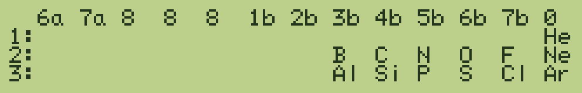

原子量は元素記号を打つと、その元素からの一覧になります。`⏎` だけなら水素からです。`↓` `↑` で 1 行、`▶` `◀` で 10 行動きます。

例: `FE` `⏎`。かっこの中は（周期−族）です。小文字を使わず `FE` と打っても鉄になりました。


原子量は IUPAC の 1985 年の値です（¹²C = 12）。最後の桁の確かさは、水素が ±7、ほかは ±3 です。`[ ]` の数はいちばん半減期の長い同位体の質量数です。

| 番号 | 記号 | 原子量 | 番号 | 記号 | 原子量 | 番号 | 記号 | 原子量 | 番号 | 記号 | 原子量 | 番号 | 記号 | 原子量 |
|---|---|---|---|---|---|---|---|---|---|---|---|---|---|---|
| 1 | H | 1.00794 | 22 | Ti | 47.88 | 43 | Tc | [98] | 64 | Gd | 157.25 | 85 | At | [210] |
| 2 | He | 4.002602 | 23 | V | 50.9415 | 44 | Ru | 101.07 | 65 | Tb | 158.92534 | 86 | Rn | [222] |
| 3 | Li | 6.941 | 24 | Cr | 51.9961 | 45 | Rh | 102.90550 | 66 | Dy | 162.50 | 87 | Fr | [223] |
| 4 | Be | 9.012182 | 25 | Mn | 54.93805 | 46 | Pd | 106.42 | 67 | Ho | 164.93032 | 88 | Ra | [226] |
| 5 | B | 10.811 | 26 | Fe | 55.847 | 47 | Ag | 107.8682 | 68 | Er | 167.26 | 89 | Ac | [227] |
| 6 | C | 12.011 | 27 | Co | 58.93320 | 48 | Cd | 112.411 | 69 | Tm | 168.93421 | 90 | Th | 232.0381 |
| 7 | N | 14.00674 | 28 | Ni | 58.69 | 49 | In | 114.82 | 70 | Yb | 173.04 | 91 | Pa | 231.03588 |
| 8 | O | 15.9994 | 29 | Cu | 63.546 | 50 | Sn | 118.710 | 71 | Lu | 174.967 | 92 | U | 238.0289 |
| 9 | F | 18.9984032 | 30 | Zn | 65.39 | 51 | Sb | 121.75 | 72 | Hf | 178.49 | 93 | Np | [237] |
| 10 | Ne | 20.179 | 31 | Ga | 69.723 | 52 | Te | 127.60 | 73 | Ta | 180.9479 | 94 | Pu | [244] |
| 11 | Na | 22.989768 | 32 | Ge | 72.61 | 53 | I | 126.90447 | 74 | W | 183.85 | 95 | Am | [243] |
| 12 | Mg | 24.3050 | 33 | As | 74.92159 | 54 | Xe | 131.29 | 75 | Re | 186.207 | 96 | Cm | [247] |
| 13 | Al | 26.981539 | 34 | Se | 78.96 | 55 | Cs | 132.90543 | 76 | Os | 190.2 | 97 | Bk | [247] |
| 14 | Si | 28.0855 | 35 | Br | 79.904 | 56 | Ba | 137.327 | 77 | Ir | 192.22 | 98 | Cf | [251] |
| 15 | P | 30.973762 | 36 | Kr | 83.80 | 57 | La | 138.9055 | 78 | Pt | 195.08 | 99 | Es | [252] |
| 16 | S | 32.066 | 37 | Rb | 85.4678 | 58 | Ce | 140.115 | 79 | Au | 196.96654 | 100 | Fm | [257] |
| 17 | Cl | 35.4527 | 38 | Sr | 87.62 | 59 | Pr | 140.90765 | 80 | Hg | 200.59 | 101 | Md | [258] |
| 18 | Ar | 39.948 | 39 | Y | 88.90585 | 60 | Nd | 144.24 | 81 | Tl | 204.3833 | 102 | No | [259] |
| 19 | K | 39.0983 | 40 | Zr | 91.224 | 61 | Pm | [145] | 82 | Pb | 207.2 | 103 | Lr | [260] |
| 20 | Ca | 40.078 | 41 | Nb | 92.90638 | 62 | Sm | 150.36 | 83 | Bi | 208.98037 |  |  |  |
| 21 | Sc | 44.955910 | 42 | Mo | 95.94 | 63 | Eu | 151.965 | 84 | Po | [209] |  |  |  |

### 7.5.4 電子配置と電離電圧（ﾃﾞﾝｼ）

`PF2` `PF2` `PF2`。元素記号から、電子配置、原子とイオンの基底状態、第 1、第 2 電離電圧（V）を見せます。電離電圧は、原子から電子を 1 つ無限の遠くまで引き離すのに要るエネルギーを、電圧で表したものです。`↓` `↑` で次、前の元素、`▶` `◀` で 10 個先、前の元素です。


鉄（26 番）は [Ar] 3d⁶4s²、基底状態は ⁵D₄、イオンは ⁶D₉/₂、第 1 電離電圧 7.87 V、第 2 は 16.18 V です。

### 7.5.5 安定同位体（ﾄﾞｳｲﾀｲ）

`PF2` `PF2` `PF3`。元素記号から、同位体、質量、存在比（%）を見せます。`↓` `↑` で 1 行、`▶` `◀` で 10 行、`⏎` で入力に戻ります。16,700 バイトと、いちばん大きなソフトです。

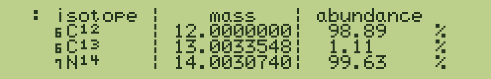

炭素では ¹²C（12.0000000、98.89 %）と ¹³C（13.0033548、1.11 %）です。2 つの質量と存在比から平均を計算すると、12 × 0.9889 + 13.0033548 × 0.0111 = 12.0111 で、表の原子量 12.011 に合います。

### 7.5.6 気圧と風速（ｷｼｮｳ）

`PF2` `PF3` `PF1`。`1` で気圧、`2` で風速です。

| 気圧の換算 | 式 |
|---|---|
| atm ↔ mb | 1 atm = 1013.25 mb |
| atm ↔ mmHg | 1 atm = 760 mmHg |
| mb → mmHg | mb ÷ 13.5951 ÷ 980.665 × 10000（小数 2 桁に丸める） |

操作説明書（p.93）の表には mb → mmHg が 0.75、mmHg → mb が 1.33 とありますが、プログラムは上の式で計算します。1000 mb は `750.06` mmHg でした（実験）。

| 風速の換算 | 式 |
|---|---|
| m/s → knot | × 1.944 |
| m/s → km/day | × 86.4 |

`force` は風力階級（ビューフォート）です。m/s、knot から force へは表を使い、km/day は m/s に直してから使います。force から速さへは範囲で答えます。

| force | knot | m/s | force | knot | m/s |
|---|---|---|---|---|---|
| 0 | 1 未満 | 0.3 未満 | 7 | 28 から | 13.9 から |
| 1 | 1 から | 0.3 から | 8 | 34 から | 17.2 から |
| 2 | 4 から | 1.6 から | 9 | 41 から | 20.8 から |
| 3 | 7 から | 3.4 から | 10 | 48 から | 24.5 から |
| 4 | 11 から | 5.5 から | 11 | 56 から | 28.5 から |
| 5 | 17 から | 8.0 から | 12 | 64 から | 32.7 から |
| 6 | 22 から | 10.8 から | | | |

例: 10 m/s → 19.44 knot、10 m/s → force 5、force 7 → 下の画面（v は m/s）。


### 7.5.7 太陽、惑星、月（ﾜｸｾｲ）

`PF2` `PF3` `PF2`。`0`〜`9` と `M` で選びます。`↓` `↑` で次、前の天体、`▶` `◀` で 4 つ先、前の天体です（`▶` は 1 の Mercury から 5 の Jupiter へ動きました。実験）。`⏎` でメニューに戻ります。


| 天体 | a（AU） | e | 半径（km） | 重力 | 体積 | 質量 | 自転（日） | 公転（年） |
|---|---|---|---|---|---|---|---|---|
| Sun | — | — | 696000 | 28.01 | 1304000 | 332946 | 25.38 | — |
| Mercury | 0.3871 | 0.2056 | 2439 | 0.38 | 0.056 | 0.055 | 58.65 | 0.2409 |
| Venus | 0.7233 | 0.0068 | 6052 | 0.91 | 0.857 | 0.815 | 243.01 | 0.6152 |
| Earth | 1.0000 | 0.0167 | 6378 | 1.00 | 1.000 | 1.000 | 0.9973 | 1.0000 |
| Mars | 1.5237 | 0.0934 | 3397 | 0.38 | 0.151 | 0.107 | 1.0260 | 1.8809 |
| Jupiter | 5.2026 | 0.0485 | 71398 | 2.37 | 1316 | 317.832 | 0.414 | 11.862 |
| Saturn | 9.5549 | 0.0556 | 60000 | 0.95 | 745 | 95.16 | 0.444 | 29.458 |
| Uranus | 19.2184 | 0.0463 | 25400 | 0.89 | 61 | 14.50 | 0.649 | 84.022 |
| Neptune | 30.1104 | 0.0090 | 24300 | 1.19 | 54 | 17.22 | 0.768 | 164.774 |
| Pluto | 39.5399 | 0.2490 | 2000? | 0.02? | 0.03? | 0.0023? | 6.387 | 248.534 |
| Moon | — | — | 1738 | 0.17 | 0.0203 | 0.012300 | 27.3217 | — |

重力、体積、質量は地球を 1 とした値です。a は太陽からの平均の距離（軌道の長半径）、e は離心率です。Pluto の `?` は、当時はっきりしていなかった値です。

### 7.5.8 アミノ酸（ｱﾐﾉｻﾝ）

`PF2` `PF4` `PF1`。`1` 中性、`2` 酸性、`3` 塩基性を選ぶと、略号、名前、示性式が出ます。`↓` `↑` で 1 画面、`▶` `◀` で 4 画面動き、`⏎` でメニューに戻ります。


| 分類 | アミノ酸（3 文字、1 文字） |
|---|---|
| 中性、疎水性 | glycine（Gly G）、alanine（Ala A）、valine（Val V）、leucine（Leu L）、isoleucine（Ile I）、methionine（Met M）、proline（Pro P）、phenylalanine（Phe F）、tryptophan（Trp W） |
| 中性、親水性 | serine（Ser S）、threonine（Thr T）、cysteine（Cys C）、tyrosine（Tyr Y）、asparagine（Asn N）、glutamine（Gln Q） |
| 酸性 | aspartic acid（Asp D）、glutamic acid（Glu E） |
| 塩基性 | lysine（Lys K）、arginine（Arg R）、histidine（His H） |

## 7.6 工学

### 7.6.1 複素数（ﾌｸｿｽｳ）

`PF3` `PF1` `PF1`。X と Y の 2 つの複素数を使い、答えは X に入ります。

| キー | 計算 |
|---|---|
| `X`、`Y` | X、Y に値を入れる（実部、虚部の順） |
| `+` `−` `×` `÷` | X と Y の四則 → X |
| `M+` | X をメモリに足す |
| `RM` | メモリ → X |
| `X→M` | X → メモリ |
| `↕` | X と Y を入れ替える |
| `√` | √X → X |
| `1/x` | 1/X → X |
| `x²` | X² → X |
| `(`（上に →xy） | 絶対値 √(実部² + 虚部²) → X、偏角 → Y |

例: X = 3 + 4i、Y = 1 − 2i。

| キー | X |
|---|---|
| `X` `3` `⏎` `4` `⏎` `Y` `1` `⏎` `−2` `⏎` | `3 + 4i` |
| `×` | `11 - 2i` |
| `√` | `3.330191 - 0.3002831i` |
| `(` | `3.343702`（Y に偏角 `-5.152422587` 度） |

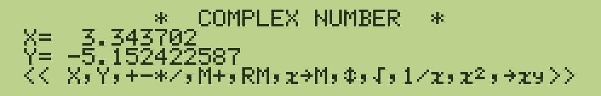

√ のあとの値を確かめると、3.330191² + 0.3002831² の平方根が 3.343702 です。偏角の単位はそのときの角度の単位です（この例は DEG）。計算の答えは有効数字 7 桁ほどに丸められます。

### 7.6.2 電気の公式（ﾃﾞﾝｷF）

`PF3` `PF1` `PF2`。14 個です。CENTER は 7 番です。

| 番号 | 名前 | 公式 |
|---|---|---|
| 1 | オームの法則 | V = IR（I = Q/t、R = ρl/S） |
| 2 | 直流の電力、電力量 | P = IV = I²R、W = IVt = Pt |
| 3 | コンダクタンス | G = 1/R = I/V |
| 4 | キルヒホッフの法則 | ΣIₙ = 0、ΣEⱼ−ΣRᵢIᵢ = 0 |
| 5 | Δ→Y 変換 | R = R₁+R₂+R₃、R₄ = R₁R₂/R、R₅ = R₂R₃/R、R₆ = R₃R₁/R |
| 6 | Y→Δ 変換 | R = R₄R₅+R₅R₆+R₆R₄、R₁ = R/R₅、R₂ = R/R₆、R₃ = R/R₄ |
| 7 | 交流の瞬時値 | V = V₀ sin ωt、I = I₀ sin ωt |
| 8 | 実効値 | I = I₀/√2、V = V₀/√2 |
| 9 | 交流の電力 | P = VI = V₀I₀/2 |
| 10 | 力率 | P = VI cos φ |
| 11 | リアクタンス | X = ωL = 2πfL、X = 1/ωC = 1/2πfC |
| 12 | インピーダンス | Z = √(R²+(ωL−1/ωC)²)、V₀ = ZI₀ |
| 13 | 固有周波数 | f₀ = 1/(2π√(LC)) |
| 14 | 電気振動 | Q²/2C+LI²/2 = 一定 |

### 7.6.3 電磁気の公式（ﾃﾞﾝｼﾞF）

`PF3` `PF1` `PF3`。16 個です。CENTER は 8 番です。

| 番号 | 名前 | 公式 |
|---|---|---|
| 1 | マクスウェルの式 | rot H = i、rot E = −∂B/∂t、div B = 0、div D = ρ |
| 2 | クーロンの法則（電気） | F = Q₁Q₂/4πε₀r² = k₀Q₁Q₂/r²、k₀ = 9×10⁹ |
| 3 | 電場 | E = V/d、F = QE、W = QV |
| 4 | 電気容量 | Q = CV、C = ε₀S/d |
| 5 | 静電エネルギー | U = QV/2 = CV²/2 |
| 6 | 電場の中の電子 | a = QE/m、mv²/2 = eV |
| 7 | クーロンの法則（磁気） | F = m₁m₂/4πμ₀r² = k₀m₁m₂/r²、k₀ = 10⁷/(4π)² |
| 8 | 磁場 | H = I/2πr、H = IN/2r、H = In |
| 9 | 電流が受ける力 | F = μ₀IHl = IBl |
| 10 | 磁束密度 | B = m/4πr² = μ₀H |
| 11 | ローレンツ力 | F = QvB、r = mv/QB |
| 12 | 磁場の中の電子 | mv²/2 = Q²B²r²/2m、ω = v/r = QB/m |
| 13 | ファラデーの法則 | V = −nΔφ/Δt |
| 14 | 電磁誘導 | V = El = vBl、I = vBl/R |
| 15 | 相互誘導 | V₂ = −MΔI₁/Δt |
| 16 | 自己誘導 | V′ = −LΔI/Δt、L = Nφ/I |

1 番の rot H = i は、電束の時間変化（∂D/∂t）の項を省いた形です。

### 7.6.4 ラプラス変換（ﾗﾌﾟﾗｽ）

`PF3` `PF1` `PF4`。46 個です。CENTER は 23 番です。上の行が F(s)、下の行が f(t) です。

| 番号 | F(s) | f(t) | 番号 | F(s) | f(t) |
|---|---|---|---|---|---|
| 1 | 1/s | 1 | 24 | s/(s+m)² | e^(−mt)(1−mt) |
| 2 | 1/s² | t | 25 | 1/(s(s+m)²) | (1−(1+mt)e^(−mt))/m² |
| 3 | 1/sⁿ | tⁿ⁻¹/(n−1)! | 26 | 1/(s²(s+m)²) | t/m²−2/m³+2e^(−mt)/m³+t e^(−mt)/m² |
| 4 | n!/sⁿ⁺¹ | tⁿ | 27 | (s+n)/(s+m)² | ((n−m)t+1)e^(−mt) |
| 5 | 1/√s | 1/√(πt) | 28 | (ω cosθ+s sinθ)/(s²+ω²) | sin(ωt+θ) |
| 6 | Γ(n+1)/sⁿ⁺¹ | tⁿ（n > −1） | 29 | (s cosθ−ω sinθ)/(s²+ω²) | cos(ωt+θ) |
| 7 | 1 | δ(t) | 30 | 1/(s²+a²)² | (sin at−at cos at)/2a³ |
| 8 | s | δ′(t) | 31 | s/(s²+a²)² | (t/2a) sin at |
| 9 | 1/(s±m) | e^(∓mt) | 32 | s²/(s²+a²)² | (sin at+at cos at)/2a |
| 10 | 1/(s(s+m)) | (1−e^(−mt))/m | 33 | (s²−a²)/(s²+a²)² | t cos at |
| 11 | 1/(s²(s+m)) | (e^(−mt)+mt−1)/m² | 34 | 1/((s+m)²+n²) | (1/n) e^(−mt) sin nt |
| 12 | a/(s²+a²) | sin at | 35 | (s+m)/((s+m)²+n²) | e^(−mt) cos nt |
| 13 | s/(s²+a²) | cos at | 36 | Γ(n)/(s−a)ⁿ | tⁿ⁻¹ e^(at)（n > 0） |
| 14 | 1/(s²+a²) | (1/a) sin at | 37 | s/((s²+m²)(s²+n²)) | (cos mt−cos nt)/(n²−m²) |
| 15 | a/(s²−a²) | sinh at | 38 | 1/√(s²+a²) | J₀(at) |
| 16 | s/(s²−a²) | cosh at | 39 | 1/(s⁴−a⁴) | (sinh at−sin at)/2a³ |
| 17 | 1/(s²−a²) | (1/a) sinh at | 40 | s/(s⁴−a⁴) | (cosh at−cos at)/2a² |
| 18 | 1/(s(s²+a²)) | (1−cos at)/a² | 41 | s²/(s⁴−a⁴) | (sinh at+sin at)/2a |
| 19 | 1/(s²(s²+a²)) | (at−sin at)/a³ | 42 | s³/(s⁴−a⁴) | (cosh at+cos at)/2 |
| 20 | 1/((s+m)(s+n)) | (e^(−mt)−e^(−nt))/(n−m) | 43 | s/(s⁴+4a⁴) | sin at sinh at/2a² |
| 21 | s/((s+m)(s+n)) | (m e^(−mt)−n e^(−nt))/(m−n) | 44 | 4a³/(s⁴+4a⁴) | sin at cosh at−cos at sinh at |
| 22 | 1/(s+m)² | t e^(−mt) | 45 | (1/s)((s−m)/(s+m)) | −1+2e^(−mt) |
| 23 | 1/(s+m)ⁿ | tⁿ⁻¹ e^(−mt)/(n−1)! | 46 | (1/s²)((s−m)/(s+m)) | 2/m−t−(2/m)e^(−mt) |

### 7.6.5 機械の公式と計算（ｷｶｲF）

`PF3` `PF2` `PF1`。12 個の公式を見せるだけでなく、`⏎` を押すと、値を聞いて計算します。値を打たずに `⏎` だけなら、公式の表示に戻ります。CENTER は 6 番、`PF2` と `PF4` は 3 つずつです。

| 番号 | 名前 | 式 | 入力 | 答え |
|---|---|---|---|---|
| 1 | 歯車のモジュール | M = D₁/Z₁ | D₁（駆動歯車の直径）、Z₁（歯数） | M |
| 2 | 歯車の直径 | D₂ = D₁Z₂/Z₁ | D₁、Z₂、Z₁ | D₂（従動歯車の直径） |
| 3 | モジュールとピッチ | M = P/π | P | M |
| 4 | ベルヌーイの定理 | v²/2+P/ρ+gz = 一定 | P₁、P₂、ρ、v₁、g、z₁、z₂ | v₂ |
| 5 | 連続の式 | Avρ = 一定 | A₁、v₁、ρ₁、A₂、ρ₂ | v₂ |
| 6 | レイノルズ数 | R = LU/ν | L（管の内径）、U（流速）、ν（動粘性係数） | R |
| 7 | エンタルピー | H = U+pV | U、p、V | H |
| 8 | カルノーサイクル（熱量） | η = (Q₁−Q₂)/Q₁ | Q₁、Q₂ | η |
| 9 | カルノーサイクル（温度） | η = (T₁−T₂)/T₁ | T₁、T₂ | η |
| 10 | ヤング率 | E = T/ε | T（応力）、ε（ひずみ） | E |
| 11 | せん断応力 | τ = P/A | P（せん断荷重）、A（断面積） | τ |
| 12 | せん断応力 | τ = Gγ | G（横弾性係数）、γ（せん断ひずみ） | τ |

4 番は v₂ = √(2(P₁−P₂)/ρ + v₁² + 2g(z₁−z₂))、5 番は v₂ = A₁v₁ρ₁/(A₂ρ₂) です。g は地上では 9.80665 m/s² です。

例 1（6 番）: 内径 0.05 m の管に水（ν = 1E-6）を 2 m/s で流す → `R= 100000`。

例 2（4 番）: P₁ = 120000、P₂ = 100000、ρ = 1000、v₁ = 1、g = 9.8、z₁ = z₂ = 0。


手で確かめると √(2 × 20000 ÷ 1000 + 1) = √41 = 6.403124237 です。

## 7.7 統計: 4 つの分布

`PF4`（ﾄｳｹｲ）`PF1`（ﾌﾞﾝﾌﾟ）から、`PF1` `ｾｲｷﾌﾞ`（正規分布）、`PF2` `Tﾌﾞ`（t 分布）、`PF3` `ｶｲﾌﾞ`（カイ二乗分布）、`PF4` `Fﾌﾞ`（F 分布）。どれも `1` で「確率 p から x」、`2` で「x から p」を求めます。p は x より**右側**の面積（上側確率）です。

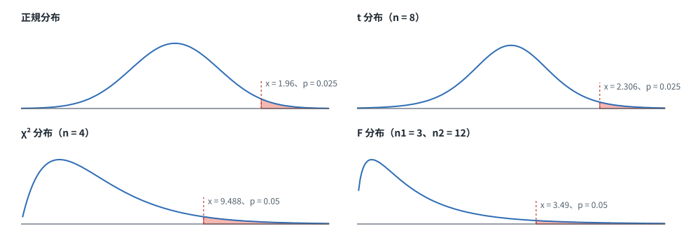

| 分布 | 入力 | 制限 | 答えの桁 |
|---|---|---|---|
| `ｾｲｷﾌﾞ` | p または x | 0 < p < 1 | 4 桁 |
| t | 自由度 n、p または x | p から x: n は 3 以上の整数、0 < p < 1 | 4 桁 |
| `ｶｲﾌﾞ` | 自由度 n、p または x | 0 < p ≦ 1、x ≧ 0 | x 3 桁、p 4 桁 |
| F | 自由度 n1、n2、p または x | 正の整数、0 < p ≦ 1、x ≧ 0 | 4 桁 |

> [!NOTE]
> 操作説明書は、t 分布と χ² 分布の自由度を「2 より大きい整数」としています。プログラムが断るのは、t の「p から x」で n ≦ 2 のときだけで、t の「x から p」と χ² は n = 1 から計算します。χ²（n = 1、x = 3.841）は `p= 0.05`、t（n = 1、x = 1）は `p= 0.25` と正しい値でした（実験、ROM 7.2、7.3）。

| 例 | キー | 答え |
|---|---|---|
| 正規分布 x = 1.96 | `ｾｲｷﾌﾞ` `2` `1.96` `⏎` | `p= 0.025` |
| 正規分布 p = 0.1 | `ｾｲｷﾌﾞ` `1` `0.1` `⏎` | `x= 1.282` |
| t 分布 n = 8、p = 0.025 | `Tﾌﾞ` `1` `8` `⏎` `0.025` `⏎` | `x= 2.306` |
| χ² 分布 n = 4、x = 9.488 | `ｶｲﾌﾞ` `2` `4` `⏎` `9.488` `⏎` | `p= 0.05` |
| F 分布 n1 = 3、n2 = 12、x = 3.49 | `Fﾌﾞ` `2` `3` `⏎` `12` `⏎` `3.49` `⏎` | `p= 0.05001` |

最初の値の入力で `⏎` だけを押すと、`1` `2` のメニューに戻ります。`ｶｲﾌﾞ` と `Fﾌﾞ` は値によって時間がかかります。

使い方の例: 平均との差を調べる検定で、自由度 8、有意水準 5 %（両側なので片側 2.5 %）の境の値は、t の 3 番目の例のとおり 2.306 です。手元の t がこれより大きければ、「差がある」と判断します。

## 7.8 デモ（ﾃﾞﾓ）

`PF5`（ﾍﾝｼｭｳ）`▲▼` `PF5` で始まる、絵と音のデモです。PC-E500 の仕様の表示、文字とグラフの表示などを繰り返します。

```text
****** ｼｬｰﾌﾟ ﾎﾟｹｯﾄｺﾝﾋﾟｭｰﾀ PC-E500 ******
    DISPLAY   :  40 *  4 lines
    GRAPHICS  : 240 * 32 dots
    RAM       : 32KB (max 96KB)
```


拡張子が `50#` なので、`ﾍﾝｼｭｳ` の 10 番目（2 ページ目の PF5）に現れます。`BREAK` で止まります。

## 7.9 ソフトの自作と追加

### 7.9.1 拡張子とメニュー

エンジニアソフトのメニューはファイルの**拡張子**で決まります。拡張子の 3 桁が上から順に押す PF キーの番号です。`#` は「下の階層がある」という意味です。

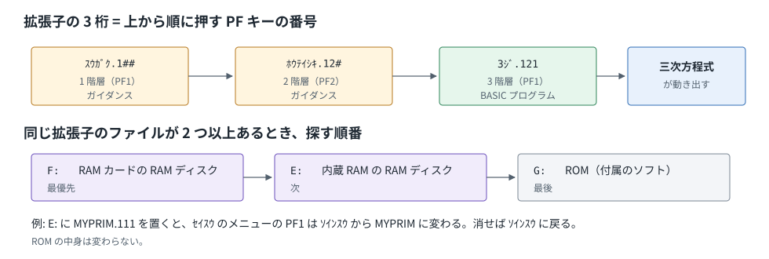

| 拡張子 | 階層 | 中身 |
|---|---|---|
| `1##`〜`9##`、`0##` | 1 | ガイダンス、または BASIC プログラム |
| `11#` など | 2 | ガイダンス、または BASIC プログラム（`ｴﾃﾞｨﾀ` の `51#` など） |
| `111` など | 3 | BASIC プログラム |

数字は 1〜9 と 0（0 が 10 番目）です。メニューに出る名前はファイル名の部分です。メニューの上に出る説明の文を、本体は**メニューガイダンス**と呼んでいます（英語版では MENU LABEL）。

同じ拡張子のファイルが F:、E:、G: のどれにもあるとき、F: → E: → G: の順で、先に見つかったものが使われます（F: は [RAM カード](04_RAM_CARD.md)、E: は内蔵 RAM の RAM ディスク）。付属のソフトを自分のもので置き換えることも、空いている番号に追加することもできます。ROM の中身は変わらず、E: のファイルを `KILL` すれば元に戻ります。

### 7.9.2 メニューの追加（ｴﾃﾞｨﾀ）

3 階層目にプログラムを置くだけでは、メニューに出ません。上の 2 つの階層（`6##` と `61#`）のファイルが必要です。これを作るのが `ｴﾃﾞｨﾀ` です。

自分の「華氏から摂氏への換算」を 6 番目のメニューに入れる例です。

1. E: を初期化します（まだなら）。`INIT "E:10K"` `⏎`（今ある E: の中身は消えます。[ファイルとドライブ](15_FILES.md)）
2. PRO モードでプログラムを書き、E: に保存します。カナは `カナ` キーを押してローマ字で打ちます（`KASI` → `ｶｼ`、`SESSI` → `ｾｯｼ`）。

```basic
10 CLS:PRINT "ｶｼ ｶﾗ ｾｯｼ"
20 INPUT "F= ";F
30 PRINT "C=";(F-32)*5/9
40 GOTO 20
SAVE "E:F2C.611"
```

3. `MENU` `PF5` `PF5`（ﾍﾝｼｭｳ）`PF1`（ｴﾃﾞｨﾀ）を押します。

```text
        *   PF KEY TITLE EDITOR   *

   ｼﾝｷ ｻｸｾｲ          ...1
   ﾒﾆｭ- ｶﾞｲﾀﾞﾝｽ ﾍﾝｺｳ ...2
```

4. `1`（新規作成）を押し、`E:ﾄﾞｳｸﾞ.6##` `⏎` と打ちます。`:` は `SHIFT` + `;`、`#` は `SHIFT` + `E` です。

```text
   FILE NAME= ?
(EXAMPLE) E:ﾀｲﾄﾙ.6##  E:ﾄﾞｳｸﾞ.6##_
```

5. ガイダンスを 3 行まで（1 行 30 文字まで）入れます。`ｼﾞﾌﾞﾝ ﾉ ﾄﾞｳｸﾞ` `⏎`、`⏎`、`⏎`。

```text
ﾒﾆｭ-ｶﾞｲﾀﾞﾝｽ= ?
1ｷﾞｮｳﾒ= ｼﾞﾌﾞﾝ ﾉ ﾄﾞｳｸﾞ_
```

6. もう一度 `ｴﾃﾞｨﾀ` を開き、`1`、`E:ｵﾝﾄﾞ.61#` `⏎`、`ｵﾝﾄﾞ ｶﾝｻﾝ` `⏎`、`⏎`、`⏎`。
7. `BREAK` で最初のメニューに戻り、`▲▼` を押すと、6 番目に `ﾄﾞｳｸﾞ` が出ます。


`PF1`（ﾄﾞｳｸﾞ）を押した画面です。1 行目が登録したガイダンスです。


続けて `PF1`（ｵﾝﾄﾞ）`PF1`（F2C）で、プログラムが動きます。

```text
ｶｼ ｶﾗ ｾｯｼ
F= 100
C= 37.77777778
F= _
```

できたファイルは `FILES "E:"` で見えます。

```text
     F2C     .611        103   E:
     ﾄﾞｳｸﾞ   .6##         30
     ｵﾝﾄﾞ    .61#         26
```

ガイダンスのファイルは、1 行目が `MF`、続いて " で囲んだ 3 行という、短い文字のファイルです。

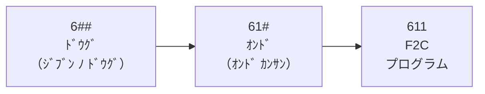

プログラムは 1 階層目や 2 階層目に置くこともできます。`E:GAME.62#` のように保存すれば、`61#` の隣に、ガイダンスなしで並びます。

### 7.9.3 ガイダンスの変更

`ｴﾃﾞｨﾀ` で `2`（メニューガイダンス変更）を押し、`E:ﾄﾞｳｸﾞ.6##` のように今のファイル名を打ちます。今のガイダンスが 1 行目に出るので、変える行は打ち直し、変えない行は `⏎` だけを押します。

```text
ｶﾞｲﾀﾞﾝｽ= ｼﾞﾌﾞﾝ ﾉ ﾄﾞｳｸﾞ


1ｷﾞｮｳﾒ=  _
```

最後に保存先を聞かれるので、`1`（内蔵の E:）か `2`（カードの F:）を押します。F: を選ぶには RAM カードが必要です。

```text
 ﾄﾞﾁﾗﾆ ﾄｳﾛｸ ｼﾏｽｶ ?
  ﾅｲｿﾞｳ (E:) ... 1   ｶ-ﾄﾞ (F:) ... 2
```

`G:ｶｶﾞｸ.2##` のように ROM のファイルを指定することもできます。変えたものは E: か F: に書かれます。

| 現象 | 理由、対処 |
|---|---|
| メニューに出ない | 上の階層の `6##` や `61#` がない |
| 登録したガイダンスが効かない | ファイル名が正しくない |
| `FILE ERROR` | 変更で指定したファイルがない |
| もう一度聞かれる | 拡張子の形が正しくない |
| ガイダンスを消したい | BASIC で `KILL "E:ﾄﾞｳｸﾞ.6##"` |

### 7.9.4 付属ソフトの置き換え

例: 素因数分解の `ｿｲﾝｽｳ`（拡張子 111）の代わりに、自分のプログラムを置きます。

```basic
INIT "E:4K"
10 PRINT "MY PRIME":BEEP 1
20 A$=INKEY$&1:END
SAVE "E:MYPRIM.111"
```

`ｾｲｽｳ` のメニューは次のように変わり、`PF1` で自分のプログラムが動きました（実験）。

```text
             ｾｲｽｳ

[MYPRIM][GCMLCM][*.113 ][*.114 ][*.115 ]
```

1 階層目も同じです。`SAVE "E:SHARP.1##"` とすると、最初のメニューの `ｽｳｶﾞｸ` が `SHARP` に変わり、`PF1` でそのプログラムが始まります。

### 7.9.5 プログラムを書くときのヒント

エンジニアソフトのプログラムは普通の BASIC の説明書にない書き方をいくつか使っています。自分のソフトでも使えます。

| 書き方 | 働き |
|---|---|
| `A$=INKEY$&1` | キーが押されるまで待ち、`INKEY$` と同じ文字を返す。約 11 分押されないと、自動電源オフになる |
| `MERGE "G:COMN.00$"` | プログラムの中で、部品のプログラムを後ろにつなぐ。部品は中間コードの形で、行番号が今のどの行よりも大きいこと |
| `P6=EVAL "-X/Y+SINX"` | 文字列を式として計算する。`f(x)= ?` で打った式の計算はすべてこれ |

例: `X=2:Y=1` のあと `PRINT EVAL "-X/Y+SQRX"` は `-5.857864376E-01`（−2 + √2）でした（実験）。

付属のソフトの中身を読むには、`FILES "G:"` で名前を調べ、`LOAD "G:ｷﾞﾘｼｬ.144"` のように読み込みます。拡張子が数字 3 桁のプログラムは、RAM ディスクへコピーすることもできます。

```text
FILES "G:"
 ｽｳｶﾞｸ   .1##         25   G:
 ｾｲｽｳ    .11#         25
 ﾎｳﾃｲｼｷ  .12#         26
```

- 付属のソフトを `LOAD` して `RUN` すると、`MERGE` で共通の部品がつながります。`BREAK` で止めてからもう一度動かすと、同じ部品を二度つなごうとしてエラーになります。そのときはプログラムの `MERGE` の行を消してから動かします。
- 変数は、P、Q、R で始まる 2 文字以上の名前が多く使われています。式の計算には X と Y、データのグラフには配列 MD を使います。
- ギリシャ文字などの特別な文字は、フォント（キャラクタジェネレータ）を切り替えて出しています。`ｷﾞﾘｼｬ` を `RUN` して `BREAK` で止めたあと、`CHR$&H83` を表示すると Γ になります。`CTRL` + `+/-` を押すと普通の文字に戻り、もう一度押すと切り替わります（操作説明書 p.116）。

ファイル名や RAM ディスクの扱いは [ファイルとドライブ](15_FILES.md)、G: の全ファイルと ROM の中の場所は [G: ドライブ](../analysis/22_ROM_GDRIVE.md) にあります。

## 7.10 本体と操作説明書の違い

### 7.10.1 食い違いの一覧

この章を書くときに、操作説明書の例とは別の値で動かし、プログラム（G: のファイル）も読んで確かめたところ、次の違いがありました。本文は右の列に合わせてあります。

| 項目 | 操作説明書 | 本体（ROM 7.2 ほか） |
|---|---|---|
| `ｾｷﾌﾞﾝ` の ε | 10⁻⁹⁰ より大きい値（p.60） | 1E-10 より小さいと入れ直し |
| 変数の消え方 | MD だけ残る（p.50） | `ｿｲﾝｽｳ` などは MD も消す。`ｸﾞﾗﾌD` は MD もほかの変数も残す。`ｼﾞｮｳｽｳ` も変数を残す |
| t、χ² の自由度 | 2 より大きい整数（p.109、110） | t の「p から x」だけ 3 以上、ほかは 1 以上 |
| 三角関数の公式 36 | 先頭のマイナスがない（p.67） | 画面は正しい |
| 三角関数の公式 49 | 符号が逆（p.67） | 画面も同じ誤り |
| mb ↔ mmHg | 0.75、1.33（p.93） | 13.5951 と 980.665 から計算する |
| 図形の名前 | Sector、Circular segment（p.76） | Fan shape、Bow shape |
| `ﾃﾞﾓ` | 書かれていない | `ﾍﾝｼｭｳ` の 2 ページ目の PF5 |

### 7.10.2 英語版の画面の違い

英語版（ROM 5.3、6.3、7.3、8.3）では、メニューと、次の見出し行の文字列が違います。計算と答えは同じです。

| ソフト | 日本語版の見出し行 | 英語版の見出し行 |
|---|---|---|
| `ｽｳﾁｶｲ1` | NUMERICAL SOLUTION (Newton's method) | NUMERICAL SOLUTION (NEWTON'S METHOD) |
| `ｽｳﾁｶｲ2` | NUMERICAL SOLUTION(method of bisection) | NUMERICAL SOLUTION(METHOD OF BISECTION) |
| `ｾｷﾌﾞﾝ` | NUMERICAL INTEGRATION(Romberg's method) | ROMBERG'S METHOD |
| `ﾎｶﾝ` | LAGRANGE'S INTERPOLATION | LAGRANGE'S METHOD |
| `ｻﾝｶｸF` | TRIGONOMETRY | TRIGONOMETRIC FUNCTION |
| `ｾｷﾌﾞﾝF` | INTEGRAL | INTEGRATION |
| `ｸﾞﾗﾌF`、`ｸﾞﾗﾌD` | GRAPH (function)、GRAPH (data) | GRAPH (FUNCTION)、GRAPH (DATA) |
| `ｼﾞｮｳｽｳ` | SCIENTIFIC CONSTANT | PHYSICAL CONSTANT |
| `ｳﾝﾄﾞｳF` | MOTION | EQUATION OF MOTION |
| `ｷｼｮｳ` | METEOROLOGICAL CONVERSION | METEOROLOGY |
| `ﾜｸｾｲ` | Sun Planets Moon CONSTANTS | SOLAR/PLANETARY CONSTANTS |
| `ｱﾐﾉｻﾝ` | AMINO ACID | AMINO ACIDS FORMULAS |
| `ﾃﾞﾝｷF` | ELECTRIC CIRCUITS | ELECTRICAL FORMULAS |
| `ｷｶｲF` | MECHANICAL FORMULA | MECHANICAL FORMULAS |
| `Tﾌﾞ`、`ｶｲﾌﾞ`、`Fﾌﾞ` | t-DISTRIBUTION、χ²-DISTRIBUTION、F-DISTRIBUTION | t DISTRIBUTION、CHI-SQUARE DISTRIBUTION、F DISTRIBUTION |
| `ｴﾃﾞｨﾀ` | PF KEY TITLE EDITOR（新規作成、変更などはカナ） | PF KEY LABEL EDITOR（APPEND、MODIFY など） |

## まとめ

- `MENU` `PF5` で入り、PF キーで下へ、`BREAK` で上へ動きます。2 ページ目は `▲▼` です。
- 計算のソフトは式と値を打つだけ、公式集は `PF1`〜`PF5` と `↓` `↑` で見ます。
- ソフトを動かすと、普通 BASIC の変数と統計のデータは消えます（`ｸﾞﾗﾌD` と `ｼﾞｮｳｽｳ` は別）。
- メニューは拡張子 3 桁で決まり、F: → E: → G: の順に探されます。自分のソフトは E: に置きます。
- ガイダンスは `ﾍﾝｼｭｳ` の `ｴﾃﾞｨﾀ` で作ります。

## 出典

- 操作説明書 p.49〜116（ENGINEER SOFTWARE MODE）。一覧、操作、公式、定数、表。
- ROM: 7.2 と 7.3 の G: ドライブのファイルを読み、公式、定数、制限値を確かめました。2 つの違いは見出し行などの文字列だけです。原子量 103 個は ROM と操作説明書（p.88〜90）で同じ値です。
- 実験: この章の例と画面は、ROM 7.2 をエミュレータで動かしたものです。同じ例を 7.3 でも動かし、答えは同じでした。
- 計算: 三角関数の公式 36、49 の誤りは数値を入れて確かめました。

## 次に読むもの

- [AER（式の登録）](08_AER.md)（自分の式を短く登録する）
- [統計](09_STAT.md)（データの入れ方）
- [ファイルとドライブ](15_FILES.md)（RAM ディスク E: と F:）
- [G: ドライブ](../analysis/22_ROM_GDRIVE.md)、[ROM バージョンの違い: 機種](../analysis/27_ROM_VERSIONS_MODELS.md)（ほかの機種のソフト集、GRAPH、TIMER）
