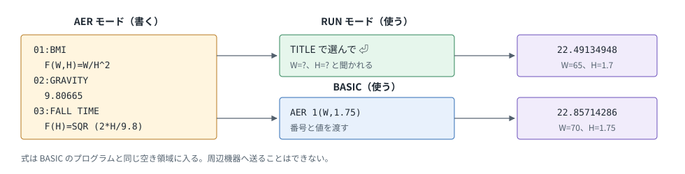
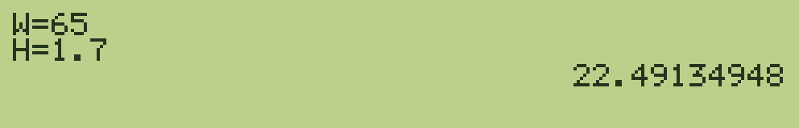

# 8. AER（式の登録）

この章はよく使う計算式に題を付けて登録しておき、何度でも呼び出す AER モードの説明です。AER は Algebraic Expression Reserve（代数式の登録）の略です。同じ式に数だけ変えて何度も計算するとき、式を毎回打ち直したり、短い BASIC プログラムを書いたりする代わりに使います。

[目次へ戻る](README.md)

## この章で分かること

- 式と題を登録する手順と、画面の見方
- RUN モードで式を呼び出し、値を入れて計算する手順
- 題の先頭の文字で式を探す方法
- 直し方、消し方、番号のずれに気を付けること
- BASIC のプログラムから式を使う方法
- 入れられる式の長さと、エラーの意味

## 8.0 はじめに

健康診断の担当者が身長と体重から BMI を何十人分も計算する場面を考えてください。`65/1.7^2` と打つのは簡単ですが、次の人も、その次の人も同じ形の式です。AER モードに `F(W,H)=W/H^2` と 1 回だけ書いておけば、あとは「W は？」「H は？」と聞かれるので、数を打つだけになります。



登録できる式は 2 種類です。

| 形 | 書き方 | 使うとき |
|---|---|---|
| 変数を聞く式 | `F(変数,変数,…)=式` | 呼び出すたびに変数の値を聞かれる |
| 式だけ | `式` | すぐ答えが出る。定数を保存するのに便利 |

式は 99 個まで登録できます。格納場所は BASIC のプログラムや変数と同じメモリなので、登録した分だけ空きが減ります。登録した式をプリンタやカセットなどの周辺機器へ送ることはできません。

この章の画面は日本語の PC-E500（ROM 7.2）のものです。AER モードのメッセージは日本語の ROM でも英語です。BMI の例は 2.2、7.3、8.3 でも同じ答えになりました（実験）。

## 8.1 AER モードに入る

入り方は 2 つあります。

| 方法 | キー |
|---|---|
| 直接 | `SHIFT` を押しながら `BASIC`（上に AER と印字） |
| メインメニューから | `MENU` を押し、`▲▼` でメニューの 2 ページ目を出して `PF1`（AER） |

何も登録していないときの画面です。

```text
01:TITLE?  28600 bytes free      * AER *
```

| 表示 | 意味 |
|---|---|
| `01:` | 次に登録する式の番号（01〜99）。99 個登録してあるときは、99 番の題と式が出る |
| `TITLE?` | 題を待っている |
| `28600 bytes free` | 残りの空き（バイト）。65535 を超えるときは 65535 と出る |
| `* AER *` | AER モードにいる |

空きのバイト数は入っているプログラムや変数、RAM の大きさで変わります。

## 8.2 式を登録する

BMI の式を登録します。

| 順番 | キー | 画面 |
|---|---|---|
| 1 | `SHIFT` + `BASIC` | `01:TITLE?  28600 bytes free      * AER *` |
| 2 | `BMI` `⏎` | `01:BMI                           * AER *` の下に `:?` |
| 3 | `F(W,H)=W/H^2` | `:F(W,H)=W/H^2_` |
| 4 | `⏎` | `02:TITLE?  28577 bytes free      * AER *` |

最後の `⏎` で式が登録され、番号が 1 つ進んで次の題を待ちます。続けて、定数と、もう 1 つの式を登録します。

```text
02  題: GRAVITY      式: 9.80665
03  題: FALL TIME    式: F(H)=SQR(2*H/9.8)
```

3 つ登録したあとの画面は `04:TITLE?  28521 bytes free` でした。1 番の式が使ったのは 28600 − 28577 = 23 バイトです。

### 8.2.1 題の決まり

- 20 文字までです。それより長く打っても増えず、20 文字目が打った文字で書き換えられるだけです（実験）。
- `⏎` だけを押すと、題なしで登録できます。題がないと、題で探すことはできません。
- カナの題も付けられます。`カナ` を押して `TAIJUU` と打つと `ﾀｲｼﾞｭｳ` になります（ローマ字入力）。もう一度 `カナ` で英字に戻ります。

```text
01:ﾀｲｼﾞｭｳ                        * AER *
:?
```

### 8.2.2 式の決まり

- 単精度の変数も、`A#` のような倍精度の変数も使えます。変数と変数はコンマで区切ります。文字列変数と配列変数は使えません。
- `sin`、`cos`、`eˣ` などの関数のキーも使えます。
- 長さは 78 文字まで、または変換したあとの大きさで 78 バイトまでです。数値は 1 個 8 バイト、関数は 2 バイト、ほかの文字は 1 バイトと数えます。

> [!NOTE]
> 操作説明書（PC-E500、p.117〜118）は、倍精度は使えない、長さは 80 文字・80 バイトまでとしています。動かしてみると、倍精度は使え、式は 78 文字まででした（実験）。長すぎる式の断り方は ROM バージョンで違い、5.3 は 79 文字の式を `AER convert error` にし、7.2 と 7.3 は 78 文字より先を打てません。PC-E500S の説明書は 78 文字・78 バイトに直っています。

例: 題 `D`、式 `F(A#,B#)=A#/B#` を登録し、RUN モードで `A#` に 1、`B#` に 3 を入れた画面です。

```text
A#=1
B#=3
               3.3333333333333333333D-01
```

> [!TIP]
> 数値を 1 つ書くたびに 8 バイト使います。式の中に同じ定数が何度も出るときは、変数にして `F( )` の中に入れると短くなります。

## 8.3 登録した式を見る

`↕` のキー（`C·CE` の下、上に TITLE と書いてあるキー。この章では `TITLE` と書きます）で、登録した式を順に見られます。

| キー | 動き |
|---|---|
| `TITLE` | 次の式を表示する。最後まで行くと 01 に戻る |
| `SHIFT` + `TITLE` | 逆の順に表示する |

新しい題を待っている `04:TITLE?` の画面から押すと、次のように進みました（実験）。


はじめの 1 回は待っている番号の 1 つ前（最後に登録した式）が出ます。そのあとは番号の順に、最後の次は 01 へ回ります。

式を打っている途中で `TITLE` を押すと、打ちかけの式は取り消されます。

## 8.4 式を使う

計算は RUN モードで行います。

1. `BASIC` を押して RUN モードにします。
2. `TITLE` を押して、使う式を出します。`SHIFT` + `TITLE` で逆順です。
3. `⏎` を押します。
4. `F( )` の中の変数が順に聞かれます。数を打って `⏎` を押します。
5. 全部入れると答えが出ます。

BMI の例です。体重 65 kg、身長 1.7 m とします。

| キー | 画面 |
|---|---|
| `BASIC`、`BM` `TITLE` | `01:BMI` / `:F(W,H)=W/H^2` |
| `⏎` | `W=?` |
| `65` `⏎` | `W=65` / `H=?` |
| `1.7` `⏎` | 下の画面 |

```text
W=65
H=1.7
                             22.49134948
```



答えが出たあと `⏎` を押すと、同じ式をもう一度、`W=?` から計算できます。値を打たずに `⏎` だけを押すと、前に入れた値をそのまま使います。まだ一度も入れていなければ 0 になります。次の画面は続けて `⏎` を 3 回押したところです。

```text
                             22.49134948
W=?
H=?
                             22.49134948
```

式だけの形（定数など）では、`⏎` を押すとすぐ値が出ます。出た値は直前の答えとして次の計算に使えます。`GRAVITY` を呼び出して `⏎`、続けて `+` `1` `⏎` と押すと、次のようになります。

```text
                                 9.80665
9.80665+1
                                10.80665
```

直前の答えの機能は [RUN モードの計算](06_RUN.md)にあります。

## 8.5 題で探す

式が増えたら、題の先頭の何文字かを打って `TITLE` を押します。

| キー | 画面 |
|---|---|
| `GR` `TITLE` | `02:GRAVITY` / `:9.80665` |
| `ZZ` `TITLE` | `Title not found` |

見つかったあと、もう一度 `TITLE` を押すと、今の式の次から、同じ文字で始まる題を続けて探します。

## 8.6 直す

### 8.6.1 登録する前

`⏎` を押す前なら、カーソルを動かし、`DEL`、`INS`、`BS` で直せます。

### 8.6.2 登録したあと

AER モードで `TITLE` を押して直したい式を出し、次の順に直します。題だけを直すときも、式だけを直すときも、もう一方は `⏎` で飛ばします。

| 順番 | キー | 画面 |
|---|---|---|
| 1 | `TITLE` で式を出す | `01:BMI` / `:F(W,H)=W/H^2` |
| 2 | `▶` | `01:BMI`（題の先頭にカーソル） |
| 3 | `SHIFT` + `▶` のあと、スペースと `INDEX` | `01:BMI INDEX` |
| 4 | `⏎` | `01:BMI INDEX` / `:F(W,H)=W/H^2`（式の先頭にカーソル） |
| 5 | `⏎` | `02:TITLE?`（式は直さずに終わり） |

`SHIFT` + `▶` は題の最後の文字の次へ一度に動くキーです。`▶` を何度か押しても同じです。

## 8.7 消す

1. AER モードで `TITLE` を押し、消したい式を出します。
2. `SHIFT` + `C·CE` を押します。確認の文が出ます。
3. `Y` で消えます。`N` なら、消さずに式の表示へ戻ります。

```text
02:AER data clear OK? (Y/N)
```

> [!WARNING]
> 式を消すと、後ろの式が 1 つずつ前に詰まります。02 の `GRAVITY` を消すと、03 だった `FALL TIME` が 02 になりました（実験）。BASIC のプログラムが `AER 3` のように番号で呼んでいるなら、番号を直す必要があります。

## 8.8 BASIC から使う

BASIC の `AER` は登録した番号の式に値を渡して、その答えを返します。番号のあとのかっこの中に、`F( )` の変数の順に値を書きます。

```basic
10 W=70
30 PRINT AER 1(W,1.75)
40 END
```

```text
                             22.85714286
```

式の中でも使えます。

```text
PRINT AER 1(80,1.8)+1
                             25.69135802
```

| 書き方 | 結果 |
|---|---|
| `AER 1(70,1.75)` | 1 番の式に W = 70、H = 1.75 を渡す |
| `AER 2` | 定数だけの式。かっこは要らない |
| `AER 1`（変数のある式で値を書かない） | `Syntax error` |
| `AER 5`（登録していない番号） | `Illegal function call` |

書式の詳しいことは [BASIC リファレンス](../analysis/14_BASIC_REFERENCE.md#aer)にあります。

## 8.9 エラー

| 表示 | 意味 | 直し方 |
|---|---|---|
| `AER format error` | `F(…)=式` の形が正しくない。`)=` がない、など | `◀` か `▶` で式を出して直す。`C·CE` なら式を打ち直す |
| `AER memory over` | メモリがいっぱいで入らない | いらない式（やプログラム、変数）を消す。`C·CE` で入力に戻り、`◀` `▶` で題を出す |
| `AER convert error` | 式が長すぎる（78 バイトを超えた、など） | `◀` で式を出して短くする |
| `Title not found` | 探した題がない | 打った文字を確かめる |

例: `F(A,B=A+B` と打つと（`)` を忘れています）、`AER format error` になります。`▶` を押すと、打った式がそのまま出るので、`)` を足せます。

```text
AER format error                 * AER *

01:BAD                           * AER *
:F(A,B=A+B
```

例: `1.1+2.2+3.3+…+1.4` のように数を 12 個足す式は、打った文字は 47 文字ですが、数値だけで 8 × 12 = 96 バイトになるので、`AER convert error` になります（実験）。

## まとめ

| したいこと | キー |
|---|---|
| AER モード | `SHIFT` + `BASIC`（`MENU` `▲▼` `PF1`） |
| 登録 | 題 `⏎` 式 `⏎` |
| 見る | `TITLE`、`SHIFT` + `TITLE` |
| 使う | RUN モードで `TITLE`、`⏎`、値 `⏎`… |
| 探す | 先頭の文字 `TITLE` |
| 直す | 出して `▶`、題 `⏎`、式 `⏎` |
| 消す | 出して `SHIFT` + `C·CE`、`Y` |
| BASIC | `AER 番号(値,値…)` |
| 制限 | 99 個、題 20 文字、式 78 文字・78 バイト |

## 出典

- 操作説明書 p.117〜122（AER モード）。制限値、操作、エラーの意味。
- 実験: ROM 7.2 で、この章の画面のとおりに操作しました。式の長さ（78〜80 文字）と倍精度は 5.3 と 7.3 でも確かめました。BMI の式は 2.2、7.3、8.3 でも同じ答えです。

## 次に読むもの

- [RUN モードの計算](06_RUN.md)（直前の答え、変数）
- [BASIC リファレンス](../analysis/14_BASIC_REFERENCE.md)（`AER`）
- [PF キーと便利な使い方](16_PF_KEYS.md)（短い文字列の登録）
