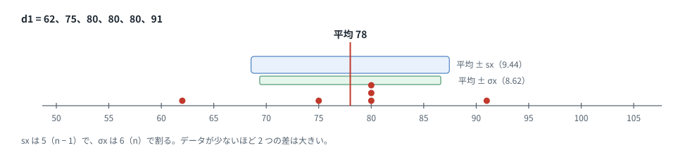
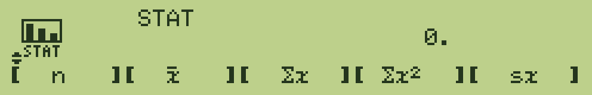
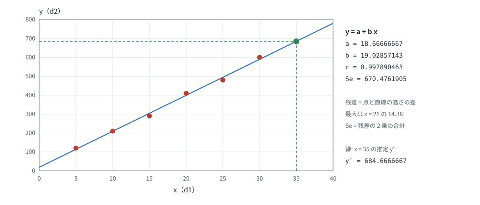
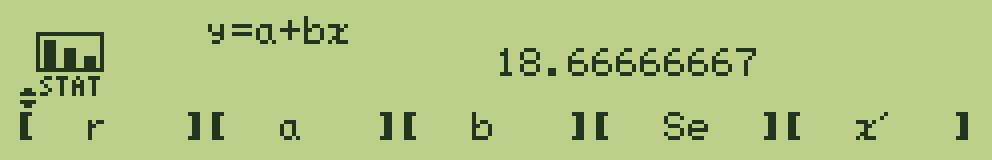
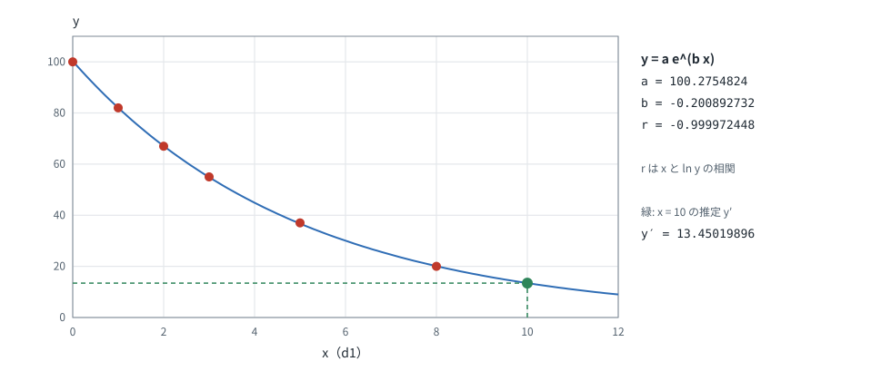
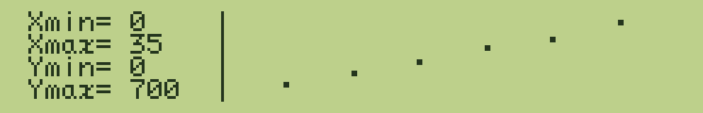
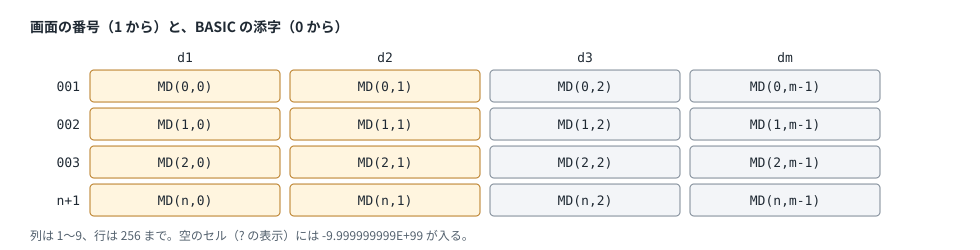

# 9. 統計（STAT）

この章は集めた数から平均や標準偏差を求め、2 つの数の関係を 1 本の直線や曲線で表す STAT モードの説明です。表に数を打ちこむだけで、12 種類の統計の値と、直線の回帰（係数、相関係数、残差、推定値）が、キー 1 つで出ます。

[目次へ戻る](README.md)

## この章で分かること

- 平均、標準偏差、回帰とは何か
- 1 つの変数の統計（平均、標準偏差）の手順
- 2 つの変数の直線の回帰と、推定の手順
- 指数、対数、べき乗、逆数の曲線の回帰
- データ表の直し方、空のデータの扱い
- データと結果が入る BASIC の変数、エラーの意味

## 9.0 はじめに

6 回の測定で 62、75、80、80、80、91 という値が出たとします。1 つの数で代表させるなら**平均**（78）です。値のばらつきを 1 つの数で表すのが**標準偏差**です。



標準偏差には 2 種類あります。

| 記号 | 割る数 | 使うとき |
|---|---|---|
| sx（標本標準偏差） | n − 1 | 一部を抜き出して測ったデータから、全体のばらつきを見積もる |
| σx（母標準偏差） | n | 測ったデータが全体そのもの |

もう 1 つの使い方が**回帰**です。温める時間 x を変えて温度 y を測ったような、組になったデータから「y = a + b x」の a と b を求め、まだ測っていない x での y を見積もります。

この機械ではデータを表（行と列）で入れます。列を d1、d2、… と呼び、9 列まで作れます。1 変数の統計では 1 列だけ、回帰では 2 列を選んで使います。だから、何種類ものデータを 1 つの表に入れておき、列を選んで順に計算できます。

この章の画面は日本語の PC-E500（ROM 7.2）のものです。STAT モードの表示とメッセージは日本語の ROM でも英語です。§9.3 の回帰の値は 2.2、7.3、8.3 でも同じでした（実験）。

## 9.1 求められる値

| 番号 | 記号 | 意味 | 式 |
|---|---|---|---|
| 1 | n | x のデータの数 | |
| 2 | x̄ | x の平均 | Σx ÷ n |
| 3 | Σx | x の合計 | |
| 4 | Σx² | x の 2 乗の合計 | |
| 5 | sx | x の標本標準偏差 | √((Σx² − n x̄²) ÷ (n − 1)) |
| 6 | σx | x の母標準偏差 | √((Σx² − n x̄²) ÷ n) |
| 7 | ȳ | y の平均 | Σy ÷ n |
| 8 | Σy | y の合計 | |
| 9 | Σy² | y の 2 乗の合計 | |
| 10 | sy | y の標本標準偏差 | sx と同じ形 |
| 11 | σy | y の母標準偏差 | σx と同じ形 |
| 12 | Σxy | x × y の合計 | |

1 変数の統計で出るのは 1〜6 です。7〜12 は 2 変数（直線の回帰）を選んだときに出ます。

### 9.1.1 回帰の式

| 記号 | 意味 | 式 |
|---|---|---|
| a、b | 直線 y = a + b x の係数 | b = Sxy ÷ Sxx、a = ȳ − b x̄ |
| r | 相関係数（−1〜1。±1 に近いほど直線に近い） | Sxy ÷ √(Sxx × Syy) |
| x′ | y から推定した x | (y − a) ÷ b |
| y′ | x から推定した y | a + b x |
| Se | 残差。実際の y と推定の y の差の 2 乗の合計 | Σ(yᵢ − (a + b xᵢ))² |

ここで、Sxx = Σx² − (Σx)² ÷ n、Syy = Σy² − (Σy)² ÷ n、Sxy = Σxy − (Σx)(Σy) ÷ n です。

> [!NOTE]
> 操作説明書は、残差の式（p.127）では n で割る形を示し、説明（p.133）では「差の 2 乗の合計」と書いていて、食い違っています。実際に計算させると、表示は n で**割らない**合計でした（実験。7.2 のほか 2.2、7.3、8.3。§9.3 の例で 670.4761905）。この章では割らない形で書きます。

## 9.2 1 変数の統計

2 つの組 A、B のデータを入れ、それぞれの平均と標準偏差を求めます。

| 番号 | A（d1） | B（d2） |
|---|---|---|
| 1 | 62 | 58 |
| 2 | 75 | 70 |
| 3 | 80 | 77 |
| 4 | 80 | 77 |
| 5 | 80 | 77 |
| 6 | 91 | 88 |

### 9.2.1 データを入れる

| キー | 画面 |
|---|---|
| `MENU` `PF4` | `STATISTICAL VARIABLE` / `STAT:D(000,0_)` |
| `2` `⏎` | `001:d1=                ?` |
| `62` `⏎` | `001:d2=                ?` |
| `58` `⏎` `75` `⏎` `70` `⏎` `80` `⏎` | `003:d2=                ?` |
| `77` `PF3`（FREQ） | `FREQUENCY (  0_)` |
| `3` | `FREQUENCY (  3_)` |
| `⏎` | `006:d1=                ?` |
| `91` `⏎` `88` `⏎` `PF5`（QUIT） | `D(006,2)` |

`STAT:D(000,0_)` は「行が 000、列が 0」で、カーソルのところに列の数を打ちます。`D(006,2)` は 6 行 2 列の表ができたという意味です。

同じ値の行が続くときは、その行の右端の値を打って `PF3`（FREQ）、行の数、`⏎` と押すと、まとめて入ります。上の例では 80 と 77 の組を 3 行まとめて入れました。FREQ で打ち間違えたら `C·CE`、取り消すなら `PF5`（CANCEL）です。取り消したときは、`⏎` を押して入力を続けます。

### 9.2.2 計算する

`PF3`（CALC）、`PF1`（STAT）と押すと、どの列を x にするかを聞かれます。

```text
    STAT
                      x←d1_
                                [CANCEL]
```

d1 のままでよければ `⏎` です。



| キー | 値 | 表示 |
|---|---|---|
| `PF1` [n] | データの数 | `6.` |
| `PF2` [x̄] | 平均 | `78.` |
| `PF3` [Σx] | 合計 | `468.` |
| `PF4` [Σx²] | 2 乗の合計 | `36950.` |
| `PF5` [sx] | 標本標準偏差 | `9.444575162` |
| `▲▼` `PF1` [σx] | 母標準偏差 | `8.621678104` |

`BREAK` を押すと、`D(006,2)` の画面に戻ります。B を計算するには `PF3` `PF1` と押し、`2` `⏎` で d2 を選びます。平均は `74.5` です。

> [!TIP]
> 計算の結果は電卓の数と同じで、`FSE` `2nd F` `TAB` などの[表示の形](05_CAL.md)の指定も使えます。平均を小数点以下 3 桁で読みたいときに便利です。

## 9.3 直線の回帰

x（d1）と y（d2）の 6 組のデータから、直線を求めます。

| | 1 | 2 | 3 | 4 | 5 | 6 |
|---|---|---|---|---|---|---|
| x | 5 | 10 | 15 | 20 | 25 | 30 |
| y | 120 | 210 | 290 | 410 | 480 | 600 |



| キー | 画面 |
|---|---|
| `MENU` `PF4` `2` `⏎`（前のデータがあれば `PF1`（NEW）から） | 2 列の表 |
| `5` `⏎` `120` `⏎` … `30` `⏎` `600` `⏎` | 6 行入れる |
| `PF5`（QUIT）`PF3`（CALC）`PF2`（a+bx） | `y=a+bx` / `x←d1_` / `y←d2` |
| `⏎` `⏎` | 回帰のメニュー |

`x←d1_` と `y←d2` はどの列を x、y にするかの確認です。列を変えるなら、番号を打ってから `⏎` を押します。



回帰のメニューは 4 ページで、`▲▼` を押すたびに次のページへ進み、最後の次は最初に戻ります。

| ページ | PF1 | PF2 | PF3 | PF4 | PF5 |
|---|---|---|---|---|---|
| 1 | r | a | b | Se | x′ |
| 2 | y′ | n | x̄ | Σx | Σx² |
| 3 | sx | σx | ȳ | Σy | Σy² |
| 4 | sy | σy | Σxy | | |

| キー | 値 | 表示 |
|---|---|---|
| `PF2` | a | `18.66666667` |
| `PF3` | b | `19.02857143` |
| `PF1` | r | `0.997890463` |
| `PF4` | Se | `670.4761905` |

### 9.3.1 推定する

y の値から x を、x の値から y を推定できます。値を打ってから PF キーを押します。

| キー | 表示 |
|---|---|
| `350` `PF5`（x′） | `x′=          17.41241241` |
| `▲▼` `35` `PF1`（y′） | `y′=          684.6666667` |

つまり、y が 350 になるのは x が約 17.4 のとき、x = 35 のときの y は約 685、と見積もれます。x = 35 は測った範囲（5〜30）の外なので、直線の関係が続くと仮定した値です。

### 9.3.2 結果の保存

結果は電卓のメモリに保存できます。`PF4`（Se）のあと `STO` `A` と押すと、変数 A に入ります。あとで `RCL` `A` で呼び出し、別の列で計算した Se と比べられます。1 つの表に d1・d2 と d3・d4 の 2 組を入れておき、組ごとに Se を比べて、どちらが直線に近いかを見る、という使い方です。

> [!WARNING]
> 統計の計算は変数 J〜Z を使います（§9.5）。自分の値を保存するのは A〜I か、`X→M` のメモリにします。

## 9.4 曲線の回帰

データが曲線の関係でも、対数や逆数に変換すると直線になる場合があります。変換した値を表に入れれば、直線の回帰の機能をそのまま使えます。

| 種類 | 曲線 | x の列に入れる値 | y の列に入れる値 |
|---|---|---|---|
| 直線 | y = a + b x | x | y |
| 指数 | y = a e^(b x) | x | ln y（y > 0） |
| 対数 | y = a + b ln x | ln x（x > 0） | y |
| べき乗 | y = a x^b | ln x（x > 0） | ln y（y > 0） |
| 逆数 | y = a + b ÷ x | 1/x（x ≠ 0） | y |

求めた値から元の曲線の値を得るには、変換を戻します。

| 求めるもの | 指数 | 対数 | べき乗 | 逆数 |
|---|---|---|---|---|
| a | `PF2` `2nd F` `eˣ` | `PF2` | `PF2` `2nd F` `eˣ` | `PF2` |
| b | `PF3` | `PF3` | `PF3` | `PF3` |
| x′（y から） | `PF5` | `PF5` `2nd F` `eˣ` | `PF5` `2nd F` `eˣ` | `PF5` `1/x` |
| y′（x から） | `PF1` `2nd F` `eˣ` | `PF1` | `PF1` `2nd F` `eˣ` | `1/x` `PF1` |

y′ のキーは 2 ページ目にあるので、必要なら先に `▲▼` を押します。相関係数 r と残差 Se は変換したあとの値についてのものです。x′ や y′ に与える値も種類に合わせて同じ変換をしてから打ちます（指数の x′ には ln y、対数とべき乗の y′ には ln x、など）。

### 9.4.1 例: 指数の回帰

時間 x とともに減っていく値 y（薬の濃さや、コンデンサの電圧のような減り方）のデータです。

| x | 0 | 1 | 2 | 3 | 5 | 8 |
|---|---|---|---|---|---|---|
| y | 100 | 82 | 67 | 55 | 37 | 20 |



y の列には ln y を入れます。値を打って `ln` を押せば、そのまま対数が入ります。

| キー | 内容 |
|---|---|
| `MENU` `PF4` `2` `⏎` | 2 列 |
| `0` `⏎` `100` `ln` `⏎` | 1 行目 |
| `1` `⏎` `82` `ln` `⏎` … `8` `⏎` `20` `ln` `⏎` | 残りの行 |
| `PF5` `PF3` `PF2` `⏎` `⏎` | 回帰の計算 |

| キー | 値 | 表示 |
|---|---|---|
| `PF1` | r | `-0.999972448` |
| `PF2` | ln a | `4.607921223` |
| `2nd F` `eˣ` | a | `100.2754824` |
| `PF3` | b | `-0.200892732` |
| `▲▼` `10` `PF1` | x = 10 の ln y′ | `2.598993898` |
| `2nd F` `eˣ` | y′ | `13.45019896` |

求める曲線は y = 100.28 e^(−0.2009 x) で、x = 10 のときの y は約 13.5 です。

### 9.4.2 グラフで見る

[エンジニアソフト](07_ENG.md)の `ｸﾞﾗﾌD`（GRAPH (data)）は、統計のデータをそのまま点で描きます。§9.3 のデータを入れたまま、`MENU` `PF5` `PF1` `PF5` `PF2`、`3`（Plot）と押し、範囲を 0〜35、0〜700 にした画面です。



## 9.5 データ表の操作

### 9.5.1 キーの一覧

| キー | 働き |
|---|---|
| `⏎` | 打った数を入れて右のセルへ。右端なら次の行の左端へ |
| `C·CE` | 表示の数を消して `?` に戻す |
| `C·CE` `⏎` | そのセルを空（未登録）にする |
| `▶` `◀` | 右、左のセル。行の端では次の行、前の行へ |
| `↑` `↓` | 同じ列の上、下の行 |
| `2nd F` `▶`、`2nd F` `◀` | 今の行の右端、左端 |
| `2nd F` `↑`、`2nd F` `↓` | 今の列のいちばん上、いちばん下 |
| `PF1` [INS] | 今の行の前に、指定した数の行を入れる |
| `PF2` [DEL] | 今の行から、指定した数の行を消す |
| `PF3` [FREQ] | 同じ値の行をまとめて入れる |
| `PF5` [QUIT] | 入力を終える |
| [NEW] | 新しい表を作る（今のデータは消える） |
| [DATA] | 入力の画面に戻る（直す、足す、消す） |
| [CALC] | 計算へ進む |

表のセルの番号は 3 桁で、`002:d1=` は 2 行目の d1 です。`↑` や `2nd F` `↑` で 1 行目に戻ると、入れた値が表示されます。

```text
001:d1=               1.
```

INS と DEL は行の数を聞かれます。

```text
   INS       (  0_)
                                [CANCEL]
```

DEL で残りの行より大きい数を打つと、今の行から後ろが全部消えます（エラーにはなりません）。

### 9.5.2 データの制限

- 表は 9 列、256 行までです。行は入れた分だけ増えます。
- 入れられる値は、絶対値が 1 × 10⁹⁹ より小さい数です。`1` `EXP` `99` を入れると `DATA ERROR` になります（実験）。
- 2 乗の合計を計算するので、10⁵⁰ 以上の値があると、計算でエラーになることがあります。10⁵⁰ と 2 × 10⁵⁰ の 2 個で統計を計算すると `CALCULATION ERROR` でした（実験）。
- 数の代わりに式や関数も打てます（例: `20` `×` `3` `+` `12` `=` `⏎`、`30` `sin` `⏎`）。`→HEX` `→DEC` は使えません。`⏎` を押す前に打ち直すなら `C·CE` です。
- 列の数を変えると、データは全部消えます。

> [!NOTE]
> 操作説明書の p.129 には「行の数を変えるとデータが消える」とありますが、行は入力とともに増える仕組みなので、消えるのは [NEW] で列の数を決め直したときです。

### 9.5.3 空のデータ

測りそこねた値は `C·CE` `⏎` で空にします。空のセルがある行は、計算から除かれます。1・2・3・4 の x に対して 2 行目を空にした 4 行の表では、n は `3.` になりました（実験）。

空のセルには `-9.999999999E+99` という特別な値が入っています。`PRINT MD(1,0)` で見ると、次のようになります（実験）。

```text
                        -9.999999999E+99
```

### 9.5.4 BASIC の変数

データは BASIC の単精度配列 `MD` と同じ場所に入ります。



だから、BASIC で作った配列 MD を統計で計算したり、統計のデータをプログラムで読んだりできます。

計算の結果は変数 J〜Z に自動で入ります。

| 変数 | Z | Y | X | W | V | U | T | S | R |
|---|---|---|---|---|---|---|---|---|---|
| 値 | n | Σx | Σx² | Σxy | Σy | Σy² | x̄ | sx | σx |

| 変数 | Q | P | O | N | M | L | K | J |
|---|---|---|---|---|---|---|---|---|
| 値 | ȳ | sy | σy | r | a | b | 0 | 0 |

§9.3 の計算のあと、RUN モードで表示させると次のとおりでした（実験）。

```text
PRINT Z;Y;X;W
 6  105  2275  45250
PRINT V;U;T;S;R
 2110  901100  17.5  9.354143467  8.539125638
PRINT Q;P;O;N;M;L;K;J
 351.6666667  178.3722699  162.8308598  9.978904637E-01  18.66666667  19.02857143  0  0
PRINT MD(0,0);MD(0,1);MD(5,1)
 5  120  600
```

- 1 変数の統計では、y の値や係数は計算されないので 0 になります。
- エラーが起きたときは、変数は変わりません。
- これらの変数とデータは、`RUN`、`CLEAR`、`NEW`、`ARUN`、`ERASE` や、エンジニアソフトの実行で消えます。エンジニアソフトのうち `ｸﾞﾗﾌD` はデータ（MD）を使うので消しません（[エンジニアソフト](07_ENG.md) §7.1.3）。

## 9.6 エラー

エラーのとき、画面に E の記号が付きます。`C·CE` で消えます。

| 表示 | 原因 | この章の例 |
|---|---|---|
| `MEMORY OVER` | 表やデータを入れる場所がない。回帰の結果を入れる場所がない | |
| `CALCULATION ERROR` | 計算の途中でエラーになった | 1E50 と 2E50 の統計 |
| `IMPOSSIBLE CALCULATION` | 1 列の表で回帰を選んだ | 1 列の表で `PF3` `PF2` |
| `DATA ERROR` | 1 × 10⁹⁹ 以上の数を入れた。または、計算に使えない値がある | `1` `EXP` `99` `⏎` |
| `0.`（E 付き） | 演算のエラー | x がすべて同じ値の回帰 |

統計や回帰は計算の回数が多いので、数の丸めによる小さな誤差がたまることがあります。

x が 5、5、y が 7、9 の 2 組のように、x が全部同じときは、直線を 1 本に決められません。このとき画面は `0.` のままで、メッセージは出ません（実験）。

## まとめ

| したいこと | キー |
|---|---|
| 入る | `MENU` `PF4`（PF4 の下に「統計」と印字）、列の数 `⏎` |
| 入れる | 値 `⏎`…、`PF5`（QUIT） |
| 1 変数 | `PF3` `PF1`、列 `⏎`、`PF1`〜`PF5`、`▲▼` `PF1` |
| 回帰 | `PF3` `PF2`、列 `⏎` 列 `⏎`、`PF1`〜`PF5`、`▲▼` |
| 推定 | 値 `PF5`（x′）、`▲▼` 値 `PF1`（y′） |
| 空のデータ | `C·CE` `⏎` |
| 新しい表 | `PF1`（NEW） |
| 制限 | 9 列、256 行、絶対値 10⁹⁹ 未満 |

## 出典

- 操作説明書 p.123〜137（STAT モード）。式、キー、変数の表、エラーの意味。
- 実験: ROM 7.2 で、この章の例のとおりに操作しました。残差 Se と係数 a は 2.2、7.3、8.3 でも同じ値です。

## 次に読むもの

- [エンジニアソフト](07_ENG.md)（データのグラフ、正規分布、t 分布など）
- [電卓（CAL）](05_CAL.md)（表示の形、`STO`、`RCL`）
- [行列](10_MATRIX.md)（行列 MD）
