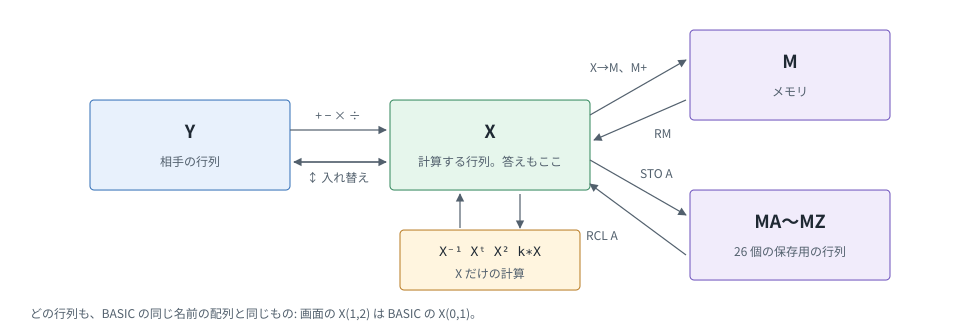
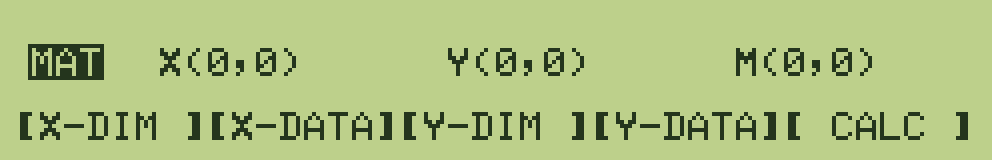
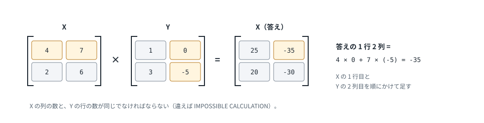
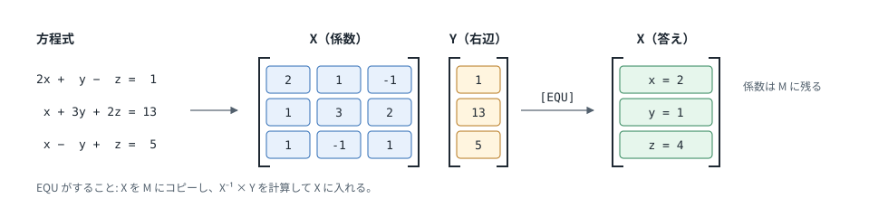

# 10. 行列（MATRIX）

この章は、数を縦横に並べた行列を、電卓の数のように足したり、かけたり、割ったりする MATRIX モードの説明です。連立方程式を解く、逆行列や行列式を求める、といった計算が、プログラムを書かずにできます。BASIC の配列とつながっているので、プログラムで作った表を MATRIX モードで解くこともできます。

[目次へ戻る](README.md)

## この章で分かること

- 行列の入れ方と見方
- 足し算、引き算、かけ算、割り算、転置、逆行列、行列式、2 乗
- 数（スカラー）との計算
- 連立方程式を解く [EQU] と、答えを確かめる [RESID]
- 行列の保存方法と、BASIC の配列との関係
- メモリの計算、印刷、エラー、計算の誤差

## 10.0 はじめに

りんご 2 個とみかん 1 個で 400 円、りんご 1 個とみかん 3 個で 450 円。1 個ずつの値段はいくらでしょう。こういう問題は、係数（個数）を四角に並べた**行列**と、右辺（合計の値段）の行列を作れば、決まった手順で解けます。値段の数が 2 つでなく 10 個になっても、手順は同じです。



MATRIX モードで計算するのは、いつも行列 X です。足し算やかけ算の相手は Y で、答えは X に入ります。M は電卓のメモリにあたる行列、MA〜MZ は保存しておくための 26 個の行列です。使える行列は、X、Y、M、MA〜MZ の 29 個です。

行列の 1 つの数を**要素**といいます。横の並びが**行**、縦の並びが**列**です。`X(1,2)` は、行列 X の 1 行目、2 列目の要素です。

| 項目 | 値 |
|---|---|
| 行列の数 | 29（X、Y、M、MA〜MZ） |
| 大きさ | 行も列も 1〜256。ただし全体はメモリの空きまで |
| 計算の精度 | 単精度だけ（10 桁） |
| 格納場所 | BASIC の単精度配列 `X`、`Y`、`M`、`MA`〜`MZ` と同じ（§10.6） |

行列 `MD` は、統計のデータと同じ格納場所です（[統計](09_STAT.md) §9.5）。

この章の画面は日本語の PC-E500（ROM 7.2）のものです。MATRIX モードの表示とメッセージは、日本語の ROM でも英語です。§10.4 の連立方程式は 2.2、7.3、8.3 でも同じ答えでした（実験）。

## 10.1 MATRIX モードに入る

メインメニューで `PF3`（MATRIX）を押します（`MENU` `PF3`）。PF3 キーのそばには「行列」と印字されています。



左の黒い MAT が MATRIX モードの表示です。`X(0,0)` は「行列 X はまだない」という意味で、行列を作ると `X(2,2)` のように大きさが出ます。この画面を、この章では**行列メニュー**と呼びます。

| キー | 働き |
|---|---|
| `PF1` [X-DIM] | 行列 X の大きさを決め、要素の入力に進む |
| `PF2` [X-DATA] | 行列 X の要素を見る、直す。大きさを決めたあとで使う |
| `PF3` [Y-DIM] | 行列 Y の大きさを決め、要素の入力に進む |
| `PF4` [Y-DATA] | 行列 Y の要素を見る、直す |
| `PF5` [CALC] | 計算のメニューへ進む |

## 10.2 行列を入れる

次の 2 つの行列を入れます。

```text
X = |  4   7 |     Y = |  1   0 |
    |  2   6 |         |  3  -5 |
```

| キー | 画面 |
|---|---|
| `MENU` `PF3` `PF1` | `ENTER DIMENSION` / `X(  0_,0)   Y(0,0)   M(0,0)` |
| `2` `⏎` | `X(2,  0_)` |
| `2` `⏎` | `X(1,1)=        0.` |
| `4` `⏎` `7` `⏎` `2` `⏎` `6` `⏎` | 行列メニューに戻り、`X(2,2)` と出る |
| `PF3` `2` `⏎` `2` `⏎` | `Y(1,1)=        0.` |
| `1` `⏎` `0` `⏎` `3` `⏎` `5` `+/-` `⏎` | 行列メニューに戻り、`Y(2,2)` と出る |

最後の要素を入れると、自動で行列メニューへ戻ります。大きさを聞かれている間に `PF5`（CANCEL）を押すと、取り消せます。

### 10.2.1 要素の入力で使うキー

| キー | 動き |
|---|---|
| `⏎` | 数を入れて、次の要素へ進む |
| `▶` `◀` | 右、左の要素へ。行の終わりでは次の行の左端へ、行のはじめでは前の行の右端へ |
| `↓` `↑` | 下、上の要素へ |
| `2nd F` `▶`、`2nd F` `◀` | 今の行の右端、左端の要素へ |
| `2nd F` `↑`、`2nd F` `↓` | 今の列のいちばん上、いちばん下の要素へ |
| `PF1` [VIEW] | 行列の形で見る |
| `PF5` [QUIT] | 前の画面へ戻る |

数を打つとき、[電卓（CAL）](05_CAL.md) と同じ四則や関数のキーが使えます。1/3 は `1` `÷` `3` `=` と打ってから `⏎` です。

### 10.2.2 行列の形で見る

`PF2`（X-DATA）`PF1`（VIEW）を押すと、3 行 3 列まで一度に見られます。

```text
           4           7
           2           6

                                [ QUIT ]
```

`PF5` を押すと要素の画面に戻り、もう一度 `PF5` で行列メニューに戻ります。4 行目や 4 列目より先は、矢印のキーで要素を動かして見ます。

## 10.3 計算する

行列メニューで `PF5`（CALC）を押すと、計算のメニューになります。`▲▼` で 2 ページ目が出ます。


```text
1 ページ目: [X⁻¹] [Xᵗ] [detX] [SCALAR] [SeeX]
2 ページ目: [EQU] [RESID] [X²]
```

MAT の下の `▲▼` は、ほかのページがあるという意味です。

### 10.3.1 計算の一覧

| キー | 計算 | 条件 |
|---|---|---|
| [X⁻¹] | X の逆行列を X へ | X は正方行列（行の数 = 列の数） |
| [Xᵗ] | X の転置（行と列の入れ替え）を X へ | なし |
| [detX] | X の行列式を表示する。X は変わらない | X は正方行列 |
| [SCALAR] | 数との計算（§10.3.4） | なし |
| [SeeX] | X の中身を見る | なし |
| [EQU] | 連立方程式を解く（§10.4） | X は正方行列、Y は同じ行の数 |
| [RESID] | 答えの確かめ（§10.4.1） | [EQU] のあと |
| [X²] | X × X を X へ | X は正方行列 |
| `+` | X + Y を X へ | 同じ大きさ |
| `−` | X − Y を X へ | 同じ大きさ |
| `×` | X × Y を X へ | X の列の数 = Y の行の数 |
| `÷` | X × Y⁻¹ を X へ | Y は正方行列、X の列の数 = Y の行の数 |
| `↕` | X と Y を入れ替える | なし |
| `+/-` | X の符号を全部変える | なし |
| `X→M` | X を M へコピーする（前の M は消える） | なし |
| `RM` | M を X へコピーする（前の X は消える） | なし |
| `M+` | M + X を M へ | 同じ大きさ |
| `STO` 英字 | X を MA〜MZ へコピーする（前の中身は消える） | なし |
| `RCL` 英字 | MA〜MZ を X へコピーする（前の X は消える） | なし |

答えが X に入る計算では、計算の前の X は消えます。あとで使う行列は、先に `STO` で保存しておきます。

計算中は `Push BREAK to Stop` と出ます。長い計算を止めるには `BREAK` を押します。止めたときは、行列は計算の前のまま残ります。

### 10.3.2 例: かけ算

§10.2 の X と Y で、X を保存してから X × Y を計算します。

| キー | 画面 |
|---|---|
| `PF5`（CALC） | 計算のメニュー |
| `STO` `A` | `X→M?` のあと、`A` で MA に保存する |
| `×` | 計算して、メニューに戻る |
| `PF5`（SeeX）`PF1`（VIEW） | 下の画面 |

```text
          25         -35
          20         -30
```



### 10.3.3 例: 逆行列、行列式、2 乗

`PF5` `PF5` で計算のメニューに戻り、`RCL` `A` で元の X を戻してから計算します。

| 計算 | キー | 結果 |
|---|---|---|
| 逆行列 | `RCL` `A` `PF1` | 下の画面 |
| 行列式 | `RCL` `A` `PF3` | `det               10.` |

```text
         0.6        -0.7
        -0.2         0.4
```


手で確かめると、行列式は 4 × 6 − 7 × 2 = 10、逆行列は |6 −7; −2 4| ÷ 10 なので、合っています。この逆行列に数 10 をかけると（次の節）、`6 −7 −2 4` という整数の行列になります。さらに [X²] を押すと、次のようになりました。

```text
          50         -70
         -20          30
```

### 10.3.4 数との計算（SCALAR）

[SCALAR] は、行列と 1 つの数 k の計算です。`PF4` を押し、k を打ってから、計算の PF キーを押します。

```text
       SCALAR                0.

[ k*X  ][ k*X⁻¹][ X/k  ][ k+X  ][ k-X  ]
```

| キー | 計算 |
|---|---|
| `PF1` [k*X] | 全部の要素に k をかける |
| `PF2` [k*X⁻¹] | 逆行列の全部の要素に k をかける |
| `PF3` [X/k] | 全部の要素を k で割る |
| `PF4` [k+X] | 全部の要素に k を足す |
| `PF5` [k-X] | k から、それぞれの要素を引く |

[k+X] と [k-X] は、数学の教科書の計算にはない、この機械だけの便利な機能です。ほとんどの要素が同じ値 k の行列を入れるときは、全部 0 の行列を作って [k+X] で一度に k にし、違う要素だけを直すと、打つ回数が減ります。

例: §10.3.3 の逆行列に 10 をかけるには、`PF4` `10` `PF1` と押します。

```text
           6          -7
          -2           4
```

## 10.4 連立方程式を解く

次の三元連立方程式を解きます。

```text
2x +  y −  z =  1
 x + 3y + 2z = 13
 x −  y +  z =  5
```

係数を X に、右辺を Y に入れて、[EQU] を押すだけです。



| キー | 内容 |
|---|---|
| `MENU` `PF3` `PF1` `3` `⏎` `3` `⏎` | X を 3 行 3 列にする |
| `2` `⏎` `1` `⏎` `1` `+/-` `⏎` | 1 行目 |
| `1` `⏎` `3` `⏎` `2` `⏎` | 2 行目 |
| `1` `⏎` `1` `+/-` `⏎` `1` `⏎` | 3 行目 |
| `PF3` `3` `⏎` `1` `⏎` | Y を 3 行 1 列にする |
| `1` `⏎` `13` `⏎` `5` `⏎` | 右辺 |
| `PF5`（CALC）`▲▼` `PF1`（EQU） | 計算する |
| `PF5`（SeeX）`PF1`（VIEW） | 答えを見る |

計算のあと、メニューの上の大きさは `X(3,1)  Y(3,1)  M(3,3)` に変わります。答えは x = 2、y = 1、z = 4 です。


[EQU] がすることは、次の 2 つです。

1. X を M にコピーします（前の M は消えます）。
2. X⁻¹ × Y を計算して X に入れます。

だから、係数は M に残り、右辺は Y に残ります。

### 10.4.1 答えを確かめる（RESID）

[RESID] は、M × X − Y を計算して X に入れます。X が正しい答えなら、どの要素も 0 になるはずです。0 でなければ、その大きさが計算の誤差の目安です。

上の例では `0`、`0`、`0` でした。右辺を 3、13、4 に変えると、答えは割り切れない数になり、RESID にもわずかな誤差が出ます（実験）。

| 右辺 | X（答え） | RESID |
|---|---|---|
| 1、13、5 | 2、1、4 | 0、0、0 |
| 3、13、4 | 2.333333333、1.466666667、3.133333333 | 0、0、-0.000000001 |

[RESID] を押すと、X の答えは消えて、誤差に置き換わります。答えが必要なら、先に `STO` `A` などで保存しておきます。

## 10.5 計算の誤差

行列の計算は、よく使われる**消去法**で行われます。ほかの計算機と同じように、途中で数が 10 桁に丸められるので、行列式や逆行列には誤差が出ることがあります。

極端な例が、逆行列を**持たない**行列です。

```text
X = | 7    1  |    行列式は 7 × 1/7 − 1 × 1 = 0 のはず
    | 1   1/7 |
```

1/7 は 0.142857142… と丸められて入るので、行列式は 0 になりません。実際の表示です（実験）。

```text
det                   3.E-10
```

行列式が 0 でないので、逆行列も「計算できて」しまいます。意味のない、とても大きな数の行列です。

```text
 476190476.3 -3333333333
 -3333333333 2.33333E+10
```

確かめる方法の 1 つは、行列を整数倍してから行列式を求めることです。上の行列を 7 倍すれば要素は 49、7、7、1 になり、行列式はちょうど 0 になります。1 行目が 6 と 2、2 行目が 3 と 1 の行列（どちらの行も 3 対 1）のように、割り切れる数だけで逆行列がない行列では、行列式は `0.`、逆行列は `DIVISION BY ZERO` になります（実験）。

大きな行列の計算には時間がかかります。操作説明書では、10 行 10 列の単位行列の逆行列が約 6 秒とされています。時間は要素の値によっても変わります。

> [!NOTE]
> 改訂 5 までの ROM（2.1、2.2、3.2、5.3）の逆行列には、ピボットの選び方に誤りがあり、逆行列を持つ行列でも `DIVISION BY ZERO` になることがあります。くわしくは [ROM バージョンの違い: 行列演算とドライバ](../analysis/25_ROM_VERSIONS_DRIVERS.md) §25.2.1 を見てください。

## 10.6 BASIC の配列とメモリ

### 10.6.1 配列との対応

行列 X、Y、M、MA〜MZ は、BASIC の単精度配列と同じものです。ただし、番号の数え方が違います。行列の `X(i,k)` は、配列の `X(i-1,k-1)` です。

| 行列 | BASIC |
|---|---|
| `X(1,1)` | `X(0,0)` |
| `X(1,2)` | `X(0,1)` |
| `X(2,3)` | `X(1,2)` |

例: BASIC で配列を作ってから MATRIX モードに入ると、そのまま行列になっています（実験）。

```basic
DIM X(1,2)
X(0,0)=1:X(0,2)=3:X(1,1)=5
```

```text
X(2,3)      Y(0,0)      M(0,0)

           1           0           3
           0           5           0
```

逆に、MATRIX モードの答えを BASIC で使うこともできます。行列は、`RUN`、`CLEAR`、`NEW`、`ARUN`、`ERASE` で消えます。プログラムで行列を使うときは、`RUN` の代わりに `GOTO` で始めます（§10.7）。

### 10.6.2 必要なメモリ

行列のメモリは、BASIC のプログラムや変数と共通です。空きは RUN モードの `FRE 0` で分かります。計算には、使う行列のほかに、途中の計算のための行列の場所も要ります。

```text
1 つの行列に要るバイト数 = 行の数 × 列の数 × 7 + 10
```

| 計算 | 途中の行列 |
|---|---|
| `X→M`、`RM`、`↕` | 0 個 |
| 普通の計算 | 1 個 |
| 逆行列、連立方程式（計算を 2 回する） | 2 個 |

例: §10.3.2 の 2 行 2 列どうしのかけ算では、X、Y、途中の行列がそれぞれ 2 × 2 × 7 + 10 = 38 バイトで、合わせて 114 バイトです。

| 例 | 計算 | バイト数 |
|---|---|---|
| 2 × 2 のかけ算 | 38 × 3 | 114 |
| 10 × 10 の逆行列（X と途中の行列 2 個） | 710 × 3 | 2,130 |
| 30 × 30 のかけ算 | 6,310 × 3 | 18,930 |

`MEMORY OVER` と出たら、いらない変数やプログラムを消すか、[RAM カード](04_RAM_CARD.md)でメモリを増やします。

## 10.7 印刷する

MATRIX モードには印刷の機能がないので、短い BASIC プログラムを使います。操作説明書は、行と列の数を聞いて要素を 1 つずつ `LPRINT` するプログラムを載せています。次は、同じ考えで 2 行 2 列の X を画面に出す、自分の例です。`PRINT` を `LPRINT` に変えればプリンタに出ます。

```basic
100 *MAT:FOR I=0 TO 1:FOR J=0 TO 1
110 PRINT "X(";I+1;",";J+1;")=";X(I,J)
120 NEXT J:NEXT I:END
```

PRO モードで入れたら、RUN モードで `GOTO *MAT` と打って動かします。`RUN` で始めると、行列が消えて保存するからです。

```text
X( 1 , 2 )=-7
X( 2 , 1 )=-2
X( 2 , 2 )= 4
```

ほかの行列を出すときは、110 行の `X(I,J)` を `Y(I,J)` や `MC(I,J)` に変えます。

## 10.8 エラー

エラーが出ると、画面に E の記号が付きます。`C·CE` を押すと、記号が消えてメニューに戻ります。

| 表示 | 原因 | この章の例 |
|---|---|---|
| `IMPOSSIBLE CALCULATION` | 大きさが合わない。足し算、引き算、かけ算の大きさの条件、逆行列と 2 乗の正方行列の条件に合わない | 2 行 3 列の X で [X⁻¹] を押す |
| `MEMORY OVER` | メモリが足りない。`X→M` や `STO` で保存する場所がない、途中の計算の場所がない | |
| `DIVISION BY ZERO` | 0 で割った。逆行列を求める途中で 0 で割ることになった | 1、2、2、4 の行列で [X⁻¹] を押す |
| `OVERFLOW` | 計算の途中で、数が大きくなりすぎた | 1E60 を含む行列で [X²] を押す |

表の例は、`MEMORY OVER` を除いてすべて実際に出して確かめました（実験）。

## まとめ

| したいこと | キー |
|---|---|
| 入る | `MENU` `PF3` |
| X を作る | `PF1`、行 `⏎`、列 `⏎`、要素 `⏎`… |
| 見る | `PF2` `PF1` |
| 計算 | `PF5`（CALC）、`+` `−` `×` `÷` や PF キー |
| 数との計算 | [SCALAR] 数 PF キー |
| 連立方程式 | `PF5` `▲▼` `PF1`（EQU）、確かめは `PF2`（RESID） |
| 保存、呼び出し | `STO` 英字、`RCL` 英字、`X→M`、`RM` |
| 大きさの制限 | 256 × 256 まで、メモリの空きまで |

## 出典

- 操作説明書 p.138〜148（MATRIX モード）。キーの一覧、制限、メモリの計算式、エラーの意味、10 × 10 の時間。
- 実験: ROM 7.2 で、この章の例のとおりに操作しました。§10.4 の例は 2.2、7.3、8.3 でも同じ答えです。

## 次に読むもの

- [電卓（CAL）](05_CAL.md)（要素を打つときのキー）
- [統計](09_STAT.md)（行列 MD）
- [BASIC の考え方](11_BASIC_CONCEPTS.md)（配列変数）
- [ROM バージョンの違い: 行列演算とドライバ](../analysis/25_ROM_VERSIONS_DRIVERS.md)（逆行列の修正、U の付く機種の追加の演算）
