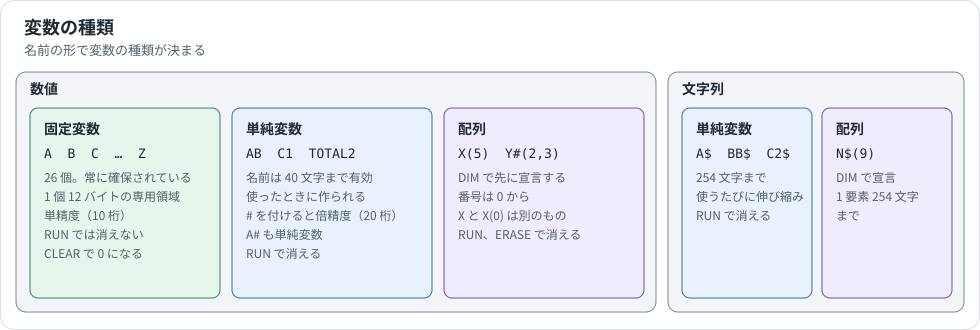
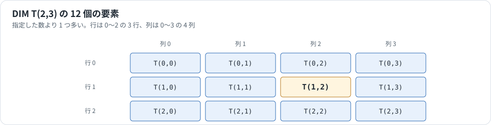
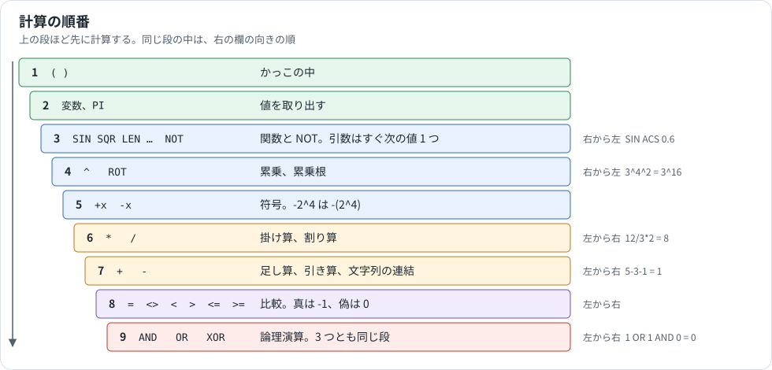

# 11. BASIC の考え方

この章は BASIC で計算やプログラムを書く前に知っておくと楽になる決まりをまとめた章です。値をどう書くか、値をどこに入れておくか、式がどの順に計算されるかを、短い例を打ちながら確かめていきます。命令を 1 つずつ調べたいときは [BASIC の命令と関数](../analysis/14_BASIC_REFERENCE.md) を引いてください。

[目次へ戻る](README.md)

## この章で分かること

- 数、16 進数、文字列の書き方
- 変数の 3 つの種類（固定変数、単純変数、配列）と、RUN で消えるもの、残るもの
- 10 桁（単精度）と 20 桁（倍精度）の使い分け
- 変数やプログラムが使うメモリの大きさ
- 比較と論理演算、そして計算の順番

## 11.0 はじめに

PC-E500 の BASIC では、プログラムを書かなくても、`RUN` モードで式を打って ⏎ を押せば答えが出ます。この章の例はどれもそのまま打てます。

```text
R=556
                                     556
R^2*PI
                            971179.3866
```

1 行目で、数 556 に `R` という名前を付けました。2 行目では、その `R` を使って半径 556 の円の面積を求めています。`^` は累乗、`PI` は円周率です。名前を付けて値を入れておく場所を**変数**、`R^2*PI` のように計算すると 1 つの値になるものを**式**といいます。BASIC のプログラムは、ほとんどが変数と式でできています。

この章の画面は日本語の PC-E500（ROM 7.2）のものです。同じ式を 2.2、7.3、8.3、8.5 でも実行し、計算の順番と結果が変わらないことを確かめました（実験）。

## 11.1 定数（決まった値）の書き方

### 11.1.1 文字列

文字や記号の並びを**文字列**といいます。命令や変数の名前と区別するために、両側を `"` で囲みます。

| 書き方 | 意味 |
|---|---|
| `"HELLO"` | HELLO の 5 文字 |
| `"2+3"` | 2、+、3 の 3 文字。計算はされない |
| `""` | 0 文字の文字列（空文字列） |

文字列の中に `"` を入れることはできません。`"VALUE OF "A" IS"` と書くと、最初の文字列は `A` の手前で終わったことになり、`Syntax error` になります。`"` が要るときは `CHR$ 34` をつなぎます。

```text
PRINT "SAY "+CHR$ 34+"HI"+CHR$ 34
SAY "HI"
```

行の終わりの `"` を忘れても、`PRINT "HELLO` のように行末までが文字列になって動くことがあります（実験）。ただし、後に文を足したときに間違いのもとになるので、必ず閉じてください。

### 11.1.2 数

| 書き方 | 値 | 説明 |
|---|---|---|
| `12`、`-1.5`、`.5` | そのまま | 10 進数 |
| `1.5E3` | 1500 | `E` の右は 10 の何乗か。単精度 |
| `1.5D3` | 1500 | `E` の代わりに `D` を書くと倍精度 |
| `4#` | 4 | `#` を付けると倍精度 |
| `12345678901` | そのまま | 11 桁以上の数は自動で倍精度になる |

扱える数の範囲は、0 と、大きさが 10 の −99 乗から 10 の 100 乗未満までです。範囲を超えると `Overflow` になり、小さすぎるときは 0 になります。

```text
9E99*9
Overflow
1E-99/10
                                       0
```

エラーの表示は `C·CE` キーで消します。エラーの番号と対処は [エラー一覧](17_ERRORS.md) にあります。

### 11.1.3 16 進数

`&H` に続けて 0〜9、A〜F を書くと 16 進数です。A〜F は 10〜15 を表します。`H` を省いて `&FFFF` と書いても通りました（実験）。

| 書き方 | 10 進 |
|---|---|
| `&HA` | 10 |
| `&H10` | 16 |
| `&H100` | 256 |
| `&HFFFF` | 65535 |
| `&HFFFFF` | 1048575（20 ビットのアドレスの最大） |

`&H10+1` は 17 のように、ふつうの数と混ぜて計算できます。逆に 10 進を 16 進で見るには `HEX` を使います（[関数と計算の範囲](14_FUNCTIONS.md)）。

## 11.2 変数



### 11.2.1 名前の付け方

変数の名前は英字で始め、英字と数字を並べます。文字列を入れる変数は最後に `$` を付けます。小文字で打っても大文字に直されます。

| 決まり | 例 |
|---|---|
| 先頭は英字 | `A1` はよいが `1A` は `Syntax error` |
| 区別されるのは 40 文字まで | 41 文字目から先が違っても同じ変数になる（実験） |
| 命令の名前で始めない | `PRINTOUT`、`ONPRINT`、`FORM`、`TOTAL`、`ORDER`、`LENGTH`、`PIE` は使えない |
| 途中に命令の名前が入るのはよい | `APRINT`、`BONPRINT`、`SCORE` は使える |

`TOTAL` が使えないのは `TO`（FOR の TO）で始まるから、`ORDER` は `OR`、`PIE` は `PI` で始まるからです。命令は空白がなくても見分けられるので、こうなります。

> [!WARNING]
> 命令の名前で始めてもエラーにならないことがあります。`PRINTOUT=1` は「`PRINT` `OUT=1`」と読まれ、変数 `OUT` と 1 を比べた結果の 0 が表示されるだけです（実験）。値が入らないと思ったら名前を疑ってください。

### 11.2.2 固定変数（A〜Z）

1 文字の `A` から `Z` までの 26 個は、常に領域が確保されている特別な変数です。プログラムがメモリを使い切っても、この 26 個は使えます。入るのは単精度の数だけです。

操作説明書 p.168 は 1 個を 8 バイトとしていますが、同じ説明書の仕様（p.351）の「固定変数の領域 312 バイト」は 26 個で割ると 1 個 12 バイトです。メモリの中でも 12 バイトずつ並んでいます（[BASIC の内部形式](../analysis/15_BASIC_INTERNALS.md) §15.2.1）。12 バイトが正しい値です。

固定変数は `RUN` で消えません。前のプログラムが入れた値を次のプログラムが受け取れます。0 に戻すには `CLEAR` を実行します。

### 11.2.3 単純変数

2 文字以上の名前（`AB`、`C1`）、`$` の付く名前（`A$`）、`#` の付く名前（`A#`）の変数は、初めて使ったときにメモリの中に領域が作られます。`A$` も `A#` も固定変数ではありません。

名前が同じでも型が違えば別の変数です。`AB`、`AB$`、`AB#` を同時に使えます。`AB!` は `AB` と同じ単精度の変数を指します。

```text
A=1
                                       1
A#=2
                                      2#
A
                                       1
```

`RUN` を実行すると単純変数は消えます（数値は 0、文字列は空）。値を残したまま動かすときは `GOTO 行番号` で始めます（[プログラムを書く](12_PROGRAMMING.md#126-run-と-goto-の違い)）。

文字列の変数には 254 文字まで入ります。254 文字の文字列に 1 文字足すと `String too long` になりました（実験）。

### 11.2.4 配列

同じ種類の値をたくさん扱うときは**配列**を使います。配列は 1 つの名前に番号（**添字**）で要素を区別する変数の並びです。使う前に `DIM` で大きさを宣言します。

```basic
10 DIM X(5)
20 X(4)=8
30 N=2
40 PRINT X(N*2)
```

- 番号は **0 から**です。`DIM X(5)` では `X(0)`〜`X(5)` の 6 個ができます。`X(4)` は 5 番目の要素です。
- 添字には式を書けます。上の例では `X(N*2)` が `X(4)` なので 8 が出ます。小数は切り捨てられ、`X(2.7)` は `X(2)` です（実験）。
- `X` と `X(0)` は別の変数です。
- 文字列の配列も同じように `DIM N$(9)` と書きます。

番号を 2 つ以上並べると表になります。`DIM T(2,3)` は 3 行 4 列の 12 個です。



```basic
10 DIM T(2,3)
20 FOR R=0 TO 2
30 FOR C=0 TO 3
40 T(R,C)=R*10+C
50 NEXT C:NEXT R
60 PRINT T(1,2);T(2,3)
70 PRINT T(3,0)
```

```text
RUN
  12  23
Subscript out of range in 70
```

70 行は行の番号 3 がないのでエラーです。番号の並び（次元）は操作説明書では 120 まで増やせますが、1 行に書ける長さに限りがあります。`DIM Q(0,0,…)` のように数を 50 個並べた行は、打った段階で `Line buffer overflow` になりました（実験）。数は中間コードの中で文字より長い形になるからです。

宣言を忘れると `Array specified without DIM`、同じ名前を 2 回宣言すると `Duplicate Definition` です。作り直すときは `ERASE X` で消してから宣言します。

### 11.2.5 使うメモリの大きさ

| 変数 | 名前の分 | 中身の分 |
|---|---|---|
| 単精度の単純変数 | 名前の長さ + 4 バイト | 7 バイト |
| 倍精度の単純変数 | 名前の長さ + 4 バイト | 12 バイト |
| 文字列の単純変数 | 名前の長さ + 8 バイト | 文字の数 |

名前の長さには `#` や `$` を数えません。`FRE0` で残りのバイト数を見ながら確かめると、表のとおりに減ります（実験、7.2）。

| したこと | 減ったバイト数 | 計算 |
|---|---|---|
| `AB=1` | 13 | 2 + 4 + 7 |
| `AB#=1` | 18 | 2 + 4 + 12 |
| `A$="HELLO"` | 14 | 1 + 8 + 5 |
| `A$="HI"` に入れ直す | 3 増える | 5 文字 → 2 文字 |
| `A=1` | 0 | 固定変数 |
| `DIM X(9)` | 78 | 7 × 10 + 8 |
| `DIM Y#(9)` | 128 | 12 × 10 + 8 |
| `DIM T(24,34)` | 6135 | 7 × 875 + 10 |

2 次元の配列はすぐに大きくなります。25 行 35 列の `T(24,34)` は 875 個もあり、6 KB を使います。プログラムの行は、行番号に 3 バイト、命令と関数に 1 個 2 バイト、行末に 1 バイトを使います。メモリの中の形は [BASIC の内部形式](../analysis/15_BASIC_INTERNALS.md) にあります。

## 11.3 単精度と倍精度

数には 2 つの精度があります。

| 精度 | 有効桁数 | 変数の書き方 | 定数の書き方 |
|---|---|---|---|
| 単精度 | 10 桁 | `AB`、`AB!` | `4`、`1E5` |
| 倍精度 | 20 桁 | `AB#` | `4#`、`1D5`、11 桁以上の数 |

どちらも 10 進で計算するので、`0.1` を 10 回足せばちょうど 1 になります。指数は −99〜99 です。

```text
AB#=1234567891234567891234
                  1.2345678912345678912D+21
AB=1234567891234567891234
                          1.234567891E+21
```

### 11.3.1 いつ倍精度で計算されるか

式の中に次のどれかがあると、その計算は倍精度になります。

- 11 桁以上の数（`1234567891234*5`）
- `D` を使った指数（`TAN 7.43D05`）
- `#` の付いた定数（`4#/7`）
- `#` の付いた変数、`DEFDBL` で倍精度と決めた変数
- `DEFDBL` を実行した後の直接の計算（画面に `DBL` が点く）

```text
4/7
                          5.714285714E-01
4#/7
                  5.7142857142857142857D-01
```

混ざった式では 1 つの演算ごとにその時の精度で計算します。`6*5+4#/7` は、`6*5` を単精度、`4#/7` を倍精度で計算し、最後の足し算を倍精度で行います。

```text
6*5+4#/7
             30.571428571428571429#
```

> [!WARNING]
> 倍精度の変数に入れても、計算が単精度なら 10 桁しか正しくありません。`A#=1/7` の `1/7` は単精度で計算されるからです。`A#=1#/7` と書きます。

倍精度の値を単精度の変数に入れると、10 桁に丸められます。

```text
AB#=5#/9
                  5.5555555555555555556D-01
AB=AB#
                          5.555555556E-01
```

`DECI`、`HEX`、`POL`、`REC` の 4 つの関数は単精度だけです。倍精度の値を渡すと 10 桁に丸めてから計算します。

### 11.3.2 DEFDBL と DEFSNG

名前にいちいち `#` を付ける代わりに、`DEFDBL A-B` のように「A と B で始まる変数は倍精度」と宣言できます。元に戻すのは `DEFSNG` です。`DEFDBL` だけを打つと、直接の計算全体が倍精度になります。

宣言した後の `A` は `A#` と同じ倍精度の変数を指します。固定変数の `A` とは別物です。次のプログラムで確かめられます。

```basic
10 DEFDBL B,D
20 DIM B(2)
30 B(0)=1#/3
40 D!=123
50 PRINT B(0)
60 DEFSNG B,D
70 PRINT B#(0)
80 PRINT D
```

70 行の `B#(0)` は 20 行で作った配列と同じものです。40 行の `!` は宣言にかかわらず単精度の変数を指す印です。

## 11.4 式

### 11.4.1 数の演算

| 記号 | 計算 |
|---|---|
| `+` `-` | 足し算、引き算 |
| `*` `/` | 掛け算、割り算 |
| `^` | 累乗 |
| `ROT` | 累乗根（`8 ROT 3` は 8 の 3 乗根） |

掛け算の `*` は省けません。`2PI` や `2(3+4)` は `Syntax error` です（電卓の CAL モードとは違います）。

### 11.4.2 文字列の演算

文字列どうしは `+` でつなげられます。数と文字列は混ぜられません。

```text
"15"+"10"
1510
"15"+10
Type mismatch
```

| したいこと | 書き方 | 結果 |
|---|---|---|
| 文字列を数にして計算 | `VAL "15"+10` | 25 |
| 数を文字列にしてつなぐ | `STR$ 15+"10"` | ` 1510`（正の数の前には空白が付く） |

計算の途中の文字列も 254 文字までです。

### 11.4.3 比較

`=`、`<>`（等しくない）、`<`、`>`、`<=`、`>=` で 2 つの値を比べます。比べた結果も数で、**正しければ −1、正しくなければ 0** です。

```text
1<2
                                      -1
3>2>1
                                       0
```

2 つ目は `3>2` が −1 になり、次に `-1>1` を調べるので 0 です。「2 は 3 と 1 の間か」は `3>2 AND 2>1` と書きます。

文字列は先頭から 1 文字ずつ文字コードを比べます。短いほうの足りない部分は文字コード 0 と考えます。

| 式 | 結果 | 理由 |
|---|---|---|
| `"ABCDEF">"ABCDE"` | −1 | 6 文字目の F と 0 を比べる |
| `"10"<"9"` | −1 | 数ではなく文字 `1` と `9` を比べる |
| `"A"="A "` | 0 | 空白も 1 文字 |

文字コードは [文字コード表とキー一覧](18_CODES.md) にあります。

> [!NOTE]
> 直接打つときの `A=3 AND 5` は代入です。`3 AND 5` の答え 1 が `A` に入ります（実験）。比較の結果を見るには `(A=3)` と括弧で囲みます。

### 11.4.4 論理演算

`AND`（かつ）、`OR`（または）、`XOR`（どちらか一方だけ）、`NOT`（でない）は、条件を組み合わせるのに使います。

```basic
10 INPUT "AGE";A
20 IF A>=6 AND A<=12 THEN PRINT "CHILD"
30 IF A<6 OR A>=65 THEN PRINT "FREE"
```

実際の動作は 16 ビットの整数のビットごとの計算です。−32768〜32767 の数を 2 進数 16 桁にして、同じ桁どうしを次の表で計算します。

| X | Y | X AND Y | X OR Y | X XOR Y |
|---|---|---|---|---|
| 1 | 1 | 1 | 1 | 0 |
| 1 | 0 | 0 | 1 | 1 |
| 0 | 1 | 0 | 1 | 1 |
| 0 | 0 | 0 | 0 | 0 |

例として 44 と 22 を計算します。

```text
 44 = 101100        44 = 101100        44 = 101100
 22 = 010110        22 = 010110        22 = 010110
AND   000100 =  4  OR   111110 = 62   XOR  111010 = 58
```

`NOT X` は 16 ビット全部を反転するので、`-(X+1)` と同じです（`NOT 3` は −4）。小数は切り捨てられ、範囲の外の数（`32768 OR 0`、`40000 AND 1`）は `Data out of range` になります。

真が −1 なのは、−1 が 16 ビット全部 1 の数だからです。だから比較の結果どうしを `AND` や `OR` でつなぐと、ちょうど条件の組み合わせになります。`IF` は 0 でない数を真とみなすので、`IF A THEN` のようにも書けます。ただし `1 AND 2` は 0 です。0 でない 2 つの数の `AND` が真になるとは限りません。

## 11.5 計算の順番



操作説明書（p.162）の順番は、変数、関数、累乗と累乗根、符号、掛け算と割り算、足し算と引き算、比較、最後に AND / OR / XOR です。括弧が一番強く、関数を重ねたときと累乗を重ねたときは右から計算します。実験で確かめたのは次のことです（7.2 で実行。2.2、7.3、8.3、8.5 でも同じ）。

| 式 | 結果 | 分かること |
|---|---|---|
| `5+2*3` | 11 | 掛け算が先。`(5+2)*3` なら 21 |
| `-2^4` | −16 | 累乗が符号より先。`-(2^4)` |
| `3^-2` | 0.111… | 累乗の右の符号は先に付く |
| `3^4^2` | 43046721 | 右から。3 の 16 乗 |
| `2^3 ROT 3` | 2.717442616 | `^` と `ROT` は同じ強さで右から |
| `SIN 30^2` | 0.25 | 関数が累乗より先。(sin 30°)² |
| `SIN 30+60` | 60.5 | 関数の引数はすぐ次の値だけ |
| `1+2<4 AND 2>1` | −1 | 足し算、比較、AND の順 |
| `1 OR 1 AND 0` | 0 | AND と OR は同じ強さで左から |
| `0 AND 0 OR 1` | 1 | 同上 |
| `1 XOR 1 AND 0` | 0 | XOR も同じ強さ |
| `NOT 1+1` | −1 | NOT は足し算より先 |
| `NOT 2^2` | 9 | NOT は累乗よりも先（−3 の 2 乗） |

> [!WARNING]
> 2 つ注意があります。
> - ほかの多くの BASIC と違い、`AND` は `OR` より強くありません。`A=1 OR B=1 AND C=1` は `(A=1 OR B=1) AND C=1` です。
> - 操作説明書（p.177）は論理演算を最後に計算すると説明していますが、`NOT` だけは関数と同じ強さです。`NOT A=B` は `(NOT A)=B` になります。`NOT (A=B)` と書いてください。

順番を覚えなくても、括弧を付ければ思ったとおりに計算されます。読む人にも親切です。

電卓（CAL モード）での順番は [電卓](05_CAL.md)、直接打った式の続け方や誤差は [RUN モードの計算](06_RUN.md) で説明します。

## まとめ

| 項目 | 決まり |
|---|---|
| 数 | 単精度 10 桁、倍精度 20 桁、指数 −99〜99 |
| 文字列 | `"` で囲む。254 文字まで |
| 16 進 | `&H` を付ける |
| 変数名 | 英字で始まり 40 文字まで有効。命令の名前で始めない |
| 固定変数 A〜Z | 26 個、RUN で消えない |
| 配列 | `DIM` で宣言、番号は 0 から |
| 真と偽 | −1 と 0 |
| 論理演算 | 16 ビット整数（−32768〜32767） |
| 順番 | 括弧、変数、関数と NOT、累乗、符号、乗除、加減、比較、AND/OR/XOR |

## 出典

- 操作説明書（Operation Manual）p.162〜163、p.168〜174、p.176〜179、p.207。p.166〜167 は手元の英語版のスキャンにないので、PC-E500S のドイツ語版の同じページによりました。
- 実験: 上の式とプログラムを ROM 7.2（確認のため 2.2、7.3、8.3、8.5 も）のエミュレータで実行。

## 次に読むもの

- [プログラムを書く](12_PROGRAMMING.md): 変数と式を並べてプログラムにする
- [関数と計算の範囲](14_FUNCTIONS.md): 使える関数の一覧
- [BASIC の命令と関数](../analysis/14_BASIC_REFERENCE.md): 命令の辞典
- [BASIC の内部形式](../analysis/15_BASIC_INTERNALS.md): 変数がメモリの中でどう並ぶか
