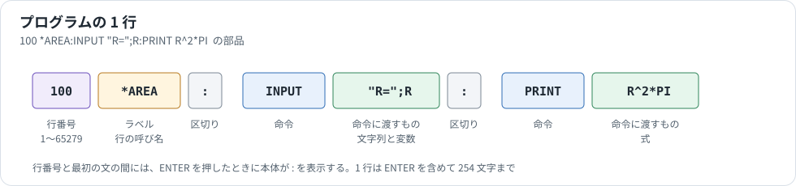

# 12. プログラムを書く

この章は、PC-E500 に BASIC のプログラムを打ち込み、動かし、直すまでの操作を、順に試しながら説明します。命令そのものの使い方よりも「どのモードで、どのキーを押すと、何が起こるか」に重きを置きます。初めてプログラムを書く人は、この章の例を上から順に打ってみてください。

[目次へ戻る](README.md)

## この章で分かること

- PRO モードと RUN モードの役割
- 行番号、ラベル、1 行に書ける長さ
- 打ち込む、動かす、直す、消すためのキー
- いくつものプログラムを 1 つのメモリに置いて使い分ける方法
- `RUN` で始めるのと `GOTO` で始めるのとの違い
- プログラムが消えるとき、消えないとき

## 12.0 はじめに

プログラムは、本体への命令を並べたものです。PC-E500 の BASIC では、ひとまとまりの命令に**行番号**を付けて 1 行とし、番号の小さい順に実行します。

```basic
10 INPUT "R=";R
20 S=R^2*PI
30 PRINT "AREA";S
40 END
```

半径を尋ねて、円の面積を出すプログラムです。10 行で数を受け取り、20 行で計算し、30 行で見せ、40 行で終わります。動かすとこうなります。

```text
RUN
R=10
AREA 314.1592654
>
```

`>` は「次の指示を待っています」という印で、**プロンプト**といいます。

## 12.1 2 つのモード

BASIC キーを押すたびに、画面上部の表示が `RUN` と `PRO` で入れ替わります。


| | PRO モード | RUN モード |
|---|---|---|
| 行番号を付けて打つ | プログラムに入る | 入らない（`10 A=3` は `Syntax error`） |
| `LIST` `DELETE` `AUTO` `RENUM` `NEW` | 使える | `Mode error` |
| `RUN`、変数に値を入れる（`AB=1`） | `Mode error` | 使える |
| 変数の中身を見る、式の答えを見る | 使える | 使える |

この表は ROM 7.2 で確かめたものです。モードを間違えてもエラーが出るだけなので、C·CE を押し、BASIC キーで切り替えてからもう一度打ってください。TEXT モードは [BASIC の命令と関数](../analysis/14_BASIC_REFERENCE.md#1421-モード) にあります。

行番号を付けずに打った命令は、⏎ を押すとすぐに実行されます。これを**直接実行**（ダイレクトコマンド）といいます。`RUN`、`NEW`、`RADIAN` などです。行番号を付けた命令はプログラムにしまわれ、動かすまで実行されません。

## 12.2 行の形



### 12.2.1 行番号

- 1〜65279 の整数です。65280 以上は `Illegal line number`、0 は受け付けられません（実験: `Undefined line`）。
- 打つ順番は自由です。本体が番号順に並べます。
- 同じ番号の行をもう一度打つと、前の行は新しい行に置き換わります。
- 番号だけを打って ⏎ を押すと、その行が消えます。
- 10 おきに付けておくと、後から間に行を足せます。足りなくなったら `RENUM` で付け直します。

`AUTO` を実行すると、⏎ を押すたびに次の番号が出ます。終わるときは C·CE です。

```text
AUTO
10 _
```

`AUTO` は、前の行を直している途中（画面に行が出ていてカーソルがある状態）では効きません。C·CE でプロンプトに戻してから打ちます。

### 12.2.2 1 行の長さと文の区切り

1 行には、行番号と ⏎ を含めて 254 文字まで書けます。実際、行番号から数えて 253 文字の行は入り、254 文字の行は `Line buffer overflow` になりました（実験）。

`:` で区切ると、1 行に 2 つ以上の文を書けます。短い文をまとめるのには便利ですが、長い行は読みにくく、修正もしにくくなります。1 行に 1〜2 文が目安です。

### 12.2.3 ラベル

行の先頭に `*` と英字で始まる名前を書くと、行番号の代わりに呼べる**ラベル**になります。操作説明書では、英字 1 文字とその後の英数字 19 文字までです。`"名前"` と書くラベルもあります。どちらの後にも `:` を置きます。

```basic
100 *TAX:WAIT 59
110 FOR Y=100 TO 500 STEP 100
120 PRINT Y,Y*1.1
130 NEXT Y
140 END
```

```text
RUN *TAX
         100          110
         200          220
         300          330
```

- `*AB` と `"AB"` は別のラベルです。`RUN *B` で `"B":` の行を呼ぼうとすると `Undefined line` になります（実験）。
- `*` のほうが速く、一覧の中で見つけやすいので、操作説明書は `*` を勧めています。

### 12.2.4 命令と、命令に渡すもの

文は命令で始まります。命令に渡す値（オペランド）は、必ず要るもの、省けるもの、書いてはいけないものがあります。`LIST` は番号を省けますが、`GOTO` は省けません。どの命令がどうかは [BASIC の命令と関数](../analysis/14_BASIC_REFERENCE.md) に 1 つずつ載せています。命令、関数、変数の名前は小文字で打っても大文字に直されます。

## 12.3 打って、動かす

1. BASIC キーで `PRO` にします。
2. `NEW` ⏎。**前のプログラムと変数はすべて消えます。**
3. 1 行打つごとに ⏎。⏎ を押すと、行番号の後に `:` が付いて表示されます。これで行が登録されたことが分かります。

```text
10:PRINT "GOOD MORNIG"
```

4. BASIC キーで `RUN` に切り替え、`RUN` ⏎。

```text
RUN
GOOD MORNIG
>
```

つづりを間違えています。次の節で直します。

## 12.4 直す

### 12.4.1 行を呼び出す

PRO モードで ↑ か ↓ を押すと、行が表示されます。どの行が出るかは、そのときの状態によります。

| 状態 | ↓ | ↑ |
|---|---|---|
| 最後まで動き終わった後など | 最初の行 | 最後の行 |
| BREAK や STOP で止めた後 | 止まった行 | 止まった行 |
| エラーの後 | エラーの行 | エラーの行 |
| 行が表示されているとき | 次の行 | 前の行 |

押し続けると、画面が流れて行が順に出ます。`LIST 行番号` で、その行から表示することもできます。


カーソルのある行だけは `:` が空白になります。ここが編集できる行です。呼び出した行が画面のどこに出るかは ROM バージョンで違い、7.2 など改訂 7 までは最後の行を画面の一番下に、改訂 8（8.3、8.5）では上から詰めて表示します（実験）。

### 12.4.2 カーソルで直す

| キー | 働き |
|---|---|
| → ← | カーソルを動かす。文字の上では点滅する四角になる |
| SHIFT + → | 行の最後の文字の次へ |
| SHIFT + ← | 行の先頭へ |
| 文字 | カーソルの位置の文字と置き換わる |
| INS | 挿入の切り替え。◀ の印が出て、打った文字が割り込む |
| DEL | カーソルの位置の文字を消す |
| BS | カーソルの左の文字を消す |
| CTRL + E | カーソルから行末まで消す |
| CTRL + U | カーソルのある行を全部消す |
| ⏎ | 直した内容を**プログラムに入れる** |
| C·CE | 取り消す |

「MORNIG」の G の上へカーソルを動かし、INS、N、⏎ と押します。

```text
10 PRINT "GOOD MORNING"
```

> [!WARNING]
> 直しただけではプログラムは変わりません。必ず ⏎ を押してください。改訂 8 の機種（PC-E500S、PC-E650、PC-U6000）だけは、ほかの行へ移ったときにも直した内容が入ります（[機種ガイド](../analysis/29_MODELS.md#basic)）。

ほかの行番号に書き換えて ⏎ を押すと、元の行はそのままで、新しい番号の行が増えます。似た行を作るときに便利です。

カーソルが出ていないときに文字を打つと、新しい入力として画面の左端から始まります。← か → を押せばカーソルが出て、表示されている行を直せます。

### 12.4.3 エラーを直す

```basic
10 PRNT "HI"
20 PRINT "BYE"
```

```text
RUN
Syntax error in 10
```

`in 10` が行番号です。C·CE で消し、PRO に切り替えて ↑ を押すと、10 行が出て、**本体が解釈できなかった箇所にカーソルが置かれます**。この例では `PRNT` の次の `"` の上です。`PRNT` は変数の名前としては正しいので、その直後の `"` で「おかしい」と分かったわけです。本当の間違いはカーソルより左にあることが多い、と覚えておいてください。

### 12.4.4 消す

| したいこと | 操作（PRO モード） |
|---|---|
| 1 行消す | 行番号 ⏎ |
| 20〜40 行を消す | `DELETE 20-40` ⏎ |
| 全部消す | `NEW` ⏎ |

## 12.5 繰り返しと停止

12.0 節の 40 行を `GOTO 10` にすると、答えを出すたびに最初へ戻ります。終わりのない**無限ループ**です。止めるには ON（BREAK）を押します。

```text
Break in 10
```

`CONT` ⏎ で続きから動きます。INPUT の途中で止めたときは、同じ質問がもう一度出ます（実験）。

回数の決まったループには `FOR` と `NEXT` を使います。12.2.3 節の例では、`Y` が 100、200、… と増え、500 を超えたら次の行へ進みます。増やす量は `STEP` で決めます。`FOR` に使う変数は、固定変数か単精度の単純変数です。

### 12.5.1 画面から流れて消える表示

画面は 4 行です。5 行以上を続けて表示すると、前の行は上へ流れて戻せません。読む時間を作るには次の方法があります。

| 方法 | 使い方 |
|---|---|
| `WAIT 59` | 以後の `PRINT` のたびに約 1 秒待つ（59 で約 1 秒）。`WAIT` だけなら ⏎ を押すまで待つ |
| `PAUSE` | `PRINT` の代わりに使う。少し待つ |
| `FOR J=1 TO 500:NEXT J` | 何もしない繰り返しで待つ。`WAIT` のない機種でも使える |
| `LPRINT` | プリンタに出す |

`WAIT` は `PRINT` 1 回ごとに待ちます。1 つの `PRINT` で何行も出すと、その分は一度に流れます。`PRINT` を分けてください。

## 12.6 RUN と GOTO の違い

行番号さえ重ならなければ、いくつものプログラムを同時に入れておけます。動かすときは始める場所を指定します。

```text
RUN 100        GOTO 100        RUN *TAX        GOTO *TAX
```

`RUN` は「まっさらにして始める」、`GOTO` は「今の状態のまま始める」です。

| | RUN で始める | GOTO で始める |
|---|---|---|
| 固定変数 A〜Z | 残る | 残る |
| 単純変数、配列 | 消える | 残る |
| `DEFDBL` など精度の指定 | 取り消す | 残る |
| `WAIT` の時間 | 取り消す | 残る |
| `USING` の書式 | 取り消す | 残る |
| `READ` の読む位置 | 最初の `DATA` から | 続きから |
| `PRINT=LPRINT` | 取り消す | 残る |
| 開いているファイル | 閉じる | 開いたまま |
| `LOCATE`、`GCURSOR` の位置 | 取り消す | 残る |
| `ON ERROR GOTO` | 取り消す | 残る |
| `ERN`、`ERL` | 消す | 残る |

確かめてみます。次のプログラムを入れ、直接 `A=5`、`AB=6`、`DIM D(3)`、`D(1)=7` を実行しておきます。

```basic
10 PRINT A;AB
20 PRINT D(1)
30 END
```

```text
GOTO 10
 5  6
                                       7
RUN
 5  0
Array specified without DIM in 20
```

`GOTO` では全部残っています。`RUN` では固定変数の `A` だけが残り、`AB` は 0 に、配列 `D` はなくなりました。

`READ` も同じです。`20 READ P:PRINT P` の前に `DATA 11,22,33` があるとき、`RUN` すれば 11、その後 `GOTO 20` を繰り返すと 22、33 と進み、`RUN` し直すとまた 11 になります（実験）。

よく使う `RUN *TAX` は、PF キーに登録すれば 1 回で呼べます（[PF キーと便利な使い方](16_PF_KEYS.md)）。

## 12.7 プログラムが消えるとき

電源を切っても、自動で切れても、BREAK、C·CE、SHIFT + CA を押しても、プログラムは消えません。消えるのは次のときです。

- PRO モードで `NEW` を実行したとき
- RESET ボタンで**初期化**したとき（[困ったとき](19_TROUBLE.md)）
- 同じ行番号の行を打ったとき（その行だけ）
- `LOAD` などで別のプログラムを読み込んだとき

重要なプログラムは `SAVE` で RAM ディスクやテープに保存します。やり方は [ファイルとドライブ](15_FILES.md) にあります。

## まとめ

| したいこと | 操作 |
|---|---|
| 書く | BASIC キーで `PRO`、行番号 + 文 + ⏎ |
| 動かす | BASIC キーで `RUN`、`RUN` ⏎ |
| 呼び出す | PRO モードで ↑ ↓、または `LIST` |
| 直す | カーソルを動かして打ち、⏎ |
| 止める、続ける | ON（BREAK）、`CONT` |
| 途中から始める | `RUN 行番号`、`GOTO *ラベル` |

## 出典

- 操作説明書 p.180〜188、p.191〜192、p.344〜347。
- 実験: ROM 7.2（行の呼び出しは 8.3、8.5 も）のエミュレータ（行の長さ、行番号の範囲、ラベル、RUN と GOTO の違い、行の呼び出し）。

## 次に読むもの

- [デバッグ](13_DEBUGGING.md): 思ったとおりに動かないとき
- [ファイルとドライブ](15_FILES.md): プログラムとデータを保存する
- [BASIC の考え方](11_BASIC_CONCEPTS.md): 変数と式の決まり
- [BASIC の命令と関数](../analysis/14_BASIC_REFERENCE.md): 命令の辞典
