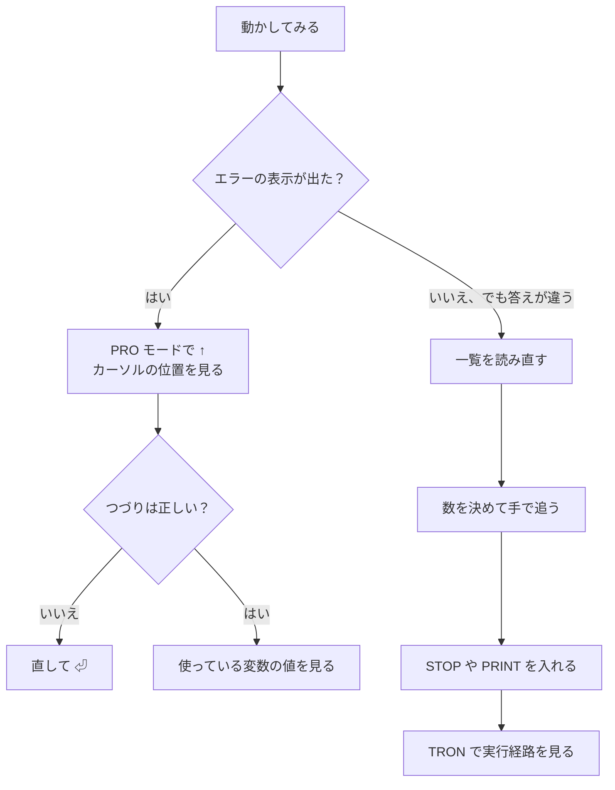

# 13. デバッグ

この章は、打ち込んだプログラムが思ったとおりに動かないときに、原因を調べて直すための章です。エラーの出た行を呼び出す、途中で止めて変数を見る、1 行ずつ進める、通った行の番号を出す（トレース）、という 4 つの方法を、短いプログラムで順に試します。

[目次へ戻る](README.md)

## この章で分かること

- エラーが出たときと、エラーは出ないのに答えがおかしいときの調べ方
- `STOP`、BREAK、`CONT`、↓、SHIFT + ↓、↑ の働き
- `TRON` と `TROFF` によるトレースの画面の見方
- 続きから動かせなくなるとき

## 13.0 はじめに

新しいプログラムが一度で動くことは、まずありません。本に載っている正しいプログラムを打ち込むだけでも、打ち間違いは起こります。間違いには 2 種類あります。



## 13.1 エラーの表示が出たとき

```basic
10 N=3
20 A$=CHR$ (N-5)
30 PRINT A$
```

```text
RUN
Data out of range in 20
```

1. C·CE でエラーを消します。
2. PRO モードに切り替えて ↑（または ↓）を押すと、エラーの行が出て、本体が解釈できなかった箇所にカーソルが置かれます。間違いはそこか、その少し左です。
3. つづりが正しければ、使っている**値**を疑います。変数の名前を打って ⏎ を押せば、RUN モードでも PRO モードでも中身が見られます。`N` は 3 なので、`N-5` は −2 です。負の文字コードはないのでエラーになったのだと分かります。

RUN モードのまま ↑ を押し続けている間も、エラーの行が見られます（離すと元の画面に戻ります）。エラーの名前の意味は [エラー一覧](17_ERRORS.md) で引けます。

## 13.2 エラーは出ないが答えが違うとき

軽い方法から順に試します。

1. **一覧を読み直す。** PRO モードで `LIST` し、↑ ↓ で全部の行を見ます。打ち間違いの多くはこれで見つかります。`O` と `0`、`I` と `1`、`:` と `;` に注意します。
2. **本体になったつもりで追う。** 簡単な数を決めて、1 行ずつ紙の上で計算します。
3. **途中に `PRINT` を入れる。** 大事な変数を表示させ、どこまで正しいかを狭めます。どの行が実行されたかも分かります。
4. **`STOP` を入れて止める。** 止まった箇所で、見たい変数をいくつでも調べられます。
5. **トレースする。** 通った行の番号を順に表示させます。時間はかかりますが、ほかの方法で分からないときに役立ちます。

## 13.3 途中で止めて調べる

止め方は 3 つあります。

- 動いている間に ON（BREAK）を押す
- トレースの間に ON（BREAK）を押す
- 止めたい箇所に `STOP` を書いておく

どれでも `Break in 行番号` と表示されて止まります。

```basic
10 A=0
20 PRINT "START"
30 STOP
40 A=A+1
50 PRINT "A=";A
60 END
```

```text
RUN
Break in 30
START
```

ここで `A` ⏎ と打てば 0 と出ます。`A=100` のように値を変えることもできます。止まっている間に使えるキーは次のとおりです。

| 操作 | 働き |
|---|---|
| ↓ | 次の 1 行を実行して、また止まる |
| ↓ を押し続ける | 1 行ずつ続けて実行し、離すと止まる |
| ↑ を押し続ける | 止まっている行を表示する。離すと元の画面に戻る |
| SHIFT + ↓、`CONT` ⏎ | 続きを普通に実行する |

↓ を押すと、進んだ行の番号が `Step in` の後に出ます。

```text
Step in 40                                      ← ↓ 1 回目
Step in 50                                      ← ↓ 2 回目
A= 1
```

`INPUT` で入力を待っている間に止めたときは、`CONT` の後にもう一度入力を求められます。

## 13.4 トレース（TRON、TROFF）

`TRON` を実行しておくと、1 行実行するたびに、その行の番号が画面の右上に約 0.5 秒、白黒反転で表示されます。


1. RUN モードで `TRON` ⏎。
2. `RUN`（または `GOTO`）でプログラムを始める。
3. 見たい行番号が出たら ON（BREAK）で止め、変数を調べる。
4. ↓ で 1 行ずつ、`CONT` か SHIFT + ↓ で連続して進める。
5. 終わったら `TROFF` ⏎。

```basic
10 READ A,B
20 C=A+B
30 PRINT C
40 DATA 3,4
50 GOTO 10
```

このプログラムをトレースすると、10、20、30、40、50 と番号が進み、10 行に戻った所で次のエラーになります。`DATA` がなくなったのに、また読もうとしたからです。番号の並びを見れば、50 行が余計だったことに気付けます。

```text
RUN
                                       7
Out of data in 10
```

`TRON` と `TROFF` はプログラムの中にも書けます。調べたい部分だけをはさめば、そこだけがトレースされます。`TRON` の行を通らなければ、トレースは始まりません。

トレースは次のどれかまで続きます。プログラムが終わっても、`NEW` を実行しても続いているので、調べ終わったら忘れずに止めてください。

- `TROFF` を実行する
- SHIFT + CA を押す
- 電源を切る

> [!TIP]
> 行が多いとトレースは遅くなります。疑わしい箇所の手前に `STOP` を置き、止まってから ↓ で進めるほうが早いこともあります。

## 13.5 続きから動かせないとき

止めた後に次のことをすると、`CONT` は `Can't continue` になります。

- プログラムの行を足す、直す、消す（実験: 止めた後に 70 行を足すと `Can't continue`）
- `END` やエラーでプログラムが終わった後に `CONT` を打つ

変数の値を見たり変えたりしただけなら続けられます。行を直したときは、`GOTO 行番号` で始めれば、変数を残したまま好きな行から動かせます（[RUN と GOTO の違い](12_PROGRAMMING.md#126-run-と-goto-の違い)）。

## 13.6 プログラムの中でエラーを受け止める

`ON ERROR GOTO` を使うと、エラーが起きても止まらずに、指定した行へ分岐できます。`ERN` にエラーの番号、`ERL` に行番号が入ります。

```basic
10 ON ERROR GOTO 100
20 INPUT "X=";X
30 PRINT 10/X
40 GOTO 20
100 IF ERN=21 THEN PRINT "NOT 0":RESUME 20
110 PRINT "ERROR";ERN;" LINE";ERL:END
```

`ERN` の番号は [エラー一覧](17_ERRORS.md) のものです。調べている間は `ON ERROR GOTO` の行を外しておくと、本当のエラーの名前が画面に出ます。

## まとめ

| 方法 | 使うとき |
|---|---|
| PRO モードの ↑ | エラーの行を見る |
| 変数名 ⏎ | 値を見る |
| `STOP`、ON（BREAK） | 止める |
| ↓ | 1 行進める |
| `CONT`、SHIFT + ↓ | 続ける |
| `TRON`、`TROFF` | 通った行の番号を見る |

## 出典

- 操作説明書 p.193〜195、p.347。
- 実験: 上のプログラムを ROM 7.2 のエミュレータで実行。

## 次に読むもの

- [エラー一覧](17_ERRORS.md): 番号と意味、対処
- [プログラムを書く](12_PROGRAMMING.md): 行の呼び出しと直し方
- [BASIC の命令と関数](../analysis/14_BASIC_REFERENCE.md): `STOP`、`CONT`、`TRON`、`ON ERROR GOTO`
