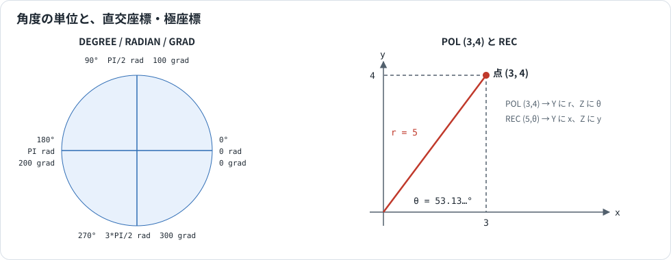

# 14. 関数と計算の範囲

この章は平方根や三角関数などの数値関数を、RUN モードや BASIC のプログラムで使うための章です。関数の一覧と例、どこまでの数を渡せるか、精度、ROM バージョンによる違いをまとめました。文字列の関数（`LEN`、`MID$` など）と `RND` は [BASIC の命令と関数](../analysis/14_BASIC_REFERENCE.md) にあります。

[目次へ戻る](README.md)

## この章で分かること

- 関数の書き方と、引数の区切り
- 角度の単位（DEG、RAD、GRAD）の切り替え
- 関数ごとの例と結果
- 計算できる範囲と、外れたときのエラー
- 単精度と倍精度、ROM バージョンによる結果の違い

## 14.0 はじめに

縦 3 m、横 4 m の部屋の対角線の長さと、その傾きを求めます。

```text
SQR (3*3+4*4)
                                       5
ATN (3/4)
                             36.86989765
```

`SQR` は平方根、`ATN` はタンジェントから角度を求める関数です。関数は RUN モードで直接使うことも、プログラムの中で使うこともできます。

## 14.1 書き方

関数の名前の後に値（**引数**）を書きます。引数が 1 つの数や変数なら括弧は要りません。式を渡すときは括弧で囲みます。

| 書き方 | 意味 | 結果 |
|---|---|---|
| `SQR 9+16` | (√9) + 16 | 19 |
| `SQR (9+16)` | √25 | 5 |
| `SIN 30^2` | (sin 30°)² | 0.25 |
| `SIN ACS 0.6` | sin(cos⁻¹ 0.6) | 0.8 |
| `ABS -5+2` | \|−5\| + 2 | 7 |

関数を並べると、右から順に計算されます。優先順位の全体は [BASIC の考え方](11_BASIC_CONCEPTS.md#115-計算の順番) にあります。

多くの関数は本体のキー 1 つで入ります。ABS、CUB、INT、NCR、NPR、RND、SGN には専用のキーがないので、文字で打ちます。数字を打ってから関数キーを押して直接答えを出す使い方は [RUN モードの計算](06_RUN.md) で説明します。

## 14.2 角度の単位

三角関数は角度を 3 つの単位のどれかで扱います。

| 単位 | 命令 | 画面の表示 | 直角 |
|---|---|---|---|
| 度 | `DEGREE` | DEG | 90 |
| ラジアン | `RADIAN` | RAD | PI/2 |
| グラード | `GRAD` | GRAD | 100 |



命令は直接でもプログラムの中でも使えます。一度選ぶと、電源を切っても変えるまでそのままです。思った答えと違うときは、まず画面の DEG / RAD / GRAD を見てください。リセット後は DEG です。

```text
DEGREE
SIN 30
                                     0.5
RADIAN
SIN (PI/6)
                                     0.5
GRAD
SIN 50
                         7.071067812E-01
```

この章の例は、ほかに断らなければ DEG です。

## 14.3 関数の一覧

「精度」の D は単精度と倍精度の両方で使えるもの、S は単精度だけのものです。S の関数に倍精度の値を渡すと、10 桁に丸めてから計算します。

### 14.3.1 三角関数と双曲線関数

| 関数 | 意味 | 精度 | 例 |
|---|---|---|---|
| `SIN` `COS` `TAN` | 正弦、余弦、正接 | D | `TAN 60` → 1.732050808 |
| `ASN` `ACS` `ATN` | 逆関数。答えは選んだ角度の単位 | D | `ACS 0.25` → 75.52248781 |
| `HSN` `HCS` `HTN` | 双曲線関数 sinh、cosh、tanh | D | `HCS 1` → 1.543080635 |
| `AHS` `AHC` `AHT` | 双曲線関数の逆関数 | D | `AHC 2` → 1.316957897 |

### 14.3.2 累乗、根、指数、対数

| 関数 | 意味 | 精度 | 例 |
|---|---|---|---|
| `y^x` | y の x 乗 | D | `2^0.5` → 1.414213562 |
| `y ROT x` | y の x 乗根 | D | `32 ROT 5` → 2 |
| `SQU` `CUB` | 2 乗、3 乗 | D | `CUB 1.5` → 3.375 |
| `SQR` `CUR` | 平方根、立方根 | D | `CUR -27` → −3 |
| `RCP` | 逆数 | D | `RCP 8` → 0.125 |
| `EXP` | e の累乗（キーは eˣ） | D | `EXP 2` → 7.389056099 |
| `TEN` | 10 の累乗 | D | `TEN -2` → 0.01 |
| `LN` | 自然対数 | D | `LN 10` → 2.302585093 |
| `LOG` | 常用対数 | D | `LOG 1000` → 3 |

### 14.3.3 整数、符号、場合の数、円周率

| 関数 | 意味 | 精度 | 例 |
|---|---|---|---|
| `ABS` | 絶対値 | D | `ABS -12.5` → 12.5 |
| `INT` | その数を超えない最大の整数 | D | `INT 3.7` → 3、`INT -3.7` → −4 |
| `SGN` | 正 1、0 は 0、負 −1 | D | `SGN -3` → −1 |
| `RND` | 乱数 | D | [RND](../analysis/14_BASIC_REFERENCE.md#rnd) |
| `FACT` | 階乗 | D | `FACT 10` → 3628800 |
| `NCR (n,r)` | n 個から r 個を選ぶ組合せ | D | `NCR (52,5)` → 2598960 |
| `NPR (n,r)` | 順列 | D | `NPR (10,3)` → 720 |
| `PI` | 円周率 | D | 単精度 3.141592654、倍精度 3.1415926535897932385 |

> [!NOTE]
> `INT` は「小数点以下を捨てる」のではなく、**小さいほうの整数**にします。負の数で違いが出ます。小数点以下を捨てるには `SGN X*INT ABS X` と書きます。

### 14.3.4 変換

| 関数 | 意味 | 精度 | 例 |
|---|---|---|---|
| `DEG` | 度分秒 → 度 | D | `DEG 12.3045`（12 度 30 分 45 秒）→ 12.5125 |
| `DMS` | 度 → 度分秒 | D | `DMS 12.5125` → 12.3045 |
| `POL (x,y)` | 直交座標 → 極座標。Y に距離、Z に角度 | S | `POL (-3,4)` → 5 |
| `REC (r,θ)` | 極座標 → 直交座標。Y に x、Z に y | S | `REC (5,60)` → 2.5 |
| `DECI` | 16 進 → 10 進 | S | `DECI FF` → 255 |
| `HEX` | 10 進 → 16 進 | S | `HEX 255` → FF |

**度分秒の書き方。** 小数点の前が度、小数第 1〜2 位が分、第 3〜4 位が秒、その後が秒の小数です。時刻にも使えます。2 時間 15 分と 1 時間 50 分の合計は次のように求めます。

```text
DMS (DEG 2.15+DEG 1.50)
                                    4.05
```

4 時間 5 分です。

**座標の変換。** 答えは 1 つ目だけが表示され、2 つとも固定変数の `Y` と `Z` に入ります。前から使っていた `Y`、`Z` は書き換わるので注意してください。

```text
REC (5,60)
                                     2.5
Z
                             4.330127019
```

**16 進の変換。** `DECI` の引数は引用符も `&H` もなしで 16 進数をそのまま書きます。`DECI A` は変数 `A` の値ではなく、16 進の A（10）です（実験）。負の数は 10 桁の 2 の補数になり、`HEX -1` は FFFFFFFFFF、`DECI FFFFFFFFFF` は −1 です。プログラムの中で文字列として 16 進が欲しいときは `HEX$` を使います。

## 14.4 計算できる範囲

数そのものは 0 と、大きさが 10⁻⁹⁹ 以上 10¹⁰⁰ 未満の数を扱えます。大きすぎると `Overflow`、小さすぎると 0 です。画面に出る桁数は画面の幅で決まります。

関数ごとの引数の範囲は次の表のとおりです（操作説明書 p.207〜208）。最後の欄は範囲を外した例を ROM 7.2 で実行した結果です。

| 関数 | 引数 x の範囲 | 範囲の外の例 |
|---|---|---|
| `SIN` `COS` `TAN` | DEG: 大きさが 10¹⁰ 未満（倍精度 10²⁰ 未満）<br>RAD: π/180 × 10¹⁰ 未満（倍精度は × 10²⁰）<br>GRAD: 10/9 × 10¹⁰ 未満（倍精度は × 10²⁰） | `SIN 1E10` → Illegal function call |
| `TAN` | 上に加えて、直角の奇数倍（90°、270° など）は不可 | `TAN 90` → Overflow |
| `ASN` `ACS` | −1 ≦ x ≦ 1 | `ASN 2` → Illegal function call |
| `ATN` | 大きさが 10¹⁰⁰ 未満（どの数でもよい） | |
| `HSN` `HCS` `HTN` | −227.9559242 ≦ x ≦ 230.2585092<br>倍精度 −227.95592420641052271 ≦ x ≦ 230.25850929940456840 | `HSN 231` → Overflow、`HSN -228` → Division by Zero |
| `AHS` | 大きさが 10⁵⁰ 未満 | `AHS 1E50` → Overflow |
| `AHC` | 1 ≦ x < 10⁵⁰ | `AHC 0.5` → Illegal function call |
| `AHT` | 大きさが 1 未満 | `AHT 1` → Division by Zero |
| `LN` `LOG` | 10⁻⁹⁹ ≦ x < 10¹⁰⁰ | `LOG 0` → Illegal function call |
| `EXP` | −10¹⁰⁰ < x ≦ 230.2585092<br>倍精度は 230.25850929940456840 まで | `EXP 231` → Overflow |
| `TEN` | −10¹⁰⁰ < x < 100 | `TEN 100` → Overflow |
| `CUR` | どの数でもよい | |
| `RCP` | 0 以外 | `RCP 0` → Division by Zero |
| `SQU` | 大きさが 10⁵⁰ 未満 | `SQU 1E50` → Overflow |
| `SQR` | 0 ≦ x < 10¹⁰⁰ | `SQR -1` → Illegal function call |
| `FACT` | 0〜69 の整数 | `FACT 70` → Overflow、`FACT 2.5` → Illegal function call |
| `DMS` `DEG` | 大きさが 10¹⁰⁰ 未満 | |
| `HEX` | 大きさが 9999999999 以下の整数 | `HEX 10000000000` → Overflow、`HEX 12.7` → Illegal function call |
| `DECI` | 0〜2540BE3FF、FDABF41C01〜FFFFFFFFFF | `DECI 2540BE400` → Overflow |

2 つの値を使うもの:

| 計算 | 範囲 |
|---|---|
| `y^x` | y > 0: x·log y が 100 未満。y = 0: x > 0。y < 0: x が整数か、1/x が奇数（x は 0 でない）で、x·log\|y\| が 100 未満 |
| `y ROT x` | y > 0: x は 0 以外で (1/x)·log y が 100 未満。y = 0: x > 0。y < 0: x が奇数、または 1/x が 0 でない整数で、(1/x)·log\|y\| が 100 未満 |
| `POL (x,y)` | x² + y² < 10¹⁰⁰、y/x < 10¹⁰⁰ |
| `REC (r,θ)` | r、r·sin θ、r·cos θ の大きさが 10¹⁰⁰ 未満 |
| `NPR (n,r)` | 0 ≦ r ≦ n < 10¹⁰⁰ の整数 |
| `NCR (n,r)` | 0 ≦ r ≦ n < 10¹⁰⁰ の整数。r と n−r の小さいほうが 69 以下 |

負の数の累乗根は、`(-32) ROT 5` → −2 のように奇数なら求まり、`(-16) ROT 4` は `Illegal function call` です。`0^0` と `POL (0,0)` もエラーになります。操作説明書の `y ROT x` の欄は、y < 0 のとき「x か 1/x が 0 でない整数」とだけ書いていますが、実際には偶数の x ではエラーです（実験）。

倍精度にすると、同じ関数でも範囲が広がります。

```text
SIN 1E10
Illegal function call
SIN 99999999999
                 -9.8768834059513772619D-01
```

## 14.5 精度

| | 画面に出る桁 | 途中の計算 |
|---|---|---|
| 単精度 | 10 桁 | 12 桁 |
| 倍精度 | 20 桁 | 24 桁 |

`DEFDBL` を実行すると、直接の計算が倍精度になります。

```text
DEFDBL
SQR 2
                  1.4142135623730950488#
FACT 25
            1.5511210043330985984D+25
```

関数の値は近似式で求めるので、特別な点（90° に近い `TAN` など）の近くや、関数をいくつも重ねた式では誤差が大きくなります。式を続けて計算したときと、答えを見てから続けたときで違う理由は [RUN モードの計算](06_RUN.md) にあります。

プログラムの中で倍精度の答えが欲しいときは、引数も倍精度にします。`A#=SQR 2` は 10 桁の √2 を入れるだけで、`A#=SQR 2#` と書くと 20 桁になります。`DECI`、`HEX`、`POL`、`REC` は倍精度でも 10 桁です。

## 14.6 ROM バージョンによる違い

上の表の例およそ 130 個を 7.2 と 2.2、7.3、8.3、8.5 で比べたところ、違ったのは次の 2 つだけでした（実験）。

| 式 | ROM バージョン | 結果 |
|---|---|---|
| `NPR (n,r)` で n が 70 以上 | 2.1、2.2 | `NPR (70,2)` が 5.989285835E+99（正しくは 4830）、`NPR (70,1)` と `NPR (100,3)` は Overflow |
| | 3.2 以降 | 正しい |
| `REC (2,30)` の後の `Y` | 改訂 7 まで（7.2 など） | 1.732050807（表示される答えは 1.732050808） |
| | 改訂 8（8.3 など） | 1.732050808 |

2.x で大きな n の順列を求めるには、`NPR (70,2)` の代わりに `70*69` と掛け算で書きます。`NCR` は 2.x でも正しい答えでした。ほかの細かな修正は [ROM バージョンの違い: BASIC](../analysis/24_ROM_VERSIONS_BASIC.md) にあります。

## まとめ

- 式を渡すときは括弧で囲む。関数は掛け算や累乗より先
- 角度は DEG / RAD / GRAD を確かめる
- `INT` は小さいほうの整数。`POL` と `REC` は `Y` と `Z` を書き換える
- 範囲の外は `Overflow`、`Illegal function call`、`Division by Zero`

## 出典

- 操作説明書 p.163〜164、p.198〜208。
- 実験: 表の例を ROM 7.2（確認のため 2.2、7.3、8.3、8.5 も。`NPR` は 2.1、3.2、5.3 も）のエミュレータで実行。

## 次に読むもの

- [BASIC の考え方](11_BASIC_CONCEPTS.md): 式の優先順位、単精度と倍精度
- [電卓（CAL）](05_CAL.md): 同じ関数をキーで使う
- [BASIC の命令と関数](../analysis/14_BASIC_REFERENCE.md#146-数値関数): 中間コードと文字列の関数
