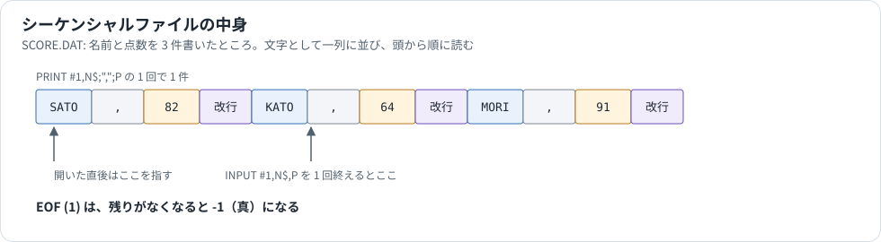

# 15. ファイルとドライブ

この章はプログラムとデータをファイルとして保存する方法の章です。本体のメモリの一部を使う RAM ディスクから始め、ファイルの名前の付け方、一度に開ける数、データを書いて読み返すプログラムまでを、実際の画面で確かめながら説明します。

[目次へ戻る](README.md)

## この章で分かること

- 保存先のデバイス（`E:`、`F:`、`X:`、`CAS:`、`COM:`）
- ファイル名と拡張子の決まり
- プログラムの保存と読み込み
- ファイル番号と、同時に開ける数
- データファイルを作る、読む、足す

## 15.0 はじめに

プログラムは電源を切っても消えませんが、通常使うプログラム領域は 1 つです（領域を増やす `BTEXT$` は[命令の説明](../analysis/14_BASIC_REFERENCE.md#btext--bdata)にあります）。新しいプログラムを書くために `NEW` をすれば、前のものはなくなります。また、プログラムが計算した値は、変数に入れただけでは次の `RUN` で消えてしまいます（固定変数を除く）。そこで、名前を付けて**ファイル**に保存します。


ファイルには 2 種類あります。

- プログラムファイル: `SAVE` で作り、`LOAD` で読む
- データファイル: プログラムが `PRINT #` で書き、`INPUT #` で読む

## 15.1 デバイス名

| デバイス名 | 保存先 | 特徴 |
|---|---|---|
| `E:` | 本体の RAM ディスク | 一番手軽で速い。本体のメモリを分けて使う |
| `F:` | RAM カードの RAM ディスク | カードごと持ち運べる（[RAM カード](04_RAM_CARD.md)） |
| `X:` | ポケットディスク（CE-140F、2.5 インチ） | 大きく、速い（[CE-140F](../analysis/17_CE-140F_DISK.md)） |
| `CAS:` | カセットテープ | 安いが遅い |
| `COM:` | シリアルポート | パソコンなどとのやり取り |

名前の後には必ず `:` を付けます。ほかの名前や、カードのないときの `F:` は `Bad drive name`、ディスクのないときの `X:` は `I/O error` です（実験）。

### 15.1.1 RAM ディスクを用意する

`E:` は使う前に大きさを決めて初期化します。大きさは 2K〜27K（32 KB の機種）で、`INIT` は直接打つときだけ使えます。

```text
INIT "E:10K"
FRE0
                                   18343
DSKF "E:"
                                    8960
```

`FRE0` は BASIC に残ったバイト数で、初期化の前は 28600 でした（32 KB の PC-E500）。10K で約 10 KB 減り、`DSKF` によるとファイルに使えるのは 8960 バイトです。残りはファイルの名前などの管理に使われます（実験、7.2）。

> [!WARNING]
> `INIT` をやり直すと、`E:` のファイルは全部消えます。大きさを変えるときも同じです。ファイルがあるときは `ｼｮｷｶ OK? (Y/N)` と尋ねるので、`Y` か `N` を打って ⏎ を押します（ファイルのない `E:` では尋ねません。実験、7.2）。

## 15.2 ファイル名

名前は 8 文字まで、その後に `.` と 3 文字までの**拡張子**を付けられます。

```text
E:SCORE.DAT
```

| 部分 | 決まり |
|---|---|
| 名前 | 8 文字まで。長い名前を打つと、先頭の 8 文字だけが使われる（実験） |
| 使える文字 | A〜Z、a〜z、0〜9、`#` `$` `%` `&` `'` `(` `)` `{` `}` `-` `^` `_` `@`、空白 |
| 拡張子 | 3 文字まで。ファイルの種類を表す |

`*` などほかの記号は `Bad file name` です。長い名前がエラーにならずに切り詰められるので、`LONGNAME1` と `LONGNAME2` は同じファイルになってしまいます。8 文字以内で付けてください。

BASIC のプログラムを `SAVE` すると、拡張子 `.BAS` が自動で付きます。`LOAD` では `.BAS` を省けますが、`COPY`、`KILL`、`NAME`、`SET` では省けません。

```text
SAVE "E:PASSED"
FILES "E:"
 SCORE   .DAT         34   E:
 PASSED  .BAS        159
COPY "E:PASSED" TO "E:P3"
File not found
COPY "E:PASSED.BAS" TO "E:P2.BAS"
>
```

`FILES` の数字はバイト数です。`NAME "E:P.BAS" AS "E:Q"` のように拡張子を書かずに名前を変えると、拡張子のないファイルになり、`LOAD "E:Q"` では見つかりません（`.BAS` を探すため）。

## 15.3 プログラムの保存と読み込み

| したいこと | 命令 |
|---|---|
| 保存する | `SAVE "E:NAME"` |
| 読み込む（今のプログラムは消える） | `LOAD "E:NAME"` |
| 保存したものと照合する | `LOAD? "E:NAME"` |
| 今のプログラムに足す | `MERGE "E:NAME"` |
| 一覧を見る | `FILES "E:"` |
| 削除、名前の変更、コピー | `KILL`、`NAME`、`COPY` |
| 消せないようにする、戻す | `SET "E:NAME.BAS","P"`、`SET "E:NAME.BAS"," "` |
| テープに保存、読み込む | `CSAVE "NAME"`、`CLOAD "NAME"` |

命令ごとの詳しい形は [BASIC の命令と関数](../analysis/14_BASIC_REFERENCE.md) にあります。`LOAD` と `MERGE` は開いているファイルを全部閉じてから動きます。

## 15.4 同時に開ける数

データファイルを使うときは、`OPEN` で開いて**ファイル番号**を付け、その番号で読み書きします。番号は 1〜255 のどれでもかまいません（`#300` は `Data out of range`）。同時に開ける数には限りがあります。

| デバイス | 同時に開ける数 |
|---|---|
| `X:` | 6 |
| `E:` と `F:` | `CAS:`、`COM:` も含めて合計 2 |
| `CAS:` | 1（上の 2 に数える） |
| `COM:` | 1（上の 2 に数える） |

`SAVE` と `LOAD` も動く間だけ 1 つ分を使います。`E:` に 2 つ開いたまま `SAVE` すると `Too many files open`、1 つ閉じれば保存できました（実験）。`CSAVE` と `CLOAD` は数に入らないので、テープのファイルを開いていても使えます。

開いたファイルは `CLOSE` で閉じます。次のときも閉じます（実験）。

- `RUN` で始めたとき
- プログラムが最後まで動いて終わったとき
- `LOAD`、`MERGE` を実行したとき

> [!WARNING]
> 書いたデータは、閉じたときに初めて全部ファイルに入ります。途中で電源を切ったり止めたりする前に、必ず `CLOSE` してください。

## 15.5 データファイルの考え方

PC-E500 の BASIC が使えるのは、先頭から順に読み書きする**シーケンシャルファイル**だけです。任意の位置を直接読み書きするランダムファイルはありません。データは文字として、書いた順に一列に並びます。



| 開き方 | 使うとき | 開いた瞬間に起きること |
|---|---|---|
| `FOR OUTPUT` | 新しく書く | **前の中身は消える** |
| `FOR APPEND` | 終わりに足す | 中身は残る。ファイルがなければ `File not found` |
| `FOR INPUT` | 読む | 先頭から読み始める |

操作説明書（p.190）はファイルがないときの `APPEND` を `OUTPUT` と同じとしていますが、ROM 7.2（2.2、7.3、8.3 も）のエミュレータではどれも `File not found` でした（実験）。最初の 1 回は `OUTPUT` で作ってください。

読むために開いたものに書く、書くために開いたものを読む、のどちらも `Mode error` です。

## 15.6 データファイルを作る

名前と点数を打ち込み、ファイルに保存するプログラムです。名前を打たずに ⏎ を押すと終わります。

```basic
10 OPEN "E:SCORE.DAT" FOR OUTPUT AS #1
20 INPUT "NAME";N$
30 IF N$="" THEN 70
40 INPUT "POINT";P
50 PRINT #1,N$;",";P
60 GOTO 20
70 CLOSE #1
80 END
```

50 行で、名前と点数の間に `","` を書いているのが要点です。`,` が読むときの区切りになります。`PRINT #1,N$;P` と続けて書くと、名前と数が 1 つの文字列にくっついてしまいます。

## 15.7 データファイルを読む

80 点以上の人を表示します。

```basic
10 OPEN "E:SCORE.DAT" FOR INPUT AS #1
20 INPUT #1,N$,P
30 IF P>=80 THEN PRINT N$,P
40 GOTO 20
```

```text
RUN
SATO                    82
MORI                    91
Input past end in 20
```

読み終わった後も 20 行が読もうとするので、最後にエラーになります。残りがあるかどうかは `EOF` で調べます。

```basic
10 OPEN "E:SCORE.DAT" FOR INPUT AS #1
20 IF EOF (1) THEN 60
30 INPUT #1,N$,P
40 IF P>=80 THEN PRINT N$,P
50 GOTO 20
60 CLOSE #1
70 END
```

これでエラーなしに終わります。流れは「`OPEN` する、`EOF` を調べる、`INPUT #` で読む、終わったら `CLOSE`」です。

## 15.8 データを足す

すでにあるファイルの終わりに 1 件足します。

```basic
10 OPEN "E:SCORE.DAT" FOR APPEND AS #1
20 PRINT #1,"ABE";",";77
30 CLOSE #1
```

```text
SATO, 82
KATO, 64
MORI, 91
ABE, 77
```

`OUTPUT` で開くと、その瞬間に前の 3 件は消えます。実際、`FOR OUTPUT` で開いてすぐ閉じたファイルは 1 バイトになりました（実験）。途中の 1 件を直すには、全部を配列に読み込み、直してから `OUTPUT` で書き直します。

## まとめ

| 項目 | 決まり |
|---|---|
| ファイルの指定 | デバイス `:` 名前 `.` 拡張子 |
| 名前 | 8 文字まで、拡張子 3 文字まで |
| RAM ディスク | `INIT "E:10K"` で用意。やり直すと消える |
| 番号 | `#1`〜`#255`、`E:`/`F:`/`CAS:`/`COM:` 合わせて 2 つまで |
| 開き方 | OUTPUT は消してから書く、APPEND は足す、INPUT は読む |
| 終わり | `EOF` で調べ、`CLOSE` で閉じる |

## 出典

- 操作説明書 p.174〜176、p.189〜191。
- 実験: 上の操作とプログラムを ROM 7.2（32 KB）のエミュレータで実行。`X:` は CE-140F をつながない状態。

## 次に読むもの

- [BASIC の命令と関数](../analysis/14_BASIC_REFERENCE.md): `OPEN`、`INPUT #`、`PRINT #`、`EOF`、`LOF`
- [RAM カード](04_RAM_CARD.md): `F:` を使う
- [エラー一覧](17_ERRORS.md): 72〜77、85〜87、94、95 番
- [カセット](../analysis/20_CASSETTE.md): テープへの保存
