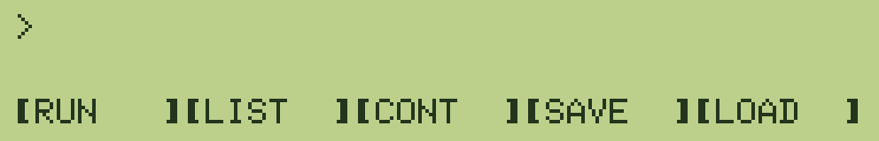
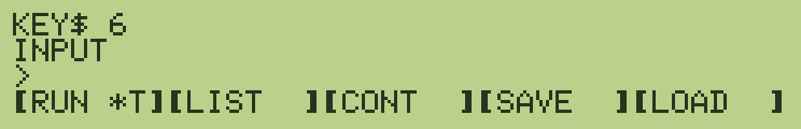
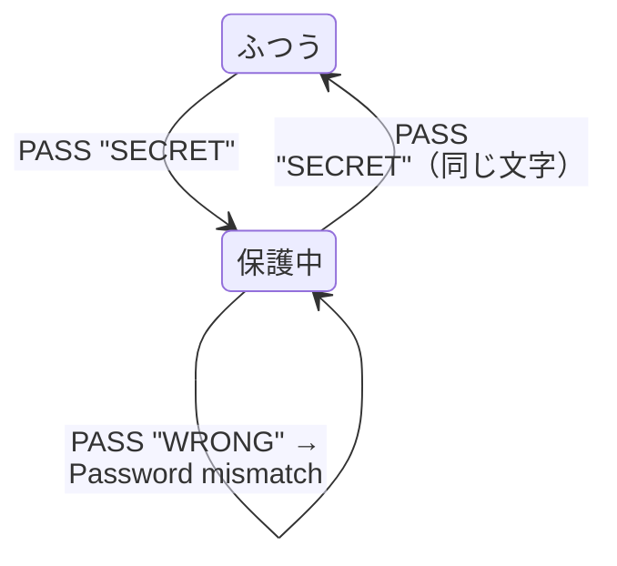

# 16. PF キーと便利な使い方

この章は同じことを何度も打たずに済ませるための章です。画面のすぐ下の PF1〜PF5 キーに文字列を登録する方法、命令の省略形、電源を入れただけでプログラムを始める方法、プログラムを隠すパスワードを紹介します。

[目次へ戻る](README.md)

## この章で分かること

- PF キーの 10 個の文字列と、呼び出し方
- `KEY` で文字列を登録する方法
- 1 つのキーでプログラムを動かす方法
- 命令の省略形
- `ARUN`、`AUTOGOTO`、`PASS`

## 16.0 はじめに

PF は Programmable Function（割り当てできる機能）の略です。メインメニューや統計では項目を選ぶキーですが、BASIC では登録した文字を打ってくれるキーになります。リセット直後の RUN モードで PF1 を押すと、`RUN` と打ったのと同じになります。あとは ⏎ を押すだけです。

## 16.1 最初の割り当て

| | PF1 | PF2 | PF3 | PF4 | PF5 |
|---|---|---|---|---|---|
| 1 段目 | RUN | LIST | CONT | SAVE | LOAD |
| 2 段目 | INPUT | PRINT | GOTO | GOSUB | RETURN |

文字列の後には空白が 1 つ付いているので、続けて `100` などを打てます。2 段目は、番号では PF6〜PF10 に当たります。

### 16.1.1 ラベルを出す

CTRL を押しながら ▲▼ キー（PF1 の左のキー）を押すと、画面の一番下に 5 個のラベルが出ます。もう一度押すと消えます。



ラベルが出ている間に ▲▼ だけを押すと、1 段目と 2 段目が入れ替わります。


ラベルを出すと、下の 1 行が使えなくなり、文字の画面は 3 行になります。

### 16.1.2 どれが打たれるか

| 画面 | PF キー | SHIFT + PF キー |
|---|---|---|
| ラベルなし | 1 段目 | 2 段目 |
| 1 段目のラベル | 1 段目 | 何も起こらない |
| 2 段目のラベル | 2 段目 | 何も起こらない |

操作説明書（p.191）は SHIFT を押しながらの使い方を 2 段目を打つ方法として説明しています。ラベルが出ているときに SHIFT を押しても何も入らないことは、ROM 7.2（7.3、8.3 も）のエミュレータで確かめました（実験）。

## 16.2 文字列を登録する

`KEY 番号,"文字列"` で登録します。番号は 1〜10（6〜10 が 2 段目）、文字列は 31 文字までです。今の割り当ては `KEY$ 番号` で見られます。

```text
KEY 1,"RUN *TAX"+CHR$ 13
>
KEY$ 1
RUN *TAX
```

`CHR$ 13` は ⏎ です。これを付けておくと、PF1 を押しただけでプログラム `*TAX` が動きます。



```basic
100 *TAX:PRINT "TAX OK"
110 END
```

```text
RUN *TAX
TAX OK
```

PF1 を押したときの画面です。いくつものプログラムを入れておき、それぞれの始めにラベルを付けて PF キーに割り当てれば、キー 1 つで選んで動かせます。以前の機種の「定義キー」（DEF キー）の代わりになります（[ほかの機種のプログラム](21_OTHER_MACHINES.md)）。

登録の例:

| したいこと | 命令 |
|---|---|
| 続きに番号を打つ | `KEY 8,"GOTO "` |
| すぐに一覧を見る | `KEY 2,"LIST"+CHR$ 13` |
| 記号をまとめて打つ | `KEY 5,"PRINT #1,"` |
| 割り当てを消す | `KEY 2,""` |
| 割り当てを全部見る | `FOR I=1 TO 10:PRINT I;KEY$ I:NEXT I` |

文字コードの 80h〜9Fh と E0h〜FFh の文字は登録できません。00h〜1Fh の文字は PF キーに登録したときだけラベルに文字として表示されます（[文字コード表とキー一覧](18_CODES.md)）。登録は電源を切っても残り、初期化すると最初の割り当てに戻ります。

> [!NOTE]
> ENG のソフトなど、メニューの画面で使う PF キーのラベルを編集するツールは [エンジニアソフト](07_ENG.md) にあります。

## 16.3 命令の省略形

命令の多くは途中まで打って `.` を付ければ通じます。入れた後は正しいつづりに直ります。

```text
10 P."HI"
10:PRINT "HI"
```

`P.` のほか、`PR.`、`PRI.`、`PRIN.` のように途中まででも `PRINT` になります。よく使うものを挙げます。

| 省略形 | 命令 | 省略形 | 命令 |
|---|---|---|---|
| `P.` | PRINT | `R.` | RUN |
| `I.` | INPUT | `L.` | LIST |
| `G.` | GOTO | `C.` | CONT |
| `GOS.` | GOSUB | `RE.` | RETURN |
| `F.` | FOR | `N.` | NEXT |

命令ごとの一番短い形は [BASIC の命令と関数](../analysis/14_BASIC_REFERENCE.md) の各項目にあります。

## 16.4 電源を入れたら始まるプログラム

プログラムの最初の行の最初の文に `ARUN` か `AUTOGOTO` を書いておくと、電源を入れたときに自動で始まります。

| 命令 | 始め方 | 変数 |
|---|---|---|
| `ARUN` | RUN と同じ | 固定変数以外は消える |
| `AUTOGOTO 行番号` | GOTO と同じ | 残る |

自動電源オフの後に入れ直したときは始まりません。詳しい条件は [ARUN](../analysis/14_BASIC_REFERENCE.md#arun)、[AUTOGOTO](../analysis/14_BASIC_REFERENCE.md#autogoto) を見てください。止めるには ON（BREAK）を押します。

## 16.5 パスワードでプログラムを隠す

プログラムを入れた状態で `PASS "文字"`（8 文字まで）を打つと、プログラムの中身が見えなくなります。同じ文字でもう一度 `PASS` を打つと元に戻ります。



| 保護中の操作 | 結果（実験、7.2） |
|---|---|
| `RUN` | 動く |
| `LIST`、↑ ↓ | 何も表示されない |
| 行を打つ | 入らない |
| `SAVE`、`CSAVE` | `Invisible program` |
| `PASS` に違う文字 | `Password mismatch` |

プログラムが入っていないときの `PASS` は `Program not exist` です。文字を忘れると戻せません。先に、保護していないものを `SAVE` しておいてください。

## 16.6 知っておくと便利な操作

| したいこと | 操作 |
|---|---|
| キーを押したときの音を出す、消す | CTRL + 0 |
| カーソルから行末まで消す | CTRL + E |
| カーソルのある行を消す | CTRL + U |
| 行の先頭、終わりへ | SHIFT + ←、SHIFT + → |
| 大文字と小文字の切り替え | CAPS |
| プリンタにも出す、やめる | SHIFT + ⏎（P↔NP） |
| 行番号を自動で出す | PRO モードで `AUTO` |
| 画面の設定をまとめて戻す | SHIFT + C·CE（CA） |

キーの働きの一覧は [文字コード表とキー一覧](18_CODES.md#184-basic-でのキーの働き) にあります。

## まとめ

- PF1〜PF5 と SHIFT で 10 個。CTRL + ▲▼ でラベル
- `KEY 番号,"文字"+CHR$ 13` で 1 キー実行
- `ARUN` / `AUTOGOTO` で自動開始
- `PASS` で隠す。文字を忘れない

## 出典

- 操作説明書 p.191〜192、p.209〜210、p.342、p.344〜346。
- 実験: ROM 7.2 のエミュレータ（PF キー、`KEY`、`KEY$`、`PASS`、CTRL + E / U）。

## 次に読むもの

- [文字コード表とキー一覧](18_CODES.md): 文字コードとキーの働き
- [プログラムを書く](12_PROGRAMMING.md): ラベルと `RUN`
- [BASIC の命令と関数](../analysis/14_BASIC_REFERENCE.md): `KEY`、`KEY$`、`PASS`、`ARUN`
