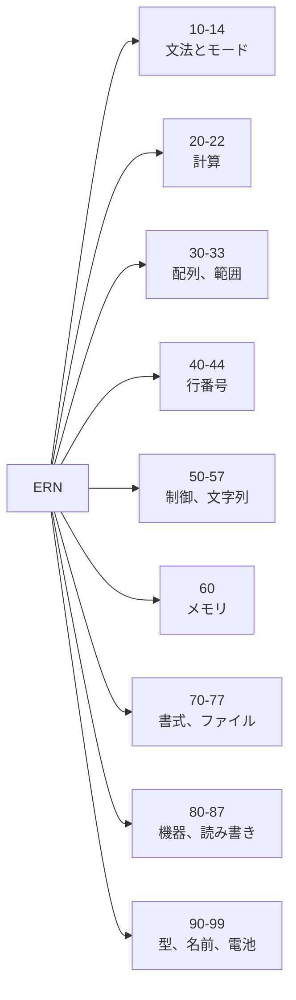

# 17. エラー一覧

この章は BASIC のエラーを番号と名前から引くための章です。1 つずつに、意味、起こりやすい原因、実際にそのエラーが出る小さなプログラム、直し方を付けました。例は、断りがない限り日本語の PC-E500（ROM 7.2）のエミュレータで動かし、表の名前と番号（`ERN`）が出ることを確かめたものです。プログラムの例は 2.2、7.3、8.3 でも同じ番号と行番号になりました（実験。違いは 17.4 節）。

[目次へ戻る](README.md)

## この章で分かること

- エラー表示の読み方と、`ERN`、`ERL`
- 10〜99 番の意味と対処
- ROM バージョンによる違い（8.3、8.4、8.5 だけのエラー）
- CAL、STAT、MATRIX、AER のエラーの参照先

## 17.0 エラー表示の読み方

```basic
10 DIM X(3)
20 X(4)=5
```

```text
RUN
Subscript out of range in 20
```

`Subscript out of range` が種類、`in 20` が起きた行です。直接打った命令のエラーには `in` が付きません。C·CE か ← → で消してから続けます。エラーの行を呼び出して直す手順は [デバッグ](13_DEBUGGING.md) にあります。

画面に番号は出ません。番号はプログラムの中で使うもので、`ON ERROR GOTO` を使うと、番号が `ERN`、行番号が `ERL` に入ります。

```basic
1 ON ERROR GOTO 900
10 DIM X(3)
20 X(4)=5
800 END
900 PRINT "ERN=";ERN;" ERL=";ERL:END
```

```text
RUN
ERN= 32  ERL= 20
```

直接打った命令で起きたエラーは `ERN` と `ERL` を変えません（操作説明書 p.340、実験）。

> [!TIP]
> 頭の数字で種類が分かります。10 番台は文法とモード、20 番台は計算、30 番台は配列と値の範囲、40 番台は行番号、50 番台は制御と文字列、60 番台はメモリ（改訂 8 は制御構文も）、70 番台は書式とファイル、80 番台は周辺機器とファイルの読み書き、90 番台は型、パスワード、ファイル名、電池です。



## 17.1 早見表

| 番号 | 表示 | 一言 |
|---|---|---|
| 10 | Syntax error | 書き方が違う |
| 11 | Direct command error | 直接では使えない、またはプログラムでは使えない命令 |
| 12 | Mode error | モードが違う。ファイルの開き方が違う |
| 13 | Can't continue | CONT で続けられない |
| 14 | Program not exist | プログラムがない |
| 20 | Overflow | 大きすぎる |
| 21 | Division by Zero | 0 で割った |
| 22 | Illegal function call | 関数に渡せない値 |
| 30 | Duplicate Definition | 同じ配列を 2 回宣言した |
| 31 | Array specified without DIM | 宣言していない配列 |
| 32 | Subscript out of range | 配列の番号が大きすぎる |
| 33 | Data out of range | 値が範囲の外 |
| 40 | Undefined line | 行番号、ラベルがない |
| 41 | Illegal line number | 行番号に使えない数 |
| 44 | Bad line number | 終わりの行が始めより小さい |
| 50 | GOSUB or FOR nesting exceeded | ネストが深すぎる |
| 51 | RETURN without GOSUB | GOSUB なしの RETURN |
| 52 | NEXT without FOR | FOR なしの NEXT |
| 53 | Out of data | DATA が足りない |
| 54 | Buffer space exceeded | 式が込み入りすぎ |
| 55 | String too long | 文字列が 254 文字を超えた |
| 56 | Line buffer overflow | 行が長すぎる |
| 57 | RESUME without error | エラーでないときの RESUME |
| 60 | Out of memory | メモリが足りない |
| 70 | Can't print in specified format | USING の桁に収まらない |
| 71 | USING format error | USING の書き方が違う |
| 72 | I/O error | 機器が応えない |
| 73 | Too many files open | ファイルを開きすぎ |
| 74 | NAME error | NAME の新しい名前が不適当 |
| 75 | Bad drive name | デバイス名が違う |
| 76 | File write protected | 書き込み禁止のファイル |
| 77 | Disk full | 空きがない、ファイルの数が多い |
| 80 | Tape read error | テープが読めない |
| 82 | Verify error | 照合して違った |
| 84 | Printer error | プリンタの異常 |
| 85 | File not open | 開いていない |
| 86 | File already open | もう開いている |
| 87 | Input past end | ファイルの終わりを過ぎた |
| 90 | Type mismatch | 数と文字列の取り違え |
| 92 | Password mismatch | パスワードが違う |
| 93 | Invisible program | 保護されたプログラム |
| 94 | File not found | ファイルがない |
| 95 | Bad file name | ファイル名が不適当 |
| 99 | Low battery | 電池の電圧が低い |

61〜64、66、68、69 は改訂 8 の ROM だけにあります（17.3 節）。

## 17.2 1 つずつの説明

「例」の行番号のないものは直接打ちます。

### 10〜14: 文法とモード

| 番号 | 例 | 原因と対処 |
|---|---|---|
| 10 Syntax error | `10 PRNT "A"` | 命令のつづり、括弧や `"` の数、`:` と `;` の取り違え、省いた `*`（`2PI`）、命令の名前で始まる変数（`TOTAL=4`）を調べる。PRO モードで ↑ を押すとカーソルの位置が手掛かりになる |
| 11 Direct command error | `10 LIST` | 直接専用の命令（`LIST`、`AUTO`、`NEW`、`DELETE`、`LOAD`、`FILES`、`KILL`、`NAME`、`SET` など）をプログラムに書いた。または、プログラム専用の命令（`INPUT A`、`GOSUB 10`、`ON …`）を直接打った |
| 12 Mode error | RUN モードで `LIST` | PRO と RUN を BASIC キーで切り替える。ファイルでは、`FOR OUTPUT` で開いたものを `INPUT #` で読む、`FOR INPUT` で開いたものに `PRINT #` で書くと出る |
| 13 Can't continue | 行を直した後の `CONT` | `RUN` か `GOTO 行番号` で始める |
| 14 Program not exist | `NEW` の後の `PASS "X"` | 保護するプログラムがない。先にプログラムを入れる |

番号 12 の例（ファイルの開き方）です。

```basic
10 OPEN "E:A" FOR OUTPUT AS #1
20 INPUT #1,A
```

> [!NOTE]
> `10 LOAD "E:NONE"` のように `LOAD` をプログラムに書くと、`ON ERROR GOTO` があっても分岐せずに `Direct command error in 10` で止まりました（実験）。

### 20〜22: 計算

| 番号 | 例 | 原因と対処 |
|---|---|---|
| 20 Overflow | `10 A=9E99*9` | 答えが 10 の 100 乗以上になった。`FACT 70`、`TAN 90`（DEG）、`EXP 231`、10 桁を超える `HEX` も。順番を変えて途中の値を小さくする |
| 21 Division by Zero | `10 A=1/0` | 割る数が 0。`RCP 0`、`AHT 1` も。`IF` で先に調べる |
| 22 Illegal function call | `10 A=SQR -1` | 関数に渡せない値。`ASN 2`、`LOG 0`、`FACT 2.5`、`NCR (3,5)`、`(-2)^.5`、`0^0` も。範囲は [関数と計算の範囲](14_FUNCTIONS.md#144-計算できる範囲) |

### 30〜33: 配列と値の範囲

| 番号 | 例 | 原因と対処 |
|---|---|---|
| 30 Duplicate Definition | `10 DIM X(3)` `20 DIM X(3)` | `GOTO` でもう一度 `DIM` の行を通っていないか調べる。作り直すなら `ERASE X` |
| 31 Array specified without DIM | `10 X(1)=5` | `DIM` を先に実行する。関数の名前の打ち間違いでも出る |
| 32 Subscript out of range | `10 DIM X(3)` `20 X(4)=5` | 番号は 0 から宣言した数まで。繰り返しの終わりの値を調べる |
| 33 Data out of range | `10 A$=CHR$ 300` | 命令ごとの範囲の外。`CHR$` は 0〜255、論理演算は −32768〜32767（`40000 AND 1`）、`LOCATE 50,0`、負の添字 `X(-1)` も |

### 40〜44: 行番号

| 番号 | 例 | 原因と対処 |
|---|---|---|
| 40 Undefined line | `10 GOTO 55` | 行もラベルもない。`*A` と `"A"` は別。直接の `RUN 85` でも出る |
| 41 Illegal line number | `10 GOTO 70000` | 65279 より大きい |
| 44 Bad line number | `DELETE 30-10`（PRO モード） | 終わりの番号が小さい。`LLIST 30-10` も。`LIST 30-10` では出ない（実験） |

### 50〜57: 制御と文字列

| 番号 | 例 | 原因と対処 |
|---|---|---|
| 50 GOSUB or FOR nesting exceeded | `10 GOSUB 10` | ネストできるのは合計 145 バイト分まで。`FOR` は 1 段 21 バイトなので 6 段、`GOSUB` は 1 段 4 バイトなので 36 段（改訂 8 の `WHILE` は単独で 18 段、`REPEAT` は 20 段）。`RETURN` せずに `GOTO` で抜けていないか調べる |
| 51 RETURN without GOSUB | `10 RETURN` | 主プログラムがサブルーチンへ流れ込んでいる。手前に `END` を置く |
| 52 NEXT without FOR | `10 NEXT I` | `FOR` がない、または変数の名前が違う。ループの中へ外から飛び込んでも起こる |
| 53 Out of data | `10 READ A` | `DATA` が足りない。`RESTORE` で戻す |
| 54 Buffer space exceeded | `(` を 60 個重ねた式 | 括弧や関数のネストが深すぎる。途中の答えを変数に入れて分ける。`SIN` を 50 個並べても出る |
| 55 String too long | `10 A$="AB"` `20 A$=A$+A$:GOTO 20` | 文字列が 254 文字を超えた |
| 56 Line buffer overflow | 254 文字の行 | 行を分ける。直接打つ `DIM Q(0,0,…)` のように数の多い行では、もっと短くても出る |
| 57 RESUME without error | `10 RESUME` | エラー処理の手前に `END` がない |

50 番の段数は 7 段目の `FOR`、37 段目の `GOSUB` で実際に出ました（実験、7.2）。操作説明書 p.351 の仕様の数と一致します。

### 60: メモリ

| 番号 | 例 | 原因と対処 |
|---|---|---|
| 60 Out of memory | `10 DIM B(5000)` | `FRE0` で残りを調べる。要らない配列を `ERASE` で消す、`CLEAR` する、RAM ディスク `E:` を小さくする（中身は消える）、RAM カードを使う |

### 70〜77: 書式とファイル

| 番号 | 例 | 原因と対処 |
|---|---|---|
| 70 Can't print in specified format | `10 USING "##"` `20 PRINT 12345` | 桁が足りない。`#` を増やす。符号の分も 1 桁要る |
| 71 USING format error | `10 USING "AB"` | 書式に使える記号だけを書く |
| 72 I/O error | `10 SAVE "X:A"`（ディスクなし） | 機器の電源、つなぎ方を調べる |
| 73 Too many files open | `E:` で 3 つ目の `OPEN` | `E:`、`F:`、`CAS:`、`COM:` は合わせて 2 つまで（[ファイルとドライブ](15_FILES.md#154-同時に開ける数)） |
| 74 NAME error | `NAME "E:P.BAS" AS "E:P.BAS"` | 新しい名前がもうある、または別のデバイス（`F:`）を書いた |
| 75 Bad drive name | `10 SAVE "Q:A"` | デバイス名を直す。RAM カードがないときの `F:` も |
| 76 File write protected | `SET "E:P.BAS","P"` の後の `KILL "E:P.BAS"` | `SET "E:P.BAS"," "` で保護を外す |
| 77 Disk full | RAM ディスクに書き続ける | 要らないファイルを `KILL` する。ファイルの数にも限りがあり、`INIT "E:8K"` では 17 個目で出た（実験） |

### 80〜87: 周辺機器と読み書き

| 番号 | 例 | 原因と対処 |
|---|---|---|
| 80 Tape read error | テープの読み取りの失敗 | 音量を変えて読み直す（[カセット](../analysis/20_CASSETTE.md)） |
| 82 Verify error | 保存した後でプログラムを変えて `LOAD? "E:A"` | 保存し直す。テープでは `CLOAD?` |
| 84 Printer error | 印刷中にプリンタの電源が切れた | 電源、用紙、つなぎ方 |
| 85 File not open | `10 PRINT #1,5` | `OPEN` していない。番号の取り違え。`RUN` はファイルを閉じる |
| 86 File already open | 同じファイルを 2 回 `OPEN` | 同じ番号、または同じ名前のファイルが開いている。`CLOSE` する |
| 87 Input past end | 空のファイルを `INPUT #` | 先に `EOF` で調べる（[データファイル](15_FILES.md#156-データファイルを作る)） |

### 90〜99: 型、名前、電池

| 番号 | 例 | 原因と対処 |
|---|---|---|
| 90 Type mismatch | `10 A$=5` | 数と文字列の取り違え。`VAL`、`STR$` で変える |
| 92 Password mismatch | 違う `PASS` を打った | 付けたときと同じ文字を打つ |
| 93 Invisible program | 保護したプログラムの `SAVE`、`CSAVE` | `PASS` で保護を外してから |
| 94 File not found | `10 OPEN "E:NONE" FOR INPUT AS #1` | `FILES` で名前を確かめる。拡張子も（`.BAS`）。`FOR APPEND` でも、ファイルがなければ出る |
| 95 Bad file name | `10 OPEN "E:A*B" FOR OUTPUT AS #1` | 使えない文字がある（[ファイル名](15_FILES.md#152-ファイル名)） |
| 99 Low battery | 電池の電圧が下がったとき | 電池を替える |

99 番は操作説明書の表にありませんが、ROM の表の最後（90 番目）に入っています（ROM）。

## 17.3 改訂 8（8.3、8.4、8.5）だけのエラー

改訂 8 の ROM には `WHILE`、`REPEAT`、`SWITCH`、複数行の `IF` が加わり、次のエラーが増えました。例は 8.3 で確かめました。

| 番号 | 表示 | 例 |
|---|---|---|
| 61 | Block IF without ENDIF | `10 IF 0 THEN` `20 PRINT 1`（`ENDIF` がない） |
| 62 | UNTIL without REPEAT | `10 UNTIL 1` |
| 63 | WHILE without WEND | `10 WHILE 0` `20 PRINT 1`（条件が真でも起きる） |
| 64 | WEND without WHILE | `10 WEND` |
| 66 | Illegal CASE or DEFAULT | `SWITCH` の中で `DEFAULT` の後に `CASE` を書く、`DEFAULT` を 2 回書く |
| 68 | SWITCH,CASE or DEFAULT without ENDSWITCH | `10 N=2` `20 SWITCH N` `30 CASE 1` |
| 69 | CASE,DEFAULT or ENDSWITCH without SWITCH | `10 CASE 1` |

50 番の表示は `GOSUB,FOR,REPEAT,WHILE or SWITCH nesting exceeded` になります。`SWITCH` の後に変数でなく `SWITCH 1` や `SWITCH N+1` を書くと `Syntax error` でした（実験、8.3）。

## 17.4 操作説明書と ROM の比べ

操作説明書（p.340〜341）の番号と、ROM の中のメッセージの表を、13 本の ROM 全部で比べました。ROM の表は番号 1 から始まり、`ERN` の値は表の中の順番に 9 を足した数です（[ROM バージョンの違い: 行列演算とドライバ](../analysis/25_ROM_VERSIONS_DRIVERS.md#2522-改訂-7--8エラーメッセージ表の移動と追加) §25.2.2）。

| 比べたもの | 結果 |
|---|---|
| 操作説明書の 43 種の番号と文言 | 全 13 本の ROM にあり、番号も文言も一致（50 番だけ改訂 8 で文言が変わる） |
| 説明書にない番号 | 99 `Low battery`。全部の ROM にある |
| 2.1、2.2、3.2、5.3、6.2、6.3、6.4、7.2、7.3、7.5 | 互いに全く同じ |
| 8.3、8.4、8.5 | 17.3 節の 7 種が増え、50 番の文言が違う。3 本は互いに同じ |

メッセージは日本語の機種（2.2、7.2、8.5 など）でも英語です。

## 17.5 ほかのモードのエラー

電卓、統計、行列、AER のエラーは、[電卓](05_CAL.md)、[統計](09_STAT.md)、[行列](10_MATRIX.md)、[AER（式の登録）](08_AER.md) の章を見てください。

## まとめ

- 表示の `in` の後が行番号。`ON ERROR GOTO` なら `ERN` と `ERL` に入る
- 番号は 10〜99。ROM の表の順番 + 9
- 改訂 8 の ROM だけに 61〜69 がある

## 出典

- 操作説明書 p.340〜341（番号と意味）、p.351（ネストの段数）。
- ROM: 13 本の ROM のメッセージの表の比較。
- 実験: 17.2、17.3 節の例を ROM 7.2（プログラムの例は 2.2、7.3、8.3 も）のエミュレータで実行。72 番はディスクをつながない状態、80、84、99 番は説明書と ROM の表によります。

## 次に読むもの

- [デバッグ](13_DEBUGGING.md): エラーの行の直し方
- [BASIC の命令と関数](../analysis/14_BASIC_REFERENCE.md): `ON ERROR GOTO`、`RESUME`、`ERN`、`ERL`
- [困ったとき](19_TROUBLE.md): エラーの表示も出ないとき
