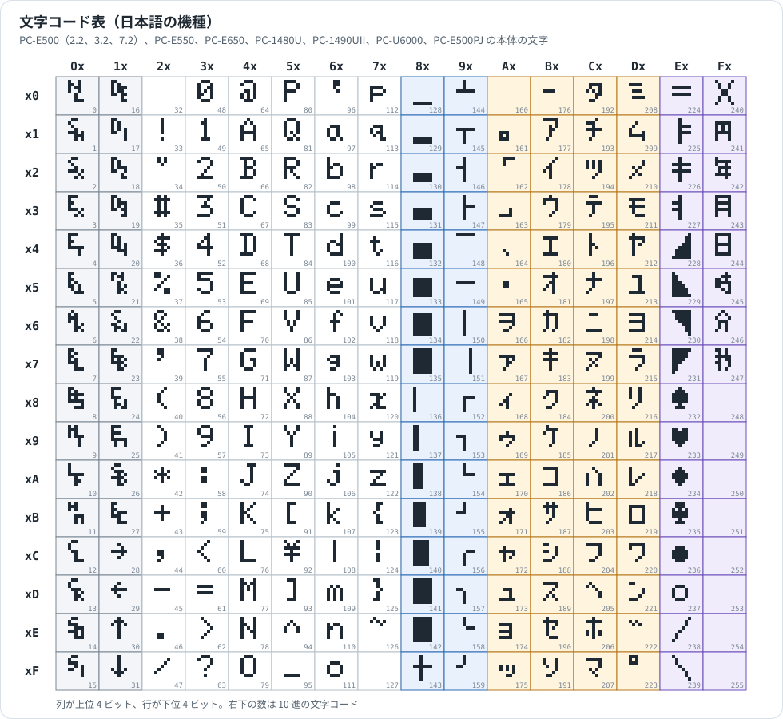
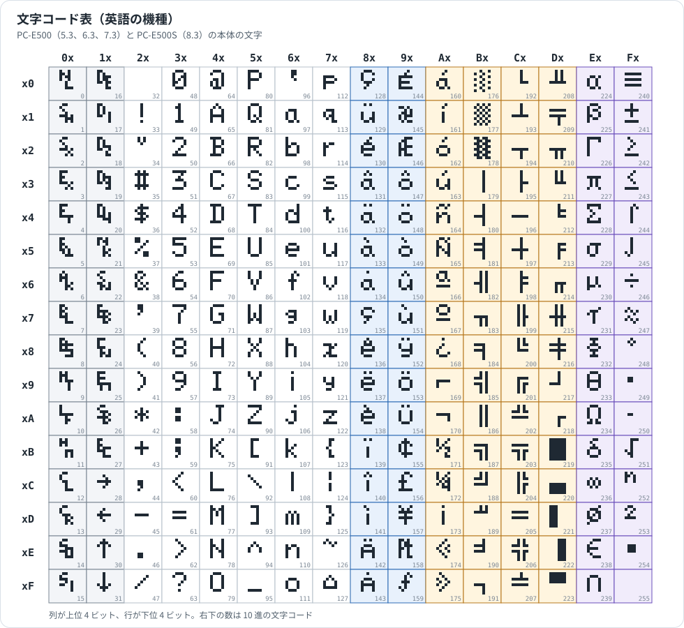

# 18. 文字コード表とキー一覧

この章は文字コードの表と、BASIC でのキーの働きの一覧です。`CHR$` で記号を出すとき、`ASC` や `INKEY$` の結果を読むとき、知らないキーの働きを調べるときに引いてください。

[目次へ戻る](README.md)

## この章で分かること

- 文字コードの読み方と、`CHR$`、`ASC`
- 日本語の機種と英語の機種の文字コード表（本体のフォントそのまま）
- 00h〜1Fh を `PRINT` したときの働き
- BASIC でのキーの働き。↑ ↓ の状態ごとの働き

## 18.0 はじめに

本体の中では、文字は 0〜255 の番号で表されます。この番号が**文字コード**です。`ASC` は文字から番号を、`CHR$` は番号から文字を求めます。

```text
ASC "A"
                                      65
CHR$ 65
A
```

`ASC` に 2 文字以上を渡すと、最初の文字の番号になります。`CHR$` に渡せるのは 0〜255 で、外れると `Data out of range` です。

番号は 16 進 2 桁で書くと表と対応します。上の桁が列、下の桁が行です。

| 文字 | 16 進 | 10 進 | 2 進 |
|---|---|---|---|
| `A` | 41h | 4 × 16 + 1 = 65 | 01000001 |
| `z` | 7Ah | 7 × 16 + 10 = 122 | 01111010 |
| `%` | 25h | 2 × 16 + 5 = 37 | 00100101 |

BASIC では `CHR$ &H41` のように 16 進のまま書けます。

## 18.1 日本語の機種の文字

PC-E500（2.2、3.2、7.2）、PC-E500PJ、PC-E550、PC-E650、PC-1480U、PC-1490UII、PC-U6000 の文字です。図は ROM のフォントデータから描いたもので、画面に出る形そのままです。



| 範囲 | 内容 |
|---|---|
| 20h〜7Eh | 英数字と記号。5Ch は `¥` |
| 80h〜8Eh | 棒グラフに使えるブロック |
| 8Fh〜9Fh | 罫線 |
| A0h〜DFh | カナ（半角）と記号 |
| E0h〜EFh | 二重の罫線、三角、トランプの記号、丸、斜線 |
| F0h〜F7h | ×、円 年 月 日 時 分 秒 |
| F8h〜FFh | 空 |

## 18.2 英語の機種の文字

PC-E500 のうち英語の機種（ROM 5.3、6.3、7.3）と PC-E500S（8.3）の文字です。



| 範囲 | 内容 |
|---|---|
| 20h〜7Eh | 英数字と記号。5Ch は `\` |
| 7Fh | 家の形 |
| 80h〜9Fh | アクセント付きの文字、通貨記号（9Bh ¢、9Ch £、9Dh ¥、9Eh Pt、9Fh ƒ） |
| A0h〜AFh | アクセント付きの文字、ª º ¿ ½ ¼ ¡ « » |
| B0h〜DFh | 網、罫線、ブロック |
| E0h〜FEh | ギリシャ文字、数学の記号（E3h π、EDh φ、F1h ±、F6h ÷、FBh √、FDh ²） |

IBM PC の文字の並び（コードページ 437）とほぼ同じです。文字どうしはすき間なく並ぶので、B3h や C4h の罫線はつながります。

日本語と英語の機種で違うのは 5Ch と 7Fh〜FEh だけです。英数字の範囲だけを使えば、どの機種でも同じに見えます。アクセント文字や罫線を使ったプログラムを別の言語の機種で動かすと、まったく別の記号になるので注意してください。

フォントのバイト列と ROM 内のアドレスは [文字のドット](../analysis/13_FONT.md) にあります。

## 18.3 00h〜1Fh（制御コード）

00h〜1Fh には `NL`、`SH` のような小さな文字があります（表の左の 2 列）。これらは PF キーに `KEY` で登録したときだけ、ラベルに表示されます。`PRINT CHR$` では文字は出ず、次の働きをします。画面の 1 行 5 桁から `PRINT "ABC";CHR$ 番号;"DE"` を実行して確かめました（実験、7.2。7.3、8.3 も同じ）。

| 番号 | 働き | 画面の様子 |
|---|---|---|
| 0〜6、14〜27 | 何も起こらない | `ABCDE` |
| 7（07h） | ビープ音 | `ABCDE` |
| 8（08h） | 左の 1 文字を消す | `ABDE` |
| 9（09h） | 次のタブ位置へ（8 の倍数の桁） | `ABC` の後に空白、16 桁から `DE` |
| 10（0Ah） | 次の行の先頭へ | `DE` が下の行の左端 |
| 11（0Bh） | 画面の左上へ | `DE` が 1 行目の左端 |
| 12（0Ch） | 画面を消して左上へ | `DE` だけが残る |
| 13（0Dh） | 同じ行の左端へ | `DE` が行の左端に上書き |
| 28（1Ch） | 右へ 1 桁 | `ABC DE` |
| 29（1Dh） | 左へ 1 桁 | `ABDE` |
| 30（1Eh） | 1 行上へ | `DE` が上の行 |
| 31（1Fh） | 1 行下へ | `DE` が下の行 |

操作説明書（p.342）にある注意もまとめておきます。

- 80h〜9Fh と E0h〜FFh の文字は PF キーに登録しない。
- プリンタ CE-126P では 00h〜1Fh と 7Fh〜FFh は空白になる（日本語の機種の変換は [CE-126P プリンタ](../analysis/18_CE-126P_PRINTER.md)）。
- プロッタ CE-515P の文字は CE-515P の文字コード表による（[CE-515P プロッタ](../analysis/19_CE-515P_PLOTTER.md)）。

## 18.4 BASIC でのキーの働き

### 18.4.1 電源、モード、消す

| キー | 働き |
|---|---|
| ON（BREAK） | 電源を入れる（自動で切れた後も）。動いているプログラムを止める。直接の `BEEP`、`CLOAD` を止める |
| SHIFT、2ndF | キーの上に書かれた文字や働きを使う。SHIFT は押しながら、2ndF は先に押して離す。例: SHIFT + Y で `&` |
| C·CE | 入力中の内容と画面を消す。エラーを消す |
| SHIFT + C·CE（CA） | 画面を消し、設定も元に戻す: `WAIT` の時間、`USING`、`TRON`、`PRINT=LPRINT`、エラーの状態 |
| MENU | メインメニュー |
| BASIC | RUN と PRO を切り替える |
| SHIFT + MENU（CAL） | 電卓（CAL）へ |
| SHIFT + BASIC（AER） | AER（式の登録）へ |
| SHIFT + ↕（TITLE） | 登録した式を呼び出す |
| CAPS | 大文字と小文字を切り替える。画面の `CAPS` が大文字の印 |
| CTRL + 0 | キーの音を出す、消す |
| CTRL + ▲▼ | PF キーのラベルを出す、消す |
| ▲▼ | ラベルの 1 段目と 2 段目を切り替える |
| SHIFT + ⏎（P↔NP） | プリンタに出す、やめる |

### 18.4.2 編集

| キー | 働き |
|---|---|
| → ← | カーソルを動かす。カーソルが出ていなければ出す（プレイバック）。直接の入力のエラーを消す |
| SHIFT + → | 行や入力の終わりへ |
| SHIFT + ← | 行や入力の先頭へ |
| INS | 挿入の切り替え |
| DEL | カーソルの位置の文字を消す |
| BS | カーソルの左の文字を消す |
| CTRL + E | カーソルから行末まで消す |
| CTRL + U | カーソルのある行を消す |
| ⏎ | 入力を決める。プログラムの行を入れる。計算、命令を実行する。`INPUT` に答える |

`12345` と打ち、← を 2 回、INS、`99` と打つと `1239945` になり、もう一度 INS を押して `8` を打つと `1239985` と置き換わります（実験）。

### 18.4.3 記号

| 記号 | 主な使い方 |
|---|---|
| `"` | 文字列とラベルを囲む |
| `;` | 続けて表示する。命令と変数の区切り |
| `,` | 間を空けて表示する。`USING` の 3 桁区切り |
| `:` | 1 行の中の文を区切る |
| `?` | `CLOAD?`、`LOAD?` などに使う |
| `#` | ファイル番号。`USING` の数字の桁。倍精度の印 |
| `$` | 文字列の変数の印 |
| `&` | `USING` の文字の桁。16 進数の前（`&H`） |
| `^` | 累乗。`USING` の指数表示 |
| `<` `>` `=` | 比較 |

### 18.4.4 ↑ と ↓

| モード | 状態 | ↓ | ↑ |
|---|---|---|---|
| RUN | 実行中 | 働かない | 働かない |
| RUN | STOP、BREAK で止まっている | 次の 1 行を実行して止まる（SHIFT + ↓ は続けて実行） | 押している間、止まった行を表示 |
| RUN | エラーで止まっている | 働かない | 押している間、エラーの行を表示 |
| PRO | 止まっている（行は出ていない） | 止まった行を表示 | 同じ |
| PRO | エラーの後（行は出ていない） | エラーの行を表示 | 同じ |
| PRO | そのほか（行は出ていない） | 最初の行を表示 | 最後の行を表示 |
| PRO | 行が出ている | 次の行 | 前の行 |

キーを待っている状態で約 11 分何も押さないと、電源が自動で切れます（操作説明書 p.347）。仕組みは [起動、割り込み、タイマ、音](../analysis/10_SYSTEM.md#107-自動電源オフ)、キーの配置は [キーボード](02_KEYBOARD.md) にあります。

## まとめ

- 文字コードは 0〜255。`ASC` と `CHR$`
- 英語と日本語の機種で、5Ch と 7Fh〜FEh が違う
- 00h〜1Fh はカーソルや画面の制御に使える
- ↑ ↓ はモードと状態で働きが変わる

## 出典

- 操作説明書 p.342〜347。
- ROM: フォントは 7.2（`F21A5h`）と 7.3（`F2155h`）のデータから描きました。ほかの ROM との一致は [ROM バージョンの違い: システム](../analysis/26_ROM_VERSIONS_SYSTEM.md#2631-フォント機種コード-3) §26.3.1。
- 実験: 制御コードは ROM 7.2（7.3、8.3 も）、編集キーは 7.2（7.3 も）のエミュレータ。7 番のビープ音は操作説明書の文字名（BL）によります。

## 次に読むもの

- [文字のドット](../analysis/13_FONT.md): フォントのアドレスとバイト列
- [PF キーと便利な使い方](16_PF_KEYS.md): `KEY`
- [キーボード](02_KEYBOARD.md): キーの並びと入力の仕方
