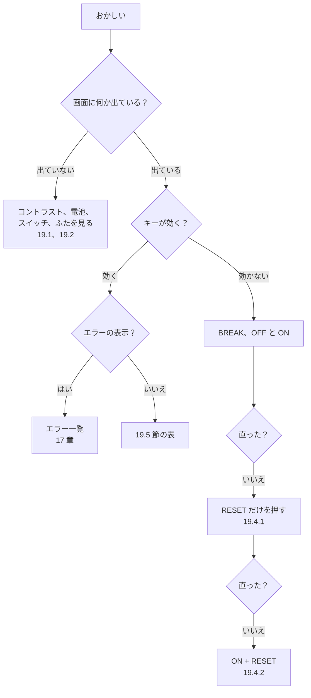

# 19. 困ったとき

この章は本体が思ったとおりに動かないときに、症状から原因と対処を探す章です。軽い対処から順に並べてあります。1 つ試すごとに、直ったかどうかを確かめてください。メモリを消す操作は最後の手段です。

[目次へ戻る](README.md)

## この章で分かること

- 画面、電源、キーの症状ごとの対処
- メモリを残すリセットと、全部消すリセットの違い
- 「消してよいか」を尋ねる画面の答え方
- BASIC、ファイル、周辺機器でよくある困りごと

## 19.0 はじめに



> [!WARNING]
> 電池を抜く、スイッチを動かす、RESET を押すなどの前に、読み出せるうちにプログラムやデータをテープ、カード、パソコンへ保存してください。

## 19.1 画面が薄い、濃い

コントラストのダイヤルを回します。新しい電池に替えた後や、気温が変わったときにも合わなくなります。

## 19.2 電源が入らない

何も表示されないときは、次の順に見ます。

| 順 | 調べるところ | 対処 |
|---|---|---|
| 1 | コントラスト | ダイヤルを回す |
| 2 | 乾電池 | 4 本とも新しいものに替える。向きも確かめる |
| 3 | 裏のメモリ保護スイッチ | `A` の側にする。`B` のままだと入らない |
| 4 | RAM カードのふたのロック | LOCK の位置にする |

電池の替え方は [表示と電源](03_DISPLAY_POWER.md)、カードのふたは [RAM カード](04_RAM_CARD.md) にあります。電池の電圧が下がると、画面に `BATT` が点き、さらに下がると消えて ON キーと RESET も効かなくなります（[電池の検出](../analysis/10_SYSTEM.md#108-電池の検出)）。

## 19.3 電源が切れない

`BEEP`、`CSAVE`、`CLOAD` のように時間のかかる命令が動いている間は、OFF キーが効きません。ON（BREAK）で止めてから OFF を押します。それでも切れなければ 19.4 節へ進みます。

## 19.4 正しく動かない、キーが効かない

次のようなときに起こります。

- 電源を入れたまま周辺機器を付け外しした
- プログラム（とくに機械語。[22 章](22_MACHINE_CODE.md)）の間違いで、システムの作業域が壊れた
- 強い静電気、電気の雑音、衝撃を受けた

### 19.4.1 リセット（メモリは残る）

1. **RESET ボタンだけ**を押して離します。
2. OFF、ON の順に押します。

ボールペンのように先の丸いものを使います。芯を出したシャープペンシルや針のような、折れたり先が尖ったりしたものは使わないでください。

これで動けば終わりです。プログラムや変数は残っています。動いてもすぐにおかしくなるなら、入れたプログラムかデータの中に原因があります。

### 19.4.2 オールリセット（消すかどうかを選ぶ）

1. ON キーを**押したまま**、RESET を押します。
2. **RESET を先に**離し、次に ON を離します。
3. 質問に答えます。

カードがないとき:

```text
S1(ﾅｲｿﾞｳ):

   ｽﾍﾞﾃﾉ ﾃﾞｰﾀｦ ｼｮｳｷｮ ｼﾏｽｶ? (Y/N)
```

| 答え | 結果 |
|---|---|
| Y | 本体のメモリを全部消す。プログラム、変数、RAM ディスク `E:`、PF キーの登録がなくなる |
| N | 消さずに始める |

RAM カードがあるときは、先にカードの質問 `S2(ｶｰﾄﾞ):` が出て、その後に本体の質問が出ます。カードだけを消すなら Y、N の順です。`MEM$="B"` で使っているときは、カードと本体が 1 つのメモリになっているので、`S1(ﾅｲｿﾞｳ):` の質問だけが出て、Y で両方を消します。

答えないでいると、約 1 分で電源が自動で切れます。実際の画面と、消える、消えないの実験は [表示と電源](03_DISPLAY_POWER.md#39-reset) にあります。

### 19.4.3 初めて入れたとき、電池を替えた後

メモリが初期化されていないときは、別の画面が出ます。

```text
S1(ﾅｲｿﾞｳ):ｱﾀﾗｼｲ ｶｰﾄﾞ ﾃﾞｽ
PF1 ｼｮｷｶ ｼﾏｽ
```

PF1 を押すと初期化されます。カードが新しいときは `S2(ｶｰﾄﾞ):` と出ます。

> [!NOTE]
> 英語版の PC-E500 では、それぞれ `S1(MAIN):`、`S2(CARD):`、`ALL CLEAR OK? (Y/N)`、`NEW CARD`、`PF1 --- INITIALIZE` と英語で表示されます（[ROM バージョンの違い: システム](../analysis/26_ROM_VERSIONS_SYSTEM.md#2632-画面の文言機種コード-3)）。

## 19.5 BASIC で困ったとき

| 症状 | 原因と対処 |
|---|---|
| 三角関数の答えがおかしい | DEG / RAD / GRAD を確かめる（[関数](14_FUNCTIONS.md#142-角度の単位)） |
| `Mode error` と出る | BASIC キーで RUN と PRO を切り替える |
| `LIST` しても何も出ない | プログラムがないか、`PASS` で隠れている（[PF キー](16_PF_KEYS.md#165-パスワードでプログラムを隠す)） |
| 表示が流れて読めない | `WAIT 59` などを入れる（[プログラム](12_PROGRAMMING.md#1251-画面から流れて消える表示)） |
| `PRINT` のたびに止まる | `WAIT` だけを実行している。`WAIT 0` か SHIFT + C·CE（CA） |
| 表示の桁がおかしい | `USING` が残っている。`USING` だけを実行するか SHIFT + C·CE（CA） |
| 右上に行番号が出て遅い | トレース中。`TROFF`（[デバッグ](13_DEBUGGING.md)） |
| 変数の値が消えた | `RUN` で始めた。`GOTO` なら残る（[違い](12_PROGRAMMING.md#126-run-と-goto-の違い)） |
| 下の 1 行が使えない | PF キーのラベルが出ている。CTRL + ▲▼ で消す |
| 小文字になる | CAPS を押す |
| 電源を入れると勝手に動く | `ARUN` か `AUTOGOTO` がある。ON（BREAK）で止める |

## 19.6 ファイルと周辺機器で困ったとき

| 症状 | 原因と対処 |
|---|---|
| `Bad drive name` | デバイス名が違う。`F:` はカードがないと使えない |
| `I/O error`（`X:`） | ディスクドライブの電源、つなぎ方 |
| `Too many files open` | `CLOSE` する（[ファイル](15_FILES.md#154-同時に開ける数)） |
| `Disk full` | 要らないファイルを消す |
| テープが読めない | 音量、テープの位置、レコーダの電池（[カセットインターフェース](../analysis/20_CASSETTE.md#206-うまくいかないとき)） |
| プリンタに出ない | 電源、SHIFT + ⏎（P↔NP）、`PRINT=LPRINT` |
| シリアルで文字化けする | 速度、パリティ、ビット数を両方で合わせる（[15 ピン](../analysis/07_PORT_15PIN.md)） |

周辺機器は必ず電源を切ってから付け外しします。

## まとめ

| 症状 | まずすること |
|---|---|
| 何も出ない | コントラスト、電池、スイッチ A、ふたのロック |
| 切れない | BREAK、OFF |
| 固まった | RESET だけ → OFF、ON |
| それでもだめ | ON + RESET。Y は全部消える |

## 出典

- 操作説明書 p.348〜349、p.355。
- ROM: 7.2 の質問の文字列（英語の文言は 5.3、7.3、8.3）。

## 次に読むもの

- [エラー一覧](17_ERRORS.md): 表示が出たとき
- [表示と電源](03_DISPLAY_POWER.md): 電池とリセット
- [仕様と保守](20_SPECS.md): 長く使うために
