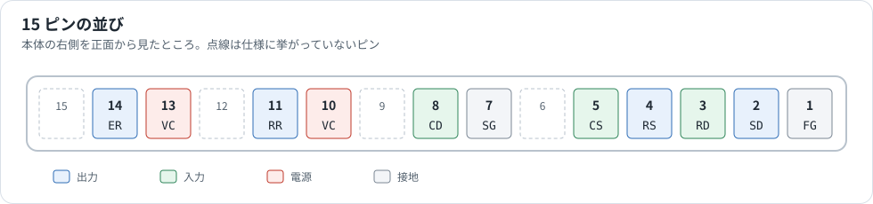

# 20. 仕様と保守

この章は PC-E500 の仕様を数字でまとめた章です。ほかの章で出てきた数（プログラムに使える大きさ、ネストの段数、桁数など）がどこから来ているかも説明します。シリアルポートのピン、付属品と別売品、長く使うための保守も載せました。機種ごとの違いは [機種ガイド](../analysis/29_MODELS.md) にあります。

[目次へ戻る](README.md)

## この章で分かること

- 大きさ、重さ、電源、画面、キー
- メモリの大きさと、その割り当て
- 計算の桁数と、`FOR`、`GOSUB` のネストの段数
- シリアルの仕様とピン
- 保守の注意

## 20.1 本体

| 項目 | 仕様 |
|---|---|
| 名前 | PC-E500 ポケットコンピュータ |
| CPU | 8 ビット CMOS（[SC62015](../analysis/02_CPU.md)） |
| 言語 | BASIC |
| ROM | 256 KB |
| 画面 | 液晶 40 桁 × 4 行、1 文字 5 × 7 ドット（[液晶](../analysis/04_LCD.md)） |
| キー | 89 個（英字、数字、記号、関数、テンキー、PF キー） |
| 大きさ | 幅 200 × 奥行 100 × 厚さ 14 mm |
| 重さ | 250 g（電池を含む） |
| 使える温度 | 0〜40 ℃ |
| 付属品 | ハードカバー、乾電池 4 本、リチウム電池 1 個、説明書 |

## 20.2 電源

| 項目 | 仕様 |
|---|---|
| 動作用 | 6.0 V、単 4 形（R03）乾電池 4 本 |
| メモリの保護用 | 3.0 V、リチウム電池 CR2016 1 個 |
| 消費電力 | 0.07 W（6.0 V） |
| 電池の持ち | 約 70 時間 |
| 自動電源オフ | キーを待って約 11 分 |

70 時間は 20 ℃ で 1 時間あたり計算 10 分、表示だけ 50 分の割合で使ったときの目安です。0.07 W ÷ 6 V で約 12 mA になります。電池の種類や使い方で変わります。

## 20.3 メモリ

| 割り当て | 大きさ |
|---|---|
| システムが使う分 | 約 3.8 KB |
| 固定変数 A〜Z | 312 バイト（12 バイト × 26 個） |
| プログラムとデータ | 28600 バイト |

合わせると約 32 KB です。初期化した直後に `FRE0` を実行すると、このとおりの数が出ます（実験、7.2）。

```text
FRE0
                                   28600
```

RAM ディスク `E:` を作るとその分だけ減り（[ファイルとドライブ](15_FILES.md#1511-ram-ディスクを用意する)）、RAM カードを足すと増やせます（[RAM カード](04_RAM_CARD.md)）。メモリの内容は、電池が切れない限り電源を切っても残ります。メモリのアドレスごとの配置は [メモリ](../analysis/03_MEMORY.md) にあります。

## 20.4 計算

| 項目 | 仕様 |
|---|---|
| 単精度 | 仮数 10 桁 + 指数 2 桁 |
| 倍精度 | 仮数 20 桁 + 指数 2 桁 |
| CAL、MATRIX、STAT | 単精度だけ |
| 計算の種類 | 四則、三角と逆三角、対数と指数、角度の変換、平方と平方根、累乗、符号、絶対値、整数、座標の変換、円周率など（[関数](14_FUNCTIONS.md)） |
| 編集 | カーソルの左右、行の上下、挿入、削除 |

## 20.5 ネストの段数

`FOR` と `GOSUB` の戻り先は合わせて 145 バイトの領域に記録されます。

| 種類 | 1 段 | 単独の最大段数 | 確認（実験、7.2） |
|---|---|---|---|
| `GOSUB` | 4 バイト | 145 ÷ 4 = 36 段 | 37 段目で `GOSUB or FOR nesting exceeded` |
| `FOR` | 21 バイト | 145 ÷ 21 = 6 段 | 7 段目で同じエラー |

PC-E500S では `WHILE`（8 バイト）、`REPEAT`（7 バイト）、`SWITCH`（9 バイト）も同じ領域を使います（[ネストの上限](../analysis/14_BASIC_REFERENCE.md#1447-ネストの上限)）。両方を使うときは、合計が 145 バイト以内なら動きます。例えば `FOR` を 3 段（63 バイト）ネストした中からは、(145 − 63) ÷ 4 = 20 段までの `GOSUB` をネストできる計算です。

## 20.6 接続端子

| 端子 | 用途 |
|---|---|
| 11 ピン（左側） | カセット、プリンタ、ディスクなど（[11 ピン](../analysis/06_PORT_11PIN.md)） |
| 15 ピン（右側） | シリアル（[15 ピン](../analysis/07_PORT_15PIN.md)） |
| カードスロット（裏） | RAM カード（[カードスロット](../analysis/05_CARD_SLOT.md)） |

別売品:

| 種類 | 型番 |
|---|---|
| RAM カード | 8 KB CE-212M、16 KB CE-2H16M、32 KB CE-2H32M、64 KB CE-2H64M |
| プリンタ / カセット | CE-126P |
| カラープロッタプリンタ | CE-515P |
| ポケットディスク | CE-140F |

くわしくは [周辺機器](../analysis/16_PERIPHERALS.md) にあります。

## 20.7 シリアル

| 項目 | 仕様 |
|---|---|
| 方式 | 調歩同期、半二重 / 全二重 |
| 速度 | 300、600、1200、2400、4800、9600 bps |
| パリティ | 偶数、奇数、なし |
| データ | 7、8 ビット |
| ストップ | 1、2 ビット |
| 出力の電圧 | CMOS レベル（4〜6 V） |
| 入力の信号 | RD、CS、CD |
| 出力の信号 | SD、RS、RR、ER |
| そのほか | SG、FG、VC |

### 20.7.1 ピン

本体の右側を正面から見て、右がピン 1、左がピン 15 です（操作説明書 p.350 の図）。



| ピン | 名前 | 記号 | 向き | 働き |
|---|---|---|---|---|
| 1 | Frame Ground | FG | − | 保護用の接地 |
| 2 | Send Data | SD | 出力 | 送るデータ |
| 3 | Receive Data | RD | 入力 | 受けるデータ |
| 4 | Request to Send | RS | 出力 | High: 送りたい |
| 5 | Clear to Send | CS | 入力 | High: 送ってよい |
| 7 | Signal Ground | SG | − | 信号の 0 V |
| 8 | Data Carrier Detect | CD | 入力 | High: 相手の信号がある |
| 10、13 | | VC | − | 電源 |
| 11 | Receive Ready | RR | 出力 | High: 受けられる |
| 14 | Data Terminal Ready | ER | 出力 | High: 本体の用意ができた |

High は VC の電圧、Low は SG の電圧です。

> [!WARNING]
> CMOS の部品が直接つながっているので、SG と VC の間の範囲を超える電圧をかけると壊れることがあります。パソコンの RS-232C（±の電圧）には、電圧を変える回路が要ります。

ピン 6、9、12、15 と、信号の時間の関係は [15 ピン（シリアル）](../analysis/07_PORT_15PIN.md) にあります。

## 20.8 保守

- 液晶はガラスです。落としたり、強く押したりしないでください。
- 急な温度の変化、湿気、ほこりを避けます。夏の車の中に置いたままにすると、高温で壊れることがあります。
- 汚れは柔らかい乾いた布で拭きます。水、溶剤、濡れた布は使いません。
- 長く使わないときは電池を抜きます。液漏れを防ぐためです。抜く前に、残したいものを保存してください。
- 静電気や雑音で全部のキーが効かなくなったら、RESET を押します（[困ったとき](19_TROUBLE.md#194-正しく動かないキーが効かない)）。

## まとめ

| 項目 | 値 |
|---|---|
| 画面 | 40 桁 × 4 行 |
| プログラムとデータ | 28600 バイト |
| 桁数 | 10 桁、20 桁 |
| 段数 | 145 バイト（FOR 6 段、GOSUB 36 段） |
| 電源 | 単 4 形 4 本、CR2016 1 個、約 70 時間 |

## 出典

- 操作説明書 p.350〜352、p.355。
- 固定変数 1 個の大きさ: [BASIC の内部形式](../analysis/15_BASIC_INTERNALS.md) §15.2.1。
- 実験: `FRE0` と段数を ROM 7.2 のエミュレータで確認。

## 次に読むもの

- [機種ガイド](../analysis/29_MODELS.md): ほかの機種の仕様
- [周辺機器](../analysis/16_PERIPHERALS.md): 別売品
- [回路とサービス](../analysis/09_CIRCUIT.md): サービスマニュアルの仕様
