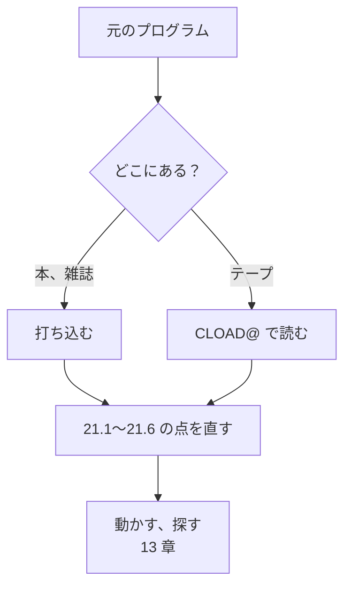

# 21. ほかの機種のプログラム

この章は以前のシャープのポケットコンピュータ用に書かれた BASIC のプログラムを、PC-E500 で動かすための章です。本や雑誌に載ったプログラムを打ち込むとき、古いテープを読み込むときに、どこを修正すればよいかを、確かめた例とともに説明します。

[目次へ戻る](README.md)

## この章で分かること

- 移しやすい機種
- 修正が必要な箇所の一覧と、直し方の例
- 古いテープを読む `CLOAD@`
- 説明書には「使えない」とあるが、実際には動く書き方

## 21.0 はじめに

操作説明書（p.353）は次の機種のプログラムなら少し直せば動くとしています。

| 系列 | 機種 |
|---|---|
| PC-14xx | PC-1401、PC-1402、PC-1403、PC-1403H、PC-1425、PC-1450、PC-1460、PC-1475 |
| PC-13xx | PC-1360 |



## 21.1 表示

| 違い | 直し方 |
|---|---|
| PC-E500 の `WAIT` は最初 0 で、`PRINT` の後に止まらない | 1 行ずつ止まる機種のプログラムは、最初に `WAIT` を足す（⏎ で進む）か、`WAIT 59` などで時間を決める |
| 1 行 40 桁、4 行 | 桁数の違う画面に合わせて区切った表示は、位置を直す |
| ない命令、ない文字 | 近い命令、近い文字に替える |

止めずに 4 行目に次の行が出ると、前の行は流れて消えます。

```basic
10 WAIT 59
20 FOR I=1 TO 9:PRINT I,I*I:NEXT I
```

## 21.2 変数と配列

| 違い | 直し方 |
|---|---|
| 変数の名前は 40 文字まで区別される（以前は 2 文字まで） | `TOTA` と `TOTB` を同じ変数として使っていたら、名前をそろえる |
| 宣言なしの `A(1)` はエラー | 最初に `DIM A(26)` のように宣言する |
| `A(1)` と `A` は別（以前は同じ変数を指す機種がある） | `A(1)` で `A` を、`A(2)` で `B` を使っていたら書き直す |
| 文字列の配列の長さの指定は要らない | `DIM AB$(30)*40` → `DIM AB$(30)`。1 要素は 254 文字まで入る |

宣言しない配列を使うと、次のようになります。

```basic
10 A(3)=5
```

```text
Array specified without DIM in 10
```

`DIM AB$(3)*4` のような長さの指定は、消さなくてもエラーにはならず、無視されました。8 文字を入れても切られません（実験、7.2。2.2、7.3、8.3 も同じ）。ただし、長さで文字が切られることを当てにしたプログラムは `LEFT$` を足してください。

## 21.3 行番号に式を書く

以前の機種では、`GOTO 100+A*10` のように行番号を計算で決める書き方が使われました。操作説明書（p.353）は、PC-E500 では `GOTO`、`GOSUB`、`RESTORE`、`THEN` の行番号に変数や式は使えないとしています。しかし実際には、`THEN` 以外は動きました。

```basic
10 L=40
20 GOTO L*2-40
30 END
40 PRINT "OK1"
50 M=100:GOSUB M
60 PRINT "BACK"
70 END
100 PRINT "SUB":RETURN
```

```text
RUN
OK1
SUB
BACK
```

| 書き方 | 結果（実験、7.2。2.2、7.3、8.3 も同じ） |
|---|---|
| `GOTO L*2-40` | 動く |
| `GOSUB M` | 動く |
| `RESTORE L` | 動く |
| `IF … THEN L` | `Syntax error` |

`THEN` の後の変数は `THEN GOTO L` と書けば直せます。とはいえ、`RENUM` で行番号を付け直しても式の中の番号までは直らないので、新しく書くプログラムでは `ON … GOTO` やラベルを使うほうが安全です。

## 21.4 論理値と DATA

| 違い | 直し方 |
|---|---|
| 真は −1、偽は 0（1 の機種がある） | `X=X+(A>B)` は `X=X-(A>B)` に、`(A=5)*10` は `-(A=5)*10` に |
| `DATA` に式を書けない | `DATA SIN 30+2` → `DATA 2.5` と値を書く。`DATA CHR$66` → `DATA B` |

```basic
10 DATA 2.5,B,SIN 30+2
20 READ X:READ Y$:READ Z
```

```text
Syntax error in 10
```

3 つ目を数として読む箇所でエラーになります。文字列の変数 `Z$` で読むと、`SIN 30+2` という文字のまま入りました（実験）。`DATA` の文字列は `"` で囲まなくてもかまいません。

## 21.5 定義キー（DEF キー）

以前の機種には `"A"` のようなラベルを DEF + A で始める機能がありました。PC-E500 にはないので、次のどちらかにします。

- PF キーに登録する: `KEY 1,"GOTO *A"+CHR$ 13`（[PF キー](16_PF_KEYS.md#162-文字列を登録する)）
- `GOTO *A` と打つ

ラベルは `"A"` のままでも使えますが、`*A` のほうが速く、勧められています。`"A"` と `*A` は別のラベルなので、呼ぶ側も一緒に書き換えてください。

## 21.6 ファイル

データをテープに書く `PRINT #` は、PC-E500 では先に `OPEN` が要ります。

```basic
10 OPEN "CAS:" FOR OUTPUT AS #1
20 PRINT #1,F,G
30 CLOSE #1
```

`OPEN` しないと `File not open` です。読むときも `OPEN "CAS:" FOR INPUT AS #1` と `INPUT #1` にします。

## 21.7 古いテープを読む（CLOAD@）

```text
CLOAD@"名前"
CLOAD@
```

名前を省くと、最初に見つかったプログラムを読みます。PC-E500 は読みながら 1 行ずつ中間コードを自分のものに変えます。次のときはエラーになります。

- 変えた 1 行が 255 バイトを超えた
- プログラムの領域に入りきらない

入りきらないときは、`CLEAR` などで変数を消してから読み直します。変換にはプログラムのほかに約 600 バイトの作業領域が要ります。同じ行でも、以前の機種とは使うメモリの大きさが違います。

テープの信号の形、実際に読み込んでみた結果、中間コードの変わり方は [カセットインターフェース](../analysis/20_CASSETTE.md#2010-以前の機種のテープcload-) にあります。

## 21.8 例: 移してみる

1 から N までの合計と平均を出す、以前の機種風のプログラムです。

```basic
10 "S":INPUT "N=";N
20 A(27)=0
30 FOR I=1 TO N:A(27)=A(27)+I:NEXT I
40 PRINT "SUM=";A(27)
50 PRINT "AVE=";A(27)/N
60 END
```

PC-E500 ではこう直します。

```basic
10 *S:WAIT 59:INPUT "N=";N
20 T=0
30 FOR I=1 TO N:T=T+I:NEXT I
40 PRINT "SUM=";T
50 PRINT "AVE=";T/N
60 END
```

宣言のない `A(27)` を固定変数 `T` に替え、ラベルを `*S` に、表示が流れないように `WAIT 59` を足しました。`KEY 1,"RUN *S"+CHR$ 13` と登録すれば、PF1 で始められます。

```text
RUN *S
N=10
SUM= 55
AVE= 5.5
```

## まとめ

| 違い | 直し方 |
|---|---|
| 止まらない | `WAIT` |
| 桁数 | 40 桁に合わせる |
| 宣言のない配列 | `DIM` |
| 真 = −1 | 符号を変える |
| `DATA` の式 | 値を書く |
| DEF キー | PF キーか `GOTO *ラベル` |
| テープのデータ | `OPEN` / `CLOSE` |
| テープのプログラム | `CLOAD@` |

## 出典

- 操作説明書 p.353〜354。
- 実験: 上の例を ROM 7.2（21.2、21.3 節は 2.2、7.3、8.3 も）のエミュレータで実行。

## 次に読むもの

- [カセットインターフェース](../analysis/20_CASSETTE.md): 古いテープの信号
- [機械語プログラムを動かす](22_MACHINE_CODE.md): 機械語の確保、読み込み、`CALL`
- [機種ガイド](../analysis/29_MODELS.md): 機種ごとの違い
- [プログラムを書く](12_PROGRAMMING.md): ラベルと実行
- [BASIC の命令と関数](../analysis/14_BASIC_REFERENCE.md): 使える命令
