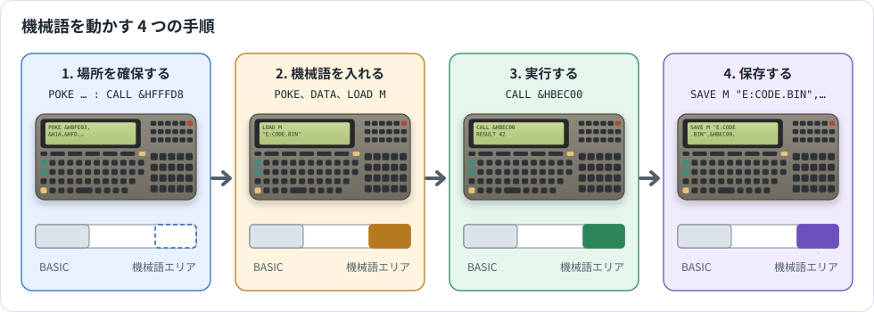
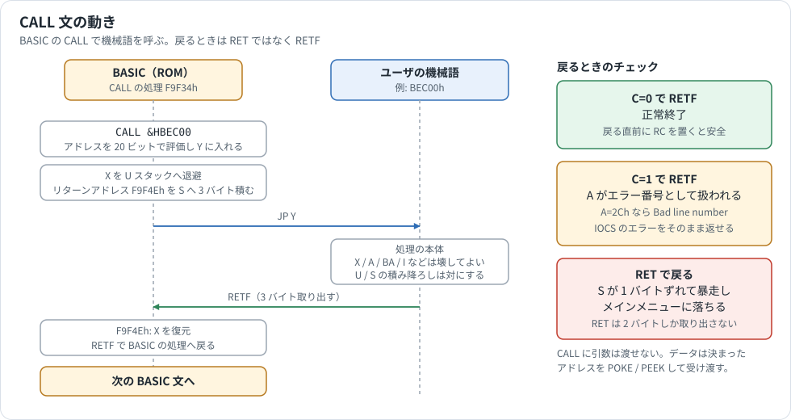

# 22. 機械語プログラムを動かす

この章は、機械語のプログラムを本体で動かすまでの手順です。置き場所の確保、プログラムの入力と読み込み、`CALL` での実行、保存、後片付けの順に、実際の画面で進めます。雑誌の機械語を打ち込みたい人、PC で作った機械語を本体で動かしたい人のための章です。命令の意味を知らなくても、手順どおりに打てば動かせます。

[目次へ戻る](README.md)

## この章で分かること

- 機械語を置く場所（機械語エリア）の確保と、確認のしかた
- `POKE`、`DATA` 文、`LOAD M`、`CLOAD M` での入れ方
- `CALL` での実行と、値の受け渡し
- `SAVE M` での保存と、自動で読み込む BASIC プログラム
- 失敗したときの症状と対処

## 22.0 はじめに

BASIC のプログラムは、本体が 1 行ずつ読み、意味を調べながら実行します。**機械語**は、CPU がそのまま実行できる数字の並びです。意味を調べる手間がないので、ずっと速く動きます。その代わり、間違っていても止めてくれません。大事なプログラムやデータは、始める前に保存しておきます。

手順は 4 つです。



この章の例は、日本語の PC-E500（ROM 7.2、32 KB）で動かしました。手順とアドレスは、シリーズのほかの機種でも同じです（[機械語を実機で動かす](../analysis/12_MACHINE_CODE.md) §12.3）。

## 22.1 機械語エリアを確保する

BASIC は、プログラムと変数のために、空いている RAM を自由に使います。機械語を置く場所を先に取り分けておかないと、あとから上書きされてしまいます。取り分けた場所を**機械語エリア**といいます。

### 22.1.1 確保する

RUN モードで、次の 1 行を打ちます。4096 バイト（1000h）を確保する例です。

```basic
POKE &HBFE03,&H1A,&HFD,&H0B,&H00,&H10,&H00:CALL &HFFFD8
```

⏎ を押すと、メインメニューになります。故障ではありません。


`BASIC` キーを押すと、RUN モードに戻ります。確保するのは最初の 1 回だけで、電源を切っても残ります。

### 22.1.2 大きさを変える

行の後ろの 3 つの数が大きさです。下位のバイトから順に書きます。先頭のアドレスは「BFC00h − 大きさ」で、終わりはいつも BFBFFh です。

| 大きさ | 後ろの 3 つ | 先頭のアドレス |
|---|---|---|
| 400h（1 KB） | `&H00,&H04,&H00` | `&HBF800` |
| 800h（2 KB） | `&H00,&H08,&H00` | `&HBF400` |
| 1000h（4 KB） | `&H00,&H10,&H00` | `&HBEC00` |
| 2000h（8 KB） | `&H00,&H20,&H00` | `&HBDC00` |
| 3000h（12 KB） | `&H00,&H30,&H00` | `&HBCC00` |
| 0（返す） | `&H00,&H00,&H00` | − |

指定するのは、足す量ではなく、確保した後の大きさです。あとから大きくも小さくもできます。大きさの決め方は、動かすプログラムの先頭のアドレスで決まります。プログラムが `BE000h` から始まるなら、BFC00h − BE000h = 1C00h を確保します。

### 22.1.3 確認する

```text
PRINT PEEK &HBFD1A,PEEK &HBFD1B,PEEK &HBFD1C
             0          236           11
PRINT FRE0
                                   24504
```

3 つの数が先頭のアドレスです。0 + 236 × 256 + 11 × 65536 = 781312 = BEC00h と読みます。確保する前は `0 252 11`（BFC00h、大きさ 0）でした。`FRE0`（BASIC に残った大きさ）は、28600 から 4096 減って 24504 になりました（実験）。

> [!NOTE]
> 大きすぎる値を指定すると、エラーは出ずに、前の大きさのままになります（8000h = 32 KB で実験）。確保した後は、必ず 3 つの数を確認してください。

## 22.2 短い機械語を打ち込む（POKE）

`POKE` は、アドレスを指定して、バイトを順に書き込む命令です。次の 8 バイトは、`BEC10h` に 42 を書いて戻るだけのプログラムです。

```basic
POKE &HBEC00,&H08,&H2A,&HA8,&H10,&HEC,&H0B,&H9F,&H07
```

| バイト | 命令 | 意味 |
|---|---|---|
| `08 2A` | `MV A,2Ah` | A に 42（2Ah）を入れる |
| `A8 10 EC 0B` | `MV [0BEC10h],A` | A を BEC10h に書く |
| `9F` | `RC` | 「エラーなし」の印 |
| `07` | `RETF` | BASIC に戻る |

`CALL` で実行し、`PEEK` で結果を見ます。

```text
CALL &HBEC00:PRINT PEEK &HBEC10
                                      42
```

## 22.3 長い機械語を打ち込む（DATA 文）

数十バイトを超えるときは、`DATA` 文に並べて、BASIC のプログラムで書き込みます。打ち間違いを見つけるために、全部のバイトを足した値（チェックサム）も調べます。画面に文字を出す 47 バイトの例です。

```basic
10 REM LOADER
20 A=&HBEC00:S=0
30 FOR I=0 TO 46
40 READ D$:D=VAL ("&H"+D$)
50 POKE A+I,D:S=S+D
60 NEXT I
70 IF S<>3913 THEN PRINT "DATA ERROR";S:END
80 CLS :CALL A
90 END
200 DATA 30,CC,D6,00,30,CC,D7,00,30,CC,D4,00
210 DATA 30,CC,D5,02,0C,20,EC,0B,0D,0F,00,00
220 DATA 09,42,05,E8,FF,0F,9F,07,48,45,4C,4C
230 DATA 4F,2C,20,4D,41,43,48,49,4E,45,21
```

`RUN` すると、3 行目に文字が出ます。


| 行 | 内容 |
|---|---|
| 20 | 書き込む先頭のアドレスと、合計の初期値 |
| 40 | 16 進の文字を数に直す（`"30"` → `&H30` → 48） |
| 50 | 1 バイト書き、合計に足す |
| 70 | 合計が違えば、実行しないで知らせる |
| 80 | 実行する |

最後の `21` を `20` と打ち間違えると、次のように止まります。間違ったまま `CALL` すると暴走することがあるので、この確認は省かないでください。

```text
RUN
DATA ERROR 3912
```

ほかの機械語に使うときは、20 行のアドレス、30 行の個数（バイト数 − 1）、70 行の合計、`DATA` を書き換えます。

## 22.4 ファイルから読み込む

| 置き場所 | 読み込み | 保存 |
|---|---|---|
| RAM ディスク（`E:`）、RAM カード（`F:`） | `LOAD M "E:名前"` | `SAVE M "E:名前",先頭,最後` |
| ポケットディスク（`X:`） | `LOAD M "X:名前"` | `SAVE M "X:名前",先頭,最後` |
| カセット | `CLOAD M "名前"` | `CSAVE M "名前",先頭,最後` |

`SAVE M` のファイルには、先頭のアドレスと長さが入っています。`LOAD M` は、元のアドレスへ読み込みます。PC で作った機械語は、「BIN を作成」で同じ形式のファイルにして渡します（[実機へ送る](../manual/14_TRANSFER.md)）。カセットの手順は[カセットインターフェース](../analysis/20_CASSETTE.md)にあります。

### 22.4.1 例: RAM ディスクに保存して読み込む

22.2 の 8 バイトと結果の場所を含む `BEC00h`〜`BEC1Fh` を保存します。書くのは**最初と最後**のアドレスで、最後のバイトも保存されます。`E:` は、先に `INIT "E:8K"` などで用意しておきます（[ファイルとドライブ](15_FILES.md)）。

```text
SAVE M "E:CODE.BIN",&HBEC00,&HBEC1F
>
FILES "E:"
 CODE    .BIN         48   E:
```

大きさは、16 バイトのヘッダーと 32 バイトの中身で 48 です。中身を消してから読み戻します。

```text
POKE &HBEC00,0,0,0,0,0,0,0,0
LOAD M "E:CODE.BIN"
CALL &HBEC00:PRINT PEEK &HBEC10
                                      42
```

### 22.4.2 BASIC から自動で読み込む

`LOAD M` はプログラムの中でも使えます。`RUN` だけで、読み込みから実行まで進みます。

```basic
10 LOAD M "E:CODE.BIN"
20 CALL &HBEC00
30 PRINT "RESULT";PEEK &HBEC10
```

```text
RUN
RESULT 42
```

機械語エリアの確保は、この中には書けません（メインメニューに移り、プログラムが止まるため）。

## 22.5 CALL で実行する



`CALL アドレス` は、そのアドレスから機械語を始めます。先頭とは限らないので、雑誌や PC のツールに書かれた**実行開始アドレス**を使います。アドレスは 16 進（`&HBEC00`）でも 10 進（`781312`）でも書けます。

| 決まり | 内容 |
|---|---|
| 引数 | 書けない。値は決めたアドレスに `POKE` で置く |
| 結果 | `PEEK` で読む。2 バイトなら `PEEK 下位+256*PEEK 上位` |
| 戻り方 | 機械語が `RETF` で戻ると、次の文へ進む |
| エラー | 機械語が C フラグを 1 にして戻ると、A の値の番号の BASIC のエラーになる |

エラーの例です。`MV A,15h`、`SC`、`RETF` の 4 バイトを呼ぶと、21 番のエラーになります。

```text
POKE &HBEC20,&H08,&H15,&H97,&H07
CALL &HBEC20
Division by Zero
```

機械語で書いたプログラムでも、`ON ERROR GOTO` で受け止められます（[エラー一覧](17_ERRORS.md)）。

## 22.6 後片付け

使い終わったら、大きさ 0 を指定して場所を BASIC に返せます。

```text
POKE &HBFE03,&H1A,&HFD,&H0B,&H00,&H00,&H00:CALL &HFFFD8
```

メインメニューから `BASIC` キーで戻ると、先頭のアドレスは `0 252 11`（BFC00h）に戻っています。機械語エリアの中身は使えなくなるので、必要なら先に `SAVE M` で保存します。

## 22.7 うまくいかないとき

| 症状 | 原因 | 対処 |
|---|---|---|
| 確保の行を打ったらメインメニューになった | 正常 | `BASIC` キーで戻る |
| 確認の 3 つの数が変わらない | 大きすぎる、または打ち間違い | `FRE0` を見て、小さくする。プログラムや変数を減らす |
| `LOAD M` で `File not found` | 名前かドライブが違う | `FILES "E:"` で確かめる |
| `LOAD` で `I/O error` | 機械語を `LOAD` で読んだ | `LOAD M` を使う |
| `CALL` の後、メインメニューになる | `RET` で戻っている、別のアドレスを呼んだ | 開始アドレスを確かめる。戻りは `RETF` |
| `CALL` の後、BASIC のエラーになる | C フラグが 1 のまま戻った | `RETF` の前に `RC`（`9F`）を置く |
| 固まる、画面が乱れる | 打ち間違い、別のアドレス用の機械語 | `ON/BRK` で戻らなければ RESET（[困ったとき](19_TROUBLE.md)）。チェックサムで確かめる |
| BASIC のプログラムが壊れた | 確保せずに `POKE` した、エリアの外に書いた | 確保してから書く |
| 電池を換えたら動かない | オールリセットで確保が消えた | もう一度確保し、`LOAD M` する |

RESET の後、データを消すかどうかを聞かれたら、残すほうを選ぶと、機械語エリアを含む RAM の中身が残ります（[表示と電源](03_DISPLAY_POWER.md)）。

## まとめ

| すること | 打つもの |
|---|---|
| 4 KB を確保 | `POKE &HBFE03,&H1A,&HFD,&H0B,&H00,&H10,&H00:CALL &HFFFD8` → `BASIC` キー |
| 確認 | `PRINT PEEK &HBFD1A,PEEK &HBFD1B,PEEK &HBFD1C` → `0 236 11` |
| 入れる | `POKE`、`DATA` 文、`LOAD M "E:名前"`、`CLOAD M "名前"` |
| 実行 | `CALL &HBEC00` |
| 保存 | `SAVE M "E:名前",&HBEC00,&HBEC1F` |
| 返す | `POKE &HBFE03,&H1A,&HFD,&H0B,&H00,&H00,&H00:CALL &HFFFD8` |

## 出典

- 実験: 日本語の PC-E500（ROM 7.2、32 KB）のエミュレータで、22.1〜22.6 の入力と結果を確かめました。
- 確保の方法は技術資料 p.77、p.85 の作業域の変更によります（[機械語を実機で動かす](../analysis/12_MACHINE_CODE.md) §12.3.2）。`CSAVE M` と `CLOAD M` は操作説明書にない命令です（[11 ピン](../analysis/06_PORT_11PIN.md)）。

## 次に読むもの

- [アセンブラ入門](../manual/03_ASSEMBLER_TUTORIAL.md): 機械語を自分で作る
- [実機へ送る](../manual/14_TRANSFER.md): PC で作った機械語を渡す
- [機械語を実機で動かす](../analysis/12_MACHINE_CODE.md): `CALL` の規約、内部 RAM と割り込みの扱い
- [メモリ](../analysis/03_MEMORY.md): RAM の使われ方
