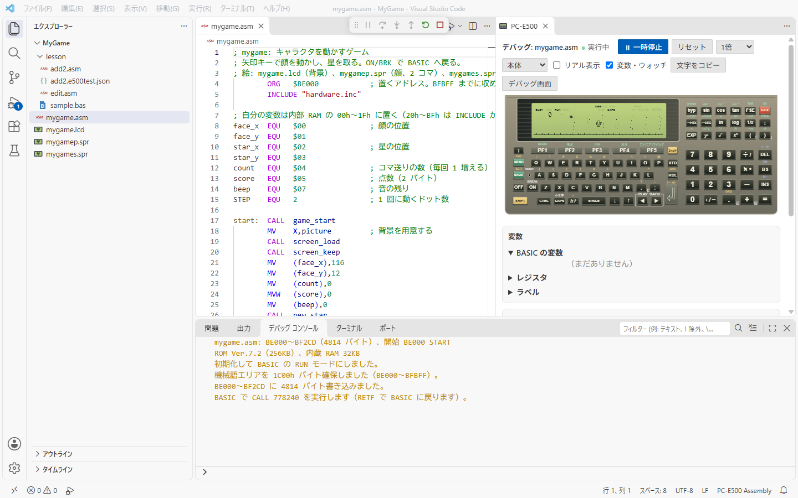

# 1. クイックスタート

この章は、ツールを初めて入れる人が、**キャラクタの動くゲームを自分の手で動かす**までの道のりです。プログラムを書いた経験も、機械語の知識も要りません。30 分ほどで、エミュレータの中で顔が動くところまで行けます。最後に、同じプログラムを実機へ送る手順も見ます。

手順は OS ごとに分けてあります。**自分の OS のものだけ**を、上から順に進めてください。

[目次へ戻る](README.md)

| 自分の OS | 読むもの |
|---|---|
| Windows | [クイックスタート（Windows）](01_QUICKSTART_WINDOWS.md) |
| Linux | [クイックスタート（Linux）](01_QUICKSTART_LINUX.md) |
| macOS | [クイックスタート（macOS）](01_QUICKSTART_MACOS.md) |

## OS による違い

作る手順（プログラムを作る、絵を描く、実機へ送る）は、どの OS でも同じです。違うのは、エミュレータで動かす方法です。

| すること | Windows | Linux | macOS |
|---|---|---|---|
| プログラムと絵を作る | VS Code | VS Code | VS Code |
| エミュレータで動かす | VS Code で `F5`。本体の画面が出て、キーで操作できる | コマンド `e500 run`。結果の画面を、文字と画像で見る | コマンド `e500 run`。結果の画面を、文字と画像で見る |
| 途中で止めて調べる | VS Code のデバッグ | − | − |
| 自動のテスト | VS Code、`e500 test` | `e500 test` | `e500 test` |
| 実機用のファイルを作る | VS Code、`e500 bin` | VS Code、`e500 bin` | VS Code、`e500 bin` |

## 用意するもの（どの OS も同じ）

使える OS とソフトのバージョンは、[動作環境](02_INSTALL.md#21-動作環境)にあります。

| もの | 用途 |
|---|---|
| [VS Code](https://code.visualstudio.com/) と、この[拡張機能](https://github.com/litchi-gh/pc-e500_tools/releases) | プログラムと絵を作る |
| [エミュレータ](https://github.com/litchi-gh/pc-e500_emulator_pockecom/releases) | 実機なしで動かす。自分の OS のもの |
| 自分の ROM | 自分の本体から吸い出したもの。ツールには入っていない |
| CE-140F か互換機 | 実機で動かすとき（[実機へ送る](14_TRANSFER.md)） |
