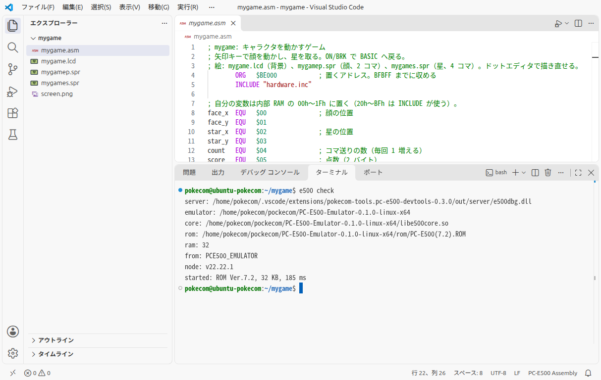
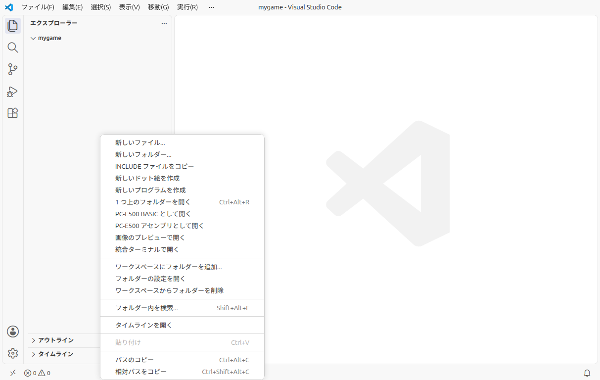
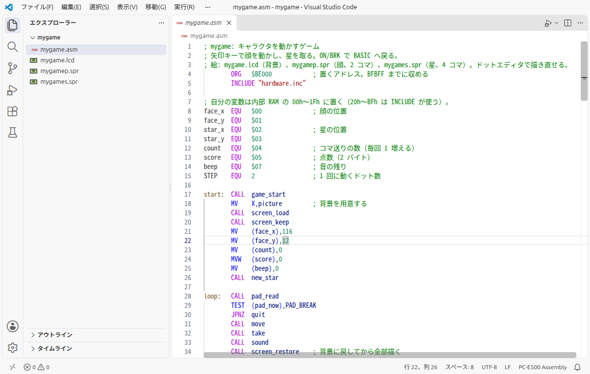
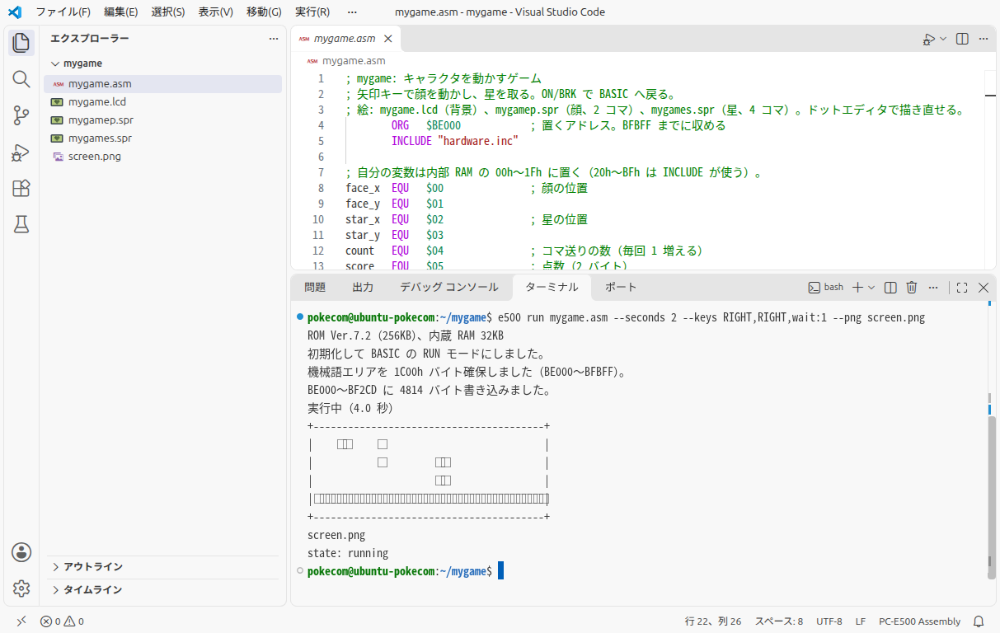
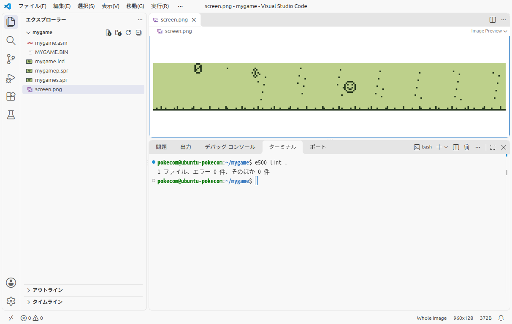
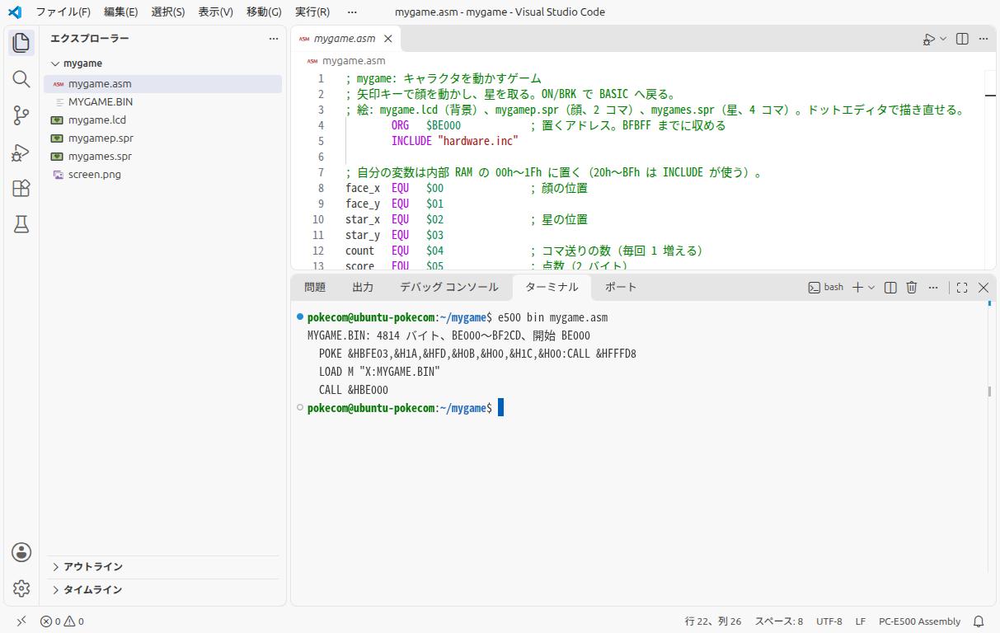
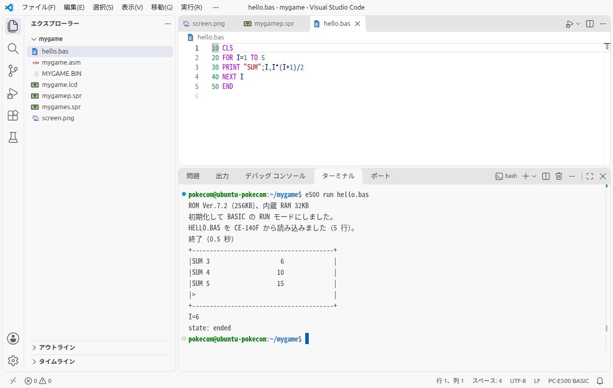

# 1. クイックスタート（Linux）

この章は、ツールを初めて入れる人が、Linux でキャラクタの動くゲームを自分の手で動かすまでの道のりです。プログラムを書いた経験も、機械語の知識も要りません。順に進めると、30 分ほどで、エミュレータの中で顔が動くところまで行けます。最後に、同じプログラムを実機へ送る手順も見ます。

くわしい説明はあとの章に回し、ここでは「動いた」を先に味わいます。画面は Ubuntu 26.04 のものです。Windows の人は[こちら](01_QUICKSTART_WINDOWS.md)、macOS の人は[こちら](01_QUICKSTART_MACOS.md)を読んでください。

[目次へ戻る](README.md)

Linux ではプログラムと絵を VS Code で作り、動かすのはコマンド `e500 run` で行います。VS Code の `F5`（実行、デバッグ）は Windows 専用です。

## 1.1 用意するもの

| もの | 用途 |
|---|---|
| Ubuntu 24.04 以降（x64）の PC | この章の手順は Ubuntu 26.04 で確かめたもの（[動作環境](02_INSTALL_LINUX.md#動作環境)） |
| VS Code、拡張機能、コマンド `e500`、エミュレータ | プログラムと絵を作る、動かす。次の節の 1 行で入る |
| 自分の ROM | 自分の本体から吸い出したもの。ツールには入っていない |

実機で動かすには、CE-140F か互換機も使います（[実機へ送る](14_TRANSFER.md)）。

自分の ROM（例 `PC-E500(7.2).ROM`）のある場所は、`~/PC-E500(7.2).ROM`（ホーム）の例で書きます。

## 1.2 まとめて入れる

端末を開いて（Ubuntu なら `Ctrl+Alt+T`）、次の 1 行を貼り付けます。

```sh
wget -qO- https://raw.githubusercontent.com/litchi-gh/pc-e500_tools/main/install.sh | sh -s -- --vscode --rom ~/'PC-E500(7.2).ROM'
```

| 部分 | 意味 |
|---|---|
| `wget -qO- アドレス` | インストール用のスクリプト（`install.sh`）を GitHub から取る |
| `\| sh -s --` | 取ったスクリプトを実行する。`--` の後ろがスクリプトのオプション |
| `--vscode` | VS Code がなければ入れる（Linux では管理者のパスワードを聞かれる） |
| `--rom ファイル` | 自分の ROM の場所。名前の `( )` は端末では特別な意味を持つので、`'…'` で囲む。まだないなら、この部分を書かない |

Node.js、.NET 10 のランタイム、コマンド `e500`、拡張機能、エミュレータが入ります。入る場所は `~/pockecom` と `~/.local/bin` で、`sudo` は要りません（VS Code を入れるときだけ要る）。既にあるものは使い回します。何をするスクリプトかは [2.2](02_INSTALL_LINUX.md#22-必要なものを入れる) にあります。

最後に `started: ROM Ver.7.2, …` と出れば入りました。ここで**新しい端末を開きます**。`e500` と打てるようになります。

## 1.3 日本語にする

VS Code を開いて、言語を変えるか聞かれたら「変更して再起動」を選びます。聞かれないときは、拡張機能の画面（`Ctrl+Shift+X`）で `Japanese` を探し、「Japanese Language Pack」を入れます。既に日本語なら、何もしません。

## 1.4 確かめる

端末で次を打ちます。エミュレータと ROM を探し、実際に一度起動して、使えるかどうかを調べるコマンドです。何も変えません。

```sh
e500 check
```



最後に `started: ROM Ver.7.2, …` と出れば準備完了です（画面は VS Code の中のターミナルで打ったところ）。

| 出たもの | 対処 |
|---|---|
| `コマンドが見つかりません` | 新しい端末を開いたか。`ls ~/.local/bin` に `e500` があるか |
| `エミュレータ（libe500core.so）が見つかりません` | `ls ~/pockecom/Emulator` に `libe500core.so` があるか |
| `ROM（*.ROM）がありません` | `ls ~/pockecom/Emulator/rom` に ROM があるか |

## 1.5 プログラムを作る

1. 空のフォルダを作って、VS Code で開きます。

   ```sh
   mkdir ~/mygame
   code ~/mygame
   ```

   1 行目でフォルダを作り、2 行目でそのフォルダを VS Code で開きます。「このフォルダーの作成者を信頼しますか」と聞かれたら「はい」を押します。

2. エクスプローラーの空いた所を右クリックし、「新しいプログラムを作成」を選びます。

   

3. テンプレートの一覧から「キャラクタを動かすゲーム」を選びます。

   

4. 名前に `mygame` と入れて `Enter` を押します。

   

次の 4 つのファイルができ、`mygame.asm` が開きます。

| ファイル | 内容 |
|---|---|
| `mygame.asm` | プログラム |
| `mygame.lcd` | 背景の絵 |
| `mygamep.spr` | 顔のキャラクタ（2 コマ） |
| `mygames.spr` | 星のキャラクタ（4 コマ） |



VS Code を使わないときは、端末で `cd ~/mygame` と `e500 new mygame` を打ち、機械語（`2`）とゲーム（そのまま `Enter`）を選ぶと、同じファイルができます。

## 1.6 動かす

VS Code のメニューの「ターミナル」→「新しいターミナル」を選びます（メニューが隠れているときは「…」の中）。下に開いたターミナルに次を打ちます。

```sh
e500 run mygame.asm --seconds 2 --keys RIGHT,RIGHT,wait:1 --png screen.png
```

| 部分 | 意味 |
|---|---|
| `run mygame.asm` | アセンブル（ソースを機械語に変える）して、エミュレータに入れ、動かす |
| `--seconds 2` | 2 秒動かす |
| `--keys RIGHT,RIGHT,wait:1` | その後、右キーを 2 回押して 1 秒待つ |
| `--png screen.png` | 終わったときの画面を `screen.png` という画像にする |



枠の中は液晶の 40 文字 × 4 行です。絵は文字ではないので `□` になります。`state: running` は「時間まで動き続けていた」という意味で、ゲームなら正常です。

左のエクスプローラーで `screen.png` をクリックすると、そのときの画面が絵で見られます。顔が右へ動き、星が浮かんでいます。



`--keys` の中身を変えると、ほかの動きも試せます。`LEFT`、`UP`、`DOWN` や、`wait:0.5`（0.5 秒待つ）を `,` で区切って並べます。

## 1.7 絵を描き直す

1. エクスプローラーで `mygamep.spr` をクリックします。
2. マウスで点を打って、好きな絵にします。

   

3. `Ctrl+S` で保存し、ターミナルで 1.6 のコマンドをもう一度打ちます（`↑` キーで呼び出せます）。`screen.png` が新しい絵になります。

描き方は[ドットエディタ](12_DOT_EDITOR.md)にあります。

## 1.8 プログラムを直してみる

`mygame.asm` の次の行を探して、`2` を `4` に変え、`Ctrl+S` で保存します。

```asm
STEP    EQU   2                 ; 1 回に動くドット数
```

1.6 のコマンドをもう一度打つと、顔が前より右まで動きます。1 回に動く量が 2 倍になったからです。

書き間違えると、赤い波線が付きます。端末で全部のファイルを調べるには、次を打ちます。間違いを探すだけで、動かしません。

```sh
e500 lint .
```

`.` は「今いるフォルダ」です。`1 ファイル、エラー 0 件、そのほか 0 件` と出れば、間違いはありません。

## 1.9 実機で動かす

1. 実機用のファイルを作ります。

   ```sh
   e500 bin mygame.asm
   ```

   `LOAD M` で読める `MYGAME.BIN` を作り、実機で打つ行を表示するコマンドです。

   

2. `MYGAME.BIN` を CE-140F（互換機の SD カードなど）にコピーします。ファイルの画面でコピーしても、次のように打ってもかまいません。`SDCARD` は自分の SD カードの名前に替えます（`ls /media/$USER` で分かります）。

   ```sh
   cp MYGAME.BIN /media/$USER/SDCARD/
   ```

3. 実機の BASIC で、表示された 3 行を順に打ちます。

   ```basic
   POKE &HBFE03,&H1A,&HFD,&H0B,&H00,&H1C,&H00:CALL &HFFFD8
   LOAD M "X:MYGAME.BIN"
   CALL &HBE000
   ```

   1 行目は機械語エリアの確保で、最初の 1 回だけです。メインメニューに戻るので `BASIC` キーで入り直します。

ゲームは矢印キーで動かします。`ON/BRK` で BASIC に戻ります。

## 1.10 画面の見方

VS Code の画面です。


| 場所 | 名前 | 使いみち |
|---|---|---|
| 左端 | アクティビティ バー | 上から、ファイル、検索、Git、デバッグ、拡張機能、テスト |
| 左 | サイド バー | ファイルの一覧など |
| 中央 | エディタ | プログラムを書く、絵を描く |
| 下 | パネル | 問題、出力、ターミナル |
| 一番下 | ステータス バー | 行番号、文字コード、言語（PC-E500 Assembly） |

## 1.11 BASIC から始める

機械語ではなく BASIC で作るときは、もっと簡単です。

1. フォルダに `hello.bas` というファイルを作り、次のプログラムを書いて保存します。

   ```basic
   10 CLS
   20 FOR I=1 TO 5
   30 PRINT "SUM";I,I*(I+1)/2
   40 NEXT I
   50 END
   ```

2. ターミナルで動かします。エミュレータに読み込んで `RUN` し、終わったときの画面と変数を表示するコマンドです。

   ```sh
   e500 run hello.bas
   ```



`state: ended` は「最後まで動いて、BASIC に戻った」という意味です。くわしくは [BASIC](13_BASIC.md) にあります。

## 1.12 うまくいかないとき

| 症状 | 見るところ |
|---|---|
| 「新しいプログラムを作成」が出ない | 拡張機能が入っているか（`code --list-extensions`）。フォルダを開いているか |
| `F5` を押しても動かない | `F5` は Windows 専用。`e500 run` を使う |
| `e500` が見つからない | 新しい端末を開いたか（[1.2](#12-まとめて入れる)） |
| メッセージが英語 | `export E500_LANG=ja` を打ってから、もう一度打つ |
| 赤い波線が出て動かない | 「問題」（`Ctrl+Shift+M`）を読む |
| `state: menu` と出る | プログラムが暴走した。直したところを元に戻して確かめる |

ほかは [24.9 困ったとき](24_COMMAND_LINE_LINUX.md#249-困ったとき)にあります。

## 次に読むもの

- 機械語を覚える: [アセンブラ入門](03_ASSEMBLER_TUTORIAL.md)
- このゲームを自分のものにする: [ゲームを作る](07_GAME.md)
- コマンドをもっと使う: [Linux のコマンド](24_COMMAND_LINE_LINUX.md)
- AI に書かせる: [24.7](24_COMMAND_LINE_LINUX.md#247-ai-に書かせる)
