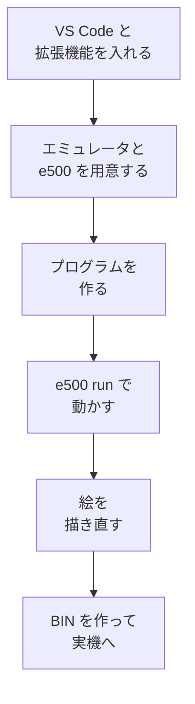

# 1. クイックスタート（macOS）

この章は、ツールを初めて入れる人が、macOS で**キャラクタの動くゲームを自分の手で動かす**までの道のりです。プログラムを書いた経験も、機械語の知識も要りません。順に進めると、30 分ほどで、エミュレータの中で顔が動くところまで行けます。最後に、同じプログラムを実機へ送る手順も見ます。

くわしい説明はあとの章に回し、ここでは「動いた」を先に味わいます。Windows の人は[こちら](01_QUICKSTART_WINDOWS.md)、Linux の人は[こちら](01_QUICKSTART_LINUX.md)を読んでください。

[目次へ戻る](README.md)



macOS では、プログラムと絵を VS Code で作り、動かすのはコマンド `e500 run` で行います。VS Code の `F5`（実行、デバッグ）は Windows 専用です。

## 1.1 用意するもの

| もの | 取る場所 | 用途 |
|---|---|---|
| macOS 15 以降の Mac | − | Apple シリコンか Intel（[動作環境](02_INSTALL_MACOS.md#動作環境)） |
| VS Code | [VS Code のページ](https://code.visualstudio.com/) | プログラムと絵を作る |
| Node.js（20.12 以降、LTS） | [nodejs.org](https://nodejs.org/) | コマンド `e500` を動かす |
| .NET 10 のランタイム（SDK でもよい） | [.NET のダウンロード](https://dotnet.microsoft.com/download/dotnet/10.0) | エミュレータを操作する部品を動かす |
| `pc-e500-devtools-<バージョン>.vsix` | [ツールの Releases](https://github.com/litchi-gh/pc-e500_tools/releases) | VS Code の拡張機能。コマンド `e500` も入っている |
| macOS 版のエミュレータ `pokecom-<バージョン>-osx-….tar.gz` | [エミュレータの Releases](https://github.com/litchi-gh/pc-e500_emulator_pockecom/releases) | `libe500core.dylib` が入ったもの |
| 自分の ROM | 自分の本体から吸い出す | ツールには入っていない |

自分の Mac の種類は、左上の Apple メニュー →「この Mac について」で分かります。

| 「チップ」の表示 | エミュレータ | Node.js、.NET |
|---|---|---|
| Apple M… | `osx-arm64` | Arm64 |
| Intel … | `osx-x64` | x64 |

この章の `osx-arm64` は、Intel の Mac では `osx-x64` に読み替えます。ダウンロードしたファイルと ROM（例 `PC-E500(7.2).ROM`）は、「ダウンロード」フォルダ（ターミナルでは `~/Downloads`）に置いておきます。

実機で動かすには、CE-140F か互換機も使います（[実機へ送る](14_TRANSFER.md)）。

## 1.2 必要なものを入れる

1. VS Code の ZIP を開き、出てきた「Visual Studio Code」を「アプリケーション」フォルダへ移します。
2. Node.js と .NET の `.pkg` を開き、画面のとおりに進めます。
3. ターミナル（「アプリケーション」→「ユーティリティ」）を開いて、入ったかどうかを確かめます。バージョンを表示するだけのコマンドです。

   ```sh
   node --version
   dotnet --list-runtimes
   ```

`node` は `v20.12` 以上、`dotnet` は `Microsoft.NETCore.App 10.` で始まる行があれば大丈夫です。

## 1.3 拡張機能を入れる

1. VS Code を開きます。
2. 拡張機能の画面（`Cmd+Shift+X`）で `Japanese` を探し、「Japanese Language Pack」を入れます。言語を変えるか聞かれたら、変えて再起動します。メニューが日本語になります。
3. 拡張機能の画面の右上の「…」から **「VSIX からのインストール」** を選び、ダウンロードした `.vsix` を指定します。
4. `Cmd+Shift+P` を押し、**「シェル コマンド: PATH 内に 'code' コマンドをインストールします」** を実行します。ターミナルで `code` と打って VS Code を開けるようになります。

## 1.4 エミュレータと e500 を用意する

### 1. エミュレータと ROM を置く

```sh
mkdir -p ~/pockecom
tar xzf ~/Downloads/pokecom-*-osx-arm64.tar.gz -C ~/pockecom
mv ~/pockecom/pokecom-*-osx-arm64 ~/pockecom/Emulator
xattr -dr com.apple.quarantine ~/pockecom/Emulator
cp ~/Downloads/'PC-E500(7.2).ROM' ~/pockecom/Emulator/rom/
```

| コマンド | 何をするか |
|---|---|
| `mkdir -p ~/pockecom` | ホームに `pockecom` フォルダを作る |
| `tar xzf … -C ~/pockecom` | ダウンロードしたエミュレータを、そこに展開する。`*` は「何でもよい」なので、バージョンの番号を打たなくて済む |
| `mv 元 先` | 展開したフォルダの名前を、短い `Emulator` に変える |
| `xattr -dr com.apple.quarantine フォルダ` | ダウンロードしたファイルに macOS が付ける「実行の制限」の印を外す。Apple の公証を受けていないファイルなので要る |
| `cp 元 先` | 自分の ROM を、エミュレータの `rom` フォルダにコピーする。名前の `( )` はターミナルでは特別な意味を持つので、`'…'` で囲む |

### 2. e500 と打てるようにする

コマンド `e500` は、入れた拡張機能の中にあります。どこからでも打てるように、それを呼び出す短いファイルを作ります。`0.3.0` は、入れたバージョンに合わせてください。

```sh
mkdir -p ~/.local/bin
cat > ~/.local/bin/e500 <<'EOF'
#!/bin/sh
exec sh "$HOME/.vscode/extensions/pokecom-tools.pc-e500-devtools-0.3.0/bin/e500" "$@"
EOF
chmod +x ~/.local/bin/e500
```

| 部分 | 何をするか |
|---|---|
| `mkdir -p ~/.local/bin` | 自分用のコマンドを置くフォルダを作る |
| `cat > ファイル <<'EOF'` 〜 `EOF` | 間の 2 行を、そのままファイルに書き込む。4 行をまとめて貼り付けてよい |
| `chmod +x ファイル` | そのファイルに「実行してよい」という印を付ける |

### 3. 場所を教える

```sh
echo 'export PATH="$HOME/.local/bin:$PATH"' >> ~/.zshrc
echo 'export PCE500_EMULATOR="$HOME/pockecom/Emulator"' >> ~/.zshrc
source ~/.zshrc
```

| コマンド | 何をするか |
|---|---|
| 1 行目 | ターミナルを開いたときに読まれる `~/.zshrc` の最後に、「`~/.local/bin` のコマンドも使う」という行を書き加える。1 回だけ打つ |
| 2 行目 | 「エミュレータはここにある」という行を書き加える。1 回だけ打つ |
| 3 行目 | 書き加えた設定を、今のターミナルで読み直す |

### 4. 確かめる

エミュレータと ROM を探し、実際に一度起動して、使えるかどうかを調べるコマンドです。何も変えません。

```sh
e500 check
```

```text
server: /Users/名前/.vscode/extensions/pokecom-tools.pc-e500-devtools-0.3.0/out/server/e500dbg.dll
emulator: /Users/名前/pockecom/Emulator
core: /Users/名前/pockecom/Emulator/libe500core.dylib
rom: /Users/名前/pockecom/Emulator/rom/PC-E500(7.2).ROM
ram: 32
from: PCE500_EMULATOR
node: v22.23.5
started: ROM Ver.7.2, 32 KB, 223 ms
```

最後に `started: ROM Ver.7.2, …` と出れば準備完了です。

| 出たもの | 対処 |
|---|---|
| `command not found: e500` | `ls ~/.local/bin` に `e500` があるか。ターミナルを開き直す |
| `エミュレータ（libe500core.dylib）が見つかりません` | `ls ~/pockecom/Emulator` に `libe500core.dylib` があるか |
| `ROM（*.ROM）がありません` | `ls ~/pockecom/Emulator/rom` に ROM があるか |
| `libe500core.dylib` が開けない、壊れていると言われる | `xattr` の行をもう一度打つ |

## 1.5 プログラムを作る

1. 空のフォルダを作って、VS Code で開きます。

   ```sh
   mkdir ~/mygame
   code ~/mygame
   ```

   1 行目でフォルダを作り、2 行目でそのフォルダを VS Code で開きます。「このフォルダーの作成者を信頼しますか」と聞かれたら「はい」を押します。

2. エクスプローラー（左のファイルの一覧）の空いた所を右クリックし、**「新しいプログラムを作成」** を選びます。
3. テンプレートの一覧から **「キャラクタを動かすゲーム」** を選びます。
4. 名前に `mygame` と入れて `return` を押します。

次の 4 つのファイルができ、`mygame.asm` が開きます。

| ファイル | 内容 |
|---|---|
| `mygame.asm` | プログラム |
| `mygame.lcd` | 背景の絵 |
| `mygamep.spr` | 顔のキャラクタ（2 コマ） |
| `mygames.spr` | 星のキャラクタ（4 コマ） |

VS Code を使わないときは、ターミナルで `cd ~/mygame` と `e500 new game mygame` を打つと、同じファイルができます。

## 1.6 動かす

VS Code のメニューの「ターミナル」→「新しいターミナル」を選びます。下に開いたターミナルに、次を打ちます。

```sh
e500 run mygame.asm --seconds 2 --keys RIGHT,RIGHT,wait:1 --png screen.png
```

| 部分 | 意味 |
|---|---|
| `run mygame.asm` | アセンブル（ソースを機械語に変える）して、エミュレータに入れ、動かす |
| `--seconds 2` | 2 秒動かす |
| `--keys RIGHT,RIGHT,wait:1` | その後、右キーを 2 回押して 1 秒待つ |
| `--png screen.png` | 終わったときの画面を、`screen.png` という画像にする |

```text
ROM Ver.7.2（256KB）、内蔵 RAM 32KB
初期化して BASIC の RUN モードにしました。
機械語エリアを 1C00h バイト確保しました（BE000〜BFBFF）。
BE000〜BF2CD に 4814 バイト書き込みました。
実行中（4.0 秒）
+----------------------------------------+
|    □□     □                            |
|           □         □□                 |
|                     □□                 |
|□□□□□□□□□□□□□□□□□□□□□□□□□□□□□□□□□□□□□□□□|
+----------------------------------------+
screen.png
state: running
```

枠の中は液晶の 40 文字 × 4 行です。絵は文字ではないので `□` になります。`state: running` は「時間まで動き続けていた」という意味で、ゲームなら正常です。

VS Code の左の一覧で `screen.png` をクリックするか、ターミナルで `open screen.png` と打つと、そのときの画面が絵で見られます。顔が右へ動き、星が浮かんでいます。

`--keys` の中身を変えると、ほかの動きも試せます。`LEFT`、`UP`、`DOWN` や、`wait:0.5`（0.5 秒待つ）を `,` で区切って並べます。

## 1.7 絵を描き直す

1. VS Code の左の一覧で `mygamep.spr` をクリックします。点を打てる画面（ドットエディタ）が開きます。
2. マウスで点を打って、好きな絵にします。
3. `Cmd+S` で保存し、ターミナルで 1.6 のコマンドをもう一度打ちます（`↑` キーで呼び出せます）。`screen.png` が新しい絵になります。

描き方は[ドットエディタ](12_DOT_EDITOR.md)にあります。

## 1.8 プログラムを直してみる

`mygame.asm` の次の行を探して、`2` を `4` に変え、`Cmd+S` で保存します。

```asm
STEP    EQU   2                 ; 1 回に動くドット数
```

1.6 のコマンドをもう一度打つと、顔が前より右まで動きます。1 回に動く量が 2 倍になったからです。

書き間違えると、赤い波線が付きます。ターミナルで全部のファイルを調べるには、次を打ちます。間違いを探すだけで、動かしません。

```sh
e500 lint .
```

`.` は「今いるフォルダ」です。`1 ファイル、エラー 0 件、そのほか 0 件` と出れば、間違いはありません。

## 1.9 実機で動かす

1. 実機用のファイルを作ります。`LOAD M` で読める `MYGAME.BIN` を作り、実機で打つ行を表示するコマンドです。

   ```sh
   e500 bin mygame.asm
   ```

   ```text
   MYGAME.BIN: 4814 バイト、BE000〜BF2CD、開始 BE000
     POKE &HBFE03,&H1A,&HFD,&H0B,&H00,&H1C,&H00:CALL &HFFFD8
     LOAD M "X:MYGAME.BIN"
     CALL &HBE000
   ```

2. `MYGAME.BIN` を CE-140F（互換機の SD カードなど）にコピーします。Finder でコピーしても、次のように打ってもかまいません。`SDCARD` は自分の SD カードの名前に替えます（`ls /Volumes` で分かります）。

   ```sh
   cp MYGAME.BIN /Volumes/SDCARD/
   ```

3. 実機の BASIC で、表示された 3 行を順に打ちます。

   ```basic
   POKE &HBFE03,&H1A,&HFD,&H0B,&H00,&H1C,&H00:CALL &HFFFD8
   LOAD M "X:MYGAME.BIN"
   CALL &HBE000
   ```

   1 行目は機械語エリアの確保で、最初の 1 回だけです。メインメニューに戻るので `BASIC` キーで入り直します。

ゲームは矢印キーで動かします。`ON/BRK` で BASIC に戻ります。

## 1.10 画面の見方

VS Code の画面は、次の部分に分かれています。

| 場所 | 名前 | 使いみち |
|---|---|---|
| 左端 | アクティビティ バー | 上から、ファイル、検索、Git、デバッグ、拡張機能、テスト |
| 左 | サイド バー | ファイルの一覧など |
| 中央 | エディタ | プログラムを書く、絵を描く |
| 下 | パネル | 問題、出力、ターミナル |
| 一番下 | ステータス バー | 行番号、文字コード、言語（PC-E500 Assembly） |

## 1.11 BASIC から始める

機械語ではなく BASIC で作るときは、もっと簡単です。

1. フォルダに `hello.bas` というファイルを作り、次のプログラムを書いて保存します。

   ```basic
   10 CLS
   20 FOR I=1 TO 5
   30 PRINT "SUM";I,I*(I+1)/2
   40 NEXT I
   50 END
   ```

2. ターミナルで動かします。エミュレータに読み込んで `RUN` し、終わったときの画面と変数を表示するコマンドです。

   ```sh
   e500 run hello.bas
   ```

   ```text
   終了（0.5 秒）
   +----------------------------------------+
   |SUM 3                  6                |
   |SUM 4                 10                |
   |SUM 5                 15                |
   |>                                       |
   +----------------------------------------+
   I=6
   state: ended
   ```

`state: ended` は「最後まで動いて、BASIC に戻った」という意味です。くわしくは [BASIC](13_BASIC.md) にあります。

## 1.12 うまくいかないとき

| 症状 | 見るところ |
|---|---|
| 「新しいプログラムを作成」が出ない | 拡張機能が入っているか。フォルダを開いているか |
| `F5` を押しても動かない | `F5` は Windows 専用。`e500 run` を使う |
| `e500` が見つからない | ターミナルを開き直したか（[1.4](#14-エミュレータと-e500-を用意する)） |
| メッセージが英語 | `export E500_LANG=ja` を打ってから、もう一度打つ |
| 赤い波線が出て動かない | 「問題」（`Cmd+Shift+M`）を読む |
| `state: menu` や `state: fault` と出る | プログラムが暴走した。直したところを元に戻して確かめる |

ほかは [25.8 困ったとき](25_COMMAND_LINE_MACOS.md#258-困ったとき)にあります。

## 次に読むもの

- 機械語を覚える: [アセンブラ入門](03_ASSEMBLER_TUTORIAL.md)
- このゲームを自分のものにする: [ゲームを作る](07_GAME.md)
- コマンドをもっと使う: [macOS のコマンド](25_COMMAND_LINE_MACOS.md)
- AI に書かせる: [25.7](25_COMMAND_LINE_MACOS.md#257-ai-に書かせる)
