# 1. クイックスタート（Windows）

この章は、ツールを初めて入れる人が、Windows で**キャラクタの動くゲームを自分の手で動かす**までの道のりです。プログラムを書いた経験も、機械語の知識も要りません。画面のとおりに進めると、30 分ほどで、エミュレータの中で顔が動き、星を取ると点が増えるところまで行けます。最後に、同じプログラムを実機へ送る手順も見ます。

くわしい説明はあとの章に回し、ここでは「動いた」を先に味わいます。なぜそうするのかが気になったら、各節の終わりにあるリンクから、その章へ進んでください。Linux の人は[こちら](01_QUICKSTART_LINUX.md)、macOS の人は[こちら](01_QUICKSTART_MACOS.md)を読んでください。

[目次へ戻る](README.md)

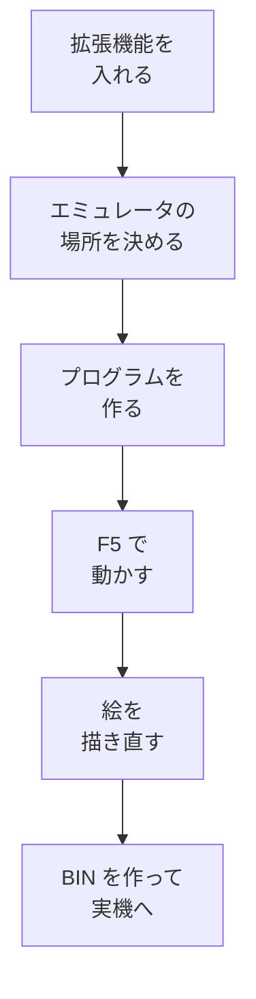

## 1.1 用意するもの

プログラムを作るだけなら VS Code と拡張機能で足ります。作ったものを PC の中で動かすにはエミュレータと ROM、実機で動かすには PC とポケットコンピュータの間でファイルを渡す機器が要ります。まずはエミュレータで動かすところまでそろえれば十分です。

| もの | 用途 |
|---|---|
| Windows 11（x64）の PC | プログラムを作り、エミュレータで動かす（[動作環境](02_INSTALL_WINDOWS.md#動作環境)） |
| [VS Code](https://code.visualstudio.com/) | エディタ |
| .NET 10 のランタイム | エミュレータを VS Code から動かすために使う（[入れ方](02_INSTALL_WINDOWS.md#23-net-10-のランタイムを入れる)） |
| PC-E500 エミュレータ | `e500core.dll` と ROM が入ったもの |
| 自分の ROM | 自分の本体から吸い出したもの。ツールには入っていない |

実機で動かすには、CE-140F か互換機も使います（[実機へ送る](14_TRANSFER.md)）。

## 1.2 必要なものと拡張機能を入れる

1. VS Code と .NET 10 のランタイムを入れます。PowerShell（スタートボタンを右クリック →「ターミナル」）で次を打つか、上の表のページからインストーラーを取って実行します。

   ```powershell
   winget install --id Microsoft.VisualStudioCode -e
   winget install --id Microsoft.DotNet.Runtime.10 -e
   ```

   `winget install` は、Windows に付いている、ソフトを入れるコマンドです。`--id` の後がソフトの名前で、`-e` は名前が完全に一致するものだけを入れるという意味です。「変更を加えることを許可しますか」と聞かれたら「はい」を押します。

2. [Releases](https://github.com/litchi-gh/pc-e500_tools/releases) から `pc-e500-devtools-<バージョン>.vsix` を取得します。
3. VS Code の拡張機能の画面（`Ctrl+Shift+X`）で、右上の「…」から **「VSIX からのインストール」** を選び、そのファイルを指定します。

VS Code の表示言語が日本語なら、メニューやメッセージも日本語になります。英語のときは、拡張機能の画面で「Japanese Language Pack」を探して入れます。

## 1.3 エミュレータの場所を決める

拡張機能は、エミュレータの本体である `e500core.dll` を直接呼び出して、VS Code の中に PC-E500 を 1 台作ります。そのため、エミュレータのフォルダがどこにあるかを 1 回だけ教えます。

先に、エミュレータの [Releases](https://github.com/litchi-gh/pc-e500_emulator_pockecom/releases) から ZIP かインストーラーを取って入れ、自分の ROM を `rom` フォルダに置いておきます（[くわしい手順](02_INSTALL_WINDOWS.md#25-エミュレータと-rom-を置く)）。

1. `Ctrl+Shift+P` を押し、**「PC-E500: 環境を確認」** を実行します。
2. 「エミュレータのフォルダ」の **「フォルダを選択」** で、`e500core.dll` と `rom` フォルダがある場所を選びます。
3. 一番下の「起動の確認」が **「使えます」** になれば準備完了です。

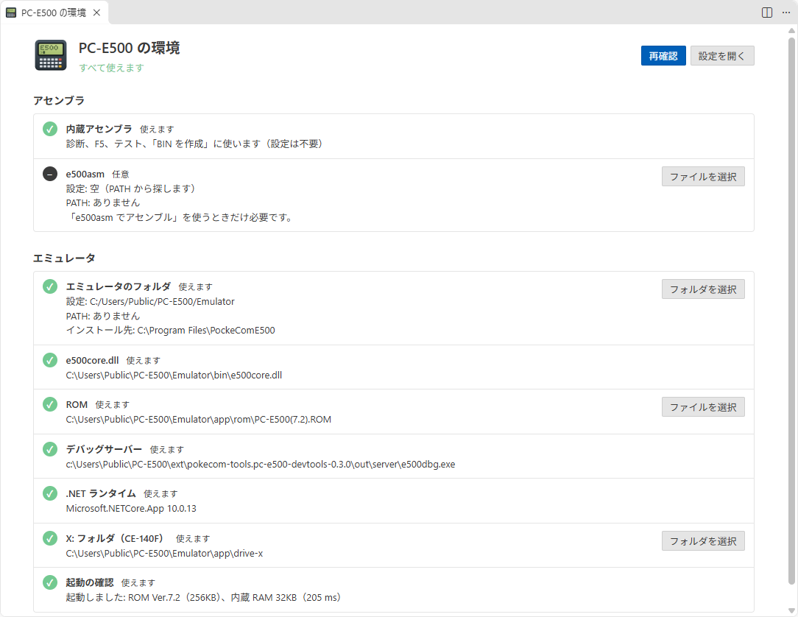

「e500asm」は「任意」のままでかまいません。拡張機能の中にアセンブラが入っています。

## 1.4 プログラムを作る

1. 空のフォルダを作り、VS Code の「ファイル」→「フォルダーを開く」で開きます。
2. エクスプローラーの空いた所を右クリックし、**「新しいプログラムを作成」** を選びます。

   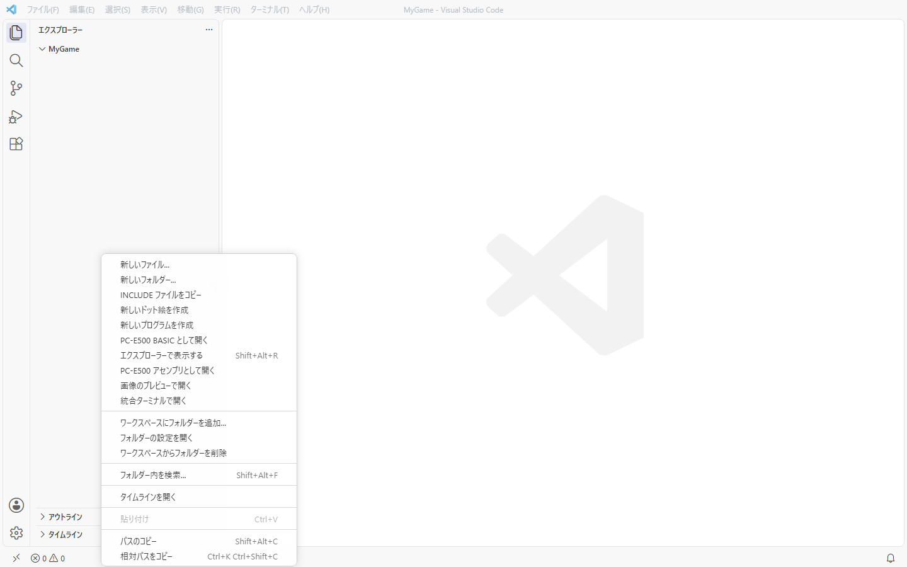

3. テンプレートの一覧から **「キャラクタを動かすゲーム」** を選びます。

   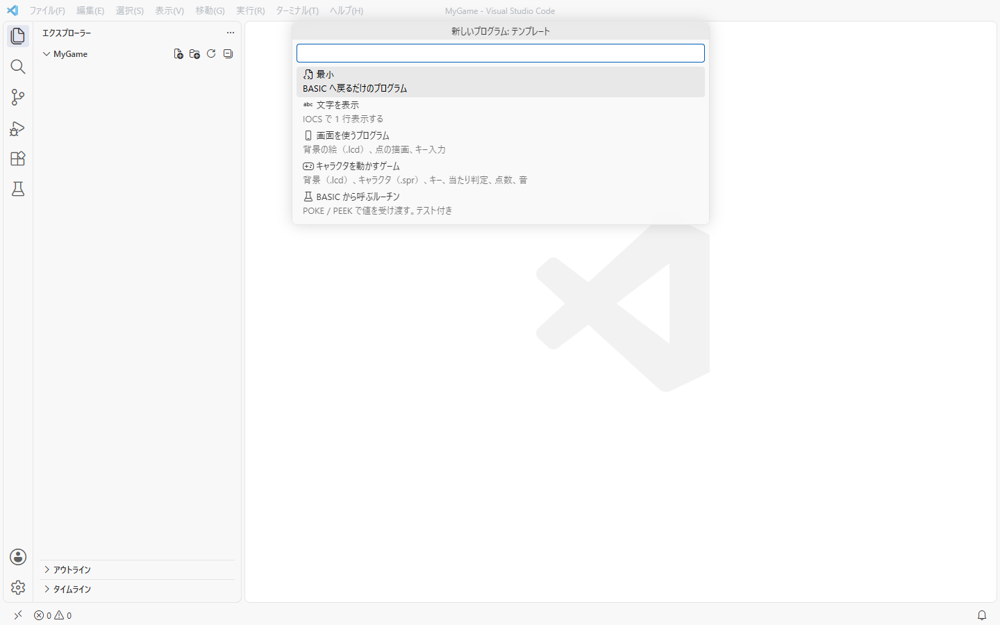

4. 名前に `mygame` と入れて `Enter` を押します。

   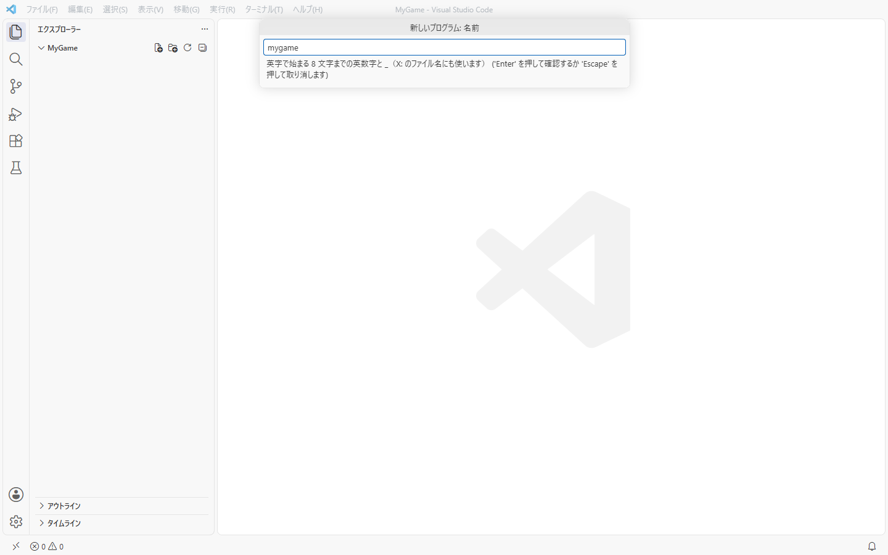

次の 4 つのファイルができ、`mygame.asm` が開きます。

| ファイル | 内容 |
|---|---|
| `mygame.asm` | プログラム |
| `mygame.lcd` | 背景の絵 |
| `mygamep.spr` | 顔のキャラクタ（2 コマ） |
| `mygames.spr` | 星のキャラクタ（4 コマ） |

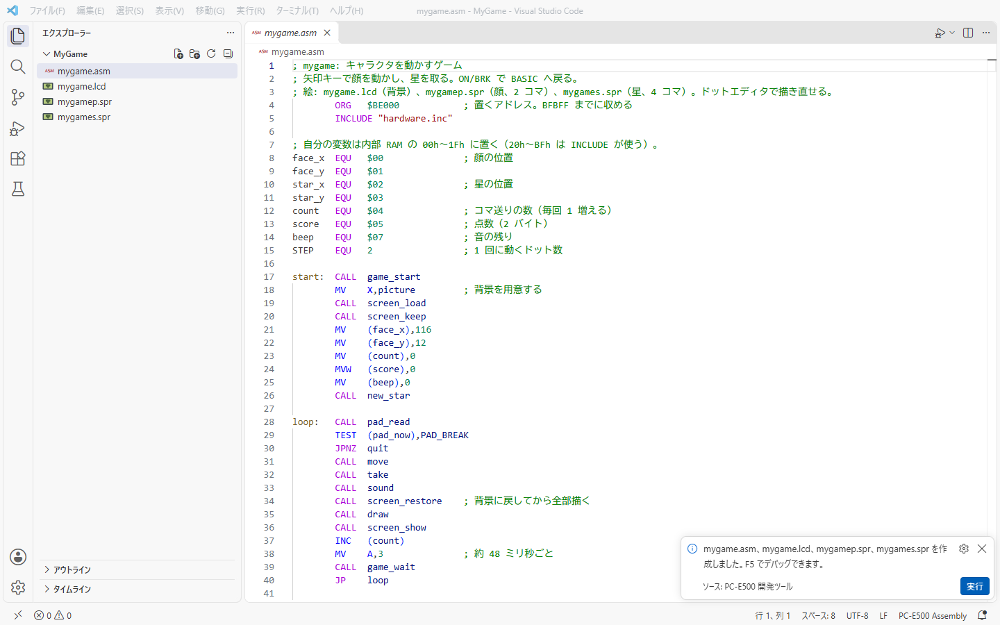

## 1.5 動かす

`F5` を押すと、アセンブル（ソースを機械語に変える）から、エミュレータの初期化、機械語の書き込み、`CALL` の実行までが続けて行われます。手で行えば 5 つの作業になるものが、キー 1 つで済むわけです。

`F5` を押します（または右上の実行ボタン）。アセンブルしてエミュレータに書き込み、`CALL` で実行するところまで自動です。

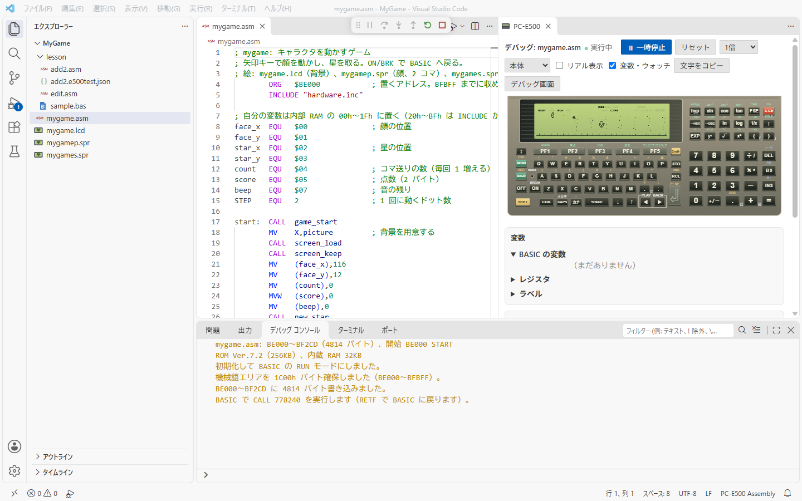

- 右のパネルの本体を 1 回クリックすると、PC のキーボードで操作できます。
- 矢印キーで顔を動かし、星に触れると点が増えます。
- `Esc`（ON/BRK）で BASIC に戻ります。
- 上の赤い四角（`Shift+F5`）で終わります。

## 1.6 絵を描き直す

1. エクスプローラーで `mygamep.spr` をクリックします。
2. マウスで点を打って、好きな絵にします。

   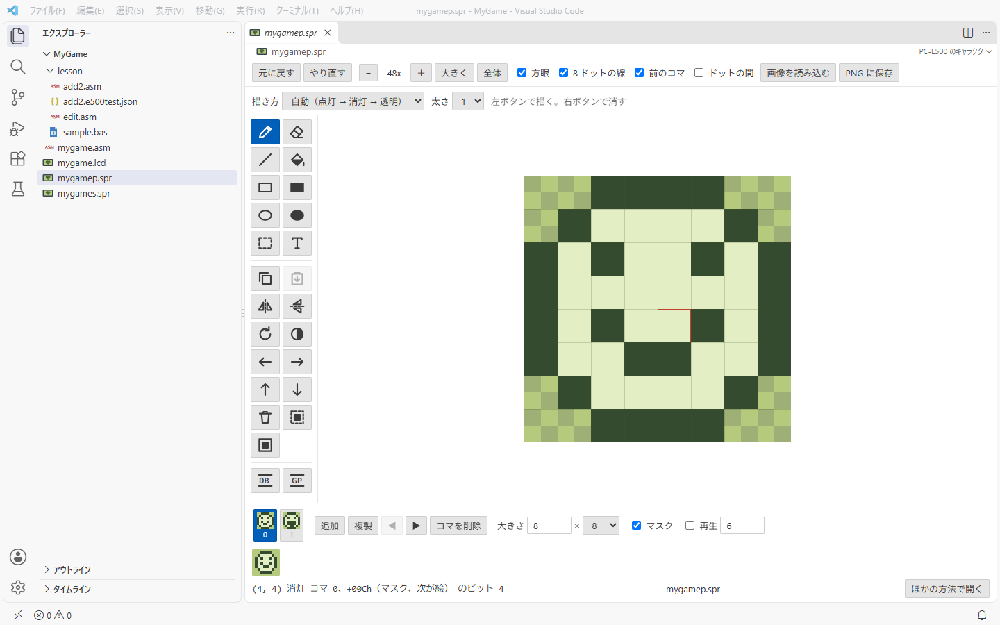

3. `Ctrl+S` で保存し、`mygame.asm` に戻って `F5` を押します。新しい絵で動きます。

描き方は[ドットエディタ](12_DOT_EDITOR.md)にあります。

## 1.7 プログラムを直してみる

`mygame.asm` の次の行を探して、`2` を `4` に変えます。

```asm
STEP    EQU   2                 ; 1 回に動くドット数
```

`F5` を押すと、顔が 2 倍の速さで動きます。保存やビルドの操作は要りません。

## 1.8 実機で動かす

1. `mygame.asm` を開き、右上の実行ボタンの「∨」から **「BIN を作成（LOAD M 用）」** を選びます。

   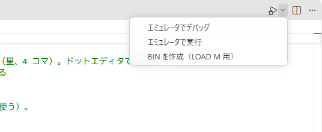

2. `MYGAME.BIN` ができ、打ち込む行が「出力」に表示されます。

   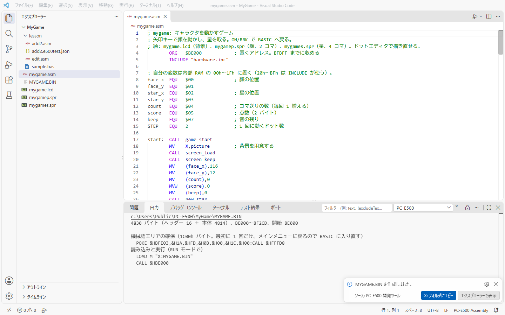

3. `MYGAME.BIN` を CE-140F（互換機の SD カードなど）に入れ、実機の BASIC で順に打ちます。

   ```basic
   POKE &HBFE03,&H1A,&HFD,&H0B,&H00,&H1C,&H00:CALL &HFFFD8
   LOAD M "X:MYGAME.BIN"
   CALL &HBE000
   ```

   1 行目は機械語エリアの確保で、最初の 1 回だけです。メインメニューに戻るので `BASIC` キーで入り直します。

## 1.9 画面の見方

VS Code で動かしているときの画面です。


| 場所 | 名前 | 使いみち |
|---|---|---|
| 左端 | アクティビティ バー | 上から、ファイル、検索、Git、デバッグ、拡張機能、テスト |
| 左 | サイド バー | ファイルの一覧など。デバッグ中は変数とコール スタック |
| 中央 | エディタ | プログラムを書く |
| 右 | PC-E500 のパネル | エミュレータの本体 |
| 下 | パネル | 問題、出力、デバッグ コンソール |
| 上の中央 | デバッグのツールバー | 続ける、進める、やり直す、終わる |
| 一番下 | ステータス バー | 行番号、文字コード、言語（PC-E500 Assembly） |

「デバッグ コンソール」には、アセンブルから `CALL` までの経過が出ます。動かないときは、まずここを見ます。

## 1.10 BASIC から始める

機械語ではなく BASIC で作るときは、もっと簡単です。

1. フォルダに `hello.bas` というファイルを作る。
2. 次のプログラムを書く。

   ```basic
   10 CLS
   20 FOR I=1 TO 5
   30 PRINT "SUM";I,I*(I+1)/2
   40 NEXT I
   50 END
   ```

3. `F5` を押す。エミュレータに読み込まれて `RUN` します。

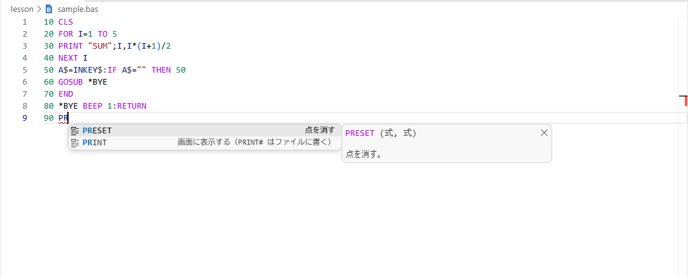

行番号の左をクリックして `F5` を押すと、その行で止まり、変数の値を見られます。くわしくは [BASIC](13_BASIC.md) にあります。

## 1.11 コマンドだけで作る

VS Code を使わずに、PowerShell のコマンドだけでも作れます。`e500` を使う方法（作る、調べる、動かす、BIN にする）は、[23.4 最初の 1 本を作る](23_COMMAND_LINE_WINDOWS.md#234-最初の-1-本を作る)に、1 行ずつの説明付きであります。

`e500asm` だけで作るときは、次の 1 つのコマンドです。リポジトリのフォルダ（`pc-e500_tools`）で打ちます。`hello.asm` は、サンプルの [hello.asm](../../Samples/Assembler/Basics/hello.asm) を使います。

```powershell
.\Assembler\e500asm.cmd Samples\Assembler\Basics\hello.asm -f ce140f -o HELLO.BIN -l hello.lst
```

| 部分 | 何をするか |
|---|---|
| `e500asm.cmd …\hello.asm` | ソースを機械語にする |
| `-f ce140f` | 先頭にアドレスと長さの入ったヘッダーを付けて、`LOAD M` で読める形にする |
| `-o HELLO.BIN` | 作るファイル |
| `-l hello.lst` | アドレスと機械語とソースを並べたリストも作る |


## 1.12 うまくいかないとき

| 症状 | 見るところ |
|---|---|
| 「新しいプログラムを作成」が出ない | 拡張機能が入っているか。フォルダを開いているか |
| `F5` で「環境を確認」のボタンが出る | エミュレータの場所が決まっていない（[1.3](#13-エミュレータの場所を決める)） |
| `F5` でほかのデバッガーを選ぶ画面になる | 右下の言語が「PC-E500 Assembly」か |
| 赤い波線が出て動かない | 「問題」（`Ctrl+Shift+M`）を読む |
| パネルは出たが、キーが効かない | パネルの本体をクリックする |
| 途中で止まってしまう | ブレークポイント（赤い丸）が付いていないか |

ほかは[困ったとき](18_TROUBLESHOOTING.md)にあります。

## 次に読むもの

- 機械語を覚える: [アセンブラ入門](03_ASSEMBLER_TUTORIAL.md)
- このゲームを自分のものにする: [ゲームを作る](07_GAME.md)
- 途中で止めて調べる: [デバッグ](10_DEBUG.md)
