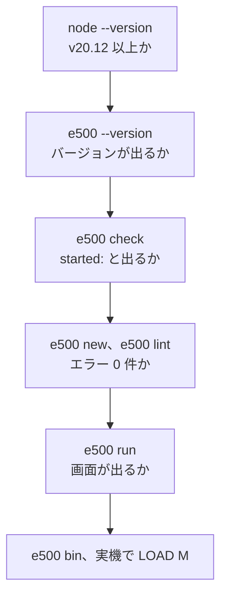

# 2. インストールと設定（Linux）

この章は、Linux でツールを入れて、使える状態にするまでを説明します。上から順に、必要な所だけ進めてください。どのコマンドにも、「何をするコマンドか」「うまくいくと何が表示されるか」を付けました。

Windows の人は[こちら](02_INSTALL_WINDOWS.md)、macOS の人は[こちら](02_INSTALL_MACOS.md)を読んでください。何を入れればよいか分からないときは、[2.2 何を入れるか](02_INSTALL.md#22-何を入れるか)の表で選べます。入れた後の使い方は [24 章](24_COMMAND_LINE_LINUX.md)にあります。

[目次へ戻る](README.md)

| 節 | 内容 |
|---|---|
| [2.1](#21-始める前に) | 動作環境、端末と、この章の書き方 |
| [2.2](#22-必要なものを入れる) | Node.js、.NET 10 のランタイムなど |
| [2.3](#23-拡張機能コマンド-e500を入れる) | VS Code と拡張機能、コマンド `e500` |
| [2.4](#24-エミュレータと-rom-を置く) | エミュレータと ROM |
| [2.5](#25-e500asme500dasm-を作る) | ソースから作るツール |
| [2.6](#26-更新とアンインストール) | 新しくする、消す |
| [2.7](#27-確かめる順番) | うまく動かないときの順番 |

## 2.1 始める前に

### 動作環境

| 項目 | 必要なもの |
|---|---|
| OS | Ubuntu 24.04 以降（64 ビット、x64）。エミュレータは glibc 2.38 以降 |
| CPU | x64。2 コア、2 GHz 程度以上 |
| メモリ | 4 GB 以上を推奨 |
| 画面 | 1280 × 800 以上を推奨。コマンドだけなら画面は要らない |
| VS Code | 1.95 以降（VS Code を使うとき） |
| Node.js | 20.12 以降。Ubuntu 26.04 では `apt` で 22 が入る。Ubuntu 24.04 の `apt` のものは 18 なので、[nodejs.org](https://nodejs.org/) から入れる |
| .NET | `e500 run`、`e500 test` は .NET 10 ランタイム、ソースから作るなら .NET 10 SDK |
| ディスク | VS Code 500 MB まで、`e500asm` と `e500dasm` 各 約 74 MB、エミュレータの `.tar.gz` は約 75 MB |

編集、診断、ドットエディタ、コマンドでの実行とテストが使えます。VS Code の `F5`（実行、デバッグ）とテスト、`E500Disassembler`（画面）は Windows 専用です。WSL の Ubuntu でも、コマンドは同じように使えます。

### この章の書き方

コマンドは **端末**（ターミナル）に打ちます。`名前@ホスト:~$` のような表示（プロンプト）の右に打って、`Enter` を押します。プロンプト自体は打ちません。パッケージを入れる例は Ubuntu 26.04 のものです。ほかのディストリビューションでは、`apt` の行をその環境のものに替えます。

| この章での書き方 | 意味 |
|---|---|
| `~` | 自分のホームフォルダ（`/home/名前`） |
| `~/pockecom` | ツールを置くフォルダの例。好きな場所に変えてよい |
| `<バージョン>` | `0.3.0` などに読み替える |
| `sudo` | 管理者の権限で実行する。自分のパスワードを聞かれる（打っても表示されない） |
| `#` より右 | 説明。打たなくてよい |

Linux では、VS Code の `F5`（実行、デバッグ）は使えません。動かすのとテストは、コマンド `e500 run`、`e500 test` で行います。

## 2.2 必要なものを入れる

```sh
sudo apt update
sudo apt install -y git unzip nodejs dotnet-runtime-10.0
```

| コマンド | 何をするか |
|---|---|
| `sudo apt update` | 入れられるソフトの一覧を新しくする。まだ何も入れない |
| `sudo apt install -y 名前…` | 名前のソフトを入れる。`-y` は、確認の質問に「はい」と答える |

| 入れるもの | 何に使うか | 要らない場合 |
|---|---|---|
| `git` | リポジトリを取ってくる | ソースもサンプルも要らないとき |
| `unzip` | `.vsix` を展開する | VS Code に拡張機能を入れるとき |
| `nodejs` | コマンド `e500` を動かす（20.12 以降） | `e500asm`、`e500dasm` だけ使うとき |
| `dotnet-runtime-10.0` | `e500 run`、`e500 test` でエミュレータを動かす | 動かさないとき。[2.5](#25-e500asme500dasm-を作る) で SDK を入れるとき |

入ったかどうかを確かめます。

```sh
node --version
dotnet --list-runtimes
```

| コマンド | 何をするか | 正しいとき |
|---|---|---|
| `node --version` | Node.js のバージョンを表示する | `v20.12` 以上（例 `v22.22.1`） |
| `dotnet --list-runtimes` | 入っている .NET のランタイムを一覧にする | `Microsoft.NETCore.App 10.…` の行がある |

## 2.3 拡張機能（コマンド e500）を入れる

[Releases](https://github.com/litchi-gh/pc-e500_tools/releases) から `pc-e500-devtools-<バージョン>.vsix` を取ります。日本語の Ubuntu では、ブラウザで取ったファイルはホームの `ダウンロード` フォルダに入ります。英語の環境では `Downloads` なので、`~/ダウンロード` を `~/Downloads` に読み替えます。

### A. VS Code を使うとき

VS Code がまだなら、[VS Code のページ](https://code.visualstudio.com/)から `.deb` を取って入れます。

```sh
sudo apt install ~/ダウンロード/code_*_amd64.deb
code --install-extension MS-CEINTL.vscode-language-pack-ja
code --install-extension ~/ダウンロード/pc-e500-devtools-0.3.0.vsix
```

| コマンド | 何をするか |
|---|---|
| 1 行目 | ダウンロードした VS Code を入れる。`*` は「何でもよい」なので、バージョンの番号を打たなくて済む |
| 2 行目 | VS Code のメニューを日本語にする拡張機能を入れる |
| 3 行目 | この拡張機能を入れる |

`was successfully installed` と出れば入りました。拡張機能の実体は `~/.vscode/extensions/`（Remote - SSH や WSL では `~/.vscode-server/extensions/`）の `pokecom-tools.pc-e500-devtools-<バージョン>` に入り、`e500` はその中の `bin` にあります。

### B. VS Code を使わないとき

`.vsix` は ZIP と同じ形のファイルです。展開するだけで `e500` を使えます。

```sh
mkdir -p ~/pockecom/devtools
cd ~/pockecom/devtools
unzip -o ~/ダウンロード/pc-e500-devtools-0.3.0.vsix 'extension/*'
sh extension/bin/e500 --version
```

| コマンド | 何をするか |
|---|---|
| `mkdir -p フォルダ` | フォルダを作る。`-p` は、途中のフォルダも作り、既にあってもエラーにしない |
| `cd フォルダ` | 今いるフォルダを移す |
| `unzip -o ファイル 'extension/*'` | `.vsix` の中の `extension` フォルダだけを取り出す。`-o` は、前のものがあれば聞かずに置き換える。`'…'` は、`*` をシェルに解釈させないため |
| `sh extension/bin/e500 --version` | `e500` を動かして、バージョンを表示する。`0.3.0` のように出れば使える |

どこからでも `e500` と打てるようにする方法は [24.2](24_COMMAND_LINE_LINUX.md#242-e500-を使えるようにする) にあります。

## 2.4 エミュレータと ROM を置く

`e500 run` と `e500 test` を使うときだけ要ります。エミュレータの [Releases](https://github.com/litchi-gh/pc-e500_emulator_pockecom/releases) から Linux 版（`libe500core.so` が入っているもの）を取り、次の**どちらか**で入れます。

### A. 展開して使う（tar.gz）

```sh
mkdir -p ~/pockecom
tar xzf ~/ダウンロード/PC-E500-Emulator-<バージョン>-linux-x64.tar.gz -C ~/pockecom
cp ~/ダウンロード/'PC-E500(7.2).ROM' ~/pockecom/PC-E500-Emulator-<バージョン>-linux-x64/rom/
```

| コマンド | 何をするか |
|---|---|
| `mkdir -p ~/pockecom` | 置き場所のフォルダを作る |
| `tar xzf ファイル -C フォルダ` | `.tar.gz` を展開する。`x` は取り出す、`z` は gzip の圧縮を解く、`f` は次にファイル名を書くという意味。`-C` は取り出す場所 |
| `cp 元 先` | ファイルをコピーする。ここでは自分の ROM を `rom` フォルダに入れる。名前の `( )` はシェルの記号なので `'…'` で囲む |

エミュレータの場所は、環境変数 `PCE500_EMULATOR` で `e500` に教えます（[24.3](24_COMMAND_LINE_LINUX.md#243-エミュレータを教える)）。

### B. インストールして使う（.deb）

```sh
sudo apt install ~/ダウンロード/pc-e500-emulator_<バージョン>_amd64.deb
mkdir -p ~/.local/share/PockeComE500/rom
cp ~/ダウンロード/'PC-E500(7.2).ROM' ~/.local/share/PockeComE500/rom/
```

| コマンド | 何をするか |
|---|---|
| `sudo apt install ファイル.deb` | パッケージのファイルから入れる。`/opt/pc-e500` に入る |
| `mkdir -p …/rom`、`cp …` | ROM を置くフォルダを作り、ROM をコピーする。`/opt` には自分のファイルを置けないので、ホームの中に置く |

`/opt/pc-e500` は `e500` が自分で見つけるので、場所を教える必要はありません。

## 2.5 e500asm、e500dasm を作る

`e500` があれば、アセンブルと逆アセンブルはできます。Node.js なしで使いたいときに作ります。

### 1. 道具を入れる

```sh
sudo apt install -y git dotnet-sdk-10.0
```

| 入れるもの | 何に使うか |
|---|---|
| `git` | リポジトリを取ってくる |
| `dotnet-sdk-10.0` | `e500asm`、`e500dasm` を作る（ランタイムも入る） |

### 2. リポジトリを取ってきて作る

```sh
mkdir -p ~/pockecom
cd ~/pockecom
git clone https://github.com/litchi-gh/pc-e500_tools.git
cd pc-e500_tools
sh Assembler/build.sh
sh DisAssembler/build.sh
```

| コマンド | 何をするか | できるもの |
|---|---|---|
| `git clone アドレス` | リポジトリを丸ごとコピーする。`pc-e500_tools` フォルダができる（最初の 1 回だけ） | − |
| `cd pc-e500_tools` | その中に入る | − |
| `sh Assembler/build.sh` | 自動テストを動かし、通れば 1 つの実行ファイルを作る。CPU の種類（x64、arm64）は自分で調べる | `Assembler/app/e500asm` |
| `sh DisAssembler/build.sh` | 同じ。画面の `E500Disassembler` は Windows 専用なので作らない | `DisAssembler/app/e500dasm` |

テストが通ると `PASS: 430 checks` のように出ます（数はバージョンによって変わります）。`e500asm` と `e500dasm` は .NET を中に持っているので、できたファイルは、.NET のない同じ種類の PC にコピーしても動きます。

### 3. 動くか確かめる

```sh
Assembler/app/e500asm --version
DisAssembler/app/e500dasm --version
```

それぞれのバージョンを表示するコマンドです。`e500asm 0.2.0 (SC62015)`、`e500dasm 0.1.0 (SC62015)` のように出れば使えます。

### 4. どこからでも使えるようにする

```sh
mkdir -p ~/.local/bin
ln -sf ~/pockecom/pc-e500_tools/Assembler/app/e500asm ~/.local/bin/e500asm
ln -sf ~/pockecom/pc-e500_tools/DisAssembler/app/e500dasm ~/.local/bin/e500dasm
```

| コマンド | 何をするか |
|---|---|
| `mkdir -p ~/.local/bin` | 自分用のコマンドを置くフォルダを作る。Ubuntu では、次にログインしたときから PATH（コマンドを探すフォルダの一覧）に入る |
| `ln -sf 元 先` | 元のファイルを指す「リンク」を置く。作り直しても、リンクはそのままで新しいものが動く。`-f` は前のリンクがあれば置き換える |

一度ログインし直して、`e500asm --version` と打って確かめます。

## 2.6 更新とアンインストール

### VS Code 拡張

| すること | 方法 |
|---|---|
| 新しくする | 新しい VSIX を「VSIX からのインストール」で入れ、「開発者: ウィンドウの再読み込み」 |
| バージョンを確かめる | 拡張機能の画面で「PC-E500 開発ツール」を開く |
| 消す | 拡張機能の画面の「アンインストール」 |
| 設定を消す | 設定画面で「PC-E500」を探し、歯車から「設定をリセット」 |

コマンドで消すときは `code --uninstall-extension pokecom-tools.pc-e500-devtools` です。VS Code から、その名前の拡張機能を取り除きます。

拡張機能を新しくすると、フォルダの名前のバージョンが変わります。`~/.local/bin/e500` に VS Code の拡張機能の場所を書いたときは、その中のバージョンも直します（[24.2](24_COMMAND_LINE_LINUX.md#242-e500-を使えるようにする)）。

以前の「Pocket BASIC / ASM Linter」を使っていた場合は、アンインストールしてください。設定（`pocketBasic.*`、`pocketAsm.*`、`pocketE500.*`）は、新しい拡張機能が最初に動いたときに `pcE500.*` へコピーします。`launch.json` の `"type": "pocket-e500"` は `"pc-e500"` に書き換えます。

### コマンドのツール

```sh
cd ~/pockecom/pc-e500_tools
git pull
sh Assembler/build.sh && sh DisAssembler/build.sh
```

`git pull` は、GitHub にある新しい変更を取ってきて、手元に反映します。`&&` は「前が成功したら次を実行する」という意味で、途中で失敗したらそこで止まります。[2.3 の B](#b-vs-code-を使わないとき) で展開した `e500` は、新しい `.vsix` でもう一度 `unzip -o` を実行します。

消すときは、`~/pockecom` と `~/.local/bin/e500asm`、`~/.local/bin/e500dasm` を消します。

## 2.7 確かめる順番

うまく動かないときは、次の順に確かめます。前の段が通るまで、後の段へ進まないのがこつです。



| 通らない段 | 見るところ |
|---|---|
| `node --version` | [2.2](#22-必要なものを入れる) |
| `e500 --version` | [2.3](#23-拡張機能コマンド-e500を入れる)、[24.2](24_COMMAND_LINE_LINUX.md#242-e500-を使えるようにする) |
| `e500 check` | [2.4](#24-エミュレータと-rom-を置く)。`libe500core.so` と ROM があるか |
| `e500 lint` | ソースの間違い。出た行番号を直す |
| `e500 run` | `state:` の行（[22.4](22_COMMAND_LINE_AI.md#e500-run)） |

VS Code では、`.asm` を開いて色が付き、間違いの表示が出れば、準備はできています。
