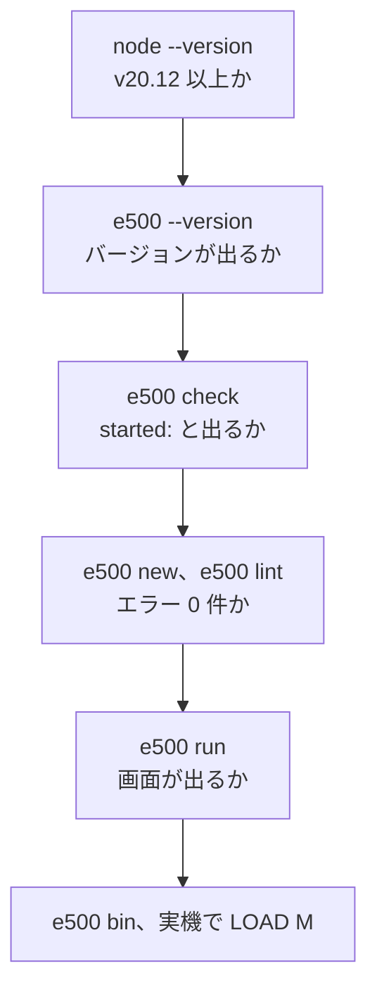

# 2. インストールと設定（macOS）

この章は、macOS でツールを入れて、使える状態にするまでを説明します。上から順に、必要な所だけ進めてください。どのコマンドにも、「何をするコマンドか」「うまくいくと何が表示されるか」を付けました。

Windows の人は[こちら](02_INSTALL_WINDOWS.md)、Linux の人は[こちら](02_INSTALL_LINUX.md)を読んでください。何を入れればよいか分からないときは、[2.2 何を入れるか](02_INSTALL.md#22-何を入れるか)の表で選べます。入れた後の使い方は [25 章](25_COMMAND_LINE_MACOS.md)にあります。

[目次へ戻る](README.md)

| 節 | 内容 |
|---|---|
| [2.1](#21-始める前に) | 動作環境、ターミナルと、この章の書き方 |
| [2.2](#22-必要なものを入れる) | Node.js、.NET 10 など |
| [2.3](#23-拡張機能コマンド-e500を入れる) | VS Code と拡張機能、コマンド `e500` |
| [2.4](#24-エミュレータと-rom-を置く) | エミュレータと ROM |
| [2.5](#25-e500asme500dasmce140conv-を作る) | ソースから作るツール |
| [2.6](#26-どこからでも使えるようにする) | PATH |
| [2.7](#27-更新とアンインストール) | 新しくする、消す |
| [2.8](#28-確かめる順番) | うまく動かないときの順番 |

## 2.1 始める前に

### 動作環境

| 項目 | 必要なもの |
|---|---|
| OS | macOS 15 以降 |
| CPU | Apple シリコンか Intel |
| メモリ | 4 GB 以上を推奨 |
| VS Code | 1.95 以降（VS Code を使うとき） |
| Node.js | 20.12 以降 |
| .NET | `e500 run`、`e500 test` は .NET 10 ランタイム、ソースから作るなら .NET 10 SDK |
| C++ のコンパイラ | `ce140conv` を作るときだけ。コマンドラインツールの `clang++` |
| ディスク | VS Code 500 MB まで、エミュレータの `.tar.gz` は約 30 MB |

編集、診断、ドットエディタ、コマンドでの実行とテストが使えます。VS Code の `F5`（実行、デバッグ）とテスト、`E500Disassembler`（画面）は Windows 専用です。

### この章の書き方

コマンドは **ターミナル**（「アプリケーション」→「ユーティリティ」）に打ちます。`%` で終わる表示（プロンプト）の右に打って、`return` を押します。プロンプト自体は打ちません。

| この章での書き方 | 意味 |
|---|---|
| `~` | 自分のホームフォルダ（`/Users/名前`） |
| `~/pockecom` | ツールを置くフォルダの例。好きな場所に変えてよい |
| `<バージョン>` | `0.3.0` などに読み替える |

macOS で使えるのは、VS Code での編集、診断、ドットエディタと、コマンドでのアセンブル、逆アセンブル、文法チェック、BIN の作成、ファイル変換、エミュレータでの実行とテスト（`e500 run`、`e500 test`）です。VS Code の中からの実行とデバッグ（`F5`）は Windows で行います。

## 2.2 必要なものを入れる

```sh
xcode-select --install
```

Apple の「コマンドラインツール」を入れるコマンドです。`git`（リポジトリを取ってくる）と `clang++`（`ce140conv` を作る C++ のコンパイラ）が使えるようになります。画面に出る「インストール」を押して、終わるのを待ちます。既に入っていれば、その旨のメッセージが出るだけです。

残りは、次のページからインストーラー（`.pkg`）を取って実行します。Apple シリコンの Mac は Arm64、Intel の Mac は x64 を選びます。

| 入れるもの | ページ | 何に使うか |
|---|---|---|
| Node.js（20.12 以降、LTS） | [nodejs.org](https://nodejs.org/) | コマンド `e500` を動かす |
| .NET 10 **SDK** | [.NET のダウンロード](https://dotnet.microsoft.com/download/dotnet/10.0) | `e500 run` と `e500 test`、`e500asm` と `e500dasm` を作る（どれも使わないなら要らない） |

ターミナルを開き直して確かめます。

```sh
git --version
node --version
dotnet --list-sdks
```

| コマンド | 何をするか | 正しいとき |
|---|---|---|
| `git --version` | Git のバージョンを表示する | `git version 2.…` |
| `node --version` | Node.js のバージョンを表示する | `v20.12` 以上 |
| `dotnet --list-sdks` | 入っている .NET の SDK を一覧にする | `10.` で始まる行がある |

## 2.3 拡張機能（コマンド e500）を入れる

[Releases](https://github.com/litchi-gh/pc-e500_tools/releases) から `pc-e500-devtools-<バージョン>.vsix` を取ります。以下は `~/Downloads` にあるとして書きます。

### A. VS Code を使うとき

VS Code の拡張機能の画面（`Cmd+Shift+X`）で、右上の「…」→「VSIX からのインストール」を選び、ファイルを指定します。

コマンドで入れるなら、先に VS Code で `Cmd+Shift+P` →「シェル コマンド: PATH 内に 'code' コマンドをインストールします」を 1 回実行して、次を打ちます。

```sh
code --install-extension ~/Downloads/pc-e500-devtools-0.3.0.vsix
```

VS Code に拡張機能を入れるコマンドです。`was successfully installed` と出れば入りました。実体は `~/.vscode/extensions/pokecom-tools.pc-e500-devtools-<バージョン>` に入り、`e500` はその中の `bin` にあります。

### B. VS Code を使わないとき

`.vsix` は ZIP と同じ形のファイルです。展開するだけで `e500` を使えます。

```sh
mkdir -p ~/pockecom/devtools
cd ~/pockecom/devtools
unzip -o ~/Downloads/pc-e500-devtools-0.3.0.vsix 'extension/*'
sh extension/bin/e500 --version
```

| コマンド | 何をするか |
|---|---|
| `mkdir -p フォルダ` | フォルダを作る。`-p` は、途中のフォルダも作り、既にあってもエラーにしない |
| `cd フォルダ` | 今いるフォルダを移す |
| `unzip -o ファイル 'extension/*'` | `.vsix` の中の `extension` フォルダだけを取り出す。`-o` は、前のものがあれば聞かずに置き換える。`'…'` は、`*` をシェルに解釈させないため |
| `sh extension/bin/e500 --version` | `e500` を動かして、バージョンを表示する。`0.3.0` のように出れば使える |

どこからでも `e500` と打てるようにする方法は [25.2](25_COMMAND_LINE_MACOS.md#252-e500-を使えるようにする) にあります。

## 2.4 エミュレータと ROM を置く

`e500 run` と `e500 test` を使うときだけ要ります。エミュレータの [Releases](https://github.com/litchi-gh/pc-e500_emulator_pockecom/releases) から macOS 版の `pokecom`（`libe500core.dylib` が入っているもの）を取ります。Apple シリコンの Mac は `osx-arm64`、Intel の Mac は `osx-x64` です。macOS 15 以降で使えます。

```sh
mkdir -p ~/pockecom
tar xzf ~/Downloads/pokecom-<バージョン>-osx-arm64.tar.gz -C ~/pockecom
xattr -dr com.apple.quarantine ~/pockecom/pokecom-<バージョン>-osx-arm64
cp ~/Downloads/'PC-E500(7.2).ROM' ~/pockecom/pokecom-<バージョン>-osx-arm64/rom/
```

| コマンド | 何をするか |
|---|---|
| `mkdir -p ~/pockecom` | 置き場所のフォルダを作る |
| `tar xzf ファイル -C フォルダ` | `.tar.gz` を展開する。`x` は取り出す、`z` は gzip の圧縮を解く、`f` は次にファイル名を書くという意味。`-C` は取り出す場所 |
| `xattr -dr com.apple.quarantine フォルダ` | ダウンロードしたファイルに macOS が付ける「実行の制限」の印を、フォルダの中の全部から外す。Apple の公証を受けていないファイルなので要る |
| `cp 元 先` | ファイルをコピーする。ここでは自分の ROM を `rom` フォルダに入れる。名前の `( )` はシェルの記号なので `'…'` で囲む |

エミュレータの場所は、環境変数 `PCE500_EMULATOR` で `e500` に教えます（[25.3](25_COMMAND_LINE_MACOS.md#253-エミュレータを教える)）。

## 2.5 e500asm、e500dasm、ce140conv を作る

`e500` があれば、アセンブルと逆アセンブルはできます。Node.js なしで使いたいとき、`ce140conv` を使いたいときに作ります。

```sh
mkdir -p ~/pockecom
cd ~/pockecom
git clone https://github.com/litchi-gh/pc-e500_tools.git
cd pc-e500_tools
sh Assembler/build.sh
sh DisAssembler/build.sh
sh FileConverter/build.sh
```

| コマンド | 何をするか | できるもの |
|---|---|---|
| `mkdir -p ~/pockecom`、`cd ~/pockecom` | 置き場所のフォルダを作って、そこへ移る | − |
| `git clone アドレス` | リポジトリを丸ごとコピーする。`pc-e500_tools` フォルダができる（最初の 1 回だけ） | − |
| `cd pc-e500_tools` | その中に入る | − |
| `sh Assembler/build.sh` | 自動テストを動かし、通れば 1 つの実行ファイルを作る。Apple シリコンか Intel かは自分で調べる | `Assembler/app/e500asm` |
| `sh DisAssembler/build.sh` | 同じ。画面の `E500Disassembler` は Windows 専用なので作らない | `DisAssembler/app/e500dasm` |
| `sh FileConverter/build.sh` | `g++` → `clang++` → `c++` の順に、最初に見つかったコンパイラで作る | `FileConverter/ce140conv` |

テストが通ると `PASS: 413 checks` のように出ます（数はバージョンによって変わります）。`ce140conv` は `built ce140conv with …` と出れば成功です。

動くか確かめます。

```sh
Assembler/app/e500asm --version
DisAssembler/app/e500dasm --version
```

それぞれのバージョンを表示するコマンドです。`e500asm 0.2.0 (SC62015)`、`e500dasm 0.1.0 (SC62015)` のように出れば使えます。

## 2.6 どこからでも使えるようにする

```sh
echo 'export PATH="$PATH:$HOME/pockecom/pc-e500_tools/Assembler/app"' >> ~/.zshrc
echo 'export PATH="$PATH:$HOME/pockecom/pc-e500_tools/DisAssembler/app"' >> ~/.zshrc
echo 'export PATH="$PATH:$HOME/pockecom/pc-e500_tools/FileConverter"' >> ~/.zshrc
source ~/.zshrc
```

| コマンド | 何をするか |
|---|---|
| `echo '…' >> ~/.zshrc` | ターミナルを開いたときに読まれる `~/.zshrc` の最後に 1 行足す。ここでは PATH（コマンドを探すフォルダの一覧）に、ツールのフォルダを足している。**何度も打つと、その数だけ行が増える** |
| `source ~/.zshrc` | 今のターミナルで `~/.zshrc` を読み直す。打たなくても、次に開いたターミナルからは効く |

`e500asm --version` と打って、バージョンが出れば完了です。

## 2.7 更新とアンインストール

### VS Code 拡張

| すること | 方法 |
|---|---|
| 新しくする | 新しい VSIX を「VSIX からのインストール」で入れ、「開発者: ウィンドウの再読み込み」 |
| バージョンを確かめる | 拡張機能の画面で「PC-E500 開発ツール」を開く |
| 消す | 拡張機能の画面の「アンインストール」 |
| 設定を消す | 設定画面で「PC-E500」を探し、歯車から「設定をリセット」 |

コマンドで消すときは `code --uninstall-extension pokecom-tools.pc-e500-devtools` です。VS Code から、その名前の拡張機能を取り除きます。

拡張機能を新しくすると、フォルダの名前のバージョンが変わります。`~/.local/bin/e500` に VS Code の拡張機能の場所を書いたときは、その中のバージョンも直します（[25.2](25_COMMAND_LINE_MACOS.md#252-e500-を使えるようにする)）。

以前の「Pocket BASIC / ASM Linter」を使っていた場合は、アンインストールしてください。設定（`pocketBasic.*`、`pocketAsm.*`、`pocketE500.*`）は、新しい拡張機能が最初に動いたときに `pcE500.*` へコピーします。`launch.json` の `"type": "pocket-e500"` は `"pc-e500"` に書き換えます。

### コマンドのツール

```sh
cd ~/pockecom/pc-e500_tools
git pull
sh Assembler/build.sh && sh DisAssembler/build.sh && sh FileConverter/build.sh
```

`git pull` は、GitHub にある新しい変更を取ってきて、手元に反映します。`&&` は「前が成功したら次を実行する」という意味で、途中で失敗したらそこで止まります。[2.3 の B](#b-vs-code-を使わないとき) で展開した `e500` は、新しい `.vsix` でもう一度 `unzip -o` を実行します。

消すときは、`~/pockecom` を消し、`~/.zshrc` に足した行を消します。

## 2.8 確かめる順番

うまく動かないときは、次の順に確かめます。前の段が通るまで、後の段へ進まないのがこつです。



| 通らない段 | 見るところ |
|---|---|
| `node --version` | [2.2](#22-必要なものを入れる) |
| `e500 --version` | [2.3](#23-拡張機能コマンド-e500を入れる)、[25.2](25_COMMAND_LINE_MACOS.md#252-e500-を使えるようにする) |
| `e500 check` | [2.4](#24-エミュレータと-rom-を置く)。`libe500core.dylib` と ROM があるか |
| `e500 lint` | ソースの間違い。出た行番号を直す |
| `e500 run` | `state:` の行（[22.4](22_COMMAND_LINE_AI.md#e500-run)） |

VS Code では、`.asm` を開いて色が付き、間違いの表示が出れば、準備はできています。
