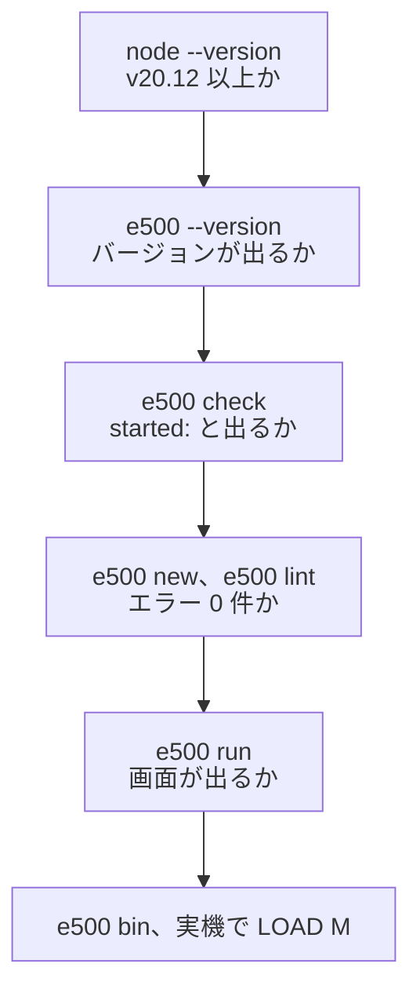

# 2. インストールと設定（macOS）

この章は macOS でツールを入れて、使える状態にするまでを説明します。上から順に必要な所だけ進めてください。どのコマンドにも「何をするコマンドか」「うまくいくと何が表示されるか」を付けました。

Windows の人は[こちら](02_INSTALL_WINDOWS.md)、Linux の人は[こちら](02_INSTALL_LINUX.md)を読んでください。何を入れればよいか分からないときは、[2.2 何を入れるか](02_INSTALL.md#22-何を入れるか)の表で選べます。入れた後の使い方は [25 章](25_COMMAND_LINE_MACOS.md)にあります。

[目次へ戻る](README.md)

| 節 | 内容 |
|---|---|
| [2.1](#21-始める前に) | 動作環境、ターミナルと、この章の書き方 |
| [2.2](#22-必要なものを入れる) | 1 行でまとめて入れる |
| [2.3](#23-拡張機能コマンド-e500を入れる) | VS Code の拡張機能 |
| [2.4](#24-エミュレータと-rom-を置く) | ROM を置く |
| [2.5](#25-e500asme500dasm-を作る) | ソースから作るツール |
| [2.6](#26-どこからでも使えるようにする) | PATH |
| [2.7](#27-更新とアンインストール) | 新しくする、消す |
| [2.8](#28-確かめる順番) | うまく動かないときの順番 |

## 2.1 始める前に

### 動作環境

| 項目 | 必要なもの |
|---|---|
| OS | macOS 15 以降 |
| CPU | Apple シリコンか Intel |
| メモリ | 4 GB 以上を推奨 |
| VS Code | 1.95 以降（VS Code を使うとき） |
| Node.js | 20.12 以降。なければ `install.sh` が入れる |
| .NET | `e500 run`、`e500 test` は .NET 10 ランタイム（なければ `install.sh` が入れる）、ソースから作るなら .NET 10 SDK |
| ディスク | VS Code 500 MB まで、エミュレータの `.tar.gz` は約 30 MB |

編集、診断、ドットエディタ、コマンドでの実行とテストが使えます。VS Code の `F5`（実行、デバッグ）とテスト、`E500Disassembler`（画面）は Windows 専用です。

### この章の書き方

コマンドはターミナル（「アプリケーション」→「ユーティリティ」）に打ちます。`%` で終わる表示（プロンプト）の右に打って、`return` を押します。プロンプト自体は打ちません。

| この章での書き方 | 意味 |
|---|---|
| `~` | 自分のホームフォルダ（`/Users/名前`） |
| `~/pockecom` | ツールを置くフォルダの例。好きな場所に変えてよい |
| `<バージョン>` | `0.2.0` などに読み替える |

macOS で使えるのは、VS Code での編集、診断、ドットエディタと、コマンドでのアセンブル、逆アセンブル、文法チェック、BIN の作成、ファイル変換、エミュレータでの実行とテスト（`e500 run`、`e500 test`）です。VS Code の中からの実行とデバッグ（`F5`）は Windows で行います。

## 2.2 必要なものを入れる

次の 1 行で要るものがまとめて入ります。新しくするときも、同じ行をもう一度実行します（ROM と、自分で作ったプログラムはそのまま残ります）。

```sh
curl -fsSL https://raw.githubusercontent.com/litchi-gh/pc-e500_tools/main/install.sh | sh
```

`curl -fsSL アドレス` がインストール用のスクリプト `install.sh` を GitHub から取り、`| sh` がそれを実行します。オプションは `| sh -s -- --vscode` のように、`--` の後ろに書きます。中身を見てから実行したいときは、次のように分けます。

```sh
curl -fsSL https://raw.githubusercontent.com/litchi-gh/pc-e500_tools/main/install.sh > install.sh
less install.sh
sh install.sh --vscode
```

| オプション | 意味 |
|---|---|
| `--rom ファイル` | 自分の ROM をエミュレータの `rom` フォルダにコピーする |
| `--vscode` | VS Code がなければ入れる（「アプリケーション」に入る） |
| `--no-emulator` | エミュレータと .NET を入れない（書く、変換するだけのとき） |
| `--vsix ファイル`、`--emulator ファイル` | 取ってくる代わりに、手元の `.vsix`、`.tar.gz` を使う |

| 入るもの | 場所 | 入れないとき |
|---|---|---|
| Node.js 22 | `~/pockecom/node` | 20.12 以降が既にある |
| .NET 10 ランタイム | `~/pockecom/dotnet` | 10 が既にある |
| コマンド `e500` と拡張機能の中身 | `~/pockecom/devtools` | − |
| エミュレータ | `~/pockecom/Emulator`（ROM は `rom`） | − |
| `e500` と打つためのファイル | `~/.local/bin/e500` | − |
| VS Code の拡張機能 | VS Code の中 | VS Code がない |

- `sudo` を付けずに実行します。自分のフォルダだけに入れるので、管理者の権限は要りません（Apple シリコンか Intel かは、スクリプトが調べます）。
- `~/.local/bin` が PATH（コマンドを探すフォルダの一覧）になければ、`~/.zshrc` に 1 行足します。**新しいターミナルを開くと**、`e500` と打てるようになります。
- `~/pockecom` を別の場所にするには、`POCKECOM_HOME=フォルダ sh install.sh` のように書きます。
- 取ってくるものは、`e500`、エミュレータ、Node.js、.NET の公式の配布元からです。Node.js は配布元の SHA-256 と同じかを確かめます。

入ったかどうかを確かめます。

```sh
e500 --version
e500 check
```

| コマンド | 何をするか | 正しいとき |
|---|---|---|
| `e500 --version` | `e500` を動かして、バージョンを表示する | `0.2.0` など |
| `e500 check` | エミュレータと ROM を探し、一度起動してみる | `started:` の行が出る |

## 2.3 拡張機能（コマンド e500）を入れる

`install.sh` は VS Code が入っていれば、拡張機能もその中に入れます。後から VS Code を入れたときは、VS Code の拡張機能の画面（`Cmd+Shift+X`）で「PC-E500」を探し、「PC-E500 開発ツール」（発行者 `litchi-gh`）を入れます。Visual Studio Marketplace にあります。`install.sh` をもう一度実行しても入ります。

`e500` は、`install.sh` が `~/pockecom/devtools` に入れたものを使います。VS Code の拡張機能の中の `e500` とは別なので、拡張機能だけを新しくしたときは、`install.sh` も実行します。

## 2.4 エミュレータと ROM を置く

エミュレータは `install.sh` が入れます。**ROM はツールに入っていません。** 自分の本体から吸い出したものを、次のどちらかで置きます。

```sh
cp ~/'PC-E500(7.2).ROM' ~/pockecom/Emulator/rom/
```

`cp 元 先` はファイルをコピーするコマンドです。名前の `( )` はシェルの記号なので `'…'` で囲みます。インストールするときなら、`--rom ~/'PC-E500(7.2).ROM'` を付けても同じです。

## 2.5 e500asm、e500dasm を作る

`e500` があれば、アセンブルと逆アセンブルはできます。Node.js なしで使いたいときに作ります。

`git` は `xcode-select --install`（Apple のコマンドラインツール）、.NET 10 **SDK** は[.NET のページ](https://dotnet.microsoft.com/download/dotnet/10.0)の `.pkg` で、先に入れておきます。

```sh
mkdir -p ~/pockecom
cd ~/pockecom
git clone https://github.com/litchi-gh/pc-e500_tools.git
cd pc-e500_tools
sh Assembler/build.sh
sh DisAssembler/build.sh
```

| コマンド | 何をするか | できるもの |
|---|---|---|
| `mkdir -p ~/pockecom`、`cd ~/pockecom` | 置き場所のフォルダを作って、そこへ移る | − |
| `git clone アドレス` | リポジトリを丸ごとコピーする。`pc-e500_tools` フォルダができる（最初の 1 回だけ） | − |
| `cd pc-e500_tools` | その中に入る | − |
| `sh Assembler/build.sh` | 自動テストを動かし、通れば 1 つの実行ファイルを作る。Apple シリコンか Intel かは自分で調べる | `Assembler/app/e500asm` |
| `sh DisAssembler/build.sh` | 同じ。画面の `E500Disassembler` は Windows 専用なので作らない | `DisAssembler/app/e500dasm` |

テストが通ると `PASS: 430 checks` のように出ます（数はバージョンによって変わります）。

動くか確かめます。

```sh
Assembler/app/e500asm --version
DisAssembler/app/e500dasm --version
```

それぞれのバージョンを表示するコマンドです。`e500asm 0.3.0 (SC62015)`、`e500dasm 0.2.0 (SC62015)` のように出れば使えます。

## 2.6 どこからでも使えるようにする

```sh
echo 'export PATH="$PATH:$HOME/pockecom/pc-e500_tools/Assembler/app"' >> ~/.zshrc
echo 'export PATH="$PATH:$HOME/pockecom/pc-e500_tools/DisAssembler/app"' >> ~/.zshrc
source ~/.zshrc
```

| コマンド | 何をするか |
|---|---|
| `echo '…' >> ~/.zshrc` | ターミナルを開いたときに読まれる `~/.zshrc` の最後に 1 行足す。ここでは PATH（コマンドを探すフォルダの一覧）に、ツールのフォルダを足している。**何度も打つと、その数だけ行が増える** |
| `source ~/.zshrc` | 今のターミナルで `~/.zshrc` を読み直す。打たなくても、次に開いたターミナルからは効く |

`e500asm --version` と打って、バージョンが出れば完了です。

## 2.7 更新とアンインストール

### VS Code 拡張

| すること | 方法 |
|---|---|
| 新しくする | [2.2](#22-必要なものを入れる) の 1 行をもう一度実行し、「開発者: ウィンドウの再読み込み」 |
| バージョンを確かめる | 拡張機能の画面で「PC-E500 開発ツール」を開く |
| 消す | 拡張機能の画面の「アンインストール」 |
| 設定を消す | 設定画面で「PC-E500」を探し、歯車から「設定をリセット」 |

コマンドで消すときは `code --uninstall-extension litchi-gh.pc-e500-devtools` です。VS Code からその名前の拡張機能を取り除きます。

Marketplace に出る前の VSIX（名前が `pokecom-tools.pc-e500-devtools`）を入れていた場合は、`code --uninstall-extension pokecom-tools.pc-e500-devtools` で消してから入れ直します。発行者が変わったので、VS Code は別の拡張機能として扱います。設定はそのまま使えます。

以前の「Pocket BASIC / ASM Linter」を使っていた場合は、アンインストールしてください。設定（`pocketBasic.*`、`pocketAsm.*`、`pocketE500.*`）は、新しい拡張機能が最初に動いたときに `pcE500.*` へコピーします。`launch.json` の `"type": "pocket-e500"` は自分で `"pc-e500"` に書き換えます。

### コマンドのツール

```sh
cd ~/pockecom/pc-e500_tools
git pull
sh Assembler/build.sh && sh DisAssembler/build.sh
```

`git pull` は GitHub にある新しい変更を取ってきて、手元に反映します。`&&` は「前が成功したら次を実行する」という意味で、途中で失敗したらそこで止まります。`e500` とエミュレータは [2.2](#22-必要なものを入れる) の 1 行をもう一度実行すると新しくなります。

消すときは、`~/pockecom` と `~/.local/bin/e500` を消し、`~/.zshrc` に足した行を消します。**`~/pockecom/Emulator/rom` の ROM は、先に別の場所へ移してください。**

## 2.8 確かめる順番

うまく動かないときは、次の順に確かめます。前の段が通るまで、後の段へ進まないのがこつです。



| 通らない段 | 見るところ |
|---|---|
| `node --version` | [2.2](#22-必要なものを入れる) |
| `e500 --version` | [2.3](#23-拡張機能コマンド-e500を入れる)、[25.2](25_COMMAND_LINE_MACOS.md#252-e500-を使えるようにする) |
| `e500 check` | [2.4](#24-エミュレータと-rom-を置く)。`libe500core.dylib` と ROM があるか |
| `e500 lint` | ソースの間違い。出た行番号を直す |
| `e500 run` | `state:` の行（[22.4](22_COMMAND_LINE_AI.md#e500-run)） |

VS Code では、`.asm` を開いて色が付き、間違いの表示が出れば、準備はできています。
