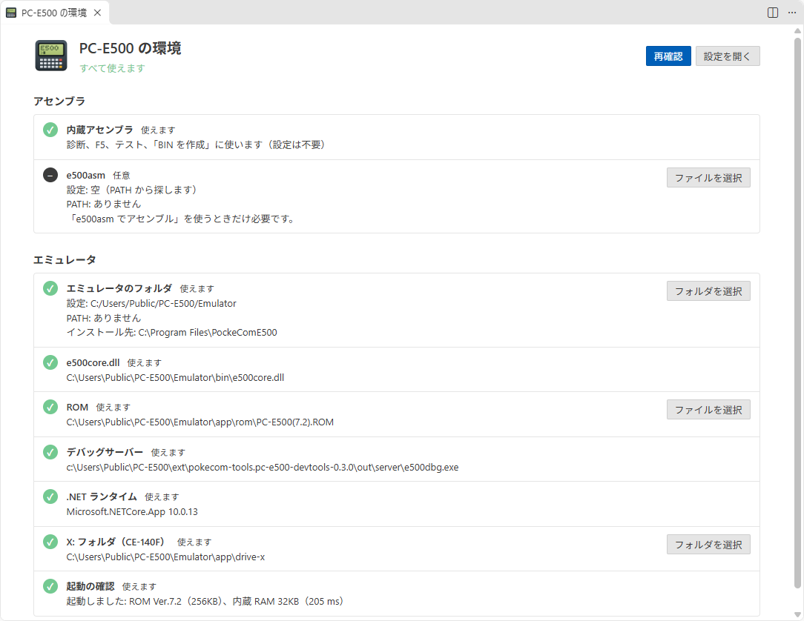
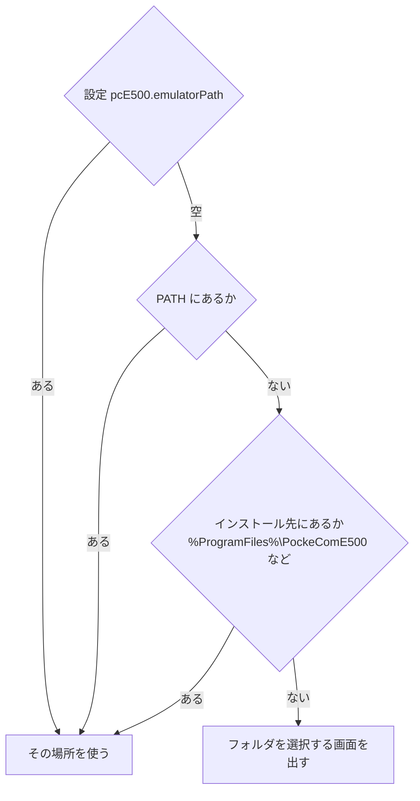
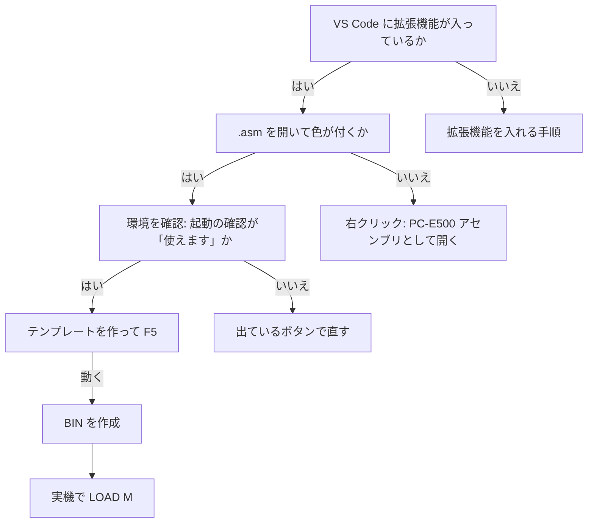

# 2. インストールと設定（Windows）

この章は、Windows でツールを入れて、使える状態にするまでを説明します。上から順に、必要な所だけ進めてください。どのコマンドにも、「何をするコマンドか」「うまくいくと何が表示されるか」を付けました。

Linux の人は[こちら](02_INSTALL_LINUX.md)、macOS の人は[こちら](02_INSTALL_MACOS.md)を読んでください。何を入れればよいか分からないときは、[2.2 何を入れるか](02_INSTALL.md#22-何を入れるか)の表で選べます。入れた後の使い方は [23 章](23_COMMAND_LINE_WINDOWS.md)にあります。

[目次へ戻る](README.md)

| 節 | 内容 |
|---|---|
| [2.1](#21-始める前に) | 動作環境、PowerShell の開き方 |
| [2.2](#22-vs-code-を入れる) | VS Code |
| [2.3](#23-net-10-のランタイムを入れる) | .NET 10 のランタイム |
| [2.4](#24-拡張機能を入れる) | 拡張機能 |
| [2.5](#25-エミュレータと-rom-を置く) | エミュレータと ROM |
| [2.6](#26-環境の確認) | そろったかどうかを調べる |
| [2.7](#27-エミュレータの探し方) | 拡張機能がエミュレータを探す順 |
| [2.8](#28-コマンドのツールを入れる) | `e500asm`、`e500dasm`、`ce140conv` |
| [2.9](#29-ソースから作る必要な人だけ) | 自分でビルドする |
| [2.10](#210-更新とアンインストール) | 新しくする、消す |
| [2.11](#211-確かめる順番) | うまく動かないときの順番 |

VS Code だけで使う人は 2.2〜2.6、コマンドも使う人は 2.8 まで進めます。

## 2.1 始める前に

### 動作環境

| 項目 | 必要なもの |
|---|---|
| OS | Windows 11（64 ビット、x64） |
| CPU | x64。2 コア、2 GHz 程度以上 |
| メモリ | 4 GB 以上を推奨 |
| 画面 | 1280 × 800 以上を推奨 |
| VS Code | 1.95 以降 |
| .NET | 動かすなら .NET 10 ランタイム、ソースから作るなら .NET 10 SDK |
| Node.js | コマンド `e500` は、VS Code があれば不要。なければ 20.12 以降。拡張機能をソースから作るときも要る |
| C++ のコンパイラ | `ce140conv` をソースから作るときだけ。Visual Studio（Build Tools でもよい）、MinGW-w64、LLVM のどれか |
| ディスク | VS Code 500 MB まで、エミュレータ 約 120 MB、`e500asm` と `e500dasm` 各 約 74 MB、`E500Disassembler` 約 116 MB |

編集、診断、ドットエディタ、実行、デバッグ、テスト、逆アセンブラの画面まで、全部の機能が使えます。どの機能に何が要るかは [2.1 動作環境](02_INSTALL.md#21-動作環境)にまとめてあります。

### この章の書き方

コマンドは **PowerShell** に打ちます。スタートボタンを右クリックして「ターミナル」を選ぶと開きます。`PS C:\Users\…>` のような表示（プロンプト）の右に打って、`Enter` を押します。プロンプト自体は打ちません。

| この章での書き方 | 意味 |
|---|---|
| `C:\PockeCom` | ツールを置くフォルダの例。好きな場所に変えてよい |
| `<バージョン>` | `0.3.0` などに読み替える |
| `.\` で始まるコマンド | 「今いるフォルダの中の」という意味。PowerShell では、これがないと今いるフォルダのコマンドを実行しない |
| `#` より右 | 説明。打たなくてよい（打っても無視される） |

## 2.2 VS Code を入れる

[VS Code のページ](https://code.visualstudio.com/)からインストーラーを取って実行します。コマンドで入れるなら次のとおりです。

```powershell
winget install --id Microsoft.VisualStudioCode -e
```

| 部分 | 意味 |
|---|---|
| `winget install` | Windows に付いている、ソフトを入れるコマンド。ダウンロードからインストールまでを行う |
| `--id Microsoft.VisualStudioCode` | 入れるソフトの名前（ID） |
| `-e` | 名前が完全に一致するものだけを入れる。似た名前の別のソフトが入るのを防ぐ |

途中で「変更を加えることを許可しますか」と聞かれたら「はい」を押します。終わったら、ターミナルを開き直します。VS Code のコマンド `code` は、開き直した後のターミナルで使えます。

## 2.3 .NET 10 のランタイムを入れる

エミュレータで動かすときに要ります（書くだけなら飛ばせます）。[ダウンロードのページ](https://dotnet.microsoft.com/download/dotnet/10.0)の「.NET ランタイム」を入れるか、次を打ちます。

```powershell
winget install --id Microsoft.DotNet.Runtime.10 -e
```

入ったかどうかを確かめます。ターミナルを開き直してから打ってください。

```powershell
dotnet --list-runtimes
```

`dotnet --list-runtimes` は、PC に入っている .NET のランタイムを一覧にするだけのコマンドで、何も変えません。次のように、`Microsoft.NETCore.App 10.` で始まる行があれば入っています。

```text
Microsoft.NETCore.App 10.0.13 [C:\Program Files\dotnet\shared\Microsoft.NETCore.App]
```

| 出たもの | 意味 |
|---|---|
| `Microsoft.NETCore.App 10.…` がある | 使える |
| `Microsoft.NETCore.App 8.…` だけ | 古い。10 を足す（古いものは消さなくてよい） |
| `dotnet` が見つからない | 入っていない。または、ターミナルを開き直していない |

## 2.4 拡張機能を入れる

1. [Releases](https://github.com/litchi-gh/pc-e500_tools/releases) から `pc-e500-devtools-<バージョン>.vsix` をダウンロードします。ブラウザで取ったファイルは、ふつう「ダウンロード」フォルダに入ります。
2. 次の**どちらか**で入れます。

**画面で入れる:** VS Code の拡張機能の画面（`Ctrl+Shift+X`）で、右上の「…」→「VSIX からのインストール」を選び、ファイルを指定します。

**コマンドで入れる:**

```powershell
cd $HOME\Downloads
code --install-extension pc-e500-devtools-0.3.0.vsix
```

| コマンド | 何をするか |
|---|---|
| `cd $HOME\Downloads` | 今いるフォルダを「ダウンロード」に移す。`$HOME` は自分のフォルダ（`C:\Users\名前`）を表す |
| `code --install-extension ファイル` | VS Code に、そのファイルの拡張機能を入れる。VS Code の画面は開かない |

```text
Installing extensions...
Extension 'pc-e500-devtools-0.3.0.vsix' was successfully installed.
```

`successfully installed` と出れば入りました。入っているかどうかは、次のコマンドでも分かります。

```powershell
code --list-extensions --show-versions
```

入っている拡張機能の名前とバージョンを一覧にするコマンドです。`pokecom-tools.pc-e500-devtools@0.3.0` があれば入っています。

3. VS Code を開いていたときは、「ウィンドウの再読み込み」を求められたら従います。

拡張機能の実体は、`%USERPROFILE%\.vscode\extensions\pokecom-tools.pc-e500-devtools-<バージョン>` に入ります。コマンド `e500` は、その中の `bin` フォルダにあります。

## 2.5 エミュレータと ROM を置く

1. エミュレータの [Releases](https://github.com/litchi-gh/pc-e500_emulator_pockecom/releases) から、インストーラー（`-setup.exe`）か ZIP を取ります。
2. インストーラーなら実行します。ZIP なら、次のように展開します。

   ```powershell
   Expand-Archive -Path "$HOME\Downloads\PC-E500-Emulator-*-win-x64.zip" -DestinationPath C:\PockeCom\Emulator
   ```

   | 部分 | 意味 |
   |---|---|
   | `Expand-Archive` | ZIP の中身を取り出すコマンド |
   | `-Path "…"` | どの ZIP か。`*` は「何でもよい」なので、バージョンの番号を打たなくて済む。当てはまる ZIP は 1 つだけにしておく |
   | `-DestinationPath …` | 取り出す場所。なければ作る |

3. 自分の本体から吸い出した ROM（`*.ROM`）を、`rom` フォルダに置きます。

   | エミュレータの入れ方 | ROM を置く場所 |
   |---|---|
   | ZIP | 展開したフォルダの `rom`（例 `C:\PockeCom\Emulator\rom`） |
   | インストーラー | `%LocalAppData%\PockeComE500\rom` |

   ```powershell
   Copy-Item "D:\MyROM\PC-E500(7.2).ROM" C:\PockeCom\Emulator\rom\
   ```

   `Copy-Item 元 先` は、ファイルをコピーするコマンドです。元のファイルは残ります。エクスプローラーでコピーしても同じです。

4. VS Code で `Ctrl+Shift+P` →「PC-E500: 環境を確認」を実行し、「エミュレータのフォルダ」の「フォルダを選択」で、展開したフォルダを選びます。画面の見方は [2.6](#26-環境の確認) にあります。

VS Code だけで使うなら、次の [2.6](#26-環境の確認) で確かめれば準備は終わりです。コマンドでも使うときは、[2.8](#28-コマンドのツールを入れる) へ進みます。

## 2.6 環境の確認

`Ctrl+Shift+P` →「PC-E500: 環境を確認」で、必要なものがそろっているかを調べます。設定画面のリンクからも開けます。



| 項目 | 調べること | 直し方 |
|---|---|---|
| 内蔵アセンブラ | いつでも使える | − |
| e500asm | 設定、PATH、実行してバージョンが出るか | 「e500asm でアセンブル」を使うときだけ必要。「ファイルを選択」か PATH に入れる |
| エミュレータのフォルダ | 設定、PATH、インストール先 | 「フォルダを選択」、候補があれば「これを設定に入れる」 |
| e500core.dll | あるか、デバッグ用の関数があるか | 新しいエミュレータのものにする |
| ROM | あるか、大きさが 256 / 384 KB か | 「ファイルを選択」 |
| デバッグサーバー | `e500dbg.exe` があるか | 拡張機能を入れ直す |
| .NET ランタイム | .NET 10 があるか | 「ダウンロード ページを開く」 |
| X: フォルダ | あるか | 「フォルダを選択」 |
| 起動の確認 | 実際に起動して ROM バージョンが読めるか | 上の項目を直す |

印の意味は「✓ 使えます」「✕ 要対応」「− 任意」です。

ワークスペースの中にある `Assembler/app/e500asm.exe` や `Emulator` は、候補として表示するだけで、「これを設定に入れる」を押すまで使いません。

コマンドで同じことを調べるには `e500 check` を使います（[22.4](22_COMMAND_LINE_AI.md#e500-check)）。

## 2.7 エミュレータの探し方

VS Code の拡張機能は、エミュレータのアプリのウィンドウを開くのではなく、その中身である `e500core.dll` を使います。画面やキーは、VS Code のパネルに自分で描きます。だから、アプリを起動しておく必要はなく、アプリの保存した状態にも影響しません。

`e500core.dll`（デバッグ用の関数があるもの）と ROM が要ります。拡張機能は、次の順に探します。



そのフォルダの中では、次の場所を調べます。

| もの | 場所 |
|---|---|
| `e500core.dll` | `bin/`、そのフォルダ、`app/`（デバッグ用の関数があるものを優先） |
| ROM（`*.ROM`） | `rom/`、`app/rom/`（`PC-E500(7.2).ROM` を優先） |
| X: ドライブ | `drive-x/`、`app/drive-x/` |

インストーラー版のエミュレータでは、ROM と X: ドライブは `%LocalAppData%\PockeComE500` から探します。

ROM の大きさは 256 KB か 384 KB です。内蔵 RAM の大きさは設定 `pcE500.ramKB` で決めます（PC-E500 と PC-E500S は 32、PC-E550、PC-E650、PC-U6000 は 64）。

コマンド `e500` の探し方は [22.3](22_COMMAND_LINE_AI.md#223-エミュレータと-rom-の探し方) にあります。

## 2.8 コマンドのツールを入れる

`e500asm`（アセンブラ）、`e500dasm`（逆アセンブラ）、`ce140conv`（ファイル変換）を、1 つのフォルダにまとめて置きます。

### 1. Git を入れる

```powershell
winget install --id Git.Git -e
```

ソースを取ってくるためのコマンド `git` を入れます。入れた後、ターミナルを開き直して `git --version` と打ち、`git version 2.…` と出れば使えます。Git を使わないときは、[リポジトリのページ](https://github.com/litchi-gh/pc-e500_tools)の「Code」→「Download ZIP」で取って、`C:\PockeCom\pc-e500_tools` に展開してもかまいません。

### 2. リポジトリを PC にコピーする

```powershell
New-Item -ItemType Directory -Force C:\PockeCom
cd C:\PockeCom
git clone https://github.com/litchi-gh/pc-e500_tools.git
cd pc-e500_tools
```

| コマンド | 何をするか |
|---|---|
| `New-Item -ItemType Directory -Force C:\PockeCom` | フォルダ `C:\PockeCom` を作る。`-Force` を付けると、既にあってもエラーにならない（中身は消えない） |
| `cd C:\PockeCom` | 今いるフォルダを、そこへ移す |
| `git clone アドレス` | GitHub にあるリポジトリを、丸ごとコピーする。今いるフォルダの中に `pc-e500_tools` というフォルダができる |
| `cd pc-e500_tools` | できたフォルダの中に入る。この後のコマンドは、ここで打つ |

`git clone` は最初の 1 回だけです。新しくするときは [2.10](#210-更新とアンインストール) の `git pull` を使います。

### 3. EXE を置く

`ce140conv.exe` はリポジトリに入っています。ほかの EXE は大きいので、[Releases](https://github.com/litchi-gh/pc-e500_tools/releases) から別に取ります。

| ダウンロードするファイル | 中身 | 置く場所 |
|---|---|---|
| `e500asm-<バージョン>-win-x64.zip` | `e500asm.exe` | `Assembler\app\` |
| `e500dasm-<バージョン>-win-x64.zip` | `e500dasm.exe` | `DisAssembler\app\` |
| `E500Disassembler-<バージョン>-win-x64.zip` | `E500Disassembler.exe` | `DisAssembler\app\` |

ダウンロードした 3 つの ZIP を、まとめて展開します。

```powershell
Expand-Archive -Path "$HOME\Downloads\e500asm-*-win-x64.zip" -DestinationPath Assembler\app -Force
Expand-Archive -Path "$HOME\Downloads\e500dasm-*-win-x64.zip" -DestinationPath DisAssembler\app -Force
Expand-Archive -Path "$HOME\Downloads\E500Disassembler-*-win-x64.zip" -DestinationPath DisAssembler\app -Force
```

1 行ごとに、1 つの ZIP の中身を `app` フォルダに取り出します。`-Force` は、前のバージョンの EXE があれば置き換えるという意味です。この 3 つの EXE は .NET を中に持っているので、動かすのに .NET を入れる必要はありません。

### 4. 動くか確かめる

```powershell
.\Assembler\e500asm.cmd --version
.\DisAssembler\e500dasm.cmd --version
.\FileConverter\ce140conv.exe info HELLO.BIN
```

| コマンド | 何をするか | 正しいとき |
|---|---|---|
| `.\Assembler\e500asm.cmd --version` | アセンブラのバージョンを表示する。`e500asm.cmd` は `app\e500asm.exe` を呼び出すだけの短いファイル | `e500asm 0.2.0 (SC62015)` |
| `.\DisAssembler\e500dasm.cmd --version` | 逆アセンブラのバージョンを表示する | `e500dasm 0.1.0 (SC62015)` |
| `.\FileConverter\ce140conv.exe info ファイル` | ファイルの種類を調べる。変換はしない | ファイルの説明が出る。ファイルがなければ「開けない」というエラー（ツールは動いている） |

「指定されたパスが見つかりません」などと出たら、`app` フォルダに EXE があるかを確かめます。

### 5. どこからでも使えるようにする（PATH）

ここまでは `C:\PockeCom\pc-e500_tools` の中でだけ使えます。**PATH** は、Windows がコマンドを探すフォルダの一覧です。ここにフォルダを足すと、どのフォルダにいても `e500asm` だけで動きます。

1. スタートメニューで「環境変数」と打ち、「環境変数を編集」を開きます。
2. 上の段（ユーザー環境変数）の `Path` を選び、「編集」を押します。
3. 「新規」を押して、次のうち使うものを 1 行ずつ足します。

   | 足すフォルダ | 使えるようになるコマンド |
   |---|---|
   | `C:\PockeCom\pc-e500_tools\Assembler\app` | `e500asm` |
   | `C:\PockeCom\pc-e500_tools\DisAssembler\app` | `e500dasm`、`E500Disassembler` |
   | `C:\PockeCom\pc-e500_tools\FileConverter` | `ce140conv` |

4. 「OK」で閉じ、**ターミナルを開き直します**。開いていたターミナルには反映されません。
5. 確かめます。

   ```powershell
   Get-Command e500asm, e500dasm, ce140conv
   ```

   `Get-Command 名前` は、その名前で動くものがどこにあるかを調べるコマンドです。3 つとも表示されれば完了です。

コマンド `e500` の PATH の足し方は [23.2](23_COMMAND_LINE_WINDOWS.md#232-e500-を使えるようにする) にあります。

## 2.9 ソースから作る（必要な人だけ）

配布の EXE を使うなら要りません。ソースを直したときや、Releases より新しいものを使いたいときに行います。

### 1. 道具を入れる

```powershell
winget install --id Microsoft.DotNet.SDK.10 -e
winget install --id OpenJS.NodeJS.LTS -e
```

| コマンド | 何を入れるか | 何に使うか |
|---|---|---|
| 1 行目 | .NET 10 の SDK | `e500asm`、`e500dasm`、`e500dbg` を作る |
| 2 行目 | Node.js（`npm` も入る） | VS Code 拡張を作る |

ターミナルを開き直して、`dotnet --list-sdks`（入っている SDK の一覧）に `10.` で始まる行があること、`node --version` に `v20.12` 以上が出ることを確かめます。

### 2. アセンブラと逆アセンブラを作る

```powershell
cd C:\PockeCom\pc-e500_tools
.\Assembler\build.cmd
.\DisAssembler\build.cmd
```

| コマンド | 何をするか | できるもの |
|---|---|---|
| `.\Assembler\build.cmd` | ①自動テストを全部動かす ②通れば、.NET を中に持った 1 つの EXE を作る | `Assembler\app\e500asm.exe` |
| `.\DisAssembler\build.cmd` | ①逆アセンブラとアセンブラの自動テスト ②通れば、コマンドと画面の EXE を作る | `DisAssembler\app\e500dasm.exe`、`E500Disassembler.exe` |

最初の 1 回は、必要な部品をインターネットから取るので時間がかかります。テストが通ると、次のように出ます（数はバージョンによって変わります）。

```text
PASS: 413 checks
```

`Tests failed` と出たら、EXE は作られません。前の EXE はそのまま残ります。

### 3. VS Code 拡張を作る

```powershell
cd C:\PockeCom\pc-e500_tools\VSCodeExtensions\pc-e500-devtools
npm ci
npm run package
code --install-extension pc-e500-devtools-0.3.0.vsix --force
```

| コマンド | 何をするか |
|---|---|
| `cd …` | 拡張機能のソースのフォルダへ移る |
| `npm ci` | 作るのに要る部品を `package-lock.json` のとおりに取ってきて、`node_modules` フォルダに入れる。最初の 1 回と、部品が変わったときだけ |
| `npm run package` | ① TypeScript を JavaScript に変える ② `e500dbg` を作る ③ `.vsix` にまとめる |
| `code --install-extension … --force` | できた `.vsix` を VS Code に入れる。`--force` は、同じバージョンが入っていても入れ直す |

`npm run package` の最後に `DONE  Packaged: …\pc-e500-devtools-0.3.0.vsix` と出れば成功です。途中の `npm warn …` や `WARNING  A 'repository' field is missing` は、そのまま進んでかまいません。

### 4. ce140conv を作る

`ce140conv.exe` はリポジトリに入っているので、`ce140conv.cpp` を直したときだけ作ります。C++17 のコンパイラが要ります。Visual Studio（Build Tools でもよい）を入れ、スタートメニューの「Developer PowerShell for VS」を開いて打ちます。

```powershell
cd C:\PockeCom\pc-e500_tools\FileConverter
.\build.bat
```

`build.bat` は、`cl`（Visual Studio）→ `g++` → `clang++` の順に、最初に見つかったコンパイラで `ce140conv.exe` を作ります。**必ず `FileConverter` フォルダの中で実行します。** `[build] OK -> ce140conv.exe` と出れば成功です。

## 2.10 更新とアンインストール

### VS Code 拡張

| すること | 方法 |
|---|---|
| 新しくする | 新しい VSIX を「VSIX からのインストール」で入れ、「開発者: ウィンドウの再読み込み」 |
| バージョンを確かめる | 拡張機能の画面で「PC-E500 開発ツール」を開く |
| 消す | 拡張機能の画面の「アンインストール」 |
| 設定を消す | 設定画面で「PC-E500」を探し、歯車から「設定をリセット」 |

コマンドで消すときは `code --uninstall-extension pokecom-tools.pc-e500-devtools` です。VS Code から、その名前の拡張機能を取り除きます。

以前の「Pocket BASIC / ASM Linter」を使っていた場合は、アンインストールしてください。設定（`pocketBasic.*`、`pocketAsm.*`、`pocketE500.*`）は、新しい拡張機能が最初に動いたときに `pcE500.*` へコピーします。`launch.json` の `"type": "pocket-e500"` は `"pc-e500"` に書き換えます。

### コマンドのツール

```powershell
cd C:\PockeCom\pc-e500_tools
git pull
```

`git pull` は、GitHub にある新しい変更を取ってきて、手元のフォルダに反映するコマンドです。自分で書き換えたファイルと重なるときは、止まって知らせます。その後、新しい EXE を[2.8 の 3](#3-exe-を置く) と同じように置き直します。

消すときは、`C:\PockeCom\pc-e500_tools` フォルダを消し、[2.8 の 5](#5-どこからでも使えるようにするpath) で足した PATH の行を消します。

## 2.11 確かめる順番

VS Code でうまく動かないときは、次の順に確かめます。


