# 3. アセンブラ入門

この章は機械語を初めて書く人のための教室です。12 の例題を順に動かしながら、PC-E500 シリーズの CPU「SC62015」のプログラムが書けるところまで進みます。BASIC が少し分かる人なら、読みながら 1 つずつ動かして、2〜3 時間で通せます。

読むだけでなく、必ず動かしてください。値を変えて動かす、わざと間違える、1 命令ずつ進める、の 3 つを繰り返すと、説明を何度も読むより早く身に付きます。例題は [Samples/Assembler/Tutorial](../../Samples/Assembler/Tutorial/) にあり、それぞれにテスト（`.e500test.json`）が付いています。

[目次へ戻る](README.md)

| 節 | 覚えること |
|---|---|
| [3.1](#31-機械語とは) 〜 [3.3](#33-動かし方) | 機械語、数の書き方、動かし方 |
| [3.4](#34-例題-1-最小のプログラム) | `ORG`、ラベル、`RC`、`RETF` |
| [3.5](#35-例題-2-値をメモリに置く) | `MV`、`DB`、レジスタとメモリ |
| [3.6](#36-例題-3-足し算) | `ADD`、`ADC`、キャリー、BASIC との受け渡し |
| [3.7](#37-例題-4-繰り返し) | `DEC`、`JRNZ`、16 ビットの計算 |
| [3.8](#38-例題-5-比べる) | `CMP`、条件分岐 |
| [3.9](#39-例題-6-文字列) | `X` で順に読む |
| [3.10](#310-例題-7-サブルーチンとスタック) | `CALL`、`RET`、`PUSHU`、`POPU` |
| [3.11](#311-例題-8-内部-ram) | `(n)`、`MVL`、`PX` |
| [3.12](#312-例題-9-文字を表示する) 〜 [3.14](#314-例題-11-線と四角) | IOCS で表示、キー、図形 |
| [3.15](#315-例題-12-割り算とエラー) | 割り算、BASIC へエラーを返す |
| [3.16](#316-間違いを探す) 〜 | 調べ方、まとめ、次に読むもの |

## 3.1 機械語とは

CPU が直接実行するのは、数の並び（**機械語**）です。人が読み書きしやすいように、1 つ 1 つの命令に名前を付けたものが**アセンブリ言語**で、それを機械語に変えるのが**アセンブラ**（`e500asm`）です。


BASIC との違いは次のとおりです。

| | BASIC | 機械語 |
|---|---|---|
| 1 行でできること | 計算、表示、繰り返しなど何でも | 移す、足す、比べる、飛ぶなど 1 つだけ |
| 変数 | 名前を書けば場所は自動 | 置く場所を自分で決める |
| 数 | 小数、大きな数 | 0〜255（8 ビット）、0〜65535（16 ビット）、0〜1048575（20 ビット） |
| 間違えたとき | エラーの表示 | 止まる、壊れる、メインメニューへ戻るなど |
| 速さ | 遅い | 速い |

## 3.2 先に知っておくこと

### 数の書き方

機械語では 16 進数をよく使います。0〜9 の次を A〜F と書き、16 で 1 桁上がります。

| 10 進 | 16 進 | 2 進 |
|---|---|---|
| 0 | 00 | 0000 0000 |
| 9 | 09 | 0000 1001 |
| 10 | 0A | 0000 1010 |
| 15 | 0F | 0000 1111 |
| 16 | 10 | 0001 0000 |
| 100 | 64 | 0110 0100 |
| 255 | FF | 1111 1111 |

2 進数の 1 桁が**ビット**、8 ビットが**バイト**です。右端がビット 0、左端がビット 7 です。16 進の 2 桁がちょうど 1 バイトになります。

ASM での書き方は次のとおりです。どれも同じ値です。

| 書き方 | 説明 |
|---|---|
| `171` | 10 進（何も付けない） |
| `$AB`、`&AB`、`0xAB`、`0ABh` | 16 進。`h` の形は数字で始める |
| `0b10101011` | 2 進 |
| `'A'` | 文字コード（65） |

この文書ではアドレスを `BEC00h` のように書きます。ASM では `$BEC00`、BASIC では `&HBEC00` です。

### メモリとアドレス

メモリは 1 バイトずつの箱の並びで、箱の番号が**アドレス**です。アドレスは 20 ビット（00000h〜FFFFFh）です。2 バイト以上の数は下位のバイトが先（小さいアドレス）に入ります。

| アドレス | 内容 |
|---|---|
| BEC00h | `2Ch`（300 = 012Ch の下位） |
| BEC01h | `01h`（上位） |

### レジスタ

CPU の中にある、計算用の小さな入れ物が**レジスタ**です。

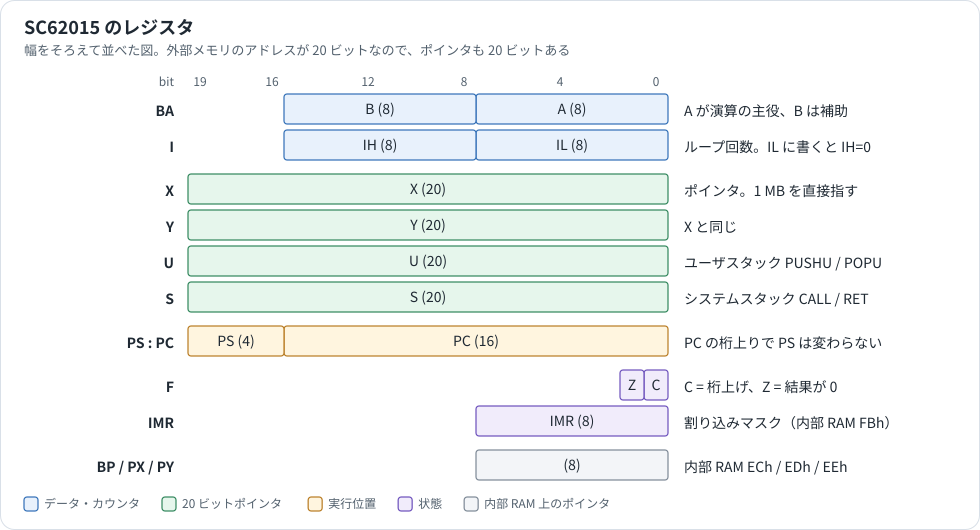

| レジスタ | 大きさ | 主な使い方 |
|---|---|---|
| `A` | 8 ビット | 計算の中心 |
| `B` | 8 ビット | `A` と組にして `BA` |
| `BA` | 16 ビット | 16 ビットの計算 |
| `IL` | 8 ビット | 回数、IOCS の番号。書くと `I` の上位は 0 になる |
| `I` | 16 ビット | 回数、16 ビットの計算 |
| `X`、`Y` | 20 ビット | アドレスを指す |
| `U`、`S` | 20 ビット | スタックのアドレス |
| `F` | 8 ビット | フラグ `C`（桁上がり）と `Z`（0） |

`A` と `IL` の間は直接移せません（`MV A,IL` は CPU にない命令です）。

## 3.3 動かし方

### VS Code で動かす

1. 例題の `.asm` を開きます。新しいファイルにコピーして `.asm` で保存してもかまいません。
2. `F5` を押します。エミュレータが起動し、アセンブル、書き込み、`CALL` まで自動で進みます。
3. 終わると、パネルの液晶に BASIC のプロンプトが出ます。

例題にはテストが付いています。左端のフラスコのアイコン（テスト）から実行すると、正しく動くことを一度に確かめられます（[テスト](11_TESTS.md)）。

### コマンドラインでアセンブルする

リポジトリのフォルダ（`pc-e500_tools`）で打ちます。

**Windows（PowerShell）**

```powershell
cd Samples\Assembler\Tutorial
..\..\..\Assembler\e500asm.cmd 03_add.asm -o add.bin -l add.lst -s add.sym
```

**Linux、macOS**

```sh
cd Samples/Assembler/Tutorial
../../../Assembler/app/e500asm 03_add.asm -o add.bin -l add.lst -s add.sym
```

| 部分 | 意味 |
|---|---|
| `cd …Tutorial` | 例題のフォルダへ移る |
| `..` | 1 つ上のフォルダ。3 つ上がるとリポジトリのフォルダに戻るので、そこから `Assembler` の中の `e500asm` を呼んでいる |
| `03_add.asm` | アセンブルするソース |
| `-o add.bin` | 機械語の出力先 |
| `-l add.lst` | リストも作る |
| `-s add.sym` | シンボル表（ラベルとアドレスの表）も作る |

うまくいくと、大きさと先頭のアドレスが出ます。

```text
OK: 28 bytes, origin=BEC00h -> ...\add.bin
```

`-l` のリスト `add.lst` には、アドレス、機械語、ソースが並びます。

```text
BEC04    88 00 EC 0B               03_add.asm(6): start:  MV    A,[DATA]
BEC08    89 01 EC 0B               03_add.asm(7):         MV    IL,[DATA+1]
BEC0C    46 01                     03_add.asm(8):         ADD   A,IL
```

### 機械語エリア

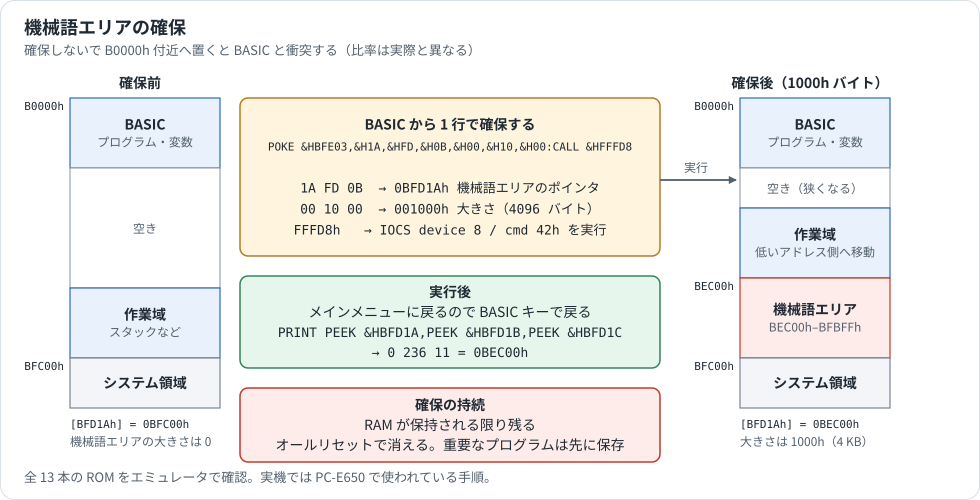

BASIC のプログラムや変数はメモリの低いアドレスから伸びてきます。機械語を置く場所は先に**確保**します。例題は 1000h バイトを確保したときの先頭 `BEC00h` に置きます。

```basic
POKE &HBFE03,&H1A,&HFD,&H0B,&H00,&H10,&H00:CALL &HFFFD8
```

`F5` のときは自動で確保されます。実機では最初に 1 回打ちます（[実機へ送る](14_TRANSFER.md)）。

## 3.4 例題 1: 最小のプログラム

何もしないで BASIC に戻ります（[01_minimal.asm](../../Samples/Assembler/Tutorial/01_minimal.asm)）。

```asm
; 01: BASIC へ戻るだけのプログラム
        ORG   $BEC00            ; 置くアドレス
start:  RC                      ; C = 0（エラーなし）
        RETF                    ; BASIC へ戻る
        END
```

| 行 | 説明 |
|---|---|
| `; …` | `;` から行末まではコメント |
| `ORG $BEC00` | 「次からは BEC00h に置く」。CPU の命令ではなく、アセンブラへの指示（**疑似命令**） |
| `start:` | **ラベル**。その行のアドレスに名前を付ける。`:` を付ける |
| `RC` | キャリー `C` を 0 にする |
| `RETF` | BASIC に戻る |
| `END` | ソースの終わり |

命令の行は左から「ラベル」「命令」「オペランド（対象）」「コメント」と書きます。大文字と小文字は区別しません。

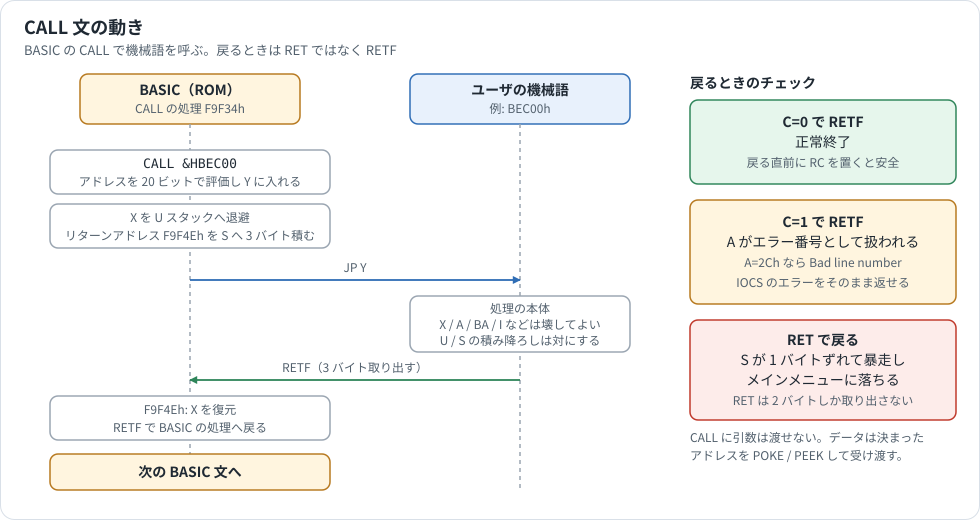

BASIC から呼ばれたプログラムの決まりが 2 つあります。

- 必ず **`RETF`** で戻る。`RET` で戻るとスタックがずれて暴走し、メインメニューへ落ちます。
- **`C = 0`** で戻る。`C = 1` のままだと、BASIC のエラーになります（[例題 12](#315-例題-12-割り算とエラー)）。迷ったら `RETF` の前に `RC` を置きます。

動かすと 2 バイト `9F 07` が BEC00h に置かれ、すぐにプロンプトへ戻ります。

## 3.5 例題 2: 値をメモリに置く

[02_store.asm](../../Samples/Assembler/Tutorial/02_store.asm)

```asm
        ORG   $BEC00
start:  MV    A,123             ; A に 123 を入れる
        MV    [RESULT],A        ; RESULT アドレスに書く
        RC
        RETF
RESULT: DB    0                 ; 結果を置く 1 バイト
        END
```

`MV`（move）は値を移す命令で、右から左へ移ります。書き方で対象が変わります。

| 書き方 | 意味 |
|---|---|
| `MV A,123` | `A` に数 123 を入れる |
| `MV A,[RESULT]` | `A` に、メモリの `RESULT` アドレスの内容を入れる |
| `MV [RESULT],A` | メモリの `RESULT` アドレスに `A` を書く |
| `MV X,RESULT` | `X` に、`RESULT` のアドレスそのものを入れる |
| `MV A,($20)` | `A` に、内部 RAM のアドレス 20h の内容を入れる（[例題 8](#311-例題-8-内部-ram)） |

`DB 0` はその場所に 1 バイトの 0 を置く疑似命令です。`RETF` の後に置くので、命令として実行されることはありません。

BASIC で結果を見ます。`RESULT` は BEC08h です（パネルの「変数・ウォッチ」のラベルかリストで分かります）。

```basic
CALL &HBEC00:PRINT PEEK &HBEC08
```

`123` と表示されます。

### メモリの中はどうなっているか

アセンブルすると、9 バイトが `BEC00h` から並びます。

```text
アドレス   内容          もとの行
BEC00  08 7B         MV  A,123       ← 08 が「A に数を入れる」、7B が 123
BEC02  A8 08 EC 0B   MV  [RESULT],A  ← A8 が「A をメモリに書く」、08 EC 0B が BEC08h
BEC06  9F            RC
BEC07  07            RETF
BEC08  00            DB  0           ← 実行後は 7B（123）になる
```

アドレス `BEC08h` は 3 バイトで、下位から `08 EC 0B` と入っています。CPU は `BEC00h` から順に読み、命令の長さだけ進んでいきます。`RETF` がないと、その次の `DB` の値まで命令として実行してしまいます。

## 3.6 例題 3: 足し算

BASIC から 2 つの数を受け取って足します（[03_add.asm](../../Samples/Assembler/Tutorial/03_add.asm)）。

```asm
        ORG   $BEC00
DATA:   DB    0,0               ; 足す数（BASIC が POKE する）
SUM:    DB    0,0               ; 結果（下位、上位）

start:  MV    A,[DATA]
        MV    IL,[DATA+1]
        ADD   A,IL              ; A = A + IL。桁上がりは C
        MV    [SUM],A
        MV    A,0
        ADC   A,0               ; A = 0 + 0 + C
        MV    [SUM+1],A
        RC
        RETF
        END
```

- `DATA` を先頭に置いたので、アドレスは BEC00h と BEC01h に決まります。BASIC はここへ `POKE` します。
- 開始アドレス `start` は BEC04h です。`F5` は `START` というラベルから始めます（大文字小文字は同じ）。
- `DATA+1` のように、アドレスは式で書けます。

8 ビットに入るのは 255 までです。200 + 100 = 300 は、`A` に 44（300 − 256）が残り、`C` が 1 になります。

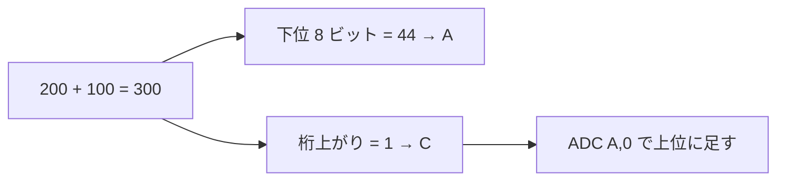

`ADC` は `C` も足す命令です。`MV` はフラグを変えないので、間に `MV` をはさんでも `C` は残っています。

```basic
POKE &HBEC00,200,100:CALL &HBEC04:PRINT PEEK &HBEC02+256*PEEK &HBEC03
```

`300` と表示されます。値の受け渡しはこのように決めたアドレスの `POKE` と `PEEK` で行います。

## 3.7 例題 4: 繰り返し

1 から N までの和を求めます（[04_loop.asm](../../Samples/Assembler/Tutorial/04_loop.asm)）。

```asm
        ORG   $BEC00
N:      DB    10                ; いくつまで足すか
SUM:    DB    0,0

start:  MV    BA,0              ; 和（16 ビット）
        MV    IL,[N]            ; 回数（IL に書くと IH は 0 になる）
loop:   ADD   BA,I              ; BA = BA + I
        DEC   IL                ; 1 減らす。0 になると Z = 1
        JRNZ  loop              ; Z = 0（まだ 0 でない）なら loop へ
        MV    [SUM],BA          ; 2 バイト書く（下位が先）
        RC
        RETF
        END
```

`DEC` は 1 を引き、結果が 0 なら `Z` を 1 にします。`JRNZ`（jump relative if not zero）は `Z` が 0 のときだけ飛びます。

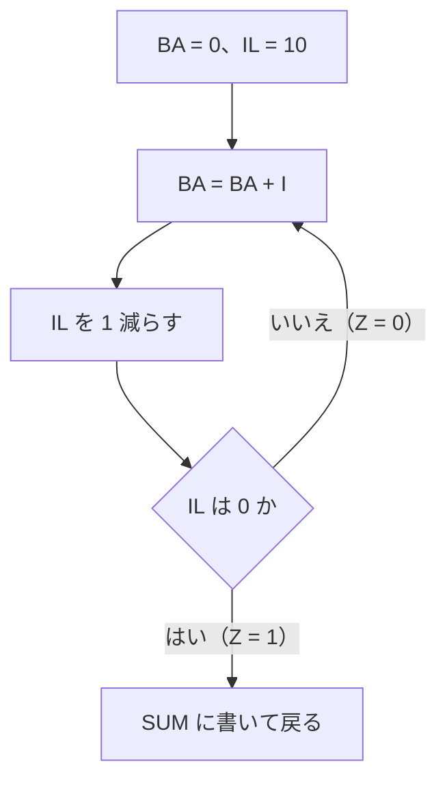

- `BA` と `I` は 16 ビットなので、和は 65535 まで入ります。
- `MV IL,[N]` は `I` の上位を 0 にするので、そのまま `I` として使えます。
- `MV [SUM],BA` は 2 バイト書きます。下位が `SUM`、上位が `SUM+1` に入ります。
- `N` を 0 にすると、`DEC` で 0 → 255 となって 256 回繰り返します。0 を使うときは先に調べます。

結果は 55（37h）です。BASIC では `PRINT PEEK &HBEC01+256*PEEK &HBEC02` で見られます。

## 3.8 例題 5: 比べる

2 つの数の大きい方を選びます（[05_compare.asm](../../Samples/Assembler/Tutorial/05_compare.asm)）。

```asm
TEMP    EQU   $20               ; 内部 RAM の 20h

start:  MV    A,[DATA]
        MV    (TEMP),A          ; 1 つ目を内部 RAM に置く
        MV    A,[DATA+1]        ; 2 つ目は A
        CMP   (TEMP),A          ; (TEMP) - A を計算して、フラグだけ変える
        JRC   done              ; C = 1: (TEMP) の方が小さい → A が大きい方
        MV    A,(TEMP)          ; そうでなければ (TEMP) が大きい方
done:   MV    [MAX],A
```

`名前 EQU 値` は数に名前を付けます。`TEMP` と書けば `$20` と書いたのと同じです。

`CMP 左,右` は左 − 右を計算し、結果は捨ててフラグだけを変えます。

| 関係 | C | Z | 飛ぶ命令 |
|---|---|---|---|
| 左 = 右 | 0 | 1 | `JRZ` |
| 左 ≠ 右 | − | 0 | `JRNZ` |
| 左 < 右 | 1 | 0 | `JRC` |
| 左 ≧ 右 | 0 | − | `JRNC` |

「左 > 右」は 1 命令では調べられません。左右を入れ替えて比べるか、`JRZ` と `JRNC` を組み合わせます。数は符号なし（0〜255）として比べられます。

分岐の命令は 3 種類あります。

| 種類 | 命令 | 届く範囲 | バイト数 |
|---|---|---|---|
| 相対 | `JR` `JRZ` `JRNZ` `JRC` `JRNC` | 前後 255 バイト | 2 |
| 近距離 | `JP` `JPZ` `JPNZ` `JPC` `JPNC` | 同じ 64 KB の中 | 3 |
| 遠距離 | `JPF` | どこでも | 4 |

ふつうは `JR` を使い、届かなければエラーになるので `JP` に変えます。

## 3.9 例題 6: 文字列

文字列の長さを数えながら、小文字を大文字にします（[06_string.asm](../../Samples/Assembler/Tutorial/06_string.asm)）。

```asm
TEXT:   DB    "Hello, Pc-e500!",0
LENGTH: DB    0
TEMP    EQU   $20

start:  MV    X,TEXT            ; X = 文字列の先頭アドレス
        MV    IL,0              ; 長さ
next:   MV    A,[X]             ; 1 文字読む
        CMP   A,0               ; 0 なら終わり
        JRZ   finish
        CMP   A,'a'
        JRC   skip              ; 'a' より小さい
        CMP   A,'z'+1
        JRNC  skip              ; 'z' より大きい
        SUB   A,$20             ; 小文字 → 大文字
        MV    [X],A
skip:   INC   X                 ; 次のアドレス
        INC   IL
        JR    next
finish: MV    (TEMP),IL         ; IL から A へは直接移せないので内部 RAM を通す
        MV    A,(TEMP)
        MV    [LENGTH],A
```

- `DB "文字列",0` は文字コードを並べ、最後に 0 を置きます。0 を終わりの印にします。
- `[X]` は「`X` が指すアドレスの内容」です。`X` を増やすと次の文字になります。
- 文字は数です。`'a'` は 61h、`'A'` は 41h なので、20h を引くと大文字になります。
- `'a'`〜`'z'` かどうかは 2 回の比較で調べます。

`X` の使い方には次の形があります。

| 書き方 | 意味 |
|---|---|
| `[X]` | `X` が指すアドレス |
| `[X+5]`、`[X-3]` | `X` から離れたアドレス（`X` は変わらない） |
| `[X++]` | 読み書きした後で `X` を増やす |
| `[--X]` | `X` を減らしてから読み書きする |

`MV A,[X++]` とすれば、読むのと次へ進むのが 1 命令でできます。`Y`、`U`、`S` も同じ形で使えます。

## 3.10 例題 7: サブルーチンとスタック

数の 3 乗を計算します。掛け算の命令はないので、足し算を繰り返すサブルーチンを作ります（[07_call.asm](../../Samples/Assembler/Tutorial/07_call.asm)）。

```asm
start:  MV    IL,[NUM]
        MV    BA,I              ; BA = 数
        CALL  multiply          ; BA = BA × I
        CALL  multiply          ; もう一度かけて 3 乗
        MV    [CUBE],BA
        RC
        RETF

; BA = BA × I。I は変わらない。
multiply:
        PUSHU I                 ; 呼んだ側の I を U スタックに預ける
        MV    (TEMP),BA         ; かけられる数
        MV    BA,0
mul_1:  PUSHU I                 ; 回数を預けて、I を足し算に使う
        MV    I,(TEMP)
        ADD   BA,I
        POPU  I
        DEC   I
        JRNZ  mul_1
        POPU  I                 ; 預けた I を戻す
        RET                     ; 呼ばれた所へ戻る
```

`CALL` はリターンアドレスを **S スタック**に積んでから飛びます。`RET` はそれを取り出して戻ります。

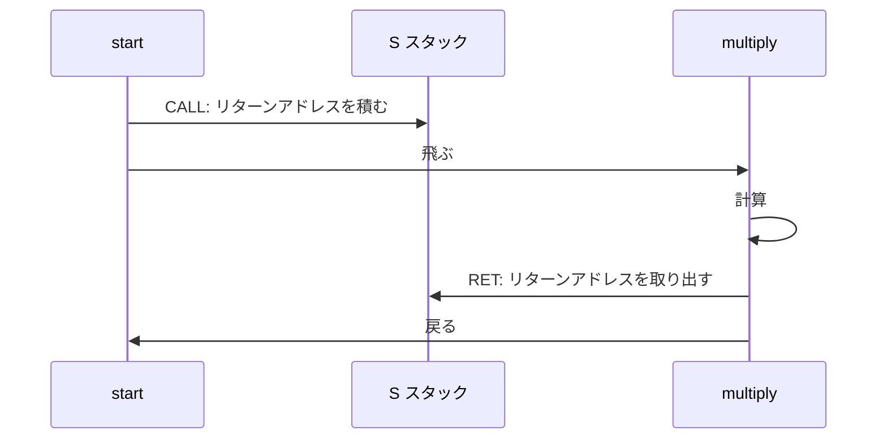

`PUSHU` は値を **U スタック**に預け、`POPU` は最後に預けたものから取り出します。

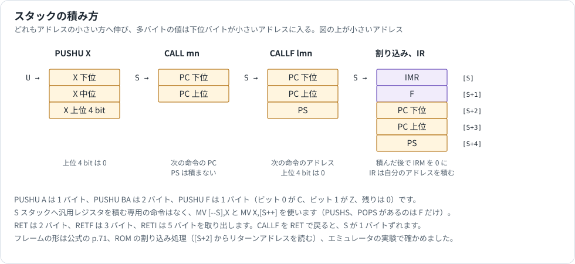

| 命令 | 使うスタック | 対になる命令 |
|---|---|---|
| `CALL` | S（2 バイト） | `RET` |
| `CALLF` | S（3 バイト） | `RETF` |
| `PUSHU` | U | `POPU` |
| `PUSHS` | S | `POPS` |

- **積んだ数だけ取り出す。** 途中で飛び出すときも、数を合わせます。
- 同じプログラムの中のサブルーチンは `CALL` と `RET`、BASIC や ROM とのやり取りは `CALLF` と `RETF` です。
- サブルーチンの前には「何を受け取り、何を返し、何が変わるか」をコメントに書いておくと、後で困りません。

### スタックの動き

`multiply` の中で、2 つのスタックがどうなっているかです（上が小さいアドレス）。

```text
            S スタック              U スタック
CALL の前   …                       …
CALL の後   [リターンアドレス 2 バイト] ←S  …
PUSHU I     [リターンアドレス]              [I（呼んだ側）] ←U
PUSHU I     [リターンアドレス]              [I（回数）] [I（呼んだ側）]
POPU  I     [リターンアドレス]              [I（呼んだ側）] ←U
POPU  I     [リターンアドレス] ←S           …
RET         …                       …
```

どちらのスタックも、積むとアドレスが減り、取り出すと増えます。`RET` は S の先頭から 2 バイトを取り出して、そこへ飛ぶだけです。だから、`RET` の前に S を元の位置に戻しておかないと、でたらめな場所へ飛びます。

## 3.11 例題 8: 内部 RAM

SC62015 にはふつうのメモリ（外部メモリ）とは別に、CPU の中に 256 バイトの**内部 RAM** があります。書き方で区別します。

| | 外部メモリ | 内部 RAM |
|---|---|---|
| 書き方 | `[アドレス]` | `(アドレス)` |
| 大きさ | 1 MB | 256 バイト |
| 向いているもの | プログラム、データ、文字列 | 計算中の値、カウンタ |

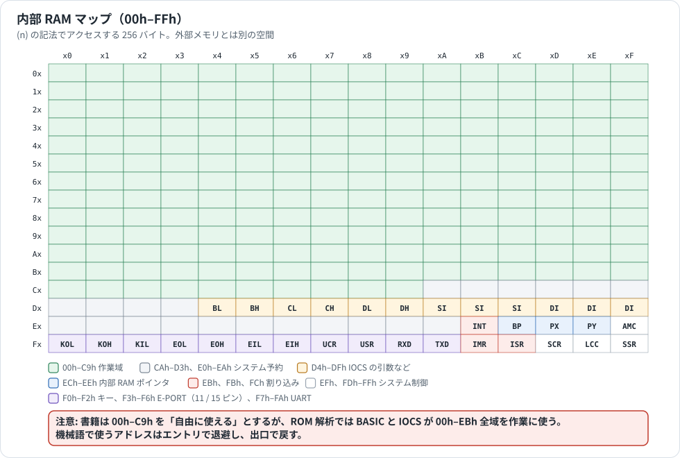

内部 RAM どうしや、数との計算ができるので、レジスタが足りないときに便利です（`ADD (n),A`、`INC (n)`、`CMP (n),5`、`MV (m),(n)` など）。**00h〜EBh は BASIC も使っている**ので、使う場所は先に退避して、終わったら戻します。

[08_internal.asm](../../Samples/Assembler/Tutorial/08_internal.asm) は 16 バイトの並びを逆にします。

```asm
WORK    EQU   $20               ; 内部 RAM の 20h〜2Fh を使う
PX_REG  EQU   $ED               ; PX レジスタのアドレス

start:  MV    I,16
        MVL   [SAVE],(WORK)     ; 元の内容を外部メモリへ（I バイト）
        MV    I,16
        MVL   (WORK),[DATA]     ; 16 バイトまとめて読む
        MV    X,DATA+16
        MV    (PX_REG),WORK     ; PX = 20h
        MV    IL,16
loop:   MV    A,(PX)            ; PX が指す内部 RAM
        MV    [--X],A           ; X を 1 減らしてから書く
        INC   (PX_REG)
        DEC   IL
        JRNZ  loop
        MV    I,16
        MVL   (WORK),[SAVE]     ; 元に戻す
        RC
        RETF
SAVE:   DS    16
```

- `MVL` は `I` バイトをまとめて移します。終わると `I` は 0 になるので、使う前に毎回入れます。
- `MVW` は 2 バイト、`MVP` は 3 バイトです。
- `(PX)` は「`PX` が指す内部 RAM」です。`PX` 自身は内部 RAM の EDh にあるので、`MV ($ED),値` で書き、`INC ($ED)` で進めます。
- `DS 16` は 16 バイトの場所を取ります。

内部 RAM の指定には次の形があります。

| 書き方 | 意味 |
|---|---|
| `($20)` | アドレス 20h |
| `(BP+$20)` | `BP`（ECh）の値 + 20h |
| `(PX)`、`(PX+2)` | `PX`（EDh）の値 + 変位 |
| `(PY)`、`(PY+2)` | `PY`（EEh）。1 命令の中の 2 つ目の内部 RAM で使う |
| `(BP+PX)`、`(BP+PY)` | 2 つの和 |

この指定は命令の前に付く **PRE バイト**で決まります。アセンブラが自動で付けるので、ふつうは気にしなくてかまいません（上の `MV A,(PX)` は `34 80 00` で、`34` が PRE です）。

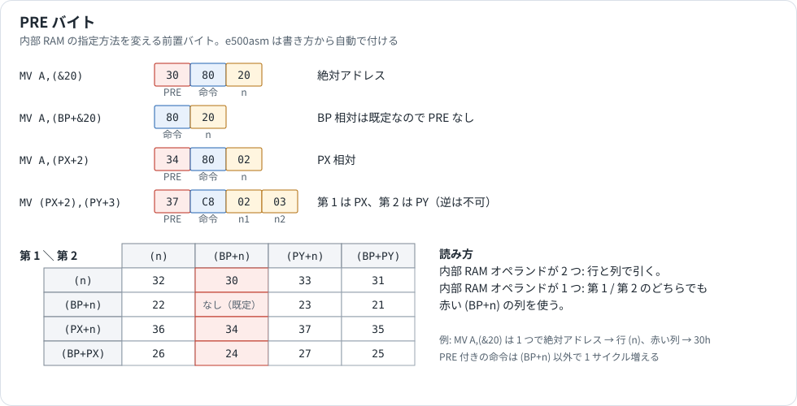

例題 5〜7 では内部 RAM の 20h〜21h を退避せずに使いました。短いルーチンで試す程度なら影響はありませんが、自分のプログラムでは退避します。`BP`、`PX`、`PY` を変えたら、それも戻します。

## 3.12 例題 9: 文字を表示する

画面、キー、ファイルなどは、ROM にある **IOCS** を呼んで使います。

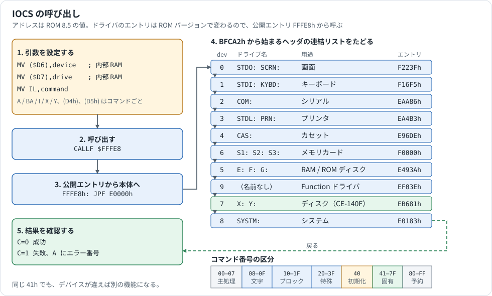

[09_iocs.asm](../../Samples/Assembler/Tutorial/09_iocs.asm)

```asm
        ORG   $BEC00
        INCLUDE "iocs.inc"

start:  MV    (CL),DEV_SCRN     ; デバイス: 画面
        MV    (CH),0            ; ドライブ
        MV    (BL),5            ; x = 5 桁目
        MV    (BH),2            ; y = 2 行目
        MV    X,msg             ; 文字列の先頭
        MV    Y,msg_end-msg     ; 長さ
        MV    IL,SCRN_PUTS      ; 番号: 指定位置へ n 文字表示
        CALLF IOCS
        RC
        RETF

msg:    DB    "HELLO, IOCS!"
msg_end:
        END
```

手順はいつも同じです。

1. `(CL)` にデバイス番号、`(CH)` にドライブ番号を入れる。
2. 引数を入れる（番号ごとに決まっている）。
3. `IL` に機能の番号を入れる。
4. `CALLF IOCS` を呼ぶ。`C = 1` で戻ったらエラーで、`A` に番号が入る。

`INCLUDE "iocs.inc"` は `DEV_SCRN` や `SCRN_PUTS` などの名前をまとめたファイルを読み込みます（[INCLUDE ファイル](06_INCLUDE_FILES.md)）。`msg_end-msg` のように、ラベルの差で長さを計算できます。

VS Code では、`MV IL,` まで打つと、そのデバイスの番号が候補に出ます。番号にマウスを乗せると引数も分かります。

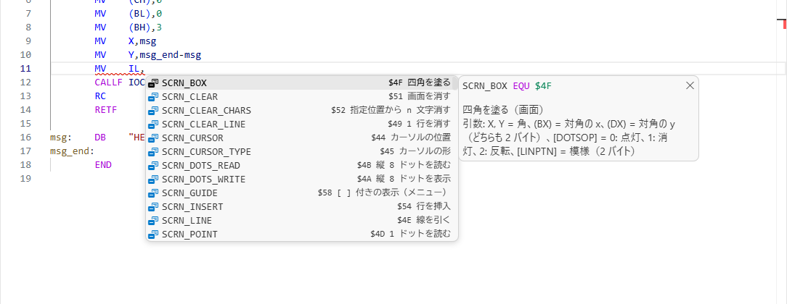

- IOCS を呼ぶとレジスタが変わることがあります。残したいものは `PUSHU` で預けます。
- `(CL)` や `(BL)` は内部 RAM の D4h〜D7h です。IOCS 用の場所なので、退避は要りません。

`CLS:CALL &HBEC00` で、3 行目の 6 文字目から表示されます（位置は 0 から数えます）。

## 3.13 例題 10: キーを待つ

[10_key.asm](../../Samples/Assembler/Tutorial/10_key.asm) は押されたキーの文字を `KEY` に入れます。

```asm
        INCLUDE "iocs.inc"
KEY:    DB    0

start:  MVW   (CX),DEV_KYBD     ; デバイス 1、ドライブ 0 を一度に入れる
        MV    IL,KYBD_CLEAR     ; たまったキーを捨てる
        CALLF IOCS
        MVW   (CX),DEV_KYBD
        MV    A,$80             ; ビット 7 = 1: 押されるまで待つ
        MV    IL,KYBD_READ
        CALLF IOCS              ; A = 文字
        MV    [KEY],A
        RC
        RETF
```

- `CX` は `CL` と `CH` を合わせた 2 バイトです。`MVW (CX),1` で、`CL` に 1、`CH` に 0 が入ります。
- `A` のビット 7 が 1 なら、押されるまで待ちます。0 なら待たずに戻り、`IL` が 1 のとき `A` に文字が入ります。
- 先に `KYBD_CLEAR` を呼ばないと、`CALL` の行を打った `ENTER` などが残っていることがあります。

```basic
CALL &HBEC01:PRINT CHR$ PEEK &HBEC00
```

`A` を押すと `A` と表示されます。`KEY` が先頭にあるので、開始アドレスは BEC01h です。

ゲームのように同時押しや押しっぱなしを読むときは、`pad.inc` を使います（[ゲームを作る](07_GAME.md)）。

## 3.14 例題 11: 線と四角

[11_draw.asm](../../Samples/Assembler/Tutorial/11_draw.asm) は画面を消して、斜めの線と塗りつぶした四角を描きます。

```asm
        INCLUDE "iocs.inc"
        INCLUDE "hardware.inc"

start:  MVW   (CX),DEV_SCRN
        MV    IL,SCRN_CLEAR     ; 画面を消す
        CALLF IOCS
        MV    A,0
        MV    [DOTSOP],A        ; 点灯
        MV    BA,$FFFF
        MV    [LINPTN],BA       ; 実線
        MVW   (CX),DEV_SCRN
        MV    X,0               ; 始点 (0,0)
        MV    Y,0
        MVW   (BX),239          ; 終点 (239,31)
        MVW   (DX),31
        MV    IL,SCRN_LINE
        CALLF IOCS
```

画面は横 240、縦 32 ドットで、左上が (0,0) です。`DOTSOP`（点灯、消灯、反転）と `LINPTN`（線の模様）は、IOCS が参照する外部メモリの場所で、`hardware.inc` に名前があります。

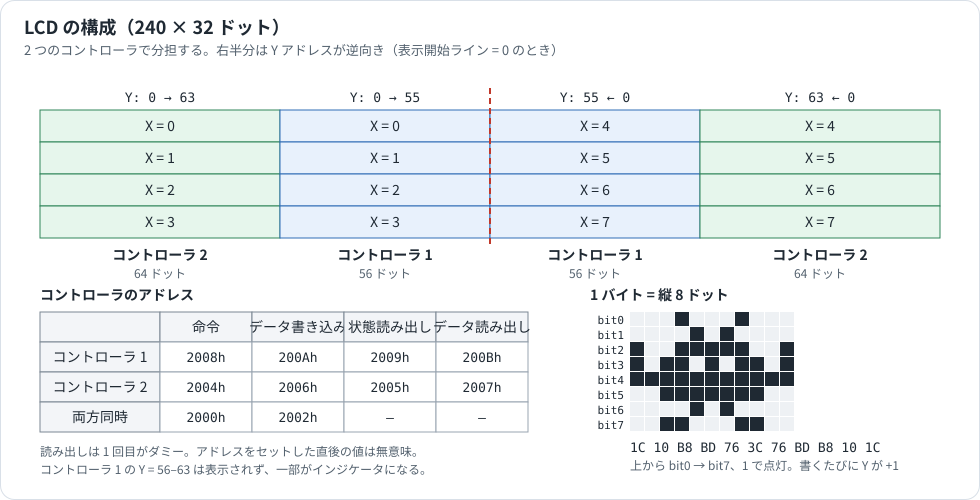

IOCS で 1 点ずつ描くのは遅いので、動く絵は `screen.inc` と `sprite.inc` を使うか、LCD コントローラに直接書きます（[液晶（LCD）](../analysis/04_LCD.md)）。

## 3.15 例題 12: 割り算とエラー

[12_divide.asm](../../Samples/Assembler/Tutorial/12_divide.asm) は 16 ビット ÷ 8 ビットの割り算です。0 で割ろうとしたら、BASIC のエラーにします。

```asm
NUM:    DW    0                 ; 割られる数
BY:     DB    0                 ; 割る数
QUOT:   DW    0                 ; 商
REST:   DB    0                 ; 余り

start:  MV    A,[BY]
        CMP   A,0
        JRZ   error
        MV    IL,[BY]           ; I = 割る数（16 ビット）
        MV    Y,0               ; 商を数える
        MV    BA,[NUM]
div:    SUB   BA,I              ; 引けるだけ引く
        JRC   done              ; 引きすぎた
        INC   Y
        JR    div
done:   ADD   BA,I              ; 引きすぎた分を戻す
        MV    [REST],A
        MV    BA,Y              ; Y の下位 16 ビット
        MV    [QUOT],BA
        RC
        RETF

error:  MV    A,21              ; C = 1 で戻ると、A が BASIC のエラー番号になる
        SC
        RETF
```

- `DW` は 2 バイトの場所を取ります（下位が先）。
- 割る数を引けるだけ引き、引けた回数が商です。引きすぎると `C` が 1 になります。
- `C = 1` で戻ると、`A` の番号の BASIC のエラーになります。`A` = 21 は「Division by Zero」です。これは BASIC の `ERN` で読める番号と同じで、`ON ERROR GOTO` で受けることもできます。番号はメッセージの表の番号に 9 を足したものです。表は [ROM バージョンの違い: 行列演算とドライバ](../analysis/25_ROM_VERSIONS_DRIVERS.md) の §25.2.2 にあります。

```basic
POKE &HBEC02,0:CALL &HBEC06
```

「Division by Zero」のエラーになります。IOCS が返したエラーも、`C` と `A` を触らずに `RETF` すれば、そのまま BASIC に伝わります。

## 3.16 間違いを探す

### アセンブルのエラー

VS Code では、間違った行に波線が付き、「問題」パネルに一覧が出ます。

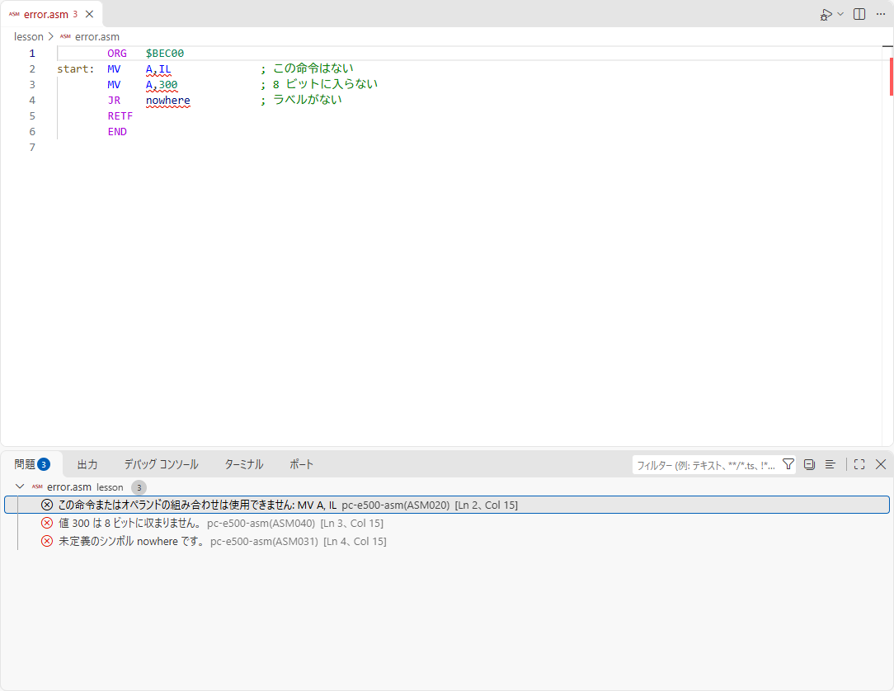

| よくある間違い | VS Code の表示 | `e500asm` の表示 |
|---|---|---|
| ラベルの綴り違い | 未定義のシンボル … です。 | `Undefined symbol: …` |
| ない組み合わせ（`MV A,IL` など） | この命令またはオペランドの組合せは使用できません | `Unsupported instruction or operands` |
| `JR` が届かない（`JP` にする） | 相対分岐の変位 … が範囲外です | `Relative branch out of range` |
| 8 ビットに入らない数 | 値 300 は 8 ビットに収まりません。 | `Value 300 does not fit in 8 bits` |
| `BEC00h` と書いた（`0BEC00h` か `$BEC00` にする） | 未定義のシンボル BEC00h です。 | `Undefined symbol: BEC00h` |

メッセージの全部は[アセンブラの文法](04_ASSEMBLER_REFERENCE.md#49-エラーメッセージ)にあります。

### 動きがおかしいとき

行番号の左をクリックして**ブレークポイント**を置き、`F5` を押すと、その行で止まります。`F11` で 1 命令ずつ進め、レジスタとメモリを見ます。

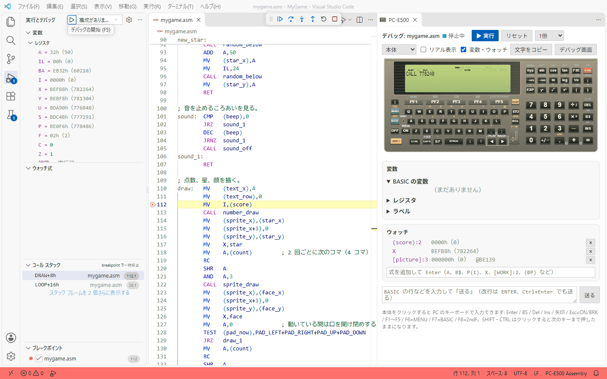

| 症状 | 調べること |
|---|---|
| メインメニューに戻ってしまう | `RET` で戻っていないか、`PUSHU` と `POPU` の数は合っているか |
| BASIC のエラーが出る | `RC` の後に `RETF` しているか |
| 何も起きない | `CALL` したアドレスは開始アドレスか（データのアドレスではないか） |
| 値が変 | `MVL` の前に `I` を入れ直したか、`IL` に書いて `I` の上位を消していないか |
| 固まる | 繰り返しが終わる条件、`DEC` する前の値が 0 でないか |
| 2 回目から変になる | 前の結果が残っていないか（`DB 0` は書き込んだときだけ 0） |

くわしい操作は[デバッグ](10_DEBUG.md)にあります。

## 3.17 まとめ

- ソースの形は「`ORG` → 命令 → `RC` → `RETF` → データ → `END`」。
- 外部メモリは `[ ]`、内部 RAM は `( )`。
- 2 バイト以上の数は下位が先。
- 比べて飛ぶのは `CMP` と `JRZ` `JRNZ` `JRC` `JRNC`。
- `CALL` は `RET`、`CALLF` と BASIC は `RETF`。
- 使う内部 RAM は退避して戻す。
- 入出力は IOCS。

よく使う書き方をまとめます。

| やりたいこと | 書き方 |
|---|---|
| `A` を 0 にする | `MV A,0` |
| `IL` の値を `A` へ | `MV ($20),IL` と `MV A,($20)` |
| 2 倍 | `ADD A,A`、`ADD BA,BA` |
| 半分（切り捨て） | `RC` と `SHR A` |
| 下位 4 ビットだけ残す | `AND A,$0F` |
| ビット 3 を 1 にする | `OR A,$08` |
| ビット 3 を 0 にする | `AND A,$F7` |
| ビット 3 が 1 か調べる | `TEST A,$08` と `JRNZ` |
| 0 クリアを `n` バイト | `X` に先頭、`I` に回数、`MV [X++],A` を繰り返す |
| 表の `A` 番目を読む | `MV X,table`、`ADD X,A`、`MV A,[X]` |
| ジャンプ先を選ぶ | `CMP` と `JRZ` を並べる |

## 3.18 ハードウェアと機種の違い

### 全体

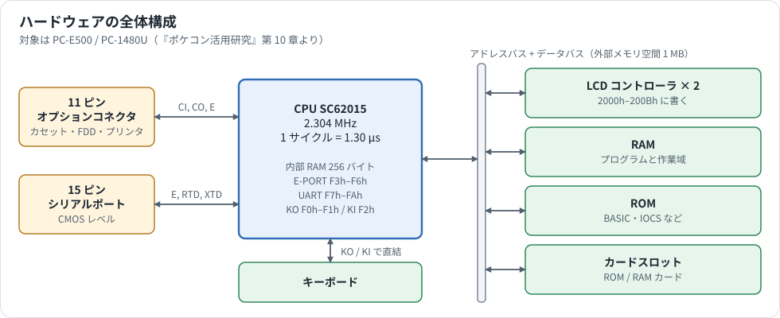

- キーボードとコネクタは CPU のポートにつながっていて、内部 RAM のアドレス（F0h から）で操作します。
- LCD、RAM、ROM、カードは外部メモリのアドレスに並んでいます。

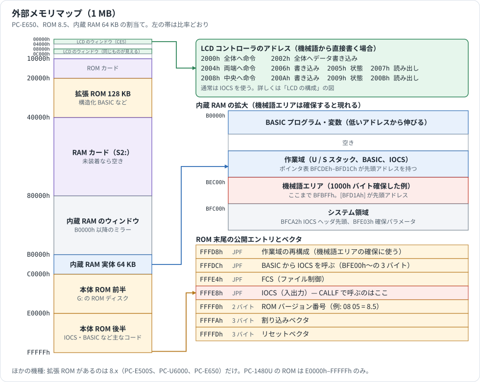

### LCD を直接操作する

画面の x = 64〜119、y = 0〜7 を点灯する例です。表示開始ラインが 0 でないときは、描かれる高さがずれます（`POKE &H2008,&HC0` で 0 に戻せます）。

```basic
10 POKE &H2008,&HB8
20 POKE &H2008,&H40
30 FOR I=0 TO 55
40 POKE &H200A,&HFF
50 NEXT I
```

`2008h` に命令（ページ、桁）、`200Ah` にデータを書きます。データを書くたびに、桁が 1 つ進みます。くわしくは [液晶（LCD）](../analysis/04_LCD.md) にあります。

### 速さ

CPU のクロックは 2.304 MHz で、1 サイクルは約 1.30 マイクロ秒です。命令のサイクルは[命令一覧](05_INSTRUCTIONS.md)にあります。

1 命令の実行中は割り込みが入りません。大きな `I` の `MVL` や `WAIT` を実行すると、その間はキーやタイマが止まります。

### 機種と ROM バージョン

CPU と公開エントリ（`FFFE8h` など）、機械語エリアの確保は、全機種で同じです。ROM の中のアドレスはバージョンで変わるので、直接呼ばないようにします。

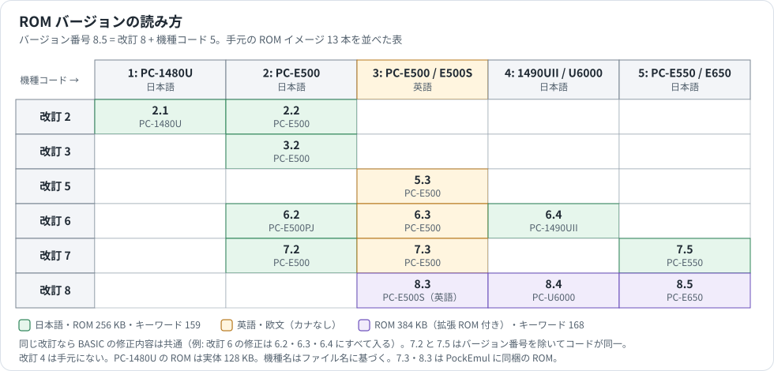

```basic
PRINT PEEK &HFFFF0;PEEK &HFFFF1
```

違いの一覧は [ROM バージョンの違い: 配置](../analysis/23_ROM_VERSIONS_MAP.md) などにあります。

## 3.19 練習問題

例題を変えて試す問題です。考え方と答えの場所を付けました。

| # | 問題 | 使うもの | ヒント |
|---|---|---|---|
| 1 | 例題 2 を、3 つの値を順に書くようにする | `MV` | `MV [RESULT+1],A` |
| 2 | 例題 3 を、引き算にする | `SUB`、`SBC` | 借りは `C`。結果が負のときはどうなるか |
| 3 | 例題 4 を、N の 2 乗の和にする | `CALL` | 例題 7 の掛け算を使う。または[掛け算のレシピ](20_RECIPES.md#mul8) |
| 4 | 例題 5 を、3 つの数の一番大きいものにする | `CMP` | 2 つの大きい方と、3 つ目を比べる |
| 5 | 例題 6 を、大文字を小文字にする | `ADD` | 範囲を `'A'`〜`'Z'` に。[文字のレシピ](20_RECIPES.md#205-文字)も見る |
| 6 | 例題 6 で、空白の数を数える | `CMP`、`INC` | 数える変数は内部 RAM に |
| 7 | 例題 8 を、並べ替えに変える | `CMP` | [並べ替えのレシピ](20_RECIPES.md#sort8) |
| 8 | 例題 9 を、4 行に表示する | `(BH)`、`DEC` | `SCRN_PUTS` は `X` を進めて返す |
| 9 | 例題 10 を、押した文字を画面に出しながら続け、`Q` で終わる | `SCRN_PUTC` | `(BL)` を 1 つずつ進める |
| 10 | 例題 11 を、四角を 10 個ずらして描く | 繰り返し | `X` と `(BX)` に同じ数を足す |
| 11 | 例題 12 を、速い方法にする | `SHL` | [割り算のレシピ](20_RECIPES.md#div16) |
| 12 | 数を受け取り、10 進で画面に出す | IOCS | [数を表示するレシピ](20_RECIPES.md#print_num) |

できたら、その例題の `.e500test.json` に合わせてテストを 1 件書いてみてください（[テスト](11_TESTS.md)）。

### 答えの例（問題 2）

```asm
        ORG   $BEC00
DATA:   DB    0,0
DIFF:   DB    0,0

start:  MV    A,[DATA]
        MV    IL,[DATA+1]
        SUB   A,IL              ; A = A - IL。借りは C
        MV    [DIFF],A
        MV    A,0
        SBC   A,0               ; 借りがあれば FFh
        MV    [DIFF+1],A
        RC
        RETF
        END
```

3 − 4 の結果は `FFh FFh`（16 ビットの −1）になります。

## 3.20 次に読むもの

- 書き方の決まりの全部: [アセンブラの文法](04_ASSEMBLER_REFERENCE.md)
- 命令の全部: [命令一覧](05_INSTRUCTIONS.md)
- 使えるルーチン集: [逆引きレシピ](20_RECIPES.md)
- 言葉の意味: [用語集](21_GLOSSARY.md)
- 画面とキャラクタを動かす: [ゲームを作る](07_GAME.md)
- CPU のくわしい資料: [CPU（SC62015）](../analysis/02_CPU.md)
- BASIC との受け渡しの規約: [機械語を実機で動かす](../analysis/12_MACHINE_CODE.md)
- もう少し長い例: [Samples/](../../Samples/README.md)
