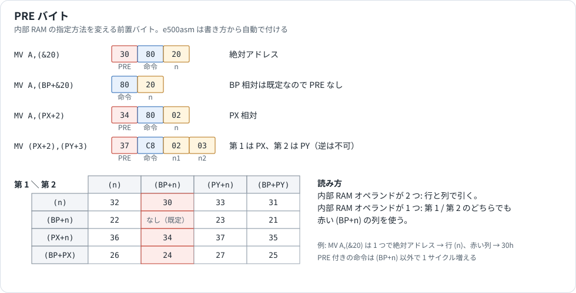
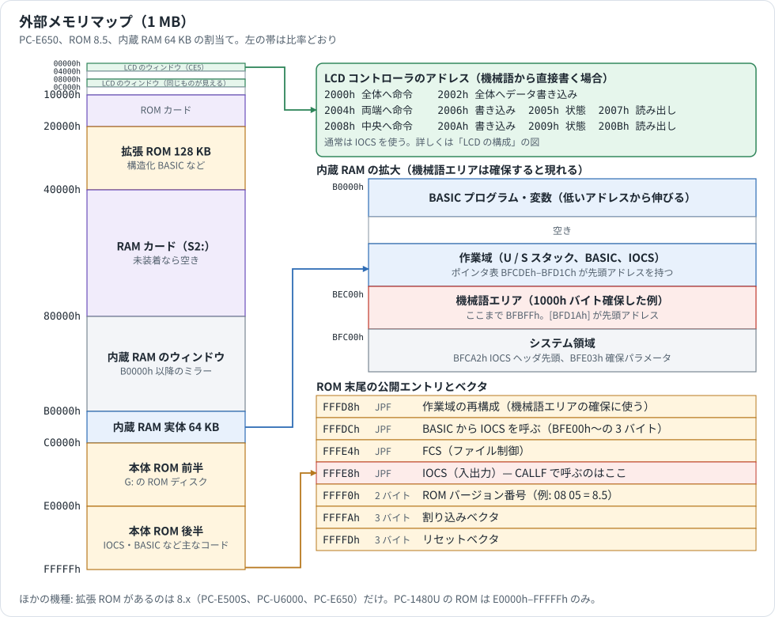

# 4. アセンブラの文法

この章はクロスアセンブラ `e500asm` の使い方と、ASM ソースの書き方の決まりをまとめた辞書です。頭から読むより、書いていて迷ったときに引いてください。「クロス」とは、PC の上で、PC とは別の CPU（SC62015）の機械語を作るという意味です。VS Code 拡張の内蔵アセンブラも同じ文法で、同じバイト列を作ります（違いは [4.10](#410-vs-code-の内蔵アセンブラとの違い)）。初めての人は[アセンブラ入門](03_ASSEMBLER_TUTORIAL.md)から読んでください。

[目次へ戻る](README.md)

| 節 | 内容 |
|---|---|
| [4.1](#41-コマンドライン) | コマンドとオプション |
| [4.2](#42-出力) | 出力するファイル |
| [4.3](#43-行の書き方) | 行、ラベル、コメント、名前 |
| [4.4](#44-数と式) | 数、文字、演算子、関数 |
| [4.5](#45-オペランド) | レジスタ、内部 RAM、外部メモリ |
| [4.6](#46-分岐) | `JR` `JP` `JPF` `CALL` `CALLF` |
| [4.7](#47-疑似命令) | `ORG` `EQU` `DB` `INCLUDE` など |
| [4.8](#48-大きなプログラムの組み立て) | ファイルの分け方、配置 |
| [4.9](#49-エラーメッセージ) | エラーの一覧 |
| [4.10](#410-vs-code-の内蔵アセンブラとの違い) | 内蔵アセンブラとの違い |

## 4.1 コマンドライン

```text
e500asm 入力.asm [オプション]
```

リポジトリのフォルダ（`pc-e500_tools`）で打つときの例です。

**Windows（PowerShell）**

```powershell
.\Assembler\e500asm.cmd Assembler\examples\sum.asm
.\Assembler\e500asm.cmd prog.asm -o prog.bin -l prog.lst -s prog.sym
```

**Linux、macOS**

```sh
Assembler/app/e500asm Assembler/examples/sum.asm
Assembler/app/e500asm prog.asm -o prog.bin -l prog.lst -s prog.sym
```

| コマンド | 何をするか |
|---|---|
| 1 行目 | `sum.asm` を機械語にする。出力先を書いていないので、ソースの隣に同じ名前の `sum.bin` を作る |
| 2 行目 | 機械語（`-o`）に加えて、リスト（`-l`）とシンボル表（`-s`）も決めた名前で作る |

うまくいくと、大きさ、先頭のアドレス、出力先が出ます。

```text
OK: 11 bytes, origin=B8000h -> ...\sum.bin
```

[PATH に入れて](02_INSTALL.md)あれば、どの OS でも、どこからでも `e500asm` と打てます。この後の例はその書き方です。

入力ファイルは 1 つです。オプションは入力の前後どちらに書いてもかまいません。空白のあるパスは `"` で囲みます。

| オプション | 値 | 既定 | 内容 |
|---|---|---|---|
| `-o`、`--output` | パス | 入力と同じ名前の `.bin` / `.hex` | 出力ファイル |
| `-f`、`--format` | `bin` / `hex` / `ce140f` | `bin` | `bin` はヘッダーなしの機械語、`hex` は Intel HEX、`ce140f` は実機の `LOAD M` で読める形（16 バイトのヘッダー + 機械語） |
| `-l`、`--listing` | パス | 作らない | アドレス、機械語、ソースを並べたリスト |
| `-s`、`--symbols` | パス | 作らない | シンボル表 |
| `--org` | アドレス（16 進） | 0 | `ORG` がないときの開始アドレス。ソースの `ORG` が優先 |
| `--fill` | 0〜255 | 0 | `DS`、`ALIGN`、`ORG` の間の空きを埋める値 |
| `--encoding` | 名前 | `utf-8` | ソースの文字コード。Shift-JIS は `shift_jis` |
| `-I` | フォルダ | なし | `INCLUDE` / `INCBIN` を探す場所。何回でも書ける |
| `-D` | `名前=値` | なし | 定数を外から定義する。何回でも書ける。`=値` を省くと 1 |
| `-h`、`--help` | − | − | 使い方を表示 |
| `--version` | − | − | バージョンを表示 |

終了コードは、成功が 0、エラーが 1 です。エラーのときは、前の出力ファイルを変えません。

### 値の書き方

| 対象 | 書き方 |
|---|---|
| `--org` | **いつも 16 進**。`BEC00`、`$BEC00`、`&BEC00`、`0xBEC00`、`0BEC00h`。`8000` は 8000h |
| `--fill`、`-D` の値 | ソースの数と同じ。`255`、`$FF`、`0xFF`、`0FFh`、`0b1010` |

どの OS のターミナルでも `$` と `&` には特別な意味があるので、`BEC00` か `0xBEC00` と書くのが簡単です。

### 使う例

```text
e500asm prog.asm -f hex -o prog.hex
e500asm prog.asm -f ce140f -o PROG.BIN
e500asm prog.asm --org BEC00 --fill 0xFF
e500asm prog.asm -I inc -I ../common
e500asm prog.asm -D MODEL=500 -D DEBUG
e500asm old.asm --encoding shift_jis
```

| 行 | 何をするか |
|---|---|
| 1 | 機械語の代わりに、Intel HEX のファイルを作る |
| 2 | `ORG` のないソースを `BEC00h` から置く。`DS` などの空きは `FFh` で埋める |
| 3 | `INCLUDE` のファイルを、ソースの隣のほかに `inc` と `../common` からも探す |
| 4 | 定数を外から決める。ソースでは `MODEL` は 500、`DEBUG` は 1 として使える |
| 5 | Shift-JIS で書かれた古いソースをアセンブルする |

拡張機能に入っている `iocs.inc` などを `e500asm` で使うときは、「INCLUDE ファイルをコピー」でソースの隣にコピーします（[INCLUDE ファイル](06_INCLUDE_FILES.md#使い方)）。

## 4.2 出力

| 出力 | 内容 |
|---|---|
| `.bin` | 機械語だけ。アドレスの情報はない |
| `.hex` | Intel HEX。アドレスが入る（20 ビットの上位は種別 04） |
| `.lst` | アドレス、機械語、`ファイル(行番号): ソース` |
| `.sym` | `名前 EQU $アドレス`。そのまま `INCLUDE` できる |

複数の `ORG` があるときは、一番小さいアドレスから一番大きいアドレスまでを 1 つにまとめ、間を `--fill` の値で埋めます。`LOAD M` で読める形にするには、`-f ce140f` を付けるか、VS Code の「BIN を作成」を使います（[実機へ送る](14_TRANSFER.md)）。

リストの例です。

```text
Address  Machine code              Source
BEC00                            03_add.asm(2):         ORG   $BEC00
BEC00    00 00                     03_add.asm(3): DATA:   DB    0,0
BEC04    88 00 EC 0B               03_add.asm(6): start:  MV    A,[DATA]
BEC08    89 01 EC 0B               03_add.asm(7):         MV    IL,[DATA+1]
BEC0C    46 01                     03_add.asm(8):         ADD   A,IL
```

## 4.3 行の書き方

```text
ラベル: 命令 オペランド,オペランド ; コメント
```

```asm
start:  MV    A,0               ; 全部そろった行
loop:                           ; ラベルだけ
        DEC   A                 ; ラベルなし
; コメントだけ
```

- 1 行に書ける命令は 1 つです。
- 命令、レジスタ、名前の大文字と小文字は区別しません。`start` と `START` は同じ名前です。
- `;` から行末まではコメントです。文字列の中の `;` はコメントになりません。
- コメントには日本語を書けます。

### ラベルと名前

| | 書き方 | 例 |
|---|---|---|
| ラベル | `名前:`（コロンが必要） | `start:` |
| 定数 | `名前 EQU 式`、`名前: EQU 式`、`名前 = 式` | `COUNT EQU 10` |

- 使える文字は英字、数字、`_`、`.` です。数字から始めることはできません。
- 同じ名前を 2 回は定義できません。ファイルの中だけで有効なラベルの機能はないので、`draw_1`、`draw_2` のように付けます。
- 後ろで定義した名前も使えます。
- レジスタと同じ名前（`A`、`X`、`BP`、`PX` など）は避けます。オペランドではレジスタとして読まれます。
- 同じ行に `ORG` があるときのラベルは、`ORG` で移る前のアドレスです。

## 4.4 数と式

### 数

| 書き方 | 種類 |
|---|---|
| `123` | 10 進 |
| `$BEC00`、`&BEC00`、`0xBEC00`、`0BEC00h` | 16 進。`h` の形は数字で始める（`0FFh`） |
| `0b1010` | 2 進。末尾に `h` が付くと 16 進（`0B8h` = B8h） |
| `'A'` | 1 文字の文字コード |
| `$`、`*` | その行のアドレス |

### 演算子

強い順です。同じ強さは左から計算します。割り算は小数を捨てます。

| 順 | 演算子 | 意味 |
|---|---|---|
| 1 | `( )`、`+x` `-x` `~x` | 括弧、符号、ビット反転 |
| 2 | `*` `/` `%` | 掛け算、割り算、余り |
| 3 | `+` `-` | 足し算、引き算 |
| 4 | `<<` `>>` | シフト（0〜63。`>>` は符号を保つ） |
| 5 | `&` | 論理積 |
| 6 | `^` | 排他的論理和 |
| 7 | `\|` | 論理和 |

比較の演算子（`<` `>` `==`）はありません。

### 関数

| 関数 | 値 | `BEC10h` のとき |
|---|---|---|
| `LOW(x)` | ビット 0〜7 | 10h |
| `HIGH(x)` | ビット 8〜15 | ECh |
| `BANK(x)` | ビット 16〜19 | 0Bh |

### 値の範囲

即値や `DB`、`DW`、`DP` は、その幅の符号付きの負数も書けます。1 バイトなら −128〜255 です。

```asm
        MV    A,-1              ; FFh と同じ
        DB    (1+2)*3, 7/2, 1<<3, ~0&$FF, $F0^$FF, 1|6   ; 09 03 08 FF 0F 07
        DW    label&$FFFF       ; 20 ビットのアドレスの下位 2 バイト
        DP    label             ; 3 バイト
```

### 文字列

`DB` では `"文字列"` を使えます。使えるのは英数字と記号（20h〜7Fh）だけです。カナなどは PC と本体で文字コードが違うので、文字コードを数か `\xNN` で書きます。

| 書き方 | 意味 |
|---|---|
| `\n` `\r` `\t` `\0` | 0Ah、0Dh、09h、00h |
| `\\` `\"` `\'` | `\`、`"`、`'` |
| `\xB1` | 16 進 2 桁の文字コード |

```asm
        DB    "SCORE",0
        DB    "\xB1\xB2\xB3"    ; 半角の「アイウ」
        DB    "A",13,10
```

## 4.5 オペランド

### レジスタ

| 名前 | 幅 | 使えるところ |
|---|---|---|
| `A` | 8 | 計算、転送 |
| `B` | 8 | `MV A,B`、`MV B,A`、`EX A,B` だけ |
| `IL` | 8 | 転送、一部の計算。書くと `I` の上位が 0 になる |
| `BA`、`I` | 16 | 計算、転送 |
| `X`、`Y`、`U`、`S` | 20 | アドレス、計算、転送 |
| `F`、`IMR` | 8 | `PUSHU`、`POPU`、`PUSHS`、`POPS` |

- `MV A,IL` と `MV IL,A` は CPU にありません。
- `ADD` と `SUB` は、左の幅が右の幅以上でなければなりません。
- 即値の前の `#` は付けても付けなくても同じです（`MV A,#1`）。

### 内部 RAM

| 書き方 | 意味 | 例 | 機械語 |
|---|---|---|---|
| `(n)` | アドレス n | `MV A,($20)` | `30 80 20` |
| `(BP+n)`、`(BP-n)`、`(BP)` | `BP` + n | `MV A,(BP+$20)` | `80 20` |
| `(PX+n)`、`(PX)` | `PX` + n | `MV A,(PX+2)` | `34 80 02` |
| `(PY+n)`、`(PY)` | `PY` + n | `MV (PX+2),(PY+3)` | `37 C8 02 03` |
| `(BP+PX)`、`(BP+PY)` | `BP` + `PX` / `PY` | `MV (BP+PX),(BP+PY)` | `25 C8 00 00` |

- 内部 RAM を 2 つ書く命令では、1 つ目に `PX`、2 つ目に `PY` を使います。1 つだけの命令では転送元でも `PX` です。
- 変位は −128〜255 で、下位 8 ビットが使われます。
- `BP` は ECh、`PX` は EDh、`PY` は EEh にあります。レジスタそのものに書くには `MV ($EC),値` のように書きます。`(BP)` は「`BP` が指す内部 RAM」です。



どの指定かは命令の前の **PRE バイト**で決まります。アセンブラが必要なときに自動で付けます（`(BP+n)` だけの命令には付きません）。`PRE $32` のように自分で置くこともできますが、次の命令の PRE は別に自動で付くので、リストで確かめてください。

### 外部メモリ

| 書き方 | 意味 |
|---|---|
| `[$BED00]`、`[label]` | そのアドレス |
| `[X]` | レジスタが指すアドレス |
| `[X+n]`、`[X-n]` | レジスタ ± n（n は 0〜255） |
| `[X++]` | 使った後で進める |
| `[--X]` | 減らしてから使う |
| `[($30)]` | 内部 RAM 30h〜32h に入っているアドレス |
| `[($30)+n]`、`[($30)-n]` | そのアドレス ± n |

- レジスタは `X`、`Y`、`U`、`S` です。
- `[X++]` や `[--X]` で進む量は移すバイト数と同じです（`A` は 1、`BA` は 2、`X` は 3、`MVL` は `I`）。`MVL` の `[--X]` では内部 RAM のアドレスも減ります。
- `S` 自身を移せるのは `[アドレス]` の形だけです（`MV S,[lmn]`）。
- `MVL (n),[X]` は CPU に同じ形がないので、`[X+0]` として作ります。

外部メモリどうしを直接移す命令はありません。レジスタか内部 RAM を通します。

## 4.6 分岐

| 命令 | 書き方 | 届く範囲 | 長さ |
|---|---|---|---|
| `JR` `JRZ` `JRNZ` `JRC` `JRNC` | `JR label`、`JR +10`、`JR -10` | 前後 255 バイト | 2 |
| `JP` `JPZ` `JPNZ` `JPC` `JPNC` | `JP label` | 同じ 64 KB の中 | 3 |
| `JP X` など | `JP X`、`JP (n)` | どこでも | 2〜 |
| `JPF` | `JPF label` | どこでも | 4 |
| `CALL` | `CALL label` | 同じ 64 KB の中。`RET` で戻る | 3 |
| `CALLF` | `CALLF label` | どこでも。`RETF` で戻る | 4 |

- `JR` の変位は `JR` の先頭 + 2 からの距離です。符号から始まる数は変位、それ以外は行き先として読みます。
- 同じ 64 KB（アドレスの上位 4 ビットが同じ）の外へ `JP` や `CALL` を書くとエラーになります。`JPF` と `CALLF` を使います。
- 命令が 64 KB の境目（`xFFFFh` と次）をまたぐ配置もエラーです。

## 4.7 疑似命令

先頭に `.` を付けても同じです（`.ORG`）。

| 疑似命令 | 別名 | 働き |
|---|---|---|
| `ORG アドレス` | − | 次から置くアドレスを決める |
| `名前 EQU 式` | `名前 = 式` | 名前に値を付ける |
| `DB 式,"文字列",…` | `DEFB`、`BYTE` | 1 バイトずつ置く |
| `DW 式,…` | `DEFW`、`WORD` | 2 バイトずつ置く（下位が先） |
| `DP 式,…` | − | 3 バイトずつ置く（アドレスなど） |
| `DS 長さ[,値]` | `DEFS`、`SPACE` | 場所を取り、値で埋める |
| `ALIGN 境界[,値]` | − | アドレスが境界の倍数になるまで埋める |
| `INCLUDE "ファイル"` | − | ほかのソースをその場に読み込む |
| `INCBIN "ファイル"[,位置[,長さ]]` | − | バイナリをその場に置く |
| `ASSERT 式` | − | 式が 0 ならエラーにする |
| `END` | − | ソースの終わり。後ろは読まない |

### ORG

```asm
        ORG   $BEC00
```

何回でも書けますが、同じアドレスに 2 回出力するとエラーです。`ORG` がなければ `--org` のアドレス（既定は 0）から始まります。

### EQU

```asm
WIDTH   EQU   240
BYTES   EQU   WIDTH*4
END_AT  =     $BFBFF
```

後ろで定義した名前も使えます。お互いを参照し合う定義はエラーになります。

### DB、DW、DP、DS、ALIGN

```asm
table:  DB    1,2,$FF,'A',"text",0
words:  DW    $1234,-1          ; 34 12 FF FF
ptr:    DP    table             ; 3 バイトのアドレス
buf:    DS    256               ; 256 バイト（--fill の値で埋まる）
        DS    16,$FF            ; FFh で 16 バイト
        ALIGN 256               ; 256 の倍数まで埋める
```

### INCLUDE

```asm
        INCLUDE "iocs.inc"
        INCLUDE "lib/print.asm"
```

- 探す順は、書いてあるファイルの場所、`-I` の場所です。VS Code では拡張機能に入っている INCLUDE ファイルも最後に探します。
- パスの区切りは `/` を使います。`\` を使うときは `\\` と書きます。
- 読み込んだファイルの `END` でも、全体がそこで終わります。INCLUDE するファイルには `END` を書きません。
- `INCLUDE` の行にラベルは付けられません。自分自身を読み込むとエラーになります。

### INCBIN

```asm
picture:
        INCBIN "title.lcd"          ; 全部
        INCBIN "data.bin",16        ; 17 バイト目から全部
        INCBIN "data.bin",16,32     ; 17 バイト目から 32 バイト
```

ドットエディタの `.lcd` と `.spr` はそのまま `INCBIN` で入れます。

### ASSERT

比較の演算子がないので、シフトを使って範囲を調べます。`x` が 0 以上のときだけ、`1+(x>>63)` は 1 になります。

```asm
        ASSERT 1+((256-size)>>63)       ; size が 256 を超えたらエラー
finish:
        ASSERT 1+(($BFC00-finish)>>63)  ; 機械語エリアに収まらなければエラー
```

## 4.8 大きなプログラムの組み立て

```text
main.asm       ORG、定数、初期化、メインの流れ、INCLUDE
draw.asm       描く部分
sound.asm      音の部分
title.lcd      背景
player.spr     キャラクタ
```

```asm
        ORG   $BE000
        INCLUDE "iocs.inc"          ; 名前だけ（大きさは変わらない）
        INCLUDE "hardware.inc"

start:  …
        RC
        RETF

        INCLUDE "draw.asm"          ; 命令を出すファイルは RETF の後に置く
        INCLUDE "sound.asm"
picture:
        INCBIN "title.lcd"
buffer: DS    960                   ; 大きな作業域は最後に
finish:
        ASSERT 1+(($BFC00-finish)>>63)
        END
```

- 名前だけのファイル（`iocs.inc`、`hardware.inc`、`keycode.inc`）は先頭に置きます。
- 命令を出すファイルは通り抜けて実行されない場所に置きます。
- `BFC00h` から先はシステムの領域です。大きくなったら `ORG` を下げます。`ORG` を下げた分だけ、BASIC で使えるメモリが減ります。



## 4.9 エラーメッセージ

`e500asm` は最初のエラーで止まり、`ファイル(行番号): error: メッセージ` と表示します。VS Code ではまとめて「問題」に出ます。

### オプションとファイル

| `e500asm` | 意味と直し方 |
|---|---|
| `Specify one input assembly file` | 入力が 2 つある |
| `Unknown option: …` | オプションの綴り |
| `Missing value for …` | オプションの値がない |
| `Format must be bin or hex` | `-f` の値 |
| `Fill must be 0..255` | `--fill` の範囲 |
| `Origin must be 00000h..FFFFFh` | `--org` は 16 進。`781312` のような 10 進は使えない |
| `Invalid address: …` | 16 進として読めない |
| `Duplicate -D symbol: …` | 同じ `-D` が 2 回ある |
| `Output, listing and symbols must have different paths` | 出力先が重なっている |
| `Output would overwrite the input source` / `… an included source` | 出力先がソースと同じ |

### ソース

| `e500asm` | VS Code（コード） | 意味と直し方 |
|---|---|---|
| `Unsupported instruction or operands: …` | この命令またはオペランドの組合せは使用できません（`ASM020`） | [命令一覧](05_INSTRUCTIONS.md)で形を確かめる |
| 〃 | SC62015 にない命令または疑似命令です（`ASM020`） | 綴り。ラベルなら `:` を付ける |
| `… takes no operands` | オペランドは指定できません（`ASM021`） | オペランドを取る |
| `… requires N operand(s)` | オペランドは N 個です（`ASM021`） | 個数を合わせる |
| `… requires data` | データが必要です（`ASM021`） | `DB` などの後に値を書く |
| `Internal operand 2 must use PY` | 2 番目の内部 RAM オペランドは PY を使用します（`ASM020`） | 1 つ目は `PX`、2 つ目は `PY` |
| `External memory index must be X, Y, U or S` | 添字レジスタは X, Y, U, S（`ASM020`） | `[BA]` などは使えない |
| `Cannot combine auto update and displacement` | 自動増減と変位は同時に指定できません（`ASM020`） | `[X+++1]` のような形は使えない |
| `Undefined symbol: …` | 未定義のシンボル（`ASM031`） | 綴り。`BEC00h` は `0BEC00h` |
| `Duplicate symbol: …` | シンボルが重複しています（`ASM030`） | 別の名前にする |
| `Cyclic EQU definition: …` | EQU の定義が循環しています（`ASM032`） | 参照をたどる |
| `EQU requires a label` | EQU にはラベルが必要です（`ASM032`） | 名前を書く |
| `Invalid number: …` | 数値を解釈できません（`ASM010`） | `0b102` など、基数に合わない数字 |
| `Unexpected expression text: …` | 式の末尾に解釈できない文字（`ASM010`） | `<` `>` などは使えない |
| `Unterminated string or bracket` | 文字列または括弧が閉じていません（`ASM010`） | `"` `)` `]` を閉じる |
| `Empty operand` | 空のオペランド（`ASM010`） | 余分な `,` を取る |
| `Value … does not fit in 8 bits` | 8 ビットに収まりません（`ASM040`） | 値か命令の幅を見直す |
| `Value … outside …` | 範囲外です（`ASM040`） | `DB` に 256 など |
| `'ｱ' is not a character of the PC-E500 as it is` | そのまま書けない文字（`ASM040`） | カナは `\xB1` の形か数で書く |
| `Relative branch out of range: …` | 相対分岐の変位が範囲外（`ASM041`） | `JP` にする |
| `Near branch crosses a 64 KiB segment` | 近距離分岐が 64 KiB セグメントをまたいでいます（`ASM041`） | `JPF` / `CALLF` にする |
| `Instruction crosses a 64 KiB segment boundary` | 命令が境界をまたいでいます（`ASM041`） | `ORG` や `ALIGN` でずらす |
| `Overlapping output at …` | 出力が重複しています（`ASM050`） | `ORG` と `DS` を見直す |
| `Output exceeds 20-bit address space` | 20 ビットアドレス空間を超えています（`ASM050`） | `ORG` を下げる |
| `File not found: …` | ファイルが見つかりません（`ASM060`） | パス。Linux では大文字小文字も合わせる |
| `Recursive INCLUDE: …` | INCLUDE が再帰しています（`ASM060`） | 自分を読み込んでいる |
| `ASSERT failed` | ASSERT が成立しません（`ASM070`） | 条件を見直す |
| `Assembly layout did not converge` | アドレス配置が収束しません（`ASM001`） | `EQU` と `ORG` の参照の循環 |

## 4.10 VS Code の内蔵アセンブラとの違い

| | `e500asm` | VS Code（診断、F5、テスト、BIN） |
|---|---|---|
| エラー | 最初の 1 つで止まる | まとめて出す |
| 開始アドレス、埋め値、文字コード | `--org`、`--fill`、`--encoding` | `ORG` がなければ 0、埋め値は 0、文字コードは VS Code の設定 |
| INCLUDE の場所 | `-I` | 設定 `pcE500.asm.includeDirectories` と、拡張機能の `inc` |
| 外からの定数 | `-D` | 設定 `pcE500.asm.defines` |
| 未保存のファイル | 使えない | 診断できる（`INCLUDE` は保存してから） |
| 出力 | `.bin` `.hex` `.lst` `.sym` | `LOAD M` 用の `.BIN` |

「e500asm でアセンブル」（右クリック）は、本物の `e500asm` を設定の `-I` と `-D` を付けて実行し、結果を「出力」に表示します。

## 4.11 できないこと

- マクロ、条件付きアセンブル（`IF`）
- 比較の演算子
- リンカ、再配置できるオブジェクト
- PC-E500 の文字コードへの変換（カナは数で書く）
